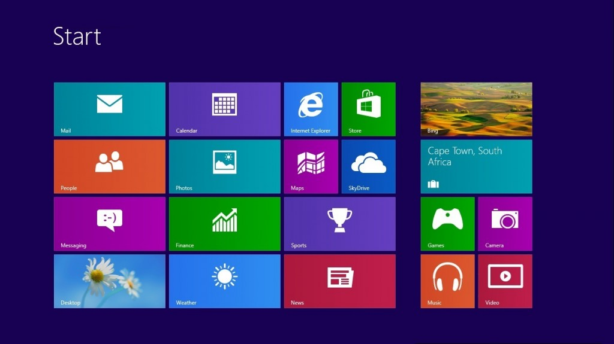
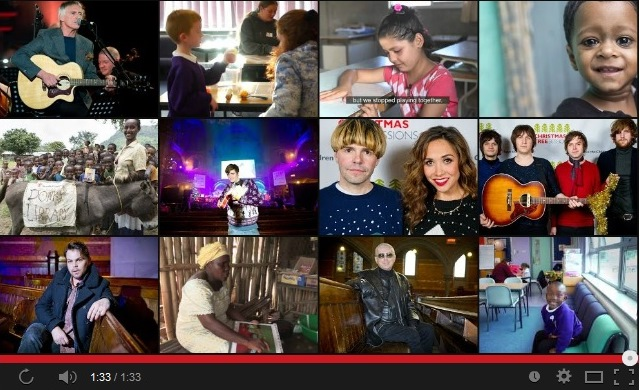
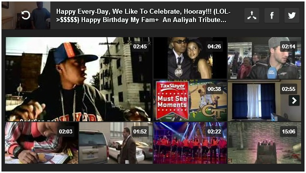
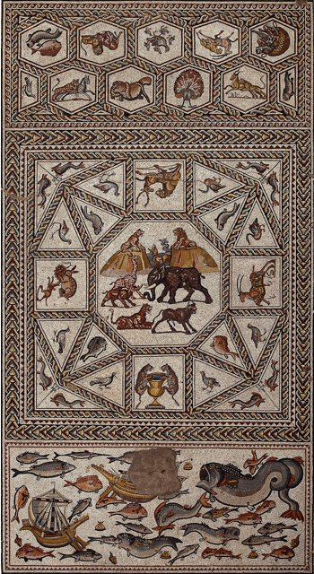
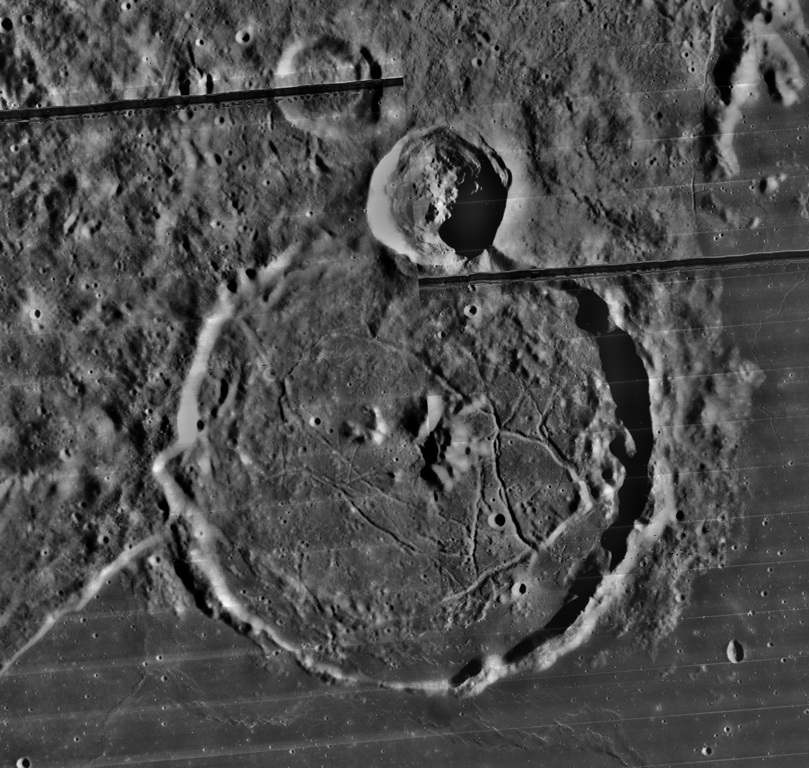
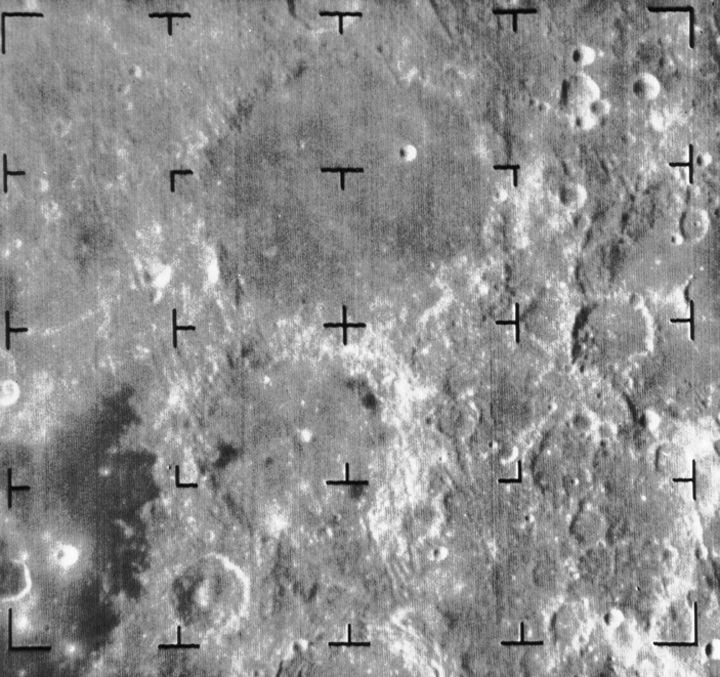
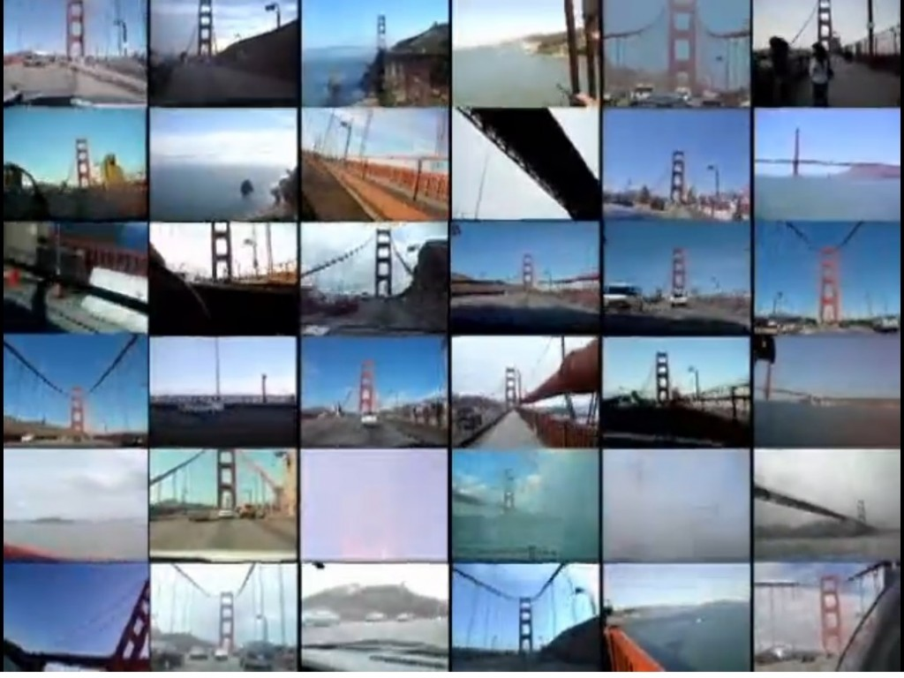

---

Navigation and mobility are defining characteristics of the contemporary media experience. Unlike the rigid, easily learned parameters of earlier media forms, global digital networks offer increasingly complex and constantly changing exchanges, formations, and compilations of information. Through a combination of hardware design and integrated software a range of devices including smartphones, tablets, and netbooks are as much navigational instruments as they are communicative tools (Verhoeff, 2012; Farman, 2011). These devices and their effects are meant to get us places, whether objectively through geo-positioning and locative technologies or subjectively through operations and platforms that retrieve, analyse, and display data in response to our commands and presumed goals. {#para1}

In theorizing interfaces, Alexander Galloway points to effects as their critical component. ‘Interfaces are not simply objects or boundary points. They are autonomous zones of activity. Interfaces are not things, but rather processes that effect a result of whatever kind’, he states (2012: vii). In their emphasis on navigation and virtual displacement, networked interfaces are increasingly scrapping holistic designs that imply stability and containment for displays that connote exploration and movement. The webpage and desktop have been replaced by the instrument panel. The dashboard design of Microsoft’s Windows 8 operating system, for example, can be considered a far-reaching response to, and perpetuation of, this trend (Fig. 1). {#para2}

 {#para3}

Introduced in 2012 in part to address the rise of touchscreen smartphones and tablets, Windows 8 replaces the desktop, its folders, and icons with a tight formation of squares and rectangles more closely resembling an instrument panel of buttons and gauges. Microsoft’s decision to reduce the role of this design in Windows 10 likely derives from the operating system’s continued appeal for keyboard-controlled desktop PCs and laptops, rather than any retreat from navigational tropes within networked digital culture. The parallel success of Chromebooks, which rely on Google’s Chrome browser and a network connection for nearly all their functionality, demonstrates the broadened appeal of network navigability as the primary value of any computing device. {#para4}

These navigational aspects of internet design are a departure from earlier efforts to map and represent distributed networks and content relationships. Through the visual rhetoric of navigation, they may mask actual network and data relationships. The Web Stalker, for example, is a web browser produced in 1997 by the artist collective I/O/D to transform any webpage’s hyperlinks into a map of lines, points, and nodes. ‘It confounds the faux-melodrama of the click-thru by automatically making the link for you’, explains co-designer Simon Pope. ‘Suspense is ridiculed and fluidity is returned to a realm where processes of delay and damming are recognized advertising opportunities’ (Lovink, 1998). In other words, the Web Stalker thwarts the poetics of temporal disclosure through navigation by replacing it with an image of structural clarity. It provides the overview in place of the partial view. Such link-node representations of networks continue to contribute to the aesthetic of cartography and spatial charting in other types of applications, even as they are adjusted to create greater play between part and whole. Prezi’s interactive presentation software, for example, has successfully combined such visualizations with zooming and parallax 3D to suggest multi-directionality of navigation and greater complexity of discourse. Cloud graphics similarly spatialize content while dissolving links. {#para5}

Within the trend toward navigational interface aesthetics, websites and applications that limit navigation primarily to their own, often exclusive, content while nevertheless suggesting unlimited material and endless navigability represent a common, but particular case. In early website design the site map was a frequent and useful companion of interface architecture. It visualized in static form the groupings, hierarchies, and other relationships characterizing the content housed on a site. The site map proved most valuable when interface navigability broke down, a relatively common occurrence in early web design. Like topographical maps, it indicated the most direct route to any destination. As interfaces have become more sophisticated and dynamic, however, site maps have been buried or discarded (for users, if not for webcrawlers) to encourage other modes of pathfinding. The navigational interface aesthetics of websites and apps seek to suggest unlimited wandering, free of the boundaries and fixed relationships imposed by the site map. They often imply an infinite variety that encourages or requires exploration, even as they present content conforming to a particular pattern. This exploits what Anna Munster calls the ‘anesthesia’ of networks, described as ‘a numbing of our perception that turns us away from their unevenness and from the varying qualities of their relationality’ (2013: 3). {#para6}

Interface design, in tandem with sheer quantity of content, contributes significantly to this goal. YouTube’s interface reconfiguration after its Cosmic Panda experiment (a beta version was available to users from July to December 2011) represents a seminal example in this regard. This controversial alteration to one of the internet’s best-known and most-visited websites recast video viewing—the linear experience of watching a chain of clips—into an exploratory, seemingly multi-directional navigational enterprise by steering the interface away from the textual connotations of the list toward the topographical connotations of the grid. This article analyses YouTube’s interface as designed for web browsers and its wider ideological implications for experiencing networks and moving images. It considers the cartographic qualities of the interface through the categories of surface, fragment, mosaic, and grid, as well as alternative presentations and interfaces that involve similar material but suggest radically different navigational experiences. {#para7}

### Surfaces

Internet video-hosting sites—of which YouTube is the global leader—do not simply amass, store, and exhibit moving-image files. They also function as complex apparatuses that assess and rank this material along presumed patterns of relevance and meaning, arranging the results into visual structures that maintain user engagement with the interface, therefore maximizing revenue generation. Since YouTube’s launch in 2005, advances in file compression, bandwidth, and processor speeds have allowed the uploading and streaming of feature-length films and videos. However, short videos and excerpts from longer works commonly known as ‘clips’ still represent the bulk of YouTube’s billion-plus catalogue and remain a significant draw. {#para8}

By situating clips of any number of lengths, genres, and topics within algorithmically determined constellations of supposedly related material, YouTube inscribes the moving image within constantly shifting gravitational forces of cross-reference and citation. Its distributed network represents a disaggregation of moving-image content that sets it apart from previous modes of media distribution (Uricchio, 2009: 36). Yet, like most sites that constantly recompose their content as a user interacts with it, YouTube does not resort to visual codes or metaphors that reflect the energy and instability of these shifts. Instead, its efforts to visualize this process for the user—specifically to present and re-present a logical and enticing sliver of its massive collection based upon the user’s queries, navigation, and selections—has led to a browser-based graphic interface built upon the visual codes of mapping and topographical exploration. While the YouTube app designed for small-screen devices maintains a list-based presentation to ensure legibility, as a result of the Cosmic Panda experiment the browser interface has adopted the restrictive, easily comprehensible, but also reassuring cartographical devices of the grid and mosaic by organizing its columns and bands of suggested video thumbnails into a tight arrangement of thumbnails within the player window (Fig. 2). {#para9}

 {#para10}

Visually presenting such material based on search inquiries, preferences, or user activity is commonly called ‘surfacing’ content. By employing long-established and deeply entrenched means of creating and organizing visual patterns such as the mosaic and grid, YouTube’s browser interface takes this metaphor a step further. Like many other platforms and interfaces, it renders the system’s multi-dimensional relationships as two-dimensional topographies. Within the specifics of the post-Cosmic Panda design, it situates the user as an explorer, capable of ranging over this variegated surface from above and zooming in on specific locations and life forms. Watching clip after clip, the surface of tiles changes after each viewing, filling the screen-frame with new ‘topographical’ combinations. By examining this interface through the aesthetic codes of the mosaic and grid as these have emerged historically across media and disciplines, one can theorize the implications of this interface as a means of organizing vision along familiar disciplining patterns that allow users to visualize a mass of data that reaches toward a limitless horizon. In this way, the YouTube interface moves away from the metaphor of the linear filmstrip to a longitudinal and latitudinal geographical metaphor. {#para11}

Matthew Fuller explains that ‘With every interface metaphor, there is a point at which its explanatory or structure-providing advantages collapse in the face of the capacity for mutation in the universal machine, the computer, and what it connects to.’ However, he adds, ‘there are conditions in which it is precisely this artificiality, and in their use as exploratory imaginal devices, that they have their uses’ (2003: 102). Cartographic metaphors set YouTube’s interface in line with the globalizing, totalizing branding of its parent company, Google, as the prime exploratory vehicle for physical, virtual, and artificial environments. By transforming the black void of the viewing window into a bird’s-eye portal view over thumbnails organized into a quilted topography, YouTube echoes the stabilizing and seemingly all-encompassing overview of applications such as Google Earth (which, in true Google fashion of increasing inclusiveness, includes not only the Earth, but the Moon, and Mars). {1} It is not an idea of *terra incognita* that is conveyed in visual representations of these platforms and programs, but rather an organized, interactive ground that can be likened to digital cartographic practices called ‘visualization’ or ‘graphic visualization’ (Crampton, 1998: 3). In her analysis of Google Earth, Munster argues that this program is not an image of the world but rather describes an enclosed territory organized on the structures of database search (2013: 11). The aesthetics and functions of the YouTube interface follow the same principle. Where Google Earth enhances virtual exploration of space through 3D visualization based on composite images, however, YouTube offers a similarly enticing landscape that includes temporality as its fundamental property. Its window of tiles presents the exploratory overview that the Panda presumably has when looking out the portal of her orbiting capsule. {2} This ties the video sharing site not only into Google’s terrestrial and extra-terrestrial visual rhetoric, but also a belief in networked culture as inherently globalizing and therefore planetary in nature. As James Hay claims, media’s historical links to air space and outer space through broadcasting and satellite transmission produced ‘a framework for imagining, requiring, and inventing something called “cyberspace”’ (2012: 19). {#para12}

This screen-frame presentation of YouTube’s interface also opens up new understandings of the mobilized gaze of moving-image media. Theorists such as Anne Friedberg (1993) and Giuliana Bruno (2002) have demonstrated the close relationship between film’s ontological mobility—through pro-filmic actions, camera movement, and the spatial ellipses of montage—and the mobility of vision in modernity. Recent scholarship has also tied moving-image spectatorship to ideologies of tourism (Corbin). YouTube’s interface achieves a sense of mobility, despite still images and the strong possibility of a stationary user before the screen. Mobility is suggested through the interface’s cartographic connotations. The screen’s arrangement of tiles presents a space of exploration, through which the user can roam by selecting a quadrant that leads to a world in motion. {#para13}

### Fragments

Describing a moving-image document as a ‘clip’ implies that it remains a fragment of a larger body. Excerpted from a pre-existing work, it may nevertheless function on its own terms, accreting additional meanings and uses for viewers familiar with the source material. Non-derivative moving-image documents called clips similarly tend to be so brief that their significance is partly or entirely bound to other clips, since, when viewing short clips, users tend to build upon them by viewing others, even if they had no such intention when accessing the site. {#para14}

From the moment a video is uploaded, YouTube transforms this document into a circulating body that promises greater meaning precisely through its dynamic mapping in relation to other bodies within its expanding universe. The clip’s coordinates are determined along adaptable criteria, including source account data, tags (and other textual markers), viewing histories, view counts, and viewing time. This process is complex and remains resistant to easy or accurate visualization. Despite more than a billion videos circulating through its works in changing patterns as clips are added, accessed, and removed, YouTube’s interface attempts a highly ordered, misleadingly stable view of its material. {3} For example, the multi-linear, multi-faceted, multi-layered potential of association that remains central to experiencing the site nevertheless adheres to the linearity of mainstream film and television. One clip follows the next within a single, designated frame. While this linearity has long been encouraged and activated through search result lists and play lists, the thumbnail grid weakens the lists’ bold hierarchy and makes visible the multiple possibilities of building meaning across clips. This contrasts with the browser-based interfaces of other video sharing websites. At the conclusion of a clip on Vimeo, for example, the interface displays a horizontal band of thumbnails of related videos across the top of the page, above the embedded screen-frame. Presented on a black background, this band recalls a filmstrip and establishes the viewing process as a linear activity. The screen-frame underneath displays nothing more than the last image of the previously watched video, which at times is nothing more than a black frame. The image—and thus the process—appear confined and arrested. {#para15}

An initial site search on YouTube via a web browser will produce only a vertical list of results. However, after the user watches a clip—at the moment the video terminates—the entire screen window transforms into a mosaic of smaller images, arranged in a tight, grid-like formation. With the original clip’s unified field ceding to these tiles, a glimpse of the underlying network seems to rise to the surface. This pattern of nine or twelve images is nothing more than a reorganizing of the column of thumbnails that regularly runs down the right side of the page and is no more than a snapshot of the seething matrix that stretches out beyond the frame in theoretically billions of tiles, each potentially repeating in any number of other configurations of tiles within this screen frame. This display may illustrate the processes working behind the surface more evocatively than the adjacent column—even if, when read from top to bottom and left to right, it strictly adheres to the list’s vertical order. Arranged in this pattern, multiple relationships are suggested across the frame, encouraging alternative sequences of viewing. You may click on one tile, for example, watch that, reach a new mosaic of possibilities based on that choice, choose another clip, watch that, then reach yet another mosaic of possibilities. At each turn, a new composite view of this presumably never-ending topography of videos presents itself. That the thumbnails fill the entirety of the frame is critical to this effect. Dailymotion’s interface, for example, offers a similar pattern of thumbnails within the screen-frame after each clip, yet these are surrounded by a grey border and include time indicators as well as a header with the thumbnail and title of the previously watched clip (Fig. 3). These properties diminish any sense of the frame as a window onto another space and more closely resemble the dashboard look of the Windows 8 start page. The inclusion of the previously watched clip and its title, by tying the underlying images to what has already occurred, suggests immobility rather than accessing new terrain. The time indicators reinforce temporal differentiation among Dailymotion’s images, further disrupting any sense of superficial cohesion across the frames. {#para16}

 {#para17}

In his work on mash-up culture, Eduardo Navas identifies two categories of mash-ups: regressive and reflexive. The regressive mash-up promotes multiple items by sampling them in new combinations (as with a musical remix stringing together several pop songs), while the reflexive mash-up ‘uses samples from two or more elements to access specific information more efficiently, thereby taking them beyond their initial possibilities’ (2007). Navas’ examples include internet interfaces such as newsfeeds and maps that embed local information. Reflexive mash-ups are not only ‘regenerative’ mash-ups, making new sense of the material at hand, according to Navas, but also the defining basis of contemporary digital culture. YouTube’s display of thumbnails within the screen-frame could be said to encompass both forms. It is regressive in its overt promotion of new material—additional clips to view—placed in close spatial proximity to each other via the thumbnail and close temporal proximity to the clip previously viewed. However, it is also manifestly reflexive in its unification of these materials from their dispersed placement within the network as a response to the foregoing choices (as indicative of potential needs or desires) of the user. {#para18}

In truth, the reflexivity of the YouTube interface is commonplace in the contemporary networked digital experience and hardly merits attention. Nor is its regressive aspect—presenting multiple choices together—particularly unusual. The exceptionality of its presentation stems from the way these two come together within a visual format that suggests the embedded screen-frame is unlike the material screen of the digital experience. While the screen of the PC, tablet, or phone often contains text, image, and symbol in configurations akin to a navigational control panel, YouTube’s embedded screen acts as a window that offers nothing but an endless field of images, laid out like a surface potentially extending beyond the frame to infinity. It is the screen-within-a-screen aesthetic that eliminates this topographical interface as a viable format for the YouTube app. Principally designed for smartphones and tablets, the app must accommodate visual and tactile interaction within a greatly reduced frame. Tiny tiles in a tiny window within the already minimal dimensions of a handheld screen would frustrate, rather than entice, users as they navigate the site. {#para19}

In its suggestion of infinite terrain beyond the frame, the YouTube browser interface differentiates itself from other instances where algorithms and interface design retrieve and display a field of images, such as infinite scroll. As its name suggests, infinite scroll produces a vertical field of images that loads more images as the user scrolls down, to create something that resembles a lengthening patchwork quilt, until the user eventually reaches a button to load more images. This has become a common interface component of photosharing sites such as Instagram and Flickr. With infinite scroll, even if the screen becomes a field of abutting images similar to that found in YouTube’s embedded frame, the user experiences the process of generating the mash-up as she scrolls down for more images. In the example of YouTube, all trace of the clip disappears to suggest a full field of images underneath, like the view of a patchwork of farmland seen from an airplane once the clouds disperse. {#para20}

Why not present users links to additional YouTube clips through such a cascade of thumbnails? Why, instead of an infinite scroll, offer them a tiny sampling, seemingly trapped within the viewer window? In opting for this configuration of images within a single frame, YouTube aligns the screen-frame of its interface not only with the contemporary forms of visuality described by Navas, but also other means of information organization that have extensive roots in the history of visual culture, from ancient art to television. When relationships are perceived across the thumbnails, for example, the interface enters into the logic of the mosaic, a form of visual expression dating back to about 500 BC. When the format is interpreted as a series of independent frames, however, the logic of the grid takes hold. {4} The grid, of course, is the organizing trope of linear perspective as developed in Italian painting in the first-half of the fifteenth century. And the history of mapmaking, conveniently enough in the current context, has resorted to both of these paradigms—mosaic and grid—as fundamental cartographic strategies. {#para21}

### Mosaics

The term ‘mosaic’ has several meanings. Among them: an arrangement of small pieces of a common material producing an overall design or image, a composite of aerial photographs depicting a topography, and a virus that causes discoloration in plants. Design, topography, and virus. To a degree, the screen-frame mosaic of YouTube’s interface encompasses all three. It designs for the user an image built from small units that suggests an overview of a small portion of the vast topography of more than a billion units that comprise the system. The very potential of any unit to proliferate across that topography by going viral, however, is ever-present. There will always be certain units, whether through popularity, corporate marketing strategies, or a combination of both, that play across the vast topography with precipitously rising and falling rates of occurrence. {#para22}

YouTube’s mosaic of tiles has an immediate corollary in the pixel field that is fundamental to digital image production itself. The ‘picture element’—usually shortened to ‘pixel’—is the smallest unit of the digital image. Emerging at the end of a clip to colonize the space of the video, the nine- or twelve-image mosaic of related videos finds its visual counterpart in the nine-to-twelve-pixel fragment extracted from a field of millions, since in such a blow-up any pixel’s colour values are always closely related to immediately surrounding pixels in comparison to those in the wider field. While we might think of the 5,000-year history of mosaics as akin to the organization of pixels to create single-image fields of unified scenes, in reality ancient mosaics encompass a variety of visual structures, including repeating the medium’s fragmentary basis at an iconographic level. A third-century Roman floor mosaic excavated in Lod, Israel, is such an example (Fig. 4). The fauna theme occupying the floor’s central octagon carries over into the divided zones of associated animals that surround it. Some of these peripheral creatures appear in the centre, while others do not. As a whole, the Lod mosaic provides a visual classification system of related material and, much like YouTube’s mosaic, part of the pleasure of the system is discerning relationships across zones, perhaps in differing sequences. {#para23}

 {#para24}

The mosaic of aerial photography is a means of visually reducing vast land masses to a series of images taken from an established distance as the camera moves over the area. These images are then arranged, edge-to-edge or in slight overlap, to recreate a unified field. In terms of aerially produced images today, the largest mosaic most people commonly encounter may be the satellite imagery option of Google Maps. In terms of historical examples of mass-circulated photographic mosaics, however, one may turn to the images of the Moon and neighbouring planets as shot by satellites and exploratory probes. Indeed, a visual aesthetic of extra-terrestrial exploration is the topographical composite (Fig. 5). {#para25}

 {#para26}

Unlike film- and paper-based mosaics, digital processing now transforms these segmented fields into seamless composites through a technique known as ‘image-stitching’. An example would be those images of Earth—often reproduced as posters or desktop wallpaper—that are generated from the careful arrangement of thousands of satellite images capturing small segments of the planetary surface with little or no cloud cover. In reality, the Earth is never entirely free of cloud cover (thankfully). YouTube’s screen-frame mosaic recalls pre-digital or pre-stitched mosaics, where edges are discernible, creating a visualization that moves back and forth between individual unit and overall pattern. The value of each image can be enhanced by its relationship to those that surround it, producing a collective meaning greater than the individual parts. {#para27}

### Grids

An additional visual code found in much extra-terrestrial image-making, particularly in the early years of space exploration, is the reseau grid of fiducial markers. This system of markings built into the image-making device segments the visual field into zones of equal size and shape (Fig. 6). These markings, used in conjunction with the exact geographical coordinates of the camera at the time of shooting, allow for multiple calculations, such as distance and altitude of objects and topographical features within the image. In this way, space photography is the direct descendant of the system of linear perspective originating in Renaissance painting. {#para28}

 {#para29}

E.H. Gombrich, in an essay on the iconographic relationships between images and maps, recognizes the relationship between aerial imagery and perspective that has been identified here. ‘Aerial pictures of cities, not to speak of the exhilarating photographs of our globe from space, turn out to look very much like the maps that were compiled in a long process of measurement and refinement over the centuries’, Gombrich notes. The mathematically accurate distances and scales of these maps rested not on aerial imagery, however, but optics and mathematics. ‘[K]nowing the curvature of the globe and the distance of the station point, the exact outlines of any continent from that point could have been predicted long before spacecraft or satellites enabled us to put the theory to the test. The theory to which I refer is of course that of perspective’, Gombrich declares, noting that from the Renaissance to his own epoch the theory of perspective ‘was treated as if it were a mapping procedure’ (1982: 188–189). {#para30}

The simple use or presence of a grid, of course, does not endow an image with the illusion of three dimensions, and the grid of YouTube’s interface in no way builds such dimensionality across the screen. Instead, it adopts the rhetoric of the grid as a stable, and meaningful, means of visualizing. Unlike the mosaic, with its varying patterns and presumed relationships across fragments, the grid offers a much more rigid, unyielding structure with regular patterns of horizontal and vertical lines intersecting at right angles. {5} The grid is a recurrent, underlying structure not only of scientific visualization, as regularly witnessed with x-y graphs, and figurative imagery, but also within analytical strains of modern art. It is here, perhaps, that the framed grid of the YouTube interface gains its traction. {#para31}

The grid emerges in twentieth-century avant-garde art as a means of mapping the image’s flat surface onto its material support. According to Rosalind Krauss, ‘Perspective was a demonstration of the way reality and its representation could be mapped onto one another’. She adds, ‘Unlike perspective, the [modernist] grid does not map the space of a room or a landscape or a group of figures onto the surface of the painting…The physical qualities of the surface, we could say, are mapped onto the aesthetic dimensions of the same surface’ (1970: 52). The grid of thumbnails that fill the YouTube screen-frame may be mapped onto this logic. It emphasizes the flatness of the surface and the dimensions of its frame. Perspective emerges within each thumbnail, perhaps, in the photographic representation of a three-dimensional space, but this dimensionality withers across the field of multiple thumbnails. Arranged edge-to-edge, that is, it is hard for the user to view them as individual glimpses into discrete spaces. The unforgiving superficial ordering of the grid returns them to a surface relationship among themselves that sustains their reading as topography flattened by an aerial viewpoint typically found in cartography. {#para32}

Krauss claims that the grid’s entrenched inflexibility—that which makes it so reliable for analysis and measurement—is rooted in two equally present, but opposing, possibilities of conceiving the structure: centripetally or centrifugally. The grid may be centripetal by turning inward in reiterating and repeating the conditions of its encompassing frame or it may appear as centrifugally moving outward if in-frame material is perceived as merely a fragment in a greater field expanding infinitely beyond the frame’s edge. As a centrifugal operation, the grid is ‘compelling our acknowledgement of a world beyond the frame’, according to Krauss (1970: 60). YouTube’s grid-like display functions in both ways. It is centripetal in its fragmenting of any clip into a grid of images that, to a greater or lesser extent, repeat the themes or meanings of that initial clip ‘mapping the space inside the frame onto itself’ (1970: 61). Rather than a window, it is then like a typesetter’s frame, strictly determining the composition of elements within. Yet it is also centrifugal in evoking a temporal and spatial fragment of a never-ending, always changing patchwork of clips radiating out in all directions. In that case it is a window that opens onto the topography, much like the mosaic in composite aerial photography depicts a fragment of a larger surface. {#para33}

### Alternatives

Munster has argued that, despite Google’s aura of completeness, ‘there are a number of ways in, out, and through Google’s world making—of approaching an outside to the self-enclosed image horizon that bounds the Google universe’ (2013: 63–64). As much can be said of its video hosting subsidiary. Whether list, mosaic, or grid, among the elements missing from YouTube’s visualization of its processes of finding meaning and relevance are depth and time. Its images are fixed, and associations can only slide across the surface, without penetrating underneath. Experiments in moving-image mash-ups, often hosted by YouTube itself, can provide alternative descriptions of this system. By subverting ideas of fixity and stable boundaries, they often make citation and syntax the entirety of the visual document’s significance. {#para34}

Two mash-ups—one an art installation, the other an on-line piece—can serve as salient examples here, since they draw in different ways on the mosaic and the grid to suggest an entropic feedback loop. Christopher Baker’s *Hello World! or: How I Learned to Stop Listening and Love the Noise* (www.christopherbaker.net/projects/helloworld) and Wreck and Salvage’s *Golden Gates* (www.blip.tv/wreckandsalvage/golden-gates–283566) date from 2008, preceding YouTube’s grid display by three years. *Hello World!* organizes 5,000 video-diary clips found on-line into a wall-sized grid of talking heads. Baker explains that he wants viewers to experience ‘a fraction’ of YouTube’s ‘incomprehensible numbers’. ‘It’s important to avoid becoming completely spellbound’, he says, adding ‘I think contextualizing digital data in architectural settings helps us do that’ (Cusack, 2012). YouTube’s and *Hello World’s* mosaics attempt the same act of inserting the clip as image into an architecture. The first is an architecture of the window, while the second is of the wall. Baker’s work presents a larger frame of the topography on a scale that can be engrossing or alienating, particularly as the images move under a cacophony of blogger (video blogger) voices. {#para35}

Wreck and Salvage’s silent *Golden Gates*, on the other hand, functions within the website frame, offering a grid of tiles strikingly similar to the YouTube interface (Fig. 7). As a mash-up, it sets in motion thirty-six appropriated point-of-view videos shot by people walking, cycling, and driving across the Golden Gate Bridge. {#para36}

 {#para37}

The slightly varying perspectives and framing on the same object and space create a percolating surface of correspondence and difference. The user’s eyes shift from image to image as they move, allowing for multiple, multi-linear experiences of the content in a way that YouTube’s stagnant mosaic menu suggests, but won’t allow. {#para38}

The enlarged parameters of time, number, and scale in these mash-ups echo pre-web visualizations of broadcast, cable, and satellite television, where multi-screen grids would create an image of the simultaneous transmissions of competing channels. The opening and closing shots of *Network*, Sidney Lumet’s 1976 film about television news, are one example. Like such depictions, *Hello World!* and *Golden Gates* indicate how an increasingly large or dynamic view of the YouTube mosaic may paradoxically narrow or drain meaning. Remaining within the two-dimensional ordering patterns of the YouTube interface, the simple addition of motion, where tiles play out in time as clips rather than still images, allows viewers to discern new patterns that could lead to meanings beyond the linearity of the play list or clip-by-clip viewing. One can imagine what visualizing multi-directional relationships within the interface would add to this experience. Perhaps such relationships must remain hidden from the user’s view and consciousness, however, to extend the length of site visits. {#para39}

In 2009—that is, well before Cosmic Panda and the resulting interface aesthetics studied here—William Uricchio already had detected in YouTube its tendency ‘to rely upon traditional media distinctions as a navigational aid to its users and as a means of appealing to existing communities of interest, while in fact all but flattening the media distinctions in practice’ (29). With the thumbnail interface of post-Cosmic Panda YouTube, the flattening literally surfaces as a feature of the platform and the media experience it contains. By engaging the visual rhetoric of cartography, however obliquely, the screen-frame thumbnails of YouTube connote the flattening rationality and access of a map. Maps also connote exploration and mobility, and this visual strategy of the YouTube interface, however simple and limited, encourages the user to construe her visit in terms of an open-ended, exploratory mission. In the movement from clip to clip, the gridded, mosaic view of the frame becomes a navigational system, representing the layout of new terrain the user can enter with each click or tap, continually returning to the mosaic-map after each foray. {#para40}

### Biographical note

Stephen Monteiro is Assistant Professor of Global Communications at The American University of Paris, where he directs the graduate track in Visual and Material Culture Studies. His writings on media and culture have appeared in *Screen*, *Grey Room, Quarterly Review of Film & Video, Photography & Culture*, and *Continuum*, among other journals. His book, *Screen Presence*, is forthcoming from Edinburgh University Press.

### Acknowledgements

The author would like to thank FibreCulture’s anonymous reviewers for their insightful and helpful comments. Portions of this essay were presented by the author at the 2013 Society of Cinema and Media Studies conference, as part of a YouTube panel convened by Sudeep Sharma.

### Notes

- {1}. In this vein, it should come as no surprise that YouTube’s first feature film, edited from its collection of user-uploaded clips, was *Life in a Day* (Kevin Macdonald, 2011), which sought to represent the sum of human activity around the globe on a single day. The film feeds the perception of YouTube as a totalizing visual apparatus, yet presents it as a tool that organizes this totality in ways that are comprehensible and significant to its user-explorers.

- {2}. ‘We thought that the idea of a panda in space was hilarious and awesome’, claims Brian Glick, one of the YouTube product managers involved in the redesign. See ‘What Inspired the Name of Cosmic Panda?’, https://www.quora.com/What-inspired-the-name-of-Cosmic-Panda#.

- {3}. YouTube claims that, on average, 100 hours of video are uploaded to the website every minute, which figures to over 50 million hours of video a year. If the average video is fifteen minutes long, this would produce over 210 million uploads a year. See https://www.youtube.com/yt/press/statistics.html.

- {4}. The 12-thumbnail display adheres strictly to the logic of the grid, while the 9-thumbnail display only closely resembles it, since the thumbnail in the upper left appears slightly larger than the others in this format.

- {5}. The grid has always presented problems for video, from the precariousness of vertical-hold in television through the 1970s, to the walls of monitors that either offer up a dizzying array of images or violent grillwork across the image. Beyond these examples, however, Hannah Higgins (2009) has demonstrated the persistence of the grid as an organizing trope throughout history, from ancient building techniques to contemporary computer programming.

### References

- Bruno, Giuliana. *Atlas of* *Emotion: Journeys in Art, Architecture, and Film* (New York: Verso, 2002).

- Corbin, Amy. ‘Traveling Through Cinema Space: the Film Spectator as Tourist’, *Continuum* 28:3 (May, 2014): 314–329.

- Crampton, Jeremy W. ‘The Convergence of Spatial Technologies’, *Cartographic Perspectives* 30 (1998): 3–5.

- Cusack, Jenny. ‘Christopher Baker’s Hello World!’, *Dazed* (2012), https://www.dazeddigital.com/artsandculture/article/12282/1/christopher-bakers-hello-world

- Farman, Jason. *The Mobile Interface of Everyday Life: Technology, Embodiment, and Culture* (New York: Routledge, 2011).

- Friedberg, Anne. *Window Shopping: Cinema and the Postmodern* (Berkeley: University of California Press, 1993).

- Fuller, Matthew. *Beyond the Blip: Essays on the Culture of Software* (Brooklyn: Autonomedia, 2003).

- Galloway, Alexander R. *The Interface Effect* (Cambridge: Polity Press, 2012).

- Glick, Brian. ‘What Inspired the Name of Cosmic Panda?’, posting to Quora, 20 October (2011), https://www.quora.com/What-inspired-the-name-of-Cosmic-Panda#

- Gombrich, E.H. *The Image and the Eye: Further Studies in the Psychology of Pictorial Representation* (Oxford: Phaidon, 1982).

- Hay, James. ‘The Invention of Air Space, Outer Space, and Cyberspace’, in Lisa Parks and James Schwoch (eds.) *Down to Earth: Satellite Technologies, Industries, and Cultures* (New Brunswick: Rutgers University Press, 2012), 19–41.

- Higgins, Hannah B. *The Grid Book* (Cambridge, Mass.: MIT Press, 2009).

- Krauss, Rosalind. ‘Grids’, *October* 9 (Summer, 1979): 50–64.

- Lovink, Geert. ‘Nettime Interview’, 17 April (1998), https://bak.spc.org/iod/nettime.html

- Munster, Anna. *An Aesthesia of Networks: Conjunctive Experience in Art and Technology* (Cambridge, Mass.: MIT Press, 2013).

- Navas, Eduardo. ‘Regressive and Reflexive Mashups in Sampling Culture’, *Vague Terrain* 7 (June, 2007), https://vagueterrain.net/journal07/eduardo-navas/01

- Uricchio, William. ‘The Future of a Medium Once Known as Television’, in Pelle Snickars and Patrick Vondreau (eds.) *The YouTube Reader* (Stockholm: National Library of Sweden, 2009), 24–39.

- Verhoeff, Nanna. *Mobile Screens: The Visual Regime of Navigation* (Amsterdam: Amsterdam University Press, 2012).
