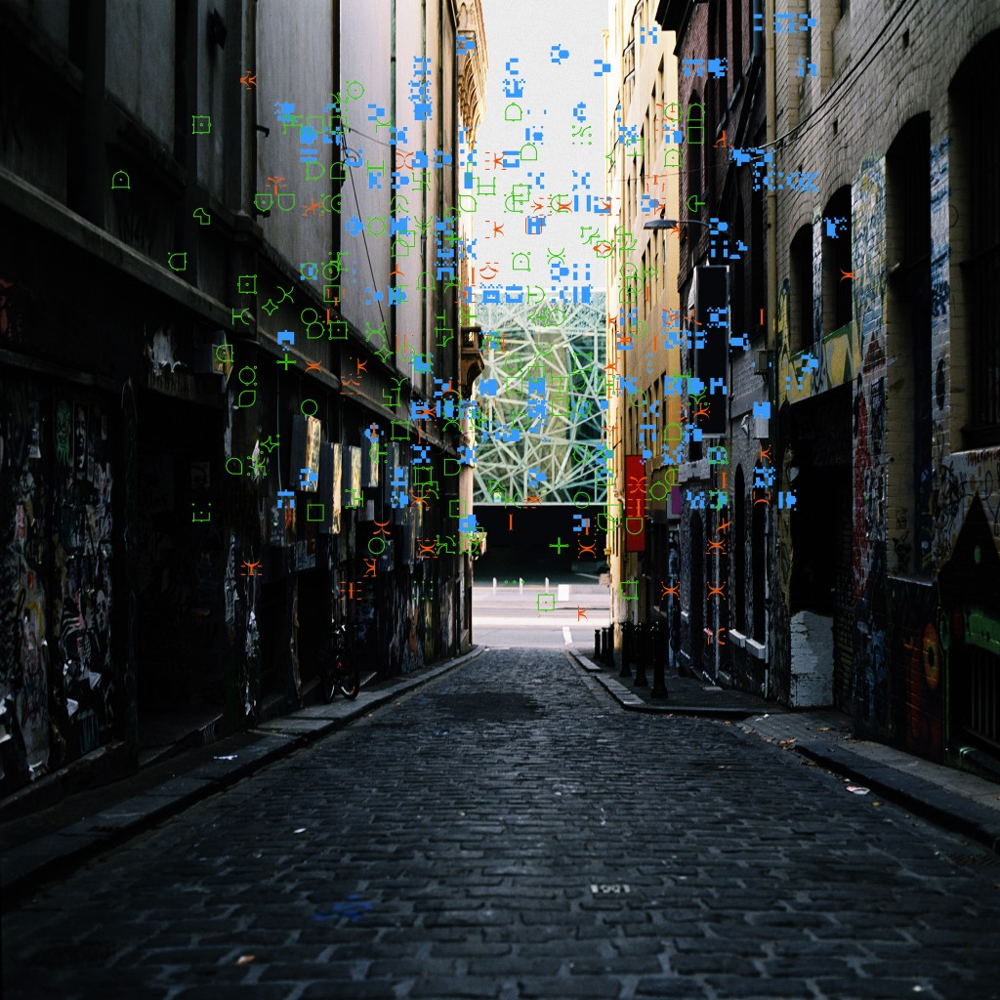
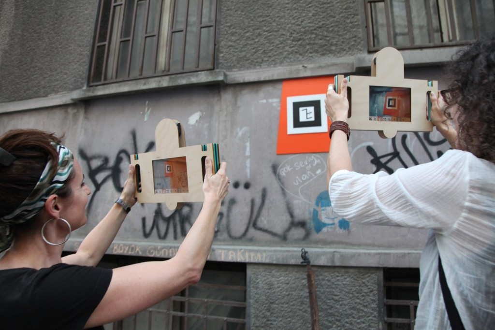
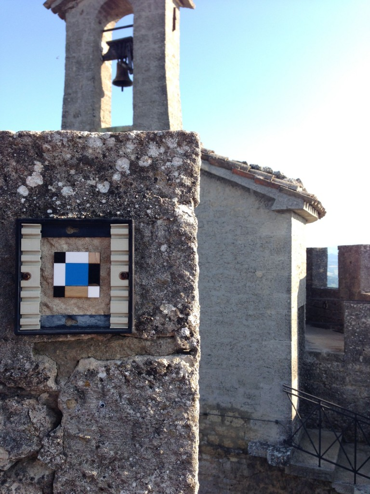
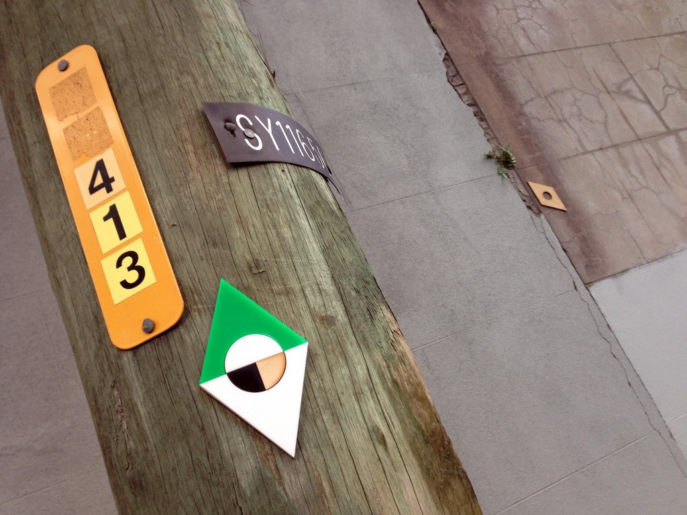
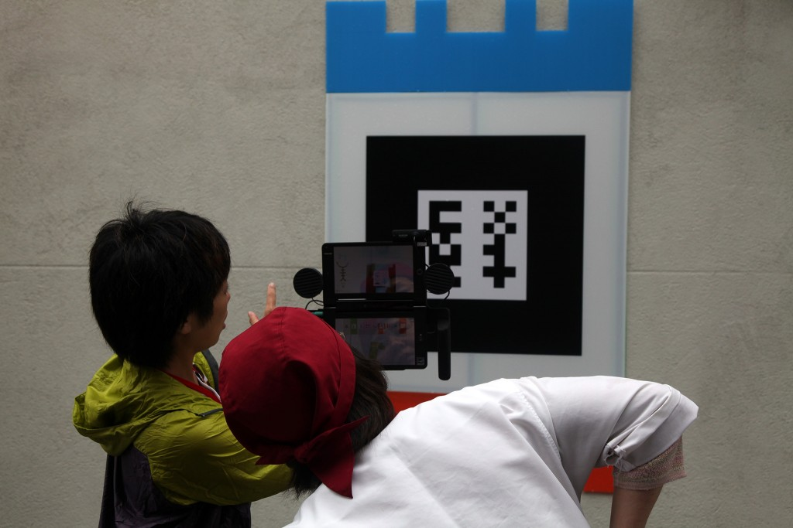

---

> culture arises in the form of play, that it is played from the very beginning. Even in those activities which aim at the immediate satisfaction of vital needs , €“hunting, for instance, €“tend, in archaic society, to take on the play-form. Social life is endued with supra-biological forms, the shape of play, which enhance its value. It is through this play that society expresses its interpretation of life and the world (Huizinga, 1949 : 46). {#para1}

### Introduction

The Anthropocene marks ‘a new phase in the history of both humankind and of the Earth, where natural forces and human forces become intertwined.’ (Zalasiewicz 2010: 2231). It is the current time in which human processes such as culture and language, the use of tools and technology, are acknowledged as part of the earth’s ecology, €“and as integral to the operations and behaviours of the earth’s ecology largely through material forces. {#para2}

We are living in the first geological time period during which human activity plays a significant role in shaping and changing the environment, €“transformations that are usually attributed to geological events. The Anthropocene, is an epoch that some argue begun with the European Industrial Revolution and thereby bought an end to the Holocene. The idea of the Anthropocene has gained currency over the past decade with scientists, geologists and others, as there is increasingly clear evidence of the impact of overpopulation, pollution, and human development on the environment. This impact is largely expressed through climate change and species extinction.

The existential risk of human extinction via runaway climate change or ecological disaster is implied in the definition of the Anthropocene through its focus on human activity as the primary force shaping our current moment on the geological time scale. Chakrabarty draws attention to aspects such as the planet’s temperature zone that ‘work like boundary parameters of human existence’ (Chakrabarty 2009) that challenge one of the basic assumptions of history , €“ the continued existence of the human species. He argues, like many others, that the old divide between human history and natural history can no longer be seen to exist, and chooses to focus on species history. In this context, humans may be described as geological agents as through our collective activity we are changing the geological conditions of the world. The two main signs of this are global warming and the loss of biodiversity, although the complexity of environmental impact extends into many other domains. {#para3}

In this worldview, play has a primary function in culture through its role in modelling modes of human survival: simulation is good tool for understanding the impact of systems on the world; play enables the possibility to become adaptive and ‘hack’ the world as conditions change; and lastly, play suggests that a changed philosophical perspective may offer an evolutionary edge for survival in a changing world. This ‘system awareness’ gives players (humans) literacy, and as a result, agency as they see themselves not living in a human-centred world but rather a complex ecology, €“a complex system, €“in which they participate. {#para4}

This essay explores the rise of playful culture within the context of the Anthropocene. It argues that play enables increased awareness of complex adaptive systems such as the environment; and explores the potential for this worldview to inspire play cultures that modify human behaviour to regenerate the environment, particularly within public space in urban areas. {#para5}

The impact of global environmental change and the loss of biodiversity clearly indicates that increasing human population and development is unsustainable. Arguably, the origins of the Anthropocene lie in an anthropocentric worldview, €”a history of thought that sees human beings as central to the world, and the most important lifeform in the environment. Anthropocentrism has dominated the traditional view of the non-human world throughout modernity, and also manifests in games, €”in that they are about a (human) player and their experience. However, games also introduce a systemic approach that engages the player in a wider set of connections and relationships with many non-human entities. In this way play can potentially offer perspectives that challenge the dominant anthropocentric worldview. {#para6}

The rise of the Anthropocene coincides with a rise in interest in play within the developed world. Huizinga argues that play is at the foundation of culture, €”before language, €”in that humans (and other animals) play games to learn skills, establish social systems, and understand their world. Taken literally, play becomes everything. This is an interesting lens through which to view culture and society but the more importantly, it recognises that play is a process for deconstructing and exploring systems. Much of the world (rocks, organisms, water, plants) existed before people; the emergence of play within the Anthropocene brings humans, €”and their systems, €”back into play with the wider world. This different worldview has two effects for humans: firstly, an increased literacy in systems and processes; and secondly, the potential for play as a process for understanding and, potentially, impacting on the flow of ecological systems via feedback or reprogramming. {#para7}

This perspective sees the entire world as a playground, not just the spaces we typically associate with games. There is a history of play that has occurred in cities over the past century, but it is in this century with the emergence of ubiquitous media public expressions of play have become more widespread within urban environments. Increased interest in, €”and creation of, €”micronations plays with notions of sovereignty and related cultural forms; pervasive games take play to the streets; and the processes of cities are revealed through mixed realities made of people, infrastructure, rules, devices, surveillance, and media creatures, in combination with a myriad of other systems, objects and organisms. An understanding of how we are living in a mixed reality in which objects, systems, humans, and media coexist is central to this worldview. {#para8}

There are a number of ways in which the potential of play preceding, €”or creating, €“a culture engages with the Anthropocene. Working on this basis, this essay begins by articulating humans at play as a productive force, then contextualises this play in mixed realities, €”an enabling environment that allows for new relationships and processes; and, finally explores some of the experiences and structures produced by these connections as demonstrated through practical examples and conceptual projects that explore play in public space at a micro and macro level. {#para9}

Transgressive acts, while perhaps not intended within existing technological infrastructures, are possible, €“even enabled, €“by rules and systems. Play in public space is transgressive in itself, as most public spaces with the exception of actual playgrounds, are not designed for this activity. The emergence of flash mobs is one example of this, and the popularity of street games is another. As games are integral to our culture they can also change the world (McGonigal, 2011) by encouraging play with the world, as a form of dialogue, deconstruction, conversation, framework, context; essentially play is an approach to the new world we inhabit. Game designers see a game as ‘a problem solving activity, approached with a playful attitude’ (Schell, 2008), what if players use this approach in daily life? Play in public space, for example, changes the relationship between player and their world by decoding moral and social boundaries previously invisible to them, shifting their role from acceptance to a more empowered position through their knowledge of implicit rules and the potential to break, change or subvert them. {#para10}

These processes, environments, and experiences demonstrate the new potential for play in relation to our understanding of humans in the Anthropocene. They suggest that play is a transgressive act on par with a situationist intervention; and a potential means of survival, such as the productive process of playfighting in animals that prepares them for their world. Equally, it offers a worldview that reveals the complexity of the Anthropocene and the myriad of non-human entities that come into play when staging games in public space. This aspect of engagement with the non-human is a key difference between play in urban spaces now, and that which occurred during the last century. {#para11}

### Humans at play

Play precedes culture (Huizinga 1949) and games and play are instrumental in the formation of culture and society. Callois (1961) expands on the practices and processes of play defining it as either *ludus* (governed by rules and systems, €“the playground) or *paidea* (free and improvised). Rodriguez (2006) has connected Huizinga’s cultural theory with ‘serious game design’. Lévy articulates a model that may be used for understanding humans at play and that articulates the ways in which these systems process the world. He defines four modes of being: possible, virtual, real, and actual (Lévy 1998). This approach when applied to urban space can be seen as an overt actualisation of the many vectors of virtual potential at play in the city: combinations of people and happenings, sound and site, information and object, game token and location, data and habitat, device and place. The city itself is a media ecology in which our lives and selves are shaped by media; ‘we do not so much have media as we are media and of media’ (Parikkia, 2010: xvii). This systemic understanding of rules and non-human agency offers the possibility of another non-anthropocentric worldview that remains within the context of the Anthropocene. {#para12}

Hayles (1999) argues that those of us who depend on technology in our daily lives are already posthuman. By way of example, play can have a physiological effect: certain types of play can activate brain plasticity (Kühn et al, 2014) causing the brain to grow or repatch itself. Studies of learning and brain function in players present ideas such as ‘gamer intelligence’ (Wouters et al, 2013) and ‘process literacy’. The former is the theory that by exercising the brain by playing certain types of games the brain can be become more resilient and reactive; the latter is the ability to problem solve and reason by modelling the simulation of processes in the brain. Bogost (2008) calls these processes ‘unit operations’, a model that mixes structuralist approaches with computation, particularly the ways in which computers form patterns of information from smaller, interconnected and related units. This methodology, alongside Lévy’s model, provides ways to understand the processes at play in contemporary games and the ‘new citizens’ that play them by looking for unit operations within cities and other environments for pervasive games. {#para13}

Forrester modelled these processes in his early work on ‘urban dynamics’ (Forrester, 1969), which was subsequently used to model the processes that construct urban spaces in SimCity. There is a rich history of play in the city, with the situationists looking for ‘a new urbanism that would allow for play and experiments, and favour psychological games, which would be an improvement over the ‘labyrinth’’ (Hollevoet, 1992 : 31); and who also drew on Huizinga for inspiration. The situationist city (Debord, 1994) or a digitally augmented psychogeography allows for the exploration of mixed realities in terms of their poetic and expressive potential. These games are similar in spirit to the earlier ‘new games movement’ (New Games Movement, 1976) as the ‘situationist game stands out from the standard conception of the game by the radical negation of the ludic features of competition and of its separation from the stream of life’ (Debord, 2014 : 154), through tactics such as the dérive. The mixed realities of the urban gaming group Blast Theory eloquently demonstrate that the collapse of time and space (Blast Theory, 2001) may occur in cities. In the present day, media ecologies and mixed realities situated within the cities themselves have come to also reflect these processes. Knowing these processes makes the city playable as it opens up its systems and rules for game design. {#para14}

This is in contrast to a more formal urban context for play, €“the playground. The playground provides ‘a free society in miniature, with all the same tensions and ever-changing harmonies, the same diversity and spontaneity, the same unforced growth of co-operation and release of individual qualities and communal sense, which lie dormant in a society devoted to competition and acquisitiveness.’ (Allen, 2014 : 78) Sørenson’s posited his vision for the ‘playground’ (Sørenson, 2014 : p.88) as early as 1935 which was later recognised as the adventure playground, a public space set aside for play which was made from ‘real’ materials. Later, Nielsen’s ‘model for a qualitative society’ (Nielsen, 2014 : 148), shifted the location of the playground to the museum, shifting the meaning again by challenging the codes of public space. {#para15}

So, after Huizinga we have three different views of play in the city: Forrester’s ‘urban dynamics’, the city as process; Debord’s unplanned journeys; and the modern idea of the playground. Play in public space is shown to be important for decoding the city and, through play, the human becomes an agent in the process of becoming which subsequently changes our relationship to the city. Play in mixed realities builds on, yet is different to that of these precursors. Firstly, players in mixed reality games come with sophisticated process literacy; and, secondly, urban spaces have tangible codes and systems meaning that play in mixed realities involves non-human entities as much as human players. These important shifts in the knowledge and skills of the players themselves, and the nature of urban space opens up the possibility of play to have an impact on our understanding of the Anthropocene via mixed realities. {#para16}

### Play in the Anthropocene

Play offers a form of cultural adaptation for dealing with the effects of the Anthropocene: radical destabilisation, rising seas and increased temperatures. Play offers a new type of citizen, fluent in simulation and process and able to modify rules and systems that can change the environment in which they live. This is play as a survival strategy through mixed realities that make tangible non-human systems and the impact of humans on these. Play enables us to hack and recode these systems. In this way, play becomes a transgressive act that changes the rules and systems of the world by ‘reprogramming reality’. {#para17}

The primary mode of play in mixed realities is the ‘pervasive game’. Pervasive games create temporary anomalies in the public space of cities where the usual rules do not apply. Taking reality as their medium, there are various approaches, €“paranoia inducing alternate reality games; sport-like street games; location-based games, €“all of which engage with public space in different ways. Some use technology, such as augmented reality (AR), to mix layers of audio-visual content into the city that literally mix different realities into and onto one another. Alternate Reality Games (ARGs) use existing elements of the world and remix or recontextualise them into their narrative in a way in which the boundary of the game world is not fixed, anything may be part of the game and often is. Street games play with teams and goals, although rather that operating on a constructed, separate playing field (like a sport) they appropriate readymade tokens, boundaries and play elements from the world around them. These could be street signs, pedestrians, plants and other objects. {#para18}

The world becomes the site, the context, or the scene for play. In and of itself this is a transgressive act, €“both for the game and for the world. Games are usually played out in controlled spaces, where the designer can stage the action, as well as design and measure the play experience for the player. As a form of game design, it is highly experimental and fraught with many challenges. For the world, play in public space challenges the rules and conventions of that space, often breaking, deconstructing, and revealing these rules and systems. {#para19}

Some of these actions may be overt. Pervasive games, whether augmented with technology or using simple analog systems, impact on a site via the creation of spectacle. The participants adopt a different set of rules and as a result behave differently in public space. Often these rules are simple enough so that they may be decoded by spectators observing the behaviour of those at play; raising questions as to who is playing, why are they playing, what are they trying to achieve, and/or should we join them? The presence of these games extends outside of the actual moment to a virtualisation in the form of images and video captured on smart phones that then spreads the game logic and behaviour like a meme (perhaps with relevant hashtags). Of course, for all this to happen it has to be a good game and a story worth telling and therein lies the challenge, €“giving the action meaning so that it becomes adopted as another layer of code and part of the city itself. {#para20}

The small screen of mobile devices can also be considered in terms of the potentialisation of the city, €“what can happen with what is here now? This may occur within a constrained set of possibilities presented in a mixed reality game, rich in meaning via connection with other players, the scoring of points, achievement of objectives; or be more freeform, finding resources, meeting a friend, joining a flashmob. Arguably, the game mode makes the choices made and the actions taken realise a more meaningful actual outcome because they are framed within a context, €“the narrative or the proposed goals of the game. Optimising day-to-day life with immediate, situational data is useful but being engaged in a process that is transforming the city raises the stakes for the individual to another level. {#para21}

What of the machines? So far in this essay, I have adopted a human centred position in all of this; but human processes are not the only ones at work in this space. In mixed reality gaming agency is given to programs, objects, systems, sensors, machine vision, and tracking devices. This vast network of objects is busy constructing mixed realities. Objects and machines are equal contributors in this exchange, and are often partners in feedback loops. So how may we recognise their role in the game? Objects don’t have to be material to be real; this raises the question as to when an object arises and has meaning, for example, drones sense things differently, but in the same time and space as humans. Is their perspective less significant than that of a human who is also in the same game? In *Alien Phenomenology* Ian Bogost proposes that we spend time ‘meandering in an exotic world of utterly incomprehensible objects’, to explore and understand their ways of being; to speculate on the world from their reality; ‘to write the speculative fictions of their processes, of their unit operations’. (Bogost, 2012 : 34) Understanding and perceiving the world through this view is part of the toolset of players engaging with mixed realities that gives them insight into the systems and processes that make up cities. {#para22}

While it is beyond the scope of this paper to explore in depth the ontology of mixed realities, exploring the ways in which a consideration of mixed realities presents a non-anthropocentric view of the world is important in understanding the opportunities for players in the Anthropocene. The nature of this space and the opening up of its rules and systems via games and simulation is dependent on a particular cultural context for play. The concept of the Anthropocene while placing the human at the centre of the world, €“aggregate human activity is directly linked to global environmental change, €“also dwarves the human by acknowledging the scale and complexity of this impact. The human is one agent in a vast network of material relations, part of which are the mediated communications of humans and machines, including machine-machine relations. It is this second aspect that expands this worldview further into the domain of the non-human systems and processes that mixed realities are made of. {#para23}

Harman’s notion of the quadruple object (Harman 2011) introduces an ontology that describes a number of different processes of interaction between objects. In this model a micronation, a game, a person, and a city may be considered in relation to one another. Harman’s quadruple object broadens and flattens our perspective of mixed realities; and enables us to look at them in the space of an object-orientated ontology in which players, devices, codes, entities, asphalt, and chalk can all be considered alongside each other. Bogost examines the quadruple object in connection with unit operations to produce an alien phenomenology that enables speculation on how the world is experienced from the point-of-view of devices, codes, and entities; and ‘names the logics by which objects perceive and engage their worlds’ (Bogost, 2012 : 29). In this framework, all objects are included in the world and relations between objects are framed via the same rules whether they are animal, vegetable, mineral, or technological. Each object is defined as having four aspects: a real object and a sensual object, which have both real qualities and sensual qualities. The sensual object and its qualities come into play when the object interacts with another object, €“they are revealed and activated by the interaction. However the real object and its qualities remain hidden, underneath the surface, only revealed when certain conditions are met. For example, an AR marker will present different sensual qualities to a digital camera coupled with an image recognition process to those that it presents to a human reading the same marker on the street. This approach makes a lot of sense in the context of games and mixed realities as it is not human-centred, and therefore allows discussion of relations between the diverse range of objects found in a mixed reality on a level playing field. {#para24}

Further to exploring a non-anthropocentric worldview, Jussi Parikka’s insect media (Parikka, 2010) presents a media ecology that captures a larger overarching system. Again, presenting a different set of relations: swarms, hives, networks, and the emergent complexity of a multiplicity of small interactions in opposition to the hierarchical design of a constructed world, this approach acknowledges a ‘whole new world of sensations, perceptions, movements, stratagems, and patterns of organisation that work beyond the confines of the human world’ (Parikka, 2010 : ix). This is a macro perspective of the city as a hive of interactions and connections mediated by the micro object-object relations that give rise to mixed realities. This worldview, with Harman’s ontology, provide a framework for understanding the system awareness enabled by playful culture and games in the Anthropocene. {#para25}

The player in the Anthropocene is aware of their world being the result of complex adaptive systems and vast interconnected networks, the player has shifted away from being a localised, human-centred construct to being a node in a wider world. The mixed realities of cities provide a rich diversity of potential interactions for many different forms of play. Seeing the city as game opens up these possibilities for humans, and for them to use play as transgressive act to recode their environment. {#para26}

### Rise of the micronation

So, how are mixed realities expressed in the world and how can we articulate these expressions? In the context of the Anthropocene, we can look at the actions of players in relation to the world around them in terms of transgressive acts that challenge the rules of play. If humans as a species are geological agents then the ways that they interact with the planet may be analysed as unit operations or members of Harman’s ontology. They could be seen as survival strategies, ways to understand or cope with the changing environment, perhaps to generate new rules of play that counter the negative impact of human habitation in the world. This would bring the process around full circle in which play once again becomes culture, and on an optimistic note, a culture that brings balance to the actual ecology itself. A more negative view suggests play as a coping mechanism in a dying world, €“it is just for fun or perhaps a type of training, €“cognitive and physical, €“that enables players of the world a more optimal strategy in adapting to changes resulting from the depletion of resources or shifting territories. {#para27}

Huizinga argues for the role of play in the formation of culture. This approach to play predates the emergence of immersive digital games, highly connected interactive environments, and spaces augmented by connectivity and layers of information. Humans, as players, are now shaped by their experience playing games, €“a ‘Ludean’ worldview, €“and largely exist in a ‘gamified’ environment in which statistics, feedback, both raw and processed data, connectivity, rules and systems, artificial entities, and processes are endemic. While the basis of the Anthropocene is the result of the escalation of material processes such as overpopulation and global environmental change, it is coupled with a world in which technological change in developed nations is both contributing to and enabling these processes, as well as measuring and communicating their effects. While the original premise behind much new technology is increased efficiency, better communication, higher productivity, and so on the same infrastructure, €“or systems of logic, €“may be used to play other games with the world. {#para28}

A playful approach to the world is empowering for the individual and provides critical feedback to the world via disruption. An example of this strategy in action is evident in the increasing interest, and creation of, micronations. These are actual or fictional nation states that play with alternative rule sets for culture and society. Micronations are not a new development. The oldest micronation in the world, San Marino (Figure. 1), was established in 301, forming its constitution in 1600. Landlocked in Italy, it’s full title is ‘The Most Serene Republic of San Marino’, and it has survived the unification of Italy, several conflicts including two world wars, Italy’s fascist movement, and the formation of the European Union (the micronation is not a member). According to the 1933 Montevideo Convention on the Rights and Duties of States defines a nation as requiring only four aspects: permanent population, defined territory, government, and a capacity to enter into relations with other states. Chakrabarty differentiates between species history and the history of capital in trying to understand human behaviour in the context of the Anthropocene. The survival of the human species does not require humans to function at the massive scale at which we currently do. Processes such as agriculture and industrialisation enable this scale of human activity to be possible driven by the drive for the accumulation of capital. In many ways micronations map the Anthropocene and provide alternative patterns of human behaviour such as in the village of Marinaleda (Hancox 2013) located in Andalusia, south of the kingdom of Spain. In this village of 2700 people, land and food are shared amongst the collective. {#para29}

These four aspects are open to interpretation. For example, a population does not have to be geographically based it simply needs to have consistent criteria for membership. Equally, defined territory in the context of mixed realities can be established in many ways, it could be through a game world or a distributed territory, or perhaps a very small urban space or interstitial zone. Government can be equated to a set of game rules or system that provide codes for the behaviour of its citizens. A game is a type of government, €“when you play you submit to the rules of the game to participate. You play along. Finally, once defined as an entity with a name, constitution, perhaps a national flag then the capacity to enter into relations with other states becomes possible. Once again, mixed realities offer many ways in which this could happen. Playful encounters or urban interventions may present ways to enter into relations with other states. {#para30}

More recently, many new micronations have emerged that demonstrate this kind of playful interpretation of these rules. This reflexive play indicates a kind of process literacy in more ‘permanent’ objects such as countries. Over time micronations emerge and are actualised with material properties (defined territory), entities (permanent population), rules (government), and effects (relations with other states). Seen in this way, a playful approach to nationhood allows the manifestation of many other possible structures that constitute a micronation, and an acknowledgment of the abstract nature of the persistent aggregates of rules and systems that are countries. The nature and constitution of micronations vary widely, examples include The Principality of Sealand, Freetown Christiania, and Neue Slowenische Kunst. (Ryan et al, 2006). However, as they are recognised often as playful experiments with the rules of nation building, they always retain an aspect of the virtual, €“fluid and mutable. {#para31}

### The Micronation of Ludea

This image (Figure 2) is from Hosier Lane in the city of Melbourne. It depicts a cloud of abstract glyphs, €“orange, green, and blue floating above the street. It is emblematic of a place, €“that is everywhere and nowhere, €“but exists in cities everywhere; and the process of articulating and finding this place. {#para32}

That place is the Micronation of Ludea (Innocent 2005, 2010, 2013, 2014). {#para33}

If you have played a game then you have been to Ludea. It is that space you go to when you are ‘in-game’, in the zone, or otherwise immersed in play. {#para34}

For the Ludeans, this state is the basis of their culture, their language, their way of life. Patterns and the logic of the game become their way of seeing the entire world. The ontology of the game world is the ontology of their reality. Reality is game. This “place” provides a way into the new space of play described earlier. {#para35}

This is where the Micronation of Ludea is located, €“floating in mixed realities, €“the interconnection of different worldviews, sensory systems, and ways of being; a multiplicity of possible cities coexisting in the same space (Figure 3). Locative media, augmented reality, wireless networks and other technologies enable these forms of being in many ways. Not only do the media have the ability to direct the flow of people and objects using instant messages and the tagging of locations with data and media, but media also enable the capacity to set up protocols and systems to connect and automate these processes. Entities leaving traces in the city, simulated cities overlaid actual cities, and transmedia ecologies all point to the multiplicity of this space rather than a singular point of view. {#para36}

Humans, as players, are fluent in the processes that build cities and nations, and while acknowledging the present moment, the current instance of a nation, they also recognise that the micronation is the product of processes, and has a life of its own. It is an object in, and of itself, and it is shaped and moulded through its interaction not only with its people but with the myriad of other objects that emerge from it: languages, media, rituals, armies, streets, plumbing, technologies, as well as humans, animals, plants and so on. {#para37}

Creating a micronation means playing with these rules, with these possibilities of socio-political processes, the forces that shape culture, peoples, wealth, cities and all the other things that go into making a nation. The micronation offers a unique viewpoint from within the system; freeing up agency and expanding the knowledge of how playful intervention could shape these systems. {#para38}

The Micronation of Ludea (established 2005) makes play its central governing system. It is a social experiment in placing, €“or breaking, €“the ‘magic circle’ (Huizinga 1949) around the micronation itself. Everything is play, and play is everything. The Ludeans come from a generation that has grown up with games, abstract machines, and digital processes. It has become second nature for them to make abstractions of reality in terms of models, systems, processes, and flows. This is ‘gamer intelligence’ in action; ‘process literacy’ in play. {#para39}

The Micronation of Ludea is both an actualisation of game logic and a virtualisation of the city; as a framework it is ongoing project/place/context to look at how the logic and codes of game worlds are used to augment urban space and generate play. {#para40}

Within the framework of a fictional state, the Micronation of Ludea manifests via a series of public artworks blending street art, formal abstraction, augmented reality, and game design that explore the idea of city as game. These works are socio-political experiments that play with the conventions of behaviour and the occupation of public space, and the ways in which these are tested when codes and the logic of game worlds are used to augment urban space and generate play. They largely manifest as pervasive games. {#para41}

One of these games is based around the activity of ‘urban codemaking’ (Figure 4). In this street game, originally staged in Melbourne during 2010 as part of the City of Melbourne Laneways Commissions, the idea of ‘rezoning the city through play’ is explored. {#para42}

Urban planning is typically a lengthy bureaucratic process that aims to balance a network of systems and rules that are social, institutional, spatial, commercial and cultural. The modern city is made of rules and systems, similar to Forrester’s ‘urban dynamics’ on which SimCity is built. Somewhat like SimCity but rather than being ‘god’ of the simulation the players of Ludea are worker ants or nodes embedded in its system. They ask, what if players recoded the city from within as multiple agents in an intimate conversation with the city via actual and virtual technologies manifesting real and potential cities. The Micronation of Ludea proposes street games that engage players with cities using languages of play (nonverbal languages of entities, actions, tokens, and processes) that open up new forms of dialogue with the codes of the city. {#para43}

Urban play strategies enabled by transmedia storytelling alter our experience of the contemporary city. Over the past two years the Ludeans have developed an approach to urban spaces called ‘urban codemaking’ that draws upon the pictographic language of travelling hobos, the spatial narrative of game worlds and generative systems as tools for urban design. The street game draws upon the mythology of a fictional universe, pervasive gaming methodologies, and strategies for urban renewal and intervention. This story is told via a game that follows players across social, digital and physical spaces within the city. {#para44}

The game creates a different set of relations with the world and a different worldview as a player. This is significant because, as pointed out by Huizinga play has an important role in the formation of culture. The role of play in cultural production is a central theme of the Micronation of Ludea, which proposes a theoretical experiment, €“a society ruled by systems of play. This is a poetic expression of contemporary developments in the developed world, in which players already engage with reality, particularly the mixed realities of cities, in new ways both mentally and physically. {#para45}

Another game, called ‘noemaflux’, embeds the language of Ludea in urban spaces turning familiar locations into readymade game worlds. noemaflux describes an act of shifting perception. The work is centered on an augmented reality that enables different ways of seeing the city. This experience is constructed via a network of relationships that connect AR markers, urban space, generative writing systems and abstract electronic spaces. {#para46}

Players use mobile devices to explore streets and laneways and find nine signs integrated into the urban environment. The signs act both as navigational signage in urban space and as gateways into the artificial world. The signs have dual meaning both as elements of an invented language (that of an artificial world) and as a machine-readable language (as AR markers). Players discover worlds through these markers and being in these worlds triggers the growth of abstract writing systems. As they move about the city they carry digital seeds that pollinate each site with glyphs from the previous site creating a crossmedia ecology connecting people, urban spaces, signs and digital systems. {#para47}

Familiar urban spaces are reinvented and inscribed with new meaning via a mixed reality. Firstly, established technologies of augmented reality such as AR markers are given a new aesthetic via their integration into sculpture, street signage and banners. Secondly, the city is reinvented through the creation of a new space in which streets and laneways overlap with abstract virtual worlds. Via these dual processes of interaction players become interconnected with the artificial world of the work and the urban landscape in which it is situated. {#para48}

In this game, machine vision introduces another level of code. The two most common forms of machine-readable markers are QR codes and the fiducial markers (Figure 5) often used in AR. QR codes are matrixes of pixels that have little meaning to humans except to signify that they may be scanned to provide a link to a web address. Fiducial markers come in many shapes and forms and in addition to signifying the presence of a portal to a mixed reality, they are signs in and of themselves. They may be presented as nondescript matrixes of black and white pixels, or be aestheticised and made part of the street itself. In figure 5, a ‘noemaflux’ marker can be seen framed in colour and seen as a poster, street sign, abstract artwork or AR marker. The woman peering at the screen works in the shop across the street and has been wondering as to its meaning for the past two days, now sees it decoded via a mobile device as people activate the marker. Typically, the first level of meaning for fiducial markers is as human-readable signs. {#para49}

However, the function of a fiducial marker is to identify a location in space to a machine. The player points their device at the marker and it scans it so that it can provide contextual information. It shifts from being virtual, €“as a portal to a possible reality, €“to actual, as that portal is activated by a machine that responds with digital image and sound. The sign on the street made of acrylic and plywood is virtual; the data on the screen and resonating through the speakers of the device is actual. The mixed reality stored within the machine is activated and shared with the player or players within the space of the city. The device knows where and when it is located and this information provides points of contact between the two realities: the digital space within the device and the urban space of the city. {#para50}

These games are ways for the Micronation of Ludea to engage in relations with other states. Its players are population, the rules of the game constitute its government, and through the act of urban codemaking it lays claim to territory. It is a poetic experiment in imaging other ways of being, and the roles of play in shaping our relations with the world, €“particularly play in mixed realities. Through ludic action in public space the potential for enabling adaptation to global environment change is possible by constructing new spaces via micronations that use new rule sets and codes of behaviour for human and non-human objects. Through play we create a new culture. {#para51}

### Conclusion

This is a positioning paper, exploring a number of ideas about play in mixed realities and how this relates to our understanding of the Anthropocene. The altered perspective offered by this experience points to a different set of relations with the world, and a different mindset as a player. This is significant because play has an important role in the formation of culture. Culture needs to evolve to survive the negative aspects of the Anthropocene. {#para52}

The role of play in cultural production is a central theme of the Micronation of Ludea, which proposes a theoretical experiment, €“a society ruled by systems of play. This is a poetic expression of contemporary developments in the developed world, in which players already engage with reality, particularly the mixed realities of cities, in new ways both mentally and physically. Some theoretical approaches to decoding this reality were presented, more work both in analysing existing games and systems is needed, and perhaps more importantly, creating further experimental game projects. {#para53}

Most useful in decoding these processes are the redefinition of the ‘virtual’ (Lévy, 1998), unit operations, €“particularly within the context of alien phenomenology (Bogost, 2008; Bogost, 2012), and object-orientated ontology (Harman, 2011). In particular, two aspects of the quadruple object offer opportunities for further exploration in this context: the exploration of flattened, inclusive ontologies perhaps expanding urban codemaking into a form of urban ontography; and the decoding of fiducial markers and other game tokens present in cities in terms of their real and sensual qualities. This second aspect could subsequently reveal forces at play within urban spaces that recontextualise pervasive games in terms of holistic systems and processes within cities. {#para54}

The role of the Micronation of Ludea is both to ‘locate’ mixed realities and crossmedia ecologies, €“to make them tangible, €“and as catalyst for ludic action in public space. It is a framework for participation in the formation and discovery of an ontological view of mixed realities. Via acts of urban codemaking and the use of the ‘noemaflux’ device, these worlds hidden in plain sight become visible through play. Although a fledging prototype of a micronation, it points to potential future spaces for exploration. {#para55}

Pervasive and physical games are gaining popularity with festivals, events, and designers dedicating time and resources to their construction. Some of these reinvent existing games, others link back to the ‘new games movement’, and as demonstrated by the history of playgrounds, many of these ideas predate the more recent video and digital gaming booms of recent times. Play, and play integrated with public space, has been a significant part of urban culture for more than a decade. Urban spaces, although increasingly ambitious, are about to reach their limits of growth. Games may help provide a solution to the problems presented by this, or at the very least a useful distraction. Watch this space. {#para56}

### Biographical Note

Dr Troy Innocent is Discipline Leader (Games and Interactivity) at Swinburne University of Technology. His practice-led research invites people to play in worlds that emerge from transmedia ecologies, €“complex systems of virtual and actual signs and entities. He has exhibited and participated in international festivals, exhibition and symposia including Ars Electronica in 1992 and 2004. Innocent’s recent public art practice manifests in mixed realities, such as an interactive sculpture garden entitled Colony (2008), Urban Codemakers (2010), and noemaflux, an ongoing work that has appeared on the streets of Ogaki, Instanbul, and Adelaide. Innocent is represented by Hugo Michell Gallery.

### References

- Manuel Borja-Villel, Teresa Velázquez, Tamara Díaz Bringas, Lars Bang Larsen, Linda Nochlin, Lady Allen of Hurtwood, Rodrigo Pérez de Arce, Beatriz Colomina, Aldo van Eyck, Constant, Robert Filliou, Pier Vittorio Aureli, Marcelo Expósito, Graham St. John. Playgrounds. Reinventing the Square. (Madrid: Museo Nacional Centro de Arte Reina Sofía, 2014)

- Blast Theory. *Can You See Me Now?* (Sheffield: https://www.blasttheory.co.uk/projects/can-you-see-me-now/, 2001)

- Bogost, Ian. *Unit Operations: An Approach to Videogame Criticism* (Cambridge, Mass.: The MIT Press, 2008)

- Bogost, Ian. *Alien Phenomenology, or What It’s Like to Be a Thing* (Minnesota, MP.: University Of Minnesota Press, 2012)

- Borges, Jorge. *Labyrinths*, trans. Donald A. Yates, James E. Irby (USA: New Directions, 1962)

- Callois, Roger. *Man, Play and Games* (USA: The Free Press of Glencoe, 1961)

- Chakrabarty, Dipesh. ‘The Climate of History: Four Theses’, *Critical Enquiry*, Volume 35, Issue 2, Winter (2009), https://criticalinquiry.uchicago.edu/past_issues/issue/winter_2009_v35_n2/

- Farman, Jason. *Mobile Interface Theory: Embodied Space and Location Media* (New York, NY: Routledge, 2012)

- Forrester, Jay W. *Urban Dynamics* (Cambridge, Mass.: The MIT Press, 1969)

- Freetown Christiania. (https://www.christiania.org/)

- Hancox, Dan. *The Village Against the World* (London: Verso Books, 2013).

- Harman, Graham. *The Quadruple Object* (Alresford, Hants: Zero Books, 2011).

- Hayles, N. Katherine. *How we Became Posthuman : Virtual Bodies in Cybernetics, Literature, and Informatics* (USA: The University of Chicago Press, 1999).

- Hollevoet, Christel, and Karen Jones, Timothy Nye. *The Power of the City / The City of Power* (New York, NY: The Whitney Museum of American Art, 1992).

- Huizinga, Johan. *Homo Ludens* (London: Routledge, 1949).

- Innocent, Troy. *Zydnei* (Sydney: zydnei.net, 2013).

- Innocent, Troy. *Xawthorn* (Hawthorn: xawthorn.net, 2014).

- Innocent, Troy. *Urban Codemakers* (Melbourne: urbancodemakers.net, 2010).

- Innocent, Troy. *Scenes from Ludea* (Melbourne: Tolarno Galleries, 2005).

- Innocent, Troy. “Code switching in mixed realities,” Proceedings of the 19th International Symposium of Electronic Art (ISEA2013), Sydney, 11–13 June 2013 / Kathy Cleland, Laura Fisher and Ross Harley (eds.), pp. 1–5.

- Innocent, Troy. “Digital media aesthetics and materiality: imprinting into and out of the virtual across the real,” Intersections and counterpoints: Proceedings of Impact 7, an international multi-disciplinary printmaking conference, Melbourne, 27–30 September 2011 / Luke Morgan (ed.)

- Kühn, S, Gleich, T, Lorenz, R C, Lindenberger, U and Gallinat, J. ‘Playing Super Mario induces structural brain plasticity: gray matter changes resulting from training with a commercial video game’, *Molecular Psychiatry* 19, 265–271 (February 2014).

- McGonigal, Jane. *Reality is Broken.* (New York: The Penguin Press, 2011)

- New Games Foundation. *The New Games Book* (Main Street Books, 1976)

- Neue Slowenische Kunst. (https://www.nskstate.com/).

- Parrika, Jussi. *Insect Media* (Minneapolis: University of Minnesota Press, 2010).

- The Principality of Sealand. (https://www.sealandgov.org/).

- PVI Collective. *Deviator* (Glasgow: https://pvicollective.com/projects/deviator/, 2012).

- Rodriguez, Hector. ‘The Playful and the Serious: An approximation to Huizinga’s Homo Ludens’, *Game Studies*, Volume 6, Issue 1, December (2006), https://gamestudies.org/0601/articles/rodriges

- Ryan, John, Dunford, George, and Sellars, Simon. *Micronations: The Lonely Planet Guide to Home-Made Nations* (Lonely Planet, 2006).

- Schell, Jesse. *The Art of Game Design: A book of lenses* (USA: CRC Press, 2008).

- Serious Business. Spirits Walk (Melbourne: https://www.srsbsns.co.uk/, 2014)

- Turner, Graham and Alexander, Cathy. ‘Limits to Growth was right. New research shows we’re nearing collapse’, *The Guardian*, 2 September (2014), https://www.theguardian.com/commentisfree/2014/sep/02/limits-to-growth-was-right-new-research-shows-were-nearing-collapse

- Wouters, P., C.van Nimwegen, H. van Oostendorp, & E. D van der Spek, . ‘A meta-analysis of the cognitive and motivational effects of serious games’, * Journal of Educational Psychology* (2013), 105(2), 249, €“265.

- Wright, Will. *SimCity* (Maxis Infrogrames, 1989).

- Zalasiewicz, Jan, and Mark Williams, Will Steffen, and Paul Crutzen, ‘The New World of the Anthropocene’. *Environmental Science & Technology*, Volume 44, No. 7, (2010) 2228–2231.
