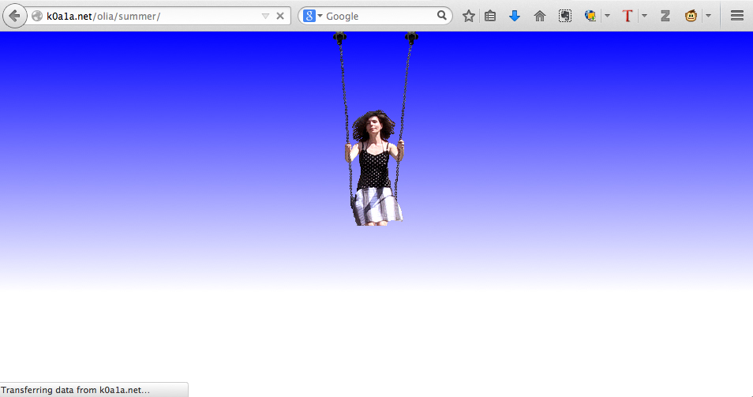
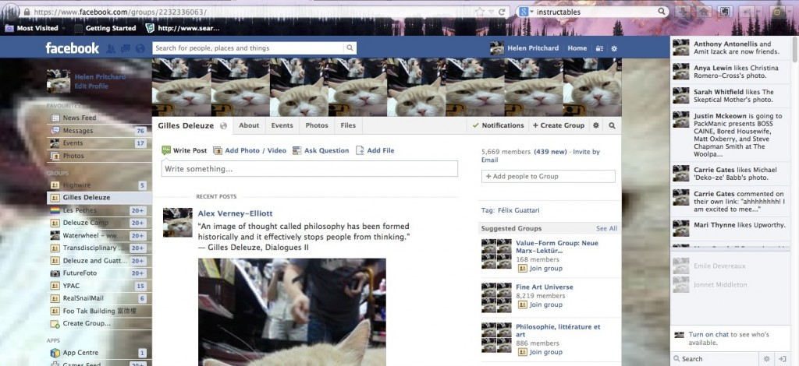
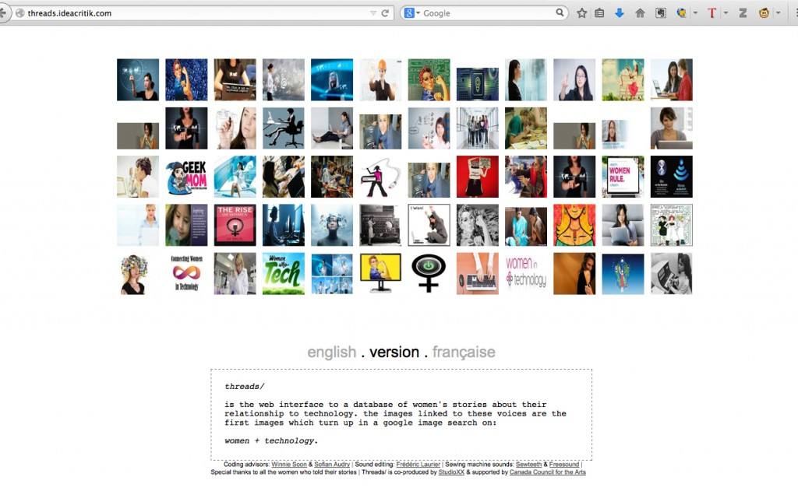

---

### Introduction

Internet-based activities like social communications, money transactions, education, and entertainment are increasingly inseparable from everyday life. Artists work with and within this banal network and explore its affordances to address network technologies, politics, aesthetics, and culture. This paper examines the notion of network affordance, a term used in the field of Human Computer Interaction and Software Studies, within the context of network art. Building on James Gibson’s theory of affordance in the context of psychology, we understand affordance as the directly perceived parameters and properties of things in an environment (Gibson, 1977: 127). The study of parameters and properties is useful in comprehending the affordances of network technologies. In the context of design, William Gaver discusses the interactivity between things and users with what he calls the affordance of predictability (Gaver, 1996). Both Gibson and Gaver call for an attention to the materiality of things. However, in addition to things that are predictable and directly perceivable, we would add a consideration of unpredictability, which includes ecological and computational parameters that are particularly important and unique in discussing network art. We illustrate this notion of unpredictability by considering four specific works from the network art exhibition SPEED SHOW [2.0] Hong Kong (2013). {#para1}

This paper discusses how the artworks are contingent upon the ‘unpredictable parameters’ of the network; they are unpredictable because of the network’s dynamic nature. We introduce the unpredictability of network affordance, expanding on Gaver’s affordance of predictability, as a dynamic framework that could articulate the experienced tension arising from the (visible) symbolic representation of computational processes and its hidden occurrences. As such, we are not only examining things that we observe through visible outputs, but also considering the complex network of behaviours within, and beyond the black box (Latour, 1987: 2–3). In particular, we are interested in interactions between code and network: how code is being intervened by network parameters when it runs live; and, the interaction between and within the works themselves. As such, affordances cannot only be limited to the properties of things, but need to take into consideration the process of interaction with other things. We base our proposal on the experience of both organising the SPEED SHOW, participating in it as artists, and what we perceived as the lack of concepts available to express how the works not only modulated the space but also challenged the experience of the network. {#para2}

### Network affordance(s) of the SPEED SHOW

A SPEED SHOW is a format for a network art exhibition conceptualised by Aram Bartholl in 2010. [1] The format requires the utilisation of an Internet-café as a presentation space, where computers are rented out and each computer displays a network art piece. The show lasts one evening (during the café’s regular opening hours). All artworks must be on-line and live running, not pre-recorded. The idea is to present network art in a public space, outside of the white cube, in a ‘quick and dirty’ fashion with very little budget. Bartholl’s SPEED SHOW concept has been deployed in many other cities, including: Amsterdam, Paris, New York, Barcelona, and Calgary. In 2013, we organised a SPEED SHOW in Hong Kong in a format slightly different from the original concept. {#para3}

The reason for adjusting the format of SPEED SHOW into that of SPEED SHOW [2.0] was because of the unique network environment in Hong Kong. This section will describe the relevant conditions of Hong Kong’s technological network infrastructure and the physical space where the exhibition took place. {#para4}

As Hong Kong’s industry shifts from a production based economy to an information economy, the development of information and communications technology (ICT) infrastructure has been key. In 1998, the Digital 21 Strategy was published by the government, detailing the future direction of ICT development in Hong Kong, geared towards transforming Hong Kong into a ‘world-class digital city’ and digital economy. [2] This strategy is composed of five main points: facilitating a digital economy; promoting advanced technology and innovation; developing Hong Kong as a hub for technological cooperation and trade; enabling the next generation of public services; and, building an inclusive, knowledge-based society. Part of this plan included the Hong Kong Science Park and Cyberport that were developed as strategic hubs to bring together clusters of IT companies, a 13 billion HKD investment. [3] ICT currently contributes 6.1% of the GDP, and Internet connection speeds, broadband and mobile penetration rates are among the highest in the world, averaging more than two mobile devices per person. [4] This advanced ICT infrastructure has been key in developing Hong Kong’s *new* main business sectors: financial services, logistics and international trade. It was the foundation that partially enabled the vast commercialisation of Hong Kong through fast trading of financial capital together with the free trade zoning. ICT is also emphasised and adopted heavily in emerging sectors, including education, medical, and cultural industries. The government’s plan also included making broadband not only limited to users but also affordable to further facilitate commercial ventures. The physical network, its properties, and its uses, are therefore directly related to Hong Kong’s ‘smart city’ business model, and its calculated shift towards an information economy. [5] {#para5}

In 2008, the Digital 21 Strategy was revised to include the concept of a wireless city. As a result, major premises including government buildings, public service centres, and public housing estates, were fitted with WIFI technology for citizen’s use. In addition, major local telecommunication operators developed their mobile network infrastructure to offer wireless mobile data access, including Global System for Mobile communications (GSM) in 1993, General Packet Radio Service (GPRS) in 1999, Enhanced Data Rate for GSM Evolution (EDGE) in 2003, Third Generation (3G) in 2004 and Forth Generation Long-Term Evolution (4G LTE) in 2010. [6] Since the early 2000s, the unlimited data tariff was introduced, and together with continuous improvement in network speeds and increased functionality of mobile devices, mobile usage behaviours have significantly changed. This change encompasses socio-technical assemblages, including but not limited to technological innovation, network affordances, commercial opportunities and social interactions that give a new place to agency and efficacy. Jane Bennett reminds us that, ‘an actant never really acts alone. Its efficacy or agency always depends on the collaboration, cooperation, or interactive interference of many bodies and forces’ (2010: 21). As an actant, the Digital 21 strategy has impacted the city at all levels with many contributing forces. The number of mobile service subscribers is more than double of the total number of Hong Kong residents in 2014. Moreover, more than 70% of the mobile service subscribers consume mobile data. [7] Consequently, having Internet stations is no longer a value-added service as part of a cafe. Arguably, highly accessible and affordable mobile Internet has lead to the obsoletion of the Internet café. Consumers no longer rely on physical stations to get Internet access. Not to mention stations occupy physical space, which is highly limited and expensive in the commercial city of Hong Kong. {#para6}

Hong Kong is also one of the most densely populated cities in the world. [8] As a result, it is a vertically stacked city. Space is at a premium, thus when an enterprise is not commercially viable it disappears quickly. It is therefore also virtually impossible to run a non-commercial venue (structural funding is rare in Hong Kong). This has a substantial effect on how things are navigated and perceived. For example, when we pitched our exhibition idea, we were asked: ‘if network art cannot be sold, how can it be art?’ (implied in the question was the assumption that something without monetary value does not really exist, and there is no space for it in Hong Kong). Consequently, one of our main goals in organising SPEED SHOW [2.0] was to open up space for non-commercial activity outside the commodified framework of the Internet. It also meant bringing layers of non-commercial and playful activity into the commercial space. We therefore chose works that engaged the relationship of the user to the Internet in an unusual way rather than as client. Our concern was to highlight the Internet’s materiality as medium (beyond usual commercial, practical, and daily use frameworks). It is important to mention that our roles in SPEED SHOW [2.0] were twofold: participatory and observational. We both participated as Hong Kong based artists, as well as organised the show and set up all the artworks. {#para7}

The physical space where the works were presented is a commercial space with a bookshop called the Kubrick café. The space itself has no wifi and no available computers because of Hong Kong’s common unlimited mobile data plans. [9] The Kubrick café includes a mini-library where books can be freely consulted and is located next to an independent cinema, which is a rarity in Hong Kong. Our choice was based on the hope that these cultural elements might facilitate a break in the commodified landscape. The particularities related to this site also dictated the technical infrastructure setup as well as the experience of the works. {#para8}

Contrary to the usual spirit of the *quick and dirty* SPEED SHOW concept, we had to introduce both hardware and network infrastructure as these were not available in the space. We placed six laptops on the elevated bar counter inside the café to display the six works, and setup a wifi network by using three of our personal phones (with unlimited data plans), hidden in the kitchen, to tether the cellular network (see figure 1.). We also placed QR codes on each table that directed to the SPEED SHOW [2.0] website. We therefore intervened in the space on different levels: turning a normal café operation into a limited timeframe exhibition, inserting visible hardware computer objects, and creating invisible wifi networks through tethered mobile devices. These interventions brought a new attention to network affordances, not only extending the event beyond a commodified framework of physical structure and network infrastructure, but also to the micro-processes of affordance. {#para9}

The particularities of the space stated above constitute *affordances*. “Affordance” is a term coined by Gibson, to designate different object possibilities for manipulation. It refers to the properties that can determine how a *thing* is used or behaves. The term stems from the field of psychology (from Gibson) and was brought into the field of Human Computer Interaction by Donald Norman (Norman, 1988), whose work is often discussed in relation to cognition. The term has also been adopted in Software Studies to examine the relationship between technical affordances and culture (Wardrip-Fruin, 2009; Parikka, 2012; Kitchin and Dodge, 2011; Douglass, 2007; Portela, 2013). For the purposes of this paper, we situate affordances in the discussion of network art, and argue that the current understanding of affordance lacks the explicit notion of unpredictability. Both Gibson and Gaver begin to approach unpredictability, but we believe the concept needs further articulation and emphasis. Gaver builds on Gibson’s use of the term and adds what he calls the affordance of predictability, in which the opposite is implied. Gaver (1996) uses the concept of affordances to describe material properties of the environment that affect people. Therefore social behaviour is understood as embedded in and shaped by its material context. Gaver defines the affordance of predictability as the appearance of an object that indicates the possibilities in which it may function (Gaver, 1996). Interestingly, he posits that there is a: ‘tendency for electronic technologies to reduce the affordance of predictability supporting everyday social behaviour.’ (Gaver, 1996: 4). Gaver gives the example of paper and explains that the affordances of paper are different to those of electronic media, largely due to the fact that with these technologies the storage medium is different to that of the display. Paper is predictable because the surface that is seen and touched is used for writing (storage), while simultaneously displaying the text (display). It is therefore obvious to the user how to interact with this object inasmuch as the storage and the display are the same. However, when these are not embedded in the same surface, such as a computer for example, the experience becomes unpredictable. The computer screen displays what is stored in the hard drive (or on networked servers), making it much more difficult to imagine what its affordances are. Thus the invisibility of connections between interfaces and the separation of their function (that is, storage and display) creates unpredictability. {#para10}

Consequently, the notion of unpredictability requires rearticulation in the context of computation. That said, unpredictability does not just stem from variable combinations and invisible connections, it comes from large sets of data producing random elements, ‘parametric relations’ (Parisi, 2013: 86), and ‘intra-actions’ (Barad, 2007:33) between all layers of the environment, and the modulation of space by software (Kitchin and Dodge, 2011). In the following sections we will examine works from the SPEED SHOW [2.0] through the lens of *unpredictable parameters*. We will argue that an expanded notion of affordances facilitates the articulation of the experience of network art and also contributes to a discussion about how these *hidden* parameters are visibly shaping our environment. {#para11}

![Figure 1: SPEED SHOW [2.0] Hong Kong](../media/twentyfour.fibreculturejournal.org/files/2015/06/SS-Figure1_SPEEDSHOW-e1435759238325.jpg)

### Unpredictable parameters

We suggest that the notion of affordance should not only be limited to the predictability of material properties, such as shapes and functionality, but should also include relational parameters that might not be visible to audiences. We want to emphasise that affordances are constantly shifting and are subjected to the conditions and happenings of the network. Given the same set of networked artworks, it is possible to see how they behave differently under varying circumstances with the dynamics of network and the live running of code. To make this observation we borrow concepts such as: data entropy in computation (Parisi, 2013), ‘parametric relations’ (Parisi, 2013: 86), the performative dimensions of code (Kitchin and Dodge, 2011), and the transduction of space (Kitchin and Dodge, 2011), to structure a framework of unpredictable parameters. These unpredictable parameters are driven by computational processes that include the relations between running code, network protocols and data manipulation. {#para12}

The show included six works from local and international artists: Olia Lialina *Summer* (2013); Tonio Mundry *You better brush your teeth* (2013); Fannie NG *Reality in RGB* (2013); Helen Nissenbaum and Daniel Howe *TrackMeNot* (2006) ; Helen Pritchard and Winnie Soon *The Likes of Brother Cream Cat* (2013); and Audrey Samson *threads/* (2010). The relations of unpredictability are most apparent when we think about how data is created, processed and manipulated. Four specific works from the exhibition show different dimensions of unpredictability: the distributed network environment of *Summer,* the socio-technical assemblages of *The Likes of Brother Cream Cat*, the search engine parameters in *threads/*, and the operations of space modality in *TrackMeNot*. The works of Mundry and NG address perceptions of reality versus what has been traditionally called virtual reality, rather than unpredictability. We therefore chose not to discuss these works in this paper. {#para13}

The title ‘SPEED SHOW [2.0]’, as mentioned previously, references the promise of “Web 2.0”. For example, *2.0* was said to be characterised by user-generated content fuelling web searches based on page rank algorithms, a participatory network that anticipated the prevalent social networking culture of today, dynamic interfaces, and platforms based on collective intelligence and peer production (O’Reilly, 2005). Lialina has argued that the ever-changing technological environment continuously influences network art (2009). The works chosen in this show depict the different characteristics of *2.0*. *The Likes of Brother Cream Cat* criticises the so-called participatory promise of social networking sites like Facebook. *TrackMeNot* and *threads/* address issues that stem from user-generated content and collective intelligence, such as surveillance based on search data used for analytics and the homogenising power of Google’s ranking algorithms. *Summer* is a playful nod to the pre-dynamic interface created through collectively produced image generation. As Lialina has commented, Internet-based artworks can be seen in different forms, such as browser add-ons, in contrast with earlier standalone websites. Artists use different ways to experiment with the network and they can be also seen in discussions on software art or under the larger umbrella term of ‘media art’ today (2009). Therefore the works chosen illustrate our position that Network art should be viewed more broadly in parallel with the technology of the Internet, as well as encourage us to think about the cultural and political aspects of Internet technology. {#para14}

### Parameters of the network environment

The question that came to the fore was one of how digital images are being manipulated by their environment. Gibson says, ‘different objects of the environment have different affordances for manipulation’ (1997: 128). This section will discuss how the network environment manipulates digital images in Olia Lialina’s work. *Summer* (2013) is made up of twenty-one different images that each reside on a server in a separate physical location around the world. A browser displays a series of images, that show Olia swinging on a swing (see figure 2.). In fact, twenty-one separate scripts are programmed such that the browser cycles through the servers, refreshing the page each time, thus serving a sequence of images that appear like a *slow-motion* GIF animation. In other words, the animated image performs in an environment that has different networked and material affordances. Affordance here includes the understanding of data processing through servers, code and browser behaviours. {#para15}

The repeatedly loading images are closely tied with the characteristics of code. Although the representation of the imag”e -the woman on a swing- ”is invariable regardless of the time it takes to load, the image is displayed dynamically in an unknown timeframe. In this, we do not refer to the subjectivities of time, but to the actual time it takes to load a sequence of images. This time is influenced by many different and unpredictable variables. Gibson argues that, ‘an affordance is an invariant combination of variables’ (1977: 134). What are these variables in relation to the network and the code? In *CODE/SPACE*, Rob Kitchin and Martin Dodge suggest that executive code might be able to listen to its environment through objects (Kitchin and Dodge, 2011: 54). In the work *Summer* the script runs inside a browser as an object. It outputs visuals according to the script’s instructions. However, the browser does not always output the exact result according to script’s instructions. The characteristics of code -programmability, interactivity and capacity- exist in relation to infrastructure, material form and social parameters; forming assemblages of data sensed from the environment (Kitchin and Dodge, 2011: 54). In the work *Summer*, the animation cannot perform without continuous access to other technologies and networks which are located in other spaces. This is achieved through the programmability of code that is executed within a browser at the exhibition. The browser renders the script from a distant server, retrieving and loading an image. After an image is displayed, it immediately calls for another server to do a similar procedure and refreshes the page. Any single server failure could result in the display of an error page that causes the whole animation sequence to stop. In other words, code does not only function as to how it is written, but also with a capability to sense the availability of data and the network. Code is required to establish a network connection with different servers, directing the Uniform Resource Locator (URL) from one to another. The programmability of code enables the changes of URL and server space redirection, as well as the changes of an image display. These constantly alter the behaviour of how the work is presented in a browser. There are also constant negotiations between, and within, network protocols and network layers for delivering data (Osterloh, 2012: 62). These are dynamic actions and changes. The different works in SPEED SHOW [2.0] must also negotiate between themselves for the network and share the various layers involved in packet transmission. The six works were distributed over three phones tethering the mobile network, thus two works per IP address. Therefore the works share addresses as well as bandwidth. In the case of Olia’s piece this impacted the visual render through slower or faster image loading speed. Depending on how ‘data heavy’ the pieces that were sharing bandwidth were, the process of loading could result in low resolution images. In other words, network affordances cannot be regarded as static parameters, but behave more like Barad’s ‘process of intra-activity’ (2003: 817–818). This observation is not about the properties of code or the network per se, but how things perform and things-in-actions (Barad, 2003: 802), open up a temporary space in time through on-going negotiations and reconfigurations. Code is programmable, following lines of instruction and executing them to perform a certain function; but once it starts running, code creates a temporary relational space where different micro activities are interacting. If one of the servers went down an error page would be displayed, and everything would stop performing, as the script stops running because a static error page is displayed. Although this did not happen during the SPEED SHOW [2.0] exhibition, Lialina was prepared for this unpredictable moment, and ready to contact the artist who hosted that particular page and image in order to fix the problem. {#para16}

The distributed nature of the work opens up ‘different agential possibilities’ due to ‘the very nature of dynamics’ (Barad, 2003: 817–818), including both humans and nonhumans. Therefore, code -as Kitchin and Dodge note- is not only a matter of its programmable capability; the relationship and the environment that surround the running code are constantly changing the conditions, which include social relations, other technical apparatuses, space and time (Kitchin and Dodge, 2013: 66). {#para17}

The work displays both image and URL one after the other in a browser. This animated and perceived data, in the form of image and text, takes us along like packets cycling across the globe. For example, a packet cycles from a US-based artist Evan-Roth to a German-based artist Danja Vasiliev. Each time the page refreshes, the image data has to travel from a different place to SPEED SHOW [2.0] in Hong Kong. These packets of data go through numerous network pipes via different service providers. During the SPEED SHOW [2.0] exhibition, the Internet speed was significantly slow and highly unstable. A mobile cellular network was used instead of a fixed line broadband or a Digital Subscriber Line (DSL) technology. The network speed was greatly reduced because of the processor, the active applications, the small mobile device memory, and the slower data connection. In terms of connectivity, the data traffic of a mobile cellular network is more ‘bursty’ (Zhang and Arvidsson, 2012: 16), which impacts the system performance (Hegde and Sohraby, 2002: 132). All these factors increased the instability and unpredictability of the code running and data representation. As a consequence, the audience could clearly see each individual frame and the loading process of each image. The assemblages of the network dynamically reconfigure affordances, they literally effected how the work performed, and how it was perceived in SPEED SHOW [2.0]. {#para18}

### Parameters of socio-technical assemblages

Another key feature of the exhibition was the way in which the social and technical aspects of the network environment interacted together. These socio-technical assemblages were most apparent through a browser add-on: Pritchard and Soon’s *The Likes of Brother Cream Cat* (2013). Pritchard and Soon’s work is about a popular cat figure, Brother Cream, that permeates the Internet through network activities. Brother Cream became famous in 2011 through generating lots of ‘likes’ in Facebook. Since then he has attracted over 1000 visitors per day in a 24-hour convenience store. People queue to take pictures with him to post on the Internet. However, Brother Cream does not always show up for photo taking. In this work the network is conceived as a relational space where various social-technical relations are actively taking place, both outside and within the network, at different moments in time. Conceivably, *catness* -the animality of Brother Cream- invades the network through the performativity of Facebook and the dynamics of social-technical relations (Pritchard and Soon, 2013). {#para19}

In a digital network like Facebook, the space is not only modified by users’ participation or human social interactions, but also the relations between network protocols, databases, and code. Facebook enables a real-time circulation of data that has been stored in databases. This circulation does not only appear in one single interface, but in a space of fluidity and multiplicity. For example, a posted image will get replicated and circulated through a friend’s network. In the case of Brother Cream’s fan page, a new image posting technically reaches more than 170 thousand people. [10] The action of posting cannot be viewed as more than just a reduction of a single post display, because each post is also linked up with other friends’ status updates and social actions, such as likes, comments and shares. All these are related to data complexity and relations, coding structure, and network interaction as network activities. These dynamic network activities cannot be regarded as a single instance, as they lead to a chain of reactions that are generative, participatory and contingent. Each profile’s archive and current data, such as records of activity and connectivity, generate a snapshot of ‘parametric architecture’, introducing ‘real-time variations’ that are constantly changing (Parisi, 2013: 85). {#para20}

Parisi explains the notion of parametricism as follows: {#para21}

> [P]arametricism implies the inclusion of contingent values (as if from the “outside”) but rather partake of the software environment of parametric relations. Parametric programming is therefore not just concerned with the computation of possible (already existing or actual) elements, but also, and significantly, with how intensive relations between finite parameters can engender new smooth spaces. (Parisi, 2013: 86; author’s emphasis) {#para22}

Therefore, a single image of Brother Cream’s trace has to be considered from the computational perspective of relationality and contingency, where the performativity of code reconfigures the intensity of the cat’s network invasion. This Cream Cat trace, as described by Parisi, ‘is determined by an unlimited number of variations occurring through time, and is unfolded into an environment of differential relations, speeds, and intensities’ (2013: 46). Within the network of the cat trace, all sequencing, sorting and representation are highly computed and dynamic, it involves things such as the spatial and temporal dimension of activities: code running, cat presence and participants’ activities. The object of the cat trace cannot be reduced simply to static image data. In this context, we have to consider these parametric relations in order to understand the underlying assemblages, which are dynamic and unpredictable. Data is constantly intervening the ordering and intensity of the social space. {#para23}

After a person logs into her Facebook account, *The Likes of Brother Cream Cat* continuously parses Facebook data and replaces every single image on the screen with Brother Cream Cat (see figure 3.). Audiences experience an augmented browsing with this on-the-fly image replacement, which are all drawn from the latest cream cat trace. The add-on code intervenes with the Facebook code by scanning all the images’ data fields and replacing the original parameter of an image URL to the cream cat image’s URL, resulting in a hijacked interface. {#para24}

The subverted images are continuously updating, which are subjected to the network activities surrounding Brother Cream Cat. The project uses the method of scraping, a computer scripting technique of webpage data harvesting that continuously reads the Brother Cream Cat’s Facebook fan page. The temporality of the artwork is subjected and is affected by numerous visible and invisible interactive parts, including the scrapping time, Brother Cream’s fan uploading time, the networked user activity time, the audience’s browser scrolling time, the Facebook code running time and so forth. All these temporal processes are unique events that are continuously happening and reconfiguring the networked space. The running of *The Likes of Brother Cream Cat* unfolds the social space through time on the fly. The add-on does not determine the aesthetic of the interface in advance. Indeed, the unpredictability is something that is subjected to the socio-technical assemblages that come into relation at every moment of time. {#para25}

*The Likes of Brother Cream Cat* runs in the form of a browser add-on that works on specific configurations and situations. For instance a specific Firefox browser and a particular Facebook version are required to run the add-on successfully. However, wider economic and political forces are constantly acting upon the artwork. The browser version and the Facebook platform keep updating with newer versions, offering different functions, interface changes, bug fixes and performance enhancement. Consequently, the add-on also needs to keep updating in order to accommodate such technical changes and social demands. The constant need to respond to the network relates to the material agency of technological artefacts. Since Facebook is running on the network, most updates are barely noticeable unless they are technical changes related to the interface. As such, the artwork always suffers from potential failures. Although the work ran smoothly during the exhibition, it fails to run at the time of writing this article. In addition to potential failures, the work experienced significant browsing delays during the exhibition. It took a lengthy time to flip from one page to another, or to load the images. The speed of the network is also highly influenced by the battery of the mobile devices, which supply and share the Internet connection. Although the add-on’s code has been run, it nonetheless takes time to take effect in the browser. The code running time becomes out-of-sync with the data representational time and results in unintentional cracks, that demonstrate socio-technical relations and invisible network intensities. {#para26}

### Parameters of the algorithmic database, Google Search

While the *The Likes of Brother Cream Cat* subverts the Facebook database, Audrey Samson’s *threads/* explores how the algorithmic database unfolds into the cultural sphere of imagery. *Threads/* shows the top images culled or ‘scraped’ from a Google search on the subject of women and technology (see figure 4.). It makes use of the affordances of the Google search engine, a giant database platform that is constantly updating and manipulating data. The culled images are mapped to a directory of pre-recorded audio excerpts from interviews conducted with women on the subject of their use of the computer and their feelings towards it. The voice of the interview is triggered when an image is clicked. These interviews were initially conducted in both English and French, which is reflected in a bilingual interface. The piece is an investigation into the cultural imagery associated with the motility of words and meanings across languages, and its relationship to the search algorithm. {#para27}

The images returned by a Google image search of the same terms in different languages has different results. The query that is effected whenever the page is loaded or refreshed returns the top 40 images of the terms: “women + technology” or “femmes + technologie”. These images are resized into thumbnails and placed in a grid like structure on the webpage. Each thumbnail is dynamically associated with an audio file from an array of interviews conducted in the language of the search query (that is, the French interface couples the thumbnails with interviews in French). In other words the sound coupling is dictated by a randomising function and changes when the page is reloaded. In addition, the results of a Google search are not solely based on keyword input and previous search history, but also based on the geographical location of the device. [11] The search entry: “women + technology”, will return different results depending whether it is sent from a device with a Hong Kong Internet Service Provider (ISP) or one with an American ISP for example. The piece therefore appears differently to any given viewer based on various criteria such as: geographic location, language of query and previous search history. {#para28}

In addition, these criteria interact and influence each other, as well as compete for search rankings. That is to say that the country’s ISP, in relation to the user’s previous search history and the search entry will be computed in Google’s patented query formula to produce an array of results (Feuz, Fuller and Stalder, 2011). The array is dynamic because the variables such as the user’s search history and the most ‘popular’ search results in Google’s top ten list are always changing. One of the important factors contributing to the results is the computation of massive amounts of data. Google continues to dominate the search engine market share, [12] the computation process involves a complex and sophisticated logic of search data mining, including web crawling, personalised search, email and Google advertisement analytics and many others. Therefore, the search mechanics keep evolving and the results are unpredictable. One could argue that if the Google query algorithm was known it could be possible to predict the outcome of its computation. However that would be a false assumption because the search engine algorithm refers to itself. For example, the top results are influenced by the sites that pay to advertise, which means they are placed at the top of the page. These sites will then get more visits and result in a higher ranking. As an interviewee working in the subversion of Google rankings tells the *New York Times*: ‘My own personal experience says that the guy with the biggest S.E.O. budget always ranks the highest’. [13] Ironically, Google was initially started as a response to such elliptical search engine behaviour (Brin and Page, n.d). Beyond this, it is difficult to imagine how the results of a query might be imagined even if one knew the algorithm. The different parameters, and the self-referential and recursive aspect of the search function lead to unpredictable results. Moreover, the manipulation of massive data shapes how we perceive the world at a specific moment of time. A user types certain keywords in the search engine bar on a particular subject in search of elucidation through ranked searched results, which are returned in the form of a hierarchical list of textual elements, images and videos. As a result, the Google search function is manipulating knowledge and constructs a particular ideology for its users (Knight, 2014). This is made apparent in the work of *threads/,* inasmuch as the image results of the keywords are constantly updating according to different browsers, locations and time, making these network affordances tangible. {#para29}

In addition to the unpredictability of web searches that is based on factors that we can imagine, Parisi (2013) also suggests that we must also take into account other unpredictable factors such as incomputable data. She explains that ‘even the simplest cellular automata are already infected by complex, incompressible, random information’ (Parisi, 2013: 42). That is to say that in addition to the complex sets of data that are computed, there exists random data that is inherent to digital data. All data sets are therefore already populated by non-computable entities, creating an entropic ecosystem which makes any prediction of an outcome impossible. The Google search results are also highly impacted by complex algorithms and the scaling of data (Brin and Page, n.d). That is to say that not only do criteria interact to produce an unpredictable outcome, but incomputable data also contributes to the entropy of the system and therefore to the search results. In this sense the results are not only dynamic and unpredictable but they are based on data that is in itself random. {#para30}

*Threads/* uses search engine parameters to show that language is associated with imagery across cultures and geographic locations. By the same token it foregrounds the search engine’s affordances in showing that the piece appears differently respective to geographic locations and query language. The unpredictability of the results is further influenced by the nature of the algorithm and the non-computable entities that infect the system. {#para31}

### Parameters of space modality

Following the previous discussion about the nature of the search engine as an entropic system, in this section we propose to use data entropy as an affordance to describe the experiences surrounding network art in Helen Nissenbaum & Daniel Howe’s *TrackMeNot*. *TrackMeNot* is a browser extension that helps protect web users from surveillance and data-profiling by search engines. The extension works by periodically issuing fake queries to selected search engines, thereby adding meaningless data to the search history -things the user is not actually searching for. Therefore, the user’s resulting search history profile is a construction that is mostly unrelated to the user’s behaviour. In fact, *TrackMeNot* could be said to be an extension designed with the purpose of increasing the entropy of a user’s profile. Its goal is to elude precise behavioural tracking and mapping by search engines (and whoever has access to that information). Complex computation introduces data entropy, a notion Luciana Parisi refers to in *Contagious Architecture*. For Parisi, data entropy results from the random data that stems from the computation of infinite sets (Parisi, 2013: 153). Parisi argues that data entropy is inherent to all computation systems and that the *contagion* must be carefully considered as it permeates all layers of our existence from the stock market to political decision-making. *TrackMeNot* demonstrates how the concept of network affordance needs to also include the notion of data entropy, along with speed, spatiality and code. Thus we need to extend Gaver’s definition of affordance to include entropy. The following section explicates how the notion of entropy and algorithmically modified space shape the user’s immanent experience. {#para32}

The choice of how to present *TrackMeNot* within SPEED SHOW [2.0] was challenging, because it is a browser extension and therefore it does not have a browser based interface as such. In a way, this reflects the challenge of presenting any form of network art by highlighting the black box (Latour, 1987: 2–3) of computational networks. Network art often tries to make the invisible forces of computational processes tangible by addressing them directly, but it remains difficult to convey that which cannot be seen. *TrackMeNot* has a static homepage that describes the project, it is explicative but does not reflect how the piece works. However, it is possible in the extension’s settings to enable a secondary tab (running in the background) that shows the search engine queries as they are being sent. The query frequency can be set from every 6 seconds to once per hour. The search engine webpage appears along with the algorithmically generated search terms and search results. The page is constantly refreshed with new terms automatically populating the search entry field, and consequently new results. That said, the terms are not just changing based on a static dictionary of words or list of phrases. They evolve based on an emulation of human response to the search results, this helps to create the next automated search query (Howe and Nissenbaum, 2009). The page is visually dynamic and refreshes often (depending on the network speed). Conceivably, it is visually translating the algorithmic process. The constant refreshing of the page suggests recursion, and as the page keeps reloading at a fairly consistent rate, each time showing a different query phrase in the input field, it also emphasises the repetition of the code. {#para33}

The algorithmic process is also intertwined with the geo-location as well as the space created by the software. *TrackMeNot* then points to a new modality of space, modulated by software and also contaminated by non-computable data. Kitchin & Dodge conceptualise space to be ‘constantly in a state of nondeterministic becoming, operationalized through the process of transduction’ (2013: 80). They use the term “code/space” to refer to the transduction of space by software. For example, they describe the space of the ATM (Automatic Teller Machine) as a combination of both the dynamic networked bank server data and the machine itself, physically located on a street. They argue that software transduces new forms of spatiality, partially because of this ceaseless modulation. Similarly, *TrackMeNot* also modulates spaces: the physical café in which the work is presented (computer screen, interaction between people around the screen), the network space where exchanges and modification of data occur (preferences and history logs), and the hardware space that facilitates such exchanges (cables, server farms and routers). This assemblage of relations is exemplified by the geo-location. The *TrackMeNot* algorithm does not mask the device’s Internet Protocol address (IP). The location of the café where the exhibition physically takes place is therefore associated in the registry of the search engine query. In addition to the *TrackMeNot* generated queries, the *threads/* piece sharing the IP address through phone network tethering is also sending its own queries. Queries from both pieces that are sent to the search engine by the algorithm are coupled to the same IP (in this case the same phone). The IP related Google history, and the evolving *TrackMeNot* results, will therefore be contaminated by both works. Therefore, the ‘code/space’ of the café also evolves with these new queries/results. IP is a geographically specific identifier of the device, the network, and the geographic location. The IP address that is being shared between two works, through the phone tethering, results in the works mingling of identities. These elements therefore become intertwined, acting in relation to each other, creating an evolving space of intra-actions (Barad, 2007) between geo-graphical space, software, hardware and Google query history. {#para34}

*TrackMeNot* generates automated queries that are unrelated to the user’s actual search behaviour. Therefore, the automation is adding data to the user’s search history, and to Google’s query database. The algorithm produces an evolving set of data. The code/space therefore evolves independently from the user. In addition to the data generated by the artists’ software, the process of continuous fake data generation produces infinite sets. We could therefore say that there is a contagion of non-computable data that results from the generation of these infinite sets (Parisi, 2013). This data is based on the concept of transcendental numbers (which are uncountable because they are based on infinite sets), and the mathematical concept of the non-computable (which cannot be enumerated by any algorithm), such as Chaitin’s constant (Parisi, 2013: 17). Parisi also argues that as a result of the emergence of this non-computable data, computation creates spatio-temporalities revealing a new mode of thought which is proper to digital computation: soft thought (Parisi, 2013: 223). She argues that a human cannot understand this mode of thought, but can however immanently experience it. Therefore this work with its ceaseless generation of data emphasises the code/space through its refreshing interface, but also alludes to something we can only experience in the protentional dimension (Petitot, Varela, Pacoud, and Roy, 1999). Soft thought would suggest that the user’s experience of the space is modified by the presence of this work, and the resulting assemblage of relations that evolves from the code/space does so not only on a perceptual level, but also immanently. In other words, the immanent experience is shaped by the code/space infected with incomputable data. {#para35}

### Conclusion

In this paper we have discussed the unique network setting of SPEED SHOW [2.0] Hong Kong and have illustrated how a number of the artworks presented were contingent upon the ‘unpredictable parameters’ of the network. Each artwork performed differently under varying circumstances. Networked tensions were generated between the works, as each work needed to compete for data network access. The careful consideration of network affordances helped to elucidate the invisible actants (Latour, 1996: 2) at play and how they impacted on our experience of the network. {#para36}

We have built upon Gaver’s “affordance of predictability” and introduced network affordance as a dynamic framework to discuss network art. We have argued that the existence of these unpredictable computational dimensions has not been sufficiently considered in the existing discussion of affordances. The network environment that we mainly consider through Lialina’s work *Summer,* shows that parameters like network infrastructure, speed and connectivity increase the instability and unpredictability of the data representation visible to the viewer. There are on-going negotiations and reconfigurations between these parameters that effect how the work performs, and how it is perceived. The concept of the network is therefore conceived as a relational space as discussed with regards to *The Likes of Brother Cream Cat*. Brother Cream exists both outside and inside the network, unfolding the social space where various social-technical relations are actively taking place. The cat invades the network based on the performativity of code. This example also emphasises how dynamic and unpredictable parametric relations act in and out of the network through socio-technical assemblages. The discussion of *threads/* examined the affordances of search engine parameters. We considered how the piece relates to algorithms and demonstrated how criteria such as geographic location, language of query, and previous search history interact with incomputable data to produce an unpredictable outcome. The entropy of the system and the nature of the algorithm influence the unpredictability of the results. Similarly, *TrackMeNot* plays with data entropy to obfuscate user behaviour from search engine analytics. The piece as it was shown in SPEED SHOW [2.0] visually translated the algorithmic process and therefore visually represented the transduction of space that was created by the software. We also argued that this piece shows how the immanent experience of the artwork is shaped by the code/space and infected with incomputable data. Each of the works therefore demonstrates different parameters of unpredictability that exemplify how the ecology of the network and its socio-technical assemblages actively shape our environment and consequently our experience of it. {#para37}

Our position as curators also contributed in manipulating the affordances of the exhibition. Firstly our interests as researchers are rooted in network materiality and liveness. We therefore chose to exhibit pieces that would explore these aspects. To further emphasise these notions we considered which works would share the same network, again somewhat controlling rendering through the speed/network sharing. We were also concerned with choosing pieces that could attempt to make a break in the heavily commodified Hong Kong landscape. These concerns are resonating with current events. At the time of writing this article, Hong Kong was experiencing the Umbrella Movement, an occupation with demands of true universal suffrage for the region. [14] The occupy movement was catalysed by climbing over a fence to reclaim Civic Square (though this space is claimed by the Hong Kong government while it borrows the misleading nomenclature of ‘public’). This reclamation was a symbolic act of agency. The space has since been ‘taken back’ by the authorities but thousands of tents occupyed the surrounding area, bleeding into main arteries of the central district. In the beginning days of occupy, the pro-democracy protesters shifted their communication channels from centralised social media applications like WhatsApp and Facebook to the peer-to-peer messaging application FireChat. The shift was in response to the rumours that mobile telecommunication network was being cut. FireChat relays messages through bluetooth, thus meshing local networks. We were inspired by this quick decentralisation of communication to imagine potential futures of the SPEED SHOW model: site-specific works, put up on the fly, broadcasted on a local network. The visitor would have to visit the location to have access to the piece, and the piece in turn would answer to the specific location, bringing the physicality of a location and its affordances back into the experience. {#para38}

The prevalent tensions that stem from the incongruence of the symbolic representation of computational processes and its actual processes and complexities is not only an issue of network art, but could possibly apply to all *invisible technologies* that permeate our existence. As we have seen, the discussion of network affordances therefore has a broader scope, from ubiquitous computing, to the politics of smart cities and other future technologies that would seamlessly integrate into our lives. {#para39}

### Biographical Note

Audrey Samson is a Hong Kong based artist and researcher. She is currently a PhD candidate at the City University of Hong Kong. Her research/practice focuses on network materiality and digital data funerals.

Winnie Soon is an artist-researcher based in both Hong Kong and Denmark. She is interested in the areas of network art and computational culture where her research focuses on the notion of *liveness* in Software Studies. Currently, she is a PhD fellow at Aarhus University.

### Notes

- [1] See the SPEED SHOW website: https://speedshow.net/

- [2] See the Digital 21 Strategy: https://www.digital21.gov.hk/eng/strategy/2008/foreword.htm

- [3] See Information Technology Services Industry in Hong Kong: https://hong-kong-economy-research.hktdc.com/business-news/article/Hong-Kong-Industry-Profiles/Information-Technology-Services-Industry-in-Hong-Kong/hkip/en/1/1X000000/1X006NLI.htm

- [4] Digital 21 Strategy booklet: https://www.digital21.gov.hk/eng/relatedDoc/download/2014D21S-booklet.pdf

- [5] Digital 21 Strategy booklet: https://www.digital21.gov.hk/eng/relatedDoc/download/2014D21S-booklet.pdf

- [6] The major Hong Kong telecommunication operators include Smartone Telecommunications Limited, HKT Limited (Formally called Hong Kong CSL Limited) and 3 Hong Kong. See the news and press releases regarding different network launches in Hong Kong:
 GSM and GPRS network by Smartone: httpss://www.smartone.com/about_us/media_centre/press_release/2003/06/2003_06_18.html
 EDGE network by Hong Kong CSL: https://www.businesswire.com/news/home/20030825005268/en/Hong-Kong-CSL-Awards-Nokia-EDGE-Network#.VGxUqYes0l0
 3G network by Three: https://www.three.com.hk/website/appmanager/three/home?_nfpb=true&pageid=001001&_pageLabel=P200470391219567710594&lang=eng
 4G LTE network by Hong Kong CSL: Â https://wwwen.zte.com.cn/endata/magazine/ztetechnologies/2013/no5/articles/201309/t20130917_405909.html

- [7] See the Hong Kong Fact Sheets released by the Hong Kong Government in 2014:
 https://www.gov.hk/en/about/abouthk/factsheets/docs/telecommunications.pdf

- [8] See the Hong Kong government 2013 population census: https://www.gov.hk/en/about/abouthk/factsheets/docs/population.pdf

- [9] According to the mobile research report from Google and Ipsos MediaCT, Smartphone penetration in Hong Kong has risen to 63% in Q1, 2013. Â https://www.startupshk.com/google-reveals-that–96-of-hong-kongers-never-go-without-their-smartphones-and-browse-the-internet-daily-highest-rate-in-asia/

- [10] The number of fans in Brother Cream Cat Facebook is more than 170,000 as of September 2014. httpss://www.facebook.com/pages/%E5%B0%96%E6%9D%B1%E5%BF%8C%E5%BB%89%E5%93%A5/117969648299869

- [11] See Google’s patent ‘Short query-based system and method for content searching’: https://www.google.com/patents/WO2006083974A2?cl=en

- [12] See the Search Engine market share details here: https://returnonnow.com/internet-marketing-resources/2013-search-engine-market-share-by-country/

- [13] See the New York Times article: https://www.nytimes.com/2011/02/13/business/13search.html?pagewanted=all&_r=0

- [14] More details about the Hong Kong Umbrella Movement:
 https://en.wikipedia.org/wiki/2014_Hong_Kong_protests

### References

- Bennett, Jane. *Vibrant Matter: A Political Ecology of Things* (Duke University Press, 2010).

- Barad, Karen. ‘Posthumanist Performativity: Toward an Understanding of How Matter Comes to Matter’, *Signs: Journal of Women in Culture and Society* *28*.3 (2003): 801–831.

- Barad, Karen. *Meeting the Universe Halfway: Quantum Physics and the Entanglement of Matter* (Durham, NC: Duke University Press, 2007).

- Brin, Sergey and Page, Lawrence. ‘The Anatomy of a Large-Scale Hypertextual Web Search Engine’,
 https://infolab.stanford.edu/~backrub/google.html

- Douglass, Jeremy. “Command Lines: Aesthetics and Technique in Interactive Fiction and New Media” – PhD Thesis, University of California (2007).

- Feuz, Martin, Fuller, Matthew and Stalder, Felix. ‘Personal Web Searching in the Age of Semantic Capitalism: Diagnosing the Mechanisms of Personalisation’, *First Monday* 16.2 (2011), https://firstmonday.org/article/view/3344/2766

- Gaver, William W. ‘Affordances for Interaction: The social is material for design’, *Ecological Psychology* 8.2 (1996): 111–129.

- Gibson, James J. ‘The theory of affordances’, in Robert Shaw and John Bransford (eds.) *Perceiving, Acting, and Knowing* (Hillsdale, NJ: Lawrence Erlbaum Associates, 1977), 127–143.

- Gibson, James J. ‘The Ecological Approach to Visual Perception of Pictures’, *Leonardo* 11.3 (1978): 227–235.

- Hegde, Nidhi and Sohraby, Khosrow. ‘Blocking in Large Mobile Cellular Networks with Bursty Traffic’, *ACM SIGMETRICS* 6.1(2001): 123–132.

- Howe, Daniel and Nissenbaum, Helen. ‘TrackMeNot: Resisting Surveillance in Web Search’, in Ian Kerr, Carole Lucock and Valerie Steeves (eds.) *Lessons from the Identity Trail: Anonymity, Privacy, and Identity in a Networked Society* (Oxford: Oxford University Press, 2009), 417–436, https://cs.nyu.edu/trackmenot/TMN-Howe-Niss08-ch23.pdf

- Kitchin, Rob and Dodge, Martin. *CODE/SPACE: Software and Everyday Life* (Cambridge, MA: Massachusetts Institute of Technology, 2011).

- Knight, Simon. ‘Finding Knowledge: What is it to ‘know’ when we search?’, in René König and Miriam Rasch (eds.) *Society of the Query Reader: Reactions on Web Search* (Amsterdam: Institute of
 Network Cultures, 2014), 227–238, https://networkcultures.org/query/wp-content/uploads/sites/4/2014/06/17.Simon_Knight.pdf

- Latour, Bruno. *Science in Action: How to Follow Scientists and Engineers Through Society* (Cambridge, MA: Harvard University Press, 1987).

- Latour, Bruno. ‘On Actor-Network Theory. A Few Clarifications Plus More Than a Few Complications’, *Soziale Welt* 47.4 (1996): 369–81, https://www.bruno-latour.fr/sites/default/files/P–67%20ACTOR-NETWORK.pdf

- Lialina, Olia. ‘Interview with Olia Lialina: Net Art is not dead’, March (2009), https://www.damianperalta.net/es/teoria/12-interview-with-olia-lialina-net-art-is-not-dead

- Norman, Donald A. *The Psychology of Everyday Things* (New York: Basic Books, 1988).

- O’Reilly, Jim. ‘Design Patterns and Business Models for the Next Generation of Software’, 30 September (2005), https://www.oreilly.com/pub/a/web2/archive/what-is-web–20.html?page=1

- Parikka, Jussi. *What is Media Archaeology* (Cambridge and Malden, MA: Polity Press, 2012).

- Parisi, Luciana. *Contagious Architecture: Computation, Aesthetic, and Space* (Cambridge, MA/London: The MIT Press, 2013).

- Portela, Manuel. *Scripting Reading Motions: The Codex and the Computer as Self-Reflexive Machines* (Cambridge, MA: Massachusetts Institute of Technology, 2013).

- Varela, Francisco J. ‘The Precious Present: A Neurophenomenenology of Time Consciousness’, in Jean Petitot, et al. (eds.) *Naturalizing Phenomenology* (Stanford, CA: Stanford University Press, 1999), 266–314.

- Wardrip-Fruin, Noah. *Expressive Processing: Digital Fictions, Computer Games, and Software Studies* (Cambridge, MA/London: MIT Press, 2009).

- Zhang, Ying and Arvidsson, Åke. ‘Understanding the Characteristics of Cellular Data Traffic’, *CellNet’12* (Aug, 2012): 13–18.

- ### Works

- Lialina, Olia. *Summer*. 2013. https://art.teleportacia.org/olia/summer/

- Howe, Daniel and Nissembaum, Helen. *TrackMeNot*. 2006. https://cs.nyu.edu/trackmenot/

- Prichard, Helen and Soon, Winnie. *The Likes of Brother Cream Cat*. 2013. https://project.arnolfini.org.uk/brothercreamcat

- Samson, Audrey. *threads/*. 2010. https://threads.ideacritik.com/
