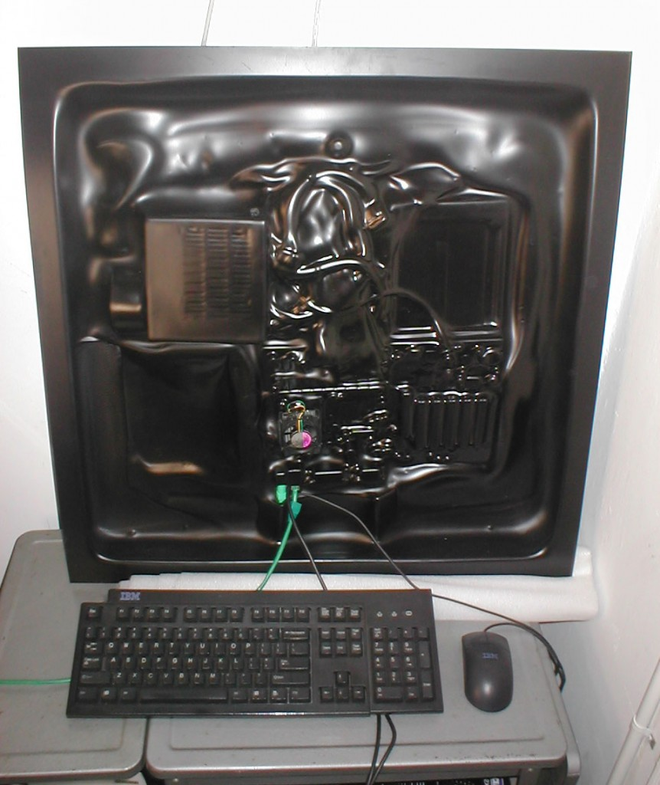

---

### Introduction

The work of these two authors is well known to anyone whose research concerns matters of affect and biopolitics, software, networks and gaming, interface culture and communication, political economy of media and information, the systems of measure and control addressed in the contexts of French theory, feminist and speculative thought, Marxism or psychoanalysis. We were lucky to have them among the keynotes for our Apps and Affect conference, where their talks sparked an interesting exchange that impacted a number of the conference conversations. Afterwards, I suggested to Patricia and Alex that they elaborate on aspects of their discussion; this invitation resulted in the following conversation, which took place via email between April and December 2014. {#para1}

Patricia Ticineto Clough is a Professor of Sociology and Women’s Studies at Queens College and the Graduate Center, CUNY. She is a social theorist whose work and teaching address the methods of inquiry and the core assumptions of such fields as anthropology and sociology in order to shift the focus towards their disciplinary peripheries where one often discovers the archives of outcast material. Clough’s co-edited collections *The Affective Turn* (with Jean Halley) and *Beyond Biopolitics* (with Craig Willse) are evidence of passionate collaborative research conducted with her students and colleagues, offering nuanced discussions on discursive closures, shifts and reconfigurations. Her work outlines the dangers and controversies of ‘the political economy of biomediated body’ (Clough, 2008:15) implemented by the ‘monitoring of the bodily affect as information’ within national and international regulatory policies. {#para2}

Clough’s current research looks at what she and her collaborators have termed ‘the datalogical turn’ (Clough et al., 2014), [1] or the shift to big data as a sociological methodology. She argues that such a move from representational to non-representational model reveals how much sociology has been merged with cybernetics. Clough explores algorithmic technologies of measure, the indeterminacy of incomputable data, and informational matter. [2] In all her texts Clough experiments with ways of inhabiting and performing the written. She does it even more intensely in her performances, one of which I was lucky to witness last fall in New York City: *Ecstatic Corona*, her ethnographic and historical research written, choreographed and produced together with young adults whom she met on her multiple returns home, to the town of Corona Queens New York, where she grew up. {#para3}

Figure 1. The Children of the Mercy Files. Patricia Ticineto Clough with the performers: Mac Morris, Omar Montana, and Elijah Kuan Wong (2014). {#para4}

Alexander R. Galloway is an Associate Professor in the Department of Media, Culture, and Communication at New York University. His theoretical trilogy on ‘allegories of control’ – *Protocol: How Control Exists After Decentralization* (2004), *Gaming: Essays on Algorithmic Culture* (2006) and *The Interface Effect* (2012) – became foundational for Media and Software Studies, where he made an equally important contribution as a programmer and media artist. From 1996 to 2002 Galloway was associated with Rhizome, a New York based new media organisation, where he worked as editor and technical director. He also founded Radical Software Group (RSG), a collective of media artists named after *Radical Software* magazine, published between 1971 and 1974, which explored the impact of video and television on society, fought for the freedom of information and warned against the dangers of its corporate control. [3] Twenty years later, RSG reintroduced similar concerns to the digital culture of the 1990s and 2000s. The group’s media art projects responded to the gross militarisation of the governmental apparatus not only in the aftermath of 9/11, but years prior to those tragic events. {#para5}

One of the works of this kind was Galloway’s Carnivore, a project whose name doubled that of the FBI’s wiretapping software better known as DCS1000 (‘Digital Collection System’). [4] By pointing to the infamous surveillance tool, his software art project exposed the practice of the massive monitoring of users’ online activity conducted since 1997, shortly after the World Wide Web become publicly available. Even though art cannot, unfortunately, entirely strip the system of its powers, it certainly can – and does – throw those powers into question. Carnivore is a hack at its best: just like its prototype, it is ‘a surveillance tool for data networks,’ ‘a software application that listens to all Internet traffic (email, web surfing, etc.)’. [5] But it is also more than that: in addition to its ironic mimicking, Galloway’s Carnivore subverts the FBI’s surveillance technique by… *improving* the tool: now it ‘features exciting new functionality including: artist-made diagnostic clients, remote access, full subject targeting, full data targeting, volume buffering, transport protocol filtering, and an open source software license.’ Most importantly, it breaks a closed system and uses data for art; this is consistent with Galloway and Eugene Thacker’s suggestion of an important substitution for the ineffective practices of resistance to the protocological control: ‘The strategy of maneuvers instead shows that the best way to beat an enemy is to become a better enemy’ (Galloway and Thacker, 2007: 98). {#para6}

Galloway’s recent interest in French thinker François Laruelle, whose work is indeed a search for *exploits* in philosophy, resulted in a new book *Laruelle: Against the Digital* (2014), where he speculates about the meaning, possibilities and limitations of digitality by reading Laruelle’s theory of “philosophical decision”, which, Galloway argues, could be seen as *digitalisation* – here, as digitalisation of thought – an operation of discretisation disconnected from the computational context. This book continues his method of tactical ‘protocological struggle’, in which the convergence of different modes of critical expression are put forward in order to demonstrate that today ‘any theory addressing networks,’ as he and Thacker write in *The Exploit*, ‘will have to entertain a willingness to theorize at the technical level’ (Galloway and Thacker, 2007: 100). {#para7}

Svitlana Matviyenko {#para8}

**Svitlana Matviyenko:** Patricia, in your work, you think the body across various platforms where it is a platform itself, one of many. In one of your talks you speak of the work of Karen Barad, who, like you, questions the organism as the privileged figure of the body. With Barad and other new materialists, you address the question of embodiment as it occurs through systems, techniques and tools for measuring, and you argue that ‘the body is inseparable from the materialisations that materialize through the measuring apparatuses.’ [6] {#para9}

We are witnessing the process of fetishisation of the data produced by bodies. The activities of members of the Quantified Self movement and other lifeloggers who willingly disclose and monitor their lives for the gaze of networks come to mind as examples. These users might not be aware of the destinations to which their data travels, the places it is stored, and its accessibility to unknown parties, but they accept such a state of things either because they trust their service providers and platform developers or because they do not see another way of maintaining their personal and professional relations in the connected world. Although the majority of users never raise concerns or think about the degree of exposure involved, one can notice a subtle but growing awareness of the ‘data cocoon’ we produce with our tools. I am interested in how we come to terms with the realisation of being involved in involuntary self-monitoring, how we negotiate the conditions, how we resist or… enjoy it. {#para10}

Speaking of apps, they engage with the body’s pulsations, vibrations and movement. The body as organism is not of interest any longer, but the body-across-platforms as the body with and as the data it produces. In the end of your essay on apps, Patricia, you ask, ‘How to intervene and experiment with the relations that the app can have and thereby become a something else of itself? What does it take to do this?’ (Clough, 2014b: 46). Could you address this question by contextualising it within your own background and also by making connections with your recent work on ‘the datalogical turn’ and your reading of the body as inextricable from measuring apparatuses? {#para11}

**Patricia Ticineto Clough:** Before I got a Ph.D. in sociology, I studied at the Biological Computer Lab at a time, the mid seventies, when second order cybernetics was being elaborated there, with Heinz von Foerster, Humberto Maturana, Gordon Pask and Herbert Brun all contributing. For me, the computer always has been the biological computer and the relationship between human and machine always has been more about the body than about artificial intelligence, even if AI at first won the day. But now when it is more common to think of digital bodies, or bodies as/of data, and calculation as affective, it is important to rethink the body beyond the body as organism, or the autopoietic body. When Maturana theorised autopoiesis during my time at BCL, he was responding to the then relatively recent discovery of DNA and the genetic code. Autopoiesis was conceived as a refusal of the direct affectiveness of the gene or an environmental input; instead the organism is affected as a whole; in its relations the organism selects for its autopoeisis, or its reproduction as a whole with the aim of homeostasis and equilibrium. As such, the organism, it was argued, is closed organisationally to information and open to energy such that the organism reproduces its boundary when it is affected. In other words, the organism is a self-organising biophysicality. While autopoiesis ushered in second order cybernetics, recognising the self-organisation of biophysical indeterminacy, autopoiesis nonetheless is a systems theory. A certain relationship between parts and wholes is presumed, as the whole is constituted by the functional interaction of parts even as higher levels of order are reached as the organism’s encounters bring it to the edge of order in far-from-equilibrium conditions. {#para12}

Measure is more sophisticated than in first order cybernetics as the observer is central to second order cybernetics, especially in terms of emergence at the edge of order, when boundaries are more a confusion of inside and outside. Yet indeterminacy is still a matter of the biophysical and not of the measure itself, not of the algorithm itself. But today, as algorithms are comprised of incompressible parts or incomputable probabilities that can be bigger than the whole and can at some point or at any point deracinate the whole, systems theory is challenged, as is the autopoietic organism as the figure of life. In algorithmic architectures where calculation is conditioned by incomputable quantities of thought and affect, calculation becomes what Luciana Parisi describes as a matter of speculative reason. This means that the algorithm is itself a spatiotemporal object and the indeterminacy immanent to it is only quasi-mathematical. (Here Parisi draws on Graham Harman’s work while drawing his work towards the quantitative). Without going into detail about Harman’s object oriented ontology, it allows for an understanding of the dynamics of measure, the indeterminate quantities conditioning each calculation. The algorithm is a real object in Harman’s terms but in Parisi’s terms, differing with Harman, the algorithm is a real object infected with the incomputable; the object is incomplete and thus open to relations. My own insistence that the organism is only a special case, a specific figure of life and that the more general case is informational matter or self-measuring matter (2007) might even be revised with Parisi’s conception of the algorithm as ‘a spatiotemporal matrix of the present’ (2013: 36), suggesting a very different materialism than the new materialisms, if a return to materialism is right at all. More important is that there is a rethinking of temporality and the present. {#para13}

I take this position in contrast to Karen Barad’s position. While I much appreciate Barad’s attention to measure, I would argue that the indeterminacy immanent to the algorithm is occluded in Barad’s conception of intra-action. Ontologically speaking, objects not only are self-measuring, they are algorithmic. Real but neither purely mathematical nor physical, the algorithm’s quantities, like the object’s qualities, relate aesthetically. This move to the speculative and the aesthetic means the dimension of relation or contact is not a matter of epistemology, cognition or recognition, privileged as these are in autopoietic systems and in Barad’s ontology as well. As for the body then, the indeterminacy of the algorithm gives us a new frame with which to engage critically the technologies that are capturing bodily senses and sensation while making bodies more inspect-able and survey-able, breaking down the ‘boundary between inner and outer knowledge and control of the body,’ as Brian Rotman (Rotman, 2008: 133), among so many others, say. But, the incomputable probability of the algorithm gives us a frame that is not about knowledge or control through knowledge. And to respond politically, we must start somewhere else than knowledge and control. We might consider rethinking media beyond media to mediation and to its immanence to the algorithm object. I believe Alex’s work on mediation can be taken in this direction. {#para14}

**Alexander R. Galloway:** As Patricia notes, cybernetics is at the heart of this historical transformation. Cybernetics describes networks of actors (whether living or non-living, natural or synthetic) who are able to express themselves, and who likewise can receive and respond to the expressions of others. Cybernetics thus describes an affective network, a network of affective expression and affective response. In many ways this is a good thing. Consider the alliance struck between feminism and cybernetics, in everyone from Ursula Le Guin and the VNS Matrix, to Donna Haraway and Sadie Plant. If patriarchy is one of the ‘deep’ psychic structures (proliferating injustice by leveraging difference and hierarchy), then shouldn’t the more equitable ‘shallow’ affective networks help do away with patriarchy? If the essentialism of concepts like ‘nature’ and ‘natural feeling’ are harmful to women, shouldn’t an anti-essentialist feeling (viz. affect) provide some hope? {#para15}

Affect is a curious topic, partly because the critical commentary seems to contradict itself. On the one hand, Fredric Jameson chronicled what he called the ‘waning of affect’ under postmodernity (Jameson, 1991: 10—11). For him deep psychological structures have given way to more surface phenomena like irony and cynicism. Yet at the same time affect seems to be on the rise today. Deleuze and Guattari famously charted the liberation of affect. Social media proliferate with people’s feelings and desires. Books and conferences are devoted to the subject. So who is right? Can both of these claims be true? Is affect on the wane, or is it on the rise? {#para16}

Upon further examination the apparent contradiction dissolves. When Jameson says affect he really means emotion or feeling. He means the purely sincere affect of the romantic, Enlightenment ego. When Deleuzians say affect they mean affect proper, that is, affect as the postmodern replacement for modern sentiment. Modern subjects have sentiments, while postmodern subjects have affects. Thus Jameson’s ‘waning of…’ and the Deleuzian ‘turn to…’ are precisely the same historical phenomenon. Modern sentiment succeeded too well, you might say – so much so that, even after disappearing, it has re-emerged everywhere, only now in simulated form. {#para17}

Cybernetics is most interesting when combating those deeply entrenched structures of injustice. Yet at the same time cybernetics has ushered in a new era of informatic legibility and monitoring. Perhaps today we are no longer ruled by the Father or the Prince. If so, we are ruled instead by the packet, the data point, the unit of legible meaning. We have a new semiotarchy to replace the old patriarchy, a new fiat of information to replace the old fiat of the Father. (I’m exaggerating of course: patriarchy is still alive and well the world over!) This is why I see Patricia’s work on self-measurement to be so useful. How are we to survive in a world driven by the rule of information? {#para18}

**Patricia:** I like the implications of Alex’s remarks: to think affect in relationship to first-order and second-order cybernetics and then to recognise affect as a replacement for modern sentiment. As such affect becomes a capacity in the Deleuzian sense which now has been deployed in the deconstruction of entrenched structures of injustice, feminism not merely an example here but a prime example, leading however to the exploitation of affect in so many ways and to a dark Deleuzianism, as Alex has called it. My first remarks about the algorithm are meant to consider that we are post-cybernetics, after affect, when criticism is up against the packet, the data point, the algorithm. {#para19}

**Svitlana:** Alex, I think your mention of cybernetics’ ambiguity is important. Perhaps, such ambiguity is not unrelated to common generalisations about cybernetics. Could we dwell on this for a moment and ask the following questions, ‘what cybernetics?’, ‘first-order cybernetics or second-order cybernetics?’, ‘Wiener’s cybernetics, cybernetics of the Macy conferences or that of the Biological Computer Lab?’, ‘what does it have say about agency?’, ‘how do we distinguish, if at all, between control and regulation?’ and so on. In the end, how important is it to be asking these questions when we apply cybernetic notions for understanding the mechanisms of the ‘world driven by the rule of information,’ where a phone has earned a status of ‘wearable electronics’? {#para20}

**Alexander:** The most common shortcoming I find when reading about cybernetics is the lack of historicisation evident in so many authors. The old mantra “always historicise” has fallen away, replaced today by the new mantra “always connect.” And along the way our ability to think historically about the industrial infrastructure has collapsed. (Incidentally this is one reason why Katherine Hayles’ book on cybernetics, *How We Became Posthuman*, is so good, because she explicitly historicises the movement.) The collapse is no coincidence, however, because cybernetic thinking was conceived as a solution to the kind of historical thinking so associated with the ‘age of ideology’, capitalism versus communism and so on. And so it’s common today to find the same authors laud both cybernetic thinking and anti-critical or post-hermeneutic thinking. In some respects, they are simply the same gesture. {#para21}

Still the ultimate irony lies in how thoroughly cybernetics (and network thinking in general) has incorporated the historical or critical mode, so much so that concepts like difference, alterity, or multiplicity are thoroughly embedded into the very architecture of cybernetic thinking. What formed the basis of the liberation struggles during my parent’s generation is now the bedrock of the most highly capitalised companies on the planet. We are left, then, to reinvent a new set of critical strategies better suited for the world in which we live now. {#para22}

**Svitlana:**That leads to my next question about governance or management conducted through the organisational principle of blackboxing and, by extension, the tactics of obfuscation and compression. Could you place apps in the context of the discussions you both initiated in your work, i.e. Alex’s writing on control after decentralisation and, most recently, on the cybernetic hypothesis and Patricia’s work on governance and measure of life, death and matter. In particular, I quote Patricia’s reference to Alex’s reading of the notion of “black box”: ‘Galloway’s treatment of blackboxing not only suggests a possible take on the app, albeit a negative one: the path we more and more will choose to interface with and through the Internet, even as the choices bundled (and those excluded) behind any app icon remain relatively opaque’ (Clough, 2014b: 37). Would it be fair to consider apps exemplary of the ‘normatively positive spin on obfuscation,’ as Alex puts it, in the midst of the ‘compulsory visibility’ and total surveillance? {#para23}

**Alexander:** Apps complicate the conversation around obfuscation and compression. I’m thinking of the way in which today’s apps and tablet computers obfuscate the machine even more than the GUI interfaces of a decade or two ago, which themselves are driven by high levels of metaphor and artifice. I see obfuscation as simply a common ingredient in all technical systems. Computer science confirms this. The ‘obfuscation of code’ is a common technique in computer science used to segment and simplify how code modules talk to each other. There is nothing nefarious about it. {#para24}

Critical theory tends to vilify obfuscation, of course, and for good reason. If the various structures and apparatuses of this life obscure and naturalise power, then it is our duty to demystify them using critique. One might call this an anti-Baroque strategy. The Baroque is an aesthetic of over-saturation. It tends toward the accentuation of an action into a repeatable manner. Thus the very gratifying immediacy of the Baroque at the same time performs an obfuscating function: we don’t know the Baroque subject precisely because he is so adept at telling us what he is. Critique, by contrast, aims to undo such structures wherever they are found, and for this reason runs contrary to the structuring tendencies of obfuscation. {#para25}

Opacity and compression are different though, partially because they are responding to a different historical condition. Today we’re grappling not only with the Big Other or the Father, but the NSA and Gmail. The strategies of visibility commonly associated with the new social movements of the 1960s – speak out, express yourself, liberate your desire, come out of the shadows, take back the streets – must be reconsidered today. This is not because such strategies failed, on the contrary these social movements succeeded in various ways, and as such their techniques were brazenly co-opted by the capitalist infrastructure. Large corporations now openly laud diversity in human resources; Nancy Fraser and others have shown how the goals of the feminist movement are now sewn into post-Fordism; Web 2.0 is thoroughly Deleuzian, and so on. {#para26}

All of these old ’60s tactics have been tremendously useful. Yet I wonder if the world isn’t a different place today. I’m not sure I want to ‘express myself’ if I know the Gmail app is listening. We’ve operated for many years under the assumption that phenomenology was basically correct, that truth is the thing that reveals itself to a solicitous subject. So here my concerns are essentially industrial. If big business has assumed the role of this ‘solicitous subject’ and now we are all the many data points revealed to it as a kind of ‘truth’ – a monetary truth to be sure – then perhaps a dose of obfuscation is in order. A cryptographic universe is much more appealing today than an enlightened one. {#para27}

**Patricia:**  Not only do I agree with Alex about the ‘obfuscation of code’ and that in the face of ‘the commodification of potentiality or inventiveness’, the black box/app is not to be critically engaged either with a hermeneutic approach or a Deleuzian approach to difference or multiplicity. But more, with Alex, I think that what is indicated is the need for criticism to shift its focus to the conceptualisation of the system and the interimplication of cybernetics and the social sciences, sociology especially. It is the conceptualisation of system that in the post World War II years linked sociology and cybernetics. It also underwrote sociology’s unconscious drive to positivism, empiricism, and scientism expressed in the circular functionality of the opposition of qualitative and quantitative methods. That is to say, the circuit between these opposed methods functioned to link phenomenology, or the epistemology of the conscious human knower to probability measures of statistically described populations that made it increasingly plausible to assume that social practices and human behaviour really were patterned and repeatable… and therefore were predictable irrespective of the historical conditions (Steinmetz, 2005). If the historical, in all its contingency and uncertainty, was not the reference for the probabilities of the human behaviour of statistical populations, it was because the historical was displaced by that more powerful conceptualisation of “system” as interdependent parts that function autopoietically to reproduce the whole. So rather than an anti-Baroque strategy or only that, what I think is needed is to see the way cybernetics has been realised in the forms and styles of presenting data in sociological writing and to consider what Matthew Fuller and Andrew Goffey call the grey zone or grey media: both the networks of our sociotechnical infrastructure and the sociotechnical sensibility with which actants act within these infrastructural networks. Thus enlarging our view of media studies to include stratagems from administration to data gathering and dissemination, not simply mass media nor social media. This is a version of the immanence of mediation to the algorithm as a spatiotemporal matrix of the present. This is where criticism is needed and the workings of the algorithm made manipulable for other purposes than mere expression, sincere expression, as Alex puts it. {#para28}

**Svitlana:** Regarding the ideology of the aesthetic, can we read such things as ‘persistence of visual knowledge’ (Chun),’calculative aesthetic’ (Clough) or ‘beautiful evidences’ (Tufte) as the productions of not just one, but all three modes of mediation, the hermeneutic middle of representation and exchange, the iridescent middle of immediacy and immanence and the infuriated middle of multiplicity and extinction? {#para29}

Speaking of the body, we see the three middles working in concert when Aphrodite enters the final scene of Alex’s essay ‘Love of the Middle.’ As you explain, it is because ‘the governor of the middle… present at the physical communication of bodies in congress,’ Aphrodite, ‘returns us to a more somatic immediacy’ (Galloway, 2014: 64). If it is not ‘the body-across-platforms’, is it ‘the body-across-the-modes-of-mediation’? Are they different bodies? Could you speak more of such somatic immediacy in ‘the middle of the middle’ and in the time when media have become so good at erasing the traces of their presence? In your opinion, do apps – the ‘tender buttons’ on our screens that respond to a touch – make us more aware of the presence of the interface? {#para30}

**Alexander:** The advent of distributed systems places certain demands on both thinking and practice. I’ve tried to pursue this in various ways over the years, whether it be working on software projects, or doing more traditional research and writing. If there is one continuous thread through my own trajectory it would have to be the something like ‘the politics of code.’ I’m interested in how technical systems both facilitate and prohibit certain kinds of political consciousness. So my first book, *Protocol*, analysed the structure of organisation in distributed networks, particularly those facilitated by the various Internet protocols that have been drafted and deployed over the last several decades. And today with my recent book *Laruelle: Against the Digital*, while the subject matter has changed dramatically, some of the basic questions remain the same. What sorts of worlds are made by possible by digitality? What does digitality prohibit? And how is it possible to think non-digitally? (Which is perhaps the most interesting question of them all.) {#para31}

With the advent of distributed infrastructures, we are obligated to think critically about the middle as such, ‘in-betweenness’ as such. Deleuze and Guattari’s rhizome provides a fitting example: the rhizome is not simply an alternative way of organising leaves, stems, and roots; the rhizome is the middle part and only the middle part. The milieu takes over. Entities, objects, agents, authors – these are all rendered meaningless from the perspective of the rhizome. Today we are faced with a different set of concerns: relationality, systematicity, mediation. Of course Google and Facebook have mastered this better than anyone else. They are perfect instances of rhizomatic capitalism. Thus as critical thinkers I maintain that we must unabashedly profess our ‘love of the middle’ if we are ever able to gain any perspective on this new ‘infrastructural turn.’ The middle is where it’s at. {#para32}

Western culture tends to alternate between two common conceptions of media and communication, one hermeneutic and the other iridescent. Distributed systems are often excluded from the story. My contribution in *Excommunication* is a simple one: additional modes of mediation exist that are equally deserving of our attention, chief among them being distributed networks. We need a robust theory of networks. We can’t assume they are natural – or worse, exceptional. {#para33}

**Patricia:**  I am quite intrigued by Alex’s recent tri-part categorization of ‘the love of the middle,’ giving media and mediation three organising figures, Hermes, Iris and the Furies. For Alex, the last, the Furies, mark an annihilation of hermeneutics and phenomenology as approaches to or forms of mediation. Neither for immanence nor depth, presence nor difference, the Furies are anti-media, as media are displaced by a ‘microphysics of links and vectors,’ a network or what Alex refers to as a system. As he sees it, we, those of us interested in critique, are up against not the system of the 1960’s but a systematicity that undoes any attempt ‘to establish a grand arc of history.’ The implications, he proposes, are a matter of aesthetics, a post-Fordist digital or information aesthetics that shifts between 0 and 1, that is, aesthetics as nothing (data has no visual form) or aesthetics as one (data always has the same form, the information network). In his remarks here Alex extends this view to offer what he calls the anti-Baroque strategy of critique that runs contrary to ‘the structuring tendencies of obfuscation.’ This phrase ‘structuring tendencies of obfuscation’ can be read in terms of cybernetics, where noise is recognised as the condition of possibility of information – a structuring/destructuring/restructuring, aimed at reproducing a system. {#para34}

Here Alex’s concern with aesthetics is reflective of his disciplinary background in literary criticism but surely any one of us following the recent turn to ontology and an object orientation in philosophy knows there has been a general return to aesthetics but as a matter of causality resonant with a turn to non-consciousness (Shaviro, 2009) as well as a non- or in-human unconsciousness as in Catherine Malabou’s work on the ‘cerebral unconscious’ (Malabou, 2012). For me, with a different disciplinary background than Alex’s, mine sociology, the return to aesthetics, I would suggest, shifts the focus of criticism from textuality/information to data/information. Or to put it otherwise, the recent turn profoundly challenges the styles and forms of presenting data, challenged as we are by the perspective of the sciences – the bio, nano, and neuro-sciences – all properly technosciences increasingly inseparable from industry, policy and developments in computer science, digital technology and the algorithms parsing big data. {#para35}

**Alexander:** I appreciate your observation about the disciplinary differences between literary theory and sociology. Indeed sociology has always had a special relationship to systems and systematicity, more than other disciplines. And I agree that we have witnessed, over the last decade or two, a transformation in society and culture from a more textual or symbol-oriented social infrastructure toward a more ergodic, practice-oriented, we might even say ‘executable,’ social infrastructure. Science and industry have a special role to play, just as before. Only today we see less focus on the industrialisation of symbolic systems – the cultural industries, subjectivity and interpellation, representation, and so on – and more focus on what Patricia is calling the sciences of life, those industries devoted to the creation and regulation of bodies, organisms, and entities. {#para36}

**Svitlana:** Although here we speak about a cybernetic model of control, I wonder if you’d also see a way to think apps and the ‘smart infrastructures’ of mobile computing in general as an instance of post-cybernetic governance. By this, I mean that it is, as according to Luciana Parisi, no longer interested in establishing the conditions of the present on the basis of the data from the past; rather, it is driven towards the future but not with the goal of predicting it, but with the goal of generating the very conditions of the future? {#para37}

If I am correct, it is what Patricia describes as ‘the commodification of potentiality or inventiveness’ that indicates ‘a turn in mathematic technology to the use of indeterminacy in calculation itself, such that calculation increasingly is motivated by uncomputable data internal to the algorithm’ (Clough, 2014b: 46). Would this be the case, Alex, that you would define as “excommunication”, although such that it comes after the cybernetic dichotomy of information and noise and the metaphysical dichotomy of presence and absence (Galloway, et al., 2014: 16)? {#para38}

**Patricia:**  What recently my coauthors and I have called the ‘datalogical turn’ (Clough, et al., 2014) is meant to point to how the algorithms that parse big data are an intensification of sociology’s unconscious drive. While there is, as Alex has pointed out, a post-fordist liberal attitude to the array of methods permitted in the humanities, ‘such liberalism nevertheless simultaneously enshrines the law of positivistic efficiency…’ (Galloway, 2014: 109). Even more so in sociology where its unconscious drive to empiricism, positivism and scientism remains and continues to discipline the forms of writing and presenting data. And yet, big data also is outflanking sociological methods of calculation as well as methods of data collection and circulation, both quantitative and qualitative. This, ‘the crisis of empirical sociology,’ as Mike Savage and Roger Burrows (2007) have described it, does not merely challenge sociologists to learn new methods of calculation and data presentation, although sociologists are fast trying to do so. The crisis is more profound in that the join of phenomenology and statistical populations is coming apart. In their treatment of big data, Bruno Latour and his colleagues have argued that many of the conceptual assumptions of social theory are undergoing change: ‘”Specific” and “general”, “individual” and “collective”, “actor” and “system” are not essential realities but provisional terms… a consequence of the type of technology used for navigating inside datasets’ (Latour et al., 2012: 2). {#para39}

My co-authors and I have argued that the datalogical turn points to a different technology for navigating datasets where rather than moving from particular to whole, the movement is from particular to particular. It is the technology of post-probabilistic calculations or measure, the use of quantities that are conditioned by their own indeterminacies, not by human participation (see: Parisi, 2013). As the datalogical turn is a turn that undoes a criticism fully dependent on Deleuze and Whitehead, it allows for the possibility of drawing out the link between post-probabilistic measure in the algorithms parsing big data and the social logic of today’s derivative economy (Ayache, 2007; Martin, 2013). It also allows for a consideration of the implications of the derivative for the conceptualisation of system, noting Randy Martin’s discussion of the way the derivative disassembles and bundles attributes, undoing the system metaphysic that takes the ‘relation of parts to whole as known beforehand and that each retains its integrity, which fixes its position, interest, and contribution’ (2013). The derivative undoes this fixity, turning ‘the *contestability* of fundamental value into a tradable commodity – a market benchmark for unknowable value’: an incomputable value that is nonetheless deployed in measure (2013: 91). The datalogical turn then carries out the unlinking of the human subject’s phenomenological perspective and statistically described populations from the current modes of a calculation that no longer needs to reference system and its assumptions. {#para40}

We might consider then that the system, or systematics, indeed, the app, must be critiqued from this perspective, a move from assemblage to derivative and perhaps a move from control society and preemption to the algorithm as a spatiotemporal matrix of the present. Control no longer is to be understood as the calculation of a future by means of prediction, nor the calculation of the unknown through pre-set probabilities in a preemption of the future. Instead post-probabilistic measures extend the present, a present that we cannot escape, a present to which consciousness is an after effect. Or as Mark Hansen puts it, we are dealing with a ‘consciousness … generated after-the-fact, as an emergence generated through the feeding forward of technically-gathered data concerning antecedent microtemporal events’ (2013). What Hansen calls ‘the operational present of technology’ is the focus of a post-cybernetic governance of an economy after affect. {#para41}

**Alexander:** Parisi is invested in the ideas of randomness and incomputable data. In *Contagious Architecture*, she speaks of patternless data, the entropic, chaos, contingencies, indefiniteness, and change. For her the incompressible virtual already exists within the actuality of the real. I see the argument in two steps: (1) algorithms are real and actual; (2) algorithms already include patternlessness, infinity, and incomputability inside themselves. She focuses on cracks, excesses, interference, contingencies, and how they overwhelm seemingly impervious rational systems. I particularly appreciate how she criticises what’s called digital philosophy or computationalism (illustrated in the work of someone like Stephen Wolfram), on the grounds that grid-based cellular automata systems are too fixed and can’t account for dynamic change. {#para42}

Yet ultimately I tend to deviate slightly from some of Parisi’s core concerns, for she remains committed to a series of concepts – infinity, the incompressible, and the indeterminable – that I can’t entirely swallow. Whitehead and Deleuze are very strong in Parisi. I sympathise with that tradition, most certainly. But as a Marxist I’m drawn eventually to an inverted set of concepts: finitude and determination, certainly, but also compression. {#para43}

At the same time these different approaches are not necessarily incompatible. So while Marxists talk about ‘determination by the material base,’ Parisi speaks rather of the indeterminable as a way to escape the fetters of ossified structure. Likewise when Marx eschews the absolute infinities of transcendental philosophy in favour of the particularities of material finitude, Parisi speaks rather of infinity as a kind of radical virtuality, ensuring a limitless space of possibility. {#para44}

I’m reminded of Kaja Silverman’s wonderful meditation on finitude offered at the outset of *Flesh of My Flesh*, her recent book devoted to the topic of analogy: ‘Finitude is the most capacious and enabling of the attributes we share with others, because unlike the particular way in which each of us looks, thinks, walks, and speaks, that connects us to a few other beings, [finitude] connects us to every other being’ (Silverman, 2009: 4). {#para45}

**Patricia:**  If I may have one last word in response to the reference to Kaja Silverman that is meant to honour it and redo it and this is to remember that digital technology has returned us to thinking again about mathematics and computing machines. These take us back to the insights of mathematicians who propose that there are many infinities. Here the many undoes the opposition of finite and infinite and refuses to let us assume something connects us to all beings or all beings to each other. Of course, I could be wrong. {#para46}

### Biographical Notes

Svitlana Matviyenko is a media scholar. She has a PhD in Critical Theory, Media Theory and Psychoanalysis from the University of Missouri and she is now pursuing her second doctorate at the Centre for the Study of Theory and Criticism at the University of Western Ontario. She writes on psychoanalysis, topology, posthumanism, mobile apps, and networking drive. Her work has been published and forthcoming in *Digital Creativity*, *(Re)-Turn: A Journal of Lacanian Studies*, *Harvard Ukrainian Studies*, *Krytyka* and others. Svitlana curated several experimental dance performances and several art exhibitions at the Ukrainian Institute of America in NYC, Museum | London (Ontario) and other venues. She is a co-editor (with Paul D. Miller) of *The Imaginary App* (MIT, 2014).

Patricia Ticineto Clough is a Professor of Sociology and Women’s Studies at Queens College and the Graduate Center, CUNY. She is a social theorist whose work and teaching address the methods of inquiry and the core assumptions of such fields as anthropology and sociology in order to shift the focus towards their disciplinary peripheries where one often discovers the archives of outcast material. Clough’s co-edited collections *The Affective Turn* (with Jean Halley) and *Beyond Biopolitics* (with Craig Willse) are evidence of passionate collaborative research conducted with her students and colleagues, offering nuanced discussions on discursive closures, shifts and reconfigurations. Her work outlines the dangers and controversies of ‘the political economy of biomediated body’ implemented by the ‘monitoring of the bodily affect as information’ within national and international regulatory policies.

Alexander R. Galloway is an Associate Professor in the Department of Media, Culture, and Communication at New York University. His theoretical trilogy on ‘allegories of control’ – *Protocol: How Control Exists After Decentralization* (2004), *Gaming: Essays on Algorithmic Culture* (2006) and *The Interface Effect* (2012) – became foundational for Media and Software Studies, where he made an equally important contribution as a programmer and media artist. From 1996 to 2002 Galloway was associated with Rhizome, a New York based new media organisation, where he worked as editor and technical director. He also founded Radical Software Group (RSG), a collective of media artists named after Radical Software magazine, published between 1971 and 1974, which explored the impact of video and television on society, fought for the freedom of information and warned against the dangers of its corporate control.

### Notes

- [1] Clough, Patricia. ‘Feminist Theory, Bodies and Technoscience’, *Bringing the Body Back in Humanities and Social Science*. February 24, 2014. CUNY Graduate Center. Available at: httpss://vimeo.com/41526429. See also: Clough, Patricia. ‘Bodies: Technoscience and Feminist Theories’, in Bryan Turner (ed.) *The Routledge Handbook of the Body* (New York: Routledge, 2012).

- [2] Parisi writes in *Contagious Architecture*: ‘Just as your smart phone works as a monitor device for tracking your location, which then becomes data used to construct the profile of your movement, so too does the monitoring procedure of smart infrastructure collect data which then become part of the programming of new infrastructural systems. As data are recorded, so they evolve into predictive scenarios aiming not simply at presetting your movement, but rather at generating its future conditions through the generative interaction of parameters with real-time data. This is how post-cybernetic control operates as a form of parametric design. From this standpoint, the goal of parametric design is deep relationality, the real-time integration of the evolving variables of a built environment in software systems that are able to figure emerging scenarios by responding to or preadapting scripted data’ (2013: 105).

- [3] https://www.radicalsoftware.org/e/history.html.

- [4] https://r-s-g.org/carnivore.

- [5] See Matthew Mirapaul’s piece on Galloway’s Carnivore ‘Cybersnooping for Sounds and Images, Not Suspects’, *The New York Times* (October 1, 2001) at https://www.nytimes.com/2001/10/01/arts/design/01ARTS.html.

- [6] Clough, Patricia. ‘Feminist Theory, Bodies and Technoscience’.

### References

- Ayache, Elie. ‘Nail in the Coffin: Author of the Black Swan’, *Wilmott Magazine* (July-August, 2007): 40—49.

- Barad, Karen. ‘Getting Real: Technoscientific Practices and the Materialization of Reality’, *differences: A Journal of Feminist Cultural Studies* 10.2 (1998): 87.

- Chun, Wendy Hui Kyong. ‘On Software, or the Persistence of Visual Knowledge,’ Grey Room, 18 (Winter 2004): 26—51.

- Clough, Patricia Ticineto. ‘The Calculative Aesthetic: Objects and Unconscious Desire in the Age of Big Data’, a talk in a series of Dialogues between Artist and Scientist on the theme of measurement at Kunstraum, Leuphana University, January 23, (2014a)

- Clough, Patricia. ‘The Philosophical Carpentry of the App: Criticism and Practice’, in Paul D. Miller and Svitlana Matviyenko (eds.) *The Imaginary App* (Cambridge, Mass.: MIT Press, 2014b): 358211;50.

- Clough, Patricia T. ‘The Affective Turn: Political Economy, Biomedia and Bodies,’ *Theory Culture & Society* 25.1 (2008): 1—22.

- Clough, Patricia, Karen Gregory, Benjamin Haber, and R. Joshua Scannell. ‘The Datalogical Turn’, in Phillip Vannini (ed.) *Nonrepresentational Methodologies: Re-Envisioning Research* (Oxford: Taylor & Francis, 2014): 182—206.

- Deleuze, Gilles. ‘Postscript on the Societies of Control,’ *October* 59 (Winter, 1992).

- Hansen, Mark. ‘Beyond Affect? Technical Sensibility and the Pharmacology of Media.’ Presented at the Critical Themes in Media Studies conference, NYU, 2013.

- Galloway, Alexander. ‘The Cybernetic Hypothesis’, *difference*s*: A Journal of Feminist Cultural Studies* 25.1 (2014): 107—131.

- Galloway, Alexander and Thacker, Eugene. *The Exploit: A Theory of Networks* (Minnesota: University of Minneapolis Press, 2007).

- Galloway, Alexander, Thacker, Eugene and Wark, McKenzie. *Excommunication: Three Inquires in Media and Mediation* (Chicago: University of Chicago Press, 2014).

- Jameson, Fredric. *Postmodernism, or, The Cultural Logic of Late Capitalism* (Durham: Duke University Press, 1991).

- Latour, Bruno; Jensen, Pablo; Venturini, Tommaso; Grauwin, Sebastian and Boullier, Dominique. ‘The Whole is Always Smaller Than Its Parts. A Digital Test of Gabriel Tarde’s Monads’, *British Journal of Sociology* 63.4 (2012).

- Malabou, Catherine. *The New Wounded: From Neurosis to Brain Damage* (New York: Fordham University Press, 2012).

- Martin, Randy. ‘After Economy? Social Logics of the Derivative’, *Social Text* 31.1* *(2013): 83—106.

- Parisi, Luciana. *Contagious Architecture* (Cambridge, Mass., MIT Press, 2013).

- Rotman, Brian. *Becoming Beside Ourselves: The Alphabet, Ghosts, and Distributed Human Being* (Durham, N. C.: Duke University Press, 2008).

- Savage, Mike and Burrows, Roger. ‘The Coming Crisis of Empirical Sociology’, *Sociology* 41.5 (January, 2007): 885—899.

- Shaviro, Steven. *Without Criteria: Kant, Whitehead, Deleuze, and Aesthetics*. (Cambridge, Mass.: MIT Press, 2009).

- Silverman, Kaja. *Flesh of My Flesh.* (Stanford, Calif.: Stanford University Press, 2009).

- Steinmetz, George. ‘The Epistemological Unconscious of U.S. Sociology and the Transition to Post-Fordism. The Case of Historical Sociology’, in Julia Adams, Elizabeth Clemens, and Ann Shola Orloff (eds.) *Remaking Modernity: Politics, History, and Sociology* (Durham, N.C.: Duke University Press, 2005): 109—157.
