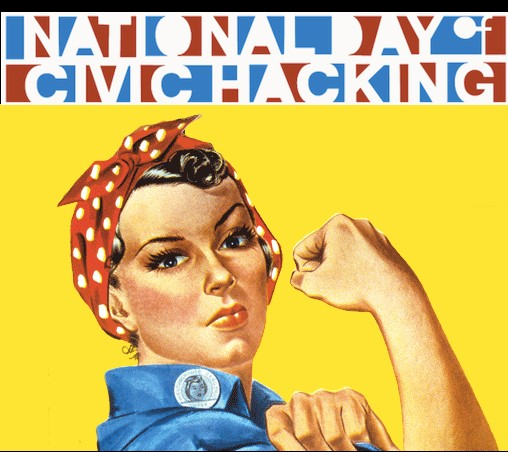

---

*In this present crisis, government is not the solution to our problem; government is the problem.* (Reagan, 1981) {#para1}

At a time when the technology sector offers hope for a revitalised economy, particularly in the United States, the working conditions typical in this highly prized industry take on special significance. This paper analyses the rise of ‘hackathons’ – code- and data-sharing events that inspire participants to accomplish specific challenges in a condensed time frame – to understand their role in the ecosystem for app development and the qualities of work they promote. Hackathons are emblematic of broader trends in high-tech labour in that they reflect the difficulties, opportunities and compromises young workers face in the wake of the Global Financial Crisis. They are a symptom of a broader transformation affecting career preparation and training as stable paths for recruitment give way to the velocity of dynamic networks. Hackathons’ growing popularity can be attributed to a range of factors, including: their effectiveness as a recruitment tool for start-up ventures and established companies; their efficiency in providing low-cost development and design prototypes; and their ability to test individuals’ capacities in a high-pressure setting. Hackathons enable aspiring professionals to demonstrate technical skills and immaterial qualities of employability (Boltanski and Chiapello, 2007; Gorz, 2010) in a competitive job market that skews young (Lu, 2014). They further provide a venue for those on the periphery of paid employment to begin the ‘netWORK’ (Nardi et al., 2002) that will be crucial in an adhoc, flexible, portfolio-driven career. {#para2}

It is perhaps unsurprising that hackathons, app jams and coding camps have taken hold in a context of fiscal austerity. In the United States, billowing costs for college education, a decline in what is vaguely termed ‘middle class jobs’ and the growing volume of anti-debt campaigns all affect the worldview of students and others seeking a stable career foothold. [1] The US recovery in fact compares well with other parts of the world, most notably Europe. Still, the hollowing out of ‘good jobs’ – understood as salaried positions with benefits – is a similar one-two combination of precarization and *déclassement* (Roggero, 2011: 12). Added to this is the steady media appetite for Silicon Valley success stories with their anti-establishment, risk-taking allure (Neff 2012): *Time* Magazine’s (2010) Top 10 billionaire college drop outs names Bill Gates at No. 1, Steve Jobs No. 2, and Mark Zuckerberg No. 6. These tech warriors’ examples provide ripe material for VC stalwarts urging young people to abandon their degrees for the more lucrative and challenging ‘hard knocks’ school of dot.com business. [2] As Gideon Lewis-Kraus (2014) writes on the latest Silicon Valley goldrush: ‘Starting a company has become the way for ambitious young people to do something that seems simultaneously careerist and heroic’. The ‘killer app’ fairytale promotes belief in a celebrity lifestyle allegedly available to young people brave enough to ditch their studies and gamble their future on a start-up. {#para3}

While each of these issues deserves further inquiry, the interest explored in this paper is the amount of work currently donated in the guise of civic or ‘issue-oriented’ hackathons (Lodato and DiSalvo, forthcoming) in the name of economic recovery. Unlike corporate hackathons, which favour the production of technical solutions for market opportunity, civic hackers put social questions at the centre. In the work of Code for America (codeforamerica.org), Random Hacks of Kindness (rhok.org) and events like the National Day of Civic Hacking (hackforchange.org), industry sponsors, public-private partners and NGOs rally thousands of participants to hack for a good cause [3] – typically, a new app or platform arising from the repurposing of accessible data sets. In the course of a day or a weekend, hackers enjoy networking, schmoozing and information sharing with well-connected sponsors. This fleeting assembly of tech workers trades off the pleasures of social computing and hacking’s informal conventions (Coleman, 2013). {#para4}

Civic hackathons are marketed as a new form of community service, right down to the nomenclature of ‘code brigades’ that evoke earlier traditions of national duty. Not just an exciting entry point for computer scientists to establish influential contacts at the beginning of their work lives, hackathons are an empowering method for motivated individuals to get involved in their local community and make a difference to the lives of others. A growing number of stories testify to the role of hackathons in creating job opportunities that did not exist otherwise (Ancona, 2014). {#para5}

But given the already existing pressure on young people to engage in career-bolstering ‘free labour’ (Terranova, 2000; Hesmondhalgh, 2010), the notion of voluntarism underwriting the civic hackathon is a development to be welcomed cautiously. Hacking for good fuses the youthful energy of Obama-era digital participation with Silicon Valley’s own Peter Pan triumphalism. The youth-centrism of this mode of participation is captured in the words of Code for America founder, Jennifer Pahlka, who suggests that ‘this generation… assumes all problems are, if not solvable, at least hackable’ (in Halper, 2013). Positioned as budding entrepreneurs, young hackers are encouraged to take personal responsibility for the decline in civic resources and amenities, including the very educational facilities that could be used to ‘teach kids to code’ (code.org). Civic hackathons are positioned as rational investments of time and labour, a socially beneficial and distinguishing extra-curricular activity in the cut-throat market for viable, fulfilling and ongoing work. {#para6}

There are many advantages to the boom in civic tech – among them, the opportunity to reverse engineer a skills gap in digital literacy brought about by the shift to cloud computing and the Internet of Things. What remains questionable however is whether hacking can or should be relied upon to ensure reliable delivery of the political, technical and affective infrastructure of major cities. In the evangelist’s view, ‘Governments need to officially recognize and partner with outside hackers and technologists’ by providing ‘high quality open data and other “raw materials” for hackers to create ‘new solutions’ (Headd, 2014). Missing in this appeal is the pragmatic reality that local governments have few resources available to devote to such a quest. As we will see, one reason civic hacking is so attractive to advocates and their recruits is because the current system of governance and administration in the US setting in particular is broken by admission. The broader issue that gets lost in the civic hacking debate is whether we are comfortable with a situation in which citizenship and employment sit together as potentials to be actualised through a short-lived event dominated by an unrepresentative participant population. {#para7}

The purposeful association of coding with voluntarism places hacking among the longer list of examples of donated, portfolio-filling, ‘sacrificial’ labour in the creative industries (Ross, 2000). In addition, the ideology of entrepreneurialism underwriting these events implicates participants in a political maneuvre that celebrates private solutions to public problems. Civic hackathons invite renewed attention to the appeal of the civic in shepherding an industry for young people’s labour that takes a lack of pay for granted (Perlin, 2011; De Peuter et al., 2012). Hackathons demand better distinctions between enterprise, industry, governance and government, and how each of these terms come to be associated with patriotic duty. This paper is an initial attempt to address these issues independently of their casual conflation. {#para8}

### Hacking Becomes Hegemonic

It takes some historical perspective to appreciate the shift in mindset that has seen hacking move from the margins of society to the mainstream. Indeed, my interest in the term is precisely its capacity to inhabit both of these locations simultaneously. [4] In civic hackathons, citizens are openly welcomed to hack their government, in an appropriate display of political affect. ‘You don’t accept the world as it is,’ were the welcoming words from Los Angeles Mayor-elect Eric Garcetti at Hack for LA 2013. [5] And yet, as we have seen repeatedly with hackers who do follow this directive, there is such a thing as too much autonomy in the act of liberating data. Edward Snowden and Julian Assange represent the wrong kind of civic hacker because their ideas of transparency have proven too radical; their notion of informed citizenship breaches establishment thinking on appropriate access and publicity (Gregg and DiSalvo, 2013). From one perspective, of course, these whistle-blowers’ actions epitomise the demand for accountability in government; their advocacy has been crucial in revealing the extent of government surveillance beyond citizens’ knowledge and consent. From another view, the same actions typify the open cyber-ethic gone wrong: a form of celebrity-seeking heroism that regards technical superiority as a moral force guaranteeing elevation from common law. [6] {#para9}

What hacking means, both now and in association with its pasts, involves perpetual debate over legitimate forms of expertise, access, authority and protocol (Nissenbaum, 2004). In Coleman’s (2013: 3) recent definition, hackers are ‘computer aficionados driven by an inquisitive passion for tinkering and learning technical systems, and frequently committed to an ethical version of information freedom’. This version of hacking certainly accompanied the latest app-fuelled tech bubble, whether in the life ‘hacking’ optimisation techniques in various quantification devices or the DIY ethos of the so-called maker movement (Hatch, 2014; Lindtner et al., 2014). As ‘hacking’ is enshrined in the parking lots, meeting spaces and wallpaper of multi-million dollar tech firms (Kovach and Goodman, 2013), as swathes of the Californian landscape are carved up and signposted with roads called Hacker Way (the route to Facebook’s Menlo Park headquarters), as hacker residencies are advertised in municipal libraries and art galleries, and as chip companies invest in hackathons to motivate summer interns, we see multiple forms of evidence that hacking has become a cherished economic activity. Hacking’s self-directed qualities embody the desirable traits of today’s model employee. {#para10}

In earlier times, to ‘hack’ meant to attack – often with a sharp implement! – and it is this meaning that still appeals in the tech industry’s relentless quest to ‘disrupt’, ‘conquer’ and ‘win’ new markets (Losse, 2012). Conversely, to *be* a hack once indicated an individual with dubious qualifications or credentials, a term of abuse for someone whose poor skills and deceitful trade toyed with trust. It is a substantial etymological accomplishment that the term ‘hack’ no longer signals a *lack* of professionalism so much as a practice that may benefit one’s professional pedigree. Even very recently, distinctions between ‘white’ and ‘black’ hat hackers drew lines between professional information systems analysts and individuals seeking notoriety by breaking security protocols and revealing flawed code. But when Facebook – perhaps the most successful company founded by a self-designated hacker – hired ‘Thrax’ as the result of a successful breach of its system (Losse, 2012), the elevation of subversive hacking to workplace recruitment strategy was complete. In this case, and presumably many others without the same publicity, illicit hacking confirmed appropriate disposition for an industry enamoured with its own rule-breaking eccentricity. {#para11}

Hat imagery nonetheless helps to appreciate hacking’s place in the broader US cultural imaginary. For decades, white and black hats were the nominal index of good versus bad in Westerns – an easy measure of the righteous protagonist demanding audience sympathy. The rugged cowboy predates the rogue hacker as the iconic renegade individual who triumphs over social convention to secure victory for what is right and just. This is one lineage that links the experiences of Edward Snowden, Julian Assange and Pentagon Papers leaker Daniel Ellsberg: in each case, the liberation of data and the public perception of the hacker as hero or villain depends on contingent notions of patriotism, responsibility and duty. {#para12}

In the tech industry, hacking’s further nuance is to embody core principles of start-up and venture-capital wooing enterprise. It is not just access to information that is heralded as ‘good’ but the conviction that especially talented individuals can do more with data than those officially charged with its curation. As we see in the case of accommodation providers like AirBnB, or the taxi service spin-off, Uber, app development typically proceeds on the premise that autonomous access to resources is superior to any state-regulated method. The liberal ideology shared by app developers and various hacking traditions is the belief that technology builds a non-partisan bridge between competent, self-motivated, rational actors (Coleman, 2012; Ames 2013). This ‘entrepreneurial citizenship’ (Irani, forthcoming) enacted in app development is increasingly attractive to local, state and federal governments in times of enforced budget constraint. Civic hackathons enable individuals to claim entitlement to public data and create innovative uses for their circulation in spite of limited municipal resources for information gathering, storage and retrieval. Hacking ameliorates the otherwise cataclysmic cuts to government spending on civic services like libraries, public schools and other repositories that enable data sharing in many communities. In its parasitic nature, the process gives citizens an opportunity to believe that enough self-motivated individuals can stave off the consequences of fiscal decisions made by elected governments. {#para13}

Civic hacking also acknowledges that data literacy is now vital for effective economic participation even while pedagogy and training for such literacy is unequally distributed according to gender, age, geography and race. Learning to code is increasingly recognised as a necessary supplement to the inadequacies of a state system of education focused on testable metrics at the expense of creative and employable skills. This is the rhetoric that has attracted so much corporate investment in initiatives like *Make: Education* (makered.org). Through this organisation, community groups, volunteers and start-ups provide infrastructure and opportunities for kids in poorly serviced school districts to explore science, art and other creative pursuits. In championing data access and dissemination, and in promoting creativity in education, civic hacking promotes DIY skills acquisition as the appropriate response to the decline in training and services once provided by the state. The National Day of Civic Hacking shows this happening at a grand level. {#para14}

### Hack For Change

Hosted in over 70 U.S. cities in June 2013, and 103 locations in 2014, The National Day of Civic Hacking is billed as an occasion to ‘bring together citizens, software developers, and entrepreneurs across the nation to collaboratively create, build, and invent, using publicly released data, code, and technology to solve challenges relevant to our neighborhoods, our cities, our states, and our country’ (hackforchange.org). Over the course of 48 hours, hundreds of ideas and thousands of lines of code are generated, debated and exchanged in synchronicity. A handful of winners are selected at each site, with media coverage, corporate seed funding, and a trip to the White House among the spoils. The language used across the weekend is one of problem solving through technical innovation. New services for assembling, analysing, and accessing data can be tested and implemented by hackers, while start-ups seeking exposure can gain free publicity when their products are used for this purpose. This unique combination of crowdsourced labour and public relations opportunity benefits businesses and potential employees alike, as witnessed in the 2013 Hack for LA. Scopely’s representative appraised the scene adroitly by praising the crowd – ‘You guys are AWESOME for giving up your weekend!’ – and concluding his sponsor’s pitch with a blatant plug: ‘We’re hiring.’ {#para15}

At the same event, newly elected Mayor Eric Garcetti deftly maneuvred the opening of the event to create a press opportunity for his forthcoming term, an injection of boosterist rhetoric anticipating the city’s plans to transform Venice Beach to Silicon Beach. Garcetti’s speech was revealing for what it admitted about the flaws in the very office he stood poised to take over. Lauding the hackers, he acknowledged that anything they did that day would matter, because the point was ‘you didn’t make it worse.’ This was Garcetti’s idea of a joke, a funny yardstick for government and civic participation. But it was also pivotal. It recognised the challenges facing LA as a city. In one breath he championed the need to appoint a CTO and CIO in his term, admitting that cities are now best run as corporations. He then pointed to the simplest services a city should be able to provide and doesn’t. ‘We still need to pave that pothole with asphalt,’ Garcetti said, ‘but knowing the pothole is there’ is something hackers accessing open data can fix. {#para16}

In his remarks, Garcetti claimed he wanted LA to be ‘the best place in the world to hack’; the event could be the birthplace of ‘the next tech CEO.’ In his term, he wanted every kid to have access to coding classes in high school, because education isn’t about preparing people for manufacturing jobs anymore. The winners of the hackathon were promised City Hall itself: ‘We’re going to open up the doors and the departments… to build a city of Angels for everyone.’ In these rhetorical strains, the idea of transparency is very easily transported from open data to an open political process and an improved democracy in general. {#para17}

The ‘Rosie the Riveter’ image advertising the National Day of Civic Hacking in 2013 is a clear instance of recruitment strategies drawing on ideals of civic service, patriotism and duty. The title’s red, white and blue etching positions hackers as inheritors of a tradition of patriotic service required in times of war. As the United States joined World War II, budgetary spending on the military and the economic impact of committed troops demanded a new perspective on employability, capability, and resources. Rosie the Riveter was used to motivate women to join the ranks of labour at a time of crisis, her feisty fist clench an icon designed to build morale. {#para18}

  {#para19}

Today, the ‘We can do it!’ attitude dovetails with the ‘Yes we can!’ optimism of Obama’s Presidency to continue a legacy of national service for contemporary times. In this latest fiscal crisis, civic hackathons mobilise a reserve army of labour to enhance service delivery for a cash-strapped state. The National Day of Civic Hacking reanimates ideas of civic duty (‘your country needs you’) to offset the consequences of war spending in the present. Code for America spreads this nation-building charter, with code ‘brigades’ branching out across the country in a display of missionary zeal (Halper, 2013). Code for America badges ambassadors for a state and a democracy that is everywhere under-resourced. Hacking is both a patch for government and a distraction from other patriotic commitments, particularly those that have prioritised military spending over education in consistent federal administrations. {#para20}

It remains to be seen whether code brigades and specialist non-profits dedicated to spreading tech literacy echo or arrest the decline of earlier traditions of civic participation in US life (Puttnam, 2000). This is the focus of ongoing research (e.g. Schrock, 2014). For now, the hackathon provides a venue for the ‘democratic personality’ to flourish (Turner, 2014) and for the production of subjectivities that accept leisure time as an occasion for productivity (Crawford, forthcoming). At the same time, civic hackathons prove to be one more instance of the computer scientist’s approach to the social, a view that typically avoids analysis of the macro political conditions inherited in software, hardware and code. By narrowing attention to issues that can be solved in a compressed timeframe, critical questions of priority and equity are left aside. Challenges are readjusted in real time to suit who and what is at hand (Lodato and DiSalvo, forthcoming). As an enactment of civic intent, hackathons parochialise the ambition of democratic participation to topics that attract the data and technical means for impact in the course of a day or a weekend. [7] The novelty of civic hacking lies not in its structural political impact, then, but in the lessons it holds for contemporary labour. {#para21}

### Labour In The Hypothetical

The language of civics, service and duty provides a convenient means by which the sacrificial labour of creative professionals can be encouraged and incorporated by business. If part of the hackathon’s appeal is the possibility of facilitating the next ‘killer app’, in reality, few of the ideas emerging from the event’s inflated conditions actually survive long-term. Accelerator attention may follow successful performance at a hackathon but this does not guarantee a viable business in the long run. [8] In hackathons what gets built rarely works, even in the case of apps that win prizes and publicity in the timeframe of the event (DiSalvo et al., 2014). Instead, the meet-ups produce an archive of speculative possibilities – what Irani (2013) calls their business-card, ‘promissory’ function. The work conducted during the week or weekend acts as an illustration of what future work *might* entail. As is the case with other practices of speculative design (DiSalvo, 2012: 111), hackers test, prod and wonder, creating ‘new imaginative instantiations of what might be.’ And yet, the artificially heightened tempo of the hackathon necessarily curtails these possibilities. {#para22}

In the ‘manufactured urgency’ (Irani, forthcoming) of the event, productivity is performed in concentrated bursts, with participants expected to ‘hit the ground running’ and drive bodies to extremes. This work experience assumes the possibility of total devotion to the task for the period allotted, a world without interruptions or competing demands on attention. Hackathons mirror other versions of ‘media work’ (Deuze, 2007) that associate youth with vigour, commitment and creativity. Power relations and other questions of politics and hierarchy are downplayed through conditions designed to maximise concentration, creativity and seamless ‘flow’ (Csikszentmihalyi, 1990). [9] {#para23}

In these ways, hackathons combine qualities of both the ‘free labour’ (Terranova 2000) foundational to the early internet and the practice of spec work in the field of design. As Kennedy (2013: 228) explains: {#para24}

> Spec work, short for speculative work, involves people producing goods, usually cultural goods, without a guarantee of getting paid. For some designers, the most troublesome manifestation of spec work is the spec work competition, which brings amateur and professional designers together in competition with each other for payment for a design job which they all undertake. {#para25}

Hackathons share these aspects of spec work in that they assemble variously qualified groups of participants together in a competitive process that results in some people being paid for their work and not all. Even when there are prizes, cash rewards are regularly subject to the whims and priorities of event sponsors. The in-built competition characteristic of hackathons also trades on the notion of crowdsourcing – ‘the outsourcing of tasks historically carried out by paid employees to the collective labour of a group of volunteers’ (Kennedy, 2013: 229). Of course, civic hackathons mobilise an additional meaning to the term volunteer: when the hackathon is advertised specifically as a new kind of voluntarism, the labour involved in developing an app design or prototype is doubly discounted. We are no longer simply describing the willing amateur who gives away skills and labour for the love of a craft; the coder gives away time and skills that are designated as beneficial to others. The question raised by civic hacking’s version of voluntarism is: who can afford the time to give away their labour? Additionally, we might ask, should those who can afford to give away labour really be setting the priorities for civic infrastructure? {#para26}

As Kennedy writes, engaging in spec work has the effect of devaluing design, because ‘only part of the workforce involved in the job’ is paid. By extension, hackathons risk devaluing the professional fields their young participants are vying to enter. One suggestion Kennedy favours in the design context is a clear distinction between participation in spec work initiatives and *pro bono* ventures. This means ‘donating professional expertise, or undertaking professional work, in the full knowledge that no payment will be received (in contrast to spec work, where participants hope to be paid)’ (2010: 242). Pro bono work is explicitly stated as being ‘for the public good’, and is part of a longer tradition of other-oriented professional service. However the concern with civic hackathons is that, if participants skew young, and discount their earnings at the very beginning of their career, will these aspiring professionals ever have the luxury of such a choice? By the time they come to appreciate how much work they have given away for free, will it be too late to demand professional recognition, or the correct proportion of paid vs. unpaid work? {#para27}

Civic hackathons induce what Hesmondhalgh (2010) might classify as morally acceptable free labour – work that is donated for charity – but in doing this usher forward the likelihood of a reliance on such labour at scale. Just as the contribution of unpaid interns is now acknowledged as necessary for certain industries to function, civic hackers ‘learning to labour’ (Willis, 1977) in informal settings create an industrial reliance on donated work in the process of receiving professional training. Paul Willis’s account of working-class Birmingham ‘lads’ is a fitting analogy to the experience of today’s young hackers who, ‘for a specific period in their lives… believe they dwell in towers where grief can never come’ (Willis 1977: 107). But as Willis concluded, working class culture ‘is not generally one of celebration and mastery. It is basically one of compromise and settlement: a creative attempt to make the best of hard and brutalizing conditions’ (1977: 107). Civic hackathons are a training ground for the grunt work of the knowledge economy, with its similar sequence of brainstorming, protracted periods of autonomous, highly mediated team-work, which culminate in a presentation for an assessing audience. A set of skills is legitimated and coerced by the form, including confidence, self-expression, mastery and composure. And at the end of the day, in hacking as in business, everything comes down to the effectiveness of the pitch (Gill, 2010). {#para28}

Hackathon participants thus learn to simulate genres of middle class professional accomplishment but don’t ever progress to a position of owning the infrastructure, influencing the budget bottom line, or changing laws that distribute resources. Coders and data evangelists valiantly carry out challenges issued by others. To use De Peuter’s (2011) terms, civic hackers are an archetypal ‘pre-cog’ – a ‘cognitariat’ (Berardi, 2009) that is forever in the making. The cognitariat is the class whose careers involve: {#para29}

> self-driven, passionate commitment to work; willingness to work for nothing; perpetual and personally financed reskilling; habituation to material insecurity; obsessive networking… [and] bold enterprising behavior. (de Peuter, 2011: 421) {#para30}

Hackathons illustrate this precarious experience, a work life that is flexible, mobile and adhoc. Those with the skills and smarts to withstand the accelerated conditions of app production thrive on the entrepreneurial confidence that comes with established social and technical networks. For the many who are less materially equipped for the evacuation of workplace protections and the withering of social infrastructure and services, the future for economic and civic participation is less assured. {#para31}

### Civics Without A State

Appealing to the individual at the expense of the confining administrative state, civic hackathons update the Reaganite philosophy of self-governance for a new, technologically literate generation. Civic hackathons embody an intractable contradiction, inviting hackers to deploy their superior mastery as supplement to the very education and political systems designed to ensure equitable access to information, training and skills. While there are benefits to the DIY citizenship encouraged in these events, they are near-sighted to the extent that they do not stem the tide of decreased funding for civic services and infrastructure. Hackathons’ partial improvement of civic services neither disrupts government nor overcomes wider citizenly disenchantment with the representative nature of US democracy. When Mayor Garcetti urges hackers to report freeway potholes by smartphone, he acknowledges the limited scope of DIY governance. Developing a platform to enhance knowledge of already existing but insufficient infrastructure is a parasitic form of assistance in the mode of the volume boost. It resembles the profiteering of social media platforms that disseminate the high quality journalism that is another employer’s responsibility to source and fund. {#para32}

Civic hackathons succeed by feting, entertaining and marginally rewarding a specific demographic that is attracted to the vision of ‘productive freedom’ (Coleman, 2012: 3) that has been hacking’s historical provenance. Such a practice appeals to an elite group of individuals who recognise themselves as agents of their moment (Streeter, 2014), whose proficiency equips them to carry the burden of civic duty and deliver services where an incompetent government fails. For the many US workers without a direct path of entry to these skills, and the productive economic subjectivities they enable, there is little likelihood that civic hacking will bring much cause for hope. In fact, the point of this discussion has been to question whether the privileges of this entrepreneurial mode of employment are really so clear. {#para33}

Hackathons’ apps-to-riches appeal shows all the signs of ‘venture labor’ (Neff 2012) for a new generation. A decade ago, young web pioneers took unstable jobs in an unproven industry as a way of staking out credibility. In Neff’s account, embracing risk was an act of autonomy and distinction for aspiring professionals looking to justify the choice to give away their labour for free. Risk was regarded as a rational financial and affective investment in the hopes of delayed payoff. For today’s civic hackers, fresh from the trauma of a major economic meltdown, it is not personal risk that motivates so much as the notions of service and patriotism so carefully targeted towards them. The affront is that these other-oriented directives for free labour translate to the same experience of precarization: incorporating the sacrificial labour of the young, powerful interests posit career training in the nostalgic strains of voluntarism. This recruitment effort deflects attention not only from the dwindling infrastructure of state-based support but from the declining middle class itself, which is also to say, the worrying economic transformations that an unregulated market encourages. {#para34}

An optimistic reading of hackathons would see their popularity as part of a demand for more socially-responsible, autonomous and collaborative workplaces. Hackathons energise workers by delivering ownership of challenges to those with both the technical competence and enthusiasm to deliver. This DIY philosophy is an important counterforce to the dampening effects of bureaucratic structure on creativity, and has significant promise as a means of revitalising the innovation pipeline for large firms. That said, the forced conviviality of teamwork culture – a sociality that is ‘both autonomous of capital and captured by it’ (Andrejevic in Hesmondhalgh, 2010: 275) – exploits the good will of hackers who are inspired by the tech industry’s vocal ambition to change the world. The gamification of political lobbying taking place in civic hackathons encourages a myopic engagement with the multiple and intersecting factors affecting individuals’ access to information and education. It is a fair weather approach to social activism. {#para35}

Hackathons provide momentary exercises in speculative citizenship (DiSalvo et al., 2014) – experiments in democracy that strive towards a reconfigured relationship between citizens, the state and capital. The downside is that the young people they harbour only ever enjoy theoretical wins. Their experience of work and of politics is growing distant from the models for self- and civic governance enjoyed in earlier times. These models include the collective power of labour and citizenship as viable political identities. Learning to labour for free risks normalising the solitude and insecurity of perpetual debut. To escape this fate, today’s hackers would do well to recognise their condition as living labour, as workers whose already substantial debt marks them as the indentured cognitariat of our time. Hackathons are not ‘a space to await entry into the labor market or a channel for upward mobility’, to cite Rogerro (2011: 157). They are instead one of the most likely places to witness work taking place ‘in a present without anticipation’ and perhaps, with encouragement, the revolutionary potential in realising ‘the immediacy of one’s own productive condition’ (*ibid*). {#para36}

### Biographical Note

Melissa Gregg is a Principal Engineer at Intel Corporation researching the future of work. He books include *Work’s Intimacy* (Polity, 2011), *The Affect Theory Reader* (Duke UP, 2010), *Cultural Studies’ Affective Voices* (Palgrave 2006) and the forthcoming* Counterproductive: A Brief History of Time Management* (Duke UP). Recent publications have appeared in *The Atlantic,* *Interactions,* *IEEE Computer Magazine* and *Television and New Media*.

### Notes

- [1] College education costs have escalated over 70% relative to wage rises in some US states (Sanchez, 2014). Andrew Ross (2014) considers the relationship between student debt and the role of credit in US society more broadly in his account of the Debt Jubilee arising out of Occupy Wall Street.

- [2] A case in point: In 2011, Peter Theil announced ’20 under 20′, a $100,000 fellowship for young people to gain experience and mentoring in the pursuit of a new business opportunity provided they left university for the experience.

- [3] My title for this paper draws on the name of an Intel corporate education initiative, ‘Code for Good’, one of the key partners for the National Day of Civic Hacking. See https://software.intel.com/en-us/codeforgood. As I hope is clear, my reflections neither advance nor disown a unified view on civic hacking as defined by Intel; in different parts of the company, hackathons serve different purposes and give rise to a range of experiences beyond those identified in this discussion.

- [4] In what follows, I show how hacking is ripe for the kind of analytical attention that, at an earlier moment, the Birmingham Centre for Contemporary Cultural Studies applied to the term ‘mugging’. In *Policing the Crisis* (Hall et al, 1978), the politics of a new era were shown to have been transduced on to the figure of the mugger, whose actions offered an occasion for moral panic and thus an outlet for the anxieties of a particular class formation. Invoking the word ‘mugging’ in popular news coverage was to deploy a signifier that summoned a complex history of class and race relations already attached to the term in its North American context. Today, the power dynamics of the digital age are efficiently accommodated in the term hacker, even if the class and racial make-up of the agent is entirely different from the black teens of Thatcherite Britain.

- [5] This paper draws on an 18 month period observing hackathons, hackathon organisers, sponsor meetings and research presentations in my role as an Intel Blue Badge employee and as Principal Investigator for the Intel Science and Technology Center for Social Computing. Some of the insights on hackathons I draw on in this paper are the result of internal company research; for details on generic features and affective qualities of hackathons I am indebted to Carl DiSalvo and Thomas Lodato, whose contributions are acknowledged throughout.

- [6] Films such as the recent *Citizenfour* (Poitras, 2014) suggest that both perceptions may be true.

- [7] The exception that proves the rule in this argument is the VC-backed lobby group, Fwd.US, whose immigration hackathons have been rolling in cadence since late 2013. In this instance, it is precisely the recourse to serious financial resourcing that provides the infrastructure to sustain a broader and highly ambitious campaign for thoroughgoing legislative reform. The FWD.US movement is the flipside of Obama’s Dreamers, and trades on a similar affective appeal that migrants should have the right to work and participate fully in productive economic and civic life. FWD.US’s billionaire donors enjoy the combined cultural and financial capital to influence government priorities, which marks its difference from other civic hackathons that adopt a bottom-up strategy to source participation and interest.

- [8] In the period documented in this paper, Intel’s Cultural Dynamics Lab concluded after a number of initiatives and experiments that hackathons were not a reliable source for product development or business innovation.

- [9] Rosalind Gill (2007) shows that these conditions that typify the rhetoric of creative industries work perpetuate the exclusion of women among other minorities. A novel account of the labour involved in securing childcare for a hackathon is Andrews (2014).

### *References*

- Ames, Morgan. From *MIT to Paraguay: A Critical Historical and Ethnographic Analysis of One Laptop Per Child*. Doctoral Dissertation, Stanford University. May 2013.

- Ancona, Lauren. ‘Stop Waiting for Permission: How civic hacking changed the way I saw my city —and myself’, *Medium* (November 24, 2014): https://medium.com/@laurenancona/stop-waiting-for-permission—23ce71aee8f8

- Andrews, Gus. ‘Finding Childcare for the UX Sprint’, *Open ITP – Internet Tools Project* (April 3, 2014) https://openitp.org/news-events/finding-childcare-for-the-ux-sprint.html

- Berardi, Franco “Bifo”. *The Soul at Work. From Alienation to Autonomy*, trans. Francesca Cadel and Giuseppina Mecchia (MIT Press, 2009)

- Boltanski, Luc and Chiapello, Eve. *The New Spirit of Capitalism* (London: Verso, 2007)

- Coleman, E. Gabriella. *Coding Freedom: The Ethics and Aesthetics of Hacking* (Princeton: Princeton University Press, 2013)

- Crawford, Mathias. ‘Procedural Communities: Post-War Los Angeles and the Rise of the Network Self’, Paper presented at 4S San Diego 2013.

- Csikszentmihalyi Mihaly. *Flow: The Psychology of Optimal Experience* (New York: Harper Collins, 1990)

- Deuze, Mark. *Media Work* (Cambridge: Polity, 2007)

- DiSalvo, Carl. ‘Spectacles and Tropes: Speculative Design and Contemporary Food Cultures’, *Fibreculture* 20 (2012): 109—122.

- DiSalvo, Carl, Gregg, Melissa and Lodato, Thomas. ‘Building Belonging’, *Interactions* 21, 4 (July 2014): 58—61

- Gill, Rosalind. ‘”Life is a pitch”: Managing the self in new media work’, In Mark Deuze (ed.) *Managing Media Work* (London: Sage, 2010)

- Gill, Rosalind. *Technobohemians or the new Cybertariat?* N*ew Media Work in Amsterdam a Decade After the Web* (Amsterdam: Institute for Network Cultures, 2007)

- Gorz, Andre. *The Immaterial*, trans. Chris Turner (Chicago: University of Chicago Press, 2010)

- Gregg, Melissa. ‘Available in Selected Metros Only: Rural Melancholy and the Promise of Online Connectivity’, *Cultural Studies Review* 16, 1 (2010): https://epress.lib.uts.edu.au/journals/index.php/csrj/index

- Gregg, Melissa and DiSalvo, Carl. ‘The Trouble with White Hats’, *New Inquiry* (2013), https://thenewinquiry.com/essays/the-trouble-with-white-hats
 Hall, Stuart, Critcher, Charles, Jefferson, Tony, Clarke, John and Roberts,Brian. *Policing the Crisis: Mugging, the State, and Law and Order* (London: Macmillan, 1978)

- Halper, Evan. ‘Civic-minded Hackers Code Well for the Future’, *LA Times* (August 23, 2013),
 https://www.latimes.com/great-reads/la-me-c1-code-for-america—20130826-dto-htmlstory.html

- Hatch, Mark. *The Maker Manifesto: Rules for Innovation in the New World of Crafters, Hackers, and Tinkerers*. (McGraw Hill, 2014)

- Headd, Mark. ‘Civic Innovation: the Collaborative State’, *Government Technology* (November 7, 2014), https://www.govtech.com/data/Civic-Innovation-the-Collaborative-State.html

- Hesmondhalgh, David. ‘User-generated Content, Free Labour and the Cultural Industries’, *Ephemera: Theory & Politics in Organization* 10, 3—4 (2010): 267—284.

- Irani, Lilly. *Designing Citizens in Transnational India*. Ph. D. Thesis (Information and Computer Science: University of California, Irvine, 2013).

- Irani, Lilly. ‘Hackathons and the Making of Entrepreneurial Citizenship’, *Science, Technology & Human Values,* Forthcoming.

- *Kennedy, Helen. ‘Against Amateur Economies: Spec Work Competitions and the Anti-spec Movement’,* Cultural Studies Review* 19, 1 (March, 2013), https://epress.lib.uts.edu.au/journals/index.php/csrj/index pp. 228–48

- Kovach, Steve and Goodman, Daniel. ‘Inside Facebook: Take A Tour Through The Social Network’s New York City Headquarters’, *Business Insider* (2013), https://www.businessinsider.com/facebook-new-york-office-tour—2013—9?op=1

- Lin, Joseph. ‘Top Top 10 College Dropouts’, *Time* (May, 2010), https://content.time.com/time/specials/packages/completelist/0,29569,1988080,00.html.

- Lindtner, Silvia, Hertz, Garnet and Dourish, Paul. ‘Emerging Sites of HCI Innovation: Hackerspaces, Hardware Startups and Incubators’, *Proceedings of ACM SIG-CHI* (Toronto, 2014).

- Lodato, Thomas and DiSalvo, Carl. ‘Issue-Oriented Hackathons as Material Participation’, submitted to *New Media and Society*. Forthcoming.

- Losse, Kate. *The Boy Kings: A Journey into the Heart of the Social Network* (New York: Free Press, Simon & Schuster, 2012).

- Lu, Yiren. ‘Silicon Valley’s Youth Problem’, *New York Times* (March, 2014), https://www.nytimes.com/2014/03/16/magazine/silicon-valleys-youth-problem.html.

- Nardi, Bonnie, Whittaker, Steve and Schwarz, Heinrich. ‘NetWORKers and their Activity in Intensional Networks’ *Computer Supported Cooperative Work* 11 (2002): 205–242.

- Neff, Gina. *Venture Labor: Work and the Burden of Risk in Innovative Industries* (Cambridge: MIT Press, 2011).

- Nissenbaum, Helen. ‘Hackers and the Contested Ontology of Cyberspace’ *New Media and Society* 6 (2004): 195–217.

- Perlin, Ross. *Intern Nation: How to Earn Nothing and Learn Little in the Brave New Economy* (London: Verso, 2011).

- de Peuter, Greig, Brophy, Enda and Cohen, Nicole. ‘Interns of the Creative Industries, Unite. You Have Nothing to Lose – Literally’, *Briarpatch* (Nov/Dec, 2012): 8—12.

- de Peuter, Greig. ‘Creative Economy and Labor Precarity: A Contested Convergence’, *Journal of Communication Inquiry* 35, 4 (2011): 417–425.

- Puttnam, Robert. *Bowling Alone: The Collapse and Revival of American Community* (New York: Simon & Schuster, 2000).

- Reagan, Ronald. The State of the Union Address (Washington, 1981).

- Rogerro, Gigi. *The Production of Living Knowledge: The Crisis of the University and the Transformation of Labor in Europe and North America*, trans. Enda Brophy (Philadelphia: Temple University Press, 2011).

- Ross, Andrew. *Creditocracy: And the Case For Debt Refusal* (OR Books, 2014).
 Ross, Andrew. ‘The Mental Labor Problem’, *Social Text* 18, 2 (2000): 1—31.

- Sanchez, Claudio. ‘How The Cost Of College Went From Affordable To Sky-High’, NPR Special Series – Paying for College (March 18, 2014).

- Schrock, Andrew. Paper presented at the International Communication Association Conference (Seattle, 2014).

- Streeter, Thomas. Panel discussion, International Communication Association Conference (Seattle, 2014).

Terranova, Tiziana. ‘Free Labor: Producing Culture for the Digital Economy’, *Social Text* 63, 18, (Summer 2000: 33—58)

– Willis, Paul. *Learning to Labor: How Working Class Kids Get Working Class Jobs* (New York: Columbia University Press, 1977).
