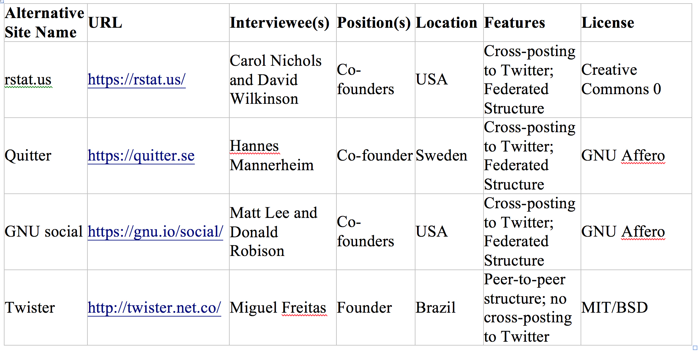

---

### Introduction: Universalised Twitter Meets Its Alternatives

Anna Tsing’s *Friction: An Ethnography of Global Connection* (2005) explores the moments when a universalised practice (for example, global capitalism) gets a grip on a local context (for example, in an Indonesian rain forest). When the slippery universal, which in some circles might be lauded as ‘frictionless’ (as in ‘frictionless capitalism’), meets local contexts, frictions occur. *Friction* traces the move from the desire for frictionless ideals to its awkward and messy contact with situated realities. Friction is resistance, but it is also productive and necessary for any energetic system. {#para1}

Taking up this idea, this paper traces the friction between Twitter and Twitter alternatives. In this sense, Twitter is situated as ‘universalised’ (Koopman, 2013: 19), which is to say that it is now an idealised form of online communication. Twitter has established a format of online communication—microblogging—that is seen to simultaneously support free expression yet also is amenable to surveillance capitalism. As such, it has a significant impact on media politics; it is a site by which people socialise, promote themselves, make jokes, build brand identities, make tech investments (for example, purchase Twitter stock), or organise activists. Whereas its early history was marked by commentary on the oddities of 140-character communication and the banality of posting mundane moments of one’s day, Twitter is now second nature for billions of people worldwide as a part of daily life. The use of the octothorpe (#) in hashtags is now part of language, as when someone leaving a party says ‘hashtag I’m out’, evoking ‘#imout.’ Although Twitter has not been universalised to the extent that capitalism has, there is a lot of energy devoted to spreading Twitter, as in the case of the U.S. State Department’s support of the service due to its perceived use in protest movements outside the United States (Bratich, 2011). {#para2}

However, Twitter is not without its critics. This is reflected by the fact that there is a robust collection of critical alternatives to Twitter being developed. This paper presents four of these alternatives and considers the frictions that occur when universalised Twitter-style microblogging meets these particular alternative practices. Specifically, drawing on the approach of critical reverse engineering, this paper considers four points of contact between Twitter and the alternatives: the pragmatic, the genealogical, the legal, and the normative. Carefully studying Twitter alternatives at each of these moments of contact reveals both their powerful critiques of Twitter as well as their specific implementations of the format of microblogging. Through analysis of these moments of contact between Twitter and its alternatives, we will see varying frictional practices: cross-posting versus separation; shifts in conceptions of Twitter’s role in the larger political economy of the Internet; different approaches to the legal questions of reverse engineering; and even a tension over whether making a Twitter alternative is media activism or not. Doing this work tells us much about Twitter, but it also shows that there is much more to microblogging than Twitter. {#para3}

The data for this work are drawn from interviews with the developers of these alternative sites [2] and to a lesser extent from software studies-inspired (Fuller, 2008; Mackenzie, 2006; Kitchin and Dodge, 2011; Chun 2011) close readings of the architectures, coding languages, and interfaces of the sites. The interviews and analyses of Twitter alternatives are read through a frame of ‘critical reverse engineering,’ an approach to studying the relationship between an original technical artefact (in this case, Twitter) and artefacts built in critical response to that artefact (here, rstat.us, GNU social, the Quitter implementation of GNU social [1], and Twister). Before exploring the alternatives, I turn to that framework. {#para4}

### Critical Reverse Engineering

In previous work (Gehl, 2014a, 2014b), I draw on the literature of reverse engineering as it appears in the fields of law and engineering (e.g., Ingle, 1994; Samuelson and Scotchmer, 2002; Eilam, 2011) to lay out ‘critical reverse engineering’: a theoretical and methodological framework for the study of social media alternatives. Critical reverse engineering is a process by which we can take apart and analyse the technical artefacts we confront. I am particularly concerned about how this process can be used to critique mainstream social media sites such as Facebook and Twitter. However, this process does not stop at critique; the goal is to use the knowledge gleaned from the analysis of the social media site to make better systems. It thus intersects with—but does not necessarily map directly onto—the specific form of activism of making media alternatives (e.g., Atton, 2002; Couldry and Curran, 2003; Rodriguez, 2001). {#para5}

I argue that there are four key points of contact included in this approach: *pragmatic, genealogical, legal,* and *normative.* First, critical reverse engineers are *pragmatic* in that they retain much of the functionality, design, and generic practices of the mainstream sites. For example, the social media alternative Ello relies on the follower/followed relationship developed by Twitter as well as a ‘stream’ of new content (with new content on top) popularised by Facebook. The pragmatic response of alternative developers is to avoid reinventing the format of social media wholesale and thus alienating would-be users. Rather, this example of ‘making do,’ is a moment of friction between an ideal (a whole new system) and the ‘compromise of practical action’ (Tsing, 2005: 85). Alternative builders attempt to mix familiar design conventions with new functionalities and modes of connection (Gehl, 2014b: 19). This reflects canonical reverse engineering practice. {#para6}

Second, social media alternative makers reverse engineer mainstream sites by doing what Foucault might call the ‘gray, meticulous, and patiently documentary’ (Foucault, 1984: 76) work of *genealogical* analysis of the mainstream sites. Reverse engineers look at many artefacts to understand the object they are reverse engineering: documentation, white papers, press releases, how the organisations that produce artefacts are structured, the theories of the user deployed by artefact makers, previous versions of the artefacts, databases, specifications, and of course lines of code. This is an intensely analytical practice. Moreover, alternative social media sites very often replicate the culture, practices, and interfaces of mainstream sites before mainstream sites become highly commercialised. Thus the alternative developers think historically, and look to the past to construct a new social media future. {#para7}

Next is the *legal* orientation. Much as with fair use exceptions in copyright law, many liberal legal regimes recognise a reverse engineering exception in intellectual property law. As I argue elsewhere, ‘in terms of the functional side [of software], unless it has been protected by a patent, we are free to replicate the functionality of existing software. And in order to do that, we are in fact allowed to open up, probe, test, and disassemble software—even to make copies of it in the process’ (Gehl, 2014b: 8). While this exception varies in each legal context (say, the United States versus Australia) and over time (especially as technology corporations engage in legal fights to limit these practices), reverse engineering is a longstanding, legal practice in manufacturing, engineering, design, and technological development. Social media alternatives thus enjoy some legal protections, even as they replicate many features of mainstream sites. This is also enhanced when the alternatives draw on the traditions of copyleft, the Free Software movement, and Creative Commons, which have for decades used copyright law against itself (Weber, 2004; Coleman, 2009). {#para8}

Finally, as I ask elsewhere, ‘why build a Twitter alternative unless one has a goal in mind’ (Gehl, 2014b: 18)? Drawing on the reverse engineering literature, I argue that taking apart social media is only the first step. The goal of reverse engineering is always to use the knowledge produced during the process of taking apart an object to build a new object. Similarly, critical reverse engineering is *normative*; it does not stop at critique, but rather must continue on to the development of alternatives that improve upon the originals. In this sense, it aligns well with Andrew Feenberg’s (1986) recommendation that critical work be grounded in material reality, seek contradictions in that reality, and use such contradictions to make a better world. Builders of alternatives are doing more than decrying what they see as the problems of mainstream social media; they are working to build better systems. {#para9}

### Critiquing Twitter: GNU social, Quitter, rstat.us, and Twister

 {#para10}

By simply positioning themselves as Twitter alternatives, rstat.us, Twister, GNU social (and its specific implementation Quitter) all present an implicit critique of Twitter. These implicit critiques were made explicit in the interviews I conducted with alternative makers. For example, in interview Carol Nichols of rstat.us faulted Twitter for the following: {#para11}

- • the ever-increasing amount of ads

- • the lack of granular privacy/blocking/harassment reporting features

- • the possible compliance of Twitter with law enforcement/government agencies in revealing even private account information

- • weird [user interface] decisions they make like the blue conversation threading

- • the hostility Twitter has towards 3rd party app developers

- • …putting tweets from people you don’t follow in your timeline

- • [their intention to] start curating your timeline for you like Facebook does in the near future

All of the developers interviewed expressed similar concerns, as well as criticisms of Twitter’s centralisation and the lack of user control over data and the underlying code. But of course, these critiques of Twitter are well documented in critical social media (as well as, increasingly, in the popular press). By building new Twitter-like systems, these developers are doing more than criticising; they are critically reverse engineering Twitter. I will explore this using the four points of contact of critical reverse engineering, paying special attention to the frictions that occur between and among Twitter and these alternatives as these sites attempt to build a better Twitter. {#para12}

### 1. Pragmatic

By simply looking at the interfaces of rstat.us, Twister, and GNU social (including Quitter), it is clear that these Twitter alternatives all retain the universalised, generic structure of ‘microblogging’: short posts with a character limit, a follower/followed social interaction system, new posts on top (often with a notification that new posts are available), a predominantly single-column presentation on the screen, and a requirement that users sign up for an account. In other words, the alternatives very much replicate the canonical features of Twitter, reflecting Twitter’s dominance as a universalised microblogging system. The developers of these sites acknowledge the close ties their alternatives have with Twitter’s interface. Carol Nichols notes that rstat.us is ‘pretty clearly inspired by Twitter.’ Donald Robertson, a member of the Free Software Foundation who helped in early days of GNU social, likewise says, ‘the current functionality of GNU social and Twitter are similar.’ As I argued above, such a move is pragmatic; maintaining familiar interfaces and functionalities allows users to immediately recognise what these sites are intended for. {#para13}

Interface similarities do not tell the full story, however. A contrast emerges when we consider how closely these alternatives are entangled with Twitter. GNU social and rstat.us maintain a relatively close tie to Twitter by allowing users to ‘cross-post’ posts. This means that if a user has a Twitter account and allows rstat.us or GNU social access to Twitter via Twitter’s Application Programming Interface (API) the user’s posts will simultaneously appear in the connected Twitter account. This allows users to use the alternative site without feeling as if they have left Twitter (and all of the connections they have made in that site). As Matt Lee of GNU social explains, ‘everyone using Twitter today could make a switch to GNU social and keep using Twitter. A lot of the apps that post to Twitter can be used too.’ Carol Nichols of rstat.us provides more details: {#para14}

> Rstat.us implements Twitter Oauth so that you can sign into rstat.us using your Twitter account instead of creating a new account on rstat.us, if you want. If you do that, you can also syndicate your posts from rstat.us to Twitter so that you can post both places at once. {#para15}

In addition to allowing the user to cross-post, using Oauth allows a user to use Twitter as the authentication system for the alternative. Tapping into the Twitter API thus makes it easier for users to switch because they can keep and maintain their Twitter accounts. {#para16}

However, this use of the Twitter API has a drawback: it reinforces Twitter’s central position in microblogging. After all, users who switch to GNU social or rstat.us do not have leave Twitter, and thus they can effectively use these alternatives as third party ‘apps’ to connect to Twitter (in the same manner as apps like Tweetbot or Ubersocial). Thus, although users might have their Twitter use mediated by an alternative, they are still contributing to Twitter as free labourers (Terranova, 2000). {#para17}

In contrast, Twister, a peer-to-peer system developed by Miguel Freitas, does not allow for cross-posting. Instead of allowing users to maintain their Twitter connection via an alternative, Twister requires them to sever the connection. In our interview, Freitas noted the decision to not allow cross-posting between Twister and Twitter was a legal one, an interpretation of the Twitter Terms of Service that holds cross-posting is prohibited (also see jpfox, 2014). Setting aside this legal question, one result of this decision is that users who want to keep using Twitter while using Twister would effectively have to work with two systems. {#para18}

Thus, it is unwise to homogenise Twitter alternatives in terms of their pragmatic relationships to Twitter. Instead, the pragmatic orientation of critical reverse engineering prompts us to consider how loosely or closely tied an alternative is to the mainstream site. The varying degrees of loose or close coupling produce different ways of thinking about what it means to make a Twitter alternative. Does the alternative act as a layer on top of the existing Twitter infrastructure? Or does it ask users to make a complete break with Twitter? {#para19}

This can be illustrated in a slightly different way with a vivid metaphor supplied by Hannes Mannerheim of Quitter during an interview: {#para20}

> Twitter is the heroin and Quitter is the methadone. Quitter does not aim to be a utopian social media, we’re aiming to create a way to drop out, to quit. Maybe later, when enough people have quit…. maybe then we can start transforming the network into something more useful (it will probably happen automatically then). But until then I think we have to mimic Twitter pretty closely, so the threshold to quitting is lower. {#para21}

Recall that Quitter allows for cross-posting and one can see that this metaphor, where Twitter is the addictive opiate and Quitter the synthetic opioid, is one way to think about leaving Twitter behind. Quitter is a specific implementation of GNU social (a larger, free software project) that features a very close copy of Twitter’s interface (software called ‘Qvitter’). Quitter thus provides a gentle way to kick the Twitter habit. GNU social and rstat.us’s cross-posting feature can help with weaning users off Twitter, as well. Twister, on the other hand, is more like going ‘cold turkey,’ that is, leaving Twitter abruptly. In this sense, the friction emerging as alternatives confront Twitter and either take advantage of Twitter’s API or not is productive, resulting in multiple ways to leave Twitter and thus multiple ways to think about microblogging as a more heterogeneous online practice. {#para22}

### 2. Genealogical

Reverse engineering can be conceived of temporally, because it reverses the forward engineering process of starting with an abstraction (such as a design, a blueprint, or a concept) and implementing that abstraction in concrete material. Reverse engineering thus starts with a concrete artefact and works backwards towards abstractions (Ingle,1994: 9; Chikofsky and Cross, 1990: 15). While reverse engineers don’t tend to think of this as a historical process, I suggest that it can be conceived of as such (Gehl, 2014a: 10–11). This is because a large part of the work of reverse engineering is tracing the genealogy of any given artefact, considering how it developed over time, looking at statements designers made about it, comparing new versions to old ones, and ultimately rearticulating the technology back into larger historical and cultural contexts. {#para23}

The technical details of this genealogical process did not come up much in interviews, but it is readily seen if we dig into online forums dedicated to these Twitter alternatives (especially on the code repository GitHub). For example, a discussion regarding potential cross-posting from Twister to Twitter (jpfox, 2014) led to a discussion of the evolution of Twitter’s Terms of Service and API. Twister contributor toyg noted: {#para24}

> One of the clauses in [third party Twitter] applications’ standard TOS is that you will not use the app to synchronise with other social networks, end-of-story. This is a policy [Twitter] implemented in the last 2 years as part of their big ‘crush 3rd party clients & other social networks’ strategy – they want people to use Twitter official clients and keep Twitter content inside Twitter….
>
> …they disabled public RSS feeds, so you need an API key to do pretty much anything…. This is why nobody does any Twitter integration anymore, except for the occasional post-update-to-Twitter from non-social applications (jpfox, 2014). {#para25}

In less technical terms, as toyg pointed out to other Twister developers, Twitter once had a very open API—not to mention an RSS feed—which would allow users and developers easy access to the data within Twitter. However, in August 2012, Twitter announced sweeping changes to the API, severely limiting access to users and developers (Sippey, 2012). Several of the developers I talked to did note the changes in Twitter’s API as key prompts for their wanting to build alternatives. Thus, as they seek to critically reverse engineer Twitter, the alternative builders are thinking—at least in part—historically, considering Twitter as it has evolved both as a technology, comparing its present-day documentation to previous versions to explore how Twitter’s relationship with third-party developers has changed over time. {#para26}

In addition, the alternative builders also consider Twitter as an online practice embedded in larger historical changes. Dave Wilkinson of rstat.us discussed Twitter as it was in 2010: ‘Looking at Twitter toward the end of 2010 and seeing how it was being used as a communication medium (much like Fidonet and modem federation before it during Soviet crises [sic.]) throughout the Arab world was really inspiring.’ Here, Wilkinson links Twitter (at least as it appeared in 2010) to previous alternative media that played a role during political protests. {#para27}

Similarly, Miguel Freitas, who is Brazilian, discusses his observation of the role of social media during that country’s *Movimento Passe Livre* protests in 2013. He noted that social media provided: {#para28}

> A feedback mechanism that [made] these movements grow over time. … That was something I could clearly see happening here in Brazil, by noticing how the presence on the streets was amplified when people had access to videos showing … police violence as totally disproportional to the original protesters (against bus fares increases). {#para29}

Freitas explains that such videos would never air on Brazilian mass media. However, he also noted that this progressive aspect of social media as an alternative to corporate-controlled mass media is endangered: {#para30}

> While social media as we have today is certainly more empowering to individuals and less prone to censoring than conventional media, there is simply no guarantee that it will keep this way. In fact, we have … some examples (especially from Facebook) where content selection is already heavily filtered. So, in the long run, these sites might be no better than mass media. {#para31}

> Another inspiring event: You surely remember London riots, when the government considered shutting down Twitter and Facebook. So it’s not about the merit of London rioters, but the mere possibility of shutting down an important channel of information like that that strikes me. This is totally against the idea of the Internet, where you are supposed to have no single point of failure. {#para32}

In addition to critiques of Twitter’s centralisation (like Freitas offers above), the alternative builders have critiqued the evolution of its business model. As Carol Nichols of rstat.us notes: {#para33}

> Especially since Twitter has gone public, and really since they started taking [venture capital], it’s to be expected that they will always be making changes that will make them the most money, not those that will make their users the most happy and safe. {#para34}

And Wilkinson adds that Twitter’s Terms of Service changes drew attention to rstat.us as a less exploitative alternative. {#para35}

In these genealogical accounts, Twitter is presented as having fallen from grace. Twitter was once an open system, with an API that allowed for heterogeneous developers to build on the platform and an interface that allowed any user to circumvent censorship and get messages out. Twitter was part of the social media challenge to centralised media power. However, for Freitas, Wilkinson, and Nichols, Twitter has succumbed to the dictates of surveillance capitalism, both by eschewing activist uses of the service in favour of advertiser-friendly practices and by remaining centralised and thus vulnerable to state surveillance and control. {#para36}

However, this isn’t the only way to trace Twitter’s history. During our interview, Hannes Mannerheim of Quitter offered a different take on Twitter: it was never revolutionary. ‘In 2010 we [Mannerheim and other Swedish Internet activists] saw how a counter-revolution had started. Spotify started taking users from Bittorrent, Facebook and Twitter had already taken over much of the diverse blogging communities.’ In other words, Mannerheim argues that Twitter’s highly centralised structure ‘took over’ from blogging as the dominant social media practice. The existence of WordPress.com, Livejournal, and Blogger notwithstanding, blogging has traditionally been a distributed format of online communication because blogging software can be run on one’s own server (Siles, 2011). Twitter’s ‘counter-revolution’ was to draw in and enclose (Andrejevic, 2007; Boyle, 2003) distributed practices such as blogging. Thus, for Mannerheim, Twitter was *never* revolutionary; from its earliest days it was built to counter the revolutionary aspects of peer-to-peer software and ‘diverse blogging communities.’ {#para37}

Once again, there is a friction as universalised Twitter meets its alternatives, this time appearing at the genealogical point of contact. The stories the Twitter alternative makers tell about their services and Twitter itself present histories and counter-histories that complicate our understanding of universalised microblogging. For example, when the next social network captures the public imagination—as Ello briefly did in 2014—we are armed with these histories to help us interpret and struggle over the meaning of a new system. Can we read it as a potentially revolutionary system that must be protected from the dictates of surveillance capitalism? Or is the new system simply a corporate reaction to more dangerous practices such as distributed media making? The divergent genealogies of Twitter offered by the alternative makers gives us material for debates about new social media technologies. {#para38}

Regardless of this divergence, all of the developers are reverse engineering in the sense that they start with a concrete artefact (Twitter as it appears today) and work backwards to abstract architectures and concepts (open APIs, less constrictive TOSs, distributed networking, free software and culture, and alternative media) that they either see in past iterations of Twitter or Internet communication in general. They then seek to re-implement those abstract features into specific, divergent, concrete forms within their alternatives. {#para39}

### 3. Legal

The legal aspects of the Twitter alternatives are quite important, and the developers discussed them at length in our interviews. Indeed, when Twitter meets the alternatives at the contact-point of the law, many complex practices and discourses emerge. Specifically, three threads emerge that tie in with critical reverse engineering: the legal protection afforded to those who reverse engineer, the legal protections that come from using copyleft, free software, or public domain licenses, and, to a lesser extent, the need to fight for the right to reverse engineer in courts. {#para40}

The first thread that emerges here is *protection due to the legality of reverse engineering.* Reverse engineering enjoys a history of legal protections. As legal scholar Pam Samuelson has argued, courts have long recognised the ‘right to take the purchased product apart, measure it, subject it to testing, and the like. The time, money, and energy that reverse engineers invest in analysing products may also be a way of “earning” rights to the information they learn thereby’ (Samuelson and Scotchmer, 2002: 1583). This extends to software and computer systems. However, software companies attempt to limit reverse engineering through terms of service (TOS) agreements. Twitter is no exception to this practice. [3] Therefore, the developers of the Twitter alternatives walk a fine line between learning how Twitter works through intense analysis of it on the one hand and violating its TOS on the other. As Nichols of rstat.us notes: {#para41}

> We’ve been really careful not to violate Twitter’s TOS, even in gray areas. I could definitely see them trying to sue us, if they decide to patent ‘posting text on the Internet in 140 character segments’ or something, which I hope wouldn’t be patentable but Amazon has one-click buying patented so who knows. {#para42}

To protect themselves from lawsuits and accusations of violating intellectual property, the alternative builders use time-tested techniques of building from broad specifications, rather than directly copying Twitter functionality. As Wilkinson says, ‘I’m not particularly concerned [about Twitter suing rstat.us]… The technology we use underneath [rstat.us] is implemented from a specification that is well-known and acknowledged by many social-based companies. Google uses it and in fact maintains some of the specifications.’ Similarly, Freitas describes the ‘clean room implementation’ of Twister: {#para43}

> I hired this guy… to implement the [user interface] in HTML/Javascript. He is also a graphic designer. So I described him the interface I wanted in details: how posts should expand on click, where to put the reply box, what to show on mouse hover, the modal dialogs etc. A lot of this functionality is common to both Twitter and other existing microblogging, so I’ve sent him some screenshots to demonstrate what I meant, but *I specifically asked him NOT to use any code or graphic elements from them*. He had to work solely based on my specifications and he was free to design the new graphical identity (my emphasis). {#para44}

In other words, Freitas and the implementer worked from functional specifications that Freitas crafted, rather than attempting to explicitly copy the look and feel of Twitter. Thus, whereas alternatives such as Twister or rstat.us bear many similarities to Twitter, their production follows accepted reverse engineering practices and thus is likely protected by law. {#para45}

The second thread is *protection due to the ‘legal jujitsu’ of copyleft, free software licenses, or the public domain.* Besides the longstanding protections afforded to reverse engineering in Western law, these Twitter alternatives also enjoy the protection of decades-old practices of copyleft, free licenses, or public domain licensing. Copyleft, inaugurated by software producer and activist Richard Stallman, uses copyright law against itself, licensing objects in such a way that they will always remain freely modifiable to future users. Moreover, copyleft requires anyone who builds on previous copyleft-licensed software to have his or her contribution licensed in the same manner as the original object. Thus, copyleft creates an infrastructure of free and open artefacts, and it is nearly impossible to make them proprietary and closed after they are licensed with a copyleft license. While not copyleft, free software licenses allow users the ability to access, modify, and distribute code (but it does not require them to perpetuate that license on any code they derive from the original project). Licensing an object as public domain allows end users to do whatever they like with the object. This includes creating closed, proprietary versions. However, unlike copyleft, licensing as public domain signals the complete rejection of the copyright system altogether, and hence it is a political move. {#para46}

The developers of Twitter alternatives are well versed in the use of licenses as a means to protect their projects, but they use different licenses to reflect different political commitments. For example, licensed under the GNU Affero license, GNU social (and hence Quitter’s interface Qvitter since it is built on GNU social) enjoys the most copyright protections of the alternatives. The Affero license is copyleft—that is, it allows users to modify GNU social but it requires any derivatives made from it to be licensed the same way. Moreover, it is built specifically for networked software. {#para47}

Citing Twister’s MIT/BSD license (a free software license), Freitas argues that Twister is protected from most, if not all legal procedures meant to shut it down: {#para48}

> I think any legal procedure against me (either because of hypothetical patents or name copyright) is mostly useless. They won’t be able to make the source code illegal, nor I think they would be able to shutdown the whole thing even if I quit. {#para49}

In other words, by using a free software license, Freitas is confident that Twister would live on even with legal actions brought against him. {#para50}

As for rstat.us, the license has changed over its development, but the developers always sought to put rstat.us in the public domain. Carol Nichols led the change in rstat.us’s license from WTFPL (an acronym for ‘Do Whatever the Fuck You Like Public License’), which is, as its name implies, very permissive to Creative Commons 0 – No Rights Reserved, which places rstat.us code and graphics in the public domain (Nichols, 2012a). Whereas WTFPL would essentially do the same as CC0, the former ‘sounds like a vaguely offensive April Fools Joke’ as a contributor to rstat.us put it (Nichols, 2012b). As one contributor to rstat.us noted, the latter, tied as it is to the 13-year-old Creative Commons legal project (founded by the lawyer Lawrence Lessig) would ‘preserve the original motivation for choosing WTFPL and make the kind of statement rstat.us wants to make without alienating people’ (Nichols, 2012a). While the Creative Commons 0 license would not protect derivatives of rstat.us from being made closed and proprietary, the rstat.us developers are making a political statement about software and culture—it should be totally free, and this freedom should be declared in such a way as to be recognised in as many legal contexts as possible. As Wilkinson notes, ‘These systems are for the people, they should be built by the people, they give people the ability to build new things, so why not let them be entirely owned by the people?’ Using a ‘serious’ license such as Creative Commons 0 (as opposed to the WTFPL) is part of the overall legal and political strategy of rstat.us. {#para51}

Finally, I turn to *activism in the legal courtroom.* Elsewhere, I argue that reverse engineering exceptions to intellectual property laws have to be exercised and protected if they are to remain viable (Gehl, 2014b: 9; see also Samuelson, 2002). Without supporting the reverse engineering exception, would-be reverse engineers would watch it fade away over time. Nichols echoes this point: {#para52}

> I have vague hopes that [being careful about the Twitter TOS] would make it not worth Twitter’s while to try and sue us, but I am not a lawyer. If they would try to sue a group including me personally, I think it would be pretty fun to go to bat over this, and I would hope organisations like the [Electronic Frontier Foundation] would help. {#para53}

Nichols practically welcomes a lawsuit because she believes it would benefit rstat.us. However, she also argues that the law and technology need to be further reconciled: {#para54}

> I think we need more technology-aware lawyers, judges, and political representatives as more and more of our life happens on the Internet… hearing court decisions or laws and the misconceptions and conclusions they draw based on their limited knowledge makes me cringe. {#para55}

In other words, to protect reverse engineering practices, not only would the critical reverse engineers need to fight for it in court if need be, lawyers and judges will also have to be educated about new technologies. These go hand-in-hand; lawyers need precedents to study as they become educated, and technology cases need technologically-aware lawyers to argue them and set those precedents. {#para56}

Ultimately, the friction caused by the legal contact point between Twitter and the alternatives revealed many complex practices and lines of thought. As should be clear, the practices of critically reverse engineering a set of functions, choosing a license (copyleft, free software, or public domain), or girding oneself against a potential lawsuit from a powerful, publicly-traded transnational firm are politically fraught. In critically reverse engineering Twitter, the alternative makers must engage in legal exegesis to see how their specific sites operate within larger contexts. In doing so, the diverging paths chosen by rstat.us, GNU social, Quitter, and Twister as they implement microblogging gives us new purchase on our legal relationship to the mainstream site Twitter. {#para57}

### 4. Normative

Finally, there remains the fourth point of contact, the normative, to consider. Drawing on the literature in reverse engineering, I argue that reverse engineers do not simply take apart a technology in order to learn more about it; they do so to build something new and better than the object they are reverse engineering. This is a normative move. It might be quite instrumental; the reverse engineer might simply want to alter an object to fit an organisation’s needs. Or, it might be for profit; the reverse engineer might want to make a competing product with a slightly different value proposition (as they say in business). For critical reverse engineering, however, the normative move is decidedly tied to broad (yet of course, contested) universalised goals such as freedom and equality. This is the case with the Twitter alternatives, as well. These alternatives are meant to be better microblogs, allowing their users the benefits of microblogging with more control over their data and the interface as well as more privacy from government and corporate surveillance. {#para58}

When it comes to this normative point of contact between Twitter and the alternatives, a major divergence emerged during my interviews with the developers. This divergence centers on a question I put to all of them: is building a Twitter alternative activism? Some of them argued that their work is not activism, stating that the purpose of a Twitter alternative is simply to provide a politically neutral platform for their users. Others argued that the very act of coding a social media site is activism, and thus they do not see their alternative as neutral; rather, it is meant to shape uses and users. This is a major divergence in terms of understanding the relationship between technological development and activism. I call this a distinction between ‘Platform Builders’ and ‘Politics Encoders.’ {#para59}

First, I turn to the Platform Builders. Matt Lee, Donald Robertson, and to a lesser extent Miguel Freitas argue that the Twitter alternatives they make should be neutral. For example, GNU social founder Matt Lee notes that the ‘only politics I see embedded in the work is that of software freedom. I can’t think of many of our users would be terribly upset about this.’ Similarly, another GNU social developer, Donald Robertson, argues: {#para60}

> I would say that I embed ethics [rather than politics] into the software. Free software is an ethical choice to protect free expression and self-determination. Any software that is free will carry that to its users, but this does not conflict with the interests of the user. Free software is in fact built in the interest of the user. The free software community is made up of people of all different political viewpoints using the same software, so I don’t believe it enforces any particular political viewpoint. {#para61}

Here, both Lee and Robertson posit the neutrality of GNU social: people of all political backgrounds can use it. It does not impose a particular politics upon its user. It will not limit the end user’s expression in any way. {#para62}

Miguel Freitas, creator of Twister, builds on this in his discussion of the relationship between activism and technological development: {#para63}

> In general, I don’t think technologists are good activists themselves… when activism expands much beyond the technology itself chances are it may be well off the target. I’ve seen bitcoin activists promoting technology as if it would solve the poverty on earth, with arguments that are based on very crude understanding of economics. I’ve seen Brazilian ‘anonymous’ group defending very incoherent positions and highly partisan and selective actions. {#para64}

Freitas is suggesting that technologists ought to stick to their domains—technological development—leaving politics out of it. {#para65}

Unsurprisingly, since he has such doubts about technologists being activists, Freitas downplays the politics he might embed in Twister: ‘I don’t want to embed any politics into twister software except for the very specific arena it fits in, namely freedom of speech, anti-surveillance and such.’ He also notes that he is careful to distinguish between political positions Twister—the software platform—might take versus his own: {#para66}

> If I may eventually talk about politics, let’s say if I want to express an opinion about Gaza’s bombing, then that will be sent from my personal account. It will be just another user’s voice, not the official twister’s position. I don’t think the users have any problems with that. If they don’t want to hear me, just ‘unfollow’ me. That’s the standard microblogging way of doing. {#para67}

Similar to Lee and Robertson, Freitas differentiates his work on Twister from what might be called ‘Capital P Politics’ – that is, Twister (the organisation) taking a political stance versus Freitas (the person) doing so. {#para68}

How can we make sense of this? We can turn to the politics of platforms. Tarleton Gillespie (2010) argues that social media sites such as YouTube have established ‘platform’ as a trope, a discursive anchor providing a structural metaphor with which to understand how social media work. This term, ‘platform,’ is semantically rich, with multiple meanings. Gillespie draws out four meanings, noting that the architectural, computational, and figurative meanings of the term—a structure upon which to build something or present an idea—are neutral, ‘typically flat, featureless and open to all’ (Gillespie, 2010: 350). A fourth meaning of social media platform—the idea of a ‘political platform’ wherein one presents a political stance—is not neutral, but rather involves value statements. For some of the creators and developers of Twitter alternatives, their systems are akin to the first three meanings of ‘platform’: they are neutral, flat, and open to all. Indeed, to use these systems as a ‘platform’ in the political sense—that is, to build them in order to express a particular political perspective—would be abusing these systems. {#para69}

This can be further explained with the ethos of the Free Software movement, which supports the Four Freedoms of software: the ability to run the program for any purpose, audit it, alter it, and distribute any changes one makes to it. On the level of property, the Four Freedoms are quite radical; as Weber (2004) notes, this perspective challenges private property as a right to exclude and instead envisions property as a right to distribute the fruits of labor. However, on the level of embedding one’s politics into code in order to shape uses and thus users, the freedoms are quite conservative. In essence, the Four Freedoms focus a developer on creating a tool that is neutral vis a vis the end user’s politics. If for some reason it constrains an end user’s expression, the end user should be able to change it. This is a very libertarian, individualistic conception of technological development, one that downplays the idea that building software is activism beyond providing others with tools. The fact that these tools help mitigate surveillance and would allow users an active role in the production of the alternatives (by allowing them to modify the source code) is not interpreted as ‘political’ or ‘activism’ by these developers. {#para70}

All of this reveals that Lee, Robertson, and Freitas have a particular normative relationship to Twitter that appears as they critically reverse engineer that site. Twitter is not free, which is to say that it is a platform that cannot be altered by end users. It also engages in surveillance of its users, selling access to their attention to advertisers. If it were free (which would mean it would allow users to alter its underlying code and even take that code and install on a server of their own) there would be far less need for an alternative, and Twitter’s capacity as a surveillance system would be curtailed because users could modify any parts of the system that allowed for monitoring. Thus, the Platform Builder’s normative move in critically reverse engineering Twitter is to supersede the Twitter platform by building a new, neutral platform that has Twitter-like features, more user control, and less centralised surveillance. Doing so would allow users to engage in microblogging in any way they wish. {#para71}

In contrast, several of the Twitter alternative developers can be called ‘Politics Encoders.’ While the Platform Builders downplay the idea that their work is political, Politics Encoders see their work as always political, always activist. Whereas Lee, Robertson, and Freitas hesitate to claim the identity of activists, Nichols, Wilkinson, and Mannerheim readily accept it. As Nichols, an rstat.us developer, notes, ‘The free software movement, in particular, is very much activism—the idea that everyone should have the freedom to read, modify, run, and redistribute software, and the people who release the code they write as such, have changed and are changing technology.’ Although this sounds similar to Lee and Robertson’s views, it differs in that Nichols, as a free software creator, explicitly claims the identity of activism. {#para72}

Building on this, Wilkinson, also an rstat.us developer, links writing software to writing political pamphlets: {#para73}

> Culture, code, and activism obviously intersect. A developer’s culture and identity directly influences the problems they are willing to solve, and thus their solutions, regardless of tools or technology, reflect those problems and their culture in turn. I find ‘code’ and ‘development’ here to just be evolutions of a type of activism that has always existed. With that in mind, yes, tech-dev is a form of activism in the same way that authoring has always been a form of activism. The usage of political pamphlets after the printing press is a similar example. It isn’t new. {#para74}

The distinction here is subtle but profound: whereas Platform Builders downplay the politics of their work, instead privileging the freedom users enjoy to put their platforms to whatever end they see fit, Politics Encoders interpret even the most mundane acts of coding (say, choosing a data structures or selecting a coding language) as activism, as intimately tied to and actively shaping the world around them—including uses and users. Indeed, the level of debate rstat.us developers had over the license (Nichols, 2012a) and certificate (Nichols, 2012c) reveals their intense attention to the politics of these technical decisions. Thus, in this view, building a Twitter alternative is activism on a large scale, with every design decision being political, shaping uses. Because of this, as Wilkinson argues, ‘As long as writing sentences is activism, so should the writing of code, the filing of bugs, the deployment of software, the dismantling and rewriting of software, software piracy, etc.’ {#para75}

Hannes Mannerheim, of Quitter, extends this idea. In addition to encoding politics into technologies, he argues that technologists have to encode politics into their own lives: {#para76}

> I don’t think it’s enough to create revolutionary technology and sit back and look how your genius creation changes the world. People spend too much time writing important books and coding ingenious programs that will change how people think and too little time actually putting their politics/technology to work. It’s tempting to become a ‘intellectual’ who aims to spread some Virus of Goodness and then lean back with a glass of wine produced by slaves, while the virus infects the moronic sheeple’s minds and makes them do good instead of bad. I think you have to perform something yourself, change the way you live. Put people in the uncomfortable position of seeing stuff being done differently and on collision course with this system. {#para77}

In other words, one must embody politics in oneself as one encodes it into a technology. This is quite different from the Platform Builder conception, where the platform gets built, released into the world, and then the users do with it what they will. Mannerheim argues instead for continuous, active performance of one’s politics, which implies that coding, activism, and performance are always happening, always linked. {#para78}

Thus, Nichols, Wilkinson, and Mannerheim express a different normative stance towards Twitter than the Platform Builders. Whereas Lee, Robertson, and Freitas want to avoid limiting what their end users can do with their alternatives, the Politics Encoders argue that every technical choice will affect end users. As such, their actions are always fraught and require a great deal of debate and analysis. As Mannerheim notes, ‘The decisions on which technology to use and which to develop [are] definitely not neutral.’ In this perspective, Twitter’s changes over time are viewed as having a specific political (and economic) end—that of monetising the attention of its users. As Wilkinson puts it, Twitter: {#para79}

> Has added promoted tweets that get injected into your timeline, promoted trending topics which defy the word ‘trend’ and now they are considering choosing what you see among your personally curated feed. They now want to control what you see…. They seem to want to place the right content next to the right ads. {#para80}

And as Nichols notes: {#para81}

> I know once you get a user base the size of Twitter’s, you’re never going to make everyone happy, but it seems like now they’re actively ignoring the needs of their users in order to serve the needs of their advertisers and shareholders. {#para82}

These design decisions could be explained away by noting that despite these changes, Twitter remains a neutral ‘platform’ for users to express themselves in (in the first three senses Gillespie (2010) lays out), but for Politics Encoders, each of these choices is highly political, shaping what is possible in Twitter, directing users towards specific ends and thus revealing that technological change is not neutral. Likewise, a Twitter alternative should seek to ameliorate these interventions by offering other possibilities of use and communication. {#para83}

Obviously, the approaches of both the Platform Builder and Politics Encoder contain implicit critiques of the other, revealing the most potent divergence among the alternatives. For the Platform Builders, embedding activist politics into the technology would limit its uses, needlessly or even destructively constraining users who want to use the tool to achieve whatever ends they see fit (including those the developers may not agree with). For the Politics Encoders, such neutrality is impossible, and thus every moment of development should be conceived of as activism; the weight then is on the developers who must think of the politics they will embed in their systems. {#para84}

This friction that occurs at the normative point of contact between Twitter and its alternatives is instructive. Should Twitter—or an alternative—be a neutral platform that does not seek to shape the content the users produce? Or is the very act of making a microblogging service activism, and when such a site fails to support progressive politics, should it be held accountable? What is productive here is that the alternatives bring this question to the fore, and instead of Twitter dictating the terms of this debate, we have multiple sites with which to think about the neutral platforms versus the politics of making social media alternatives. {#para85}

### Conclusion

This essay took up Anna Tsing’s concept of friction—the moment when a universalised system, such as global capitalism—meets and gets a grip on a specific local context. The meeting of the global and the local is energetic; moreover, to complicate things, there need not be one ‘global’ meeting a local. As she argues, there are also frictions among ‘multiple, contested universals’ (Tsing, 2005: 89). By taking up critical reverse engineering’s approach to four points of contact (pragmatic, genealogical, legal, and normative) and considering the meeting between the universalised microblog Twitter and several alternatives, I have shown other universals emerging. Specifically, the alternative makers have engaged with important questions: how closely connected to Twitter should an alternative be? How do we understand Twitter’s history and the larger history of the Internet? What sort of property and distributive regimes should be deployed? What is the best course to deal with potential legal challenges? In making alternatives, are we engaging in activism or making neutral platforms? The alternative makers have principled and strong convictions about answers to these questions, leading to disagreements such as the platform builder/politics encoder distinction. However, to paraphrase Tsing, these disagreements ‘are not a reason to give up on’ Twitter alternatives; rather ‘they are what make [the alternatives] lively’ (Tsing, 2005: 88). In other words, rstat.us, Twister, and the installations of GNU social (including Quitter) are providing new ways to think about microblogging and even one of our grandest universals, communication. {#para86}

### Biographical Note

Robert W. Gehl is assistant professor of communication at the University of Utah. He has published research that critiques social media sites such as YouTube, Facebook, Twitter, MySpace, and blogs in *New Media and Society, First Monday, Computational Culture,* and *Social Text*. His book, *Reverse Engineering Social Media* (2014 Temple UP), explores the architecture and political economy of social media.

### Notes

 [1] GNU social is a free software project to build microblogging software that can be installed on one’s own server. This can then be federated, which means that users can sign up for one instance of GNU social and follow each across instances of GNU social installed on servers around the world. GNU social instances include Indy.im, Gnusocial.no, LoadAverage.org, and Quitter.se, so a registrant at Indy.im can follow one at LoadAverage.org and vice-versa (see Ortega 2015 for more about federation). The specific instance Quitter.se was profiled in this paper because it features an interface, Qvitter, that closely mimics Twitter’s interface in ways that a standard installation of GNU social does not.

 [2] All interviews were conducted via email or in person between May 2014 and February 2015. They were preceded with the University of Utah’s Institutional Review Board consent notices. Interviews took place over several days with multiple follow-up sessions. I would like to express my sincere thanks to the interviewees, who deeply educated and challenged my understanding of making alternative social media.

 [3] Twitter’s Developer Agreement and Policy (httpss://dev.Twitter.com/overview/terms/agreement-and-policy, last accessed 2 November 2014) specifically prohibits reverse engineering: ‘You will not or attempt to (and will not allow others to)… reverse engineer, decompile, disassemble or translate the Twitter API, or otherwise attempt to derive source code, trade secrets or know-how in or underlying any Twitter API or any portion thereof.’ The legality of such a clause is disputable (Samuelson and Scotchmer 2002). It is likely there to constrain third party developers who seek to build applications on top of Twitter’s platform.

### References

- Andrejevic, Mark. ‘Surveillance in the Digital Enclosure’, *The Communication Review* 10 (2007): 295–317.

- Atton, Chris. *Alternative Media* (London: SAGE, 2002).

- Boyle, James. ‘The Second Enclosure Movement and the Construction of the Public Domain’, *Law and Contemporary Problems* 66.33 (2003): 33–74.

- Bratich, Jack. ‘User-Generated Discontent’, *Cultural Studies* 25 (September 2011): 621–40.

- Chikofsky, Elliot and James H. Cross. ‘Reverse Engineering and Design Recovery: A Taxonomy’, *Software, IEEE* 7.1 (1990): 13–17.

- Chun, Wendy Hui Kyong. *Programmed Visions: Software and Memory* (Cambridge, Mass.: MIT Press, 2011).

- Coleman, Gabriella. ‘Code Is Speech: Legal Tinkering, Expertise, and Protest Among Free and Open Source Software Developers’, *Cultural Anthropology* 24 (August, 2009): 420–54.

- Couldry, Nick and James Curran, eds. *Contesting Media Power: Alternative Media in a Networked World* (Oxford, UK: Rowman & Littlefield Publishers, 2003).

- Eilam, Eldad. *Reversing: Secrets of Reverse Engineering* (New York, NY: Wiley, 2011).

- Feenberg, Andrew. *Lukács, Marx, and the Sources of Critical Theory* (New York: Oxford University Press, 1986).

- Foucault, Michel. ‘Nietzsche, Genealogy, History’, in Paul Rabinow (ed.). *The Foucault Reader* (New York: Pantheon Books, 1984), 76–100.

- Fuller, Matthew. *Software Studies: A Lexicon* (Cambridge, Mass.: MIT Press, 2008).

- Gehl, Robert W. *Reverse Engineering Social Media.* (Philadelphia, PA: Temple Press, 2014a).

- Gehl, Robert W. ‘Critical Reverse Engineering: The Case of Twitter and Talkopen’. *SSRN Scholarly Paper ID 2470750* (Rochester, NY: Social Science Research Network, 2014b) https://papers.ssrn.com/abstract=2470750

- Gillespie, Tarleton. ‘The Politics of ‘Platforms’’, *New Media & Society* 12.3 (2010): 1–18.

- Ingle, Kathryn A. *Reverse Engineering* (New York: McGraw-Hill, 1994).

- jpfox. ‘Possible to Add a Dedicated Url Field?’ GitHub (14 January, 2014) httpss://github.com/miguelfreitas/twister-core/issues/63

- Kitchin, Rob and Martin Dodge. *Code/space: Software and Everyday Life* (Cambridge, Mass.: MIT Press, 2011).

- Koopman, Colin. *Genealogy as Critique: Foucault and the Problems of Modernity* (Bloomington, IN: Indiana University Press, 2013).

- Mackenzie, Adrian. *Cutting Code: Software and Sociality* (New York: Peter Lang, 2006).

- Nichols, Carol. ‘Future Direction of Rstat.us Development’. Email Archive. Librelist Archives (7 January, 2012a) https://librelist.com/browser//rstatus/2012/1/7/future-direction-of-rstat-us-development/

- Nichols, Carol. ‘Changing the License to CC0 #443’. Repository. GitHub (11 January, 2012b) httpss://github.com/hotsh/rstat.us/pull/443

- Nichols, Carol. ‘Certificate Authority’. Mailing list archive. Librelist Archives (10 July, 2012c) https://librelist.com/browser//rstatus/2012/7/10/certificate-authority/

- Ortega, Manuel. ‘GNU Social: Federation against the Social Model of Twitter’. Las Indias in English, (April 8, 2015) https://english.lasindias.com/gnu-social-federation-against-the-social-model-Twitter

- Rodriguez, Clemencia. *Fissures in the Mediascape: An International Study of Citizens’ Media* (New Jersey: Hampton Press, 2001).

- Samuelson, Pamela. ‘Reverse Engineering under Siege’. *Communications of the ACM* 45.10 (2002): 15–20.

- Samuelson, Pamela and Suzanne Scotchmer. ‘The Law and Economics of Reverse Engineering’. *The Yale Law Journal* 111.7 (2002): 1575.

- Siles, Ignacio. ‘From Online Filter to Web Format: Articulating Materiality and Meaning in the Early History of Blogs’. *Social Studies of Science* 41 (September, 2011): 737–58.

- Sippey, Michael. ‘Changes Coming in Version 1.1 of the Twitter API’. Twitter Blogs. (16 August, 2012) httpss://blog.Twitter.com/2012/changes-coming-to-Twitter-api

- Terranova, Tiziana. ‘Free Labor: Producing Culture for the Digital Economy’. *Social Text* 18.2 (2000): 33–58.

- Tsing, Anna Lowenhaupt. *Friction: An Ethnography of Global Connection* (Princeton, N.J.: Princeton University Press, 2005).

- Weber, Steven. *The Success of Open Source* (Cambridge, Mass: Harvard University Press, 2004).
