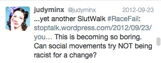
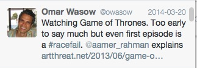
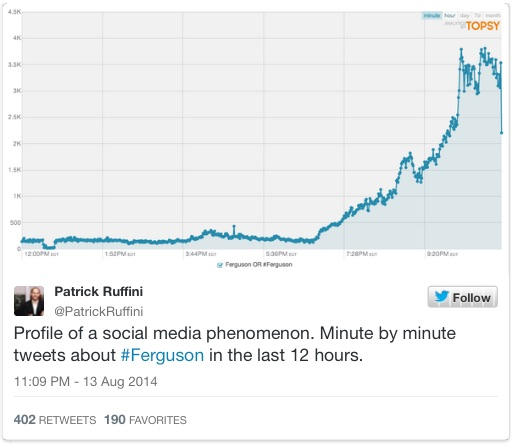
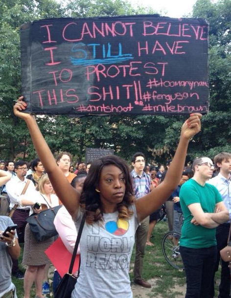
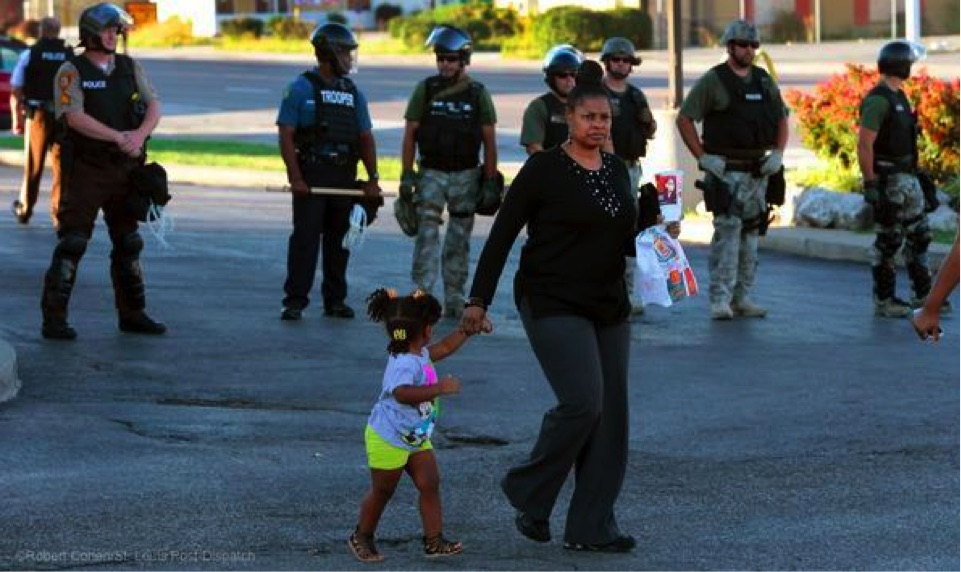
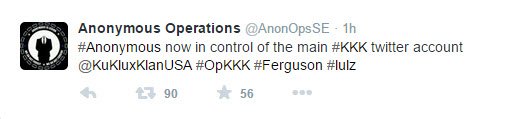

---

Much has been written about the news potential of blogs and microblogs (see for example Siles, 2011; Papacharissi and Oliveira, 2012; Bastos et al., 2013), as well as about the political potential of online space in general (e.g., Bohman, 2004; DeLuca and Peeples, 2002; Downey and Fenton, 2003). In fact, since the dawn of the Internet age, discussion of the democratic potential of Internet-mediated space has been one of the major top level conversations. Yet a lot of that discussion gets mired in an orthodox Habermasian take on what we should consider a democratic public sphere—that is, one where rational critical discourse on matters of societal importance (such as, most critically, the actions of the State) can take place; populated by citizens stepping out of their private roles as interested individuals and into a public space where they become participants in disinterested discussion and debate (Habermas, 1962). {#para1}

While one can argue the merits of Habermas’s public sphere, what of the other kinds of discussion and debate that are facilitated by networked technology? Taking its cue from critical public sphere theorists such as Nancy Fraser (1992) and Michael Warner (2002), this paper explores those other publics: more-or-less subaltern, more-or-less rational, more-or-less critical, and almost certainly partial, affective, interested and *loud*. The paper is interested in angry publics. It is interested in fringe publics. It’s interested in the kinds of publics that do politics in a way that is rough and emergent, flawed and messy, and ones in which new forms of collective power are being forged on the fly, and in the shadow of loftier mainstream spheres. These are the publics born of frictions, in Anna Tsing’s sense, ‘the awkward, unequal, unstable and creative qualities of interconnection across difference’ (2005: 4). {#para2}

Specifically, this paper unpacks the publics of the hashtag, that piece of multiply repurposed typography, that rebel punctuation mark moving to establish itself in new regimes of discourse and communication. Like other forms of active punctuation such as the ‘@’, ‘$’ and ‘!’, residents of QWERTY keyboards that, out of sheer convenience, were taken up by programmers and users alike to take on additional, performative meanings, the hashtag is now one of the most recognisable symbols of communication itself. From its humble Roman origins, where it was used to denote something was measured in pounds—a meaning that drifted towards additionally meaning something numbered (Roman, 2014) [1]—it was twice appropriated by early digital communication cultures. The first appropriation was in 1969 as the ‘redial’ button on early touch-tone phone keypads, where it was known as the ‘octothorpe’ (Roman, 2014), and the second was in 1988 as a symbol marking out IRC channels in the hay-day of early Internet chatroom enthusiasm (Zappavigna, 2011: 791). From its digital neonacy, it was then mobilised by Chris Messina, who, inspired by folksonomic endeavours such as del.icio.us, selected it due to its ubiquity on pre-smart phone keypads (pers. comm.) and proposed its use as a ground-up search symbol in tweets, a structure that was later worked into Twitter’s programming language as an official function (Messina, 2007; Roman, 2014). Now, moving beyond Twitter alone and into other structures both on and offline, it has the potential to organise new structures of discussion, new ‘ambient affiliations’ (Zappavigna, 2011: 803), and new ‘potential discourse communities’ (2011: 801) where in-line metadata acts as both text and metatext simultaneously (2011: 801), drawing discourse together *across technologies* in a way that is worthy of more sustained study. {#para3}

In the taxonomy of information types, hashtags are hybrids. They are both text and metatext, information and tag, pragmatic and metapragmatic speech. They are deictic, indexical—yet unlike other such signs that point elsewhere, hashtags point to themselves, to their own dual role in ongoing discourse. Some have argued that when it comes to the online organisation of information there’s a tension of type between chronological and contextual modes (Benovitz, 2010: 124). Chronological organisation (for example, a thread) can sometimes fail to address the contextual embeddedness of a conversation; while contextual organisation (for example, a hyperlink) might be able to provide greater context (Benovitz, 2010: 124), yet itself risks losing the temporal aspect—how a topic has developed over time. The hashtag therefore functions in the space between the contextual and the chronological. It is a node of continued context across media, conversations and locales, and yet it emerges temporally, self-developing through time, pointing to itself as it points to the other texts it marks as within its ambit. {#para4}

In this way hashtags push the boundaries of specific discourses. They expand the space of discourse along the lines that they simultaneously name and mark out. New hashtags are constantly being deployed into the world: some may not ‘catch’; others might rise to prominence through repetition, through use, through uptake. For example, those organising or livetweeting a conference (for example, the 2014 Canadian Communication Association conference) might propose a number of hashtags—#cca2014, #cca14, #cca, #aca14—and some might become more popular than others, but all of them remain in play, becoming part of the ongoing flow. We could contrast this form of data organisation to processes such as agenda-setting, gatekeeping and creating news frames where those controlling messages set the shape of the discursive content from above, limiting the ways in which information flows may be organised and presented (Bastos et al., 2013: 264). While not discursive limiters or boundaries then, hashtags do have the ability to mark the discursive flows of an event, and are in fact events themselves (Bruns and Sauter, 2014; Rambukkana, 2014), straddling that dual role as text and metatext. {#para5}

Drawing on thinkers such as Massumi (2011), Kwinter (2001) and Whitehead (1967), I conceive of events as moments when otherwise disparate experiences entwine to form something new. Threads of as-yet-unrelated material flow together in complex aggregates and assemblages that, once together, take on a novel character. They move from the complex to the singular, twining into threads of their own that go on to combine into further complexes, further assemblages. The gift that Foucault (1972) gave us for the figuring of discourse and discursive power was to draw our attention to discourse as *event*. As researchers, to understand the power and embeddedness of a specific discourse we need to trace it, to discover both its contextual relevance and its temporal arc—to trace *both* its affects *and* its points of origin, points of change. Where event theory can add to our understanding of the discursive is in showing how, in our current cross-linked and meta-textual environment, events of discourse are coming to *recognise and mark themselves as such*. This self-reflexive discourse occurs in multiple ways—not the least of which is the popular uptake of the term ‘discourse’ in its academic sense—but one worth highlighting due to its increasing societal prominence is through the political and discursive use of the hashtag. {#para6}

Some previous studies have looked at the role of hashtags in relation to political discourse. Most of these are centred around analysing how the hashtag operates on Twitter during major—but temporally limited—political events. Hashtags such as #Jan25, #Tahrir, #Egypt, #Tunisia, and #spill have been analysed, for example, with respect to their role in the Arab Uprisings (for example, Papacharissi and Oliveira, 2012), and a 2010 leadership upset in the Australian parliament (Bruns and Burgess, 2012). On a short timescale, events and studies such as these demonstrate how the hashtag can work as a uniting thread of discourse that allows those who use it to feed into an ongoing and evolving conversation—even, as Douai (2013) points out, acting as one of the seeds that can contribute to a critical mass forcing change. This paper, however, looks at the political hashtag on longer time scales, and for events that are ongoing. It looks at places where tensions simmer and build up over time, where frictions develop and ignite, and where those tracking these fraught politics through hashtags find new problematics and issues, drawing attention to them to wear away at normative and hegemonic phenomena. It also looks at how this kind of hashtag can spill beyond Twitter to other spaces of social networking—such as the recent introduction of the hashtag to Facebook and its more established use on Instagram—and even to other media spaces such as television and print, billboards, skywriting and graffiti (See Figure 1). But how exactly can we situate the hashtag with respect to political communication? {#para7}

### Communication, Friction and Digital Intimacies

As John Durham Peters (1999) reminds us, communication is not a process that naturally invites understanding, connection or societal harmony—despite a common conception that this is the case. This is perfectly illustrated in the tensions between the popular understanding of McLuhan’s (1962) notion of the global village, and what the original text actually described. When I ask my students what they think ‘global village’ means, I usually get an answer that is akin to some cosmopolitan utopia, a borderless community where geographic distance no longer holds the same meaning and everyone is happy and connected. Then I get them to take apart the actual text. McLuhan deploys the ‘tribal village’ as a problematically racist metaphor, where the sound of war drums—heard by all in such a small space—gets everyone excited or angry. His argument that ‘electronic interdependence recreates the world in the image of a global village’ (1962: 31) has nothing to do with utopia. He envisioned a world where everyone is connected through these flows of information in ways that yes, draw us together, but he saw that drawing-together as fraught, complicated, even dangerous. We all hear the drums, no matter where we are; we all become embroiled in conflict, get in each other’s business, in each other’s *space*. Adding in digital media and the Internet—a natural extension to McLuhan’s evocation of Pierre Teilhard de Chardin’s *noosphere*, a vision of ‘a technological brain for the world’ (McLuhan, 1962: 32)—the global village might be better visualised not with utopic images of multiracial children holding hands, but with panoptic images of your boss confronting you with the Facebook wall pictures of your covert, alcohol-soaked, trip to Cuba, when you were ‘officially’ at home with the flu. And as with organisational communication, the same holds for international, and intercultural communication. Digital convergence increases the sphere of global connection, but that does not, in and of itself, heal a world community broken by misunderstanding. Rather, as Peters (1999) underlines, divergent understandings and interests are the natural baseline. {#para8}

The political role of communication media cannot, therefore, be to ‘fix’ a broken system of public sphere communication, but rather to ‘un-fix’ staid communication patterns, to re-figure the public conversation about important issues and topics (such as inequality, racism, sexism and abuses of power) with a view to cracking open stable systems of meaning-making, and working—as Peters reminds us we need to do (1999: 30)—to *build* better communication across and between cultural and subcultural spaces. We need to work with and through the ‘productive friction[s] of global encounters’ (Tsing, 2005: 3), to tap the unpredictable and raw energy that is concomitant with our increasing interconnection. {#para9}

And an increasingly prominent venue of such connections is in the realm of ‘digital intimacies’. Intimacies, in the critical sense, are the ‘kinds of connection that *impact* on people, and on which they depend for living’ (Berlant, 1998: 284; original emphasis). For Lauren Berlant, the space of intimacy comprises close connections that matter and that subtend our lives and experiences, define multiple forms of human relationship, and act as crucial spaces of mediation between our selves and our worlds. The realm of the digital affords a multiplicity of new forms of intimate connection, especially now since, as Vincent Mosco discusses, digital technologies have sunk ‘into the woodwork’ (2004: 21) become part of the texture of our everyday lives. Nancy Baym even goes so far as to call cyberspace a myth (2010: 150); from her perspective, there is no separate space of digital connection, not any more. The digital has simply become one of the regular conduits of connection for everyday life—digital intimacies are now, quite simply, part of the new shape of human intimacy. {#para10}

And the intimacies of our lives *affect* us; they forge, sustain, renew, break or alter connections that matter in our lives. And this is doubly so for intimate linkages and disassociations that might be working at an un-conscious level, that tap their affective vigor from some of the more problematic elements of status quo relationships, such as from racist, sexist, classist and ableist ‘common sense’ understandings. This is why it is important to investigate not only intimacy, but also ‘intimate privilege’ (Rambukkana, 2015). [2] One of the challenges in thinking through digital intimacies, then, is to think about what forms of intimacy might be privileged in the digital realm, as well as how the intimate privileges of society, and their resistance, surface in aspects of digital culture. {#para11}

Which brings us back to the hashtag, the technosocial event (Rambukkana, 2014) that taps one of the privileged aspects of digital culture, virality, and uses it to promote and extend everything from advertising campaigns to activist engagements. In a world of increasing and cacophonous complexity, hashtags are singular moments that coalesce into something new: threads of meaning that work to weave new abstractions into the world. These new elements can range from the ridiculous to the sublime, from the politically irrelevant to the politically potent. It is this deeper end of the meme pool that is worth investigating further: What are these broader political functions of the hashtag? And how might something like race-activist hashtags form a kind of ‘sticky engagement’ (Tsing, 2005: 6) with these issues through time, and over distance? We will explore these questions through a singular but ongoing discursive event, RaceFail, and its affinities with subsequent tags that call out and expose racism in multiple venues of life and culture, most notably #Ferguson. {#para12}

### The Great Cultural Appropriation Debate and Racefail of Aught Nine

As a case study that demonstrates the power of the hashtag as political discourse we can consider the sustained conversation about RaceFail that started in the science fiction and fantasy (SFF) blogosphere. Methodologically, this exploration mobilises Rogers’s suggestion to ‘follow the methods of the medium’ as a way to ‘reorient the field of Internet-related research’ to consider the Internet as a source of data, method and technique (Rogers, 2013: 1). By taking the object of study, ‘#RaceFail/RaceFail’ (with and without its ‘hashed’ diacritic), and employing multi-modal searches for its incidence as its major data-gathering methodology, this paper uses what might be termed a snowball textual analysis sample to gather material across media linked through the same tag. Unlike many early studies of hashtags that use programs such as TwapperKeeper to track and record tweets (e.g., see Bruns, 2012: 1331), this study centres the life of this tag in ways that contain but exceed the scope of the Twitterverse. The following texts were gathered using a number of tools, including Topsy, a website that provides the ability to search across social media platforms, and offers useful advanced search tools that, for example, allow searching the timeline for the earliest posts; as well as Google, for its far reaching search tendrils and metrics; and HootSuite in combination with Google Spreadsheets and TAGS Explorer to track and visualise more recent incidents on Twitter. Together, and through the cross-linking and archive posts found in many of the major blog posts on this topic, we can piece together a picture of this discursive event as it first exploded and then developed into a touchstone—the #RaceFail hashtag, and the word RaceFail itself—that continue to be appended to ongoing discussions, working to evoke the sprit of the earlier debate and simultaneously stitch in new material. {#para13}

‘The Great Cultural Appropriation Debate and Racefail of Aught Nine,’ AKA ’Writing the Other/Great Cultural Appropriation Debate of DOOM ‘o9,’ AKA ’RaceFail ‘09’ stretches back as a named discourse to January of 2009. It was (and to a certain extent, still is) a messy, involved, heated, emotive discussion. In other words, it’s the complete opposite of what Habermas would call ‘rational critical discourse’ (1981) and would be seen through his lens as a misuse of public sphere resources. But for several subaltern counterpublics (such as the SFF blogosphere, the antiracist blogosphere, and fan publics of multiple stripes) RaceFail ’09 was a seismic shift in subcultural norms, trends and discussion. It kicked off a more visible critical race mediascape in SFF writing and criticism, as well on the net in general. {#para14}

This online quarrel started in reaction to a blog post by speculative fiction author Elizabeth Bear about the politics and process of ‘writing the Other’ in science fiction and fantasy. Her post, initially a reaction itself to an earlier post on a related topic, downplayed the fraught politics of representation and presented a facile list of pitfalls to avoid and guidelines to follow to access what she characterises as a ‘simple, but not easy’ process (Bear, 2009). Her dismissal of the more nuanced arguments about the power relations and history of representing People of Colour and Indigenous people, coupled with what some read as racist narrative elements in her own work (Avalon’s Willow, 2009), sparked first negative comments, then response posts containing further negative criticism. Collectively, these discussed (often heatedly) issues such as racism, cultural appropriation, colonialism, Orientalism, exoticism and white privilege—both in relation to SFF texts themselves and the norms of the SFF publishing industry—after which things got ugly (Somerville, 2013). Those critiquing Bear were themselves violently critiqued, mostly by what seem to be white fans/authors/publishing executives. While it is impossible to tell exactly who said what and when and to whom due to the pseudonymy of the Internet, the main tension (the major ‘Fail’) is how writers, fans and critics of colour were attacked about having the right to critique at all, characterising them as lacking the required intelligence and decorum for ‘proper’ intellectual debate. After this the quarrel descendeds into further personal attacks, with the spouses of the critiqued white critics, several of whom were also members of the publishing industry, jumping into the fray calling the of Colour–critics and allies ‘trolls,’ or ‘orcs’ and threatening to ‘blacklist’ them from industry publishing and fan culture, as well as outing one prominent critic by exposing her LiveJournal pseudonym, collectively collapsing the textual world of critique with that of interpersonal and professional politics (Somerville, 2013). {#para15}

Collected around these loose main structuring events in the blogosphere is a nimbus of related discourse. The Topsy timeline indicates that while there were discussions of race in science-fiction and fantasy before this epoch-making epic web brawl, the emotions and issues thrown up in this scuffle were truly an ‘incitement to discourse’ in Foucault’s (1976: 17) sense, with the keyword and then hashtag RaceFail—not present in web archives before this point—crystallising the affect of these debates into a diachronic anchor point that allows the thread to be pulled together across space and time. It is interesting, in particular, how this tagging had the ability to pull even-earlier material into its ambit. For example, this paper’s snowball strategy retrieved many texts that that don’t actually contain the term ‘RaceFail’, such as Bear’s original post; however, by subsequent diachronic linking and archiving, and synchronic blog posts and comment threads, the hashtag collects and self-organises the material most relevant to it, linking back to incorporate even material that came before it, and helped it become. {#para16}

It is this linking function that is perhaps the most interesting. Now you can find the #RaceFail hashtag across media platforms, and branching out to new subject matter. A review of Topsy findings collects material from Twitter, personal blogs, newsblogs, mainstream news sites, aggregators such as Tumblr and Reddit, and some wikis. At a second level of analysis, these posts and tweets, especially the later ones, utilise #RaceFail to signify a discussion of racism in other spheres. It is in this sense that race-activist tagging, in addition to branching off to incorporate multiple media, starts to develop beyond the SFF public sphere to address other small publics as well as the mainstream public sphere as a whole. For example, there is discussion of mainstream movies, television and news, both within the realm of sci-fi and fantasy and beyond, with topics such as: the whitening of casting in *The Last Airbender* (2010) and *The Hunger Games* (2012)*;* the sketchy race politics of episodes of BBC’s *Sherlock* (2010); the cultural appropriation of various popular Halloween costume tropes; racist comments of/on mainstream politicians, actors or sports figures; even how race crosses with other issues, such as the politics of the SlutWalk (see Figure 2). Recent clusters show it being used, for example, to discuss the racist slave liberation narrative on HBO’s *Game of Thrones* (2011) (see Figure 3), an unfortunate yellowface incident on CBS’ *How I met Your Mother* (2005)—that was also trending as a topic through the hashtag #HowIMetYourRacism (Digital Spy, 2014)—and the whitewashing of Aronsfky’s Biblical epic *Noah* (2014) (Smietana, 2014; Sergio, 2014). Sometimes the hashtag is in the text itself, sometimes in the comments it incites, but every time the tag is used—and Google Trends show over 108,000 individual hits from a peak interest in mid-to-late 2009 through to mid–2014—a piece is added to the discussion. {#para17}

However this doesn’t mean to say that this discussion is unified, consistent or even entirely on topic. In fact, despite its persistence, the channel is a muddy one. For example, while the predominant use of #RaceFail is as a race-activist hashtag, an important secondary usage rubbing up against it is about ‘Fail’ moments in relation to running culture, such as ‘Aaaaaand it’s raining #racefail’ (@SCRunnerGrl, 2015). Another, parallel, usage is a recent cluster that saw #racefail being taken up to discuss a ‘Fail’ incident on the program *The Amazing Race* (2001), leading #amazingrace to be the top hashtag used alongside #racefail from September 2013 – March 2015, [3] an aberration that caused friction between the multiple publics it networked together, such as one user who tweeted ‘#RaceFail usually means something very different in my circles #AmazingRace’ (@haymakerhattie, 2014). Such usages, while they do ‘muddy the waters’ are not deliberate attempts to swamp the discussion (as discussed below), and are perhaps a low level frictive force we could think of as a form of noise. Another fraught element is how, while #RaceFail does have a consistent presence across multiple platforms, it also often appears as Racefail, without the symbol, meaning that parts articulated to this hashtag public will only incidentally and inconsistently be collected by following the tag (for example, when an article is linked to, or a tweet retweeted). The fact that this hashtag public is not even always hashtagged as such—even on Twitter—is a further friction that underlines its provisional nature as a consistent public at all. {#para18}

Yet despite the inconsistencies and the misdirections, this discursive channel has still carved out a distinct and persistent political voice—but what does that critical voice *do*? How does this welling up of critical race discourse function with respect to those who deploy it, for fandom, for science fiction and fantasy, and for society in general? As N. K. Jemisin points out, it contributed to paradigm shift in these discursive spaces. On the rough anniversary of the explosion of RaceFail, critical race blogger and acclaimed fantasy writer N. K. Jemisin published a blog post titled ‘Why I Think RaceFail Was The Bestest Thing Evar for SFF’ (2010). In it she talks about how, contrary to some who think the ‘Fail’ part of RaceFail was that it happened at all, these issues needed to be discussed. But more: they needed to be *argued*. As Sara Ahmed notes, the policing of affect can have many negative effects, causing everything from psychological distress to bad politics. Subjects in precarious circumstances, such as immigrants, refugees, sessional workers, are often barred from expressing legitimate anger and are even subject to being forced to perform a kind of ‘coercive happiness’ in order to receive or retain access to common resources (2009). Fan cultures—and SFF fandom is particularly known for this—can perform some of that same policing, where anger with subcultural privilege and oppression around issues such as sexism and racism had been traditionally met by derision and exclusion. {#para19}

Take for example #GamerGate. #GamerGate began as a targeted misogynist attack against game developer Zoe Quinn in 2014, involving public discussions of her sex life and accusations of collusion with game journalists to promote her game *Depression Quest* (Hathaway, 2014). This backlash against feminist games and game criticism became fused with the earlier backlash against Anita Sarkeesian’s (2012) Kickstarter campaign to start a web series about sexism in video games, to which the response from some fans was the creation of sexist and misogynist memes, multiple death and rape threats, and even a flash video game the point of which was to beat Sarkeesian up to ‘put her in her place’ (Chee and Bergstrom, 2013). Together, this backlash, which frames itself rather as a symposium on ethics in games journalism (Hathaway, 2014), [4] has become an all-out-brawl, with much anger on either side. With this kind of staid culture, anger and intense discursive fighting are perhaps the only ways to bring about true change. As with #GamerGate and the problem of sexism in video game culture, the quarrel—from the Latin, *querel* (or complaint)—that underliesay the question of race representation in SFF was always there waiting to happen; it was a disconnect, an *aporia*, a problematic issue that needed a prolonged and angry argument to air its grievances and map out their discursive extent. And as a discursive event, it bore fruit. {#para20}

Jemisin notes that since RaceFail there has been an ‘increased awareness [in] the SFF zeitgeist on race issues’ (2010) that has led to many positive outcomes, including some publishers actively seeking out authors of colour (which, though risking tokenism also addresses a long-identified structural bias against authors of colour being considered ‘real’ SFF writers). It has also led to the publication of some excellent anthologies, and even speakers, panels or whole conferences devoted to issues of race in science-fiction and fantasy, such as Nalo Hopkinson being invited to give a keynote address at the International Association for the Fantastic in the Arts conference in 2010, and Jemisin herself being Guest of Honour at Continuum in 2013 (on which, more below). Jemisin’s point is that these changes would not have occurred in the absence of the uppity spirit of #RaceFail. Drawing on Lewin’s theory of change, she writes about how: {#para21}

> stable organisations/systems inherently resist significant change, mostly due to inertia. They’re frozen in place by the weight of their own history, the comfort of tradition, participants who have a vested interest in maintaining the status quo, and so on. So the only way to enact change in such a system is to destabilise it—unfreeze it. Then quickly push through changes before a new stable equilibrium is reached and the system freezes again (Jemisin, 2010). {#para22}

From her perspective, RaceFail worked as a solidarity movement that ‘turned up the heat’ on an under-addressed issue (2010). It shook up a few stable systems (such as those of SFF fandom and publishing) creating new opportunities for ongoing discussion and debate that are having an ongoing material impact on the shape and nature of those publics. [5] {#para23}

More recently, during her 2013 speech as Guest of Honour at speculative fiction and pop culture convention Continuum in Australia, Jemisin called for a discourse of reconciliation to keep alive this powerful discussion and, tapping the Australian model of reconciliation, redirect it into something positive, inclusive, even healing (2013). [6] After discussing her trepidation in coming to Australia (a country with a notorious history of racism) as an outspoken, young Black woman, she writes: {#para24}

> Australia may not be the safest place for someone who looks like me… but it’s trying to become safer. And Australia may have classified the peoples of the Koori and other nations as ‘fauna’ until very recently, but Australia has also made tremendous strides lately in rectifying this error. I’ve listened in fascination to the Acknowledgements of Country made at nearly every public event I’ve attended since I’ve been here. I’ve marvelled that indigenous languages are offered as courses for study at some local universities. I am awed that you don’t shove all of your indigenous history into a single museum, where it’s easy for people not of that culture to avoid or ignore, because that’s what happens in the US. So as horrified as I am by the nastier details of Australian history… I am also heartened, astonished, inspired, by the Australian present. You’ve still got a long way to go before Reconciliation is complete, but then again, you’ve started down that path. You’re trying (Jemisin, 2013). {#para25}

She contrasts this with the situation in the United States where some are aggressively trying to repeal Black voting rights won in the Civil Rights era, where Stand Your Ground laws and similar in places such as Florida and Texas ‘allow white people to shoot Black people with impunity,’ as in the cases of Trayvon Martin and (we could add) Michael Brown, [7] and where even a fraught and limited reconciliation process would be an impossibly distant pipe dream (Jemisin, 2013). While the metaphor of Australia as a troubled political space on the road to rediscovery and renewal is perhaps a bit too simplistic, where she takes this argument with respect to SFF is a more fruitful, evoking the return of the repressed. {#para26}

She calls for SFF to take up this spirit of reconciliation in order to unearth the hidden history of these genres. In a manner uncannily similar to how Amin Alhassan (2007) traces the histories of the theory of Marx, Foucault and Derrida to their post-colonial underpinnings (thus arguing that postcolonial theory should be taught as foundational to Communication and Cultural Studies), she Jemisin draws out the intimate privilege inherent in conceptualising SFF as white and male and western genres when there have been such stories and dreamings throughout human history and transcending geopolitical borders and boundaries. She writes: {#para27}

> We tread upon the mythic ground of religions and civilizations that far predate ‘Western’ nations and Christianity; we dream of traveling amid stars that were named by Arab astronomers, using the numbers they devised to help us find our way; we retell the colonisation stories that were life and death for the Irish and the English and the Inka and the Inuit; we find drama in the struggles of the marginalized and not-quite-assimilated of every society. Speculative fiction is at its core syncretic; this stuff doesn’t come out of nowhere. And it certainly didn’t spring solely from the imaginations of a bunch of beardy old middle-class middle-American guys in the 1950s (Jemisin, 2013). {#para28}

Her call for reconciliation within these genres, at the levels of both fandom and publishing, is a call to harness the unease and anger into something generative, to use it to reclaim suppressed but central threads—to reweave the texture of SFF discourse into a stronger, more enduring fabric. {#para29}

And among the elements she draws on in discussing how this could happen, she evokes the event of RaceFail in its ongoing digital persistence. She writes: ‘If you did not follow RaceFail when it occurred or if you dismissed it as too much to handle, try. It’s all still there; just Google it. Hundreds of people poured millions of words into articulating what’s wrong with this genre, and how those wrongs can be made right. You owe it to yourself to read some of what they wrote’ (Jemisin, 2013). Her words, both in the speech and in its archival on her blog and various other spaces, [8] further link this discussion to the tag of RaceFail, adding a further articulation to its ongoing meaning. [9] {#para30}

As to how such discursive changes and resistances surface in broader publics, tracing some of the more recent uses of #RaceFail brings us examples such as the apology for the yellowface incident on *How I Met Your Mother*, and the non-apology for the whitewashing of Aronofsky’s *Noah*. [10] Akin to the Habermassian ideal of how the public sphere operates with respect to state power (turning over and deconstructing decisions, holding those making bad decisions accountable, putting civil society’s desires and issues on the agenda) the publicity that accrues to RaceFail discussions on Twitter, Facebook news feeds, Tumblr, and even mainstream news channels is having some effect in the broader spheres of cultural production and of political discussion. For example, following the yellowface incident a flurry of tweets as well as posts in multiple other media (for examplee.g., Angry Asian Man, 2014; Racialicious, 2014; Ma, 2014) led showrunners Carter Bays and Craig Thomas to issue the following statement through a series of tweets: {#para31}

> Hey guys, sorry this took so long. @himymcraig and I want to say a few words about #HowIMetYourRacism. {#para32}
>
> With Monday’s episode, we set out to make a silly and unabashedly immature homage to Kung Fu movies, a genre we’ve always loved. {#para33}
>
> But along the way we offended people. We’re deeply sorry, and we’re grateful to everyone who spoke up to make us aware of it. {#para34}
>
> We try to make a show that’s universal, that anyone can watch and enjoy. We fell short of that this week, and feel terrible about it (Digital Spy, 2014). {#para35}

While the motivations behind this statement may be genuine or rhetorical, the effect of such an acknowledgement could bode well for more-mindful future cultural production—if only to avoid bad press. In contrast, we can also see how some creatives are resistant to change. In response to criticisms that *Noah*, a Biblical epic set in the Middle-East, had an exclusively white, British- or Australian-accented, cast, the co-screenwriter, Ari Handel, wrote: {#para36}

> From the beginning, we were concerned about casting, the issue of race. What we realised is that this story is functioning at the level of myth, and as a mythical story, the race of the individuals doesn’t matter. They’re supposed to be stand-ins for all people. Either you end up with a Benetton ad or the crew of the Starship Enterprise (qtd. in Sergio, 2014). {#para37}

He goes on to say: {#para38}

> You either try to put everything in there, which just calls attention to it, or you just say, ‘Let’s make that not a factor, because we’re trying to deal with everyman.’ Looking at this story through that kind of lens is the same as saying, ‘Would the ark float and is it big enough to get all the species in there?’ That’s irrelevant to the questions because the questions are operating on a different plane than that; they’re operating on the mythical plane’ (qtd. in Sergio, 2014). {#para39}

The recourse to the white-as-universal *mythos* is a symptom of the same reactionary response that sees attempts to redress structural privilege as ‘politically correct’ moves —the submerged logic being: change is difficult, and uncomfortable. But in the era of RaceFail, when such decisions are now being increasingly challenged and talked about, they no longer happen in a cultural vacuum where privileged representations of difference, race and world cultures simply become *the* representations. Like Jeff Rosenblum argues with respect to the impact of social media criticism on corporations in the film *The Naked Brand* (2013), in this era of high networked visibility through new media, public scrutiny can act as powerful motivator of corporate action—a way maybe to harness some of the pervasive energy of neoliberalism and wrest it towards (perhaps reluctant) social justice and social change. And, as with corporations, for the creatives working to fashion fictions these public reflections on representation, and the frictions they mobilise, will continue to have an impact on the stories they are putting out into the world. This matters because the stories we tell ourselves, even the science fictional and phantasmatic ones set in other worlds, are still populated with images and tropes of race and difference from the world we actually live in. {#para40}

#RaceFail acts as a persistent marker for these ongoing public sphere discussions. While the #Fail hashtag predated RaceFail and was considered by some a persistent ‘“microgenre” [used for] complaining about something, often technological’ (Zappavigna, 2011: 803), #RaceFail couples this persistent genre with a persistent politics, one that allows those ongoing discussions to weave their complexity into a singular—and powerful—discursive event. This kind of ‘sticky engagement’ (Tsing, 2006: 6) can even spill over into other cognate spheres of discourse. We now turn to a brief consideration of one such parallel discussion, that around #Ferguson. {#para41}

### Ferguson and the Persistence of Race-Activist Hashtag Publics

When police officer Darren Wilson shot and killed unarmed teenager Michael Brown on 9 August, 2014 in the small town of Ferguson, Missouri, the response of the predominantly African-American St. Louis suburb was one of disbelief, anger and protest (Kroh, 2014). While the story as a whole has multiple facets, extended over months and involving protests, a disproportionate police response and further sympathy and synergistic protests catalysed around subsequent events, such as the death of another Black teen Vonderrit Myers Jr. in October (Covert, 2014), the contours are all too familiar. The anger that emerges from these situations is a visceral and vital one, forged in long histories of injustice, resistance and exhaustion. Such is the raw amplitude of this frustration and anger that it imbues the social media discussions that reflect it with these qualities, as the affect of these struggles pours into this new medium of public discussion. Just as RaceFail exploded into the relatively new social spaces of the blogosphere, the shooting in Ferguson and its continuing aftermath have found a powerful articulation through social media discussions and in particular through the mobilisation of #Ferguson. {#para42}

#Ferguson is the 9th most frequently-used hashtag in conjunction with #RaceFail from September 2013 – March 2015, and arguably the most resonant one in mainstream news media, both US and international. Deployed soon after news broke about the events, the tag grew to over 4000 hits in only 9 hours (Zerehi, 2014; see Figure 4). Nor is it the only race-activist hashtag to emerge from these events. Others, such as #FergusonOctober, #IAmMichaelBrown and #BlackLivesMatter, to mark the large October protest and highlight the repetitive occurrence of white police officers killing Black teens in the US; and #ArrestDarrenWilson and #JusticeForMikeBrown to call for justice in this case, were all prominently featured as part of these protests—and not just within tweets but on other social media platforms and even in analogue media such as protest signs (See Figure 5).

 {#para43}

Appadurai discusses how primordia such as race have become globalised, writing that ‘sentiments whose greatest force is their ability to ignite intimacy into a political sentiment and turn locality into a staging ground for identity, have become spread over vast and irregular spaces’ (2010: 390). He was discussing evolving and spreading ethnoscapes as they spread through movements of people, images and techno-ideological flows, and the conjunction of race-issues and the hashtag can be seen as an apt example of the ‘vast and irregular’ new special formations he is theorising. Equal parts ethnoscape, ideoscape, mediascape and technoscape, [11] the space of the racialised hashtag public is one of powerful and mobile affectivity, drawing together and separating, calling out and memorialising, drawing a biopolitical problematic into a new sphere of human interaction. {#para44}

That these issues have become globalised is undeniable. The Ferguson shooting and protests were featured on international and transnational media; for example, on the BBC (Petersen, 2014) and Al Jazeera (2014). One BBC news article even noted how Amnesty International was sending observers to monitor police actions and support the communities (a first for the United States), and that critics of the United States were piling on, with even Iran’s Supreme Leader Ali Khamenei tweeting criticism of how the United States was treating its own citizens and using #Ferguson in the tweet (Petersen, 2014). As Sauter and Bruns (2014) note, ‘Thematic hashtags rarely exist in isolation from a wider discursive context: they emerge out of, are part of, and can shape events in the wider online and offline world.’ While the social media articulation of #Ferguson did not ‘cause’ this struggle to become global news, it is a significant part of its global articulation. Like how the portable videocamera became a crucial part of the event that was the Rodney King police beatings and their fraught aftermath, the political use of hashtags helped to ignite a global reflection on race, the policing of Black bodies and the militarisation of police, and became a crucial part of this new assemblage—despite and in direct competition to the neoliberal tendency of trying to transform the hashtag into an appendage of the advertising industry. {#para45}

The tension between this neoliberal desire to reduce hashtag publics to product publicity, and the activist desire to use hashtags to further public sphere awareness of political issues is codified in the controversy over the ‘algorithmic filtering’ (Tufekci, 2014) of #Ferguson on Facebook. When many began to notice that #Ferguson was trending on Twitter, but absent or near-absent on Facebook news feeds, critics started to reflect on the reason. One of the most prominent critics, Zeynep Tufekci, asks: {#para46}

> But I wonder: what if Ferguson had started to bubble, but there was no Twitter to catch on nationally? Would it ever make it through the algorithmic filtering on Facebook? Maybe, but with no transparency to the decisions, I cannot be sure.
>
> Would Ferguson be buried in algorithmic censorship?
>
> Would we even have a chance to see her? (Tufekci, 2014; See Figure 6). {#para47}

The question of Facebook’s algorithmic filtering and its effect (willed or not) spilled into mainstream media, with one CBC News article citing Anatoliy Gruzd, who noted that ‘there’s a concern that the algorithmic filtering of the content can hinder the ability of the protesters to build awareness for their particular campaign’ through the use of hashtags on Twitter and Facebook (quoted in: Zerehi, 2014). The same article cites Fenwick McKelvey, who notes that this is not a new debate, with Twitter as well garnering criticism for their opaque and proprietary filtering practices. He notes that it might not be ‘editorial bias that dictates what appears or doesn’t appear on our timeline[s, but rather] algorithms intended to help us get a personalised experience on the web’ (Zerehi, 2014). The collective point of these articles and voices is that such filtering practices affect and shape our personal mediascapes—including, crucially, whether or not we will see controversial, fractious or political content—and as such our abilities to engage with such issues. While one can argue that it might not be incumbent on sites such as Facebook to curate our entire news consumption, the fact that software algorithms are being used to direct us toward certain content and away from others—or even to manipulate our moods (Meyer, 2014)—raises concern for issues as broadly situated as net neutrality, public sphere access, research ethics and digital media futures. {#para48}

The social media mobilisation around #Ferguson has led to an unprecedented response, including international news coverage and even transnational policy intervention. On 11 November, 2014, Michael Brown’s parents spoke in front of the UN Committee Against Torture, where they: {#para49}

> call[ed] for global intervention in America’s policing tactics. The couple asked a panel to recommend that ‘racial profiling and racially-biased police harassment across the jurisdictions surrounding Ferguson’ stops, and for the Department of Justice to ‘conduct a nationwide investigation of systematic police brutality and harassment in black and brown communities, and youth in particular,’ adding that the ‘methodology and findings of this investigation must be made publicly available’ (Townes, 2014). {#para50}

This ongoing story would likely not have had the same sustained impact and international reverberation without its social media amplification—one that no doubt had a catalysing effect for those on the ground as well, acting as a global echo chamber for the sustained event of this loud and angry protest. At time of writing, people were waiting for the grand jury decision in the case of Darren Wilson and Missouri State Governor Jay Nixon was poised to call in the National Guard and also noted that over 1,000 police officers had completed over 5,000 hours of specialised training to prepare for this verdict, leading some commentators to note that given the preparation, the verdict seemed to be a forgone conclusion (Townes, 2014). Nixon went on to announce that these police measures were (ironically) so that peaceful protestors would not have their rights violated, adding that ‘violence will not be tolerated’ (citedqtd. in Rules, 2014). This statement, so out of step with Missouri’s violent response to the first 90 day phase of this protest, and to the violent nature of policing of People of Colour in general, prompted journalist Julia Carrie Wong to post a series of images depicting victims of police violence with the repeated legend ‘violence will not be tolerated’ (Rules, 2014), one soon taken up as new viral hashtag often articulated in combination with #Ferguson: {#para51}

## ViolenceWillNotBeTolerated @GovJayNixon Police fire teargas and rubber bullets into peaceful #Ferguson protest (Rules, 2014).

And when the Klu Klux Klan (KKK) reared their unwelcome cowled heads as part of this discussion, announcing that they would use lethal force against Ferguson ‘terrorists’, Anonymous launched ‘Operation KKK’ to take over or block KKK social media, as well as un-hood and exposes its prominent members (Beaumont, 2004; See Figure 7). While still awaiting its final chapter, is it clear that this is a messy fight, and one in which social media in general, and race-activist hashtags in particular, are playing crucial parts. {#para52}

### Conclusion: Beyond Mere Searching

Searching and tagging are powerful technologies. They allow us to cut across contexts and gather material, texts, and resources. But beyond the individual process of searching and gathering like digital data, it is the self-consciousness and prominence of the hashtag that marks it as something worth noting—both in general and with respect to its potential impacts for activist politics and organising. While folksonomic tagging ventures and attempts to organise and archive conversations, debates, and fields of thought all break open exciting new spaces of discourse, none have achieved the mass mediated prominence of the hashtag. The frictions born from trying to wrest the hashtag away from the hollow articulations of public relations and advertising campaigns and maintain their potential for activist content will be ongoing. But one upshot of this prominence is, perhaps ironically, that at least in this one way neoliberalism and activism might be speaking the same language, though obviously with different intents. But might this mean a way out of the familiar cycle of just preaching to the choir in activist circles (Downing & Rodriquez, 2005)? Do political hashtags, despite their inconsistent, somewhat-unfocussed, sometimes-embattled aspects, have the world’s ear? And do race-activist hashtags give us a new tool, not simply for a presumed-ineffectual ‘armchair activism,’ but for actual discursive intervention? {#para53}

One final question worth asking is: What is the space between #RaceFail and #Ferguson? One important thing to note of this gap is that the time between them isn’t neutral, but rather one of development. The networked persistence of discussions of racism in life and culture (of which the stickiness of #RaceFail is a useful metonym) has allowed critical race theory to expand from the bounds of too-insular activist and academic subcultures and publics into a known apparatus and structure of the public sphere as a whole. The space between these two tags is one of time and growth and development—similar, also, to the space between 9/11 and the Boston bombings or the recent shootings on Parliament Hill in Canada. When the tragedy of 9/11 happened, Western society snapped: racism, always already present and having major structural effects, flooded the public sphere and overwhelmed the critical voices and societal guilt-structures that kept it unevenly and incompletely in check. But in the subsequent events we had the apparatus of critical race discourse—forged on the fly from the frictions and fractures of that time combined with earlier writing and activism—to bulwark and embolden our critical voices; intersectional analyses to ask also what roles foreign policy, poverty and mental health issues might have had in triggering these horrible events; and the sobering memories of the dismal reality of the post–9/11 period to help us resist falling prey to the fear mongering of opportunistic and hawkish politicians. #Ferguson and other new and potent race-activist hashtags (such as #BlackLivesMatter, #FreddieGray) are the legacy of earlier critical discussions and the earlier technosocial events that mobilise them, #RaceFail being but one, and collectively form an activist critical objection—a quarrel—levelled at unjust abuses of power. {#para54}

### Author Biography

Nathan Rambukkana is an Assistant Professor in Communication Studies at Wilfrid Laurier University, in Waterloo Canada. His work centres the study of discourse, politics and identities, and his research addresses topics such as hashtag publics, digital intimacies, intimate privilege, and non/monogamy in the public sphere. He is the editor of the collection *Hashtag Publics: The Power and Politics of Networked Discursive Assemblages*, under contract with Peter Lang Press.

### Notes

 [1] The name and shape of the sign was likewise determined. It is known as the ‘pound’ or ‘number’ sign due to its Roman provenance, where it derived from the term *Libra Pondo* (pound in weight), which was abbreviated ‘lb’, and evolved through usage and convention to ‘℔’, and finally ‘#’ (Roman, 2014). In the UK it is known as the ‘hash sign’ (a corruption of ‘hatch’ from its cross-hatched shape) since there pounds have their own distinct symbol (New Oxford American Dictionary, 2014). It is also sometimes known as the ‘octotherp’, ‘octothorp’ or ‘octothorpe’ and by other names in further contexts, such as the ‘sharp’ in musical notation—although typographically, this is a similar, though not identical, symbol: ‘♯’(Roman, 2014).

 [2] ‘Intimate privilege’ is a concept I developed in my dissertation that examined discourses surrounding non-monogamy in the public sphere. It discusses how the social and cultural privileges that accrue to intimacies are emergent, how they ride in on a nexus of intersecting and interlocking privileges and oppressive elements to develop in singular ways. Intimate privilege, the amount of privilege one is able to mobilise in relation to one’s intimate connections, is a factor of not just any one element alone, but the singular and situational combination of all of one’s intimate connections.

 [3] January 2013 was when I started to track this tag in real time. For a larger project I am currently seeking funding to get access to this tag through the now-proprietary Twitter API from its emergence in 2009.

 [4] Both GamerGate and RaceFail show evidence of ‘sea-lioning’ a discursive technique where one side of a debate frames itself as more civil and reasonable than the other through persistent demands that the discussion be reframed along their lines and demands for evidence—and indeed this term was coined with respect to GamerGate (Don and Mercer, 2015). As a technique of discursive co-optation, it is similar to other techniques such as hashtag flooding, undue repetition of a tag to garner attention, and hashtag swamping, flooding a tag channel with unrelated or opposed information to blunt an activist message. This latter term was coined by #Occupy organiser Susan Basko in 2011 to describe how those opposed to #Occupy’s message tried to render the channel informationally useless or ‘hard to clean’—for example, through forcing organisers to waste time deleting posts and banning users (pers. comm., 2014).

 [5] In a similar way, the feminist response to #GamerGate and its precursors could be associated with a promising trend of both discussion of these issues, such as Anita Sarkeesian giving keynote addresses at the 2013 Feminists in Games conference in Vancouver (Yakashiro, 2013), and some changing representational trends, such as Blizzard announcing a new very muscular and not scantily-clad female *Overwatch* character named Zarya that was specifically designed to address these criticisms (Parfitt, 2015).

 [6] While we can be critical of discourses of reconciliation, especially with respect to how they can be coopted by settler states and mainstream media as ways to paper over and elide legitimate calls for anti-colonial resistance and redistributive justice (Wakeham, 2012), when substantial and not simply apologia for ongoing injustice, they can have ‘radically transformative potential’ (Wakeham, 2012: 1).

 [7] Jemisin only mentions Trayvon Martin here, as the Michael Brown shooting in Ferguson, Missouri had not happened yet. I discuss this connection further with respect to the hashtag public that formed around #Ferguson below, though it is worth nothing how this matter appearing in her speech foreshadows the persistence and unity of these publics.

 [8] In addition to archiving the speech on her blog, the talk was discussed prominently elsewhere, including on Twitter, on various blogs (e.g., DeLong, 2013; Nicoll, 2013) and in the online periodical *Dark Matter Zine* (‘Fall-out’, 2013).

 [9] Jemisin’s further articulation and entreaty is one that has caused ripples. This move was met with some hostility, and such powerfully racist vitriol from science fiction writer Theodor Beale—he literally called her an uncivilised savage and hinted at her genetic inferiority (meadows, 2013)—that it is clear that the road to reconciliation in SFF might be long indeed.

 [10] In its final season, an episode of the popular sitcom *How I Met Your Mother* was themed as a Samurai-style quest where a character seeks special powers from ‘wise masters’, all of whom were played by white actors portraying ‘yellowface’-style characters, that is, charactersones based on East-Asian stereotypes and caricatures of East-Asian features, voices, etc. I unpack the context of the whitewashing of Aronofsky’s Noah below.

 [11] These are Apparudai’s terms for the spaces and flows of ethnicity, ideology, media and technology respectively (2010: 384).

### References

- @haymakerhattie ‘#RaceFail usually means something very different in my circles #AmazingRace’, *Twitter,* 27 April (2014), httpss://Twitter.com/HaymakerHattie/status/460579134868316161

- @SCRunnerGrl. ‘Aaaaaand it’s raining #racefail’, *Twitter,* 22 February (2015), httpss://Twitter.com/SCRunnerGrl/status/569467101540421633

- Ahmed, Sarah. ‘Happiness, Race and Empire’, Talk for International Day for the Elimination of Racial Discrimination, York University, Toronto, ON, 19 March (2009).

- Al Jazeera. ‘US opens Ferguson Civil Rights Inquiry’, *Al Jazeera*, 5 September (2014), https://www.aljazeera.com/news/americas/2014/09/us-opens-ferguson-civil-rights-inquiry–20149422453226832.html

- Alhassan, Amin. ‘The Canonic Economy of Communication and Culture: The Centrality of the Postcolonial Margins’, *Canadian Journal of Communication* 32 (2007): 103–118.

- *The Amazing Race* (CBS, 2001).

- Angry Asian Man. ‘What’s Up with the Yellowface on How I Met Your Mother?’ *Angry Asian Man* [blog] 14 January (2014), https://blog.angryasianman.com/2014/01/whats-up-with-yellowface-on-how-i-met.html

- Appadurai, Arjun. ‘Disjuncture and Difference in the Global Cultural Economy’, in Daya Kishan Thussu (ed.). *International Communication: A Reader* (London: Routledge, 2010), 383–392.

- Avalon’s Willow. ‘Open Letter: To Elizabeth Bear’, Seeking Avalon [blog] 13 January (2009), https://seeking-avalon.blogspot.ca/2009/01/open-letter-to-elizabeth-bear.html

- Bastos, Marcos T., Rafael L. G. Raimundo and Rodrigo Travitzki. ‘Gatekeeping Twitter: Message Diffusion in Political Hashtags’, *Media, Culture and Society* 35.2 (2013): 260–270.

- Baym, Nancy. *Personal Connections in the Digital Age* (Malden, MA: Polity, 2010).

- Bear, Elizabeth. ‘Whatever You’re Doing, You’re Probably Wrong’, Throw Another Bear in the Canoe [blog] 12 January (2009), https://matociquala.livejournal.com/1544111.html

- Beaumont, Valerie. ‘Anonymous Hijacks KKK Twitter Account after Klan Declares Cyber War (Screenshots)’, *IfYouOnlyNews.com,* 16 November (2014), https://www.ifyouonlynews.com/racism/anonymous-hijacks-kkk-Twitter-account-after-klan-declares-cyber-war-screenshots/

- Berlant, Lauren. ‘Intimacy: A Special Issue.’ *Critical Inquiry* 24.2 (1998): 281–288.

- Benovitz, Miriam G. ‘“Because there aren’t enough Spoons”: Creating Contextually-Organized Argument Through Reconstruction’, National Communication Association Annual Conference (2010), Conference Proceedings, 124–130.

- Bohman, James. ‘Expanding Dialogue: The Internet, the Public Sphere and Prospects for Transnational Democracy’, *The Sociological Review* 54.1 (2004): 131–155.

- Bruns, Axel. ‘How Long is a Tweet? Mapping Dynamic Conversation Networks on *Twitter* using Gawk and Gephi’, *Information, Communication and Society* 15.9 (2012): 1323–1351.

- Bruns, Axel, and Jean Burgess. ‘Researching News Discussion on Twitter: New Methodologies’, *Journalism Studies* 13.5–6 (2012): 801–814.

- Bruns, Axel and Theresa Sauter. ‘#auspol: The Hashtag as Community, Event, and Material Object for Engaging with Australian Politics’, in Nathan Rambukkana (ed.) *Hashtag Publics: The Power and Politics of Discursive Networks*, unpublished manuscript (2014).

- Chee, Florence and Kelley Bergstrom. ‘On Playing “Like a Girl”: A Comparative Analysis of Quasi-Affirmative (Re)action’, Paper presented at Canadian Communication Association, Victoria, BC (2013, 5–7 June).

- Covert, Bryce. ‘Largest Ferguson Demonstration Yet Ends With Sit-In’, *Think Progress,* 13 October (2014), https://thinkprogress.org/justice/2014/10/13/3579229/ferguson-sit-in/

DeLong, Brad. ‘N.K. Jemisin: Continuum GoH Speech’, Brad DeLong’s Grasping Reality… [blog] 13 August (2013), https://delong.typepad.com/sdj/2013/08/nk-jemisin-continuum-goh-speech.html?asset_id=6a00e551f08003883401901e1c172a970b

- DeLuca, Kevin M., and Jennifer Peeples. ‘From Public Sphere to Public Screen: Democracy, Activism, and the “Violence” of Seattle’, *Critical Studies in Media Communication* 19.2 (2002): 125–151.

- Digital Spy. ‘How I Met Your Mother Creators Apologize for Yellowface Incident’, *Cosmopolitan*, 15 January (2014), https://www.cosmopolitan.com/entertainment/tv/news/a18635/how-I-met-your-mother-apologizes-for-yellowface/

- Don, and Mercer, Alex. ‘Sea-lioning,’ *Know Your Meme* (2015), https://knowyourmeme.com/memes/sea-lioning/

- Douai, Aziz. ‘“Seeds of Change” in Tahrir Square and Beyond: People Power or Technological Convergence?’, *American Communication Journal* 15.1 (2013): 24–33.

- Downey, John, and Natalie Fenton. ‘New Media, Counter Publicity and the Public Sphere’, *New Media & Society* 5.2 (2003): 185–202.

- Downing, John, and Clemencia Rodriguez. ‘Citizens’ Media: Methods, Problems and Prospects’, Keynote Address, Media Democracy Day. Concordia University, Montréal. October 18 (2005).

- ‘Fall-out from N. K. Jemisin’s Continuum 9 GpH Speech’, *Dark Matter Zine,* 14 June (2013), https://www.darkmatterzine.com/fall-out-from-n-k-jemisins-continuum–9-goh-speech/

- Foucault, Michel. *The History of Sexuality Volume 1: An Introduction*, trans. Robert Hurley (New York: Vintage, 1990; 1976).

- Foucault, Michel. ‘Discourse on Language’, trans. A. M. Sheridan Smith in *The Archaeology of Knowledge and the Discourse on Language* (New York: Pantheon. 1972), 215–237.

- Fraser, Nancy. ‘Rethinking the Public Sphere: A Contribution to the Critique of Actually Existing Democracy’, in Craig Calhoun (ed.) *Habermas and the Public Sphere* (Cambridge: MIT Press, 1992), 109–142.

- *Game of Thrones* (HBO, 2011).

- Habermas, Jürgen. *The Structural Transformation of the Public Sphere: An Inquiry into a Category of Bourgeois Society*, Thomas Burger and Frederick Lawrence (trans.) (Cambridge, MA: MIT Press, 1989; 1962).

- Habermas, Jürgen. *The Theory of Communicative Action, Vol 1, Reason and the Rationalization of Society*, trans. Thomas McCarthy (Boston, MA: Beacon Press, 1984; 1981).

- Harrington, Steven and Jaime Rojo. ‘Saber Tags Sky over New York to Defend Arts and Bash Romney’, *Brooklyn Street Art* [blog] 23 September (2012), https://www.brooklynstreetart.com/theblog/2012/09/23/saber-tags-sky-over-new-york-and-bashes-romney/#.VGoDAoeDh21

- ‘Hash Sign’, *New Oxford American Dictionary* (2014).

- Hathaway, Jay. ‘What is Gamergate, and Why? An Explainer for Non-Geeks,’ *Gawker,* 10 October (2014), https://gawker.com/what-is-gamergate-and-why-an-explainer-for-non-geeks–1642909080

- Hopkinson, Nalo. ‘A Reluctant Ambassador from the Planet of Midnight’, *Journal of the Fantastic in the Arts* 21.3 (2010): 339–350.

- *How I Met Your Mother* (CBS, 2005).

- *The Hunger Games* (Lions Gate, 2012).

- Jemisin, N. K. ‘Why I Think RaceFail Was The Bestest Thing Evar for SFF’, *Epiphany 2.0* [blog] 18 January (2010), https://nkjemisin.com/2010/01/why-i-think-racefail-was-the-bestest-thing-evar-for-sff/

- Jemisin, N. K. ‘Continuum GoH Speech’, *Epiphany 2.0* [blog] 8 June (2013), https://nkjemisin.com/2013/06/continuum-goh-speech/

- Kroh, Kiley. ‘Missouri Town Erupts In Protest After Police Shoot Unarmed Black Teenager’, *Think Progress,* 10 August (2014), https://thinkprogress.org/justice/2014/08/10/3469602/ferguson-police-michael-brown/

- Kwinter, Sanford. ‘The Complex and the Singular’, *Architectures of Time: Toward a Theory of the Event in Modernist Culture* (Cambridge, MA: MIT Press, 2001), 3–31.

- *The Last Airbender* (Paramount, 2010).

- Ma, Kai. ‘Dear, “How I Met Your Mother”: “Asian” Is Not a Costume’ *Time*, 17 January (2014), https://time.com/1155/dear-how-i-met-your-mother-asian-is-not-a-costume/

- Massumi, Brian. *Semblance and Event: Activist Philosophy and the Occurrent Arts* (Cambridge, MA: MIT Press, 2011).

- McLuhan, Marshall. *The Gutenberg Galaxy* (Toronto: University of Toronto Press, 1962).

- meadows, foz. ‘Reconciliation: A Response To Theodore Beale’, *shattersnipe* [blog] 14 June(2013), httpss://fozmeadows.wordpress.com/2013/06/14/reconciliation-a-response-to-theodore-beale/

- Messina, Chris. ‘Groups for Twitter; or A Proposal for Twitter Tag Channels’, FactoryCity [blog] 25 August (2007), https://factoryjoe.com/blog/2007/08/25/groups-for-Twitter-or-a-proposal-for-Twitter-tag-channels/

- Meyer, Robinson. ‘Everything We Know About Facebook’s Secret Mood Manipulation Experiment’, *The Atlantic,* 28 June (2014), https://www.theatlantic.com/technology/archive/2014/06/everything-we-know-about-facebooks-secret-mood-manipulation-experiment/373648/

- Mosco, Vincent. *The Digital Sublime: Myth, Power, and Cyberspace* (Cambridge, MA: MIT Press, 2004).

- Nicoll, James. ‘N.K. Jemisin’s Continuum GoH Speech’, *More Words, Deeper Hole* [blog] 8 June (2013), https://james-nicoll.livejournal.com/4403512.html

- *Noah* (Paramount, 2014).

- *The Naked Brand* (Questus, 2013).

- Papacharrissi, Zizi and Oliveira, Maria de Fatima. ‘Affective News and Networked Publics: The Rhythms of News Storytelling on #Egypt’, *Journal of Communication* 62 (2012): 266–282.

- Parfitt, Ben. ‘Blizzard Hopes New Overwatch Character will Help Address Female Diversity Criticisms’, *MCV: The Market for Computer & Video Games,* 9 March (2015), https://www.mcvuk.com/news/read/blizzard-hopes-new-overwatch-character-will-help-address-female-diversity-criticisms/0146344

- Peters, John Durham. *Speaking Into the Air: A History of the Idea of Communication* (Chicago, IL: University of Chicago Press, 1999).

- Petersen, Kierran. ‘Unrest in Ferguson Draws Attention from the US’s Critics’, *BBC News*, 20 August (2014), https://www.bbc.com/news/blogs-echochambers–28845076

- Racialicious. Untitled Post. *tumblr,* 15 January (2014), https://racialicious.tumblr.com/post/73432116354/as-if-you-didnt-have-enough-of-a-reason-to-hate

- Rambukkana, Nathan. *Fraught Intimacies: Non/Monogamy in the Public Sphere* (Vancouver, BC: UBC Press, 2015).

- Rambukkana, Nathan. ‘Introduction: Hashtags as Technosocial Event’, in Nathan Rambukkana (ed.) *Hashtag Publics: The Power and Politics of Discursive Networks*, unpublished manuscript (2014).

- Rogers, Richard. *Digital Methods* (Cambridge, MA: MIT Press, 2013).

- Roman. ‘Episode 145: Octothorpe’, *99% Invisible* [online radio program] 16 December (2014), https://99percentinvisible.org/episode/octothorpe/

- Rules, Cassandra. ‘Missouri Governor Says “Violence Will Not Be Tolerated” In Ferguson, A Viral Hashtag is Born’, *The Free Thought Project,* 12 November (2014),
 https://thefreethoughtproject.com/missouri-governor/#ur3MJ5KdkqbaMTbL.99

- Sergio. ‘Co-Screenwriter of “Noah” Explains Why There Are No Black People Or POC In The Film’, *Shadow and Act* [blog] 14 April (2014), https://blogs.indiewire.com/shadowandact/co-screenwriter-of-noah-explains-why-there-are-no-black-people-or-poc-in-the-film

- *Sherlock* (BBC, 2010).

- Siles, Ignacio. ‘The Rise of Blogging: Articulation as a Dynamic of Technological Stabilization’, *New Media & Society* 14.5 (2011): 781–797.

- Smietana, Bob. ‘Does “Noah” Have A Race Problem? Biblical Film Draws Criticism For Lack Of Diversity’, *Huffington Post,* 4 August (2014), https://www.huffingtonpost.com/2014/04/08/noah-race_n_5107490.html

- Somerville, Ann. ’A Themed Summary of RaceFail ‘09’, *Fiction by Ann Somerville: Love, Romance, and the Occasional Sound Thrashing* blog.. https://annsomerville.net/a-themed-summary-of-racefail–09-in-large-friendly-letters-for-those-who-think-race-discussions-are-hard/

- Starr, Terrell J. ‘Woman Behind Powerful Mike Brown Protest Photo Defies “Respectability Politics”’, *AlterNet*, 17 August (2014), https://www.alternet.org/woman-behind-powerful-mike-brown-protest-photo-defies-respectability-politics

- Townes, Carimah. ‘“Ready For War”: 1,000 Police Officers Mobilized In Advance Of Grand Jury Ruling In Ferguson’, *ThinkProgress,* 12 November (2014) https://thinkprogress.org/justice/2014/11/12/3591240/ferguson-grand-jury-ruling-prep/

- Tsing, Anna Lowenhaupt. *Friction: An Ethnography of Global Connection*. (Princeton N.J.: Princeton University Press, 2005).

- Tufekci, Zeynep. ‘What Happens to #Ferguson Affects Ferguson: Net Neutrality, Algorithmic Filtering and Ferguson’, *Medium.com,* 14 August (2014), httpss://medium.com/message/ferguson-is-also-a-net-neutrality-issue–6d2f3db51eb0

- Wakeham, Pauline. ‘Reconciling “Terror”: Managing Indigenous Resistance in the Age of Apology’, *American Indian Quarterly* 36.1 (2012): 1–3.

- Warner, Michael. *Publics and Counterpublics* (New York: Zone Books, 2002).

- Whitehead, Alfred North. *Process and Reality*, Corrected edition (New York: Free Press, 1967).

- Yakashiro, Emily. ‘Feminists in Games Meet in Vancouver’, *Gender Focus* (2013, 5 June).

- Zappavigna, Michelle. ‘Ambient Affiliation: A Linguistic Perspective on Twitter’, *New Media & Society* 13.5 (2011): 788–806.

- Zerehi, Sima Sahar. ‘Michael Brown’s Shooting in Ferguson Lost on Social Media’, *CBC.ca*, 19 August (2014), https://www.cbc.ca/news/technology/michael-brown-s-shooting-in-ferguson-lost-on-social-media–1.2740014
