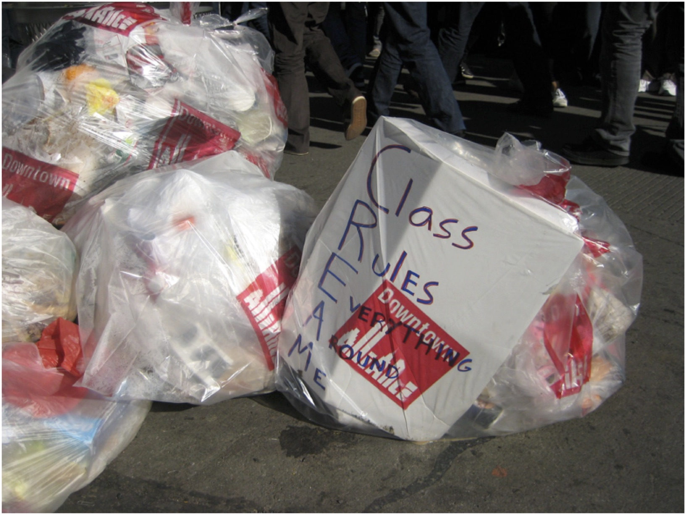

---

### Introduction: Fighting Fire with Fire: Entanglements between Corporate-Owned Platforms and Activist Social Media Practices

The digital era has seen activists around the world use social media platforms and information and communication technologies (ICTs) for social movement organising. Activist uses of corporate-owned social media platforms (from Facebook and Twitter to YouTube) and digital tools (including smart phones and digital cameras) support unprecedented coordination of local and global movements. However, these hybrid (online and offline) social movements [1] produce frictions that reveal discrepancies between the risks and promises of corporate-owned networks. This is certainly the case with social movements concerned with economic inequality, such as the Occupy movement, where such uses can benefit the very corporations the movement seeks to dethrone. Regardless of how one measures the roles and successes of social media in the context of activism, the uses of corporate-owned platforms and tools position activists within paradoxical entanglements between praxis and ideals. {#para1}

Questions about the efficacy of social media practices within social movements, and the roles they play in sparking and sustaining social movements are quite sharply contested (Gladwell, 2010; Shirky, 2011; Tremayne, 2013; Sigal and Biddle, 2015). Despite repeated dismissals of social media networks as merely ‘weak’ ties that have no lasting social change global uprisings and revolutions since 2011 increasingly many skeptics of social media’s force, potential, and roles. [2] The application of these tools within the hybrid Occupy movement served many purposes. [3] Gaby and Caren (2012) demonstrate the role Facebook played in spreading Occupy messaging after protests started on September 7, 2010, which included access to related news, information sharing, updates on meetings, and as a site for messaging. Posts about protests drew new members, especially those depicting images of confrontations between the police and protesters (Tremayne, 2013). The movement eventually spawned over 1500 Facebook pages, under names including ‘Wall Street Occupation, local occupations across the globe, occupying specific institutions and networking occupiers’ (Gaby and Caren, 2012: 267). These Facebook sites alone revealed four hundred thousand active users through Facebook pages. Activities ranged from sharing pictures, videos, to status updates (Pempek et al., 2008). Gaby and Caren (2012) report major uses of Facebook included recruitment of people and resources, information sharing, storytelling and ‘access-group exchanges.’ [4] {#para2}

The Adbusters article, ’*#OCCUPYWALLSTREET: A shift in revolutionary tactics’* [5] (itself circulated largely online) is recognised for its key role in sparking Occupy Wall Street. The article describes how social media can contribute to ‘shifting’ or ‘changing’ the role of mass communication in social movements; that Twitter and other platforms can connect ‘disparate peoples’ with similar motives; and, that interactions are unpredictable between homogenous groups and even more so with heterogeneous ones (Adbusters, 2010; Tremayne, 2013). By using a mediated platform like Facebook, movements can enjoy a lateral mode of sharing, collaboration, and even coordinated action, given the connective nature of the communication technologies in use. [6] How and in what ways does this shift in revolutionary tactics play into the hand of the very corporations and their associated powers that a movement such as Occupy can be said to oppose? This paper explores this question through the qualitative findings of a three-year SSHRC funded research project that explored how young people use social media for community and movement organising. [7] {#para3}

As we explore ‘the entanglements that arise due to frictions between the philosophies embedded within technologies and the philosophies embedded within activism’ (Shea et al, 2014), we identify three entanglements that emerge from our research findings: {#para4}

> Entanglement 1: Women Activists’ Digital DIY Practices: Accessing the Master’s Tools
>
> Entanglement 2: Using the Master’s Tools for DIY Reporting: Frictions between Citizen Journalism and Corporate-Owned News
>
> Entanglement 3: Activist Ideals of Openness and Challenges of Infiltration and Police Violence: Subversive Uses of Master’s Tools {#para5}

Our essay explores entanglements as dynamic frictions; as the editors of this* *issue note, ‘friction can be disruptive, productive, or both, and it may contribute discord or harmony.’ Indeed our research underscores how the ‘frictions between technologies and activists…ultimately enhance the ability of activists to take more control of their projects, create new ethical spaces and subvert technologies,’ as well as ‘result in tension, conflict and hostility’ (Shea et al, 2014). By examining entanglements through the theoretical lenses of connective labor, veillance, and the master’s tools, we illustrate how Barad’s (2012) concern with ‘queering the binary of individuals and groups’ allows an account of social movements as dynamic and non-linear encounters and relations. {#para6}

Occupy activists’ ideals of fighting corporate oligarchies collide with their pragmatic uses of corporate owned digital tools. Our study revealed that the views of Occupy participants span both ends of the spectrum regarding this tension; from radicals and anarchists who insist that revolution is impossible so long as citizens divulge information through corporate social technologies; to pragmatists who advocate the necessity of reaching a wide audience effectively through ‘free’ services such as Facebook. These frictions rarely, however, prevent Occupy activists from using Facebook, Twitter, YouTube, and other corporate owned and widely accessible platforms. However, even in the few years that have passed since the heyday of Occupy movement camps and associated mobilisations around the globe, reluctance to use these master’s tools has exponentially increased. The surveillance and infiltration made possible by state access to these open networks and communications, combined with high-profile cases such as Wikileaks and the Snowden revelations, has increased activist sensitivity to the risks of organising social movements via the master’s tools. {#para7}

### Quantum Entanglements and Implications for Social Theory

‘Entanglement,’ the theme of this issue of *Fibreculture* is a rich concept increasingly used by those in humanities and social sciences, significantly as a result of interventions made by quantum-physicist and social theorist Karen Barad. Entanglements imply profound and unresolved paradoxes that challenge the realism and causality theories commonly embraced by physicists and many others. {#para8}

It is worth providing a short overview of the concept of quantum entanglement. In 1935 Schrodinger developed the term ‘entanglement,’ following correspondence with Einstein, who described the uncanny paradox of inexplicable communication between particles as ‘spooky action at a distance’. In brief, when two originally independent and measurable entities interact —particles, for example—the state of the post-entanglement entities can no longer be understood, described or measured independently from one another. What can be approximately modelled post-entanglement is what is termed the ‘quantum system’. But any attempt to measure one of the discrete interacting constituents in the resultant quantum system collapses the state of the entire entangled system. This paradox is particularly troubling to scientists wedded to a local realist view of causality. {#para9}

Furthermore, even if one instead focuses on measuring the quantum system, at best a model can approximate but can never exactly measure the quantum entanglement under scrutiny. Karen Barad notes that this challenge, in a positive sense, ‘queers the binary of the individual and the group’ (Barad, 2012b: 77). Within dynamic and non-linear quantum entanglements, scientists invoke the concept of ‘hidden variables’ as an explanatory solution to some of these unknowns—in short, the result of entanglements and the nature of an encounter which refuses our perception, knowledge, and measurement. Any description of entanglements necessarily requires admitting a substantial margin of error, and significant *hidden variables*, all of which underscores the challenge of predicting the result of interactions between entities. The significance of new materialism and agential realism (as Barad terms it) is the growing application of these questions and increasing acknowledgment of the radically ‘unknown’ intra-actions within socio-cultural and political systems. {#para10}

As the notion of entanglements demonstrates, one cannot easily predict the results of an encounter between entities in a system or state-space. Will the use of open and publicly accessible information shared by activists via Facebook result in police infiltration and surveillance? How might women’s often invisible, gendered connective labor change our entanglements with technologies, or create more inclusive social movement participation? What is the significance of women’s increased access to participating and controlling the media(ted) means of production; of being interested to learn and adopt DIY skills to become Facebook admins, documenters, and connectors (Boler et al, 2014), using technologies often not previously used? {#para11}

The digital tools used by activists provided a necessary medium for connecting nodes, but simultaneously the use of open and public platforms like Facebook and Twitter meant that the Occupy movement was exposed to additional infiltration from naysayers, police, and other undercover operatives set out to ‘bring down’ the movement (Kiley, 2012). Given the horizontal (leaderless) social movement structure and the Occupy movement’s principled commitment to openness and transparency, the movement was especially vulnerable to surveillance.
 {#para12}

### Background: the Hybrid, Horizontal and Leaderless Occupy Movement

Occupy Wall Street (OWS) began on September 17, 2011, in Zuccotti Park on Wall Street, the financial centre of New York city and site of the United States Stock Exchange. Responding to a call issued through the Canada-based magazine *Adbusters*, the movement was directly modelled upon and inspired by the Spanish social movement, Los Indignados. [8] {#para13}

Its representative meme ‘We are the 99%’ captures not only an American national shift in awareness regarding wealth inequality, but rather a global zeitgeist. [9] On October 15, 2011, through globally orchestrated solidarity, Occupy Wall Street became an international movement with participants in more than 100 cities in the United States and 1500 distinct occupation sites around the world (Occupywallstreet.org; 2015). {#para14}

Occupy adopted many practices engaged by Los Indignados and other contemporary as well as earlier social movements—from the occupation of public spaces, to large open meetings called General Assemblies (GAs). In general, the movement stressed an emphasis on process as being as important as the end goals (‘Be the change you want to see!’). The diverse, localised yet globally united Occupy camps and cities protested corporate ownership and governance through unusually creative and radical approaches and processes. [10] {#para15}

Occupy is recognised as a hallmark example of horizontalism, a consensus-based, leaderless organisation increasingly common in contemporary social movements. Elsewhere, we explore the significance of this emphasis on process which acknowledges that the process of making a better world is as important as the ultimate goal or vision of that world (Boler and Nitsou, 2014; Boler et al 2014; Ratto and Boler 2014). This shift from vertical hierarchical leadership structures to horizontalism is further linked to what we explore as the shift from collective to *connective action* (Boler et al, 2014; Bennett and Segerberg, 2012). Central to the connectivity that describes our social media networks, is what Bennett and Segerberg call the ‘logic of connective action’; they describe such connective action networks as ‘far more individualised and technologically organised sets of processes that result in action without the requirement of collective identity framing’ (Bennett et al, 2013: 750). In contrast to both collective and vertical ‘hierarchical coalitions of organisations,’ Castells (1996) describes contemporary social movements as ’fine-grained, multilayered networks*’* (Bennett, 2012).* * {#para16}

When our research team interviewed the first 50 participants of our study at the Occupy Toronto public encampment in November 2011, we were surprised that every participant interviewed—from the most radical anarchist to those who did not even own a mobile device—used Facebook for* all* communications related to Occupy and also as their primary filter and source of news. In the subsequent 30 interviews with female Occupy participants from nine different Occupy cities in the United States, 100% of those we spoke to used Facebook for most aspects of their political and social organising; however, they also frequently used platforms such as Twitter, YouTube, Vimeo, or other web-streaming platforms for the posting and sharing of videos and citizen journalism related to Occupy. [11] {#para17}

A significant feature of involvement in Occupy as well as in most contemporary movements includes low-barriers to participation. This refers both to the easy access via everyday technologies; the inclusivity of perspectives; and the use of ‘accessible’ slogans and ideologies, such as the 1% and the 99%. That said, many of the key women participants and ‘connective labourers’ we interviewed were not significant users of digital media and technologies prior to OWS. Many did not have extensive resources and did not own a digital camera or even a smartphone, and hence it was often due to serendipitous acquisition of such technologies that women described becoming ‘avid documenters’. For example, one participant began her connecting and documenting work only after her brother gave her a smartphone and added her to his cell phone coverage plan. Another received a digital camera for a birthday, which then allowed her to begin documenting. Another did not livestream until she realised what technological tools were needed and that they were not prohibitively expensive to access and use. In addition to accessing the tools were the skills needed to deploy them effectively for labor ranging from recording events, live streaming, uploading to a streaming site, or administrating Facebook pages. The demand to engage in connecting, documenting, and ‘adminning’ led to women learning, through DIY (do-it-yourself) practice, and by DIT (do-it-together) of watching how other Occupy participants used these ICTs effectively. {#para18}

In 2011, there was not yet the widespread suspicion, public awareness and resistance to corporate plundering of our private data for advertising profit (Facebook opened to the public in September 2006; Twitter in July 2006; and YouTube in February 2005). Since then, public awareness of the risks of sharing data and the realities of surveillance is radically and rapidly changing. Efforts continue to develop and build alternative technology infrastructures that would move such communications off the grid of unabashed data-mining, invasions of privacy, and related risks of corporate and governmental surveillance (Deibert and Rohozinski, 2009; La Rue, 2013; Pillay, 2013; Deibert, 2013; Citizen Lab, 2014). This was one response to the surveillance of social media: {#para19}

> We were very, very open with the city, with everything we were doing. To this day, we are too horizontal. It’s a problem, because sometimes we cannot get things done specifically how we want to. Sometimes you have to have some strategies. So, if you say you’re going to be at this and this place at this time, when we show up, there’s a bunch of police already (Katie, Occupy Los Angeles). {#para20}

Alongside the risk of surveillance, our interviewees shared consistent examples of using digital tools and platforms to circulate visual documentation of police and state violence and repression: {#para21}

> You could see how LAPD was [saying] ‘okay, you guys stay here, oh okay, you go there’ and they were, … just kind of doing this ballet orchestration of [the media]. But two blocks away they’re beating people and the media wasn’t allowed to go over there and see that. *And then when they shot the guy in the tree house, the media didn’t show that.* *But the live streamers, (like) Magda, … she live streamed it, shooting the guys in the tree house* (Penny, Occupy Los Angeles, italics added). {#para22}

This entanglement of police violence and sousveillance reflects the encounters and frictions as layers of intra-actions: between police and activists’ video documentation; between corporate and citizen journalism; between human and technology, itself with complex layers of hardware, software, interfaces, human attention and energy. These entanglements expand the robust strength, reach, and capacity of social change movements, while also placing at risk the privacy (and often the ideals) of activists. Activists’ use of corporate owned and surveilled social media platforms to document, organise and distribute counter-discourses to the ruling logic of capitalism reflects the paradox of ‘fighting fire with fire’. In the case of Occupy, the ideals of fighting corporate greed are in direct friction with the pragmatic practices of utilising tools that benefit the very corporations participants seek to undermine. [12] {#para23}

Our analysis of activist entanglements takes up the challenge suggested in a previous issue of *Fibreculture*: {#para24}

> The popularity and rich cultural experiences witnessed in these spaces cannot be simply dismissed as yet another form of corporate control over culture, or Orwellian dataveillant machine. It would thus appear that current analytical frameworks and tools have failed to fully comprehend the ontology of commercial Web 2.0. *If we are to identify critical alternatives to commercial Web 2.0 and, more generally, if we are to intervene in the ontogenesis of Web 2.0, we need to reconstruct a critical approach that deals with these contradictions* (Langlois et al, *Fibreculture*, 2009, emphasis added). {#para25}

We intend this essay to outline how the entanglements illustrate the urgent need for ‘critical alternatives to commercial Web 2.0,*’* and to provide a* *’critical approach that deals with these contradictions*’ *through theoretical concepts of veillance, connective labor, and the master’s tools. {#para26}

### Conceptual Frameworks: the Master’s Tools, Connective Labour, and Veillance

Surveillance, and veillance more broadly, is infiltrating the everyday lives of people around the globe. The era of ubiquitous digital media ensures that this trend will not disappear. Whether used by police, states, corporations, activists, or other social change agents, veillance is rife, and includes the familiar practice of surveillance, as well as Mann’s notion of ‘sousveillance’ or turning our cameras around to ‘look back’ at the surveillance powers-that-be. Veillance is enabled through use of digital tools and particularly cameras or other forms of capturing information and data. {#para27}

This dialectical dynamic of veillance is captured by a concept we borrow from Audre Lorde to understand the participants’ entanglements with technologies: namely, the ‘master’s tools.’ We adapt her question, ‘Can the master’s tools dismantle the master’s house?’ to explore the paradox of entanglements between philosophical and political ideals and pragmatic needs for activists to reach the widest possible audiences using the master’s tools. {#para28}

In a renowned speech delivered in 1984, activist, poet, and writer Audre Lorde asserted that the ‘master’s tools can never dismantle the master’s house.’ Adapting Lorde’s concept of ‘masters tools’, we use the term to refer to social media platforms such as Facebook and Twitter, which systematically profit from selling user’s data and which enable surveillance by corporations and other interested parties including the state and the military; as well as to technologies produced for profit and to an extent for data gathering, such as smartphones and other digital recording devices. Women activists’ of the Occupy Movement engage and repurpose the ‘master’s tools,’ juggling the contradictions between strategic and pragmatic choices on one hand, against the surveillance risks of utilising corporate owned master’s tools. {#para29}

The entangled dilemmas of a veillance society and of creatively repurposing the master’s tools, were encountered by the women activists we interviewed in the course of their connective labor: they organically established unique roles we have identified as that of the ‘Admin’ (Facebook Administrator), the ‘Documentarian’, and the ‘Connector’, roles enacted through women’s uses of social platforms and tools including Facebook, Twitter, and live streaming. {#para30}

Following Barad’s conception of entanglements, we explore frictions between corporate owned technologies and activists not as a binary but as a dynamic and productive tension. Connective labor, our third theoretical lens, reflects the embodied entanglement between and amongst humans (for example, activists and police, activists and media makers), and between humans and technologies (activists and platforms, or police and platforms). Within a social movement context, connective labor reveals the entangled mediations of both material, as well as less tangible realities and practices of veillance and the master’s tools. {#para31}

Throughout our interviews with nearly 30 women Occupy activists across North America and with 80 Occupy Movement activists in total, participants identified the value of ‘subverting’ various ‘master’s tools,’ as this woman from southern California describes: {#para32}

> I became excited about media because of this movement, because it suddenly was a tool that was for the people and not just something that was gonna’ be a watching, like something that’s invasion of privacy. Suddenly it became a connector … we turn that around and we flip it when what was private before, now is a public mobilisation tool and people are all becoming part of a movement because of a Facebook page … we’ve subverted something that was potentially damaging. (Maggie, Occupy Orange County) {#para33}

The appropriation and re-purposing of such tools reveals the anti-corporate ideals of activists in dynamic tension with the vying needs for pragmatic efficacy and affordances of both many-to many and one-to-many communication, despite the very real risks of surveillance. {#para34}

As we reflect on the question of how to use the master’s tools to dismantle the master’s house, we can draw on the following remarks by network theorist Jussi Parikka: {#para35}

*The only effective form of intervention in this world is to learn its laws of operation and try to undermine or overrun them. One has to give up being a player at a fairground sideshow and become an operator within the technical world where one can work on developing alternatives.* But this then begs the question: What are the skills needed to ‘become an operator’? This question is at the core of media theory and ‘what is media’ that differentiates theorists: is it just technical skill? Is it conceptual? What cultural, contextual skills do we need to operate? This affects how we think of networks too. What is taken to be a network? (Soderman et al 2014; emphasis added) {#para36}

Parikka’s call for us to become ‘operators’ resonates with the realities of women activists’ DIY learning and action, and how they gained access to tools and social media in order to enact the three key roles of connective labor: the admin, the connector, and the documenter. {#para37}

Our exploration of entanglements builds on our previous work which foregrounds the connective labor of women Occupiers who actively employ digital media technologies for movement building. In our essay ‘Connective labor and social media: Women’s roles in the ‘leaderless’ Occupy movement’ (Boler et al, 2014), we identified women’s key participation and gendered labor in the North American Occupy movements. {#para38}

The embodied and material nature of women’s connective labor has supported, and in many ways sustained, the contemporary Occupy movement. Connective labor involves maintaining fluid interfaces between the lived material realities shared in meetings, alongside web-based communications such as information sharing, dialogue, decision-making and strategising. Both online and off, connective labor works to ensure smooth interfacing and communications across and between the mediated sites of social movements, and calls for skills of meeting facilitation, inclusive and careful listening capacities, organisational facilitation and delegation—to name a few of the requisite skills for connective labor. {#para39}

Connective labor is intra-action between humans and technology. These entanglements between humans, platforms, ideals and pragmatics reveal intra-action and the symbiotic relationship between materialities and meanings. ‘The existence of a strong correspondence between matter, practice, and meaning in Barad’s work (2007), indicates that ‘matter’ can be seen as inseparable from the actions it engenders. As such, separate worlds of, on the one hand, obdurate matter, and on the other, active practices do not exist’ (Alberti and Marshall cited in Scott and Orlikowski, 2010: 12). {#para40}

Entangled intra-actions reveal how ‘materiality is understood not as a ‘thing’ or ‘an inherent fixed property of abstract independently existing objects of Newtonian physics’ (Barad, 2003: 822), but a process of materialisation that configures reality. Even concepts, rules, language, or software (which are often offered as examples of immateriality) cannot exist without material enactment—whether embodied in thoughts, produced in action, or expressed in texts, machines, or running code’ (Scott and Orlikowski, 2010: 12–13). {#para41}

Occupy was further characterised by an inherent (and hybrid) creativity, arising in large part from the adaptation of (1970s, second wave feminism) organising tactics including horizontalism and consensus-based decision-making, and consciousness-raising practices. In that essay we foreground the experiences of women Occupiers who actively employed digital media technologies for movement building, and identified three key roles which ground our theory of connective labor: Facebook Administrator, Documentarian, and Connector. These roles distinctively exemplify and fit the definition of immaterial and affective labor (Boler et al, 2014; Boler and Nitsou, 2014). This connective labor that fuelled Occupy, as our interviews and research revealed, is highly gendered and remains largely invisible. While these three roles overlap, there are also important distinctions: {#para42}

- • Facebook Admins organise and publicise the efforts of their Occupy Movement ‘city/site.’

- • Documentarians archive and author.

- • Connectors share, mobilise, reach out, and network.

Connective labor pays particular attention to immaterial and affective work, and builds on Bennett and Segerberg’s (2011) ‘personalised collective action’ and ‘logic of connective action.’ Diversified self-production and distribution of media result in more heterogeneous, sometimes conflicting, visions of movement building. [13] These women activists—historically excluded from access to means of media production and circulation—engaged various DIY and/or DIT modalities to learn from others or teach themselves to use ICTs and platforms ranging from Facebook administration to Twitter to live streaming. The women’s adoption of these roles illustrates an extended enactment of Bennett and Segerberg’s (2012) ‘logic of connective action’, revealing the often hidden connective, digital labor of women in sustaining the networked and affective dimension of social movements. {#para43}

Women’s uses of corporate social media networks to administrate, document and connect the movement resulted in fraught entanglements of exposure whereby the ‘gaze’ of power—particularly of law enforcement and corporate-owned mass-media, as well as both offline and online publics—functions as a perpetual surveillance, alongside the simultaneous empowerment and capacity building afforded by the same media (Boler et al, 2014). ‘Veillance’ (Mann, 2004; 2013) provides a conceptual approach ‘to reconstruct a critical approach that deals with these contradictions’ (Langlois et al, 2009). This meta-conceptual framework also provides an analytic approach for understanding the materiality of interface between humans and machines. {#para44}

Veillance, as Mann defines it (2004), includes two key dimensions: surveillance and sousveillance. The reality of surveillance weaves through our everyday lives as a manifest practice whether we pay attention or not. Around 1 billion Internet users live in countries—approximately 40—with regular censored Internet (Deibert, 2013). Surveillance, the watching from above, was brought into stark relief through international cases such as Wikileaks and more recently Edward Snowden’s whistleblowing on the United States NSA violations of constitutionally guaranteed privacies. {#para45}

Mann notes that ‘sousveillance is often implemented by media that is controlled centrally, and thus subject to surveillance,’ which points out again built-in contradictions and frictions. However, at the same time, sousveillance ‘tends to be distributed and less organised, or at least less hierarchical, and thus conducive to a small community in which individuals trust one another’ (Mann, 2004). Veillance is useful especially in its articulation of the dynamic system of surveillance in relation to sousveillance. The felt and material contradictions within the lived context of veillance reflects the dynamic, even dialectical, tensions driving contemporary social movements. {#para46}

Those we interviewed did not express extensive worry about corporate invasion of privacy and access to profile data. However, in the context of Occupy—particularly when speaking with dedicated anarchists active in Occupy at local conferences—discussions would often turn to the problematic fact that the fibre optic systems not to mention the social media platforms used, are owned by those profiting from our use of technological hardware and software. In sum, complex entanglements emerge as activists engage corporate owned tools and platforms to counter capitalism, and to administrate, document, and connect the movement. The fraught materialities of exposure to the surveilling gaze of power (particularly police and law enforcement and corporate owned mass media) coincide with the charged sense of empowerment and possibility for these first time and veteran activists. {#para47}

### Occupy Entanglements: ‘Reclamation of Public Space’ and ‘Coming Up Against a Monster’

> Our world is not working for most people. … I’m exceedingly inspired to be with a group of people who are thinking from all kinds of different angles about similar problems … I do believe the state is afraid of us. They would not execute their violence upon us elsewise, right? Even though it seems like a losing battle as you see endless footage of police brutality and cops coming in and throwing tents in garbage trucks and whatnot. The reality is that people mobilising, exercising their very basic freedom of assembly and specifically the act of occupying space, bringing to light the fact that it’s already occupied space and we’re on indigenous land, but on top of that, I mean, when capitalism first began its journeys, there was still something called the ‘commons’ … the reclamation of public space and the very weight of having people say ’no’–although we’re coming up against a monster (Tyana, Occupy Wall Street). {#para48}

We now address in more detail the entanglements that emerged within the course of our research, and situate these frictions within the context of connective labor of women Occupy participants who navigate the vicissitudes of veillance and the paradoxical uses of the master’s tools. {#para49}

### Entanglement 1: Women Activists’ Digital DIY Practices: Accessing the Master’s Tools

In the formative weeks of the study, our interviewees reported access to the media tents being highly controlled; as Penny described, ‘In the beginning I tried to join the media team but I was pretty much not allowed inside the media tents.’ These tents were situated at each Occupy site—they were areas protected with tarpaulins containing tables and digital tools such as computers and locally established wifi networks. Our observations of these media tents revealed a gender division, as male Occupy participants frequented these spaces, while women tended to be in the spaces related to health care, food, or clothing. A fellow participant testified in agreement: {#para50}

> Yeah, there were people like Penny who wanted to get involved but it was so locked down, that we had a security tent within the tent (Penny laughing) and if you couldn’t pass that security tent, you couldn’t even get in. I mean you could go in the tent but you were locked in within another tent. It’s just … it was bad because we had so many talented people around the encampment that wanted to help but we weren’t letting them in (Penny’s friend and Occupy participant, Occupy Los Angeles). {#para51}

During our interview in downtown Los Angeles in December 2012, a year after all of the Occupy camps had been closed by militarised and coordinated police efforts across North America, Penny describes teaching herself the skills of live streaming, engaging DIY methods to acquire skills to use diverse communication technologies. {#para52}

> I was at GA every night with my little flip cam, I was filming GA and then I would go home and then I would upload it to YouTube, and then I would go to school the next day and then after school I would come back and go to GA and do that every single day. So I was producing more media then probably the entire media team but I wasn’t really involved with that team and then in January I started live streaming. I probably would have launched it sooner if I knew I could of. Because I had looked into it but, I looked at live stream and it seemed like it was expensive, you had to pay for it, it seemed out of my reach, and that maybe it was too technologically advanced but then for watching live stream I realised that some of the streamers were using Ustream with android phones, I learned by watching how to do live streaming so in January I started live streaming. Now, I am working with different Occupy news, I am working with OWS week and Occupy public access TV in New York and then also different collaborations with different people (Penny, Occupy Los Angeles). {#para53}

Penny’s description reveals how she engaged DIY practices to become entangled with the digital tools in order to serve as a primary documenter and connector for Occupy. Her experience also shows frictions between activists (being excluded from generally male-dominated media spaces) and frictions between activists and technological access. {#para54}

She worked ‘under the radar’ of her Occupy colleagues for some time in order to open yet more inclusive spaces of direct democratic participation within socially-mediated public communication such as one of the Twitter hashtags being used for OLA. Penny describes how she gained access to a Twitter hashtag that was being under-utilised and how she mobilised it as a major source for ongoing, live updates as well as providing anyone and everyone open access to this OLA twitter hashtag. This illustrates the multiple ways in which Occupy women self-skilled in order to assume more active roles in the movement. Social media, it turns out, is perfectly suited to job sharing in these new activist configurations: {#para55}

> Actually, from the very beginning I took over one of the twitters [accounts] by myself because we had … OWS Los Angeles twitter and then we felt that was too long, so we got Occupy LA twitter so we were tweeting off of both of those … there was a lot of strict rules about how we were going to run social media and I didn’t feel like I could really follow the rules, so I kind of took the OWS Los Angeles twitter all by myself … ran that one, and I probably tweeted a lot more than the whole team tweeted and I kind of just, well, ‘fuck the rules, I don’t like your rules, I am just going to do what I am going to do … everything I am going to do is supporting Occupy LA but I am too restricted by the rules.’ I even got to the point where I will write the password on the bathroom wall … It hasn’t been hacked or compromised … nothing bad happened … Want the password? (Penny, Occupy Los Angeles). {#para56}

In our analysis of women’s key roles within the movement, Penny’s role emerges as that of both a connector and a documenter. Through her DIY efforts she learned how to use these master’s tools, and her persistence saw her develop media capacities that had at first seemed prohibitive. The challenge of accessing the technologies and putting them into use is exemplified by her comment, ‘I probably would have launched it [my livestream] sooner if I knew I could’ve.’ This example saw a first-time young woman activist with limited cultural and economic resources appropriate tools to become *the* key livestreamer and documentarian of Occupy Los Angeles. Penny’s persistence and commitment, her labor as both a connector and documenter, proved indispensable to the movement. This was echoed by a fellow activist, ‘Penny has become our soul … her footage is worth a lot’ (Katie, Occupy Los Angeles). {#para57}

As explained by another interviewee, her relationship to the tools is defined by connective labours—being a Facebook admin, connecting, and documenting. Her labour thus helps to magnify the voice of Occupy, encouraging a level of information sharing that served as a catalyst for other peoples’ engagement. {#para58}

> I was totally technophobic … but when the movement started I just started adding people and within, I remember, in nine days I had like 900 new friends … and it’s people from all over the world. What I saw in terms of the mobilisation over the Internet was fascinating and how everybody started sharing what was really going on in places, and how it has Google Translate right there, and I could read articles from everywhere in the world. People were sending stuff about what was happening in their city and it was the most worldwide news that was present and what’s happening in some city in Hamburg, Germany, and what’s happening … in Algeria. … I never would have jumped into it if the Occupy movement hadn’t suddenly catalysed that … (Mary, Occupy San Francisco). {#para59}

Penny’s experiences reflects a common experience of feeling excluded and alienated from accessing digital technologies, yet Occupy provided opportunities to catalyse women to engage DIY methods and overcome technology-related fears. {#para60}

### Entanglement 2: Using the Master’s Tools for DIY Reporting: Frictions between Citizen Journalism and Corporate-Owned News

Occupy participants engaged the master’s tools and utilised sousveillance to counter misreporting, or lack of reporting of Occupy events. A persistent thread across all interviewees was the need to identify free spaces to amplify the unfiltered, uncensored, living reality that was Occupy. This interviewee addresses her use of social media to fight the dominant narratives of corporate and traditional news media: {#para61}

> I was trying to fight some of the media narrative because we have so much paid advertisement, paid media coming at us that I really wanted to educate people. And really connect with people too that were of the same mind because I can shout all I want as one person and you look maybe kind of like a crazy person but if you have a 100 people shouting about what they want then you’re a force to be reckoned with (Anna, Occupy Santa Cruz). {#para62}

Another participant explains the disconnect between what the media was reporting and what was really happening on the ground: {#para63}

> Tuesday? Oh Tuesday’s the day … [the police] were supposed to shut it down. … it was the first time that a comparison started to happen where you started tracking what the real media was saying about what was happening and you could see the total 1984 Newspeak going on. You’re like, ‘what the fuck?’ Because you’re there. Your friends are there and then you’re reading the articles and you’re going, ‘that’s not what happened.’ And you’re starting to actually see this fallout, and it’s not that… I didn’t have any love of media before that point, but I really was like, ‘this is crazy’ (Maggie, Occupy Orange County). {#para64}

Her description of traditional media reports on Occupy events as ‘Newspeak’ demonstrates a widely shared sense of disconnect and conflict between divergent narratives and discourses about Occupy. Significant here is that movement participants increasingly came to ‘trust’ or privilege eyewitness accounts, variations of citizen journalism as well as video of events quickly uploaded to video streaming sites. In this sense, one can identify the entanglement with the master’s tools, which enabled participants to provide what they considered to be accurate, grassroots, and eyewitness media coverage. {#para65}

Aptly summarising these entanglements, one interviewee describes how: {#para66}

> This [Facebook] data feed felt like a total participatory action study … In essence, by being out there on the front lines and getting news media right there at that time, it was like we had infiltrated and we were actually seeing the ‘Newspeak’ really happening … We the people can make their own news now. {#para67}

This same participant then describes sousveillant entanglements, with the Occupiers as the infiltrators who had a unique opportunity to witness newspeak being produced: {#para68}

> By being out there on the front lines and getting news media right there at that time, it was like we had infiltrated and we were actually seeing the Newspeak really happening. … And it was the very first time that I … kept the news that the media made and the news that we had created … it’s just really fascinating to me … this whole media thing … people are taking video of the cops beating up the people, and the cops used to be taking the videos. So it’s like we’ve got this panopticon both sides. We’re all watching each other now (Maggie, Occupy Orange County). {#para69}

Maggie’s description reveals the entanglement of veillance in action—the muti-directionality of cameras, using the master’s tools to record police brutality and document the events not fully-reported by traditional news. The end result is what she describes as a dual-directionality panopticon. {#para70}

One participant explains how social media tools allowed activists to challenge the mainstream media’s narratives and document what was actually happening on the ground to show police brutality and the closure of camps: {#para71}

> And so, the night of that raid specifically … there was a group of us on Facebook and people were getting Twitter feeds too, and at the same time we were getting information both from the regular media, we’re listening to the regular media while getting news feeds from our friends, and we were putting everything, one after the other up on Facebook and just feeding, and we created our own newsreel, because we were getting in, this is what happened, and ‘the cops just came up and now there’s a standoff, and now there’s’ … So, it was interesting having five different people on our side taking in news straight from the front, from where the guys were and then having that running reel of what [mainstream media] were saying was happening and then putting both in…like, ‘[mainstream media] just said this, but look what we have’ (Jean, Occupy Los Angeles). {#para72}

Another participant from another Occupy site describes her connective labor, and use of these platforms for ‘re-reporting’, using the master’s tools to produce eyewitness news and filtered, or synthesised news as an alternative to the misleading traditional media coverage (or lack therefore) of Occupy: {#para73}

> I was doing that extreme information feed, six live feeds open at once, reading all the Twitters, reading several hashtags at once, and just watching them refresh and refresh and trying to figure out what was happening. … I was re-reporting it in a slightly condensed (way) … giving more of an update and overview with links so that people could hook into that story and know what was happening (Laura, Occupy San Francisco). {#para74}

Engaging the master’s tool to challenge the traditional, unidirectional forces of one-way surveillance (watching from above), the activist above describes the use of cameras and posting these alternative citizen reports as a subversion of the surveillant gaze: ‘people are taking video of the cops beating up the people.’ This subversion of master’s tools to watch the masters demonstrates sousveillance, or ‘watching from underneath.’ {#para75}

Mann identifies sousveillance as an urgent focus for our practices, lives, and research: {#para76}

> Sousveillance, derived from French ‘sous’ (below) and ‘veiller’ (to watch), is the art, science, and technologies of ‘people looking at’. Sousveillance typically involves small person-centric imaging technologies, whereas surveillance tends to be architecture or enviro-centric (cameras in or on the architecture or environment around us) (Mann, 2005). {#para77}

Other participants describe the frictions between corporate owned reporting and front line documentation by Occupy activists with the master’s tools, of events that remain unreported by traditional media: {#para78}

> Only us that actually went through it and saw it, that actually were there, understand what happened, and that’s why we make sure that we have our own people … taking pictures (or) live streaming (Penny, Occupy Los Angeles). {#para79}

In sum, the frictions between corporate owned news and DIY reporting by activists using the master’s tools determine whose narrative is accepted as authoritative; and whose story ‘counts’ as the record of the entanglements between activists, police, and the state. {#para80}

### Entanglement 3: Activist Ideals of Openness and Challenges of Infiltration and Police Violence: Subversive Uses of Master’s Tools

Our participants highlighted frictions between platforms and tools as potential apparatuses for surveillance that simultaneously afforded the capacity for outreach and organising. There were heated debates and differences amongst the participants of the horizontal, leaderless movement regarding planning and strategies, and around surveillance and infiltration versus the commitment to openness and inclusivity. The central use of Facebook and Twitter for communication, organisation, and planning meant that many of the social media conversations surrounding Occupy were open, transparent, and public. The encampments as well as the General Assembly meetings and working groups also followed along the same vein. While smaller planning groups met off camera and offline, the Occupy ethos of DIY culture prized openness and transparency, despite the corresponding risk of infiltration: {#para81}

> Everyone still says there’s police infiltrators. Right now, social media, with all the problems that we’re dealing with, people disagreeing, some people have said, “Oh, some of these people that just always start arguments—maybe they’re police infiltrators” (Katie, Occupy Los Angeles). {#para82}

Showing the entanglement between their national Occupy network and state forces, Jane from OLA described how the police targeted their media tent at the precise moment of a pre-arranged, national ‘inter-Occupy’ Skype conference call: {#para83}

> The first night that we were set up to actually do one of the calls from our tent, a media tent at Occupy LA, the bomb squad showed up. They came right into that tent. They didn’t really go anywhere else on the grounds [laughs]. And we’re like, “You guys gotta go!” and I said to myself, we must be doing something really consequential if the bomb squad’s gonna’ try to coerce us out of this area, and this tent, and try to get us to leave. And of course we said that we weren’t going and that they could blow us up. (laughing) and it would be fine and so i was just sort of trying my best to get everything accomplished that i thought would be able to set us up for something better once i knew the raids were coming and the camps were gonna’ be decimated (Jane, Occupy Los Angeles). {#para84}

The ‘coincidence’ of a bomb-squad arriving to disrupt the national Occupy Movement call, saw the participant anticipate the police raids that would occur shortly thereafter: the internationally-orchestrated, violent and forcible state and police shutdown of Occupy sites across North America on Nov 17, 2010 (Wolf, 2012). {#para85}

Another participant describes sousveillance in terms of using tools to connect across the U.S.: {#para86}

> I had been working with people at OWS and in Philly and Portland about putting together this inter-occupy and this conference called Service and we were doing conference calls using wifi technologies and our mobile phones from city hall grounds. {#para87}

The added risk with operating in these online ‘public spaces’ is the exposure to surveillance technologies. As described by Mann (2004): {#para88}

> Surveillance … as with profiling, often operates in secret, in the context of larger peer-anonymous communities, thus breeding mistrust, which itself breeds more surveillance, as a vicious cycle. Not to forget, of course, the lack of inverse visibility that can lead to corruption of politicians who use secrecy to hide theft of public monies, and the like, in a surveillance-only society. {#para89}

Speaking directly to the friction between surveillance and sousveillance, Mann writes: {#para90}

> Surveillance often embodies an hypocrisy, e.g. ‘we can watch you but you’re not allowed to watch us’. And since surveillance is the veillance of hypocrisy, we might ask ’what is sousveillance the veillance of? Integrity is the opposite of hypocrisy. So we might argue that sousveillance is the veillance of integrity. Also worth noting, sousveillance is often implemented by media that is controlled centrally, and thus subject to surveillance. {#para91}

Our interviews with participants who experienced conflicts, dissonance, violence at the hands of police, media, or military, reflect descriptions of sousveillance that appears to be the ‘new normal’ of undersight from beneath. Challenging Lorde’s assertion that the ‘master’s tools will never dismantle the master’s house,’ the use of such digital tools and platforms contributed the otherwise unreported or underreported police and state violence against the Occupy protesters and camps. {#para92}

### Conclusion: Commitments to the Long Haul of Social Change

The closure of the North American camps did not mark the end of the Occupy Movement. Since the internationally orchestrated, violent shutdown of all Occupy camps on November 17, 2011, the movement has continued—some retaining an association with the term ‘occupy’ and others not. These local and regional direct actions include: Occupy Sandy, a successful relief effort after Hurricane Sandy, coordinated through the Occupy network of that region; and, Occupy the Hood, one of hundreds of organised occupations and protests in support of families or people whose homes are threatened with foreclosure. Most Occupy developments are highly local and reflect a high rate of success in accomplishing targeted goals. Such actions and efforts are often focused in particular neighbourhoods within a city; these include, Occupy the Hood (Los Angeles), Occupy Bernal (San Fransisco), and Occupy the Farm (occupations of public spaces for urban gardening). The established web-based networks of Occupy have played a key role in mobilising local direct action. {#para93}

Despite the fact that master’s tools may change our relationship to politics and media for the rest of our lives, the risks and costs of using tools developed by corporate behemoths are of increasing concern not only to activists but to everyday users of the Internet; while we populate Facebook, Twitter, and Google with extensive personal, financial, political, demographic details, these are taken and used for corporate profit. More recently services like Ello and Diaspora offered alternatives to Facebook; however, those involved in social movements are more likely to use services that ensure a critical mass of social media users. {#para94}

The concept of the master’s tools usefully acknowledges contradictions effectively *built into* the tools themselves: for example, the interests of those who produce and profit from the tool are built into the tools’ uses, entangling the user within contradictory interests. But the conceptual tool doesn’t intend to answer the question of whether these tools can or cannot dismantle the master’s house: this conflict is ongoing and currently unfolding within a global context. Activists expressed divergent perspectives about these paradoxical entanglements. While some Occupy participants celebrated the subversive use of Facebook by social movements, other activists are deeply concerned about the increasing privatisation of the Internet and the need for technological alternatives of all kinds. {#para95}

The uses of alternatives such as mesh networks were demonstrated during the recent four-month Hong Kong Occupy movement of 2014; news and blogs reported on the initial use of the ‘FireChat’ application to organise, coordinate, and communicate for the first weeks of the movement (Meyer, 2014). Contradicting some of the hype about FireChat use, Jason Li notes the following: ‘During the Hong Kong protests, everyone I spoke to said that Facebook and WhatsApp were by far the most commonly used communication tools’ (2015). In a similar vein, authors Ivan Sigal and Ellery Biddle of Global Voices emphasise the precipitating “affect” that frequently “sparks” a revolution, despite traditional news hype that too often heroifies a new technology as the movement catalyst (Sigal and Biddle, 2015). While the future of mesh networks and the value of FireChat is contested and remains in question as a solution (Sigal and Biddle, 2015), Meyer describes the tension between corporate owned infrastructures, software, and digital tools and activist visions and aims: ‘many see mesh networking as a new, more promising kind of Internet. Mesh networks are more secure and resilient. They’re not as easy to dominate. As such, they seem ideal for disaster and protest situations’ (Meyer, 2014). {#para96}

Despite debates about the precise role of social media in different contemporary uprisings and protests since 2011, the Occupy movement is historically unique in the fact that events are readily communicated to witnesses around the globe through ‘just in time’ communication technologies, through virtually synchronous and one-to-many communications. These forms of communication and mobilisation employed by Occupy, enabled by the masters’ tools, represent the new media foundation of contemporary hybrid social movements. As we anticipate new developments within hybrid social movements, the catch–22 of the entanglements between humans and technologies alert us to remain cognisant of a guiding thesis from Donna Haraway’s ‘A Cyborg Manifesto’: ‘Irony is about contradictions that do not resolve into larger wholes, even dialectically, about the tension of holding incompatible things together because both or all are necessary and true’ (1991: 149). {#para97}

Irony aptly captures the paradoxical entanglements of contemporary social movements struggling for economic justice while simultaneously engaging and supporting corporate owned tools and platforms. The irresolvable frictions echo the truism of radical democracy as an unfinished project. The activists we interviewed recognised this, and clearly expressed their ‘long-haul’ commitment to the action, philosophies, and vision that the Occupy Movement calls for and represents. Queering the binaries—one effect of intra-action and entanglements—is not an overnight affair; the required long-haul commitment to social justice and economic equality is an unpredictable journey into uncertain terrain. {#para98}

### Author Biographies

Megan Boler is Professor of media and education at OISE/University of Toronto. Her books include *Feeling Power: Emotions and Education* (Routledge 1999); *Democratic Dialogue in Education* (Peter Lang 2004); *Digital Media and Democracy: Tactics in Hard Times* (MIT Press, 2008); and *DIY Citizenship: Critical Making and Social Media* (eds. Ratto and Boler, MIT Press, 2014). Her previous funded research ‘Rethinking Media Democracy and Citizenship’ examined the motivations of producers of web-based challenges to traditional news. Her web-based productions include the official study guide to the documentary *The Corporation* (dirs. Achbar and Abbott 2003), and the multimedia website Critical Media Literacy in Times of War.

Jennie Phillips is a Doctoral Fellow with the Citizen Lab, University of Toronto. Her research aims to identify a distributed approach to developing crisis resilience within virtual civil society networks. With an MA in Education Technology, she has experience in Emergency Management, international development, training and technology with the federal government, private, non-profit and her company ellips design + consulting.

### Notes

 [1] ‘Hybrid social movement’ refers to contemporary convergence of social and digital media as key communication tools for social movement organising, “hybrid” referencing the fact that social movements now rely significantly on both online and offline networks. For further discussion of the hybridity of on- and offline practices within social movements, see for example Boler 2008; Boler and Nitsou, 2014; Castells, 2012. ‘This hybrid of cyberspace and urban space constitutes a third space that I call the space of autonomy’ (Castells 2012; 222).

 [2] For a discussion of weak ties see for example Gladwell (2010). See also Wolfsfeld et al (2013).

 [3] Gaby and Caren (2012) highlight that activists and supporters like to use the tools they know; the platforms are designed on the basis of sharing and contribution, and capitalizing on them allows tapping into large, dense networks and engaging the ‘movement sympathisers.’

 [4] Other scholars highlight the potential of online networks to impact to offline results (Tremayne, 2013; Aday et al, 2010, Conover et al, 2013). They can be used to connect individuals for resource mobilization, collective framing, and help navigate the challenges of mass organization and coordination (Bennett and Segerberg, 2012; Theocharis, 2013; Hounsell, 2011; Theocharis, 2014).

 [5] ‘#OCCUPYWALLSTREET: A shift in revolutionary tactics’ was the Adbusters article that called for the OWS movement. July 13, 2011 https://www.adbusters.org/blogs/adbusters-blog/occupywallstreet.html

 [6] Other research shows that in the initial stages of the movement, Twitter was a dominant platform for communication (Schneider, 2011; Stirland, 2011; Tremayne 2013). Analyses of tweets disseminated throughout the movement (Tremayne 2013; Conover, 2013; Theocharis, 2014, Thorson et al., 2013) reveal how Twitter was used to facilitate the rhetoric between the activists, mass media, organizations and the public and well as to sustain the momentum of the movement. More specifically it was used as a platform for the local level to communicate time-sensitive police and protest information, facilitate interstate communication regarding related to mass media and narrative frames, to manage critical issues faced by the movement.

 [7] This essay is grounded in findings from a funded Canadian Social Science and Humanities Research Council three-year research project, ‘Social Media in the Hands of Young Citizens’, (PI Megan Boler, 2010–2014). The mixed-methods project engages interviews, participant-observer ethnography, analysis of technological and artistic creations, and discourse analysis of texts. In this essay, as we are drawing from 80 interviews conducted in 9 different cities (across the United States, Toronto, and Melbourne, Australia). We will refer to the international reach of this Movement as ‘Occupy’ rather than ‘Occupy Wall Street’ which will be used to refer specifically to the Occupy participants in New York City. The research included semi-structured interviews with 50 Occupy Toronto activists, and 30 longer semi-structured interviews with women activists from seven US Occupy sites (Oakland, Los Angeles, Santa Cruz, Santa Barbara, Santa Ana, Wall Street, San Francisco). The research teams also conducted an intensive year of discourse analysis of Occupy related websites, Facebook pages, twitter hashtags, indy-video, Ustream. These findings were analyzed in part with Atlas.ti qualitative data research software.

 [8] The Spanish movement was also called ‘Real Democracy NOW’ or 15M (‘15M’ standing for May 15) that occupied public spaces in Madrid during the spring and summer of 2011. 15M in turn had been inspired by the events begun in Tahrir Square and other Middle Eastern uprisings that came to constitute the ‘Arab Spring’ of 2011. See Postill (2014).

 [9] Occupy, as with other horizontally-structured movements, is sometimes defined as a ‘countercultural movement’ (concerned with changing consciousness and awareness) rather than as a bona fide ‘social movement’ defined by definitive policy-oriented or legislative goals. However Occupy is classified, its meme ‘We are the 99%,’ and the related concept of the 1% owning the majority of the world’s wealth, represents the Occupy Movement’s radically successful intervention into popular and political conceptions and vocabulary, giving voice to the realities of the growing income gap experienced in all corners of the globe. Additionally, this intervention shifted traditional news discourse to use the term ‘economic injustice’ for the first time rather than ‘class warfare’.

 [10] Like many of the movements taking place around the globe, they operate through organizational modalities also known as Transnational Advocacy Networks or TANS. Spanning state borders, and containing one or more members that are either non-state agents or do not act on behalf of the state (Risse-Kappen, 1995), a TAN is a set of ‘relevant actors working internationally on an issue, who are bound together by shared values, a common discourse, and a dense exchange of information and services’ (Keck and Sikkink, 1998: 2; Mitchell and Boissevain, 1973: 23). TANs are distributed and decentralized, simultaneously operating in domestic and international spaces. The distributed and decentralized modality of a TAN overlaps with the ‘horizontal’ organizational structure of many contemporary social movements.

 [11] As well, some of these clips are shareable without being posted via a video-streaming site; users are increasingly able to share videos in a resolution and data byte size that facilitates sharing.

 [12] Surveillance scholar Vian Bakir describes the complexities associated with the uptake of technology: ‘The emergence of Web 2.0 combined with convergence cultures created a media environment that, for a while, was poorly understood, allowing challenges to strategic political communication from lay-people going about their everyday lives. As the democratization of media production has become more actualized in Web 2.0, and as convergence causes more ‘linking up’ between web-based participatory media and mainstream media, we enter a media environment of complexity, chaos and populism—what McNair describes as a shift from a ‘control paradigm’ to a ‘chaos paradigm,’ and what others refer to as the ‘YouTube effect’ …. Media agenda-building now seems to be a more open field ….’ (Bakir, 2010: 4).

 [13] Connective labour (Boler et al 2014) extends Bennett and Segerberg’s (2012) discussion of the ‘logic of connective action’, in which ‘connective action’ distinguishes contemporary networked activism from more traditional ‘collective action’ central to social movement theory. While *collective* action frames do have a place in social movement theory when considering organizational coordination and identity, *connective* action networks are ‘typically far more individualized and technologically organized sets of processes that result in action without the requirement of collective identity framing the levels of organization resources required to respond effectively to opportunities’ (Bennett and Segerberg 2012, 750).

### References

- Aday, Sean, Henry Farrell, Marc Lynch, John Sides, John Kelly and Ethan Zuckerman. ‘Blogs and Bullets: New Media in Contentious Politics’, *Technical Report, U.S. Institute of Peace* (2010).

- Adbusters. ‘A Shift in Revolutionary Tactics’– the article that called for the OWS movement’, *Adbusters* (2012) https://www.adbusters.org/blogs/adbusters-blog/occupywallstreet.html

- Bakir, Vian. *Sousveillance, Media and Strategic Political Communication: Iraq, USA, UK*. (London: Bloomsbury Publishing, 2010).

- Ball, James, Julian Borger and Glenn Greenwald. ‘Revealed: How US and UK Spy Agencies Defeat Internet Privacy and Security’, *The Guardian* (2013) https://www.theguardian.com/world/2013/sep/05/nsa-gchq-encryption-codes-security

- Barad, Karen. ‘Interview with Karen Barad’, in Rick Dolphijn and Iris van der Tuin (eds). *New Materialism: Interviews and Cartographies* (2012a): 48–70.

- Barad, Karen. ‘Intra-actions [interview by Adam Kleinmann]’*, Mousse 34: An issue about dOCUMENTA 13* (2012b): 76–81.

- Bennett, W. Lance. ‘The Personalization of Politics Political Identity, Social Media, and Changing Patterns of Participation’. *The Annals of the American Academy of Political and Social Science* 644.1 (2012): 20–39.

- Bennett, W. Lance, and Alexandra Segerberg. ‘The Logic of Connective Action: Digital Media and the Personalization of Contentious Politics’. *Information, Communication & Society* 15.5 (2012): 739–768.

- Bennett, W. Lance and Segerberg, Alexandra.* The Logic of Connective Action: Digital Media and the Personalization of Contentious Politics* (Cambridge: Cambridge University Press, 2013).

- Boler, Megan (ed.). *Digital Media and Democracy: Tactics in Hard Times* (Cambridge, Mass: MIT Press, 2008).

- Boler, Megan and Christina Nitsou. ‘Women Activists of Occupy Wall Street: Consciousness-Raising and Connective Action in Hybrid Social Movements’, in Martha McCaughey (ed.). *Cyberactivism on the Participatory Web* (New York: Routledge, 2014).

- Boler, Megan, Averie Macdonald, Christina Nitsou and Anne Harris. ‘Connective Labor and Social Media: Women’s Roles in the ‘Leaderless’ Occupy Movement’, *Convergence: The International Journal of Research into New Media Technologies* 20 (2014): 438–460.

- Chalmers, Johnson. *Blowback 2nd Edition: The Costs and Consequences of American Empire* (New York: Holt, 2004).

- Conover, Michael D, Emilio Ferrara, Filippo Menczer and Alessandro Flammini. ‘The Digital Evolution of Occupy Wall Street’, *PLoS ONE* 8.5 (2013).

- Deibert, Ronald. *Black Code* (Toronto: Signal, 2013).

- Deibert, Ronald and Rafal Rohozinski. ’Tracking GhostNet: Investigating a Cyber Espionage Network*’, Information Warfare Monitor* (2009): 1–52.

- Gaby, Sarah and Neal Caren. ‘Occupy online: How Cute Old Men and Malcolm X Recruited 400,000 US users to OWS on Facebook’,* Social Movement Studies* 11 (2012): 367–374.

- Gladwell, Malcolm. ‘Small Change: Why the Revolution will not be Tweeted’, *The New Yorker* (2010), https://www.newyorker.com/magazine/2010/10/04/small-change–3

- Gray, Chris Hables. *Postmodern War: the New Politics of Conflict*. (New York: Guilford: 1997).

- Gray, Chris Hables, and Ángel J. Gordo. ‘Social Media in Conflict Comparing Military and Social-Movement Technocultures’. *Cultural Politics* 10.3 (2014): 251–261.

- Greenwald, Glenn. ‘UK detention of Reprieve Activist Consistent with NSA’s View of Drone Opponents as ‘Threats’ and Adversaries’, *The Guardian*, 25 September (2013), https://www.theguardian.com/commentisfree/2013/sep/25/nsa-uk-drone-opponents-threats

- Greenwald, Glenn, Poltras, Laura and MacAskill, Ewen. ‘NSA Shares Raw Intelligence including Americans’ Data with Israel’ *The Guardian*, 11 September (2013), https://www.theguardian.com/world/2013/sep/11/nsa-americans-personal-data-israel-documents

- Haraway, Donna. ‘A Cyborg Manifesto: Science, Technology, and Socialist-feminism in the Late Twentieth Century’, in *Simians, Cyborgs, and Women: The Reinvention of Nature* (New York: Routledge 1991), 149–182.

- Hounshell, Blake. ‘The Revolution will be Tweeted’, *Foreign Policy* (2011 June). https://www.foreignpolicy.com/articles/2011/06/20/the_revolution_will_be_tweeted

- Kiley, Brendan. ‘Political Convictions? Federal Prosecutors in Seattle Are Dragging Activists into Grand Juries, Citing Their Social Circles and Anarchist Reading Materials’, In *The Stranger* (2012 August 8) https://www.thestranger.com/seattle/political-convictions/content?oid=14397498

- La Rue, Frank. ‘Report of the Special Rapporteur on the Promotion and Protection of the Right to Freedom of Opinion and Expression, Frank La Rue’, *United Nations General Assembly: Human Rights Council* (2013 April) https://www.ohchr.org/Documents/HRBodies/HRCouncil/RegularSession/Session23/A.HRC.23.40_EN.pdf

- Langlois, Ganaele, Fenwick McKelvey, Greg Elmer and Kenneth Werbin. ‘Mapping Commercial Web 2.0 Worlds: Towards a New Critical Ontogenesis’, *Fibreculture* 14 (2009) https://fourteen.fibreculturejournal.org/fcj–095-mapping-commercial-web–2–0-worlds-towards-a-new-critical-ontogenesis/print/

- Li, Jason. ‘Fact checking the hype around mesh networks and FireChat’. January 11, 2015. https://www.88-bar.com/2015/01/fact-checking-the-hype-around-mesh-networks-and-firechat/

- Lorde, Audre. ‘The Master’s Tools Will Never Dismantle the Master’s House’. *Sister Outsider: Essays and Speeches* (1984): 110–114.

- Mann, Steve, Jason Nolan, and Barry Wellman. ‘Sousveillance: Inventing and Using Wearable Computing Devices for Data Collection in Surveillance Environments’, *Surveillance & Society* 1.3 (2001): 331–355.

- Mann, Steve. ‘“Sousveillance”: Inverse Surveillance in Multimedia Imaging’, in* Proceedings of the 12th Annual ACM International Conference on Multimedia *(New York, NY: 2004): 620–627.

- Mann, Steve. ‘Equiveillance: The Equilibrium between Sur-veillance and Sous-veillance.’ Association of Computing Machinery’. (2005 May 12) https://wearcam.org/anonequity.htm

- Mann, Steve. ‘Veillance and Reciprocal Transparency: Surveillance versus Sousveillance, AR Glass, Lifeglogging, and Wearable Computing’,* IEEE ISTAS *(2013): 1–12.

- Mann, Steve. ‘Veillance: Beyond Surveillance, Dataveillance Uberveillance and the Social Implications of Microchip Implants’, *Emerging Technologies* (2014): 32.

- Masover, Steve. ‘Not Your Granddaddy’s Metadata: Don’t Believe the PRISM Anti-Hype’, *Daily Kos* (2013 June 7) https://www.dailykos.com/story/2013/06/07/1214589/-Not-your-granddaddy-s-metadata-don-t-believe-the-PRISM-anti-hype#

- Meyer, Robinson. ‘What Firechat’s Success in Hong Kong Means for a Global Internet’, *The Atlantic* (2014 October 6), https://www.theatlantic.com/technology/archive/2014/10/firechat-the-hong-kong-protest-tool-aims-to-connect-the-next-billion/381113/

- Soderman, Braxton, Nicole Starosielski and Jussi Parikka. ‘Circulating Concepts: Networks and Media Archaeology: Interview with Jussi Parikka’, *Amodern 2: Network Archaeology* (2014) https://amodern.net/article/jussi-parikka-interview/

- Pempek, Tiffany A., Yevdokiya A.Yermolayeva and Sandra L. Calvert ‘College Students’ Social Networking Experiences on Facebook’, *Journal of Applied Developmental Psychology* 30 (2008): 227–238.

- Pillay, Navi. ‘Opening Remarks by Ms. Navi Pillay, United Nations High Commissioner for Human Rights to the Side, Event at the 24th session of the UN Human Rights Council How to Safeguard the Right to Privacy in the Digital Age?’, *United Nations Human Rights Council* (2013 September), https://www.ohchr.org/EN/NewsEvents/Pages/DisplayNews.aspx?NewsID=13758&LangID=E

- Ratto, Matt and Megan Boler (eds). *DIY Citizenship: Critical Making and Social Media*. (Cambridge: MIT Press, 2014).

- Scott, Susan V., and Wanda J. Orlikowski. ‘Entanglements In Practice: Performing Anonymity Through Social Media’, *MIS Quarterly* 38.3 (2014): 873–893.

- Schneider, Nathan. ‘From Occupy Wall Street to Occupy Everywhere’, *The Nation* (2011), https://www.thenation.com/article/163924/occupy-wall-street-occupy-everywhere#

- Shea, Pip, Tanya Notley and Jean Burgess. *Fibreculture* 25 CFP (2014) https://fibreculturejournal.org/cfp-entanglements/

- Shirky, Clay. ‘The Political Power of Social Media Technology, the Public Sphere, and Political Change’, *Foreign Affairs* (2011), https://www.foreignaffairs.com/articles/67038/clay-shirky/the-political-power-of-social-media

- Sigal, Ivan and Ellery Biddle. *’*Our Enduring Confusion About the Power of Digital Tools in Protest’, *Fibreculture* 25* *(2015).

- Stirland, Sarah Lai. ‘Hacktivists Begin Operation Occupy Wall Street’, Talking Points Memo (TPM) (2011), https://talkingpointsmemo.com/idealab/hacktivists-begin-operation-occupy-wall-street

- The Citizen Lab. ‘Planet Blue Coat’, *Research Brief 13, Munk School of Global Affairs, University of Toronto,* January (2013): 1–30.

- Theocharis, Yannis, Will Lowe, Jan W van Deth and Gema García-Albacete. ‘Using Twitter to Mobilize Protest Action: Online Mobilization Patterns and Action Repertoires in the Occupy Wall Street, Indignados, and Aganaktismenoi Movements’, *Information, Communication & Society* 18.2 (2014): 202–220.

- Theocharis, Yannis. ‘The Wealth of (Occupation) Networks? Communication Patterns and Information Distribution in a Twitter Protest Network’, *Journal of Information Technology and Politics* 10.1 (2013): 35–56.

- Thorsona, Kjerstin, Kevin Driscoll, Brian Ekdalec, Stephanie Edgerlyd, Liana Gamber Thompsone, Andrew Schrock, Lana Swartz, Emily K. Vragah, and Chris Wells. ‘YouTube, Twitter and the Occupy Movement: Connecting Content and Circulation Practices’, *Information, Communication & Society* 16.3 (2013): 421–451.

- Tremayne, Mark. ‘Anatomy of Protest in the Digital Era: A Network Analysis of Twitter and Occupy Wall Street’, *Social Movement Studies: Journal of Social, Cultural and Political Protest* 13.1 (2013): 110–126.

- Wolf, Naomi. ‘Revealed: How the FBI Coordinated the Crackdown on Occupy’, *The Guardian* (2012 December 29), https://www.theguardian.com/commentisfree/2012/dec/29/fbi-coordinated-crackdown-occupy

- Wolfsfeld, Gadi, Elad Segev and Tamir Sheafer. ‘Social Media and the Arab Spring: Politics Comes First’. *The International Journal of Press/Politics* 18.2 (2013): 115–137.
