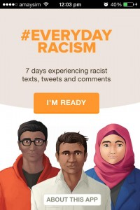
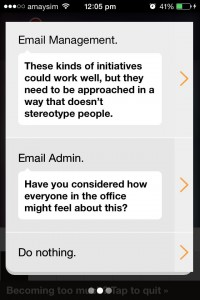
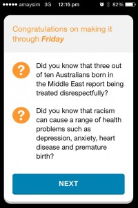

---

### Preface

On the 15th of April, 1914, one Mr. Francis James Shaw, of 23 White Street, Melbourne, applied for, and was granted, a copyright for the White Australia Game. This boardgame was to be played by two players, one person playing ‘the White Men,’ the other playing ‘the Coloured Men.’ These names did not, of course, simply refer to the colour of the pieces, but represented the ethnic identity of either colonists or the Southeast Asians and Pacific Islanders targeted by the ‘White Australia Policy’ after 1901 (Lake and Reynolds 2008). Players had four tokens on each side, and points were given depending on how far one moved their pieces. While today the National Archives of Australia holds gameplay instructions, a board for gameplay, and copyright information, there is little known about the commercial fate of the White Australia Game. We can, however, address the way the game was played. {#para1}

While the game was competitive, both players had the same goal: to remove the black pieces from the map of Australia and replace them with the white pieces. In this sense, the players were not playing a nominal identity, but were instead implementing racialised government policy. The player controlling ‘the White Men’ adopted the roles of the post-federation immigration system, drawing white pieces into Australia’s east coast, and progressively marching west across the terrain. Along the way, the player controlling ‘the Coloured Men’ would sternly march their pieces in the other direction, before pushing the pieces into the Pacific Ocean. This seaward journey was undoubtedly a metaphor for the total lack of care that the participants and designers had for the actual fate of resident Southeast Asians and Pacific Islanders – some of whom came to Australia as indentured labourers – or, implicitly, the Indigenous Australians whose population and dispossession of Terra Australis were completely elided by the game. This raises the point that the player responsible for ‘the Coloured Men’ did not identify with those targeted by the White Australia policy, but rather took on the role of acting in the name of a racialised collective whose existence, as a category, was a product of government apparatuses of various forms. Both players thus held what was essentially a white Australian identity, seeking the same goal of the removal of ‘the Coloured Men’ from Australia. {#para2}

### Introduction

The *White Australia Game* acts as an early example of the intersection between games and race in Australia. It remains, for now, a monument to a certain type of racism and a certain period of gameplay in Australian history. In this article, we wish to investigate a more contemporary and antithetical intersection between race and games in Australia, through the case study of the mobile app, *Everyday Racism*. Ideologically speaking, *Everyday Racism* and the *White Australia Game* could not be further removed. Where the *White Australia Game* is an education in an ideology of national racism, *Everyday Racism* seeks to expose racist behaviour as it is experienced at the level of the individual and educate using anti-racist pedagogies. For our research, *Everyday Racism* acts as a lens with which to critically frame race and games; in particular, we aim to unpack the use of videogames as solutions to systemic racism. Before progressing further, though, we, the authors, feel it is important to note our own positions as male *pakeha* (settler) New Zealanders working in tertiary institutions. Because of our backgrounds, we have benefitted from structural racism in both Australia and New Zealand in many ways, but particularly – as is relevant to this article – we have been spared from the forms of prejudicial rhetoric captured in the game. On this basis, we acknowledge that we have not been the targets of racial abuse, and that while our analysis includes the game’s presentation of racism, our focus is on its nature as a game. {#para3}

The game *Everyday Racism* does not propose to solve racism; however, it does engage with racism in a videogame setting, and thus brings with it a host of concerns. We wish to address this game in its role as an intervention into racism in Australia. Players take on the role of one of three non-white Australians: an indigenous man, a Muslim woman, and an Indian exchange student, with a fourth option of playing as ‘yourself’. It is through the eyes of these characters that the player engages with a social world coloured entirely by racist discourse and practice, set within the wider context of a regime of liberal state and non-state agencies ostensibly capable of fairly administering in favour of the oppressed whenever complaints or problems arise. The game was produced by All Together Now, an Australian NGO with an anti-racist focus, based on research into the issue of racism and anti-racist behaviour by research groups at the University of Western Sydney, Deakin University, and the University of Melbourne. While none of the authors of this paper were involved in the production of this game, some of us have colleagues who were directly involved in this project. {#para4}

We contend that *Everyday Racism* has admirable goals in attempting to educate players in different modes of racist expression and different challenges faced by the victims of prejudice. At the same time, we also argue that there are a number of core problems in *Everyday Racism*, and that attention to these issues will improve the effectiveness of this and similar projects *as games*. To this extent, we propose a critical reflection on the game with the eye to improving both the design of future applications and also developing a toolbox for critical analyses of race within games studies. Of primary importance to our approach are the following concerns: first, the treatment of racism as a game (and thereby something that has rules) is problematic, not least because it makes the player responsible for managing moments of racism, often from the position of the target of racism – this in turn leads to the player being partly responsible the situation. Second, there is a relationship between the phone, the player, and the game which needs to be highlighted: namely the player’s phone shifts from being a site of intimacy and safety to being the source of abuse and vitriol. In this fashion, the game takes on some of the forms of activism that emerge from 4chan (see Higgin, 2013), insofar as the activism is about reframing the use of familiar spaces and objects. This relationship has educational potential but its novelty and dynamics require some unpacking. Third, *Everyday Racism* engages in a direct and didactic connection between racist discourse and research into the health and psychological effects of racism. For the game, racism is foremost a phenomenon with direct consequences to both individual and group mental and physical health, and thus it prescribes actions to minimise racism. As this article shows, it thereby relies on certain assumptions about racialisation and ‘bystander’ behaviour that merit close attention. Fourth, we suggest that *Everyday Racism* is a confluence of three attributes identified within recent videogame scholarship: the use of games for anti-racist pedagogy, particularly by Identity Supportive Games (Lee, 2013); the interpellating and subjectifying aspects of political videogames (Fordyce and van Ryn, 2014); and work on avatars (Apperley and Clemens, 2015). In this article, we address these concerns through four separate approaches: first, through a literature analysis of existing scholarship on race and games; second, with an analysis of the game *Everyday Racism*; third, we move to addressing the role of critical race studies and race health studies in the context of pedagogy; finally, we engage in a comparison with other games that involve a political or pedagogical component. {#para5}

### Race in Videogames

*Everyday Racism* marks a considerable shift in how the notion of racism is dealt with in videogames, thus much of the previous critical literature has deal with implicit or explicit racism that is found in the representations of race in games (see Sze-Fai Shiu 2006) the racism found in online communities (see Nakamura 2009) or in the algorithmic or procedural way race is represented in as a defining attribute in games (see Galloway 2007). Many games are reliant on truths of an essential and biological difference between fantastical or realistic ‘races’. In some cases, this may be represented in economic differences between different races, such as in the *Civilization* (MicroProse, 1991-) and *Warcraft* (Blizzard Entertainment, 1994-) series where players construct different buildings depending on their chosen identity (see Galloway 2006; Kontour 2009). By providing unique buildings to specific races, these games essentialise cultural qualities within each group. In other cases, racial difference is cast as an internal quality, for instance in the vast majority of role-playing games different races will have a unique set of statistical modifiers, such as changes to somatic qualities like strength, or ‘psychic’ qualities like charisma. In these games, at the centre is the figure of the, often white, human. This is the ‘normal’ being from which all other racial variations find their reference. The modelling of racial difference through inherent statistical qualities is completely integral to a great deal of gameplay, as too is the centralisation and privileging of a very specific type of racialised identity. The practice of min-maxing, as described by Joris Dormans (2006) is a practice based in choosing racialised identities for play based on the statistical gameplay benefits granted by each race, rather than based around experiencing a different form of identity. In the context of gaming cultures, it may be difficult to elaborate how race is problematic, and how it leads to issues of racism; this is especially so, given a context where each race realises itself as an ontological fact with certain benefits and weaknesses to be exploited for gameplay purposes, rather than a political or cultural identity with particular concerns and investments. Race becomes a common means of negotiating a rule-based system, rather than a problem in and of itself. While *Everyday Racism* also adopts this rule-based conception of race, it examines how racism structures individual experience through gaming mechanics, with the goal of making players reflect on racism. {#para6}

Race in videogames is not always associated directly with particular gameplay qualities as noted above. In many cases, particularly in story-driven single player games, race is a narrative device, operating as a generic marker of certain social or cultural attributes. Reducing races to efficient storytelling devices is highly problematic; fortunately there is substantial quantitative research into the intersection of race and games. Games regularly limit the player to one or two predefined avatars. Research by Williams et al (2009) sought to chart the range of identities available for player avatars within 150 videogames, as well as the identities of the other characters that the players would interact with. Jansz and Martis also conducted similar research in 2007, focusing on gender, but including race among the research categories and a report commissioned by Children Now, from 2001, also addressed race, gender, and violence. Across all these reports, the dominant avatars and identities were white. The report by Children Now observes that racial variation tends to occur for male avatars more (48%) than female (22%). This is corroborated by Jansz and Martis, despite their smaller sample size. Other games provide more selection of avatars, or allow the player to engage in designing their own. Research by Dietrich (2013) assesses the range of pigmentation available during character creation phases of gameplay, through an analysis of sixty-five games. Dietrich’s work shows that light skin tones are always available, if not the only choice (n:26), whereas only sixteen games allow the player to choose dark skin tones. Dietrich expanded analysis to other acts of racial phenotyping, and found that forty-two games only offered straight hair as an option, with most of the remainder only providing an ‘afro’ as an alternative. Needless to say, whiteness is a hegemonic characteristic of avatars within many videogames. {#para7}

The dominance of white hyper-masculine heroes (such as in the *Far Cry* series and the various *Wolfenstein* games) within videogames is often played out within videogames journalism and cultural responses, for instance in the popular debates around *Assassin’s Creed III*, where videogame publisher Ubisoft (who would later be critiqued for gender representation within the same game series) were criticised for their representation of Native American ethnicity and culture. Or the criticisms and counter-criticisms around the ethnic tensions played up in *Resident Evil 5*, where the protagonist, who is either white or hispanic, is sent to Haiti and spends much of the game killing zombified Afro-Haitians. Many of the complaints in this case referred to the aesthetic similarity to racialised violence in Haiti’s past. For many videogames, race becomes a statistical and narrative problem in the way it essentialises somatic or cultural traits within certain ethnic groups. For instance, the work by Anthony Sze-Fai Shiu (2006) notes racist and anti-miscegenationist attitudes within *Duke Nukem 3D* and *Shadow Warrior*, games where racial qualities are rendered in hyperbolic fashion for ostensibly humorous purposes. Sze-Fai Shiu notes a homology between space aliens and “alien” migrants to America in *Duke Nukem 3D*, and the game’s reliance on a mythological all-white Los Angeles to deliver this narrative. The representation of race and ethnicity is an ever-present issue within many videogames, with some engaging in a more literal approach than others. Researchers have, in turn, begun to investigate the effect of racialised avatars and racialised avatar construction (see Peck et al, 2013; Lee, 2014). *Everyday Racism* attempts to tackle the issue through the popular format of the mobile app, to which we turn below. {#para8}

### Playing *Everyday Racism*

Modelling racism as a game or within a game necessarily implies that racism is a rule-based system. Because of its nature as a game, *Everyday Racism* commits to these qualities of this particular media form. But where *Everyday Racism* differs from other games is along a seemingly slight but crucial line. Other games construct racial qualities with attributes, metrics, and scales which essentialise race as a discrete thing; in comparison, *Everyday Racism* models not race, but racism, as a rule based system. This small difference means that *Everyday Racism* is not making the crucial mistake that so many other texts treat not only as normal, but as a selling point. As such, *Everyday Racism* chooses to express these rules in a somewhat different way to other games’ presentation of race. To understand how it does so, and with what consequences, let us examine four features that are important to its operatation as a game: the relationship between the player and the avatar, the relationship between the player and the device, the presentation of racism in a system-based fashion that structure experience and the related success/failure conditions of the game, and the economics of the game as a commodity. {#para9}

*Everyday Racism* begins with a download. The game is free to install, and requires none of the dreaded ‘in-app purchases’ that many mobile games possess. The game is available for iOS devices (the Apple ecology, including iPhones and iPads) and for those devices running the Android operating system (for portable devices from HTC, Motorola, Samsung, and many others). As of September 2014, there are somewhere over one thousand downloads, and a total of 68 reviews across all platforms. While we expected some to perhaps contain a degree of hostility to the ideology of the game, most of the negative reviews merely critiqued buggy aspects of the game’s implementation or aesthetics. Only four reviewers expressed hostility to the textual content of the game, encoding their resistance in familiar terms: “reverse racism” and “Sick and disgusting.” Once past the reviews and the installation process, the player can start the game. {#para10}

 {#para11}

There are incidental setup procedures, such as confirming that the player is aged over 18, as well as survey data pertaining to the age, gender, suburb, and ethnicity of the user. The player clicks “I’m Ready” and progresses to what is possibly the most important choice in the whole experience: the game calls on the player to choose one of four avatars: three racially coded individuals, and one blank slate. The chosen avatar then becomes the lens through which the player then views and experiences different forms of racist behaviour. The three archetypes, built in consultation with affected groups, are Aisha, a young Muslim woman from Oman, Vihaan, a young male Indian student, and Patrick, an Aboriginal man. Again, however, the spectre of the central and privileged figure rears its head: there is also the option to play as “yourself.” Presented as a genderless silhouette, this figure lacks any racial identity. This figure, in being unmarked, is the implicit white norm a case which is reinforced as the player experiences other positions. While playing as ‘You’ a player has the experience of watching the lonely Aisha from the window of a party to which she is not invited. If the player replays the game as Aisha, the same scene is experienced from Aisha’s viewpoint, wherein the character looking out the window is a young white bespectacled man with blonde hair and a light beard. Otherwise, unlike the other avatars, the character of ‘You’ is never visible, and, in either case, never directly experiences racism in the course of the game. The unmarked ‘You’ is always a third party to racialised abuse. {#para12}

Outside the spectrum of ethnicity, the avatars are largely uniform. They are implicitly middleclass, aged in their mid-late twenties, live city-based lifestyles, are interested in youth socialisation, and appear to have no children, partners, or other dependents. The game has eliminated almost every variable except ethnicity and gender. We can read from this an idea of a certain normative expectation about the players of smartphone games, in terms of their age and their social desires. The lack of intersectionality means that while other ethnicities may well be represented to certain degrees, there is an element to which people of other cultures are not well-represented within the game. {#para13}

Once the avatar has been chosen, the player will then be presented with a series of engagements which unfold in real time for players. Numerous events occur every day, intermittently interrupting the player’s daily life with racialised content from the game posing as phone alerts of new messages intervening in the experience of the game. This is an experience that continues with multiple alerts on a daily basis for one week. The player experiences racial discrimination, mediated through the phone as text messages, emails, radio conversations, and, at times, narrative videos and comics. The form that racism takes varies across the many experiences, and events are sorted for each player, generally by the day of the week. At times the racism comes in the form of the player suffering epithets from passers-by. In other cases the player watches retail assistants harass shoppers, and is questioned as to whether they will intervene on a possibly racist attitude. {#para14}

 {#para15}

 {#para16}

 {#para17}

Within *Everyday Racism*, by and large, racism is presented in a purely linguistic format, delivered at specific daily intervals. Events transpire, and the player is interpellated into a response. The gameplay progresses in a similar manner to dating simulator games, or the conversation mechanic employed by games such as the *Mass Effect* series, where the player is called upon to select from a limited set of responses to the current situation. While normally these genres involve a heavy amount of narrative, *Everyday Racism* relies on short-form communication and racism is communicated literally in almost every case. Characters are directly harassed or ignored on the basis of presumptions about their ethnicity, religion, or culture. This abuse may be shouted, written down, emailed, or tagged. In other cases, the abuse is more subtle – indirect accusations of inappropriateness or ‘poor fit’. In all cases, the player receives four of these moments of racism interrupting every day directly from their mobile device. For each interruption, they are asked to respond. Depending on the archetype, some experiences are different, and the content or method of racism changes. Almost all possible actions are communicative actions, cast into three different moulds. The three possible reactions supplied are always either to a) take no action, b) seek remediation from an authority figure or social group, or c) directly intervene in the situation. The scenarios vary so widely it is worth giving several examples. {#para18}

In one scenario, universal to the racialised avatars, you receive an email from a prospective employer stating that you have not been employed because they ‘just don’t feel that you would be a good *cultural* fit with the organisation’ (our emphasis). Reacting by filing a formal complaint (option b) leads to a pro forma email saying an investigation is pending, while replying with an email to the employer identifying their racism (option c) leads to their assurance that you have ‘misunderstood’. In another scenario, you are not invited to socialise with workmates because they assume you do not drink alcohol, and direct action again leads to a denial of racist intent. Alternately, as Pat, you receive an email for a workplace function related to an annual celebration of Indigenous Australian culture that includes mocking suggestions to bring body paint and didgeridoos. Direct action again leads to denial, and a suggestion the player is too ‘serious’. Against these, there are more dramatic audio-visual scenarios, including a video segment – again universal to the racialized archetypes – in which a person calls out a car window to ‘go back to where you came from’ before speeding off. For players acting through the avatar of ‘yourself,’ the situations are more selective, yet the responses continue to fit the same pattern as before. For these players, the experiences are tangential: instead of being subject to the abuse, we watch as people are not invited to parties, as workplace teasing is shared in group emails, and as people are targeted by mall cops. Here, guilt is the predominant motivator for action. Do we sit silently while others are targeted due to perceived difference? For the racialised avatars, the situation is less escapable: in another audio-visual scenario the player overhears racist radio broadcasts, unfortunately a hazard endemic to Australian media (see Hanson-Easey et al., 2012), and is invited to complain to the broadcaster; while in another case the player overhears a racist discussion by café staff, before being asked: ‘How will you respond?’ The supplied choices for the latter include either walking out, replying ‘I just wanted to order a coffee’ or asking ‘Can I speak to the manager?’ Choosing any option but that of direct action leads to the game asking, rhetorically: ‘Do you think acting like it doesn’t matter will change anything?’ Such comments dovetail with reviewer remarks. One 5-star review stands out: ‘I love this app. You feel powerless and helpless.’ {#para19}

A significant aspect of this type of gameplay is the way that it elides the efforts or costs inherent in the actions available to the player, were they to attempt them in real life. To ‘do nothing,’ aggressively confront strangers, write a complaint to the Human Rights Commission and ‘contact a lawyer’ are represented as equally difficult – indeed, the way the game castigates inaction implies that the responsibility is often upon the player-as-victim to endure the financial cost, potential unemployment, further alienation, or even violence that the various options present in order to remain an ethical and racially-conscious citizen. By reducing to equivalence the social and economic costs of different actions, the game elides the significant differences in access to certain types of solution amongst racialised individuals. The issue here is that, for instance, the player’s choice of deciding to ‘seek legal counsel’ instead of ‘ignore it’ is not represented in game with costs of time, finance or emotion that such an act would require, and the player is not given any real sense of this occurring in a narrative frame. As such, the differences in costs to, and capacities of, characters in the game are hidden behind the clicking of the button. In this sense, the game is engaging in what Bruno Latour calls the ‘double click’ (2013). For Latour, the double click is the apparent jump from one state to another without paying attention to the process of transition. As Latour notes: ‘The error is not that we trust Double Click—it’s our whole life—but that we slip unwittingly from omission to forgetting. […] What was only a slight, legitimate veiling, a necessary omission, has been transformed into oblivion’ (2013: 275). As Latour’s words suggest, the problem is not that we allow the transition to occur, but that the processes underlying the transition are forgotten. In *Everyday Racism*, clicking from an engagement with racist behaviour through to a solution omits the fundamental barriers to holding racism to account, namely the processes of finding institutional solutions are often ineffective in their results and exhausting to conduct, which the game does acknowledge to some extent. Frequently, *Everyday Racism* requires us accept that state agencies as equally available to all – something that Australia’s racist history precisely disbars – in part by never staging racist scenarios in some of their everyday locales: police stations, hospitals, social service agencies Players who begin oblivious of the financial and social costs involved to victims may be no more informed in this matter when they finish playing. {#para20}

Furthermore, the gameplay negotiation of the conditions of racism are always individual, even though the game wishes to generate an attitude of bystander intervention. The player is always alone in responding to racism, and when support is felt in the game it is generally institutional in nature: bosses, lawyers, and politicians intervene to limit racist acts. This is a significant problem for two reasons. For one, institutional racism is far more destructive and violent than individually separated moments of racist speech. As the scenarios described earlier illustrate, this is made apparent in the game itself where incidents have no effective remedy because there is no recognition; racism is piecemeal, ambiguous and ‘everyday’. Secondly, while the player and their avatar are responsible for action, both are capable of forms of remediation but nonetheless largely incapable of actually mobilising solutions. While there are likely pragmatic reasons for this – relating to issues of game design and game pedagogy – it is nonetheless important to state that, again, it would seem that both those that spout racist abuse and those that save victims are socially-coded as white. {#para21}

This brings us to the question of completing the game. The game continues at a rate of four racist messages a day for one week. Beyond technical errors (which have stalled some attempts at completion) there are two ways to resolve the game: to make it through all 28 instances of racism; or, to exit. Exiting the game is always an option. ‘Becoming too much? Tap here to quit,’ or a variation, is displayed as a footer across the bottom of the app. Clicking this leads to a ‘GAME OVER’ page, annotated with a suicide prevention hotline number for those overly distressed by their experience, before taking players to a survey page, then finishing with a “Play again” button and advertisements to study racism at one of the several Australian universities that funded the app. Unlike some other activist games, the loss condition does not provoke a sense of responsibility in the player (Fordyce and van Ryn, 2014: 38–39). If a player does not quit the game, they will progress towards completing the game at the end of the week. The player suffers no ill effects from playing the game poorly or choosing not to intervene. There are likely pragmatic reasons for the lack of complexity in the *Everyday Racism’s* construction, yet still it is important to note that there is no imposition on player’s success and no barrier to completion of the game. This success is framed as an ‘endurance’ of the conditions of racism. Upon completion of the game, players are congratulated on their success, before being called upon to ask others to ‘take up the challenge.’ In other words, it is not necessary to play *Everyday Racism* ‘well’ in order to succeed: the game invites you to put yourself in the shoes of people experiencing racism in order to finish the game, and to engage with the problems of racism, but you do not have to comply to succeed; you just have to withstand its abuse for a week. Obviously, as the app itself notes, for people who really do have to suffer racist abuse on a daily basis there is no expectation of relief at the end of the week. {#para22}

*Everyday Racism* presents racism as a rule-based system. By having challenges based in singular events and individualised responses to these events, it overcodes the individual ability to find solutions, and underrepresents institutional structures that inform racism. It remains an open question how effective the strategy of endurance is as a sufficient or necessary device for educating players on the conditions of racism. Given that inferences are made within the game about the relative merits of different forms of action (see below), though, the authors contend that there is probable merit in exploring the use of qualitative feedbacks and metrics into future iterations of this and similar games. Where *Everyday Racism* does presently make significant contributions is in terms of its operations outside of its gameplay environment: in terms of a pedagogy of engagement, and in terms of a complication of the mobile-user relationship. {#para23}

### The Pedagogy of *Everyday Racism*

The question of what to do about reducing levels of racism remains implicit through *Everyday Racism*. Within the game, the underlying pedagogy is made apparent through interweaving screens of ‘facts’ about racism, such as that racist attitudes are sustained because they are not challenged, that ‘confronting racist behaviour leads to less prejudiced attitudes in participants,’ and that racism ‘can cause a range of health problems’. Much of this is sourced in the research of *Everyday Racism*’s designers, specifically in the fields of health and applied psychology research. While racism has for some time been understood as a moral or political wrong, and research has extensively documented the levels of social disadvantage experienced by racialised groups in multiple aspects of life, quantitative health research into the effects of both racist and anti-racist acts is a recently emerging field. In Paradies’ (2006) major review of 138 separate studies, he found a strong association between self-reported racism and ill health in oppressed racial groups, particularly in regards to negative mental health outcomes (emotional distress and depression) and health-related behaviours. Though ‘racism’ is not universal in its application or effects, all studies pointed to a correlation between self-reported racism and ill health (see also Paradies, Harris et al. 2008). At the same time, psychology researchers suggest that attempts to alter beliefs through collective guilt about racism may have be counterproductive (Halloran 2007), and that, alternately, it is likely more effective to prescribe anti-racist behaviours. This recommendation, informed by a wealth of scholarship on ‘bystander’ interventions, comes from a significant body of work by academics associated with the game* *(e.g. Pedersen, Walker et al. 2005, Nelson, Dunn et al. 2011, Neto and Pedersen 2013). It suggests that explicitly identifying racists acts when they occur, or taking ‘anti-racist prosocial action,’ frequently has productive effects for targets and bystanders, as well as being ‘politically significant in developing effective approaches that shift the burden of anti-racism away from targets’ (Nelson, Dunn et al. 2011). The supposition here is that ‘public condemnation’ can lead racist individuals’ to see they have overestimated community support (Nelson, Dunn et al. 2010), though this tells us little about bystander’s intolerance of racism in spaces* not* governed by anti-racist mores. {#para24}

 {#para25}

A key aim of *Everyday Racism* would seem to be to encourage bystander behaviour, though close attention to the underpinning research suggests some limitations. Most acutely, one study suggests that bystanders should intervene on the basis of ‘superordinate group membership,’ explicitly placing their actions in the context of ‘shared values, experiences, affiliations, and roles to promote common, inclusive social group membership’ (Nelson, Dunn et al. 2011). That is, the suggestion is to recalibrate an individual’s prejudice to the parameters of a more inclusive ideological formation, such as the nation, locality, or organisation. This is a compelling strategy, though it is important to note nationhood and other similar ‘supervalent’ norms that are contested by Critical Race Studies scholarship as the grounds of social belonging in Australia. One obvious reason for this is the crucial role that racial discriminatory government policy has played in the historical formation of the nation as a ‘white nation’ (Hage 1998, Hage 2003), wherein nationalism and* *racial discrimination are twinned responses to a fear (or paranoia) about the loss of social identity. At its strongest, this literature insists that the nation is itself a racist artefact, premised on discrimination against Indigenous people and others and sustained by the continuing refusal to recognise Indigenous Australians as a polity ‘beyond’ the colonial nation. Typically scholars have framed any appeal, therefore, to the nation as supervening reality is implicitly a refusal of their sovereignty (e.g. Moreton-Robinson 2007, Watson 2009, c.f. Sibley 2008). {#para26}

Given these critiques, perhaps we might appeal to a more acceptable supervalent norm? On this point, Critical Race Studies introduces two more profound injunctions. The first is derived from the critique of ‘whiteness’ as, following Aileen Moreton-Robinson (2004: 75), ‘an invisible regime of power that secures hegemony through discourse and has material effects in everyday life’. Moving beyond the identification of explicit racism, whiteness scholars seek to identify how processes of social normalisation police difference and establish, or reify, white practices and expectations as unquestionable norms. The naturalised superiority of ‘rational’ argument and disciplinary intervention are, on this Foucauldian account, part and parcel of white governmentality (see Moreton-Robinson, Casey et al. 2008). In games such as *Everyday Racism*, played by both white and non-white individuals, this critique of norms would lead us to be apprehensive about both the availability of non-white experiences to white players and, in addition, any valorisation of intervention on behalf of non-whites by white players. Secondly, Critical Race Studies draws attention to the possibility of positive racialised difference; that is, differences actively embraced by individuals. This is a possibility implicitly denied by the parameters of *Everyday Racism*, wherein racialisation (rather than solely racism) is always an error. At no point is this clearer than in the case of Pat, the Aboriginal avatar, whose interpellation as essentially Aboriginal is only ever something on which the player can take no action or seek correction. Ironically, even Pat is told to ‘go back to where you came from’. The game is so firmly attached to the anti-racist tenet that racialisation is always a misrecognition of a subject for a type that it makes no room for positive difference. It may not by surprising that a rule-base environment is incompatible with the negotiated realities of everyday racialised life – such as that experiences of race may also include the positive reclamation and recovery of marginalised identities and knowledges – though it is nonetheless important to note. {#para27}

One of the most novel dimensions of the pedagogy of *Everyday Racism* is the way in which it shifts the function of the mobile device. The main play window of *Everyday Racism* acts as an operating system dashboard, where players are invited to respond to various social notifications. Players see emails and texts with the familiar icon of an envelope appearance, and Facebook notifications use the ubiquitous ‘f’ logo. The narrative events are presented, again, with familiar system icons: the videos have movie file icons, audio recordings appear similar to the iTunes logo, and the comics sections have an icon of a camera. The importance of this otherwise overlooked aesthetic choice is that it complicates the relationship between the user and the device. In one reading, the mobile phone has already produced the user as a subject of the iOS ecology, only for *Everyday Racism* to interrupt this process in a jarring and desubjectifying manner. When encountering the acts of racism, the user finds themselves unable to use the phone ‘in the right way’ – that is, in the socially understood manner of use (Agamben, 2009:21). In another reading, the design and interaction decisions being made here are not about usability, but, following the first of Shneiderman’s eight golden rules of HCI design, are about exploiting interface consistency across media platforms (1998: 74–75). The design decisions being made here are not about creating a system that is more user-friendly, but about generating a familiar interactive experience in order to render the application more hostile to its users. As van Ryn notes (2013), the function of gestural touch-screen devices is generally positioned towards a representative gesture, rather than a representative environment, and to this end, *Everyday Racism*, reproduces the navigation of an operating system as a game environment. By having regularly placed interruptions throughout the day, the game mimics the regular daily interruptions of mobile-mediated social interactions. The phone is no longer the site of friendly interaction and easy negotiation of social life. It turns into the source of accusatory and negative expressions of hatred and ostracism. This is a valuable move for *Everyday Racism*. By opening up familiar and regular sites of socialisation to the ideas of hostility and risk, the emotional costs and social vulnerabilities of racist behaviour are highlighted. {#para28}

The literature of Critical Race Studies, in particular, poses large questions in regards to the pedagogy of *Everyday Racism* and the health and psychology research which underwrites it. What political viewpoint do we have that allows us to invest so heavily in white intervention? What other place might positive racialisation have in an anti-racist pedagogy? While, arguably, this line of inquiry may be beyond the interests and intentions of the game developers, whose goal is to elicit prescribed practical responses, our critique identifies some of the more general problems such games necessarily face, particularly when delivered through a mobile device. {#para29}

### Rules of Games, Rules of Race

The work of Joey Lee (2013) is exemplary in addressing race in videogames beyond the fantastic or colonial presentations mentioned earlier, and without resorting to ethnic clichés. Lee’s research unit not only researches games, but produces them as well. The goal for approaching race and games is to complicate the identity of Asian-Americans as model minorities through what Lee calls ‘Identity Supportive Games’ (or ISGs). There are several issues at the heart of ISGs: unpacking stereotypes that polarise in both positive and negative directions, i.e. “wise sages” and “sly villains” (Lee, 2013: 128); to reduce the policing of Asian-American identities by Asian-Americans, and in broader American society as well (129). The concept of ‘identity support’ stems from the idea of the identity crisis faced by young Asian-Americans. Lee’s goal has been to reaffirm individual identity within and in spite of both American and Asian cultural influences. To this end, Lee produces a four-part schematic for understanding what pedagogical capacities an ISG could contain: {#para30}

- ● reflection on identity

- ● support for identity formation

- ● experimentation with identities

- ● challenge and confront assumptions

From this schema, Lee develops two videogames prototypes: *A-Culture-Rate* and *Flying Asian Stereotypes!* We attempted to obtain access to these games but were unsuccessful, however Lee offers thorough descriptions. These games are important to compare with *Everyday Racism* because the avatars are either not present (*A-Culture-Rate* makes use of direct address) or fixed (an Asian-American male in the case of *Flying Asian Stereotypes!*). In the case of *A-Culture-Rate*, the player is directly addressed, asked to ‘rate’ ten photos of Asian people in terms of how acculturated they are to contemporary American culture. Players are also given the opportunity to provide expectations regarding these persons as they play, and will receive a summary biography of each person at the end of the game. *Flying Asian Stereotype!* is different insofar as players take on the role of an Asian man who traverses a 2D landscape. During this experience, players dodge or collect characteristics (“nerd”, “shyness”, and so on). These characteristics change the appearance of the avatar, but they also change the way in which the characters move on the screen. In this way, Lee’s game manifests a connection between racist stereotypes and somatic or psychic qualities in a person. Within Lee’s games, racial observations made by the players about characters in the game almost always complicate the player’s ability to make progress. {#para31}

Productive theoretical concepts can arise out of applying Lee’s concept of ISGs to *Everyday Racism*. Identity supportive games are pseudo-narrative games which attempt to unpack very specific identities (Asian-Americans) in order to undermine preconceptions about those identities. In the case of *Everyday Racism*, the game is capable of supporting those individuals who have a diverse ethnic background and are fully a part of Australian society. While you can play as several different racialised avatars, the avatars are minimally different from each other in terms of their experiences within the game. Which is to say, the experiences represent a kind of generalised subjectivity that is necessarily more aligned with supervalent categories – e.g. Australian citizens – than it is with ethnic groups within the national population who may have an attachment to other cultures. In this sense, *Everyday Racism* implicitly undermines the idea that racially-coded bodies are different from other Australian bodies. The game’s messaging requires that ethnicities are supported at the cost of the overt valuing of cultural difference. {#para32}

*Everyday Racism* is, as noted, somewhat limited in the way it approaches systemic racism, though it may be that the rule-based aspects of games, more generally, are not helpful for understanding the oppressive function of systems. Some generally progressive and anti-racist commentators have previously attempted to use games as a metaphor for understanding oppression; John Scalzi’s blog post “Straight White Male: The Lowest Difficulty Setting There Is” for instance, codes different races in terms of their inherent social difficulties. Scalzi’s treatment of the issue attempts to refer to systemic racism in terms of ‘starting stat points’ or, in other terms, how much flexibility you have to develop certain aspects of your identity at birth. The metaphor that Scalzi employs relies upon gamer culture to make its point, and makes use of practices such as min-maxing, as mentioned above, and the idea of inherent statistical qualities to individual characters based in race. This posting fostered over 800 comments alone, most of which were counterproductive. While Scalzi’s model is comprehensible to gaming culture, it is also approached with a great deal of open hostility. Furthermore, any practices that essentialise certain ethnicities along particular lines buy into certain ideas of ethnic purity, and limit the possibility of variation within ethnic groups or within societies. Wendy Chun (2011: 40–41) critiques this very practice as a form of ‘race as technology,’ a core issue for Chun being that this practice ‘makes accidental characteristics essential’ despite the progressive intentions of their authors. {#para33}

As noted above, the way in which *Everyday Racism* engages with winning and losing is illuminating, both for this game and others like it. Foremost, we suggest that such games need to provide the opportunity for players to find an exit from the game’s demands, in order for players to get rid of a game that they do not want as much as to accommodate for those people with traumatic experiences of racism in the past. At the same time, there also needs to be consequences for the choices that the player takes in the game. Players may be castigated for particular choices, but these criticisms are only on screen for as long as it takes for the player to swipe it away. The source of criticism also changes – at times the player is critiqued by characters in the game (“Daniel Jackson: You sound like the model of tolerance yourself – fucking idiot”) and at times by a faceless narrator (“Do you ever feel like you’ve let someone down?”) Nonetheless, for the avatar, there is no long-term consequence for any decisions. The lack of trajectory for player’s decisions means that the game only models its own formal structure as a game, specifically one that has a ludic experience that lacks connection to anything wider. Compare this to games by Molleindustria, where the player’s involvement in the game map out their wider responsibilities to ethical practices (Fordyce and van Ryn, 2014). Nonetheless, for the avatar, there is no long-term consequence for any decisions. The lack of trajectory for player’s decisions means that the game only models its own formal structure as a game, specifically one that has a ludic experience that lacks connection to anything wider. Compare this to games by Molleindustria, where the player’s involvement in the game map out their wider responsibilities to ethical practices (Fordyce and van Ryn, 2014).

The reason Molleindustria is raised is because the organisation produces games which, like *Everyday Racism*, are about finding non-numeric, non-statistical means for understanding forms of abstracted social tensions. The organisation produces games directed at various social problems including racism, sexism, the military-industrial complex, and so on. Where Molleindustria’s works differ from *Everyday Racism* is that both play and representation within their games are highly abstract. In games such as *Oiligarchy* (Molleindustria, 2008) the social issue is represented literally, depicting the military and corporate aspects of large oil companies, and the aspects of play – such as installing new oil wells – are literally engaged. In other cases, games become highly metaphorical approaches (as in *Unmanned* (Molleindustria, 2012) and *To Build A Better Mousetrap* (Molleindustria, 2014)), wherein the game context has only a mythic relationship to the object under assessment. In *Unmanned*, the experience of shaving the face of your avatar is connected to tensions in military masculinity through the jarring affective moment of repeatedly cutting oneself, as juxtaposed with the act of shooting Iraqi civilians, which is treated by the game as a quotidian experience. We can perhaps learn from the approach taken here in terms of driving *Everyday Racism* means that games take on an education through the formal qualities of gameplay, not through a direct conveyance of information.

A second game that has somewhat unexpectedly provided advances in discussing racial identification in the context of videogames is *Rust* (Facepunch Studios 2014). *Rust* is a multiplayer game currently under open development whose ‘early access’ form is available to players. Until recently, players’ avatars have exclusively been nude white men, however, as recently noted in their development blog, all players will now be generated with a random set of identity phenotypes over which the player has no control. The blog states: ‘Everyone now has a pseudo unique skin tone and face. Just like in real life, you are who you are – you can’t change your skin colour or your face’ (Facepunch Studios 2015a). These randomised qualities are generated based on the player’s account number, and thus will remain constant over multiple plays. Unsurprisingly, the topic of ‘Racism’ is currently the most active thread on the game’s community webforums. Within this community, debate has emerged over whether the problem of racism was a factor of game design (i.e. that including race generated the racist discourse, and thus reversing the race change in the game’s development would be the best course of action) or whether the change in appearance simply made apparent the racist behaviour in-game. As the first commenter noted, playing as a phenotypically black avatar led to significant racial abuse, concluding that ‘skin colours seem like a poor decision’ (Facepunch Studios 2015b). This commenter’s subsequent response exposed the experience of rhetorical racism: ‘I actually liked the idea first, but my experience today has really soured the game for me. I find it very disappointing and though this may seem sensitive, actually quite hurtful. I may not be black but that doesn’t mean I can’t be offended’ (Facepunch Studios 2015b). While neither Molleindustria’s games, nor *Rust*, as yet are about racism itself, both raise examples of strategies for engaging with race as a social issue within videogames.

Given our analysis of *Everyday Racism*’s* *operation, it would appear that structural racism is difficult to display outside of narrative forms. As a tendency within the development processes for mobile games we can observe a trend to focus on gameplay over narrative, and thus perhaps some changes need to be made to the way that development progresses within mobile ecologies. There are, however, a wide range of games that offer alternatives worth exploring. Other games that approach systemic problems through videogames include pieces such as* dys4ia *(Anthropy, 2012) and* Depression Quest* (Quinn, 2013); *dys4ia* in particular engages with the problems of gender identity through an extended metaphor involving Tetris shapes. In its current form *Everyday Racism* does not engage with racism through the system of gameplay, and thus lacks the ability to produce clear game-based goals that include anti-racism as a part of the solution. We suggest that by presenting a system that produces more clearly defined wins and losses, a game would be able to engage in a more firmly pedagogical approach to racism without becoming simply didactic. That is, while the didacticism of *Everyday Racism* has evident benefits, the next stage for anti-racist games is to become more productive in terms of generating reflexive educational moments for players. In the case of *Against All Odds* (United Nations High Commission for Refugees, 2005) players take on the role of one of many avatars, beginning the game seated at an interrogation. The player must give up their rights to vote, to free association, and to their sexuality, among other things. As the player attempts to gain more freedoms, they are progressively beaten by security forces. Blood begins to cover the page and the screen – a development that affects both gameplay and game aesthetics. If the player does not sign away enough of their rights, they will never progress to the next stage. For the game *Darfur is Dying* (mtvU, 2006) the player is never able to win. Instead the player is situated in a refugee camp, and must slowly sacrifice family members to roving mercenaries in order to collect water. While the crises that these two games present are somewhat removed from the experiences that *Everyday Racism* seeks to interrogate, they do a great deal to weave gameplay, pedagogy, and narrative together. {#para34}

### Conclusion

From the above analyses, we can make a number of observations about what productive steps can be taken in light of *Everyday Racism*. The nature of systemic racism poses problems for rule-based game design, as well as for narrative-based gaming decisions. There is also the manner in which games engage their avatars – games that are built around specific avatars have a different set of gameplay experiences to those that raise up a number of different identities. Finally, *Everyday Racism* makes effective use of mobile platforms, and makes significant headway in this direction. These three areas are excellent points from which this game and other anti-racist games can continue to make progress. {#para35}

In terms of operating on a mobile platform, the way in which *Everyday Racism* centres the mobile phone as a site of hostile social interactions is a profitable step. Because the game does not seek to be kind to the player in terms of the experiences of gameplay, and by complicating patterns of phone use, the game opens the potential for experiencing negative affect responses to moments of racism. By evoking negative mobile phone experiences, the game makes good use of existing cultures of use for mobile technology. Building on this approach would seem to be a rewarding exercise, provided that any developments take into mind the way in which overarching narratives can be coded within a single game in a way that responds to user input for longer than a moment. *Everyday Racism* is a linear narrative underneath a game-like interface, an initial foray into the possible uses of apps in anti-racist politics that is at once innovative, problematic and illuminating. {#para36}

### Acknowledgements

A draft of this article was presented at the Knowledge, Culture, Economy conference, Institute for Culture and Society, University of Western Sydney, 3–5 November 2014. The authors would also like to thank Yin Paradies for his comments.

This research was supported by the Australian Research Council Discovery Project Grant DP140101503 ‘Avatars and Identity’ (2014–2016) led by Justin Clemens, Thomas Apperley and John Frow. All errors remain the authors’ own.

### Biographical Note

Robbie Fordyce is a researcher on the Melbourne Network Society Institute project ‘the Domestic 3D Printing Initiative’, and a research assistant to the Australian Research Council project ‘Avatars and Identity’. His primary research interests are 3D printing, videogames, globalization and activism, often through the lens of post-autonomist Marxist thought. He has previously been published in ephemera, the Journal of Peer Production, and Asia Pacific Media Educator.

Timothy Neale is a research fellow at the Institute for Culture and Society, University of Western Sydney. He is the co-editor of History, Power, Text: Cultural Studies and Indigenous Studies (with Crystal McKinnon and Eve Vincent, UTS ePress, 2014) and his recent work has appeared in Settler Colonial Studies, Continuum and Australian Humanities Review.

Tom Apperley, Ph.D. is an ethnographer that specializes in researching digital media technologies. His previous writing has covered broadband policy, digital games, digital literacies and pedagogies, mobile media, and social inclusion. Tom is currently a Senior Lecturer at UNSW, Australia. Tom’s more recent work has appeared in Digital Creativity, eLearning and Digital Media, and Westminster Papers in Culture and Communication.

### References

- Apperley, T. and Clemens, J. ‘The Biopolitics of Gaming: Avatar-Player Self-Reflexivity in Assassin’s Creed II,’ in M. Kapell (ed.). *The Play Versus Story Divide in Game Studies: Critical Essays* , (Jefferson: MacFarland, 2015): 110-124.

- Anthropy, A. (2012). dys4ia [https://www.newgrounds.com/portal/view/591565]

- Bethesda Softworks (2014) *Wolfenstein: The New Order.*

- Blizzard Entertainment (1994-). *WarCraft* series.

- Chun, Wendy Hui Kyong ‘Race and/as Technology or How to Do Things to Race’ in Lisa Nakamura and Peter Chow-White (eds.), *Race After the Internet* (Routledge, 2011): 38–60.

- Dietrich, David R. ‘Avatars of Whiteness: Racial Expression in Video Game Characters’, *Sociological Inquiry* 83.1 (2013): 82–105.

- Dormans, Joris. ‘On the Role of the Die: A brief ludologic study of pen-and-paper roleplaying games and their rules,’ *Game Studies* 6.1 (2006).

- Everyday Racism: Apple app store page (2014) Accessed 7th September 2014 [httpss://itunes.apple.com/au/app/everyday-racism/id726683275]

- Everyday Racism: Google Play store page (2014) Accessed 7th September 2014 [httpss://play.google.com/store/apps/details?id=com.atn.everydayracism]

- Facepunch Studios (2015) ‘Devblog 51’ Play Rust Accessed 2 April 2015 [https://playrust.com/devblog–51/]

- Facepunch Studios (2014-) *Rust*.

- Facepunch Studios (2015) ‘Racism’ Rust Forums Accessed 2 April 2015 [[https://facepunch.com/showthread.php?t=1455833&s=4258577a583015b79b60367f4d0fe888]]

- Galloway, Alexander. *Gaming: Essays in algorithmic culture*, (Minneapolis: University of Minnesota Press, 2006).

- Galloway, Alexander. ‘Starcraft, or, balance’, *Grey Room*, 28 (2007): 86–107.

- Fordyce, R. and L. van Ryn (2014) ‘Ethical commodities as exodus and refusal’ ephemera 14 (1): 35–55.

- Hage, Ghassan. *White Nation: fantasies of white supremacy in a multicultural society*, (Sydney, NSW: Pluto Press, 1998).

- Hage, Ghassan. *Against Paranoid Nationalism: searching for hope in a shrinking society*, (Annandale, Vic.: Pluto Press, 2003).

- Halloran, M. J. (2007). ‘Indigenous Reconciliation in Australia: do values, identity and collective guilt matter?’ Journal of Community & Applied Social Psychology 17: 1–18.

- Hanson-Easey, Scott Alen, and Martha Augoustinos, ‘Narratives from the Neighbourhood: The Discursive Construction of Integration Problems in Talkback Radio,’ *Journal of Sociolinguistics* 16.1 (2012): 28–55.

- Higgin, T. (2013). ‘/b/lack up: What Trolls Can Teach Us About Race’ *Fibreculture Journal 22*: 133–151.

- Kontour, K. (2009). Myths of neoconservatism and privation in *World of Warcraft*. Refractory: A Journal of Entertainment Media 16 https://refractory.unimelb.edu.au/2009/11/17/myths-of-neoconservatism-and-privatization-in-world-of-warcraft-%E2%80%93-kyle-kontour/

- Lake, Marilyn and Henry Reynolds. *Drawing the Global Colour Line: white men’s countries and the question of racial equality*, (Carlton, Vic.: Melbourne University Publishing, 2008).

- Latour, Bruno. *An Inquiry Into Modes of Existence: an Anthropology of the Moderns*, (Cambridge, Mass.: Harvard University Press, 2013).

- Lee, Jong-Eun Roselyn. ‘Does Virtual Diversity Matter?: Effects of Avatar-Based Diversity Representation on Willingness to Express Offline Racial Identity and Avatar Customization,’ *Computers in Human Behavior* 36 (2014): 190–97.

- Lee, Joey J.. ‘Game Mechanics to Promote New Understandings of Identity and Ethnic Minority Stereotypes’, *Digital Culture and Education*. 5.2 (2013):127–150.

- MicroProse (1991-). Civilization Series

- Molleindustria (2009). Every Day the Dame Dream [https://www.molleindustria.org/everydaythesamedream/everydaythesamedream.html]

- Molleindustria (2008). Oligarchy [https://www.molleindustria.org/en/oiligarchy/]

- Molleindustria (2014). To Build a Better Mousetrap. [https://www.molleindustria.org/to-build-a-better-mousetrap/]

- Molleindustria (2012) Unmanned [https://unmanned.molleindustria.org/]

- Moreton-Robinson, Aileen. ‘Whiteness, Epistemology and Indigenous Representation’ in Aileen Moreton-Robinson (ed.), *Whitening Race*, (Canberra, ACT: Aboriginal Studies Press, 2004).

- Moreton-Robinson, Aileen (ed.). *Sovereign Subjects: indigenous sovereignty matters*, (Crows Nest, NSW: Allen & Unwin, 2007).

- Moreton-Robinson, Aileen, Maryrose Casey and Fiona Nicoll (eds.). *Transnational Whiteness Matters*, (Lanham, MD: Lexington Books, 2008).

- mtvU (2006). Darfur is dying.

- Nakamura, Lisa. ‘Don’t hate the player, hate the game: The racialization of labor in World of Warcraft’, *Critical Studies in Media Communication* 26.2 (2009): 128–144.

- Nelson, Jacqueline K., Kevin M. Dunn, Yin Paradies, Anne Pedersen, Scott Sharpe, Maria Hynes and Bernard Guerin. *Review of bystander approaches in support of preventing race-based discrimination* (Carlton, Vic.: Victorian Health Promotion Foundation, 2010).

- Nelson, Jacqueline K., Kevin M. Dunn and Yin Paradies. ‘Bystander Anti-Racism: a review of the literature.’ *Analyses of Social Issues & Public Policy*, 11.1 (2001): 263–284.

- Neto, Yara Frias and Anne Pedersen. ‘No time like the present: determinants of intentions to engage in bystander anti-racism on behalf of Indigenous Australians.’ *Journal of Pacific Rim Psychology* 7.1 (2013): 36–49.

- Paradies, Yin. ‘A systematic review of empirical research on self-reported racism and health,’ *International Journal of Epidemiology*, 35.4 (2006): 888–901.

- Paradies, Yin, Ricci Harris and Ian Anderson. *The Impact of Racism on Indigenous Health in Australia and Aotearoa: Towards a Research Agenda*, (Darwin, NT: Cooperative Research Centre for Aboriginal Health, 2008).

- Peck, Tabitha C, Sofia Seinfeld, Salvatore M Aglioti, and Mel Slater, ‘Putting Yourself in the Skin of a Black Avatar Reduces Implicit Racial Bias,’ *Consciousness and Cognition* 22.3 (2013): 779–87.

- Pedersen, Anne, Iain Walker and Mike Wise (2005). ‘‘Talk Does Not Cook Rice’: Beyond anti-racism rhetoric to strategies for social action’, *Australian Psychologist* 40.1 (2005): 20–31.

- Quinn, Z. (2013). Depression Quest. [https://www.depressionquest.com/]

- Scalzi, J. (2012) ’Straight White Male: The Lowest Difficulty Setting There Is’ Scalzi.com [https://whatever.scalzi.com/2012/05/15/straight-white-male-the-lowest-difficulty-setting-there-is/] Accessed: 17 September, 2014.

- Sibley, Chris G, James H Liu and Sammyh S Khan. ‘Who are ‘we’? Implicit associations between ethnic and national symbols for Maori and Pakeha in New Zealand’, *New Zealand Journal of Psychology* 37 (2008): 38–49.

- Sze-Fai Shiu, Anthony. ‘What Yellowface Hides: Video Games, Whiteness, and the American Racial Order’, *The Journal of Popular Culture,* 39.1 (2006): 109–125.

- Ubisoft (2007-) *Assassin’s Creed* Series.

- Ubisoft (2008-) *Far Cry* Series.

- United Nations High Commission for Refugees (2005). Against all odds.

- van Ryn, Luke. ‘Gestural Economy and Cooking Mama: Playing With the Politics of Natural User Interfaces’, *Scan*, 10.2 (2013).

- Watson, Irene. ‘Sovereign Spaces, Caring for Country, and the Homeless Position of Aboriginal Peoples’, *South Atlantic Quarterly* 108.1 (2009): 27–54.
