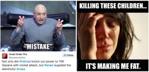
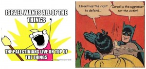
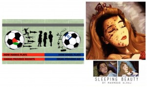
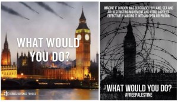
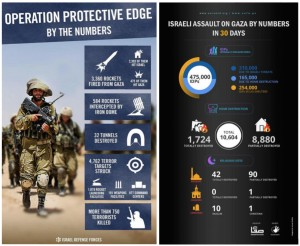
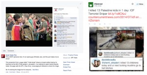
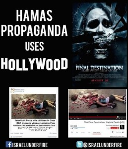
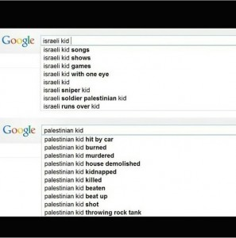
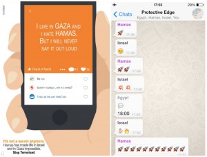

---

> You won’t believe what #Hamas was hiding in a mosque! Retweet if you are outraged!
>
> #IsraelUnderFire #HamasWarCrimes (@IsraelUnderFire, 2014, August 1) {#para1}

In one of his best-known provocations, Jean Baudrillard (1995) declared that the Gulf War of 1991 did not take place. For Baudrillard, the idea of the war broadcast to Western audiences by media organisations such as CNN was merely a ‘masquerade of information’, and what actually took place on the ground in Iraq was not a war at all but a horrifying ‘disfiguration of the world’ (40). In other words, the semiotic rendering of the conflict by the mass media was a simulacrum with no relationship to its supposed referent. Much has changed in the 24 years since Baudrillard’s essay series was first published. The discourse network which mediates our understanding of war – that array of technologies and institutions enabling information to be sorted and processed, as Friedrich Kittler defined it (1990: 369) – has been radically reshaped by the Internet. Most notably, for our purposes, social networking services have created a thriving media ecosystem that cultivates viral or ‘spreadable’ texts (Jenkins, Ford and Green, 2013). This paper explores how wartime communication, by the military as well as non-state actors and individuals, is adapting to this environment, using as a case study the exchange of creative political content during the conflict between Israel and Gaza in July and August 2014. {#para2}

While aspects of that conflict continue to be disputed, there is broad agreement over most of the central facts. It began on July 8, 2014 with an air attack by the Israeli Defense Forces (IDF) on more than 150 sites in the Hamas-led Gaza Strip, as part of a military campaign named Operation Protective Edge. The offensive followed the sporadic exchange of rockets and mortars from Gaza, and air strikes from Israel, in May and June 2014. The conflict escalated on July 17 when Israel launched a ground invasion of Gaza. After a number of unsuccessful attempts at cease-fires, a lasting truce was reached on 26 August. Over the 50-day conflict, over 2,100 Palestinians and 71 Israelis were killed (OCHA, 2014). Throughout that period, many aspects of the conflict and its wider context were forcefully contested on social media, especially within the data streams of Facebook, Twitter, Instagram and Tumblr. This was described in the mainstream media as a ‘war of the hashtags’ (Aljazeera, 2014) or ‘hashtag battle’ (Mackey, 2014), referring to the two of the key hashtags that content was often shared under: #GazaUnderAttack and #IsraelUnderFire. {#para3}

During the previous Gaza War of 2008–2009, belligerents and their supporters also sought to disseminate their views on social media, as Will Ward has detailed (2009). At that stage, however, the social media ecosystem was much less developed: Twitter, for example, handled only 300,000 plain-text tweets each day while today it handles half a billion each day, including embedded images and videos; and Instagram had not yet been launched. Utilisation of social media increased during Israel’s Operation Pillar of Defense in 2012, during which the IDF made extensive use of Twitter to frame its messages (Cohen, 2012). {#para4}

Indeed, the strategic potential of social media during times of crisis had been repeatedly demonstrated prior to the outbreak of the July 2014 conflict. The so-called “Twitter revolutions” in Tunisia, Egypt and elsewhere showed how social media can be utilised to organise protests, disseminate ideas and narratives, and build support inside and outside one’s country (Tufekci and Wilson, 2012; Tufekci, 2013; Papacharissi, 2014; Henry Jenkins, n.d.). The 2011 Occupy Wall Street protests also demonstrated how creative content such as Internet memes could contribute to political discussion during periods of crisis, as Ryan Milner (2013a) has shown. It was in this context, then, that both sides during the 2014 Gaza War engaged on social media. {#para5}

It must be stressed that a major portion of the digital content shared during the conflict was ‘informational’: news reports or commentary, especially first-hand evidence such as photos or videos posted by citizens, journalists or citizen journalists. Much of the image-based material – especially on the pro-Palestinian side – exhibited the logic of transparent immediacy, to adopt the term developed by Jay Bolter and Richard Grusin: it sought to immerse the viewer in the image and minimise or de-emphasise the mediation (Bolter and Grusin 1999: 22–23). Graphic photographs of children’s dead bodies, grieving families, and destroyed homes, as well as tweets from those directly experiencing the devastation in Gaza, were widely shared. Such first-hand reportage was thought to have helped to sway international public opinion in favour of Palestine (Beckerman, 2014) and was contrasted with Israeli ‘hasbara’, or public diplomacy, which was characterised as trying but failing to shift the prevailing narrative of the war (Khader, 2014). Leaving this issue to one side, I will focus instead on how parties on both sides crafted multimodal digital content that sought to interpret, explain or recontextualise the conflict, with the ultimate goal of securing or bolstering support for their cause. This content – sometimes referred to as ‘shareables’, since the purpose is to be shared on social media – is widely used for marketing as well as by organised groups and individuals for the purposes of political communication. In the present context, I suggest it may be considered viral propaganda, since it is a deliberate and methodical attempt to influence thoughts and behaviours (Jowett and O’Donnell, 2012: 7). To be more precise, the material may be described as viral agitprop, in the sense of creative content intended to influence thoughts or behaviours that may or may not be produced by a government or formal institution. {#para6}

A large amount of such agitprop was created and shared by those on both sides of the conflict. Notable sources of material on the Israeli side included the Israel Defense Forces’ own Twitter, Facebook and Instagram accounts; the StandWithUs and Tweeting Statuses Facebook pages; and IsraelUnderFire, the name of shared Twitter and Facebook accounts run by a group of around 400 volunteer students at the Interdisciplinary Center (IDC) Herzliya, a private Israeli university, which received support from the Israeli government and the IDF (Hall, 2014); this so-called ‘hasbara room’ was also in operation during the 2008–2009 Gaza War (Ward, 2009) and during Operation Pillar of Defense in November 2012 (Gravé-Lazi, 2014). On the Palestinian side, a broader range of groups and individuals produced and shared such material. They included the OpIsrael Twitter account, associated with the Anonymous collective; the Twitter account @occpal; the NGO Euro-Mid Observer for Human Rights; and the Palestinian social media identity Mohammad Zeyara via his high-profile public Facebook page. {#para7}

Previous examinations of multimodal viral content have utilised discourse analysis at varying levels of methodological formality (see, for example, Kuipers, 2002 and Milner, 2013a). I will draw upon the approach pioneered by Limor Shifman, which disambiguates three distinct parts of a ‘meme’ capable of being imitated: the content, or ideas and ideologies; the form, or how it is outwardly expressed; and the stance, which describes how the creators orient themselves towards the text, who can participate in it, and the tone (or keying), style and function of the communication (Shifman, 2013: 40). I will also rely upon the social semiotic approach to visual communication developed by Gunther Kress and Theo van Leeuwen (1996), which is based upon systemic functional linguistics. In using these tools, I wish to draw attention to two notable, related qualities seen consistently in material produced by both sides of the conflict: novelty of form coupled with fixity of content, and meta-mediation. {#para8}

### Novelty of Form, Fixity of Content

  {#para9}

The first salient feature of the diverse creative material disseminated by social media accounts on both sides of the Gaza-Israel conflict was the seeking out of novelty of form, or neophilia. Fresh, contemporary signifiers, styles and media objects were constantly emerging, including image macros, infographics, diagrams, data visualisations, graphs, cartoons, games, a flashmob and Instagram photographs with vintage filters. As Vice journalist Patrick McGuire (2012) observed of viral material previously generated during Operation Pillar of Defense, the style of presentation adopted for military communication could be ‘shockingly savvy’. A particularly striking example was the ‘clickbait’-style tweet quoted at the beginning of this paper, with its signature ‘curiosity gap’ that omits a vital piece of information: ‘You won’t believe what #Hamas was hiding in a mosque!’. It links to a YouTube video uploaded by the IDF which enables viewers to share the experience of an Israeli soldier raiding an enemy position; the footage, shot with a helmet camera, directly evokes the genre of first-person shooter video games. {#para10}

This kind of hypermediated content, which is well attuned to the latest Western cultural practices, bears some resemblance to what Milner (2013a) has described as ‘pop polyvocality’ in networked communication: a phenomenon whereby a diverse range of voices make use of pop culture signifiers to join in civic debate through contributing derivations of widely recognised discursive forms. The tendency to embrace pop culture touchstones was most noticeable in the use of image macro exploitables: the ‘Dr Evil’, ‘First World Problems’, ‘All The Things’ and ‘Batman Slapping Robin’ memes were all used to explain current news, rebut antagonists’ messages, or provide contextual information (figs. 1–4). The discursive stance of these four examples might suggest that the viral agitprop made extensive use of humour to critique official discourse, as Milner, drawing upon the work of Peter Dahlgren (2009), observed of memes circulated during the Occupy Wall Street protests. But pop culture references were frequently repurposed with quite a different discursive stance: the form might have been whimsical but the keying, or internal tone, was serious. For example, an image of a soccer match referencing the contemporaneous World Cup final was repurposed as a commentary showing Hamas aiming rockets at children (fig. 5), while the Disney character Sleeping Beauty was juxtaposed with a photo of a dead Gazan woman (fig. 6). {#para11}

Indeed, the stance of most of the creative content shared online during the conflict was not, in fact, playful engagement with pop culture but rather strong or ‘high arousal’ emotion – one of the key characteristics of succesful viral content (Shifman, 2013: 67–68) – that was rendered in a range of novel, and even stylish, forms. Two typical examples are the ‘What Would You Do’ shareable created by the IDF (fig. 7), in which a stark interrogative invites British audiences to imagine themselves assailed by Hamas rockets, and the Palestinian response to it based upon the same pattern (fig. 8). Characteristically, the Palestinian content appears somewhat less attuned to the codes of Western visual design; explanatory body copy would normally be placed at the bottom rather than the top of a multimodal image (Kress and van Leeuwen 1996: 193–196). Another contemporary form adopted by both sides was the infographic. As with the ‘What Would You Do’ shareable, slickly designed Israeli examples (fig. 9) were paralleled by Palestinian equivalents that exhibited somewhat less familiarity with contemporary semiotic conventions (fig. 10). {#para12}

A related type of content shared by Israelis were diagrammatic illustrations of Hamas tunnels or positions near Gazan schools or hospitals. These infographics and diagrams display what Kress and van Leeuwen (199: 139) have described as the ‘shift from the dominance of the perceptual to the dominance of the conceptual’: they seek to express a fundamental, generalised reality true beyond any individual example captured in a photograph. Moreover, they utilise the signifiers of objectivity and precision not only to convey authority but also to activate what Michael Saler (2012: 284) has described as ‘disenchanted enchantment’, that is, the evocation of a sense of awe through scientific disillusionment. {#para13}

These are a few representative examples of the wide range of recognisably novel forms that were created on both sides of the conflict; more examples are discussed in the following section (figs. 11–16). Milner (2013b), borrowing terminology from Deborah Tannen (2007), notes how memes are a balance of individual acts of novelty with fixity: in other words, users take elements of a fixed ‘media lingua franca’ of culturally available artefacts and modify them in new ways. During the Occupy Wall Street protests, for example, many participants created novel variations on widely recognised memes such as the ‘pepper-spraying cop’ and ‘We are the 99%’ (Milner, 2013a). But during the Gaza-Israel conflict, the novelty-fixity dynamic emerged in a distinctive new way. Rather than the forms remaining fixed and the content changing throughout endless derivations, the content appeared to remain fixed while the forms kept changing. A limited set of fairly simple messages – such as the number of rockets Hamas had fired at Israel, for example, or the fact that those rockets were in response to an ongoing occupation – were continually rehashed in new ways. For this reason, the discourse in many social media streams often seemed less polyvocal (following Milner) than univocal, in that the content appeared to speak from a single, coherent point of view. There was one example of a participatory project which involved variations on a fixed form – a project organised by StandWithUs which invited users to share photos of their passport as a token of international support, which was imitated by Palestinian opponents – but that was notable for its centripetal nature, conveying a sense of unity and solidarity rather than a diversity of viewpoints. {#para14}

The use of novel forms to convey a fixed set of messages can be seen, at least in part, as a response to the technical limitations and affordances of the data stream. Lev Manovich (2012) has defined the ‘data stream’ as a collection of media objects arrayed in a single column that is experienced as an uninterrupted flow of discrete, time-ordered events, with the most recent event being most salient; it is now a key symbolic form in new media. Its fundamental organising principle – arbitrarily related units of information notionally in reverse chronological order – favours the creation of novel, stand-alone texts rather than ongoing patterns or narratives. Each item of content must succeed on its own merits without necessarily being able to rely on a previously established context or the objects before and after it. The data streams of Twitter, Facebook and Instagram are also extremely noisy, crowded and fast-moving, especially during wartime. In this ecosystem, actors compete for the vital resource of user attention (Tufekci, 2013). As Henry Jenkins, Sam Ford and Joshua Green put it: ‘[I]f it doesn’t spread, it’s dead (2013: 1). In response to these conditions, proponents of both sides in the Gaza-Isreal conflict produced a huge volume of diverse stand-alone content at a febrile pace with the hope of making it spread; a ‘throw enough mud at the wall and some of it will stick’ strategy. Since successful content is that which is most suited to its sociocultural environment (Shifman, 2013: 22), novel modes of signification were favoured due to their perceived appeal to prevailing online cultures. But due to the Internet’s low cultural latency, to borrow Faris Yakob’s term (1990), trends have a tendency to quickly run their course. When viral material did not succeed, spent forms were replaced by new ones even though the ideas and ideologies being expressed had not changed. Indeed, since shareables are designed to be decontextualised by spreading across social networks, there was a strong need to repeat their core messages for audiences who had not seen any of the previous, similar content. {#para15}

### Meta-Mediation as a Semiotic Strategy

The second feature of the content shared during the conflict I wish to draw attention to is meta-mediation, or the thematising of the act of mediation itself. This must be distinguished from hypermediacy, defined by Bolter and Grusin (1999: 35) as a cultural logic that renders mediation conspicuous rather concealing it. By comparison, meta-mediation not only lends mediation formal prominence but renders it the central ideational component of a media object. The practice of ‘going meta’, first described by Douglas Hofstadter in 1979, has gained increased cultural prominence over the past 15 years (Fuller, 2015: 77) and has been observed in responses to viral media such as the video of Susan Boyle’s performance on Britain’s Got Talent (Green and Jenkins, 2011: 117). In the present context, meta-mediation emerges as a tool of strategic communication. {#para16}

By far the most prominent type of meta-mediated content shared online during the Gaza-Israel conflict took the form of a social media post or posts embedded as a subordinate component of another social media post (see Kress and van Leeuwen, 1996: 112). For example, a Facebook post by IsraelUnderFire consisted of an apparent screencap of a post to an anti-Israel Facebook page showing two male IDF soldiers kissing and the homophobic comment ‘Israel is gays [sic] army’; this was accompanied by a comment from the IsraelUnderFire poster that included a compelling personal narrative (fig. 11). Another post, which was widely disseminated on Twitter during the conflict, apparently showed an Israeli soldier boasting on Instagram of how many Muslim children he had killed, with the comment enlarged to make it more salient (fig. 12). As these examples suggest, meta-mediation often involves retaining the form and content of the original message more or less intact but imbuing it with a very different discursive stance; a speech act that was initially a disparagement or a boast is repurposed as an object of moral outrage. This practice resembles what Alex Fattal (2014) has termed ‘recombinatory circulation’, whereby digital content produced by a counterpublic (or public) is resignified by an oppositional public (or counterpublic) in an antagonistic way. Thus sharing on social media becomes not a neutral act or ‘positive’, in the way market-based media industries understand new media audiences in the attention economy, but critical and hostile. {#para17}

A related type of meta-mediated material was the compositing of various, contrasting artefacts so as to demonstrate a gap between media myth and reality. One example is an IsraelUnderFire montage (fig 13) which asserts that Hamas propaganda is using fake photos of war victims. Utilising the compositional logic of ‘given and new’ (Kress and van Leeuewen, 1996: 186–192), it places the given ‘myth’ of Hamas on the left and contrasts it with the new revelation of their supposed ‘reality’ on the right; this same structure was used in a number of other similar shareables. But it was not only the discourses of antagonists that were meta-mediated; often, the social media content of allies – including a Gaza resident’s text messages, or notifications on the app Red Alert used to warn Israelis of incoming rockets – was also embedded in social media posts, accompanied by explanatory and supportive commentary. Other content sought to embed media artefacts perceived as neutral, such as the screencap of Google Autocomplete searches for Israeli and Palestinian children shared on Instagram (fig. 14). Like the embrace of novel forms, these practices can be seen in part as a response to the affordances and limitations of the social media ecosystem that content is disseminated within. Meta-mediation provides a ready source of new content in a hungry attention economy, and enables those who are located far from the fighting to proactively intervene and create novel, shareable material using widely available digital tools. {#para18}

But meta-mediation also does much more than that. In some ways, it is a contemporary equivalent of the older, oppositional ‘reading’ practices discussed in early British audience studies research (Hall, 2006; Morley and Brunsdon, 1999). Critical reading practices were championed by early advocates of discourse analysis as a way of improving the meta-medial literacies of audiences, who were encouraged to take into account the conditions of textual production as much as the semiotic content of texts themselves. Instead of operating at the level of reception and being dependent on the critical capacity of the audience, however, meta-mediation in viral agitprop operates at the level of distribution and the logistics of the sign-message. Milner (2013a: 2370–2381) has analysed similar multimodal artefacts shared during the Occupy Wall Street protests: supporters and opponents of the movement would interrogate and annotate each other’s social media content, engaging in rich multiturn conversations. According to Milner, embedding the assertions of other participants in a debate may assist civic conversation to break out of online echo chambers and engage more with those who hold opposing views. It seems doubtful that very much genuine engagement is likely to take place in the extremely polarised context of the Israel-Palestine conflict. But if war is a ‘speed-factory’, as Paul Virilio (2006: 157) reminds us, meta-mediation may be considered at least an attempt to slow down production and make time for critical examination. The viewer is invited to stop and regard tweets and Instagram photos as objects to be reflected upon, or clues to be investigated – not quickly scrolled past. Critical meta-mediation defamiliarises media content, making it strange and foregrounding its materiality and modes of construction. Perversely, it may bring us closer to unmediated reality itself, just as the practice of hypermediacy ‘makes us aware of the medium or media and … reminds us of our desire for immediacy’ (Bolter and Grusin, 1999: 34). {#para19}

Two other types of meta-mediated content were also apparent during the conflict. Some multimodal texts sought to recreate familiar new media interfaces, such as smartphones depicting imagined chats with parties involved in the conflict (figs. 15 and 16), in order reframe the narrative of the war; one apparently popular shareable even depicted the Gaza Strip as a map in the video game Minesweeper (Lotan, 2014). Like the infographics noted in the previous section, this material sought to move the debate from the domain of the perceptual into the domain of the conceptual, using widely recognised metaphors to mount broad, generalised arguments. In direct opposition to these examples, however, were other pieces of meta-mediated content which expressed incredulity that the war was being experienced and explained as a pop-culture simulacrum rather than a real conflict. For example, a post on Mohammed Zeyara’s Facebook page mobilised outrage against the video game Gaza Assault: Code Red, which allowed players to pilot drones to attack sites in Gaza; the post received nearly 10,000 shares. And one of the most highly shared images of the conflict was the so-called ‘Sderot cinema’ photograph of Israelis watching the bombing of Gaza from a hill in the town of Sderot as if they were at an open-air movie. The pervasive fascination with, and critique of, meta-mediation in viral agitprop recalls Friedrich Kittler’s description of a Pink Floyd song as a ‘discourse on discourse channel conditions’ (quoted in Winthrop-Young, 2011: 54). Just as ‘[r]ock songs sing of the very media power which sustains them’ (Kittler, 1999: 111), so too did propaganda during the Gaza-Israel conflict. {#para20}

### Diverse Functions, Polarised Publics

What are the functions of these two related, sometimes coexistent, semiotic practices? As Tufekci (2013: 849) has noted, social media can be utilised to address a range of activist goals including addressing larger publics, mobilising supporters and offering preferred frames. Networked communication through social media can also play a key role in the emergence of narratives that connect disparate participants with shared sentiments (Papacharissi, 2014). Although it is not necessarily created by activists, the viral agitprop examined in this paper can certainly perform these functions. In addition, this content fulfils a number of other important communicative goals related to its wartime context, including winning support from foreign audiences, rearticulating national identity, boosting morale, and – through the practice of meta-mediation – neutralising enemy messaging. Because viral agitprop is generally distributed in small chunks, unlike a feature article or television broadcast, a single channel or user is able to generate a wide range of material performing a diverse range of functions each day of the war. {#para21}

Single channels and users were also able to disseminate messages among a diverse range of audiences, both domestic and international. IDF social media accounts, for example, would mix messages aimed at cultivating group identity and solidarity (for example, ‘Shabbat Shalom’) with strident addresses to foreign audiences composed in a range of languages; the OpIsrael Twitter feed combined graphic images of dead bodies with quotations from Shakespeare and image macros (and much else besides), each of which is optimised for users in different social locations. Green and Jenkins (2011: 117) have argued that successful spreadable media typically encodes ‘diversified experiences’ for different users, becoming ‘meaningful on many different levels’ and therefore disseminated in a wider range of contexts; in the case of viral agitprop, the content itself was highly diversified, meaning that each item did not necessarily need to resonate with a wide range of audiences but had the capacity to speak to distinct niches. {#para22}

In spite of the diversity in audience, it was generally clear whether a piece of viral content was aimed at constituting an Israeli (counter)public or Palestinian (counter)public (Warner, 2002), since the discourses of each side were so polarised. As Lotan (2014) has shown, the social media landscape during the Gaza-Israel conflict was marked by strong homophily, with the social networks of Gaza and Israel supporters largely insulated from communicative interactions with their opponents. This was due in part to the conditions of the data streams that material was disseminated within, which consisted of unique feeds of personalised media content or ‘idiomedia’ (Barnet, 2009). Members of respective publics were largely consuming content that they chose or that was chosen for them. {#para23}

Yet these polarised publics were occasionally disrupted by opposing voices as a result of several practices, including meta-mediation of antagonists’ digital content as well as the technique of ‘hashtag-jacking’: purposefully using hashtags of opponents or third-parties to reach a wider audience. For example, the Google Autocomplete screencap (fig. 14) was shared with the comment ‘The tag #IsraelUnderAttack shouldn’t even exist’, thus ensuring it reached at least some supporters of Israel. Hashtags could also be used to enter conversations in completely different discursive domains: for example, the diagram using the metaphor of soccer (fig. 5) included the hashtags #Germany, #Argentina and #ClosingCeremony in order to join the concurrent global conversation on the World Cup. The way that polarised publics are constituted by – and occasionally disrupted by – viral agitprop casts seems to cast doubt upon Baudrillard’s argument regarding how war is projected by the media. If the Gulf War of 1991 did not happen, we might say that the Gaza War of 2014 happened in different ways for different publics: to some, it was a legitimate military response to terrorism, while to others, it was never a war to begin with but rather a massacre. Both sides were largely, though never completely, insulated from their opponents’ worldviews. {#para24}

### Viral Agitprop: A New Internet Genre?

In this paper I have briefly detailed how newness and new media itself were both salient in the multimodal creative content distributed on social media by both sides during the 2014 Gaza-Israel conflict. I suggest that this type of content could be considered a distinct genre of Internet communication, which is distinguishable from a number of other related online practices and forms of signification. As a form of goal-directed messaging produced in a methodical, and often professionalised way, it does not represent the kind of vernacular creativity described by Jean Burgess (2008). Nor does it generally reflect the phenomenon of ‘polyvocality’ observed by Milner (2013a) of social media during the Occupy Wall Street protests, as I have already made clear: by contrast, viral agitprop seems to encode a limited set of messages and perspectives despite adopting a wide variety of forms. The viral agitprop produced during the Gaza-Israel conflict did not consist predominantly of Internet memes in the narrower sense of the word as used by Shifman (2013), since its content was usually not transformed into a large number of variations by a broad community of users. Instead, it often took the form of what Shifman calls ‘virals’: single cultural units which are forwarded widely in their original form. However, although agitprop typically provokes strong emotional arousal and adopts simplicity in its messaging – two of the typical characteristics of virals, according to Shifman – it relatively infrequently expresses humour or ‘positivity’ (2013: 66–69). In short, viral agitprop is what happens when practices of online creativity are instrumentalised in the high-stakes context of ongoing military conflict; when memetic and viral content becomes systematised and serious rather than participatory and playful; when memes – in the wider sense of the word – go to war. Adbusters magazine cofounder Kelle Lasn (2013) has argued that we have entered an era of meme warfare when social conflicts are contested through the generation of potent viral messages produced en masse in ‘meme factories’ (quoted in Penney, 2014); the examples discussed in this paper could be seen as a literal instantiation of this wider phenomenon. {#para25}

As I have shown, this wartime genre was produced, to some extent, by the conditions of the discourse networks within which it was distributed. This appears to be a straightforward example of the strong linkages that Kittler has claimed exist between military exigencies and media systems. As he once asserted in an interview with John Armitage (2006: 27), war is the ‘mother of all high-speed information and communications technologies’, which advances by ‘shocks and jumps’ (and so too, a fortiori, is it the originator of the media objects generated through those technologies). In *Gramophone, Film, Typewriter*, Kittler summarises how this process has historically been enacted: {#para26}

> [T]he media system proceeded in three phases. Phase 1, beginning with the American Civil War, developed storage technologies for acoustics, optics and script: film, gramophone and the man-machine system, typewriter. Phase 2, beginning with the First World War, developed for each storage content appropriate electric transmission technologies: radio, television, and their more secret counterparts. Phase 3, since the Second World War, has transferred the schematic of a typewriter to a technology of predictability per se; Turing’s mathematical definition of computability in 1936 gave future computers their name. (Kittler, 1999: 243) {#para27}

This tidy analysis, however, is complicated by the rise of these new semio-technical practices being promulgated by both sides during the Gaza-Israel conflict. Rather than military development determining (or over-determining) media systems, those systems are exerting a discernible influence on the military. Kittler (1999: 97) claimed that popular culture is merely an ‘abuse of army equipment’; today, we might say that military strategy is an abuse of Facebook. Militaries and civilian technology companies are co-operating to define the contours of contemporary warfare together. In such a context, site policy changes by those technology companies – such as tweaking the EdgeRank algorithm which orders Facebook’s News Feed, or changing Twitter’s time-ordered feed to an algorithmically-determined one – can have geopolitical consequences. {#para28}

It is important not to apply conclusions drawn from the agitprop cited here to other military or civilian conflicts where the capabilities and intentions of the actors involved are different. For example, a key goal of those on both sides in the Gaza-Israel conflict was to a garner mainstream public support in highly networked, industrialised nations, which exerted a strong influence on the form and content of the material shared. But with social media increasingly pervasive across the globe, more and more militaries and non-state actors are utilising social networking platforms to expand their influence, as demonstrated by the Islamic State’s widely disseminated and much-discussed YouTube videos. How militaries, NGOs and citizens respond to the affordances and limitations of social networking services by creating viral agitprop, and how those services respond in turn, is therefore an important dynamic that may impact on how wars are mediated and possibly even affect their outcome. Indeed, as Kittler has pointed out, control of today’s discourse networks is what those conflicts are really about anyway: ‘[R]eal wars are not fought for people or fatherlands, but take place between different media, information technologies, data flows. Patterns and moirés of a situation that has forgotten us’ (Kittler, 1999: xli). {#para29}

### Biographical note

Chris Rodley is a PhD candidate in the Digital Cultures program at the University of Sydney. His doctoral research is tracing the emergence of a poetics of big data, with a focus on how the ability to search and manipulate large amounts of information in real time is transforming relationships between texts, authors and readers.

### Acknowledgements

I would like to thank the anonymous reviewers, editor Glen Fuller, and Grant Bollmer for their helpful feedback and suggestions.

### References

- Al Jazeera. ‘Gaza and Israel: War of the Hashtags’, *Inside Story* (2014, July 22), https://www.aljazeera.com/programmes/insidestory/2014/07/who-winning-social-media-war-over-gaza–2014722172425666235.html.

- Armitage, John. ‘From Discourse Networks to Cultural Mathematics: An Interview with Friedrich Kittler’, *Theory, Culture & Society* 23.7–8 (2006): 17–38.

- Barnet, Belinda. ‘Idiomedia: The Rise of Personalized, Aggregated Content’, *Continuum: Journal of Media & Cultural Studies* 23.1 (2009): 93–99.

- Baudrillard, Jean. *The Gulf War Did Not Take Place* (Sydney: Power Publications, 1995).

- Beckerman, Gal. ‘Israel Has A New Worst Enemy — Twitter’, *The Jewish Daily Forward* (2014, July 24), https://forward.com/articles/202714/israel-has-a-new-worst-enemy-twitter/?p=all.

- Bolter, Jay and Grusin, Richard. *Remediation: Understanding New Media* (Cambridge, Mass.: MIT Press, 1999).

- Burgess, Jean. ‘‘All Your Chocolate Rain Are Belong to Us?’ Viral Video, YouTube and the Dynamics of Participatory Culture’ in Geert Lovink and Sabine Niederer (eds.), *Video Vortex Reader: Responses to YouTube* (Amsterdam: Institute of Network Cultures, 2008).

- Cohen, Noam. ‘In Gaza Conflict, Fighting With Weapons and Postings on Twitter’, *The New York Times* (2012, November 21), https://www.nytimes.com/2012/11/22/world/middleeast/in-gaza-conflict-fighting-with-weapons-and-postings-on-twitter.html.

- Dahlgren, Peter. *Media and Political Engagement: Citizens, Communication, and Democracy* (Cambridge: Cambridge University Press, 2009).

- Fattal, Alex. ‘Hostile Remixes on YouTube: A New Constraint on Pro-FARC Counterpublics in Colombia’, *American Ethnologist* 41.2 (2004): 320–335.

- Fuller, Glen. ‘Meta: Aesthetics of the media assemblage’, *Platform* 6 (2015): 73–85.

- Gravé-Lazi, Lidar. ‘IDC Fights War on Another Front’, *The Jerusalem Post* (2014, July 16), https://www.jpost.com/PromoContent/IDC-fights-war-on-another-front–362989.

- Green, Joshua and Jenkins, Henry. ‘Spreadable Media: How Audiences Create Value and Meaning in a Networked Economy’ in Virginia Nightingale (ed.), *The Handbook of Media Audiences* (Malden: Wiley-Blackwell, 2011).

- Hall, Matthew. ‘Israeli Propaganda War Hits Social Media’, *The Sydney Morning Herald* (2014, July 18), https://www.smh.com.au/it-pro/government-it/israeli-propaganda-war-hits-social-media–20140717-ztvky.html.

- Hall, Stuart. ‘Encoding/Decoding’ in Stuart Hall, Meenakshi Gigi Durham and Douglas M. Kellner (eds.), *Media And Cultural Studies Keyworks* (London: Blackwell, 2006).

- Jenkins, Henry. ‘Twitter Revolutions?’,* Spreadable Media* (n.d.), https://spreadablemedia.org/essays/jenkins/#.VB1_Oi6Swq4.

- Jenkins, Henry, Ford, Sam and Green, Joshua. *Spreadable Media: Creating Value and Meaning in a Networked Culture* (New York: NYU Press, 2013).

- Jowett, Garth and O’Donnell, Victoria. *Propaganda and Persuasion* (Los Angeles: Sage, 2006).

- Kittler, Friedrich. *Discourse Networks*, trans. Michael Metteer* *(Stanford: Stanford University Press, 1990).

- Kittler, Friedrich. *Gramophone, Film, Typewriter*, trans. Geoffrey Winthrop-Young and Michael Wutz* *(Stanford: Stanford University Press, 1999).

- Khader, Jamil. ‘The Grand Failure of Israeli Hasbara’, *Aljazeera.com* (2014, August 22), https://www.aljazeera.com/indepth/opinion/2014/08/grand-failure-israeli-hasbara–20148221228220202.html.

- Kress, Gunther and van Leeuwen, Theo. *Reading Images: The Grammar of Visual Design* (London: Routledge, 1996).

- Kuipers, Giselinde. ‘Media Culture and Internet Disaster Jokes: Bin Laden and the Attack on the World Trade Center’, *European Journal of Cultural Studies* 5.4 (2002): 450–470.

- Lasn, Kalle. *Meme Wars: The Creative Destruction of Neoclassical Economics* (New York: Seven Stories Press, 2012).

- Lotan, Gilad. ‘Israel, Gaza, War & Data’, *Medium* (2014, August 5), https://medium.com/i-data/israel-gaza-war-data-a54969aeb23e.

- Mackey, Robert. ‘Young Israelis Fight Hashtag Battle to Defend #IsraelUnderFire’, *The New York Times* (July 15, 2014), https://www.nytimes.com/2014/07/16/world/middleeast/young-israelis-fight-hashtag-battle-to-defend-israelunderfire.html.

- Manovich, Lev. ‘Data Stream, Database, Timeline: The Forms of Social Media’, *Software Studies Initiative* (2012, September), https://lab.softwarestudies.com/2012/10/data-stream-database-timeline-new.html.

- McGuire, Patrick. ‘The Gaza Strip Cyber War’, *Vice* (2012, November 19), https://www.vice.com/read/the-gaza-strip-cyber-war.

- Milner, Ryan. ‘Pop Polyvocality: Internet Memes, Public Participation, and the Occupy Wall Street Movement’, *International Journal of Communication* 7 (2013a), 2357–2390.

- Milner, Ryan. ‘Media Lingua Franca: Fixity, Novelty, and Vernacular Creativity in Internet Memes’, *Selected Papers of Internet Research* 3 (2013b), https://spir.aoir.org/index.php/spir/article/view/806.

- Morley, David and Brunsdon, Charlotte. *The Nationwide Television Studies* (London and New York: Routledge, 1999).

- OCHA (United Nations Office for the Coordination of Humanitarian Affairs). ‘Occupied Palestinian Territory: Gaza Emergency Situation Report’ (2014, September 4), https://reliefweb.int/sites/reliefweb.int/files/resources/ocha_opt_sitrep_04092014.pdf.

- Papacharissi, Zizi. *Affective Publics: Sentiment, Technology, and Politics* (Oxford: Oxford University Press, 2014).

- Penney, Joel. ‘Meme Warriors and Media Viruses: Theorizing the Persuasive Political Power of the Web’ [videotaped conference presentation], *YouTube* (2014, May 12), https://www.youtube.com/watch?v=_y5K88LHPlI

- Saler, Michael. *As If: Modern Enchantment and the Literary Prehistory of Virtual Reality* (Oxford: Oxford University Press, 2012) [Kindle edition].

- Sharbaugh, Patrick. ‘Lulz Will Find a Way: How Meme Culture Is Empowering Civic Engagement in the Socialist Republic of Vietnam’ [videotaped conference presentation], *YouTube* (2014, May 12), https://www.youtube.com/watch?v=_y5K88LHPlI.

- Shifman, Limor. *Memes in Digital Culture* (Cambridge, MA: The MIT Press, 2013).

- Tannen, Deborah. *Talking Voices: Repetition, Dialogue and Imagery in Conversational Discourse* (Cambridge: Cambridge University Press, 2007).

- Tufekci, Zeynep and Wilson, Christopher. ‘Social Media and the Decision to Participate in Political Protest: Observations From Tahrir Square’, *Journal of Communication*, 62.2 (2012), 363–379.

- Tufekci, Zeynep. ‘Not This One’: Social Movements, the Attention Economy, and Microcelebrity Networked Activism’, *American Behavioral Scientist* 57.7 (2013): 848–870.

- Virilio, Paul. *Speed and Politics*, trans. Mark Polizzotti (Los Angeles: Semiotext(e), 2006).

- Ward, Will. ‘Social Media in the Gaza Conflict’, *Arab Media and Society* 7 (2009), https://www.arabmediasociety.com/topics/index.php?t_article=242.

- Warner, Michael. ‘Publics and* *Counterpublics’,* Public Culture* 14.1 (2002): 49–90.

- Winthrop-Young, Geoffrey. *Kittler and the Media* (Cambridge: Polity Press, 2011).

- Yakob, Faris. ‘Cultural Latency’, *Fast Company* (2009, July 1), https://www.fastcompany.com/1302632/cultural-latency.
