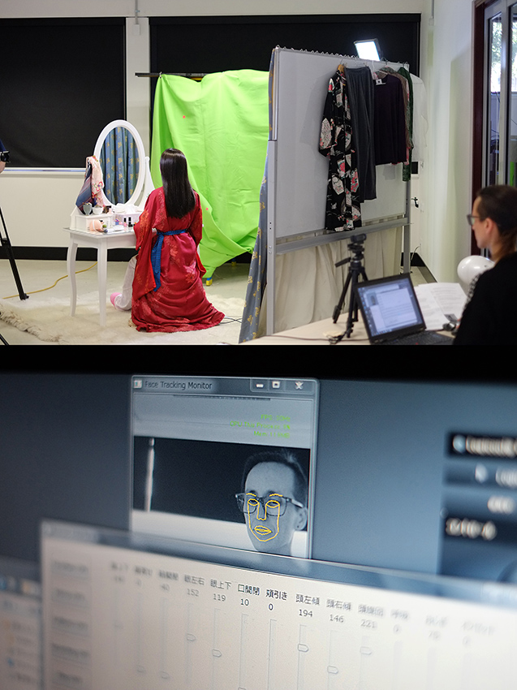
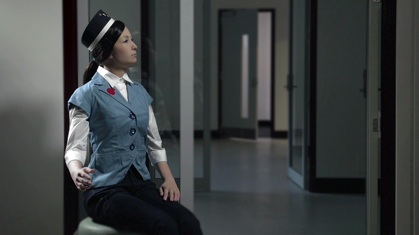
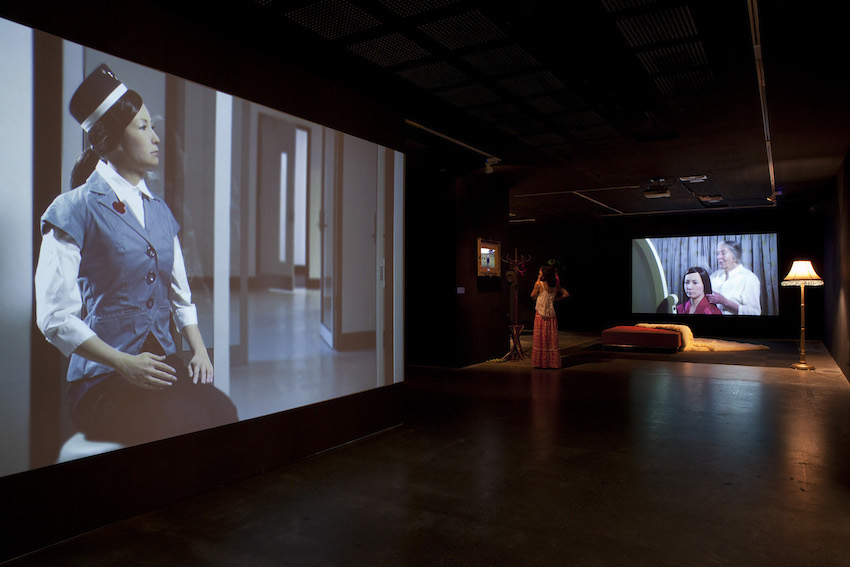

---

This paper critiques a choreographed performance of embodied agency by a ‘very humanlike’ (Ishiguro, 2006) gynoid robot. It draws on my experience at the Creative Robotics Lab, UNSW Australia, in 2013, with Actroid-F (or Geminoid-F), designed by ATR Hiroshi Ishiguro Laboratories [1], when I created six artworks making up *Actroid Series I* (2015). My analysis here proceeds from and through the part-programmed, part-puppeteered actions and vocalisations of Actroid-F in my six-minute video *Radical Hospitality*, in which the robotic gynoid actor performs compound negotiations of embodied authority, docility, and compliance. All six artworks in the series seek to induce moments of feminist hyper-awareness, or cognitive lysis (Randolph, 2001), that work against the normalisation of instilling gendered societal restrictions into humanoid robots via their embodiments and functionalities. I contend that the forthcoming devolution to ‘very humanlike’ androids of work in the domain of hospitality will draw upon, shape and reinforce the overrepresentation in this area both of women and of “feminine” robots, and that representation of aesthetics and behaviours commonly associated with “femininity” has a large part to play in this process. In my performance, installation and screen works I try to disturb the intransigence, or the non-negotiability, of these aesthetics and behaviours. {#para1}

*Radical Hospitality* is a video of a performance by Geminoid-F that is scripted in every sense of the word. I wrote phrases for the robot to say, edited the control scripts for its speech and movement, and operated the computer interface that triggers and controls its physical expression, following my minimalist screenplay. My small video crew witnessed this performance “in person”, and the artwork could in fact be presented as a live installation comprising the robot and an operator (see Fig. 1); or, with technical augmentation, it could be presented in telepresence or virtual reality. In the first gallery installation of *Radical Hospitality*, the video was projected onto a large wall directly inside the gallery entrance, its sound filling the space, and the larger-than-life image of Geminoid-F refused and granted entry to visitors (Fig. 4). In all modes of encounter, the work exploits the degrees of remove that characterise this humanoid, robotic telepresence technology: the poignantly performative lags and gaps between operations of various elements of its assemblage (computer equipment, cameras, and human and prosthetic bodies). These lags and gaps function, in the artwork, to signify that gender, and particularly femininity, are chronically mediated in modern-day culture (Meyers, 1999), and that its timeworn stereotypes are currently being reproduced into ostensibly progressive, high-tech machines. {#para2}

### Robo-sexism

Based on an ethnographic engagement comprising research and fieldwork with various humanoid robots and their designers and makers, Jennifer Robertson makes the observation that ‘most roboticists reinforce in and through their humanoids, by default arising from indifference, quite unprogressive notions of gender dynamics and the sexual division of labour’ (2010: 28). Towards the end of her article ‘Gendering Humanoid Robots’, as a way of illustrating this gendered division, Robertson introduces the interesting metaphor of ‘degrees of freedom’ in robot-building. Degrees of freedom are machines’ corporeal capabilities of motion along particular independent planes, such as are represented by the slider controls on Actroid-F’s computer interface (Fig. 1). In a humanoid robot, a degree might be the simple capacity of a limb to move left–right, or a head (or an eyebrow) to move up–down. According to Robertson’s direct observation of certain humanoids (here Geminoid HI-1 and Actroid HRP-4C), ‘if a robot’s degrees of freedom are extrapolated allegorically, the implication … is that *individuality*, gendered male, as opposed to *typicality*, gendered female, is equipped with more (degrees of) “freedom”‘ (29; original emphasis). *Radical Hospitality* performs this typicality, focusing on one binary degree of bodily freedom (Actroid-F’s right arm), to amplify this and many other robots’ sociological dependence, despite their vanguard status, on ingrained cultural norms. {#para3}

In the interest of a contextualised discussion of individuality versus typicality, it’s worth first taking an approximate roll-call of “geminoids” to date. Geminoid is a neologism for an android copy (surface aesthetics and basic sensing only) of a specific human. This collective of semi-autonomous androids is being manufactured cooperatively between Osaka and Tokyo [2],purportedly for studying the presence (*sonzai-kan*) and personalities of human beings (Guizzo, 2010; Ishiguro, 2014). Thus, states the project’s founder Hiroshi Ishiguro (2014: 138), geminoids ‘extend the applicable field of android science’. Geminoids are also sometimes called actroids, and there is some slippage between the two terms as employed by both producers and commentators. The term “geminoid” connotes twinning; however, Erica, a robot that will be discussed later in this paper, is nobody’s twin but is still a geminoid. The term “actroid” is a broader term and is more often used in relation to the female-appearing ‘very humanlike’ androids; that said, there have been, overall, more “females” than “males” developed so far, and these “females” are the only geminoids expressly regarded as actresses for the purpose of entertaining humans. {#para4}

Despite the so-called uncanny valley (Mori, 2012 [1970]), actroids are designed to appear and behave as humanlike as possible so as to render them as familiar as possible, presaging a future of belonging, of ethically viable sociocultural identity (Hasegawa and Collins, 2010; Ishiguro and Nishio, 2007: 141; Nishio et al., 2012). Designers of these robots state that actroids performance in the expressive arts (theatre, music and film, where their bodies are on display and in most cases *are* the display) will help androids in general become assimilated into the wider society (Carroll, 2011; Cuthbertson, 2015; Guizzo, 2010). The designers expressly intend that the units be used for entertaining and host(ess)ing duties, including providing soothing, pandering presences in homes and hospitals (ATR and Kokoro, 2010; Carroll, 2011; Robertson, 2010: 15). It is claimed that their incidence in these obliging roles will familiarise and content the public with interaction with robots that closely resemble humans (Ogawa, Taura and Ishiguro, 2012). So, aside from the units’ current limited functionality, their performed subservience is strategic and designed to diffuse anxiety about robots “taking over”. Gendering the robots helps achieve this objective. The actroids’ familiarity is achieved via reinscription of stereotypically gendered cultural narratives and attributes (Robertson, 2010), consistent with a propensity in some engineers of other types of robots to give “non-useful” robots “feminine” morphologies (Robertson, 2010: 18-21). {#para5}

To date, approximately 20 geminoids have been developed and publicised, all modelled after young females, with the exception of (intendedly) exact copies of two male professors from Japan and Denmark, one female professor, roughly middle-aged, from China, and a seldom-glimpsed “brother” to Actroid-F. The individuality of the professors’ robotic doppelgangers is foregrounded; they are each meant to provoke double-takes as the exact likeness of their model. The reasons given for the exactitude of one’s professorial geminoid range from flippant: it can spend “quality” time with wives (Ishiguro, 2012) and mothers (Carroll, 2011) – to pragmatic: it can free up research time by travelling and delivering lectures (Cuthbertson, 2015; Ishiguro, 2012) – to earnest, if self-important: it can act as a security measure or body double for sensitive public appearances (Burrows, 2011). In short, they are highly individualised simulacra of (their) highly individualised masters. Ishiguro’s copy has been through about four upgrades, making it more Ishiguro-like each time. Professor Henrik Schärfe takes his geminoid on the road, garnering much personal publicity including TED talks and a citation on the 2012 *Times* ‘Influential People’ list. But the female professor’s copy, YangYang, based on Professor Song Yang, is not functional and has not been since its press launch in April 2015. According to Mr Han, vice president of Shanghai Shengqing Industries, with whom I conversed with the help of a translator on a research visit to China in February 2016, the YangYang robot has been disassembled into parts, some of which are in China and some of which are in Japan. Its degree of freedom is thus constrained, and one could argue, in fact, that presently it has no degrees of freedom. The abovementioned “brother” to Actroid-F, named Kurokawa, is at the opposite end of the individuality scale: it is a clone of its “female” counterpart, with the same face, but a shorter wig, different clothes (businesswear and a blue tie) and reshaped foam padding (see Knox, 2015: 19-20). It has made few, if any, further public appearances since its launch in 2011 on the site DigInfo (this is still the only YouTube video available), and as far as I can ascertain is not discussed in any published English-language research papers. It has possibly participated in a hospital patient companionship trial in 2010/2011 (though this may have been a solo Actroid-F). {#para6}

By contrast, 14 young-female-appearing actroids have publically debuted since 2003. Some of these are modelled on actual living women, but when the robots are viewed as a group it appears that it is more important to their designers that they evoke an image of ideal beauty and amicability – that is, of typicality. A robot built very recently by Ishiguro’s lab, Erica, has 19 degrees of freedom and ‘is a more advanced version of Geminoid F’ (McCurry, 2015). The ATR Laboratories website states: ‘Its appearance is designed for [a] beautiful and neutral female face, by which people can familiarly interact with it’ (ATR, 2016). {#para7}

> The principle of beauty is captured in the average face, so I used images of 30 beautiful women, mixed up their features and used the average for each to design the nose, eyes, and so on … That means she should appeal to everyone. (Ishiguro in McCurry, 2015) {#para8}

Saya, a gynoid robot by another designer, Hiroshi Kobayashi, has worked as a receptionist at Tokyo University of Science and Ben-Gurion University of the Negev in Israel. Other labs in Korea and China are building female-realistic humanoids in a similar vein. I have written elsewhere (Knox, 2015; 2016) about the profusion of hostess-types among the ranks of ‘very humanlike’ androids, and in this paper I will focus on the manifestation of the phenomenon in Geminoid-F in a recital by this robot of what I might term generic hospitality. {#para9}

A brief note: the number of geminoids cited above is approximate because, as lab-grown innovations, all these androids appear and disappear in the public eye, in the designers’ publications and websites, and in reality. The names are part name, part model number. Colleagues in Tokyo have explained to me that when the engineers improve a function or aesthetic – for example, actuators being redistributed to areas of prime experimental focus (currently the face) – the android is often renamed: for instance Repliee Q2 was shown as Repliee Q1-Expo, and only very slight variances (1 degree of freedom) and some extra sensors officially differentiate the two generations. The effects of “improving” a model may also be drastic: a droid that can stand may be transformed into a new model which is not able to stand, because of a shift in research emphasis to one not requiring this ability. In an iterative workflow analogous to performativity itself, the droids are constantly overwritten, producing identities that evolve over time. There should, therefore, be many practical opportunities for robotics engineers, notwithstanding the ‘indifference’ noted by Robertson, to make incursions into the androids’ aesthetic standardisation along stereotypical lines, perhaps in experimental frameworks that could seek to *exceed* the standard levels of perceived robotic affinity via aesthetic familiarity. This approach of experimental boundary-pushing is aligned with scientific/governmental imperatives of novelty and innovation. And so, perhaps goaded by projects initiating from within the visual and performing arts, and by the findings of and the public reactions to these projects, robotics engineers might be convinced to re-examine the stereotypic image of the gynoid. Collaboratively, we might begin to frame a lack of stereotypical predictability – a relaxing of strict adherence to type – as an “improvement”. {#para10}

### Working with Geminoid-F

In making *Radical Hospitality* I worked closely in dramaturgical practice with the gynoid called Geminoid-F, or Actroid-F. ‘F’ stands for female (ATR and Kokoro, 2010). The initial press release for Geminoid-F, dated 26 March 2010, described its new features in contrast to the contemporaneous geminoid named HI-1, which is modelled on its lead creator, Ishiguro himself. {#para11}

> The humanoid robot “Geminoid HI-1” which has previously been developed … has a complicated body structure … In contrast, the newly-developed Geminoid™ F has minimum degrees of freedom required for tele-operation and has been designed to re-create more natural facial expressions like smiling. By limiting the number of moving parts, development cost was significantly reduced. In addition, wide applications in practical scenes can be expected by adopting the appearance of a more friendly woman. (ATR and Kokoro, 2010) {#para12}

According to the release and the robot’s online homepage [3], due to this ‘significant downsizing’, ‘Geminoid-F is hoped for becoming more common communication media for everyday life’. {#para13}

ATR Laboratories’ early designs of the female-model geminoid – Repliee Q1, Q1-Expo and Q2 – allowed for 31, 41 and 42 degrees of freedom, respectively, while the first “male”, HI-1/HI-2, has progressed from 46 to 50 degrees of freedom. The 2010 Geminoid-F has only 12 degrees of freedom, partly so that it would be cheaper, more lightweight, and more easily applied to social environments and installations (ATR and Kokoro, 2010; Burrows, 2011). [4] Its possibilities of movement are thus delimited, ostensibly in service of the goal that all humans become familiar and comfortable with all humanoids. Its limited deployable freedom relative to that of the geminoid clones of male university professors can be seen as typical of a persistent contradiction in modern societies: ‘patriarchal systems embedded in the ideological discourse of egalitarianism’ (Stoeltje, 1988: 220). Ishiguro has since developed a more restricted (cheaper and lightweight) version of himself, HI-4, which has 16 degrees of freedom as compared to Geminoid-F’s 12. However, he is still working on HI-2, which has 50 degrees of freedom. There is no fembot comparable to the HI-2; Otonaroid (discussed below) comes closest, but trails by 10 degrees. {#para14}

Geminoid-F is a seated android – it has legs and feet but cannot stand. It is physically fused to its chair via a metal pole that projects in an undignified fashion through the chair and up its “spine”. It “sleeps” in a slumped-over position on this same chair or stool. It is tethered by electricity and data cables, and its servo actuators are powered by an external air compressor that feeds them through a tube. This compressed air is also used to give the android the appearance of breathing in its chest. The android is operated by humans via an external computer running Windows, including the native text-to-speech software and speech synthesis, and 13 faders programmed in Visual Basic by which the operator can manually control actuator movement along specific binary planes (one plane, the torso, was out of commission at the time of filming, and the final fader controlled a programmed combination of mouth and brow movement to express “surprise”). The unit does not currently have the artificial intelligence to learn or to make decisions autonomously. The android has a camera in each eye, and blinks on an automatic program (much as one could say humans do), a reflex that does much to enhance its “naturalism”. It can track faces and movements, and exhibit a range of motor movement within its 12 polar axes. Operating this robot is a lot like puppeteering and a little like driving a remote-controlled, jumpy jalopy. [5] For all that it is a high-tech entity and a proud product of the high-tech jurisdiction, its basic face-tracking, laggy virtual faders, and sometimes jerky pneumatics give it a decidedly hands-on, folksy feel. Observers experience the non-human non-fluidity as a provocative disconnect between the appearance of the robot (credibly “human”) and its movement (obviously not). The artwork *Radical Hospitality* exploits the robotic gestural awkwardness of this otherwise realistic simulacrum to point up the *ideological* lag between modern identity politics and those being inscribed into these ‘very humanlike’ machines. It joins a body of my work that looks into the societal naturalisation of women behaving awkwardly. Curiously, the technical term “compliance” applies to the air actuators’ controlling and attempting to smooth out this jerky movement in the robot (MacDorman, 2008). {#para15}

Geminoid-F does have a relatively mobile face compared to most robots; its physical freedom is primarily facial, allowing it to mime a range of recognisable facial expressions conveying emotion and empathy. The android’s performance parameters that I utilised in *Radical Hospitality’s* choreography are its head rotation side-to-side, eyeball rotation side-to-side, smile, head tilt (coquettish), and an opening-up gesture of the right arm and hand. I have focused on this expressive arm gesture devolved to the actroid – perhaps its least smooth physical gesture [6], [7], and embedded it as the crux of a cyclical performance of welcome/exclusion. French scholar Mireille Rosello (2001: 127) discusses a form of ‘glamour’ in which the prestigious welcoming gesture is performed by the male (or the patriarchy), while the backstage work connoted by the gesture is done by a female subaltern. However, at national and regional borders, or at almost any institutional border where a physical, general welcoming gesture (or a smiling rejection) is called for, a female figure is usually procured (Knox, 2015, McNulty, 2007). If, as Rosello describes, the performance of ‘hospitality calls for a series of gestures that must combine the art of welcoming symbolically, as well as a more humble aspect that makes the host closer to the servant’ (2001: 126), then the proxied hostess is at once front-and-centre and humbly liminal in this figuration, as she materially takes over the welcoming gesture while it is understood that she is possessed, blank: that the semiotics of the gesture are beyond her full control. Telepresent androids deliver this intrinsically awkward performance *par excellence*. {#para16}

I have also lent my own unsynthesised (non-Japanese) voice, in voiceover, to the actroid, as might conceivably befit its liminal, cyborgian, global-citizen status (Geminoid-F’s ‘master template’ is one-quarter non-Japanese (Guizzo, 2010)) and its roles as telepresence robot and as a futuristic, personable, flesh-suggestive sentry. The puppet says, *Welcome.* In *Radical Hospitality* the actroid, in uniform, sits before a series of open doors that suggest the “hoops” we must jump through, or, more literally, the thresholds we must negotiate in order to be socially acceptable, or welcome. It gestures in an official, programmatic manner to imaginary, invisible or notional beings entering “its” space. From a distance of a few metres, it might be taken for a human. It is a confluence of the corporeal typologies of hostessing women and the workaday Japanese employee (see Iwabuchi, 1994; Meyers, 1999; Oda, 2001; Ueno, 2001a, 2001b). Its humanoid body has no toes, genitals, nipples or hair (it wears a wig). Yet it is feminine. There is no functional reason for the robot smiling at the threshold to be feminine, it just feels right. Questions of what or who is across the threshold, and what the crossing demands or means, are downplayed by the saccharine performance at the gate. {#para17}

I have proposed elsewhere (Knox, 2015) that all hostesses’ performances of functional surrogacy are reflexive: they filter and feminise for the general public a masculine authority that, as Allison (1994: 166) observes, is already dependent on the gestures and labours of women. In this performance, which is generally keyed to signify a *conditional* hospitality, ‘gender serves as a hinge on which all the ambiguity of the status of the host can support the complex interactions between race and class’ (Rosello, 2001: 134). This norm-based interplay between race, gender, nationality and social standing, as it applies to the perception of “helpful” technologies, is observed and examined in studies by researchers across the world (e.g. Carpenter et al., 2009; Dautenhahn et al., 2005; Van Zoonen, 2002). For the purposes of my experiment (and also in Rosello’s book-length study of gender and hospitality) the phenomenon is extrapolated as a relatively global one, spanning at least European, Japanese, North American and Australasian contexts. And while other works in *Actroid Series I* are set in domestic settings (cf. Carpenter et al., 2009), *Radical Hospitality* understands the surrogated performance of hostile hospitality as occurring as a *ne plus ultra* at the borders to nation-states, where hostesses stand as signifiers for international (in)hospitality – baldly, who is admitted and who is refused entry. The work concurs with Rosello in regarding the hostess in this role with simultaneous ‘positive suspicion and naïveté’ (2001: 75). I want to understand the less obvious, intangibly performative aspects of the role, and the interdependence of the human model organism (the “hostess”) and the robotic role delivery. For as ‘servants obviously do not disappear when nations become independent’ (135), neither does the human subaltern disappear when, in a suppositional scenario, humankind is “liberated” by functionary robots. {#para18}

*Radical Hospitality* is but one effort to spotlight the model of the model of the model. As the longest of the works in its series, across which the actroid undertakes television host(ess)ing, reception duties, and new-age wellness facilitation in the guises of concubine, geisha and Lolita types (among others), *Radical Hospitality’s* specific foci are repetitive gesture, and the aforementioned relationship of gesture to time. The actroid’s clunky, literally contrived welcoming gesture is perfectly suited to a caricature of bureaucratic hospitality. It shows us the way, in a manner that makes us pause, cock our head and narrow our eyes. It proceeds identically every time it happens anew. As with the other works in the series, the video’s incessant temporal looping comments on the refractions of this mirror-craft through time. {#para19}

Occasionally, the robot in the video says, *I’m sorry, we’re full.* The gynoid’s change of heart may be precisely programmed, may be arbitrary, may be algorithmic. *Radical Hospitality’s* uniformed hostess is a pre-security measure, a front line of observation that could, due to its cyborgian connectedness to the network, alert its (puppet)masters to anything untoward or irregular at the border. At a conference in 2014, I was asked whether I thought my depiction of the gynoid in action in *Radical Hospitality* was particularly fanciful, as people could simply ignore its directives, ignore it completely, or overpower it if they felt like it. I countered that why, then, do people follow hostess’ directives at airports, sporting matches, or any public gathering? The surrogacy of this figure is well understood. The repercussions of disobedience will not stem from or stop with “her”. A border-patrolling, refusal-conferring gynoid is not the actual bouncer, rent-a-cop or guard; “she” is the technologised and subcontracted gesture of conditional hospitality, a fearless front for the fearful wiles and mechanisms of global capitalism and authoritarianism. {#para20}

The android is unable to take offense. In fact, androids as they currently stand (or sit) are unable to properly, authentically own – or, therefore, to take or give – anything. Their telepresence will in some cases progress to incorporate AI (Cuthbertson, 2015), and recent experiments have trialled the program Cleverbot in actroids (see e.g. Grogan, 2013), but most of the time the actroid robots receive and transmit messages based entirely on human input and instruction, and even in their most advanced iterations display only cleverly simulated performances of emotion or entitlement. The gynoid in *Radical Hospitality* bestows welcome, but like the hostesses in Rosello’s analysis it will only ‘mediate between the guest and the master’s desire’ (2001: 124); any information about the receiver’s offense or otherwise flows *through* it. Its incapacity is a condition for the possibility of information flow (González, 1999 [1995]: 271). Its incarnation as border-hostess simultaneously sanitises and eroticises its (her) incapacity. {#para21}

### Self-fulfilling Prophesies

Robertson (2010: 5) claims that the current state of ‘robo-sexism’ effectively re-conflates identity, sex and gender, ‘proving’ the gendered identity of androids by attributing to them feminine or masculine markers and capabilities, and then having the robots representatively perform these. Android science (Hornyak, 2006; Ishiguro, 2006) generally follows a scheme described by anthropologist of technoscience Lucy Suchman (2007: 226): {#para22}

> Positioned as exemplary of leading edge thinking and technical practice, these initiatives in new technology materialize the cultural imaginaries that inspire them and which they in turn work to enact. {#para23}

Recently in Singapore four engineers and a communications researcher (Tiong et al., 2013) conducted a study based on the Computers Are Social Actors (CASA) theory, examining the impact of gender stereotypes on people’s impressions of a social robot in a security guard role. Their report cites over 20 studies that, predictably, find the general public, and institutional hiring policies, to adopt particular gender-stereotyped attitudes toward many occupational roles (264). The study hypothesised that a ‘backlash effect’ (264), wherein people would evaluate as less advantageous a worker who violated occupational stereotypes, would extend into the field of human–robot interaction. The study’s participants did indeed perceive the security robot that matched gender-role stereotypes (male) as being more useful and acceptable than the mismatched security robot (female). {#para24}

A problem with studies like these, carried out in a purely engineering context, is that their findings lend themselves to an over-simplistic use in guiding technical manufacture and design; they accord easily with the rules both of commercialism and of “common sense” (cf. Alac, 2009; Suchman, 2007: 167). These researchers explicitly state that their study ‘provides an anchor for robot designers to reduce the large design dimensions by possibly laying their focuses on gender stereotypes’ (Tiong et al., 2013: 267). Because the stereotypes are “proven” as true, they are recoded as helpful. They are described in this particular document as ‘high level social concepts’ (267) affecting user preference, and robots’ persuasive power and task suitability. To extol stereotyping (archetyping is not discussed) as a high-level concept is tendentious. To adversely affect, however unwittingly, the insecure futures of the groups who lose out in the stereotyping dialectics is helpful only to the dominant, power-invested groups, who by means of continued “careless” oppression retain and fortify their power. {#para25}

In *Radical Hospitality* the typically politely concealed master–slave dynamic is *un*concealed, by a touristic voyeurism that reinforces both jingoistic nationhood and gendered scopophilia. While a quasi national anthem loops in the background, the robot, dressed as a “perfect” hostess, is revealed as imperfect and rote by the video’s precise focus on its gestural movement. Its embodied limitations are on show. Its “degree of freedom” is low, even as it superficially arbitrates on others’ mobility. The physical absence of the tourists (who are nonetheless present) emphasises the self-affecting structuration of performativity. The hostess carries on *regardless*. The industrious grotesquery of the computer–human–machine assemblage (the puppeteered, robotically gesturing actroid) is performed by a strictly gendered body ‘whose paroxysmal and repetitive gestures make it seem as if it’s animated by unseen forces’ (De Fren, 2008: 139). In Ernst Jentsch’s (1996 [1906]: 14) words, bodies animated by unseen forces produce ‘a demonic effect’ that yet ‘reveals the human body to the viewer’. Geminoid-F performs a politics of demonisation in its programmatic wielding of power to divide those who are welcome from those who are not. {#para26}

I offer in *Radical Hospitality* a feminine android hostess at the institutional pinnacle of her distilled usefulness, vaguely forbidding yet dewy-faced, doe-eyed and demure… gesturing the while with an obvious lack of suppleness and sophistication in her motors and springs. Her arm opens and shuts like a car park’s boom gate, or perhaps it flaps in the breeze indicating the state of the climate like a basic windsock. There is nothing about *Radical Hospitality* that is free, unless you count a possibly endless time-loop, an interminability that might in itself be transcendent. The radical condensation of meaning in this gynoid body in her flagship, defining role is attributable to centuries of its narrative persistence through periods and important turning points in technogenesis and techno-industrial evolution. If its mechanical repertoire can be seen as ‘demonic’, it will most often be the gynoid itself who is branded as demon. However, the demon might also be its creator/s, or its unseen animator, *or*, if the gynoid is possessed by the demon of *automation itself*, then the behaviour that it paroxysmally repeats is *societal conditioning at large and unspecific*, which also controls the animator. There is no escape but to radically reassess and redesign the agency of the gynoid in light of the reciprocal relationship between embodiment and social degrees of freedom. {#para27}

### Creative (Feminist) Robotics

As androids become more widespread, it will be worth noting any shifting in their gendering in relation to roles to which are typically ascribed varying degrees of authority and freedom. I suspect that, over time, as more authority is required of and perceivable in a humanoid robot of the aesthetically ‘very humanlike’ variety, we will see more masculine-gendered actroids, and more super-realistic masculine androids generally. At present, while the physical range is so limited (current versions of the actroid are fixed as seated, ostensibly so as to concentrate on naturalised, face-to-face ‘interaction experiments’ (Nishio, Ishiguro and Hagita, 2007: 347), and their functions are mainly to reassure and entertain – while our needs are limited to their gesturing and simple chatter – we have ladies. {#para28}

Since Geminoid-F, ATR Laboratories have created Kodomoroid and Otonaroid. [8] Since June 2014, these gynoids have been at the National Museum of Emerging Science and Innovation (Miraikan) in Tokyo in the permanent exhibition Android: What is Human?, curated by Ishiguro. Their human models are anonymous. The museum states: {#para29}

> Kodomoroid is a teleoperated android robot resembling a human child. It is an android announcer with potential exceeding that of its human equivalent. It can recite news reports gathered from around the world 24 hours a day, every day, in a variety of voices and languages. … Kodomoroid, with its close resemblance to a human child and detached voice, continuously recites world news. It is a work of art of sorts, which asks profound questions about humanity’s future. {#para30}
>
> Otonaroid is a teleoperated android robot resembling an adult female. She has been hired by the Miraikan as a robot science communicator. At the exhibition, you can talk with her and also operate her. … Through this experience, you will gradually acclimate to communication with an android robot and become capable of comprehending it more instinctively. (Miraikan, 2014) {#para31}

Erica and YangYang have been created since Kodomoroid and Otonaroid. “Female” actroids continue to be seen by the proponents of this specific ‘android science’ as the correct path: the best way to successfully mirror, delight and therefore reassure humans on a *consumer* scale (Grogan, 2013) is to match the expected deference and restricted movement range with their recognisable bodily incarnation. {#para32}

Hopefully, my directed performances with Geminoid-F might challenge the viewer’s instinctive comprehension of gynoids – the whats and whys of their production. Presented in the contemporary art context, which has consistently ‘found its own vectors for exploring cyberfeminism with work that addresses the image of the sheborg through the language of emerging and sophisticated technologies’ (Cutler, 2001: 189), *Actroid Series I* complicates and questions interpretations that are often simplistic and/or reductive, aiming to participate in a transdisciplinary discourse about how androids are made and used. Ishiguro himself states: ‘Artist[s] and philosophers are very important collaborators in the next [robots]. Why art? All engineering is coming from art’ (Hasegawa and Collins, 2010: 5). Acknowledging the prospective benefits of a wider humanities-based perspective, some cognitive scientists (Haring, Mougenot and Watanabe, 2012: 156) believe that social robotics should ‘require researchers to understand not only mechanics and computer programming but also … psychology and social science – both fields that have generally appealed more to women’. Unexamined as this ‘appeal’ is here, the emerging field of android science recognises that different perspectives are now needed. These perspectives should, however, be nuanced, intersectional, and not limited to the psychological, cognitive and social sciences which also employ positivist rationales not unlike those upon which engineering is usually based (Haraway, 1988; Sprague and Kobrynowicz, 2006). Women should be involved in their own representation on all levels. I would disagree that currently ‘all engineering is coming from art’, although I think what Ishiguro references here is the imagination. The thought is good. Now we need more collaborative imagination than merely imagining that ‘basically we want to see beautiful women, right?’ (Ishiguro in Hasegawa and Collins, 2010). {#para33}

In *Radical Hospitality* I explore the embodied constraints of the technosocial positioning of the gynoid, and enact, in Judith Still’s (2013: 27) words, ‘how we are haunted by the past, and how we fashion those ghosts in the present’. Through the mimetic employment of the too-feminised gynoid in a hostessing role that is “hers by right” due to centuries of women’s performance of it, the gaucheness of the gendering of the role is intensified and, ideally, subverted. In commercial and research robotics, Suchman sees mimesis operating as a less deliberate, less considered, decidedly not subversive mode of reproduction: ‘the fascinations of artificial personhood … involve a kind of mimesis that works as a powerful disclosing agent for associated assumptions about the human’ (2007: 241). Perhaps in an art-based robotics, playing with these assumptions might help to provoke a cross-disciplinary interrogation of them. Because, creative as humanoid robotics may be in the literal sense that it creates robots, the discipline feeds from stereotypes and rebuilds them into its creations – as if, indeed, a non-stereotyped robot were unmakeable in the current semiotic system. According to Suchman, ‘one line of generative critique’ is to ‘trace out ways in which the assumptions that underwrite contemporary efforts to configure humanlike machines are remarkably familiar ones, their positioning at the leading edge of technoscientific innovation notwithstanding’ (2007: 226). Extending this line of critique, *Actroid Series I* moves from attentively tracing to mimetically performing assumptions about the human in “feminine” androids (gynoids), seeking an engaged, cinematic reconsumption that might psychosomatically disrupt the reflex or desire to stereotypically configure and consume robots. {#para34}

### Biographical Note

**Elena Knox** is a media/performance artist and scholar. Her works centre on performances of gender in technoscience and communications media, and are presented in galleries, theatres, festivals and public spaces internationally. Her writing has appeared in literary and academic journals in Australia, New Zealand, Europe, UK and USA. Knox won the 2015 Dean’s Medal for her PhD at UNSW Australia Art & Design and is a JSPS Postdoctoral Fellow at Waseda University, Japan. [https://elenaknox.com](https://elenaknox.com)

### Notes

[1] The Laboratories are housed in the Department of Systems Innovation, Graduate School of Engineering Science at Osaka University, and the project is conducted in association with Kokoro and the National Institute of Advanced Industrial Science and Technology (AIST), University of Tokyo.

[2] One such android has been made at the Center for Computer-mediated Epistemology in Aalborg, Denmark, in collaboration with the Japanese.

[3] The project’s webpage is www.geminoid.jp/en/robots.html. See also Burrows (2011).

[4] See also Reid Simmons, professor of robotics at Carnegie Mellon in Carroll (2011): ‘In 5 or 10 years robots will be routinely functioning in human environments.’

[5] *National Geographic* (Lovgren, 2007) cites Ishiguro: ‘Robots do not have human-level intelligence. It is rather similar to a vehicle today.’

[6] In the influential science fiction novel *The Future* *Eve*, the character Thomas Edison requests that a young woman be cloned as an android, paying especial attention to her ‘gentle and harmonious gestures’ while replacing her personality with a more submissive one (De Fren, 2008: 28-29).

[7] Ishiguro’s colleague and sometime co-author has recently co-conducted a study on jerky motion in video replay. ‘Receptive to Bad Reception: Jerky Motion Can Make Persuasive Messages More Effective’ (Patel et al., 2014) examines the extent to which attention-capturing jerkiness influences message processing and increases ‘compliance to a persuasive message’. The experiment manipulated the jerkiness of an actor’s movements in a computer-delivered video, and it was found that ‘jerky character motion can make computer-mediated messages more persuasive’ (2014: 32). Conversely, Ishiguro has stated publicly that it was jerky movement that made his very first geminoid Repliee R1, a copy of his young daughter, unappealing to humans that encountered it (Guizzo, 2009; Hornyak, 2006).

[8] See [https://www.miraikan.jst.go.jp/en/exhibition/future/robot/android.html](https://www.miraikan.jst.go.jp/en/exhibition/future/robot/android.html)

### References

- Alac, Morana. ‘Moving Android: On Social Robots and Body-in-interaction’, *Social* *Studies of Science* 39.4 (2009): 491-528.

- Allison, Anne. *Nightwork: Sexuality, Pleasure, and Corporate Masculinity in a Tokyo Hostess Club* (Chicago: University of Chicago Press, 1994).

- ATR (Advanced Telecommunications Research Institute International). ‘Robots’ (2016), [https://www.geminoid.jp/en/robots.html](https://www.geminoid.jp/en/robots.html)

- ATR (Advanced Telecommunications Research Institute International) and Kokoro Ltd. ‘Press Release on the Tele-operated Android “Geminoid™ F”‘, 26 March (2010).

- Burrows, Erika. ‘Geminoids and the New Robot Race’, *Engineering and* *Technology Magazine* 6.10 (2011), [https://eandt.theiet.org/magazine/2011/10/birth-of-a-robot-race.cfm](https://eandt.theiet.org/magazine/2011/10/birth-of-a-robot-race.cfm)

- Carpenter, J., Davis, J., Erwin-Stewart, N., Lee, T., Bransford, J. and Vye, N. ‘Gender Representation and Humanoid Robots Designed for Domestic Use’, *International Journal of Social Robotics* 1.3 (2009): 261-265.

- Carroll, Chris. ‘Us. And them’, *National Geographic Magazine*, August (2011), [https://ngm.nationalgeographic.com/2011/08/robots/carroll-text](https://ngm.nationalgeographic.com/2011/08/robots/carroll-text)

- Cuthbertson, Anthony. ‘Hiroshi Ishiguro: Robots Like Mine Will Replace Pop Stars and Hollywood Actors’, *International Business Times*, 21 April (2015), [https://www.ibtimes.co.uk/hiroshi-ishiguro-robots-like-mine-will-replace-pop-stars-hollywood-actors-1497533](https://www.ibtimes.co.uk/hiroshi-ishiguro-robots-like-mine-will-replace-pop-stars-hollywood-actors-1497533)

- Cutler, Randy Lee. ‘Warning: Sheborgs/Cyberfems Rupture Image-stream!’, in Bruce Grenville (ed.) *The Uncanny: Experiments in Cyborg Culture* (Vancouver: Vancouver Art Gallery and Arsenal Pulp Press, 2001), 187-200.

- Dautenhahn, K., Woods, S., Kaouri, C., Walters, M., Koay, K.L. and Werry, I. ‘What Is a Robot Companion, Friend, Assistant or Butler?’, in *Proceedings of IEEE International Conference on Intelligent Robots and Systems* (2005), 1488-1493.

- De Fren, Allison. 2008. *The Exquisite Corpse: Disarticulations of the Artificial Female.* PhD Thesis, University of Southern California (2008).

- González, Jennifer. ‘Envisioning Cyborg Bodies: Notes from Current Research’, in Jenny Wolmark (ed.) *Cybersexualities* (Edinburgh: Edinburgh University Press, 1999 [1995]), 264-279.

- Grogan, Abi. ‘How Human Should a Humanoid Robot Look?’, *Engineering and* *Technology Magazine* 8.8-9 (2013), [https://eandt.theiet.org/magazine/2013/08/youre-not-my-type.cfm](https://eandt.theiet.org/magazine/2013/08/youre-not-my-type.cfm)

- Guizzo, Erico. ‘The Amazing Androids of Hiroshi Ishiguro’, *IEEE Spectrum*, Special Report: Engineers of the New Millennium: Robots for Real, 30 October (2009), [https://spectrum.ieee.org/podcast/robotics/artificial-intelligence/the-amazing-androids-of-hiroshi-ishiguro](https://spectrum.ieee.org/podcast/robotics/artificial-intelligence/the-amazing-androids-of-hiroshi-ishiguro)

- Guizzo, Erico. ‘Hiroshi Ishiguro: The Man Who Made a Copy of Himself’, *IEEE Spectrum*, Special Report: Telepresence, 23 April (2010), [https://spectrum.ieee.org/robotics/humanoids/hiroshi-ishiguro-the-man-who-made-a-copy-of-himself](https://spectrum.ieee.org/robotics/humanoids/hiroshi-ishiguro-the-man-who-made-a-copy-of-himself)

- Haraway, Donna. ‘Situated Knowledges: The Science Question in Feminism and the Privilege of Partial Perspective’, *Feminist Studies* 14.3 (1988): 575-599.

- Haring, Kerstin Sophie, Mougenot, Celine and Watanabe, Katsumi. ‘Gender Differences in the Perception of Robots’, in *Proceedings: 30th Annual Conference of the Robotics Society of Japan* (2012), 154-156.

- Hasegawa, Toru and Collins, Mark. ‘Interview, Hiroshi Ishiguro’, The Cloud Lab at the Columbia University Graduate School of Architecture, Planning and Preservation (2010), [https://www.thecloudlab.org/interview_ishiguro.html](https://www.thecloudlab.org/interview_ishiguro.html)

- Hornyak, Tim. ‘Android Science’, *Scientific American*, 1 May (2006), [https://www.scientificamerican.com/article/android-science](https://www.scientificamerican.com/article/android-science)

- Ishiguro, Hiroshi. ‘Android Science: Conscious and Subconscious Recognition’, *Connection* *Science* 18.4 (2006): 319-332.

- Ishiguro, Hiroshi. Live Q&A at Arts Centre, Melbourne, Australia, 24 August (2012).

- Ishiguro, Hiroshi. ‘Android Science: Towards as New Methodology of Cognitive Science’, *Expo21XX Online Exhibitions*, Hannover (2014), [https://www.expo21xx.com/automation21xx/17466_st3_university](https://www.expo21xx.com/automation21xx/17466_st3_university)

- Ishiguro, Hiroshi and Nishio, Shuichi. ‘Building Artificial Humans to Understand Humans’, *Japanese Society for Artificial Organs* 10 (2007): 133-142.

- Iwabuchi, Koichi. ‘Complicit Exoticism: Japan and its Other’, *Continuum: The Australian Journal of Media and Culture* 8.2 (1994): 49-82.

- Jentsch, Ernst. ‘On the Psychology of the Uncanny’, *Angelaki* 2.1 (1996 [1906]): 7-21.

- Knox, Elena. *Beyond Beyond the Valley of the Dolls: Gynoids’ Performance of Hospitality.* PhD Thesis, University of New South Wales (2015).

- Knox, Elena. ”Face Robots’ Onscreen: *Comfortable and Alive*‘, in Jeffrey Koh, Belinda Dunstan, David Silvera-Tawil and Mari Velonaki (eds), *Cultural Robotics. Lecture Notes in Artificial Intelligence 9549* (Berlin and Heidelberg: Springer, 2016), 133-142.

- Lovgren, Stefan. ‘Robot Code of Ethics to Prevent Android Abuse, Protect Humans’, *National Geographic News*, 16 March (2007), [https://news.nationalgeographic.com.au/news/2007/03/070316-robot-ethics.html](https://news.nationalgeographic.com.au/news/2007/03/070316-robot-ethics.html)

- MacDorman, Karl. ‘British Press Picks Up ‘Junk From the Blogosphere’ about Robots’ [Interview], *The Observers*, 10 October (2008), [https://observers.france24.com/en/20081010-humanoid-robots-repliee-r-1-telegraph-blunder-blogosphere-junk](https://observers.france24.com/en/20081010-humanoid-robots-repliee-r-1-telegraph-blunder-blogosphere-junk)

- McCurry, Justin. ‘Erica, the ‘Most Beautiful and Intelligent’ Android, Leads Japan’s Robot Revolution’, *Guardian*, 31 December (2015), [https://www.theguardian.com/technology/2015/dec/31/erica-the-most-beautiful-and-intelligent-android-ever-leads-japans-robot-revolution?CMP=soc_567](https://www.theguardian.com/technology/2015/dec/31/erica-the-most-beautiful-and-intelligent-android-ever-leads-japans-robot-revolution)

- McNulty, Tracy. *The Hostess: Hospitality, Femininity, and the Expropriation of Identity* (Minneapolis: University of Minnesota Press, 2007).

- Meyers, Marian (ed.). *Mediated Women: Representations in Popular Culture* (Cresskill, NJ: Hampton Press, 1999).

- Miraikan. ‘Android: What is Human?’, Tokyo, June (2014), [https://www.miraikan.jst.go.jp/en/exhibition/future/robot/android.html](https://www.miraikan.jst.go.jp/en/exhibition/future/robot/android.html)

- Mori, Masahiro. ‘The Uncanny Valley’, trans. Karl F MacDorman and Norri Kageki, *IEEE Robotics and Automation Magazine* 19.2 (2012 [1970]): 98-100.

- Nishio, Shiuchi, Ishiguro, Hiroshi and Hagita, Norihiro. ‘Geminoid: Teleoperated Android of an Existing Person’, in Armando Carlos de Pina Filho (ed.) *Humanoid Robots, New Developments* (Vienna: I-Tech, 2007), 343-352.

- Nishio, Shiuchi, Watanabe, Tetsuya, Ogawa, Kohei and Ishiguro, Hiroshi. ‘Body Ownership Transfer to Teleoperated Android Robot’, in Shuzhi Sam Ge, Oussama Khatib, John-John Cabibihan, Reid Simmons and Mary-Anne Williams (eds) *Lecture Notes in Artificial Intelligence vol. 7621* (Berlin and Heidelberg: Springer, 2012), 398-407.

- Oda, Masanori. ‘Welcoming the Libido of the Technoids Who Haunt the Junkyard of the Techno-Orient, or The Uncanny Experience of the Post-techno-Orientalist Moment’, in Bruce Grenville (ed.) *The Uncanny: Experiments in Cyborg Culture* (Vancouver: Vancouver Art Gallery and Arsenal Pulp Press, 2001), 249-264.

- Ogawa, Kohei, Taura, Koichi and Ishiguro, Hiroshi. ‘Possibilities of Androids as Poetry-Reciting Agent’, in *Proceedings:* *21st IEEE International Symposium on Robot and Human Interactive Communication* (2012), 565-570.

- Patel, Himalaya, Bayliss, Lauren C., Ivory, James D., Woodard, Kendall, McCarthy, Alexandra and MacDorman, Karl F. ‘Receptive to Bad Reception: Jerky Motion Can Make Persuasive Messages More Effective’, *Computers in Human Behavior* 32 (2014): 32-39.

- Randolph, Jeanne. 2001. ‘Looking Back at Cyborgs’, in Bruce Grenville (ed.) *The Uncanny: Experiments in Cyborg Culture* (Vancouver: Vancouver Art Gallery and Arsenal Pulp Press, 2001), 182-186.

- Robertson, Jennifer. ‘Gendering Humanoid Robots: Robo-sexism in Japan’, *Body and Society* 16.2 (2010): 1-36.

- Rosello, Mireille. *Postcolonial Hospitality: The Immigrant as Guest* (Palo Alto: Stanford University Press, 2001).

- Sprague, Joey and Kobrynowicz, Diane. ‘A Feminist Epistemology’, in Janet Saltzman Chafetz (ed.) *Handbook of the Sociology of Gender* (New York: Springer, 2006), 25-43.

- Still, Judith. *Derrida and Hospitality: Theory and Practice* (Edinburgh: Edinburgh University Press, 2013).

- Stoeltje, Beverly J. ‘Gender Representations in Performance: The Cowgirl and the Hostess’, *Journal of Folklore Research* 25.3 (1988): 219-241.

- Suchman, Lucy A. *Human–Machine Reconfigurations: Plans and Situated Actions* (New York: Cambridge University Press, 2007).

- Tiong, B.C.T., Park, T., Jung, Y., Yeow, K.T. and Hong, A.Y.W. ‘When Stereotypes Meet Robots: The Effect of Gender Stereotypes on People’s Acceptance of a Security Robot’, in D Harris (ed.) *Lecture Notes in Artificial Intelligence 8019* (Berlin and Heidelberg: Springer, 2013), 261-270.

- Ueno, Toshiya. ‘Japanimation and Techno-orientalism’, in Bruce Grenville (ed.) *The Uncanny: Experiments in Cyborg Culture* (Vancouver: Vancouver Art Gallery and Arsenal Pulp Press, 2001a), 223-231.

- Ueno, Toshiya. ‘The Shock Projected onto the Other: Notes on ‘Japanimation and Techno-orientalism”, in Bruce Grenville (ed.) *The Uncanny: Experiments in Cyborg Culture* (Vancouver: Vancouver Art Gallery and Arsenal Pulp Press, 2001b), 232-235.

- Van Zoonen, Liesbet. ‘Gendering the Internet: Claims, Controversies, and Culture’, *European Journal of Communication* 17 (2002): 5-23.
