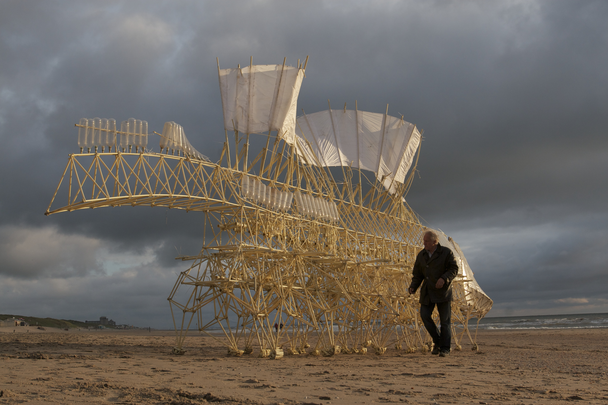
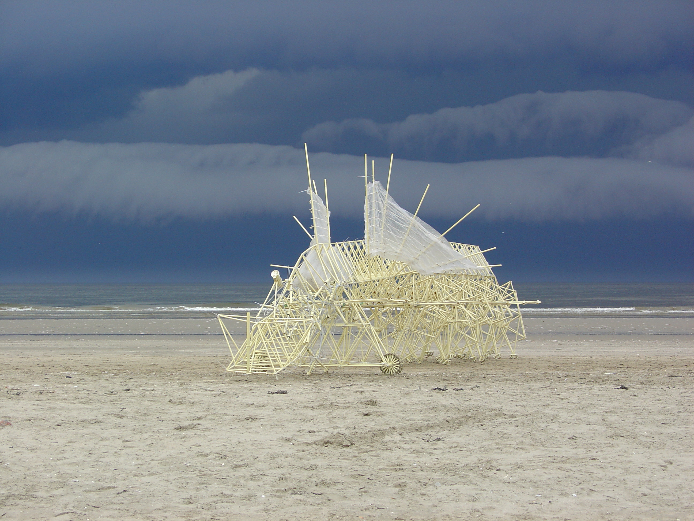
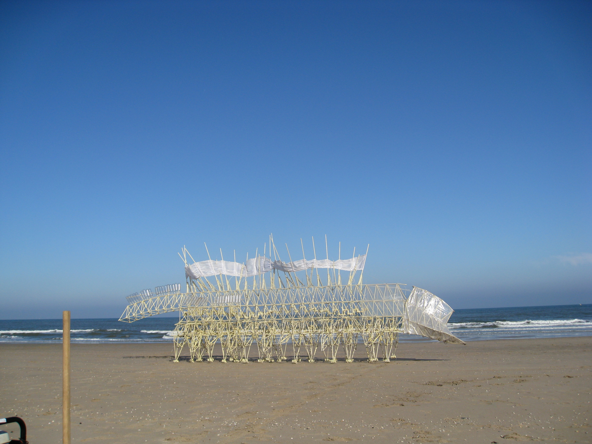
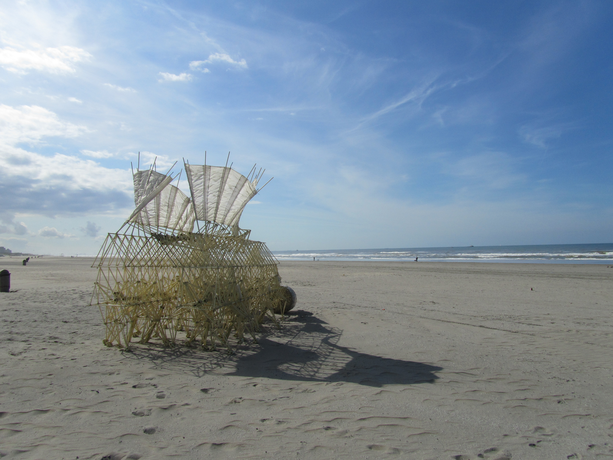

---

For more than twenty years now, Dutch artist and engineer Theo Jansen has been invested in the development of new, non-organic species that he refers to as Strandbeesten, which in English translates to “beach animals”. His beach animals are creatures constructed from plastic conduit normally used to house electric cables, ropes, plastic bottles and pieces of sailcloth. He describes them as ‘skeletons that are able to walk on the wind’. They are called ‘animals’, yet they are completely inorganic. They use the wind to propel themselves and require no other fuel or food. Over time, Jansen has managed to develop creatures that are increasingly capable of ‘surviving’ on their own. His ideal plan is to put the beach animals out in herds on the beaches and have them live their own ‘life’. [1] The intricate complexity and transparency of the beach animals, and the precision of their movements in response to wind and sand, are fascinating to watch. Equally fascinating are the questions they raise about (among others) the materiality of experience, the relationships and differences between the organic and the non-organic, and the definition of life and of intelligence from a post-anthropocentric perspective. {#para1}

This article places Jansen’s beach animals and the questions and issues they provoke in the context of the development of robots. Jansen’s beach animals are not robots. They were not designed to fulfil any practical purpose. They do not involve electromechanical constructions or computer programming. They do not mimic human or animal behaviour. Yet, as semi-autonomous non-organic agents created by humans, they are interesting in the context of the development of robots for how they present an ecological approach to the design of non-organic intelligence. They invite a rethinking of experience and intelligence from a non-anthropocentric perspective and point to movement as crucial to both the intelligence of non-organic agents and the ways in which humans relate to such agents. {#para2}

I will start from a comparison of Jansen’s beach animals as a model for a non-organic evolution with another proposal for such evolution by Valentino Braitenberg in his 1984 essay ‘Vehicles: Experiments in Synthetic Psychology’, a text that has become a classic in the teaching of artificial intelligence and robotics. Braitenberg’s essay is not a practical exploration like the development of Jansen’s beach animals, but a thought experiment. Braitenberg himself describes it as ‘an exercise in fictional science’ (1984: 1); not for amusement, he adds, but in the service of science. As a thought experiment, the evolution he describes in his essay is meant to inspire thinking about the development of non-organic behaviour and intelligence. Precisely as a thought experiment, his text is interesting because of the assumptions implied by *how* it invites the reader to think about non-organic behaviour and intelligence. My aim is not to discuss to what extent either Braitenberg’s thought experiment or Jansen’s ongoing practical explorations can be compared to organic evolution as described by Charles Darwin and others, but rather to show how the comparison with organic evolution is evoked by each of them in the form of stories that unfold through metaphorical and (imagined as well as concrete) material relays. I will show how each of these stories has different implications for understanding what is intelligence and what might be the relationships and differences between human intelligence and non-organic intelligence. Placing Braitenberg’s and Jansen’s approaches side by side illuminates the specificities of Jansen’s approach and how this approach implies a radically different take than Braitenberg’s on non-organic intelligence, on intelligence as environmental, and on what might be the relationship between agency and behaviour. {#para3}

Jansen’s beach animals demonstrate an understanding of intelligence as grounded in what Mark Hansen (2015) proposes to call “worldly sensibility”. The current state of technological developments, Hansen points out, puts humans in a situation in which more and more capturing, storing, transmission and interpretation of information happens in ways that are inaccessible to humans. Digital and networked technologies operate at scales and speeds and according to logics very different from human modes of experiencing, communicating and thinking. More and more communication and information processing is going on in ways to which humans have no access. This situation, Hansen argues, requires a thorough rethinking of perception and experience (and intelligence, I would add) beyond the human centred approaches that dominate our current understanding of them. Hansen elaborates a non-human centred approach to experience and agency via a rereading of the philosophy of Alfred North Whitehead. Whitehead died in 1947 and his work therefore is not, and could not have been, about the kind of media developments that motivate Hansen’s rethinking of experience and agency. Yet what Whitehead proposes is an approach that understands human experience as one variation of experience among other types of experiences, like non-human experiences, and even non-organic experiences. [2] {#para4}

Whitehead’s theory is not an empirical approach that explains how organic and non-organic experience developed, but a speculative ontology that helps us to see how we may conceive of human and non-human experience, or organic and non-organic experience, in terms of a continuity of variations rather than in terms of fundamental difference. Jansen’s beach animals and Braitenberg’s vehicles might be conceived similarly as speculative approaches to the relationships and difference between the organic and the non-organic with regard to experience and intelligence. An important difference between Jansen’s and Braitenberg’s approaches is that Braitenberg assumes non-organic intelligence to be fundamentally different from organic intelligence, and conceives of the development of intelligent machines in terms of assuming the need to mimic what we typically perceive as human conscious intelligence. In contrast, Jansen’s approach suggests a continuity between organic and non-organic intelligence in that both are grounded in embodiment and take shape via their capacity of increasingly complex responses to an environment. This is an approach in line with N. Katherine Hayles’ (2016) observations that the dominant focus on human intelligence as characterised by conscious experience and choice making blinds us to the actual modes of operating of other types of intelligence, and even to large parts of how human cognition operates. The analogy to explore, Hayles argues, is not that between technical systems and consciousness, but that between various types of non-conscious cognition in humans, other biological entities and technological systems. [3] {#para5}

### A Darwinian Approach to Vehicles

Braitenberg begins his essay ‘Vehicles: Experiments in Synthetic Psychology’ with an invitation to his readers to imagine very simple machines and to look at these machines, or vehicles, as he calls them, ‘as if they were animals in a natural environment’ (1984: 2). He explicitly evokes the evolution of organic life as a model for the narrative he is going to unfold, and in a way analogous to Darwin’s approach to evolution he starts his description from the simplest of vehicles, Vehicle 1, which is ‘equipped with one sensor and one motor. The connection is a very simple one. The more there is of the quality to which the sensor is turned, the faster the motor goes’ (1984: 3). This quality could be, for example, temperature: the vehicle will speed up in warm regions and slow down in cold regions. Of course its exact speed will also be influenced by the medium through which it moves (air, water, etc.), the surface on which it moves (hills or slopes, rough or smooth, etc.), and what it bumps into. All of these together will determine its speed and influence its direction. ‘Imagine, now’, Braitenberg invites his readers, ‘what you would think if you saw such a vehicle swimming around in a pond. It is restless, you would say, and it does not like warm water. But it is quite stupid, because it is not able to turn back to the nice cold spot it overshot in its restlessness’ (1984: 5). {#para6}

The description of Vehicle 1 is followed by a description of Vehicle 2, which has two sensors and two motors that can be connected in various ways, allowing for more varied and complex responses to its environment. And then more sensors and more connections are added, threshold devices, circuits, photocells, object detectors, movement detectors, and so on. Braitenberg describes very vividly how each step in the evolution of his vehicles will result in different movements, producing what seem to be different personalities with different likes and dislikes, aims, instincts, and even values and feelings like love. His essay plays in an often quite funny way with the reader’s surprise as to how very simple sensors and motors would indeed produce something that looks to us like behaviour motivated by, for example, love, without involving any such experience or even any kind of consciousness on the part of the vehicle. At one point, Darwin’s idea of natural selection is invoked, when Braitenberg invites his readers to imagine a table upon which some of the more complex vehicle specimens are placed. There will also be ‘some sources of light, sound, smell, and so forth on the table, some of them fixed and some of them moving. And there will be various shapes or landmarks, including the cliff that signals the end of the tabletop’ (1984: 26). While the vehicles are put to the test, the ones that keep circulating on the table are copied and vehicle and copy are both placed back on the table. Those that have fallen off the table will not be placed back or copied. Since copying will have to happen at high speed, mistakes are likely to be made every now and then, as a result of which new variations emerge. {#para7}

Braitenberg’s narrative captures how natural selection gives direction to evolution and how the direction that evolution takes depends on which organisms happen to survive within given circumstances. It also captures how incidental changes, with regard both to the capabilities of the creatures and to the circumstances they encounter, can affect the chances of survival and thus the direction that evolution takes. Braitenberg’s narrative about what happens on the “table of the fittest” (my term) shows evolution to be, not a teleological development towards a pre-given goal to which creatures adapt, but dependent on how well creatures are capable of surviving due to their innate capacities, and how incidental changes – to their construction and/or their environments – can therefore prompt radical changes in who “fits” best and survives. In this respect, his imagined evolution is quite biblical in how it starts from creatures seemingly created out of nothing, who find themselves in an alien world where evolution takes over from the creator such that whether they survive or not will depend on the extent to which their equipment will support their survival in the environments they encounter. {#para8}

Every now and then, in Braitenberg’s essay, creators step back in and change the course of the evolution by adding some new features (for example, additional motors and sensors, or additional connections). Their role in the narrative highlights the difference between an organic evolution as described by Darwin, which lacks such a creator, and a non-organic evolution in which humans are involved as creators. A closer look at these creators’ role in Braitenberg’s narrative also highlights some ambiguities or tensions within the narrative. What exactly do these creators aim to achieve by adding some features and not others? A closer look at the text reveals the intentionality of these shifts, and hence the way in which the comparison with organic evolution is invoked. For example, at the very beginning, when a second motor and sensor are added to Vehicle 1 to create Vehicle 2, it is observed that ‘you may think of it as being a descendant of Vehicle 1 through some incomplete process of biological reduplication: two of the earlier brand stuck together side by side’ (1984: 6). This invokes a comparison with organic evolution, in that new variations are constructed as if they could have been accidental modifications of previous generations. Several vehicles later, however, it is no longer explained how the selection of new features added by creators could have emerged from modifications of previous vehicles. Rather, now we are told how these additions allow vehicles to do things that look like intelligent behaviour. Creators are adding features to serve a goal they have in mind, introducing the comparison with organic evolution through the idea of natural selection as a means by which to test which addition works best. It becomes increasingly unclear, however, how natural selection as accounted for in the narrative (the struggle for survival on the “table of the fittest”) relates to the rationale behind the features added by the creators. Their selection of features seems to have less and less to do with what is required to survive on the “table of the fittest” (which is envisaged as a kind of Paris-Dakar race); instead, it is increasingly explicitly motivated by how these new features will result in what looks like intelligent behaviour, perceived by humans as an expression of quasi-human personality. Intelligence is now measured in terms of how well the vehicles’ behaviour passes for the expression of human-like intelligent behaviour, understood in rather Cartesian terms as an expression of a private interior as driving force behind public exterior behaviour. This is most explicit when the final vehicle (Vehicle 14) is introduced with the following observation: {#para9}

> As time goes on, we grow affectionate toward the diversified crowd of our vehicles, from the very simple ones to the more complex models displaying interesting social interactions and sometimes quite inscrutable behavior. … We do not feel, however, that they show any personality, not even the most complex ones of type 13. … Perhaps we would accept them more readily as partners if they gave more convincing evidence of their own desires and projects. We notice that our fellow men usually seem to be after something, when they go about their business or when we converse with them. Dealing with people is interesting because of the challenge their continuous internal scheming seems to provide. The system of desires we suspect behind their scheming may be part of what we call the personality. (1984: 81) {#para10}

The narrative continues with a description of how the addition of a new feature can contribute to giving the impression of precisely such behaviour. The chapter thus explains how the behaviour of the vehicles can be made to *appear as if* driven by desires similar to those of humans. And this is where the evolution of the vehicles ends. {#para11}

A closer look at how the comparison with organic evolution is evoked in Braitenberg’s narrative shows that his use of evolution as metaphor does not actually explain the development of non-organic intelligence, but rather naturalises a particular understanding of what non-organic intelligence is, specifically how such intelligence manifests itself in behaviour that looks like human intelligent behaviour while actually operating in very different and much more simple ways. Instrumental here is the shift in what counts as progress in the evolution described above, from increased capacity to adequately respond to the environment on the “table of the fittest”, to increased capacity to show behaviour that looks like an expression of an intelligence similar to humans’. Braitenberg’s story thus affirms the assumption that human intelligence is the aim and endpoint of the evolution of intelligence while at the same time establishing a firm distinction between human intelligence and that of the vehicles. For what his “evolution” works towards is not intelligence like human intelligence but behaviour that *looks like* an expression of human intelligence. Early in the essay Braitenberg states that ‘when we analyze a mechanism, we tend to overestimate its complexity’ (1984: 20), and time and again his narrative explains how behaviour that looks like that of a human-like intelligence can be achieved using relatively simple means. His narrative thus presents a comforting message to designers trying to achieve something that looks like human intelligence, and also provides a reassuring response to the threat of what – in relation to more complex creatures – is called the uncanny valley effect (Mori, 1970): when robots become increasingly human-like, at first this helps humans to relate to them until, at some point, as the border between human and non-human begins to blur, the human likeness of robots begin to evoke uncomfortable feelings in humans. If indeed ‘when we analyze a mechanism, we tend to overestimate its complexity’, we may conclude from Braitenberg’s argument that there is nothing to fear, since the effect of complex behaviour in machines is actually the effect of much simpler mechanical responses. “They” are not as intelligent as we are, even if they appear to be so. {#para12}

We might wonder, however, if the vehicles’ very basic causal responses are capable of producing behaviour that looks like that of intelligent life, whether this could not equally be the case with what we perceive as intelligence in organic life. Even if we do not take this to mean (as Braitenberg suggests with regard to the vehicles) that intelligence is mere illusion, this possibility does have radical implications in how it invites a reconsideration of human intelligence and the relationship between human and machine intelligence. Such rethinking is, according to Hansen (2015), precisely what current technological developments require us to do. Hansen’s point is not that human intelligence is mere illusion, but that approaching perception and experience by privileging a human perspective blinds us to the fact that human conscious perception and experience are only variations on what perception and experience can be. Such privileging of a human perspective can be seen at work in Braitenberg’s explanation of the behaviour of his machines. If we look at a vehicle’s behaviour as if it were that of a human, or trying to mimic that of a human, then the behaviour may indeed appear to be as one observes. But actually, this behaviour is the direct result of the vehicle’s responses to its environment by means of what it is equipped with in order to perceive and respond. The vehicle is not pretending anything, but is responding to what it encounters according to how it is wired. If we look at the behaviour of the vehicle from this perspective (that is, from the perspective of what makes sense for the vehicle) then its behaviour is a perfectly logical response to what it encounters. {#para13}

### Affordances and Ecology

Braitenberg’s account of the vehicles prevents a reading of their behaviour in terms of a sensible and intelligible response to their environment because his narrative does not give a clue as to why their sensors respond in the way they do, or how this is related to the functionality of the vehicle within the environment. This omission sets the stage for the possibility of reading the behaviour for what it is not. Regarding Vehicle 3c, Braitenberg observes: {#para14}

> This is now a vehicle with really interesting behavior. It dislikes high temperature, turns away from hot places, and at the same time seems to dislike light bulbs with even greater passion, since it turns towards them and destroys them. On the other hand it definitely seems to prefer a well-oxygenated environment and one containing many organic molecules, since it spends much of its time in such places. But it is in the habit of moving elsewhere when the supply of either organic matter or (especially) oxygen is low. You cannot help admitting that Vehicle 3c has a system of VALUES and, come to think of it, KNOWLEDGE, since some of the habits it has, like destroying light bulbs, may look quite knowledgeable, as if the vehicle knows that light bulbs tend to heat up the environment and consequently make it uncomfortable to live in. It also looks as if it knows about the possibility of making energy out of oxygen and organic matter because it prefers places where these two commodities are available. (1984: 12-14) {#para15}

The description explains how the behaviour of the vehicle might be interpreted in terms of likes, dislikes, values and knowledge from the perspective of a human observer watching the vehicle, but leaves out how the causal responses that produce the vehicle’s behaviour make sense from the perspective of its modes of operating as well as in relation to its environment, function and survival. {#para16}

Jansen’s beach animals are quite different in this respect. The driving force behind their evolution is the need to improve the way their interaction with their surroundings supports their survival. They need the wind to move and their construction follows from that. They need to be able to move across sand and ideally they should be able to avoid going into the sea because they lack the means to deal with water and will “drown”. Their entire construction is the result of an evolution in response to their environment and to the affordances of this environment, and their behaviour follows suit. {#para17}

The notion of *affordance* was introduced by James Gibson (1977) to describe the ways in which environments hold the potential for actions and perceptions. Gibson introduces these ideas in the context of evolutionary biology. Some environments, he observes, afford activities like walking, picking berries or growing plants, whereas others afford climbing trees, hunting animals or catching fish. What people or animals will do in certain environments will depend not only on what they are capable of but also on the affordances of the environment and how it invites them to use their capacities in certain ways rather than others, and to develop certain capacities rather than others. Gibson also uses the idea of affordances to elaborate an understanding of perception as resulting both from interactions afforded by the environment and from our perceptual systems. {#para18}

Gibson’s ideas about affordances have become important to embedded and enactive approaches to perception and cognition. They have also found their way into theories of design, wherein they are used to describe how design affords perceptions and actions, and also how design can start from the relationships between the affordances of the environment and that which is to be designed. Applied to the design of robots or other mechanical creatures, this would mean an approach that does not start from an autonomous entity that then has to prove its capability for survival in an encounter with an environment, but from the potential of the environment and how the creature-to-be-designed can tap into this potential – that is, actualise it. This is called an ecological approach to design; Jansen’s beach animals are a pertinent example. {#para19}

The potential of the wind to generate movement and the sand to carry certain structures and afford them to move is the starting point for the animals’ development. Thus, their design is a response to the potential of the environment, leaving space for interaction and growth. Evolution here is not a confrontation with the environment – wiping out all but the fittest – but rather a creative exploration that aims to maximise interaction with the environment. It is from this interaction that the beach animals evolved into more complex creatures. Evolution here does not describe evolution of the creature as autonomous entity capable of surviving (or not) in an environment. Rather, it describes an evolution of the creature–environment relationships towards ever more complexity. Increasing the complexity of the creature at the same time increases the number of its complex relations with the environment. {#para20}

Similarly, an ecological approach to the design of intelligent machines would not mean designing an intelligence and then seeing how this intelligence appeared to operate in an environment, but instead starting from how the potential of an environment might be actualised by a creature and how the design and the intelligence of the creature might follow from this. Discussing an ecological approach to engineering, Peter Trummer (2008) refers to Félix Guattari’s (2014) elaborations on ecological thinking in terms of the real, the possible and the virtual. Using Guattari’s terminology, Trummer contrasts an ecological approach to design to a more traditional engineering approach that thinks in terms of the real and the possible, where the real describes what is already there and design is thought of in terms of what is possible in already given conditions. {#para21}

> Possible is what we can imagine. It is that which we want to realise. Such practices deal with two essential rules: one is to resemble or to imitate, and the other is limitation, the conformation to existing models. (2008: 98) {#para22}

True ecological thinking, Trummer observes, moves beyond these limits and requires an understanding of ecologies as virtual environments in which what is already there (species, objects) is actualised but in which there are also potentialities that are not yet actualised. The challenge of ecological design is to actualise these unrealised potentialities. The evolution of the beach animals shows how Jansen’s ecological approach actualises new ways of turning wind into kinetic energy and new ways of moving by means of an intricate leg system. Their evolution continues to actualise more possibilities for relating the creatures and their environment by means of systems that afford the wind to create pressure in plastic bottles that can then be used to move when there is no wind, as well as systems that allow water to trigger a causal logic that results in a shift in the direction of movement (and thus for the animal to avoid walking into the sea), and still other systems that afford the air pressure of approaching stormy weather to trigger a causal logic that anchors the animal to the ground. {#para23}

### Non-organic Intelligence

The design of the beach animals affords them to respond to their environment in ways that allow them to move, collect and store air supply and, increasingly, to avoid entanglement in the sea or being blown away by a storm. They are not equipped with sensors and they lack anything like consciousness. Nevertheless, they are capable of meaningful responses to their environment as a result of complex accumulations of instances of cause and effect. I propose for them to be understood as demonstrations of the emergence of very basic non-organic intelligence. This intelligence is not something “behind” their movements – a kind of blackboxed brain ordering the animal around – but is emergent in how their bodies are capable of responding to wind, sand and water and in how they move in response to what they encounter. {#para24}

The intelligence of Braitenberg’s vehicles, too, might be considered a matter of how their design causes them to move in response to what is detected by their sensors. The better they are capable of responding with movement in ways that match the environment, the bigger are their chances for survival. However, Braitenberg’s narrative does not explain their intelligence in these terms; he only speculates on how their behaviour might be read for something it is not. He is looking for ways of reading their behaviour in ways that chime with his understanding of his own intelligence, as when for example he wonders: {#para25}

> But do they think? I must frankly admit that if anybody suggested that they think, I would object. My main argument would be the following: No matter how long I watched them, I never saw one of them produce a solution to a problem that struck me as new, which I would gladly incorporate in my own mental instrumentarium. And when they came up with solutions I already knew, theirs never reminded me of thinking that I myself had done in the past. (1984: 51) {#para26}

The vehicles do not think, he argues, because he has never recognised anything like his own thinking in them. {#para27}

Braitenberg’s explanation not only illustrates the anthropocentrism of his approach to intelligence but also a problem observed by Hansen, namely how such a human dominated perspective is preclusive of relating to other kinds of intelligence that we are surrounded by and that increasingly produce our world for us. Hansen is not referring to robots but to digital and networked technologies that no longer function as analogous to prostheses – providing humans with extensions of human ways of perceiving, experiencing and thinking – but that now operate at speeds and scales and according to logics quite different from those of humans. High-tech sensors perceive things that humans cannot; computers process data in ways that humans cannot; massive amounts of communication are going on between machines that remain imperceptible to humans, etc. For humans to gain access or communicate with these machines, an additional layer of mediation is needed that affords them to connect to what they are doing. Following Braitenberg’s logic, we could of course decide that because these technologies operate very differently from humans, these modes of operating have nothing to do with perception and experience or with intelligent behaviour, and that the additional mediation required to communicate with humans is mere make-believe. However, this logic is not going to be of much help in a situation in which these operations are increasingly co-constitutive of what appear to us as our world, our perceptions, our experiences and our thinking. What we need is to develop more awareness of, on the one hand, technology’s ways of communicating with us as a milieu within which our perceptions and experiences are implicated and, on the other hand, the difference between human and technological forms of communication and their modes of operating. Looking back at Braitenberg’s example of the vehicles, this means to develop an awareness of how the appearance of their behaviour results from how this behaviour (intentionally or unintentionally) affords to be read in human terms. At the same time, considering their intelligence will require a reconceptualisation of our very understanding of perception and experience from a non-anthropocentric perspective. Hansen shows how Whitehead’s speculative ontology provides a starting point for such reconceptualisation. He also shows how this reconceptualisation requires us to think through the implications of Whitehead’s ideas beyond Whitehead’s own era and from the perspective of current technological developments. Central to both Whitehead’s actuality and Hansen’s further actualisation is what Whitehead has termed ‘perception in the mode of causal efficacy’. This term plays an important role in Whitehead’s expanded notion of perception as developed in Process and Reality (1978). [4] {#para28}

Whitehead introduces this concept in the context of a critique of what he describes, in the following, as a too simplistic understanding of perception. {#para29}

> We open our eyes and our other sense organs; we then survey the contemporary world decorated with sights, and sounds, and tastes; and then, by the sole aid of this information about the world, we draw what conclusions we can as to the actual world. (1978: 174) {#para30}

Instead, he proposes an understanding of perception as a ‘mixed mode’ that involves a combination of what he calls ‘presentational immediacy’ and ‘causal efficacy’. Presentational immediacy describes {#para31}

> the perceptive mode in which there is clear, distinct consciousness of the “extensive” relations of the world. These relations include the “extensiveness” of space and the “extensiveness” of time … In this mode, the contemporary world is consciously prehended as a continuum of extensive relations. (Whitehead, 1978: 61) {#para32}

All too easily, Whitehead observes, the primacy of presentational immediacy is assumed to be an obvious fact. In fact, however, presentational immediacy is grounded in perception in the mode of causal efficacy, which designates the causal background of experience, this comprising the material processes that inform conscious perception and remain to a large extent outside conscious awareness, but from which conscious perception emerges. Whitehead uses “causal efficacy” to refer to a diversity of ways in which bodies register what they encounter without incurring objectifications, that is, without that which is registered becoming an object of perception for a percipient. It is only in the mixed mode, that is, in combination with presentational immediacy, that such objectifications happen and that perception becomes conscious perception. {#para33}

Whitehead offers an understanding of perception that grounds conscious perception within a much broader understanding of what perception may entail. His approach opens up perception ‘beyond sense perception proper, to the material processes that do not manifest in sense perception but that nevertheless are necessary for its occurrence’ (Hansen, 2015: 20). This understanding affords an expansion of sensing beyond human conscious perception and including other ways of making contact with ‘the operational present of sensibility’ (Hansen, 2015). Perception understood as a mixed mode can explain how perception may involve different degrees of consciousness and this makes it possible to understand human, animal and even vegetal modes of perceiving in terms of a continuum of possibilities. Whitehead goes as far as to include non-organic perception on this continuum. Stones, atoms and objects can also be understood to perceive in the mode of causal efficacy, he argues, yet in their case this does not become connected to perception in the mode of presentational immediacy. {#para34}

Whitehead proposes an expanded understanding of perception that includes non-human and even non-organic perception; yet, human perception (implicitly) remains the norm in that it presents the fullest embodiment of the model. Furthermore, presenting the mixed mode as the model for perception implies that non-organic perception (consisting only of perception in the mode of causal efficacy) lacks something. This is reflected in Whitehead’s renaming of this mode as “nonsensuous perception”, as distinct from sense perception, in *Adventures of Ideas* (1933) (see also Hansen, 2015: 19). Non-organic perception appears as somehow incomplete, the lowest ranking mode on a continuum that finds its highest expression in human conscious perception. It is at this point that Hansen proposes a radicalisation of Whitehead’s model by means of centralising perception in the mode of causal efficacy instead of perception in the mixed mode. Thus inverted, Whitehead’s speculative ontology can still explain various modalities of conscious perception as variations on a continuum, but it no longer centralises human conscious perception and the mixed mode of perception as the model for the evolution of higher order perception. This opens the possibility of conceiving alternative modes of higher order perception, modes that do not evolve via the mixed mode model and do not involve consciousness. This possibility becomes most relevant in relation to current technological developments. {#para35}

Typical of current technological developments is that they ‘impact the general sensibility of the world prior to and as a condition for impacting human experience’ (Hansen, 2015: 6). What Hansen means is that digital and networked technologies, as well as technologies like sensors that probe the world and gather data beyond the scope of human perception, function in ways that are no longer correlated directly to human modes of sensory experience. In order for humans to relate to what is sensed and processed by these technologies, additional mediation is required to translate what is captured and processed into what is accessible to human perception. These technological developments thus foreground what Hansen describes as the inherent or constitutive doubleness of mediation: ‘their simultaneous, double, operation as both a mode of access onto a domain of worldly sensibility and a contribution to that domain of sensibility’ (2015: 6). Because twenty-first century technology increasingly provides access to what previously fell outside the scope of our perception and conscious awareness, these technologies simultaneously also extend the domain of sensibility. Furthermore, they combine in their mode of operating something that cannot be combined in consciousness: ‘To the extent that they centrally involve data processing, twenty-first century media bring together an intentional relationship to sensibility (the fact that data is about sensibility) with a nonintentional relationship to sensibility (the fact that data is sensibility)’ (2015: 7). In the internal operations of twenty-first century media technology these two are combined. Confronted with these technologies, therefore, it becomes relevant to consider the possibility of higher intelligence that does not develop via the mixed mode model of perception but through increasingly complex lineages of causal efficacy. Such rethinking of intelligence may shed new light on the role of non-conscious perception and experience in organic intelligence. As Hansen points out, the rise of twenty-first century technology foregrounds aspects of perception and experience that probably already existed, but had gone unnoticed. And as Hayles observes, it might be that the combination of non-conscious perception and cognition, rather than conscious perception and cognition, provides the key to understanding the relationships between human and non-human intelligence (Hayles, 2016). {#para36}

The evolution of the beach animals is an exploration of such non-conscious non-organic intelligence. They demonstrate behaviour that we assume requires either organic intelligence (including some kind of consciousness), or a system of sensors and wires mimicking organic intelligence. At the same time, the transparency of their construction demonstrates how their behaviour is constituted through accumulations of instances of cause and effect. As low-tech explorations of non-conscious intelligence, their evolution is much more accessible to humans than the machinations of twenty-first century technology, and yet allows for an exploration in line with Hansen’s observation that twenty-first century media technologies confront us with aspects of perception and experience that are not unique to these technologies but are foregrounded by their pervasive presence and increasing impact on our lives. {#para37}

As demonstrations of increasingly complex behaviour in response to their environment, the beach animals suggest that the development of higher intelligence might not necessarily involve a ghost in the machine (the Cartesian model), or a consciousness emerging from mixed mode perception (Whitehead), but that it could be a matter of how combinations of individual instances of causal efficacy feed forward (Hansen) into more complex forms of non-conscious experience. The beach animals invite reconsideration of agency and of higher order intelligence as the effect of this logic at work in their behaviour. What appears as their agency is not a matter of a centralised consciousness steering their actions but of a great number of individual causal interactions between elements of the animal, the sand, the wind, the water and so on. The beach animals demonstrate how what can be perceived as the agency of the animal results from what we could, after Whitehead (1978), call a “society” of elements that together is the animal, and how this society of elements holds together a great number of individual instances of causal efficacy. They also show that this society does not require consciousness or centralisation. The animals’ agency is environmental in how it emerges as the effect of patterns of interaction between parts of the animals and the environment. Their agency is not that of agents using sensors to reach out and probe their environment; it emerges from what might be described as environmental sensibility, from the ways in which elements of the creatures’ bodies are capable of interaction with the environment. Together all these interactions produce the behaviour that sustains their survival. {#para38}

### Movement

As a model for the design of intelligent machines, the beach animals point to movement as a central concern: movement is the basis for their intelligence and movement is also the basis for how humans relate to them. Braitenberg’s narrative, too, points to the centrality of movement in terms of how machines are perceived as agents. Even though Braitenberg shows this perception to be a misreading (a misreading that does not result from the vehicles’ behaviour being deceptive, as Braitenberg’s narrative suggests, but from the perceiver’s unawareness of the actual causality that determines the responses of the vehicles), his explanation does illustrate how human perceivers relate to the behaviour of the vehicles in terms of an action in response to the affordances of their environment. This is also the case with the beach animals. They suggest an approach to developing a robot’s identity that does not start from designing an exterior to house its operating system, but from designing its modes of operating, in particular its movements, in ways that take into account how they will constitute the robot as an intelligent agent. Such an approach is currently being explored in the Australian Research Council funded research project ‘Performative Body-Mapping (PBM): a new method towards socializing non-humanlike robots’, led by Petra Gemeinboeck (see also Gemeinboeck and Saunders, 2016). {#para39}

The beach animals also show that the possibility for humans to relate to their movements is not a matter of recognising similarities between their movement and that of humans or animals. The bodies of the beach animals are actually in many ways quite unlike the bodies of animals and their movement does not look much like that of a human or an animal (as it would, for example, in an animation that used motion capture to produce human- or animal-like movements in creatures that do not look like humans or animals). What makes them life-like is how their movements respond to the affordances of the environment, and how we can perceive them in these terms. This is similar to how we understand the movements of other humans. Enactive approaches to perception and cognition like those of Varela, Thompson and Rosch (1993), Noë (2004) and Berthoz (2000) point to the centrality of movement to how humans perceive and make sense of what they encounter. Through experience with (self)movement we make sense of the world we encounter in terms of potential for action. We are capable of perceiving the world as a space filled with three-dimensional objects (instead of perceiving only one dimension of each thing) because we are familiar with the effects of movement and allow them to inform how objects and space appear to us. Movement is also the basis for our understanding of the behaviour of other bodies as variations of possible movements of our own body. That is, understanding the movements of others or understanding others through movement does not mean that the movements have to be similar to those of the body interpreting them. Key is that we can make sense of them in terms of potential action. {#para40}

The skeletal construction of the beach animals foregrounds the logic of action and response from which their movements result and appeal to the creative imagination of humans encountering them. This makes them so interesting as examples of the potential of movement for developing new human–machine relationships. Movement affords an approach to developing such relationships that does not start from a gap to be bridged between human and machine (for example by making the machine human-like) but from the potential of humans to relate to and interpret a diversity of movements. Enactive approaches to perception and cognition explain how this potential is not a matter of movements being recognisable as representations of human movement, but of harnessing the ways that humans are capable of making sense of what they encounter as a result of their own bodily experience with (self)movement. {#para41}

### Co-evolution

The evolutionary processes of Braitenberg’s vehicles and of Jansen’s beach animals both involve humans as creators. In Braitenberg’s narrative, human intervention manifests mainly in the creation of the first vehicle, in new features being added to the vehicles, and in vehicles that manage to survive on the “table of the fittest” being copied. Evolution is thus presented as a project inaugurated by creators from a certain distance; they “throw” a first machine into the world and add new inventions every now and then to see how a seemingly autonomous process of the survival of the fittest might eliminate all but the “best” version. Jansen’s role with regard to the beach animals, on the other hand, is that of a creator deeply invested in improving the chances of survival of all his creations and in maximising the ways in which they relate to their environment. His ideal plan is that one day the beach animals won’t need him anymore, so that he can step back and leave them to their own independent lives on the beach. {#para42}

Braitenberg and Jansen seem to share the attitude that neither of them conceive of themselves as being implicated in the evolution of their own intelligent machines. In both cases humans make the evolution happen, but the evolution, it seems, does not affect them. Such a perspective on humans as mere inventors, creators and users of technology overlooks how what is considered to be human is actually the product of our co-evolution with technology and how the development of the vehicles, the beach animals, robots and other technologies is part of this co-evolution. This is what Hansen (2000, 2006), Hayles (2012), Bernard Stiegler (1998, 2009, 2011) and others term “technogenesis”. The idea of technogenesis is that humans and technology have co-evolved and that human intelligence cannot be understood separately from the technologies that humans use and through which they relate to their environments. This idea may seem unusual if one assumes that human thinking is done by an autonomous mind existing independently from its environment (and therefore from how “its” body interacts with this environment). Yet, the idea that cognition developed through the interaction of humans with tools and technologies is not controversial at all in fields of research like palaeoanthropology, evolutionary biology and neurophysiology, all of which point to the intimate connection between the development of human intelligence and the tools and technologies used by humans, and to how the use of tools resulted in the emergence of new modes of intelligence. Similarly, Hansen, Hayles and others argue that media technologies and intelligent machines are not merely created by humans but also change how humans perceive, make sense and think. This opens up an additional dimension with regard to ecological design, namely to approach the design of human–machine interaction as the actualisation of still unrealised potentialities. Here it seems movement has a lot to offer. {#para43}

### Biographical Note

**Maaike Bleeker** is a professor in the Department of Media & Culture Studies at Utrecht University. Her work engages with questions of perception, cognition and agency from a broad interdisciplinary perspective, with a special interest in embodiment, movement, and technology, and the performativity of meaning making and knowledge transmission. Recent publications include the co-edited volume *Performance and Phenomenology: Traditions and Transformations* (Routledge 2015) and the edited volume *Transmission in Motion: The Technologizing of Dance* (Routledge, forthcoming 2017), and the articles “Science in the Performance Stratum: Hunting for Higgs and Nature as Performance” (in *International Journal of Performance Arts and Digital Media* 2014) and “Movement and 21st Century Literacy” (in *Digital Movement*. Ed. Sita Popat and Nicholas Salazar, Palgrave). Bleeker was the organizer of the 2011 world conference of Performance Studies international (PSi), titled *Camillo 2.0: Technology, Memory, Experience* (Utrecht, May 25-29 2011), and served as President of PSi from 2011 to 2016.

### Acknowledgements

The ideas about human–machine relationships and robot-design as elaborated in this article greatly benefitted from extended dialogue with Petra Gemeinboeck and the opportunity to participate in the preparatory phase of the Australian Research Council funded project ‘Performative Body-Mapping (PBM): a new method towards socializing non-humanlike robots’ (led by Gemeinboeck) as Visiting Research Fellow of the National Institute for Experimental Arts (UNSW). I am most grateful for this opportunity and I am much looking forward to further developing ideas together in the context of the ‘Performative Body-Mapping’ project.

### Notes

 [1] Jansen’s description of and rationale for the beach animals can be found at [https://www.strandbeest.com](https://www.strandbeest.com)

 [2] Hansen’s interpretation of Whitehead is based on a broad reading of Whitehead’s oeuvre, most centrally *Science and the Modern World* (New York: Free Press, 1967), *Process and Reality: An Essay in Cosmology*, corrected edition, eds. D. Griffith and D. Sherburne (New York: Free Press, 1978), and *Adventures of Ideas* (New York: Free Press, 1933).

 [3] These remarks were made by N. Katherine Hayles in her lecture ‘Enlarging the Mind of the Humanities: Human and Technical Cognition’ at *Worlding the Brain* (University of Amsterdam, 17-19 March 2016). This is also the subject of her forthcoming book.

 [4] On this point, Hansen’s reading of Whitehead differs considerably from readings by many other authors that are currently reviving Whitehead’s ideas. In the Introduction and Chapter 2 of *Feed Forward*, Hansen indicates these differences and explicitly distances himself from works by, among others, Brian Massumi, Erin Manning, Luciana Parisi and Steven Shaviro.

### References

- Berthoz, Alain. *The Brain’s Sense of Movement*, trans. Giselle Weiss (Cambridge and London: Harvard University Press, 2000).

- Braitenberg, Valentino. *Vehicles: Experiments in Synthetic Psychology* (Cambridge: MIT Press, 1984).

- Gemeinboeck, Petra and Saunders, Robert. ‘Towards Socializing Non-anthropomorphic Robots by Harnessing Dancers’ Kinesthetic Awareness’, *Cultural Robotics: Lecture Notes in Artificial* *Intelligence* 9549 (2016), 85-97.

- Gibson, James J. ‘The Theory of Affordances’, in Robert Shaw and John Bransford (eds) *Perceiving, Acting, and Knowing: Toward an Ecological Psychology* (Hillsdale: Erlbaum, 1977), 67-82.

- Guattari, Félix. *The Three Ecologies*, trans. Ian Pindar and Paul Sutton (London: Bloomsbury, 2014).

- Hansen, Mark. *Embodying Technesis: Technology Beyond Writing* (Ann Arbor: University of Michigan Press, 2000).

- Hansen, Mark. *Bodies in Code: Interfaces with Digital Media* (New York and London: Routledge, 2006).

- Hansen, Mark. *Feed Forward: On the Future of Twenty-First Century Media* (Chicago: University of Chicago Press, 2015).

- Hayles, N. Katherine. *How We Think: Digital Media and Contemporary Technogenesis* (Chicago: University of Chicago Press, 2012).

- Hayles, N. Katherine. ‘The Cognitive Nonconscious: Enlarging the Mind of the Humanities’, *Critical Inquiry* 24 (2016): 783-808.

- Mori, Masahiro. ‘The Uncanny Valley’, *Energy*7.4 (1970): 33-35.

- Noë, Alva. *Action in Perception* (Cambridge: MIT Press, 2004).

- Stiegler, Bernard. *Technics and Time 1: The Fault of Epimetheus*, trans. Richard Beardsworth and George Collins (Stanford: Stanford University Press, 1998).

- Stiegler, Bernard. *Technics and Time 2: Disorientation*, trans. Stephen Barker (Stanford: Stanford University Press, 2009).

- Stiegler, Bernard. *Technics and Time 3: Cinematic Time and the Question of Malaise*, trans. Stephen Barker (Stanford: Stanford University Press, 2011).

- Trummer, Peter. ‘Engineering Ecologies’, *Architectural Design* 78.2 (2008): 96-101.

- Varela, Francesco J., Thompson, Evan and Rosch, Eleanor. *The Embodied Mind: Cognitive Science and Human Experience* (Cambridge: MIT Press, 1993).

- Whitehead, Alfred North. *Adventures of Ideas* (New York: Macmillan Company, 1933).

- Whitehead, Alfred North. *Process and Reality*, ed. David Ray Griffin and Donald W. Sherburne (New York: The Free Press, 1978).
