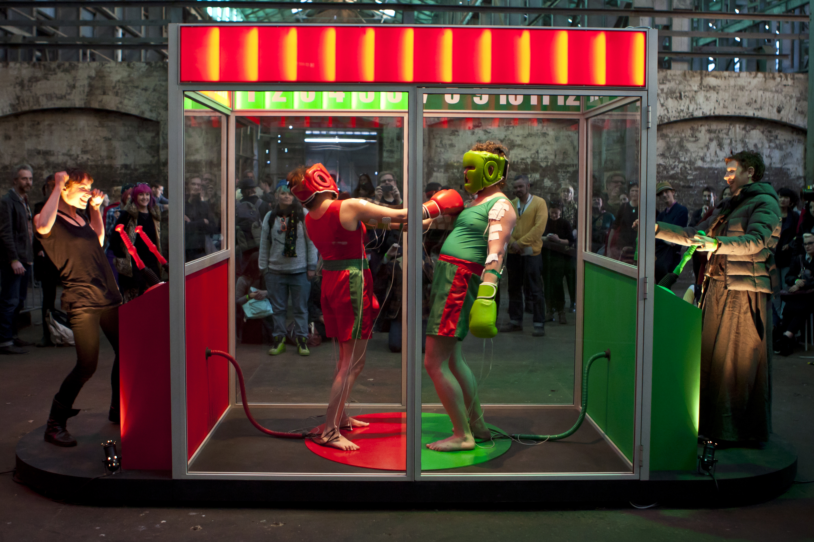

---

### Introduction

The focus of this paper is a participatory artwork, *Game On,* which is a boxing “game” where one participant can control the actions of another via electric muscle stimulation. [1] The paper explores *Game On* as a creative enquiry into agency and the nature of cognition in distributed systems. *Game On* explores what happens to agency in a system where embodied experience is disrupted or extended, based on the understanding that a sense of personal agency is created through actions, and that the actions of others influence our understanding of ourselves as separate from them. Participatory artworks like *Game On* can be viewed as a form of performative research, creating a system which is analogous in some ways to states of affairs outside that system. [2] In this way, *Game On* does more than represent possibility: it enables an exploration, in real time and space, of what happens when embodied experience and sense of agency is disrupted or extended using technologies of connection, and the implications of this disruption and extension for locating a responsible agent within this kind of system. {#para1}

The *Game On* installation design is based on a scene from the 1976 American science fiction thriller film *Future World*, directed by Richard T. Heffron, where human players control android boxers. *Game On* replaces these boxing androids with humans, and draws players from the audience to use joysticks to control two boxers (actual people) via a MIDI-controlled electric muscle stimulation device. Electric muscle stimulation controls motor actions in humans by sending electrical impulses to muscles via electrodes attached to specific points on the limbs, mimicking the impulses sent to muscles from the central nervous system that cause the muscles to contract, so that the affected individual moves involuntarily. The way the players control the boxers in *Game On* is akin to the way a gamer would move a joystick to control an avatar in a virtual fighting game. When the player pulls the joystick toward his or her body, the boxer s/he controls involuntarily raises an arm (to block or prepare to throw a punch), and when the player pushes the joystick forward, the boxer’s arm extends involuntarily to throw a punch. [3] By replacing *Future World’s* androids with real people, *Game On* explores the challenges faced by society as technology advances to a point where the level of realism in “games” becomes indistinguishable from reality, and poses questions regarding how we might ascribe agency and responsibility in both human and non-human entities. {#para2}

### Extended Cognition in the *Game On* System

*Game On* is a performative realisation of a system where agency is dispersed across people, objects and the environment. In this system the boxer is connected to their player by an electrical network (akin to neurological signals) such that the experience of the player extends to include the boxer s/he controls. {#para3}

This expansion of agency entails a form of cognition that exceeds the boundaries of the nervous system. Such a view departs from traditional approaches in cognitive science, which abstract cognitive processing from bodily function and consider the body and environmental factors as peripheral to any understanding of the nature of mind and cognition. [4] In contrast to theories of mind that associate the mind with brain function, [5] extended approaches to cognition view cognitive systems as extending beyond the boundaries of the individual organism. [6] {#para4}

For some authors, the implication of extended cognition is that of an extended *self* [7] wherein features of the environment are ‘parts of the computational apparatus that constitutes our minds’ (Clark, 2003: 6). This points to a conception of subjectivity as a self that extends beyond the boundaries of the human body, entailing that through an expansion of agency self/other boundaries are permeable: the self as ‘porous, spilling out of itself’ (Rotman, 2008: 8). On this account, just as the self would extend to include an avatar in a virtual/gaming environment, the player in *Game On* extends to include his or her boxer, rendering it difficult to determine where the player ends and the boxer begins. {#para5}

An alternative position, and the one pursued in this paper, is that cognition is a relationship between a cognising subject and an independently existing state of affairs. [8] While the player’s cognition may exceed the boundaries of their nervous system to include their boxer, the act of cognising is not a quality of the cognisant being (i.e. the player). A quality is a feature of something, whereas a relation is a property that holds between things. [9] Since nothing can be constituted by its relations, ‘what knows, as well as what is known, must have a character of its own and cannot be defined by its relation to something else’ (Anderson, 1962: 69). Any relation involves at least two or more distinct terms, and each of the terms must have its own intrinsic properties (these are necessary to constitute what stands in the relation). {#para6}

In the *Game On* system both a subject and an object can be identified: the subject being that which cognises (the player) and the object being the state of affairs known (the boxer). The player’s cognitions cannot constitute part of that player’s cognitive apparatus. The knower (the player) and the states of affairs known (the boxer) are distinct terms in the cognitive relationship. [10] To view the environment included in an agent’s cognitive processing as partially *constituting* that agent’s cognitive system is to confuse qualities with relations. Viewed as a relationship, cognition cannot be a property of things, and cannot be reduced to either one of the terms of the relationship. [11] {#para7}

Bateson’s example of a blind man who relies upon a walking stick for locomotion is illustrative here. Does his “self” begin at the end of the walking stick, which taps the ground? Or at the handle of the stick he holds? The stick, for Bateson, is merely ‘part of the systemic circuit which determines the blind man’s locomotion’ (Bateson, 1972: 318). The stick in this example is akin to the *Game On* boxer’s arms, which are merely a causal link in the chain along which the transmission and transformation of information occurs. Although the player is the cognising agent insofar as s/he causes the actions of the boxer’s limbs, the boxer in *Game On* is no more part of the player’s body than a blind man’s walking stick is part of the man. However, the player’s role in *Game On* is more complex than the scenario described by Bateson, because s/he is controlling a sentient being. That is, unlike the blind man’s walking stick, which has no consciousness separate from the man, the object of the player’s cognition (i.e. the boxer) is not merely receiving information sent from the player; the boxer is also cognisant. The boxer is aware of his or her actions (i.e. his or her arms directing punches toward the opponent), and is also aware that s/he is not the cause or author of these actions. {#para8}

### Agency in the *Game On* System

There is much evidence to suggest that the sensory-motor operations of the body create a sense of agency, [12] and that a sense of self as agent is built through the capacity to understand ourselves as the authors of our actions, separate from others and from the external world (Jeannerod, 2003). Although the boxers have the experience that they are not the authors of the movements of their arms (i.e. no sense of agency) they still have a sense that the limb being moved is their own (i.e. the experience of being the subject of the movement). [13] With ordinary voluntary movement, a kinesthetic experience of movement elicits a sense of *ownership*, and the experience of being the author of the action generates a sense of *agency.* [14] In the same way as we can know the environment outside our bodies, we can also know bodily events. [15] Through visual and proprioceptive/kinesthetic information (afferent sensory feedback) the boxers in *Game On* are aware that they are moving, but they are not issuing motor commands to generate the movement (i.e. there is no efference). {#para9}

The boxers are also conscious of themselves as being part of a system, where their control over their actions is disrupted via electric muscle stimulation: thus, while sense of ownership may be related to moments of agency, it extends beyond a given instance or situation. As evidenced in reported responses from *Game On* boxers about their experience of agency during the game, it is clear that boxers still experience an enduring sense of self as agent, even though their sense of agency is disrupted within this system. For instance, one boxer noted, when reflecting on his sense of agency: ‘Well, it went out the window, but only within the game context … I still knew that I was ultimately in control of myself’ (*Game On* boxer #1, personal communication, 18 December 2013). [16] A broader narrative enables the boxer to maintain the sense that, outside of this system, s/he is the owner of his or her limbs but is choosing to rescind agency temporarily. [17] Indeed, the boxers’ ability to rescind control and allow his or her limbs to be moved via an external force is itself an instance of agency. One boxer reported: ‘I felt an intense loss of my sense of agency, but I think to regain some feeling of control I ignored this, and somehow manufactured my own alternative choice: I tried to create the idea that I was choosing to last until the end of the session and tolerate the pain’ (*Game On* boxer #2, personal communication, 21 December 2013). [18] {#para10}

### Locating Responsibility

Traditionally, the operator of a machine is held responsible for the consequences of its operation (Matthias, 2004). In a system such as a fighting game where a human controls a non-autonomous robot or avatar, the attribution of responsibility rests with the human/controller. However, identifying a responsible agent within the *Game On* system is more complicated, because the “robot” is also a sentient being, and not merely an avatar receiving information sent from the player. While it is not within the scope of the present paper to address the complex legal and ethical issues surrounding recent developments in the manufacturing of adaptive, autonomously operating devices, there are some parallels between a *Game On* boxer and an autonomous machine. The operator of an autonomous machine cannot be held responsible in circumstances which occur due to the adaptive capabilities of the robot (Marino and Tamburrini, 2006), so there is ‘a responsibility gap, which cannot be bridged by traditional concepts of responsibility ascription’ (Matthias, 2004: 176). [19] However, unlike a robot, the boxer in *Game On* is an organic, cognising subject. As a cognisant being, the boxer has a direct awareness of his or her actions (e.g. arms throwing punches towards the opponent), and also the awareness that s/he is not the agent initiating these actions. A robot or avatar only ‘knows’ via representation: ‘input’ comes in the form of symbols or coded representations of other objects, not *actual* objects (Wilcox and Katz, 1981). The boxer’s knowledge of the world ‘is not mediated by cognitive representations internal to the mind or brain’ (Michell, 1988: 227) but instead involves a ‘direct relation between the knower and some independently existing situation’ (Michell, 1988: 240). [20] {#para11}

*Game On* utilises the boxer-as-android metaphor to explore questions regarding agency and responsibility attribution, both in real situations involving human and machinic avatars and scenarios such as the speculative science fiction of *Future World*, but the boxers role as “android” is nothing more than metaphor. Although the players control the boxers’ actions, the boxers in *Game On* are also agents; they are complicit in the violent acts by relinquishing control of their limbs in order to be remotely controlled to punch their opponents. Unlike an avatar in a fighting game – who is unable to challenge the controller and behaves according to programming – the boxer has agreed to participate in a performance knowing that they will be involuntary forced to cause another individual harm. An agent is considered responsible if they know the particular facts surrounding their action, and is able to freely form a decision to act (Matthias, 2004). Thus, the boxer in *Game On* is not free from responsibility. {#para12}

Attribution of responsibility is further complicated when we consider the role of the artist within this system. Within the context of the performance, both the boxer and player are given “permission” by the artist to inflict pain on others (either to punch their opponent, or to electric-shock a boxer they are controlling). Not only do participants surrender control within this context, they go to great lengths to fulfill their obligations. One boxer commented: ‘I felt the larger part of what we were participating in was more important, that the game was more important than my opponent’s suffering. I was more focussed on successfully participating in the “game” than I was focussed on my opponent’s wellbeing’ (*Game On* boxer #2, personal communication, 21 December 2013). {#para13}

This commitment to the “game” extended beyond participation and endurance. Although the boxers still maintained voluntary control over the movement of their legs and torsos, and were able to move their arms voluntarily when not subjected to electrical impulses, they followed instructions to refrain from moving their limbs of their own volition. [21] To gain a better understanding of the boxers’ behaviour in *Game On* it is instructive to consider similarities between *Game On* and the famous Milgrim experiments conducted in the 1960s. Milgrim demonstrated that participants were prepared to administer increasingly painful electric shocks to another human if instructed to do so by a figure of authority (Milgrim, 1963). The artist in *Game On* occupies a position of power not dissimilar to the experimenter in the Milgrim study. In both situations the participants assume that the authority figure (artist or experimenter) will act competently and professionally. Participants are unlikely to question the situation or to discontinue, even if they feel compromised (Eysenck, 1994). As one boxer described it: ‘Once in the box, hooked up and surrounded by the audience, I did not feel that leaving was an option, even though the first shock was much more intense than I remembered it [being] in the lab’ (*Game On* boxer #2, personal communication, 21 December 2013). [22] {#para14}

Locating an agent “responsible” for inflicting pain in *Game On* is difficult, when agency is distributed across the system (a system that includes the artist). In the laws of torts and of crimes for most countries, the concept of *intention* is the main determinant for attribution of both legal liability and moral responsibility. In civilised penal systems, liability for serious crime depends not only on a person having committed an outward act of a crime, but on their having done this in a particular state of mind, *mens rea*, which includes the intention to commit the act (Moore, 2009). Outside this legal context, in an everyday sense, we learn early on to judge behaviour according to the presence of intent, perceiving actions that are performed *on purpose* as more serious. Justice Holmes suggests that ‘even a dog knows the difference between being stumbled over and being kicked’ (in Moore, 2009: xii). This may be so, but who, or what, is responsible for the “kicking” in *Game On*? A focus that is exclusively directed toward the actions of the boxers could lead to the conclusion that they are the agents responsible for the act of violence. If actions reveal the intentions of the acting agent, then an intention to inflict harm could be inferred by observing the boxers’ actions (i.e. punching their opponents). However, expanding the frame to include the players locates responsibility differently: although the violent acts are executed by the boxers, the agents generating these actions are the players. This frame of reference suggests that the responsibility lies with the players, whose intention to punch is trans-located onto, and executed by, the boxers. {#para15}

However, an even wider focus suggests that although both the players and boxers are engaged in a violent act, the artist mitigates their responsibility. The artist ostensibly condones these acts of violence through the creation and framing of the work. Can we conclude that responsibility for the violent actions conducted within this system lies with the artist? The accepted avant-gardism of some artistic activity, as distinct from conventional ethical standards, permits the artist to pursue practices that may be in direct tension with “correct” behaviour in everyday contexts (Macneil and Bolt, 2011; Rancière 2009, 2010). Thus, it could be argued that the artist is simply fulfilling her role: to push boundaries and challenge dominant social mores. [23] Broadening this frame further, the members of the audience viewing the work are also complicit in the activity of inflicting pain. However, the audience members have perhaps learnt to accept artistic activity as a practice that is granted a certain ethical autonomy to challenge society’s norms. If so, this suggests that the boxers, players, artist and audience should *all* be exculpated. {#para16}

### Causal Fields and Intentions as Causes

Can any of the *Game On* participants be held accountable for their actions? A deterministic account of behaviour suggests that none of the participants are freely choosing their actions, either in the *Game On* system or beyond. Although the freedom to make decisions about one’s own behaviour is viewed as a quintessentially human quality (Satre, 1956), the notion that any particular behaviour is *uncaused* cannot be logically defended, as the action would literally randomly occur in time without any connection to other events, thus divorcing action from the self. While the causes of an action may not always be readily identifiable, all physical and psychological events are caused by, and in turn cause, other events. “,”[24]”>> As Mackay and Petocz (2011) note, it would be difficult to conceive of a world where this was not the case. The self must have a causal role in action (Anderson, 1962), and the self is in turn caused by other events, moulded by genetics and the environment. Thus, as Smith and Darlington (1996: 19) point out, ‘whether a Nobel Prize winner or a murderer, no one really has control over their own behaviour’. {#para17}

Although it may be contrary to our experience of agency, the acceptance of a causal account of behaviour implies that we are less like androids than we think when it comes to the control we have over our own actions. Our *sense* of agency or control, however, is a fundamentally human characteristic, which develops through the experience that intentions and observed actions are consistently associated (Jeannerod, 2006), and this sense of agency is itself a cause. Because cognitive events exist in the same spatiotemporal realm as physical events, cognitions themselves can be causes (Michell, 1988). It follows that the conscious intention to act may contribute to the causes of a given action. Indeed, the distinction between accidental and non-accidental consequences of action ‘rests upon the cognitions *guiding* behaviour’ (Michell, 1988: 235; original emphasis). The behaviour of the participants in *Game On* is guided by the knowledge that the outcome of their actions involves inflicting harm on the other participants involved: that is, all the participants have the intention to commit (or facilitate) an act of violence. {#para18}

Returning to the boxer-as-android metaphor utilised by *Game On*, how might we distinguish between accidental and non-accidental consequences of action in the case of non-human entities? While we may someday be able to judge whether a robot has acted “intentionally” or “unintentionally”, we are not likely to face this situation any time soon. If we make no assumptions about the intentions of robots we can assume that robots are ‘completely unremarkable technological artifacts, no different than toasters or cars’ (Asaro, 2007: 2). While robots can be causally efficacious, ‘they are not considered to be moral agents in the sense that they are not held responsible for their actions’ (Asaro, 2006: 11). [25] When we ascribe intention in order to assign blame for a robot’s actions we refer to the cognitions that guide the actions of the manufacturers or operators of the robot, [26] and to the relevant conditions in which the robot’s actions took place. Our ability to distinguish between intentional and unintentional consequences of action involves identifying both the cognitions that guide the actions and the circumstances in which the actions occur. {#para19}

*Game On* literalises a system that is in some ways analogous to phenomena outside that system. It doesn’t simply *represent* possibilities, but enacts possibilities in real time and space, and in that respect it is similar to other causal systems/situations involving humans or machinic avatars. However, the conditions under which one event produces another within a particular situation (e.g. inflicting harm within the context of a participatory artwork) may not obtain in another context. Causes operate within specific and causally relevant contexts and are not simply or linearly related to their effects (McKay and Petocz, 2011). It is not possible to explain the behaviour of the *Game On* participants (boxers, players, artist, audience) without an understanding of the causal field (standing conditions or relevant background circumstances) in which their actions occur. [27] We cannot simply attribute responsibility on the basis of a particular agent’s intentions. A full understanding of any given action – within the *Game On* context or beyond – must include the system of relationships between organisms and their environmental conditions. {#para20}

### Biographical Note

Michaela Davies is a cross-disciplinary artist working with installation, sound, performance and video. Davies graduated with a PhD in Psychology from The University of Sydney, and currently works as a practicing psychologist. Drawing on the idea that contemporary participatory art practices can be viewed as a form of performative research, her artistic practice is informed by an interest in the role of psychological and physical agency in creative processes and performance.

### Notes

 [1] Davies, M. (2013). *Game On*, [https://michaeladavies.net/game_on.html](https://michaeladavies.net/game_on.html)

 [2] Fleming (2002), drawing on the work of Turner (1982), posits that performance necessarily invokes a register of communication concerned with possibility and hypothesis.

 [3] The “raising/blocking” motion is triggered by sending electrical impulses to electrodes attached to the boxer’s bicep. The “punching” motion is triggered by sending impulses to particular muscles in the shoulder and the tricep, and releasing the impulses sent to the bicep muscles, in a specific and precisely timed sequence.

 [4] See Wilson and Foglia (2011) for a review.

 [5] For example, Armstrong (1968).

 [6] See Clark and Chalmers (1998), Clark (2003) and Menary (2010) for examples.

 [7] For example, Clark and Chalmers (1998).

 [8] The cognising subject and the object term in this relation each exist independently of the act of cognising (Anderson, 1962).

 [9] As Mackie states: ‘A quality is an intrinsic feature of a thing, it belongs to the thing itself, whereas a relation holds between two or more things’ (Mackie, 1962: 266). This distinction between qualities and relations holds a central place in Anderson’s (1962) conception of cognition.

 [10] This distinction overcomes the problem inherent in extended views of cognition, which render the boundary between player and boxer impossible to determine. A relational approach to cognition also avoids the difficulties associated with a dualist/Cartesian account of mentality. The dualist, who views cognition as internal to the organism, is unable to give an account of how the immaterial mind interacts with the physical world. When cognition is understood as a relation, there is no difficulty concerning how the mind and body interact, because, as Boag (2008) points out, psychological relations exist in the same spatiotemporal universe as every other occurrence.

 [11] Viewed as a relation, cognition is not reducible to either psychological or physical phenomena. Aspects of the external world cannot constitute part of our minds, nor is cognition reducible to neural processes. ‘Neural processes pertain only to one term (the subject term of the cognitive relation, i.e., the knower) – they are necessary but not sufficient for mental processes’ (Petocz, 2006: 50-51).

 [12] For example, Berti et al. (2005); Chaminade and Decety (2002); Farrer and Frith (2002); Farrer et al. (2003); Haggard (2005); Leube et al. (2003); Tsakiris, Hess, Haggard, Boy and Fink (2007).

 [13] This situation is not unlike the experience of an individual affected with anarchic hand syndrome, who loses their sense of agency but maintains a sense of ownership of the affected body part (Hertza, Davis, Barisa and Leman, 2012).

 [14] This distinction between ownership and agency is made by Gallagher (2007), and research into visuo-tactile integration and self-attribution supports the distinction (see Tsakiris and Haggard, 2005).

 [15] Such mechanisms for interoception (the brain’s knowledge of bodily states) are well established. See Cameron (2001).

 [16] Each of the boxers who participated in *Game On* were sent the following questions via email, asking them to reflect on their experience as a *Game On* boxer: *How did it feel to hit your opponent involuntarily? Did you feel competitive, even though you were not controlling the movement of your limbs (e.g. did you still want to win)? How did you feel about your controller? How much control did you feel you had? What happened to your sense of agency? Did you feel like part of a bigger system? How connected did you feel to your own body? Is there anything else you would like to add?* Four of the eight *Game On* boxers responded to these questions. Their complete responses are attached as an Appendix.

 [17] The boxers have the ability to consciously experience themselves as acting beings and to reflect on these actions in terms of a narrative, which creates a sense of continuity in their conscious experience. One is always in some kind of somatic state as one cognises (Boag, 2008) and, according to Menary (2008), these embodied experiences structure narratives. Humans learn relationships between situations and the bodily states of frustration and gratification invoked by these situations, developing ‘acquired emotional associations’ (Damasio, 1994 :134). With repeated exposure one learns that particular bodily states arise in relation to particular situations and these learnt bodily states are remembered (Boag, 2008).

 [18] Arguably, the parameters of the narrative self may be redefined by a continued disruption of agency in the minimal self, or ‘a consciousness of oneself as an immediate subject of experience, un-extended in time’ (Gallagher, 2000: 15). Nelson, Parnas and Sass (2014) discuss loss of minimal self caused by loss of narrative self in schizophrenic subjects. It is possible that repeated external influence on the minimal self leads to a loss of both agency and ownership via an extended identification of the narrative self. This is reflected in the comments of one boxer, who reported that her ability to get through the performance was ‘only made possible by the fact that I knew the session was going to end. Would that “choice” have been possible to imagine if I had no idea when the session would end? I don’t think it would’ (*Game On* boxer #2, personal communication, 21 December 2013).

 [19] As Matthias (2006) points out, in circumstances where no-one is clearly at fault society becomes collectively responsible for the costs of any negative consequences of a robot’s actions (e.g. through taxation or insurances).

 [20] For the boxer’s knowledge of the world to involve neural representations that code input, the boxer must perceive the input before it is recognised. However, if the boxer’s perception itself entails recognition then the representation is redundant, for he/she can already know directly the thing that the representation is introduced to account for. See Wilcox and Katz (1981) and Michell (1988) for further exposition of the logical incoherence of *representationist* views of mental processing, and a critique of the computer analogy as a model for human cognition.

 [21] The boxers’ movements were also limited by the confined space of the *Game On* box. As one boxer noted: ‘I wonder how different the experience would be if the boxers could move around: I found standing on the spot taking punches was quite difficult to do – I would instinctively turn my head and body away from an incoming punch. Standing on the spot further reduced the amount of control I had over the situation’ (*Game On* boxer #3, personal communication, 13 December 2013).

 [22] The “lab” this boxer refers to was the Underbelly Arts Lab, which hosted the development period prior to the Underbelly Arts Festival at Cockatoo Island at which *Game On* premiered in 2013.

 [23] This is not to imply that artists themselves are not constrained by both subjective and institutional regulation. As Macneil and Bolt (2011) point out, artists are increasingly constrained and regulated.

 [24] See Maze (1983) and Anderson (1962) for detailed arguments in support of psychological determinism.

 [25] Asaro (2007) suggests that, as robot behaviour becomes more sophisticated and “human-like”, they might be treated as quasi-agents by the law – in some cases robots could be seen as agents acting on behalf of others, and the responsibility for the actions of a robot should fall on the individual who grants the robot permission to act on their behalf.

 [26] Even in the absence of direct causal connections, we hold producers of goods responsible on the basis of economic considerations summarised in the Roman law principle *ubi commoda ibi incommoda* (see Santoro, Marino and Tamburrini, 2007).

 [27] The notion of a causal field was introduced by Anderson (1962), as a way of directing or limiting causal analysis. Causal judgements are made within specific contexts that take some factors as stable background conditions. Mackie (1980) gives the example of an explosion in Jones’ apartment: Jones striking a match in his apartment to light a cigarette (as he has done on many previous occasions without causing an explosion) is part of the causal field. The gas leak in Jones’ apartment is a difference in relation to the field, and a probable cause of the explosion. If the explosion had occurred at a petrol station, and Jones had struck a match where open flames were prohibited, then the striking of this match would be a likely cause of the explosion, rather than a background condition.

### References

- Anderson, J. *Studies in Empirical Philosophy* (Sydney: Angus and Robertson, 1962).

- Armstrong, D.M. _A Materialist Theory of the Mind_ (London: Routledge and Kegan Paul, 1968).

- Asaro, P.M. ‘What Should We Want from a Robot Ethic?’, *International Review of Information Ethics* 6 (2006): 9-16.

- Asaro, P.M. ‘Robots and Responsibility from a Legal Perspective’, paper presented at *IEEE International conference on Robotics and Automation*, Rome (2007).

- Bateson, G. ‘Form, Substance, and Difference’, in *Steps to an Ecology of Mind: Collected Essays in Anthropology, Psychiatry, Evolution, and Epistemology* (Chicago: University of Chicago Press, 1972), 448-466.

- Berti, A., Bottini, G., Gandola, M., Pia, L., Smania, N., Stracciari, A., Castiglioni, I., Vallar, G. and Paulesu, E. ‘Shared Cortical Anatomy for Motor Awareness and Motor Control’, *Science* 309 (2005): 488-491.

- Boag, S. ”Mind as Feeling’ or Affective Relations? A Contribution to the School of Andersonian Realism’, *Theory and Psychology* 18.1 (2008): 505-525.

- Cameron, O.G. ‘Interoception: ‘The Inside Story—A Model for Psychosomatic Processes”, *Psychosomatic Medicine* 63 (2001): 697-710.

- Chaminade, T. and Decety, J. ‘Leader or follower? Involvement of the inferior parietal lobule in agency’, *NeuroReport* 13 (2002): 1975-1978.

- Clark, A. *Natural Born Cyborgs. Minds, Technologies, and the Future of Human Intelligence* (New York: Oxford University Press, 2003).

- Clark, A. and Chalmers, D. ‘The Extended Mind’, *Analysis* 58 (1998): 10-23.

- Damasio, A.R. *Descartes’ Error: Emotion, Reason, and the Human Brain* (New York: Putnam, 1994).

- Eysenck, M.W. *Perspectives on Psychology* (Hove, England: Psychology Press, 1994).

- Farrer, C., Franck, N., Georgieff, N., Frith, C.D, Decety, J. and Jeannerod, M. ‘Modulating the Experience of Agency: a Positron Emission Tomography Study’, *NeuroImage* 18 (2003): 324-333.

- Farrer, C. and Frith, C.D. ‘Experiencing Oneself vs Another Person as Being the Cause of an Action: The Neural Correlates of the Experience of Agency. *NeuroImage* 15 (2002): 596-603.

- Fleming, C. ‘Performance as Guerrilla Ontology: The Case of Stelarc’, *Body and Society* 8.3 (2002): 95-109.

- Gallagher, S. ‘The Natural Philosophy of Agency’, *Philosophy Compass* 2.2 (2007): 347-357.

- Haggard, P. ‘Conscious Intention and Motor Cognition’, *Trends in Cognitive Science* 9.6 (2005): 290-295.

- Hertza, J., Davis, A.S., Barisa, M. and Lemann, E.R. ‘Atypical Sensory Alien Hand Syndrome: A Case Study’, *Applied Neuropsychology: Adult* 19.1 (2012): 71-77.

- Jeannerod, M. ‘The Mechanism of Self-Recognition in Humans’, *Behavioural Brain Research* 142 (2003): 1-15.

- Jeannerod, M. *Motor Cognition: What Actions Tell the Self* (Oxford: Oxford University Press, 2006).

- Leube, D.T., Knoblich, G., Erb, E., Grodd, W., Bartels, M. and Kircher, T.T.J. ‘The Neural Correlates of Perceiving One’s Own Movements’, *NeuroImage* 20 (2003): 2084-2090.

- Mackie, J.L. ‘The Philosophy of John Anderson’, *Australasian Journal of Philosophy* 40 (1962): 265-282.

- Mackie, J.L. *The Cement of the Universe: A Study of Causation* (Gloucestershire: Clarendon Press, 1980).

- Mackay, N. and Petocz, A. ‘Realism and the State of Theory in Psychology’, in N. Mackay and A. Petocz (eds) *Realism and Psychology: Collected Essays* (Leiden: Brill, 2011), 17-51.

- Macneill, K. and Bolt, B. ‘The “Legitimate” Limits of Artistic Practice’, *Real Time Magazine* 104 (Aug-Sept 2011): 26-27.

- Marino, D. and Tamburrini, G. ‘Learning Robots and Human Responsibility’, *International Review of Information Ethics* 6 (2006): 46-51.

- Matthias, A. ‘The Responsibility Gap: Ascribing Responsibility for the Actions of Learning Automata’, *Ethics and Information Technology* 6 (2004): 175-183.

- Maze, J. *The Meaning of Behaviour* (London: Allen and Unwin, 1983).

- Menary, R. (ed.). *The Extended Mind* (Cambridge, Mass.: MIT Press, 2010).

- Menary, R. ‘Embodied Narratives’, *Journal of Consciousness Studies* 15.6 (2008): 63-84.

- Michell, J. ‘Maze’s Direct Realism and the Character of Cognition’, *Australian Journal of Psychology* 40.3 (1988): 227-249.

- Milgram, S. ‘Behavioural Study of Obedience’, *Journal of Abnormal and Social Psychology* 67.4 (1963): 371-378.

- Moore, M.S. *Causation and Responsibility: An Essay in Law, Morals, and Metaphysics* (Oxford: Oxford University Press, 2009).

- Nelson, B., Parnas, J. and Sass, L.A. ‘Disturbance of Minimal Self (Ipseity) in Schizophrenia: Clarification and Current Status’, *Schizophrenia Bulletin* 40.3 (2014): 479-482.

- Petocz, A. ‘Commentary on “Freudian Dream Theory, Dream Bizarreness, and the Disguise–Censor Controversy” ‘, *Neuro-psychoanalysis* 8 (2006): 49-53.

- Rancière, J. ‘The Aesthetic Dimension: Aesthetics, Politics, Knowledge’, *Critical Inquiry* 36.1 (Chicago: University of Chicago Press, 2009), 1-19.

- Rancière, J. ‘The Aesthetic Heterotopia’, *Philosophy Today* 54 (2010): 15-25.

- Rotman, B. *Becoming Beside Ourselves: The Alphabet, Ghosts, and Distributed Human Being* (Durham: Duke University Press, 2008).

- Santoro, M., Marino, D. and Tamburrini, G. ‘Learning Robots Interacting with Humans: From Epistemic Risk to Responsibility’, *AI & Society* 22.3 (2007): 301-314.

- Satre, J-P. *Being and Nothingness* (New York: Philosophical Library, 1956).*

- Smith, F. and Darlington, C. ‘Epistemological Realism in Psychology: Kant or Won’t?’, *New Zealand Journal of Psychology* 25.1 (1996): 13-20.

- Tsakiris, M., Hesse, M.D., Boy, C., Haggard, P. and Fink, G.R. ‘Neural Signatures of Body Ownership: A Sensory Network for Bodily Self-Consciousness’, *Cerebral Cortex* 17 (2007): 2235-2244.

- Tsakiris, M. and Haggard, P. ‘The Rubber Hand Illusion Revisited: Visuotactile Integration and Self-Attribution’, *Journal of Experimental Psychology: Human Perception and Performance* 31.1 (2005): 80-91.

- Turner, V. *From Ritual to Theatre: The Human Seriousness of Play* (New York: PAJ Publications, 1982).

- Wilcox, S. and Katz, S. ‘A Direct Realistic Alternative to the Traditional Conception of Memory’, *Behaviourism* 9.2 (1981): 227-239.

- Wilson, R. and Foglia, L. ‘Embodied Cognition’, in E.N. Zalta, U. Nodelman and C. Allen (eds) *Stanford Encyclopedia of Philosophy* (Palo Alto: Stanford University Press, 2011).

### Appendix: Participants’ responses to the artist’s questions about their experience as a *Game On* boxer

***Game On* boxer #1 (email communication, 18 December 2013)**

*How did it feel to hit your opponent involuntarily?*

I feel pretty glad. I felt proud of my controller that we were able to work together well.

*Did you feel competitive, even though you were not controlling the movement of your limbs (e.g. did you still want to win)?*

I felt competitive on behalf of my controller. I wanted them to win. I didn’t feel that personally I had a stake in the win or loss.

*How did you feel about your controller?*

Depends on who they were. If they were operating well, and got the timing of everything, I felt good about them. If there was a connection, an understanding of the game, that’s good. Sometimes people were just ignorant of what was happening, so they unknowingly did painful things, jamming the controller down. Ignorance in control sucks balls.

I loved it when people got the instructions. That was cool to have someone who got it.

Kids were the worst. They just couldn’t get it generally. No empathy either. When my opponents had kids controlling them, I’d feel pretty bad for them (the opponent).

*How much control did you feel you had?*

You could help with direction a little, but everything else was up to the controller.

The player might have felt I was their avatar a bit, but probably not so much, as the pain aspect [or] empathy would remind them that I was a person. Maybe except for those fucking kids – ask them about that.

*What happened to your sense of agency?*

Well, it went out the window, but only within the game context. I still knew that I could walk out, unplug, talk to the controller. I still knew that I was ultimately in control of myself.

This I think is what defines the pain associated with this project: if that was happening to me in a jail cell and I couldn’t see, it would be a nightmare, but in this context it’s fine, great even.

*Did you feel like part of a bigger system?*

What?

*How connected did you feel to your own body?*

Very connected. This was exactly unlike being on a dissociative drug or [in a] float tank or whatever would get you unconnected. Your body and its pain and movement were right up there and you weren’t going to disconnect from that.

***Game On* boxer #2 (email communication, 21 December 2013)**

*How did it feel to hit your opponent involuntarily? Did you feel competitive, even though you were not controlling the movement of your limbs (e.g. did you still want to win)?*

I felt pleased with myself when a punch landed in my opponent’s face. Even more delighted when that punch registered a bell because I was very aware of the audience. I wanted the girls to win. I did not take this idea of “winning” seriously at all. It was much more of an entertaining irony in my mind than any sort of personal desire to “win” as such.

I felt completely detached from any connection with my opponent when a punch connected with his face. Within the boundaries of the “game” I felt nothing about his wellbeing. For me this is almost unimaginable because I am usually deeply concerned about the experience of suffering.

Although I never considered it as an active decision, I felt the larger part of what we were participating in was more important, that the game was more important than my opponents suffering. I was more focussed on successfully participating in the “game” than I was focused on my opponent’s wellbeing. I felt this way even though several punches that made contact with my face did in fact hurt. Not a lot, but enough for me to be aware that it was possible to register pain through the headgear. Although, let’s face it, the pain of the shock made the pain of the punch comparatively insignificant.

*How did you feel about your controller?*

I formed a judgement of my controller from the first registered shock. If they executed a good punch I felt like we were a team, and I felt positive we would win the round. However, if the initial shock was messy, i.e. if it locked up and left me paralysed, or if the wrong part of my arm registered first, or the motion was too fast to result in a fully extended punch, I became slightly anxious because of course it was painful, and I felt like I did not trust the controller not to hurt me in an unpredictable way. Of course all shocks hurt, but if I knew what to expect I could mentally prepare, and accept the pain. This was much less traumatising than if the shocks happened sporadically, or in a strange order, or intensity, or duration. If someone repeatedly messed up the motion I would just clench my teeth and tense up because suddenly the pain became a little frightening, in the sense that I felt I could not trust that person to shock me in a way I could predict, or a way that would not to paralyse me.

*How much control did you feel you had?*

I must admit that from the first shock I was slightly traumatised. Once in the box, hooked up, and surrounded by the audience, I did not feel that leaving was an option, even though the first shock was much more intense than I remembered it [being] in the lab. I remember shooting a horrified look at my opponent for a second after the first shock, when all I could think was ‘oh fuck!

Is it going to be this intense? Oh my god!’ But for me there was no way I was going to stop the game at that point. I understood what the experience was going to be like, and I felt that the intensity was part of the experience. I was also very aware of the audience. I felt more convinced that I could handle the pain than I did feel convinced I could disappoint the artist and the audience by either asking for the voltage to be turned down, or leaving the game altogether. So, as the match proceeded, I think I just talked myself into toughening up, although when I registered pain I cried out, and that was absolutely involuntary. I cried out because it somehow made the pain more tolerable, and because I was committed to finishing the game, the crying out just happened as a result of the combination of intense pain and intense determination to tolerate that pain. At some point in the match, however, I remember catching my sister’s eye in the audience and she looked utterly horrified. This made me particularly uneasy, although we laughed about it later. It was a moment when I doubted my own determination, and I became suddenly quite concerned about how this would be perceived by my little niece, who was also watching. Seeing them took me out of my “zone” of tolerance. This was a particularly intense moment of feeling that I had absolutely no control over what was happening, and it was slightly unnerving for a few minutes. But as the game wore on I became more accustomed to the pain and I felt less out of control as a consequence. By the end of the session I even felt an almost euphoric sense of exhilaration from the adrenalin that was pumping through my body. The buzz was kind of awesome, and by the time the next session was ready to get under way I felt my perception of the pain had significantly altered. That in itself was exciting for me.

*What happened to your sense of agency?*

I felt an intense loss of my sense of agency, but I think to regain some feeling of control I ignored this, and somehow manufactured my own alternative choice: I tried to create the idea that I was choosing to last till the end of the session and tolerate the pain. I think this shift of focus took the fear out of the feeling of a loss of agency. I was able to do this successfully, I think, because I knew when the session was going to end. I am not sure if I would have been able to use this determination if I did not know when the session was going to end. But I think the first step was to try to ignore the awareness of a loss of agency because that was the most frightening moment of the experience. Perhaps I would have manufactured a different “choice” in my mind in a different circumstance. I’m not sure. Or perhaps, if my sense of a loss of agency was intense enough, and this was to produce an overwhelming experience of fear and doubt, perhaps I would be unable to manufacture any alternative choice in my mind. I wonder if this has anything to do with “possibilities”. From a “social movements” perspective, when new possibilities are imagined by a group of people who have had their concept of “personhood” limited by the dominating group, they become able to “enact” those possibilities even though those perceived “limitations” have not changed. Is it in some way parallel that I was able to imagine a new possibility for creating a sense of agency, even though the initial limitation of my agency hadn’t changed? But was my ability to imagine an alternative choice and get through the session only made possible by the fact that I knew the session was going to end? Would that “choice” have been possible to imagine if I had no idea when the session would end? I don’t think it would.

My sense of a loss of agency was, however, much more intense when a child became the controller. I became instantly more afraid and this distracted me from my determination to tolerate the pain. This was definitely due to the unpredictability of the way children would control us. I did not feel they could conceive of the [artistic] concept and I distrusted their willingness to respect any assumed boundaries. It completely destabilised my manufactured idea of tolerance because it redefined the degree and intensity of that tolerance.

*Did you feel like part of a bigger system?*

Yes. I felt like I was part of a spectacle, and my perception of my place in that spectacle changed dramatically over the course of the session. At times when the pain was most intense I felt like the system was happening around me, but all I could think about was my own body. Then, when we became paralysed, or when the cords became tangled and the artist and tech crew came to rescue us it made it impossible to feel completely separate from the bigger system. It made me feel like we were all part of the system, and that the purpose of the system was to stimulate the audience. I felt like the controllers were also part of the system.

*How connected did you feel to your own body?*

I felt connected to my own body up until the shock, at which point I felt that something was getting in the way of that connection.

***Game On* boxer #3 (email communication, 13 December 2013)**

*How did it feel to hit your opponent involuntarily? Did you feel competitive, even though you were not controlling the movement of your limbs (e.g. did you still want to win?) How did you feel about your controller? How much control did you feel you had? What happened to your sense of agency? Did you feel like part of a bigger system? How connected did you feel to your own body? Is there anything else you would like to add?*

I didn’t experience any feelings of guilt when hitting my opponent in the ring. I suspect this was because we were both in the same situation; by taking part in the work we had both accepted the dangers involved and we both ran the same risk of being punched hard or hurt. If I did hit my opponent in the face or any other sensitive part of the body I did feel momentarily sorry but inevitably I would be hit in return which mitigated any real sense of responsibility. The act of hitting my opponent was also accompanied by the pain caused by the shocks, so it was difficult to focus on anything other than my own discomfort in that moment.

My feelings towards the controllers were pretty variable; when they listened to the instructions properly and felt confident in what they were doing it could be quite fun and I could, to an extent, enjoy being “controlled”. It almost felt like a partnership – especially if you won. If they were unable to work the controls properly (drunk people, kids, idiots) it was much more difficult situation to be at peace with.

Throughout most of the performances I felt acutely aware of my body – the discomfort associated with the muscle spasms didn’t really allow me to think of much else at the time. This was especially true when we filmed the sequences for the video. I found that to be quite a different experience to the other performances; it took a lot more out of me physically and emotionally. It was a much more introspective experience, whereas being in front of a crowd brought the performative nature of the work to the forefront. I found being controlled by a machine to be quite different from being controlled by a person; even though I couldn’t see my controller I felt that there was a kind of exchange between us. I certainly didn’t feel this with the computer.

The only times I felt particularly concerned about the lack of control I had over my body was when a controller would hold the joystick in one position for too long, as the muscle spam (and pain) would momentarily make it impossible to move my arm or much of the rest of my body.

I did find myself trying to influence the involuntary movement to help direct the outcome of the game (with varying success). I definitely wanted to win, but this came more from a sense of play than anything serious.

I wonder how different the experience would be if the boxers could move around: I found standing on the spot taking punches was quite difficult to do – I would instinctively turn my head and body away from an incoming punch. Standing on the spot further reduced the amount of control I had over the situation.

I did have a turn being a controller; intellectually I knew what I was doing was causing my boxer pain, but I also knew that if I moved the joysticks steadily and smoothly I could minimise that discomfort and probably win (which I did!). I certainly empathised with what they were going through, but in knowing that they had consented to be shocked, I didn’t struggle with any feelings of guilt ,*per se*.

***Game On* boxer #4 (email communication, 24 December 2013)**

*How did it feel to hit your opponent involuntarily?*

I didn’t feel comfortable with the idea of it at first, then as I was hit as well I felt that there was a mutual agreement.

*Did you feel competitive, even though you were not controlling the movement of your limbs (e.g. did you still want to win)?*

Yes, I felt competitive and even enjoyed it when I won.

*How did you feel about your controller?*

I felt that we were on the same team, except if the control got stuck on and they were hurting me, [then] I felt they were my enemy.

*How much control did you feel you had?*

Overall, I felt I could override the system, so therefore I felt I had ultimate control and was relinquishing control for the game.

*What happened to your sense of agency?*

I enjoyed relinquishing control.

*Did you feel like part of a bigger system?*

Yes.

*How connected did you feel to your own body?*

The extreme sensations make you aware of your body. Also having an audience makes you aware of your body.

Last updated 2017-02-21 13:06:48 AEDT
