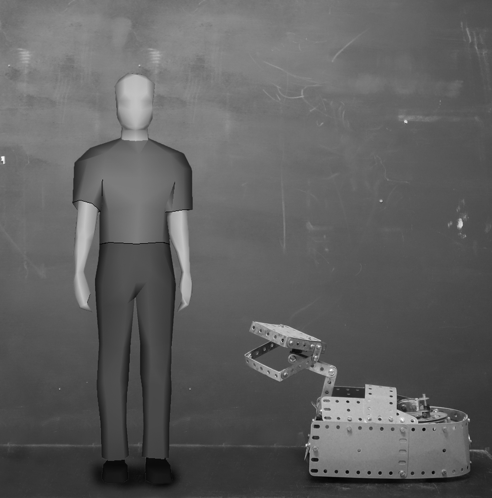
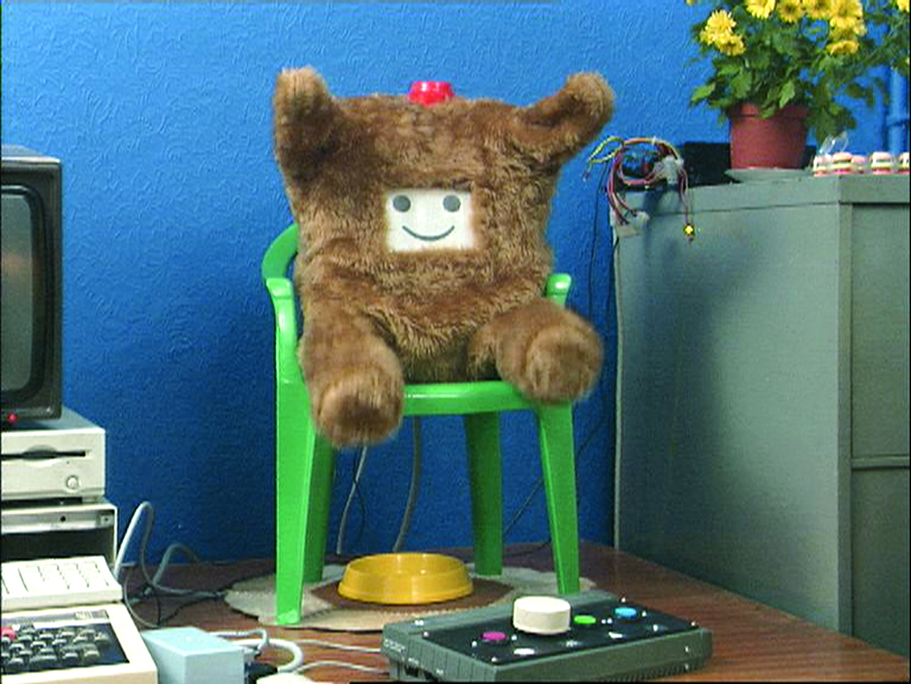
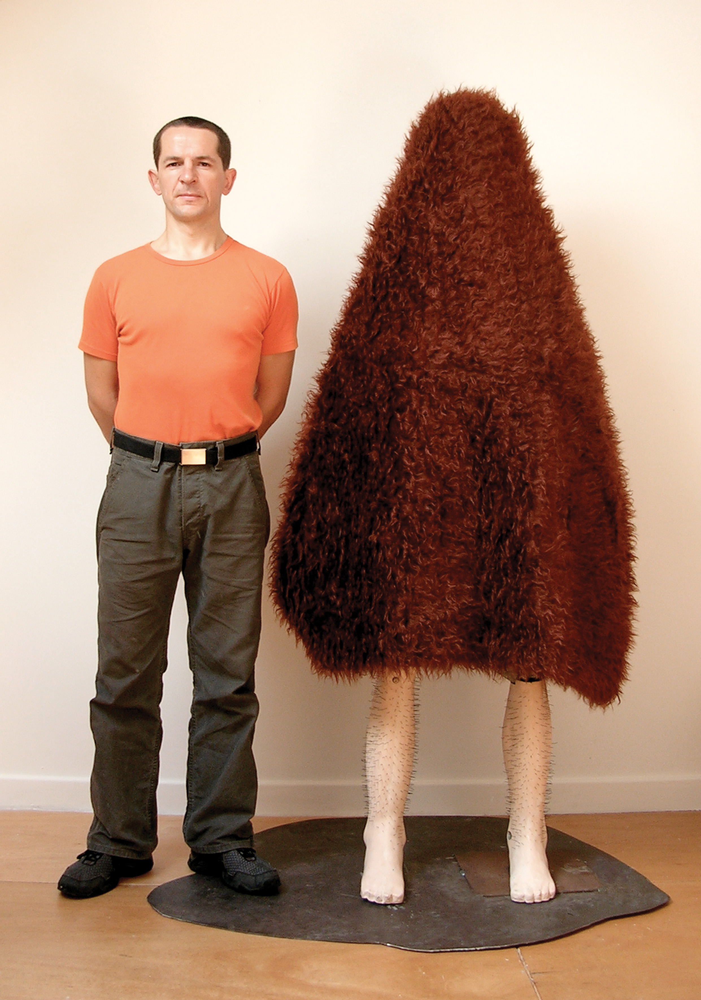
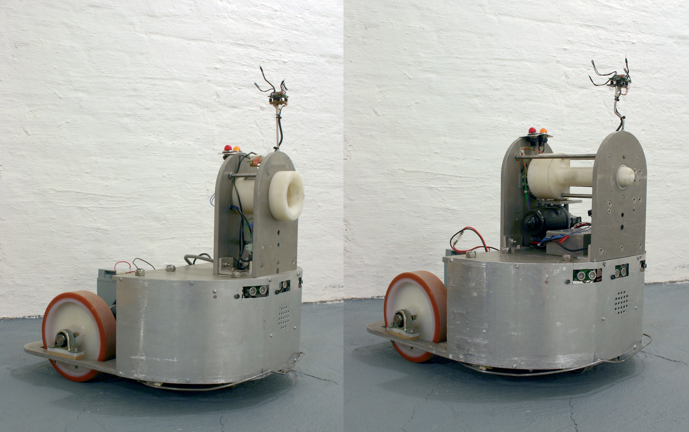

---

This paper explores the phenomenon of social robots from the perspective of an electronic artist, a practitioner making robots and other machines within an artistic context. My art objects are vehicles for reflecting on the co-evolution of humans and machines, a reflection informed by observation and experience. Intelligent robots are of particular interest to my practice as they combine mobility, service, social interaction and adaptive skills so as to integrate with the fabric of human society as embodied semi-autonomous agents. They also have captured the imagination of a wide public through works of fiction, wherein advanced robot characters have been commonplace for many decades. People, it appears, are curious about the capabilities of intelligent robots. {#para1}

Buoyed by techno-scientific progress and financial interest, the field of robotics is fast gaining visibility and maturity, undergoing a tremendous development effort for research, industrial, military, civil and social applications. Indicators of this trend are, for example, Google’s acquisition of several robotics and artificial intelligence companies since November 2013 (Ackerman, 2013) and the economy-focused Policy Exchange think tank event *Rise of the Robots* held in London in July 2014. Many of the currently developed or foreseen applications for robots are social, aimed at supporting humans, with roles such as butler, teacher, elder-carer, receptionist and security guard being the most common (Dautenhahn et al., 2005). These roles share a fundamental anthropocentric bias: the robots are providing a service to humans. As a consequence, human–robot interaction is commonly designed to facilitate a useful transaction provided to a human by a benign machine. {#para2}

The global network of connected devices, often called the Internet of Things (IoT), is emblematic of the progressive integration of computing machines in many areas of human society. Founded on an exponentially widespread machine-to-machine network (M2M), the ‘traffic generated for M2M devices is predicted to grow 22-fold from 2011–2016’ (Tsiatis et al., 2014: 4); this trend complements the global adoption of sensing and connected technologies within private and public environments as delivered by the smartphone. Motivated equally by scientific research and the quest for financial return, the development of smart machines and the potential consequences of their global deployment raise many questions that are not necessarily relevant to the promoters and developers of the technologies. Of particular interest to me is the notion of machinic life. The capacity of a machine ‘to alter itself and to respond dynamically to changing situations’ (Johnston, 2008: ix) has, until recently, been found solely in living organisms. We may now need to create a specific ontological category for these new machines, that acknowledges the idea that ‘people and things are not so different after all’ (Pickering, 2010: 18). But the benign and anthropocentric bias of robotics research, combined with the commercial imperatives driving the deployment of social robots, leave researchers and developers little scope for exploring and understanding machinic life and its impact on society. In contrast, artists working with robotics, being largely free from commercial and scientific constraints, are well positioned for investigating the potential of non-benign machines. {#para3}

### Machinic Life

Electronic artist Ken Rinaldo wrote that he is looking forward to ‘the day when [his] artwork greets [him] good morning when it has not been programmed to do so’ (Rinaldo, 1998: 375), an encounter with a live artwork which has, to my knowledge, not occurred yet. Although the quest for artificial life has been of interest to scientists, artists, writers and inventors since antiquity, it is only recently that scientific and technological developments have made “living” artificial creatures a realistic possibility and a rich field of research for the 21st-century robotic artist. This article focuses on non-biological systems or constructs that may demonstrate aspects of machinic life as defined by John Johnston. Having examined a comprehensive set of examples from the fields of robotics, artificial life and new artificial intelligence, Johnston (2008) posits that the evidence points toward the emergence of radically new machines (software and hardware). With a family tree rooted in the work of W. Grey Walter and other post-WWII British cyberneticians, the new machines, possessing adaptive characteristics that used to be found solely in biological living organisms, do not fit comfortably in the categories of either alive or not alive. According to Johnston, these liminal machines are the tremors announcing a genuine machinic life. The notion is not new, having brewed throughout the 20th century in the realms of fiction and cultural studies. Johnston refers directly to the ‘becoming machinic’ and ‘machinic phylum’ coined by Deleuze and Guattari (1980: 406), claiming that ‘becoming-machinic is a force or vector that, under the guise of imitation, is directing and shaping not only ALife experiments and contemporary robotics but much of the new technology transforming contemporary life’ (Johnston, 2008: 20). {#para4}

The implications for human society of sharing the world with representatives of machinic life are profound and multi-faceted. Artificially intelligent creatures present a novel condition that calls for extensive study and scrutiny. I have identified three useful concepts in the works of Johnston, Donna Haraway and Sherry Turkle that inform this practice-led reflection on the subject: {#para5}

**Machine As Assemblage:** for Johnston (2008: 111) ‘the term machine designates an ensemble of heterogeneous parts and processes whose connections work together to enable flows of matter, energy, and signs … Machines, first of all, are assemblages that include both humans and tools, or in modern societies, technical machines’. {#para6}

**Contact Zones:** this term is coined by Haraway (2008: 186) to describe the common experiential dimension where ‘animals, humans and machines are all enmeshed in hermeneutic labor (and play) by the semiotic-material requirement of getting on together in specific lifeworlds. They touch therefore they are. It’s about the action in contact zones’. In a more technical fashion, robotic scientist Frédéric Kaplan (2005: 60) borrows from psychology the notion of shared attention (*attention partagée*) to assess the degree of interaction between a human and a robot by monitoring the robot’s perceptual data while it is interacting with a human in the performance of specific tasks. {#para7}

**Sort of Alive:** a term coined by an 11-year-old schoolgirl named Holly, referring to mobile robots navigating a maze during a study led by Turkle. ‘Sort of alive’ has since been used to describe an intermediary condition between that of an inanimate object and that of an animal (Turkle, 1998). {#para8}

### The Socialisation of Robots

“Social robot” is still a term open to interpretation, and this paper adopts the definition offered by Terrence Fong et al.: {#para9}

> Social robots are embodied agents that are part of a heterogeneous group: a society of robots or humans. They are able to recognize each other and engage in social interactions, they possess histories (perceive and interpret the world in terms of their own experience), and they explicitly communicate with and learn from each other. (2003: 144) {#para10}

Eleven years after this definition was written, social robots have not yet had a significant impact on human society, yet an emerging trend in industrial robotics indicates a growing socialisation of robots. {#para11}

Unlike the nascent and still experimental social robots being developed worldwide or the prospective returns of Google’s investment in robotics companies, industrial robots have been commercially viable since the 1950s and a mature industrial robotics market now exists. Recent numbers show a year-on-year growth of 12 per cent between 2012 and 2013, indicating a similar trend in 2014 (Modern Material Handling, 2014). Industrial robots, traditionally programmed to perform repetitive manipulation tasks with accuracy and speed in secure areas, are undergoing a significant change with the introduction of collaborative capabilities. According to Modern Material Handling, {#para12}

> … easy to use and easy to integrate robots will open up a wide range of new customers and new applications for robots. A main example for this category of robot use is the human-machine-collaboration. The robots working together with the worker in the factory or also in non-manufacturing sectors are capable of understanding human-like instructions (by voice, gesture, graphics) and have modular plug-and-produce components. (2014) {#para13}

While practical applications of social robotics in domestic, health or corporate environments are not yet mainstream, the prominence of collaborative industrial robots signals that applications for human–robot social interaction are entering commercial maturity. First commercialised in 2012 by Rethink Robotics, Baxter the affordable, human-safe, collaborative industrial robotic arm with a friendly face is a recent commercial success. Baxter and its more advanced sibling Sawyer, launched in 2015, are being adopted by small and medium-sized manufacturing businesses worldwide. As robots are becoming social and ubiquitous, they deserve critical, artistic attention more than ever. {#para14}

### Anthropocentrism and Benign Robots

The open definition by Fong et al. of a social robot proposes a balanced state where humans and robots share a world in an even fashion and does not mention a utilitarian usage for robots. Although the terms of the definition still apply to recent research, the majority of current social robotics projects favour an anthropocentric, utilitarian perspective that does not leave much room for robots’ histories to develop. In their survey of social robotics, Fong et al. have identified common characteristics of the field: {#para15}

> … social learning and imitation, gesture and natural language communication, emotion, and recognition of interaction partners are all important factors. Moreover, most research in this area has focused on the application of “benign” social behavior. Thus, social robots are usually designed as assistants, companions, or pets, in addition to the more traditional role of servants. (2003: 145) {#para16}

It can be argued that these roles for social robots, as well as the adjective ‘benign’, sum up the current status quo in social robotics science, in which machines have to comply to rules of safety, friendliness and legibility in order to facilitate interaction with the humans. {#para17}

Anthropomorphic design of body and behaviour is assumed to be an evident gateway to a natural relation between a human and a sociable robot. In Brian Duffy’s words, ‘it can facilitate rather than constrain the interaction because it incorporates the underlying principles and expectations people use in social settings in order to fine-tune the social robot’s interaction with humans’ (2003: 181). As a result, robots are often given a humanoid or animal appearance, ranging from very realistic (see the Geminoid series or Paro the robot baby seal) to mechanical humanoid (e.g. iCub, Asimo, Nao) to cartoon-ish (e.g. iCat, Baxter, Leonardo). With the exception of Paro, the “mood” of the all the robots mentioned above is indicated through an expressive face modeled on human features: eyes, eyebrows and mouth are used to model the expression of common emotional states such as happiness, sadness, boredom, etcetera. To further ease the integration of robots into a human environment, recent developments in the emerging field of soft robotics make use of materials such as rubber and electro-active polymers in the construction of body and actuators, allowing, for example, the creation of octopus-inspired manipulators. In a similarly soft fashion, a functional android prototype called Roboy, featuring joints fitted with flexible tendons instead of rigid motors, was launched in Switzerland in 2013. The ability of soft robots to “give” naturally when encountering obstacles ‘makes them ideal for applications such as personal robots that interact with people without causing injury’ (Trivedi et al., 2008: 99), thus embedding the benign, domesticated dimension mentioned earlier into the sheer materiality of the machine. {#para18}

Understandably, it is of little interest to most engineers and robotics scientists to explore the possibilities of non-benign social machines. Scientific or commercially driven projects are essentially reductive, having to provide safe solutions, fulfil consumers’ needs, and follow established methodological criteria. Early examples of creative machines designed for exploring human–machine interaction from a more open-ended and inclusive perspective can be found in the work of early British cyberneticians such as Gordon Pask, who coined the term ‘maverick machine’. {#para19}

### Maverick Machines

In 1968, Jasia Reichardt curated the landmark exhibition *Cybernetic Serendipity*, a show that dealt broadly with the demonstration of how humans can use computers and new technologies to extend our creativity and inventiveness. Reichardt commissioned Gordon Pask to produce a piece that would illustrate his ideas about cooperative action and self-organisation. If possible, it should also have some aesthetic merit. The result was as a work called *A Colloquy of Mobiles*: an interactive installation that ‘represented an ecological, or perhaps ethological, fantasy’ (Pask and Curran, 1982: 78). Pask had been exploring the notions of self-regulation and collaborative learning for years, creating educational devices such as *SAKI* the adaptive keyboard instructor (1956) or more artistic endeavours such as *Musicolour* (1953), a synaesthetic machine that produced a coloured light performance in response to musicians performing with traditional instruments. Described by Pask (in Reichardt, 1968: 34) as a reactive ‘aesthetically potent environment’, *A Colloquy of Mobiles* comprised five motorised modules made of fibreglass, metal and purpose-built electronics hanging from the ceiling over a surface of four by five metres. The mobiles, described as two males and three females, were able to engage in discourse, compete, cooperate and learn about each other using light beams and sound while moving on powered beams. Conceived as a social system where ‘sharing takes place between people, between processors, or between people and processors’ (Pask and Curran, 1982: 79), the installation was designed in such a way that the males appeared to be competing for female attention and the females responded to adequate light stimulation with specific sounds and motion. The visitors were invited to walk amongst the hanging robots and contribute to the interaction using mirrors and flashlights. Pask mentioned that: {#para20}

> … in order to remain a self-organising system, the mobiles had to steer a middle course between two extremes: no conflict resolution, in which case the system would fail to organise at all, and total organisation, total sharing of information, in which case the individual character of the machines would be destroyed. The introduction of … the human element was a safeguard against total organisation. (1982: 79) {#para21}

The mobiles can be considered ‘maverick machines’, a term coined by Pask to describe ‘machines that embody theoretical principles or technical inventions which deviate from the mainstream of computer development but are nevertheless of value’ (1982: 133). {#para22}

In his book *The Cybernetic Brain*, Andrew Pickering highlights the originality of the early British cyberneticians’ approach to knowledge generation as a counterpoint to that of modern science. Whereas modern scientific methodologies tend to isolate the subject of the experiment so as to reduce noise and ensure repeatability, the non-modern cybernetic approach is performative, being that the subject is observed in action within an environment. According to Pickering, the cybernetics perspective is one in which we are: {#para23}

> … enveloped by lively systems that act and react to our doings, ranging from our fellow humans through plants and animals to machines and inanimate matter, and one can readily reverse the order of this list and say that inanimate matter itself is also enveloped by lively systems, some human but most nonhuman. (2010: 20) {#para24}

Pickering describes the black box, a staple of cybernetic theory, as ‘something that does something, that someone does something to, and that does something back’ (2010: 20). Cybernetic knowledge is produced not from opening the black box or from deconstructing it to its smaller sub-components but from engaging performatively with it as a partner in a ‘dance of agency’. For a contemporary techno-artist working with robots, the notions of maverick machines and a cybernetic dance of agency have strong appeal. They evoke possibilities of real-time social interaction with autonomous artificial entities that operate on their own terms in a shared environment, gradually exploring communication and relationship through contact zones. Pask’s maverick machines, entangling humans and processors in a physical environment (and sometimes in a non-benign fashion), are inspiring precursors for robotic art projects investigating these notions. {#para25}

### Non-Benignity

As discussed earlier, the vast majority of robots are designed to be fundamentally benign, to either operate safely in isolation or integrate seamlessly within human society. A significant exception is the military robot. Military technology often drives techno-scientific progress, and robotics is a prominent area of weapon development as it allows deployment of forces with limited exposure of human soldiers (Galliott, 2015). Yet, the adoption of intelligent technologies that raise the possibility of autonomous killing machines challenges the strict military chain of command. Military forces and security providers insist that it is essential to keep a human in the loop (remote-control operation), or at least “on” the loop, ‘where the operator is on standby and can override the robotic targeting process’ (Leveringhaus and Giacca, 2014: 11). For example, British Aerospace, makers of the British Taranis unmanned stealth airplane, ‘made it clear that, with regard to unmanned aircraft systems, there will always be a need for a human in the loop, in particular regarding any use of weapons, both now and in the future’ (Leveringhaus and Giacca, 2014: 5). According to P.W. Singer in his book *Wired for War,* when it comes to truly autonomous weapons, ‘both specialists and military folks tend to change the subject or speak in absolutes’ (Singer, 2009: 123). He quotes Eliot Cohen, a recognised military expert at Johns Hopkins: ‘People will always want humans in the loop’ (2009: 123). Generals currently favour solutions that allow sensitive decisions to remain under operator control. A US Army report about future tactical autonomous combatants (TACs) states that, ‘even though we use the term “autonomous”, we do not envision total autonomy. The term “supervised autonomy” is more accurate. Humans will “supervise” the unmanned entities when objectives change or when decisions outside the bounds of the TAC’s autonomy are required’ (Johnson et al., 2003: 1). Given that they still involve humans in a supervisory role, I have excluded military robots from my discussion of non-benign intelligent machines below. {#para26}

### Non-Benign Maverick Machines

A non-benign, non-military robot can be thought of as a maverick machine in that it deviates from the mainstream of robotics development. Looking at such machines presents the opportunity to investigate robotic invention and its role in society off the beaten track of market-driven or purely scientifically motivated development. Non-benign here does not stand for malign, but instead aims to define an area where a wide range of autonomous behaviours are possible, covering a full gamut of possibilities which may include aggressive as well as friendly traits. A non-benign maverick machine could thus be an interesting vehicle for exploring the manifestations of machinic life. Such a ‘sort of alive’ artefact is likely to develop a range of responses that will not resemble animal or human behaviours. This potential can be seen, for example, in the case of evolvable hardware, where engineers apply genetic algorithms to electronic design. Evolving electronic circuits using genetic algorithms allows the software to arrive at efficient solutions that significantly depart from those designed by humans. The weight of electronic circuit designers’ experience leads them to: {#para27}

> … operate largely under assumptions of linearity, and consider only modularity and hierarchically-structured systems, though it is clear in many cases that the resulting performance is inferior to that attainable if we were able to transcend these limitations and exploit the vastly augmented design space and emergent properties attendant upon less constrained and more holistic conceptions. (Miller, Thompson and Fogarty, 1997: 105) {#para28}

Similarly, the design of a social robot for the emulation of a support or service task traditionally undertaken by humans is likely to be limited by assumptions and past experience. {#para29}

Creating a non-benign, intelligent machine presents the challenge of developing software and hardware architectures from which a non-biased, less constrained and more holistic machinic life system can evolve. Artistic practice is well suited to investigate the potential of such a machine as a concept as it addresses a mix of traditional subjects (life-likeness, performance, representation) and contemporary questions (exponentiality of technological progress, hegemony of scientific knowledge, relationship with machines, control society, post-humanity, singularity). However, the realisation of an art robot addressing these challenging questions calls for a collaboration between artists, scientists and technologists. {#para30}

### On the Role of Art Robots

Art robots can shed a different light on contemporary robotic research and on our relation to machines, for example by creating speculative scenarios and experiments free of utilitarian function and not fully constrained by the methodical rigour of scientific research. The artist’s contribution to deciphering techno-scientific trends provides a different perspective to a scientist’s or a technologist’s perspective. Electronic art specialist Stephen Wilson (2007) argues that ‘in a techno-scientific culture, artistic probing of the world of research is a critical, desperate need. We need people looking at these fields of inquiry from many frames of reference, not just those sanctioned by academia or commerce’. Similarly, Robert Zwijnenberg in his preface to *Art and Technoscience* makes a case for a revitalised role for humanities and the arts in understanding and guiding societal choices presently driven by technologists and scientists. He argues that ‘the eager and unrestrained artistic attitude vis-à-vis the life sciences ought to motivate scholars in the humanities to instigate and develop more sustained reflection about the life sciences’ (Zwijnenberg, 2009: xxvii). {#para31}

Having attended and contributed to a significant number of international electronic arts events and exhibitions over the past two decades, my experience is that the field of electronic arts features more software-based and screen-based works than autonomous robotics works. A likely reason is the wide range of technical skills and resources required to produce reliable machines combining many complex hardware and software components. As a result, relatively few robotic artworks have been created, which, on the one hand, limits the scope of historical research and, on the other, leaves much to be explored with the medium. In *Robotic Art,* a joint statement published in 1996, artists Eduardo Kac and Marcel-lí Antúnez Roca wrote that: {#para32}

> … one of the crucial concerns of robotic art is the nature of a robot’s behavior: is it autonomous, semi-autonomous, responsive, interactive, adaptive, organic, adaptable, telepresential, or otherwise? The behaviour of other agents with which robots may interact is also key to robotic art. The interplay that occurs between all involved in a given piece (robots, humans, etc.) defines the specific qualities of that piece. (Kac and Roca, 1997) {#para33}

Although Kac’s and Roca’s extensive taxonomy offers a valid way of differentiating between robotic artworks, I would like to propose a simplified categorisation, comprising three categories, yet including a wider range of media: {#para34}

**Illustrative:** the work is not functional, instead representing robots through another medium such as photography, video, sculpture. {#para35}

**Reactive:** functional machines fitted with sensors and actuators inhabit a physical space. All their possible states are pre-programmed: they are finite machines. {#para36}

**Evolutive:** complex machines that can adapt, evolve and learn. {#para37}

The reactive category encompasses the majority of existing robotic artworks, in which the machines’ design and programming don’t allow for true adaptation even if they are able to react to a changing environment. Reactive art robots can provide a rich form of interaction with the public, embodying possible human–robot relationship scenarios, conveying ideas about the role of machines in human society, or demonstrating technological possibilities. Yet, due to their deterministic design, reactive systems are closed and eventually predictable entities. More apt to produce representatives of machinic life is the evolutive category, where a robot’s design includes adaptive intelligence that enables it to learn and evolve new behaviours from its interactions with the environment. The artwork results from the assemblage of robot, human participant and environment, a sum of connections and flows that, beyond sheer techno-scientific demonstration, conveys intentionality. The roots of such artistic endeavours can be found in last century’s systems art movement. In the words of systems art proponent Jack Burnham, ‘systems-oriented art will deal less with artifacts contrived for their formal value, and increasingly with men *[sic]* enmeshed with and within purposeful responsive systems … [T]he system itself will be made intelligent and sensitive to the human invading its territorial and sensorial domain’ (Burnham, 1968: 363). Almost 50 years later, the ‘intelligent and sensitive’ systems evoked in future tense by Burnham are reaching technical feasibility. {#para38}

Few robotic art projects have dealt with the complexity required by such systems, and the ones that have were often the result of art–science collaborations. Mentioned in order of increasing non-benignity, *Fish-Bird* (2006) by Mari Velonaki in collaboration with a team from the Australian Centre for Field Robotics, and *Accomplice* (2013) by artist Petra Gemeinboeck and computer scientist Rob Saunders, propose a strong artistic vision combined with advanced computer science. Velonaki’s robots, wheelchair-like machines showing no visible circuitry or motors, move gracefully while dropping poetic printed notes on the floor. The artwork aims to induce ‘a willing state of suspended disbelief, where [the visitor] is not conscious of interacting with a machine …​ A successful interface enables fluent, intuitive communication between human and machine’ (Rye et al., 2006). The fluid interaction between visitors and system and the use of the written English language by the robots still don’t make for a fully benign machine in that the robot system’s motivation remains alien. *Fish-Bird* offers the visitor a chance to be part of a cybernetic assemblage as an observer and participant and does not deliver a clear, goal-driven interaction, creating space for an open and personal human–machine relationship to exist. {#para39}

The robots in *Accomplice* are more explicitly non-benign, laboriously destroying what appears to be a gallery wall. Embedded into the wall, the robots are programmed to be “curious” and to autonomously explore their environment. Once the environment has been memorised, however, the robots get “bored” and use their electro-mechanical punches to alter it, producing marks and holes in the wall. Over the duration of an installation, the gallery environment gets irreversibly altered and, as the walls get increasingly perforated, the robots become visible and exhibit a curious disposition toward the visitors standing on the other side. Gemeinboeck and Saunders (2013: 216) are interested in creating ‘works that explore notions of autonomy and artificial creativity that may offer starting points for thinking about social settings that involve humans interacting and collaborating with creative agents’. {#para40}

In different ways, the two maverick machines described above are non-anthropocentric systems, assemblages that offer environments for humans and sort-of-alive machines to share experiences, explore, and make manifest possible stories for humans and social robots. They cultivate contact zones. Together with the complexity supported by the collaboration with scientists, the open-ended, non-benign characteristics of these machines and their modes of staging offer an experimental playground for a first-hand experience of early machinic life. {#para41}

### Wild Robot Coy-B and its Older Relatives

At the time of writing, I am working on *Wild Robot Coy-B*, a collaborative project with an autonomous robotics scientist. The project aims to create an intelligent robot with a potential to be dangerous, that will interact with humans in live performances. I will first discuss three of my existing hand-made robots in order to clarify *Coy-B*‘s lineage before describing the project in more detail. {#para42}

My practice of robotic art started in 1996 when I started learning techniques of interfacing and control that I applied to robots designed for video and performance. An early example is *The Fluffy Tamagotchi* (1998), a robot inspired by the famous electronic hand-held toy pet. Made for a short video, in my taxonomy *The Fluffy Tamagotchi* is situated half-way between an illustrative robot and a reactive one. While its features, inspired from the original toy, are functional, due to the use of video the robot in the artwork doesn’t require reliability or maintenance. The video provides an overview of the robot’s operation in a descriptive, deadpan fashion, contradicting the absurd nature of a five-kilo machine that excretes blue custard and cries loudly when its program needs attention. *The Fluffy Tamagotchi* is an early instance of a machine that offers a critical comment on a techno-societal trend, questioning the rationale of replacing living animals with commodified, artificial ones, packaged in plastic eggs and fitted with rudimentary AI. {#para43}

The following two examples could be situated within the maverick machine category as their design has not been inspired by existing commercial products. *Furman* (2003) is a six-foot high machine that delivers karate-style kicks, powered by compressed air. A physical manifestation of a creature I saw in a dream, *Furman* is introduced and demonstrated in live performances where it fells me on a gym mattress with one powerful kick. The creature is both a friendly guardian and a machine that turns against its creator in a Frankenstein-like fashion. The hairy robot taps into unconscious images in a surrealist fashion and provides a humorous illustration of the duality of robots and technology in general. Despite being a simple anthropomorphic automaton whose presence is enhanced by a performer telling a story, at its heart, *Furman* is a non-benign machine that can harm a human standing in the way of its metal and epoxy foot. {#para44}

The next work displays non-aggressive robots that do not interact with humans. The “male” and “female” *Sexed Robots*, created in 2005, operate autonomously in a zoo-like enclosure. Their program takes them through a pseudo-random selection of different states that include roaming, singing, sleeping and being in heat. If two robots in heat find each other they will attempt to have intercourse, connecting their genital organs which are machined in industrial nylon stock to interlock in a complementary fashion. The intercourse ends when one of the robots changes state and disengages. A reactive piece of medium-level complexity, *Sexed Robots* questions, in an absurd manner, to what extent humans want to delegate some of their basic functions to machines. Simultaneously they provide an entertaining alternative to the robots I saw in robotics laboratories at the time: small wheeled platforms fitted with various modules such as grippers or cameras that slowly performed sorting or navigating tasks, unlikely to capture the attention of a non-specialised audience for more than a short time. Fitted with a genital module, the sexed robots perform an isolated algorithmic dance sometimes punctuated by a duet of penetration. They are not social robots as they don’t attempt to establish a benign relationship with humans. Instead, their performance aims to draw parallels between human and machinic behaviours and trigger reflection. {#para45}

Imagined as ‘an experiment in human–robot interaction with a metaphorical dimension that will provide material for reflection, dialogue and analysis on the ontology of artificial creatures’ (Granjon, 2014: 30), *Wild Robot Coy-B* goes a step further than *Accomplice* and *Furman* with regard to its level of non-benignity. The project’s initial inspiration was Joseph Beuys’ *I Like America and America Likes Me*(1974), wherein the artist shared a space in a New York gallery with a live coyote for three days. Beuys chose to spend several days with the coyote in a shared territory in an attempt to metaphorically reconnect with natural wildness and instinct, dimensions lost to contemporary western humanity. In the *Coy-B* project, an evolutive autonomous robot of similarly dangerous potential will replace the coyote. Symbolically opposed to the coyote, the robot is a representative of up-to-date machinic life, the product of technics and artificiality. Performance creates a terrain for an open-ended relationship to unfold between a human and a smart, learning machine, programmed to be curious and to develop its own responses to internal and external stimuli. The programming and the physical design of the robot will involve genetic algorithms and other evolvable machine design techniques to limit the aforementioned anthropocentric bias. The *Coy-B* robot will be fitted with an arm-mounted gripper that could potentially double as a bite-inflicting actuator. Acknowledging a potentially aggressive, dangerous dimension is an important part of the metaphor that the work aims to produce, recognising the multi-faceted range of applications of any technology. In order to insure both conceptual robustness and scientific relevance, the work will be developed by a team comprising an artist, two scientists and a science and technology studies (STS) scholar. {#para46}

### A Word of Caution

Despite its inherent subversive element, a non-benign, intelligent machine artwork contributes to the general digital augmentation of our environment and its immense potential for monitoring and control. Denouncing ‘Silicon Valley’s quest to fit us all in an electronic straightjacket by promoting efficiency, transparency, certitude and perfection – and, by extension, eliminating their evil twins of friction, opacity, ambiguity and imperfection’ (Morozov, 2014: xiii), activist writer Evgeny Morozov posits that the ongoing application of data-driven control to many domains of society, often presented as a *fait accompli*, must raise questions about the power held by the controllers. A technological art practice, with all the subjectivity, messiness and lateral thinking that characterise the artistic process, is well suited to inject noise into this perfect landscape – to make the straightjacket itchy in places. {#para47}

Nevertheless, artists adopting contemporary cybernetic tools need to be aware of the potential pitfalls. Digital artist and theorist Simon Penny, writing about artificial life and interactive art, warns that ‘artists must be careful not to unconsciously and unquestioningly endorse the value systems and narratives hidden in scientific discourses, where they often lie hidden, disguised as axioms’ (Penny, 1996). One of the challenges faced by artists working with science and technology is the risk of spending much of their time and resources on the acquisition and application of new technical knowledge, sometimes to the detriment of their original artistic intention. The possibility of confusing the means for the end is very real and too often demonstrated in the technologically heavy world of electronic arts. Artistic adoption of contemporary technological tools must not lead to losing sight of the intended artistic and critical content. The artwork is likely to be more evocative and multi-layered if it embodies a reflection on the medium and its context, going beyond an application of sophisticated tools. I believe that it is a grand challenge for artists and their collaborators working with robots to devise non-benign, ambiguous, maverick machines to produce awareness, resistance and knowledge, and that in so doing we can impact societal choices for a future in which human and non-human agencies can dance freely. {#para48}

### Biographical Note

Paul Granjon is an electronic artist and educator working and living in Cardiff, Wales. He teaches at all levels of the Fine Art course at the Cardiff School of Art and Design and runs regular workshops and public events. He has presented robots and other machines for performances and exhibitions since 1996.

### References

- Ackerman, E. ‘Google Acquires Seven Robot Companies, Wants Big Role in Robotics’, *IEEE Spectrum*, 4 December (2013), [https://spectrum.ieee.org/automaton/robotics/industrial-robots/google-acquisition-seven-robotics-companies](https://spectrum.ieee.org/automaton/robotics/industrial-robots/google-acquisition-seven-robotics-companies)

- Burnham, J. *Beyond Modern Sculpture: The Effects of Science and Technology on the Sculpture of This Century* (New York: George Braziller; London: Allen Lane/Penguin Press, 1968).

- Dautenhahn, K., Woods, S., Kaouri, C., Walters, M. L., Koay, K. L. and Werry, I. ‘What is a Robot Companion-Friend, Assistant or Butler?’, in proceedings of the *IEEE/RSJ International Conference on Intelligent Robots and Systems* (2005), 1192-1197.

- Deleuze, G. and Guattari, F. *A Thousand Plateaus* (Minneapolis: University of Minnesota Press, 1980).

- Duffy, B. ‘Anthropomorphism and the Social Robot’, *Robotics and Autonomous Systems* 42 (2003): 177-190.

- Fong, T., Nourbakhsh, I. and Dautenhahn, K. ‘A Survey of Socially Interactive Robots’, *Robotics and Autonomous Systems* 42 (2003): 143-166.

- Galliott, J. *Military Robots: Mapping the Moral Landscape* (Farnham: Ashgate, 2015).

- Gemeinboeck, P. and Saunders, R. ‘Creative Machine Performance: Computational Creativity and Robotic Art’, in proceedings of the *Fourth International Conference on Computational Creativity* (2013), [https://www.computationalcreativity.net/iccc2013/download/ICCC2013-Proceedings.pdf](https://www.computationalcreativity.net/iccc2013/download/ICCC2013-Proceedings.pdf)

- Granjon, P. ‘Coy-B, an Art Robot for Exploring the Ontology of Artificial Creatures’, *Springer Notes on Artificial Intelligence* 8069 (2014): 30-33.

- Haraway, D. ‘Crittercam: Compounding Eyes in Nature Culture’, in E. Selinger (ed.) *Postphenomenology: A Critical Companion to Ihde* (Albany: State of New York University, 2006), 175-188.

- Johnston, J. *The Allure of Machinic Life: Cybernetics, Artificial Life, and the New AI* (Massachusetts: MIT Press, 2008).

- Johnson, J., Meyers, T., Richards, R., Wolfe, M. and Trinkle, G. ‘Unmanned Effects (UFX): Taking the Human Out of the Loop’, *Project Alpha* (Concept Exploration Department, Joint Futures Lab, Joint Experimentation Directorate (J9), U.S. Joint Forces Command, 2003), [https://edocs.nps.edu/dodpubs/org/JFC/RAPno.03-10.pdf](https://edocs.nps.edu/dodpubs/org/JFC/RAPno.03-10.pdf)

- Kac, E. and Antunez Roca, M. ‘Robotic Art’, *Leonardo Electronic Almanac* 5.5 (1997), [https://www.ekac.org/kacmarcelli.html](https://www.ekac.org/kacmarcelli.html)

- Kaplan, F. *Les Machines Apprivoisées* (Paris: Vuibert, 2005).

- Leveringhaus, A. and Giacca, G. ‘Robo-Wars: The Regulation of Robotic Weapons’, Oxford Martin Policy Paper (Oxford: University of Oxford, 2014), [https://www.oxfordmartin.ox.ac.uk/downloads/briefings/Robo-Wars.pdf](https://www.oxfordmartin.ox.ac.uk/downloads/briefings/Robo-Wars.pdf)

- Miller, F., Thompson, P. and Fogarty, T. ‘Designing Electronic Circuits Using Evolutionary Algorithms. Arithmetic Circuits: A Case Study’, in M. Makela and K. Miettinen (eds) *Genetic Algorithms and Evolution Strategy in Engineering and Computer Science* (Chichester: John Wiley and Sons, 1998), 105-131.

- Modern Material Handling. ‘Global Robotics Sales Set New Record’, *Modern Material Handling*, 23 June (2014), [https://www.mmh.com/article/global_robotics_sales_set_new_record](https://www.mmh.com/article/global_robotics_sales_set_new_record)

- Morozov, E. *To Save Everything Click Here* (London: Penguin Books, 2014).

- Pask, G. and Curran, S. *Microman* (London: Century Publishing, 1982).

- Penny, S. ‘Embodied Cultural Agents: At the Intersection of Robotics, Cognitive Science and Interactive Art’, Artist website (1996), [https://simonpenny.net/texts/darwinmachine.html](https://simonpenny.net/texts/darwinmachine.html)

- Pickering, A. *The Cybernetic Brain* (Chicago: University of Chicago Press, 2010).

- Reichardt, J. (ed.) *Cybernetic Serendipity, the Computer and the Arts,* special issue of *Studio International* (London and New York: Studio International, 1968).

- Rinaldo, K. ‘Technology Recapitulates Phylogeny: Artificial Life Art’, *Leonardo* 31.5 (1998): 371-376.

- Rye, D., Velonaki, M., Williams, S. and Scheding, S. ‘Fish-Bird: Human–Robot Interaction in a Contemporary Arts Setting’, in proceedings of *Vital Signs*, RMIT University (2005), [https://www.cse.unsw.edu.au/~acra2005/proceedings/papers/rye.pdf](https://www.cse.unsw.edu.au/~acra2005/proceedings/papers/rye.pdf)

- Singer, P.W. *Wired for War: The Robotics Revolution and Conflict in the 21st Century* (London: Penguin, 2009).

- Trivedi, D., Rahn, C., Kierb, W. and Walkers, I. ‘Soft Robotics: Biological Inspiration, State of the Art, and Future Research’, *Applied Bionics and Biomechanics* 5.3, September (2008): 99-117.

- Tsiatis, V., Fikouras, I., Höller, J., Mulligan, C., Karnoustos, S., Avesand, S. and Boyle, D. *From Machine-to-Machine to the Internet of Things: Introduction to a New Age of Intelligence* (Oxford: Elsevier, 2014).

- Turkle, S. ‘Cyborg Babies and Cy-Dough-Plasm: Ideas about Life in the Culture of Simulation’*,* in R. Davis-Floyd and J. Dumit (eds) *Cyborg Babies: From Techno-sex to Techno-tots* (New York: Routledge, 1998), 317-329.

- Wilson, S. ‘Interview with Stephen Wilson [Interview]’, interviewed by R. Rebatty (2007), *[https://we-make-money-not-art.com/interview_with_12/](https://we-make-money-not-art.com/interview_with_12/)*

- Zwijnenberg,R. ‘Art, the Life Sciences, and the Humanities: In Search of a Relationship’, in I. Reichle (ed.) *Art in the Age of Technoscience* (Berlin: Springer, 2009).
