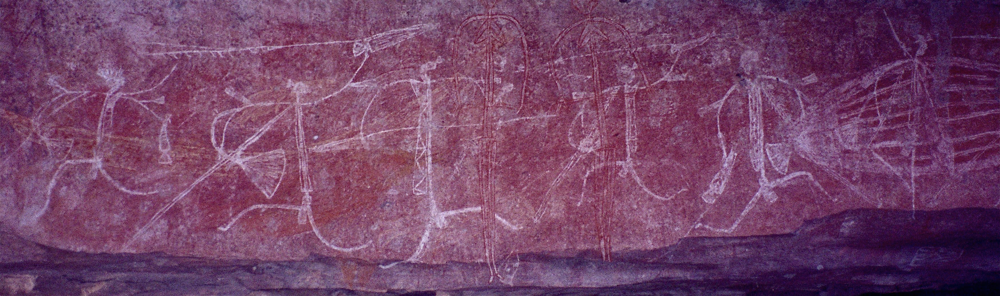

---

https://fibreculturejournal.org/AbdillaFitch.mp4

### Introduction

It could seem to some that Indigenous Knowledge is fundamentally at odds with the contemporary digital age, and with Western society’s thirst and demand for new knowledge to be constantly generated. Furthermore, it would also seem diametrically opposed to science-led ventures into the Brave New World of technological advancement in the field of robotics. Yet, precisely at this juxtaposition a commonality can be drawn. How might we create a space for Indigenous Knowledge Systems and Pattern Thinking to impact and influence future developments in, for example, autonomous systems in robotics and artificial intelligence (AI)? Creating a physical and pedagogical space for an initial foray into these ideas, the Indigenous Robotics Prototype Workshop embarked on practical and creative experimentation along new Indigenous Digital Songlines. {#para1}

This paper is formatted as a dialogue between the lead author, an Indigenous consultant in innovation, technology and culture, and the second author, a non-Indigenous roboticist. We adopt a convention where the second author’s voice is set in *italics*. {#para2}

### Indigenous Advancement: Prototype Workshop

Engaging Indigenous youth with the new technological languages of our times is imperative in enabling participation and creative leadership into the future. The Indigenous Robotics Prototype Workshop was devised specifically for a group of twenty Indigenous youth (8–12 years old) from Glebe Primary School in inner city Sydney. It took place in November 2014 over the course of one day. I was lead researcher/developer and facilitator of the workshop. Using Lego Mindstorms kits, we created a culturally relevant course, leveraging Indigenous Knowledge Systems to introduce core elements within the field of robotics. Throughout the development of the prototype course, I consulted with Gadigal Elder Allen Madden, with Dr Robert Fitch as academic advisor. This paper uses the experiences of the first Australian Indigenous Robotics Prototype Workshop as a springboard for further discussion of the possible role of Indigenous Knowledge Systems and Pattern Thinking in the future research, development and design of creative and intelligent robotics. {#para3}

The aim of the co-developers of the prototype course was to explore how to create a culturally relevant course that engaged urban Indigenous youth in Science, Technology, Engineering and Mathematics (STEM) subject areas through the creative adaptation of Indigenous Knowledge applied through an engagement with robotics. In doing so, we aimed to introduce coding and its principles as a language central to working within digital technology, and to contextualise where and why it is important for urban Indigenous youth to think of coding as part of their future. {#para4}

I started by exploring concepts in Aboriginal Science and looking for its influence on contemporary scientists, and where we might include an embrace of traditional Old Ways within the course design and implementation. [1] This was done through engaging Uncle Allen Madden in a consultative role; researching and designing a delivery structure that suited the demographic of the Indigenous youth we were teaching; and prioritising advocacy of Indigenous Knowledge as a valued, yet divergent, paradigm to be employed when working with science and technology. Finally, we created a mentoring and role-modelling structure, bringing in inspiring Indigenous people who successfully work in various associated fields of new digital technology. [2] This provided adequate support for the youth and ensured individual successes, critical to the benefit of the experience for those participating. Mentoring, informed by an Indigenous Excellence Agenda (Booth et al., 2014), works toward counteracting commonly internalised perceptions regarding Indigenous youth disadvantage, especially in tech sectors such as robotics. {#para5}

*Robotics is already being used as part of the education of school-age children. One of the most prominent mainstream programs is the FIRST robotics competition series, held regularly in Australia and worldwide (FIRST Australia, 2015). Scholars have also begun to explore the idea of robotics as a way to bridge the technology gap between advantaged and disadvantaged youth (McDonald and Howell, 2012), and as a tool of cultural expression among Indigenous peoples (Catlin, Smith and Morrison, 2012). Developing our workshop required us to create robotics educational material that is customised to support the specific cultural context of urban Australian Indigenous youth.* {#para6}

The workshop comprised a brief introduction to Indigenous Knowledge Systems, an introduction to robotics, and a series of participatory and creative coding exercises leading to the construction of simple wheeled mobile robots. Students then used their robots in a navigation task that required them to further develop their technical knowledge, and participated in two non-technical tasks with a robotics theme (a running game and a card game). {#para7}

*The robotics presentation introduced modern robotics from the perspectives of what robots look like, what they do, and what challenges they face. The emphasis was on seeing the world from the robot’s point of view, in particular with regard to perception (‘how do I make sense of seemingly meaningless sensor data?’), localisation (‘where am I and what happens if I get lost?’) and control uncertainty (‘what happens when I do not move in the direction intended?’). Thinking in this way helps students to gain intuition about fundamental research problems inrobotics: many tasks that we as humans perform trivially and unconsciously are tremendously difficult for robots. Adopting the robot’s point of view highlights these challenges and, at the same time, helps students to better engage with robotics by linking research problems to their everyday experience.* {#para8}

*Students assembled and programmed robots, using standard LEGO Mindstorms kits, in a guided exploration framework. They worked in small teams of two or three students plus a mentor. Written instructions were provided for mechanical assembly and simple programming tasks in an incremental sequence leading to creation of a wheeled platform that could execute a series of pre-programmed motion commands. The mechanical parts are press-fit and can be assembled without tools. The programming interface supplied with the kits is a graphical language consisting of action blocks that are strung together to form a program that is subsequently downloaded to the robot control module for execution. The action blocks are customised by entering numerical values to control the linear and angular velocity of the robots.* {#para9}

*The students used their robot platforms to participate in a navigation exercise where a robot’s task is to move to a goal location while avoiding obstacles. The robots moved over a flat surface upon which obstacles and goal locations were hand drawn. The navigation exercise was particularly engaging to the students. Nearly all groups were successful in assembling a working robot with good command over its motion.* {#para10}

Building different robots and enabling different coding exercises within the program was contextualised through Indigenous mapping. In the ‘Mapping of Country’ exercise, the children drew Aboriginal Sydney and its boundary lines with chalk in an outdoor courtyard. The emphasis was on the protocols pertaining to the country on which we stood that day: Eora Nation, home to the Gadigal people, and on our interrelatedness with everything through respect for country. The map included the neighbouring nations: Dharug to the west, Dharawal to the southwest, Guringai to the north. The ways in which crossing boundaries is acknowledged through protocols, and the ceremonies central to Songlines’ continuation through country and across territories, were related to the protocols of code. The children needed to program their robots to track a coded course, which crossed through courtyard country and chalk-drawn nation boundaries. {#para11}

The map was also used for a derivation of a “starboard–port” running game substituting Indigenous Nations for the nautical coordinates. A simple explanation was given about the value and richness of Indigenous Knowledge in the domain of science and technology. We discussed how Western science is consistently readjusting facts accordingly to this knowledge base, as, for instance, in the growing acceptance of the multi-regional model of the origins of modern humans, which takes account of Australian Aboriginal people having evolved in Australia rather than in Africa, as Western science has historically claimed. {#para12}

Card games depicting different robots in differing contexts were a way of introducing to the youth the different roles and locations of robots in society. These include domestic markets, the manufacturing industry, agriculture and other lesser-known areas. The card game was a simple matching game wherein images of robots are matched to their intended industry. Further to the acquisition of technical knowledge, this game has the future potential for a creative realigning or misaligning of roles to robots, in order to spark creativity and ingenuity in Indigenous youth regarding the design of future robots. {#para13}

Scoreboards and awarding of stickers (featuring Indigenous animals) continued to inspire the cultural connection in the students. The prototype was concluded through an award ceremony where certificates, specifically designed to identify a range of STEM and attitudinal related award categories, were distributed. {#para14}

Rich data were collected through evaluation mechanisms, creatively embedded throughout the prototype and post-course phases. Feedback was collated from mentors, teachers and the academic advisor. All feedback strongly attested to the outcome that the prototype workshop was highly successful. The group of children expressed a firm desire to return and continue with the robotics course. {#para15}

The Indigenous Robotics Prototype Workshop allowed us to explore an example of how we could create meaning from an alternate knowledge base, Indigenous Knowledge Systems, through technology. Gaining support is a commitment to providing initiatives for Indigenous communities to engage and direct future economies within the digital sector. By analysing the key areas of current digital research and development, coding and programming has been identified as a core component of the future digital economies (Topsfield, 2014). {#para16}

Executives [3] from major companies Intel, Google and IBM have told me that Equity and Diversity is not simply a corporate social responsibility, but is good for business (Bell, Baxter, Herbert and Dooley, in conversation with author, 2015). They are seeking divergent research methodologies, engineering insights and creative design innovations for and within their products and services. Edward Qualtrough interviews Intel’s Rosalind Hudnell: {#para17}

> The chipmaker [Intel] has started to make moves into wearables, Internet of Things, robotics, mobile devices and augmented reality markets; products are being tailored for different demographics, and “diverse experiences lead to different input, which leads to different engineering solutions”. (Qualtrough, 2015, partially quoting Hudnell) {#para18}

There is significant potential for Indigenous Robotics to enhance what we now consider to be mainstream robotics research and development, whether for creative, industrial, or consumer-related ends. As we will argue, Indigenous Pattern Thinking can lead to more effective design that considers the entire system lifecycle along with diverse environmental impacts. Indigenous Robotics would also inform the complex contextual relationships in multi-robot systems and human–robot interaction at the forefront of current scientific enquiry. {#para19}

*The success of the workshop in terms of student engagement is perhaps unsurprising given the history of robotics in promoting engaged enquiry and learning (Singh, Fitch and Williams, 2010). The main tangible outcome of the prototype workshop is more workshops, which build upon the Indigenous Knowledge base and Indigenous Digital Sovereignty framework established. But a deeper outcome is the opportunity to reflect more broadly on the significance of Indigenous robotics, which we explore in the remainder of this paper.* {#para20}

The initial inspiration for the Indigenous Robotics Prototype Workshop came from a desire to investigate how established Indigenous Knowledge Systems might contribute to, influence and impact our connection and experience with new digital technology. Further investigation has led to new questions, and in what follows we will ask how Pattern Thinking (a system for understanding the complex web of ontology, epistemology and interrelatedness within the Indigenous paradigm) might unearth new ways of engaging with digital technology. {#para21}

### Alternate Paradigms

> When paradigms change, the world itself changes with them. (Kuhn, 1996: 111) {#para22}

In my own youth, there is no doubt that the idea of robots was epitomised by the Transformers of the 1980s. These Transformers also remind me of the superhuman Indigenous Creation Spirits such as Biame, who gave us our lore and culture, and formed the landscape, waterholes and rivers before returning back to the sky. This whimsical, pop culture image linkage – examined and presented in a socially and culturally responsive way – leads me to ask: how could such an adoption and adaptation of our culture through robotics and/or AI bridge the divide for our youth? {#para23}

I want to compare Indigenous Knowledge Systems to the study of autonomous robots and other intelligent agents, where the agent’s task is typically defined in terms of maximising a given objective (or utility) function. *The agent has access to perceptual information about the world, which is often incomplete and uncertain, and takes actions that are likely to increase its utility (task performance) over time, thereby maximising its chances of success. We will return to this idea later in the article.* {#para24}

Indigenous Knowledge Systems (IKS) is a term I will use for the recognition of Indigenous Spirituality; Aboriginal Science; Philosophy; Cosmology; Kinship; Country; Culture; and The Dreaming, known as Lore (otherwise akin to “law”). Essentially, Indigenous Knowledge Systems is a term to make sense of all the components that a Western knowledge paradigm historically segregates. {#para25}

IKS is often mis/represented as mythology. But as Roland Barthes (1973: 188) points out, myth is language: *‘*Ancient or not, mythology can only have an historical foundation, for myth is a type of speech chosen by history: it cannot possibly evolve from the “nature” of things.’ As Elder Wayne “Mukgrrngal” Armytage (in conversation with author, 2015) informs me, custodianship of Indigenous Knowledge is transmitted through strict, compressed oral lore, to ensure its veracity, reverence, relevance and ability to sustain and nurture all life. [4] This could be conceived as akin to code, to coding. {#para26}

*Ideas of the veracity, trust, and relevance of information have rich analogues in robotics. One primary challenge of modern robotics is how to deal with uncertainty in various forms, such as uncertainty in sensing, perception, localisation and control. Uncertainty is reduced by fusing immediate observations with mathematical models built from previous observations. Such models can also be shared among robots for mutual benefit. Trust and truthfulness of information (typically measured in terms of Shannon entropy) are therefore necessarily connected to (possibly shared) previous experience. Relevance of information is particularly important for systems of robots that must communicate with each other; one way of mitigating bandwidth limitations in wireless networks is to communicate only the information that is (mathematically) relevant to a certain robot at a certain time (Kassir, Fitch and Sukkarieh, 2015). These are deep concepts in robotics that can be quite naturally related to equally deep concepts in the custodianship and transmission of knowledge in Indigenous Knowledge Systems.Both place importance on a history of previous experience encoded such that it is trusted, timely, and relevant to the situation at hand. It seems that drawing this connection is useful both in engaging Indigenous students in learning about robotics problems, and also in possibly developing new approaches to these problems informed by Indigenous Knowledge Systems.* {#para27}

Songlines act as an oral map. Songlines impart (epistemological) knowledge while concurrently providing meaning and an ethical framework to all life and beings. The same song would be sung throughout one’s life; the knowledge embedded through the Songline and the act of “singing up country” unlock the next “door” in one’s consciousness. This could be conceived as a next-level intelligence. Australia is mapped by thousands of Songlines, intersecting and crossing at intervals, a network of routes for trade, initiation, seasonal hunting, birthing and death. Vicki Grieves explains: {#para28}

> For Aboriginal people, each of the lines represents the law or knowledge that prescribes these connections and provides the blueprint for ensuring that they continue. (2009: 200) {#para29}

IKS can nudge the existential compartmentalism of Western techno-science into another realm of interrelationship and interconnectedness; indeed, the current wave of “new materialisms” bears striking resemblance to, and could benefit from, *indyamarra*. [6] Mukgrrngal tells me that ‘the rock over there does not exist until its sung into being’ and adds that the power of matter interrelationship is such that ‘if we stop caring for country, country dies, and we die’. [7] In Pattern Thinking, the rock has value, meaning and place, as do human beings and the animal, plant, cosmological and metaphysical worlds combined. All things create the complexity of the Pattern Thinking web in a nuanced relationship of being+knowing entwined. {#para30}

Where once religion informed and influenced all aspects of Western society, now technologist corporations are increasingly informing and influencing our worldviews. The broad differences between Western and Indigenous knowledges are summed up succinctly by Michael J. Christie: {#para31}

> Aboriginal Science is a mode of knowledge production which has evolved to allow human beings to fit into, rather than outside of the ecology. It is a science in which all human dimensions, the social, economic, religious and political, are integrated and interpreted within, and in terms of, the rest of the physical universe. (Christie, 1990: 56-57) {#para32}

IKS syndicates theology, philosophy, science, the arts, ethics and the law through Pattern Thinking: being+knowing is interconnection and interrelatedness. Pattern Thinking can regulate the delicate balance of all things synthetic and our relationship to them. It is an ethical intelligence and embodiment born from this land, giving meaning and relationship to everything. I take this system, evolved as a streamlined ecology, as the best chance of Australian humanity’s maximising its chances of success. {#para33}

*Robotics can be viewed as in concert with Indigenous Knowledge in that it also involves the notion of autonomous agents [8] operating in synergy with their world, which roboticists refer to as the environment. A robot’s environment can include terrain, objects, humans, animals and other robots. The scale of the robot’s environmental representation, and the degree to which the robot’s goals work for or against its environment, are matters of design. But questions of how the robot perceives its world and decides to act [9] are undoubtedly fundamental to the discipline (Thrun, Burgard and Fox, 2005), and these questions present a compelling opportunity to conceive of robots in a sense that is informed by Indigenous Knowledge. The setup and background story of the workshop’s navigation exercise made an initial step towards drawing such a connection; obstacles and goals in the robotics sense were cast in terms of Indigenous ecology. The subfield of multi-robot systems [10] is concerned specifically with coordination, cooperation and collaboration, and is an excellent avenue to pursue in future workshops.* {#para34}

### Being+Knowing Entwined

Indigenous philosophy can be seen as comprised by three components, all interlinked and informing the others: Physical World, Human World and Sacred World (Foley, 2003). Some cultural scholars (e.g. Haraway, 1988; Harding, 1993; Hartsock, 1974) adopt standpoint theory, an analysis of discourse that prioritises and explores the authority implicit in the experiential perspective of the individual (the individual standpoint). In Indigenous Standpoint Theory, the perspective of Indigenous peoples is prioritised in recognising and analysing the (co)construction of knowledge – this while acknowledging that all Indigenous experience is not the same (see e.g. Moreton-Robinson, 2013; Nakata, 2007; Tuhiwai Smith, 2014). Indigenous Standpoint Theory thus offers an ontological and epistemological framework for debunking the imperialism of Western knowledge; the framework supports ’emancipatory and liberatory epistemologies in their deconstruction process’ (Foley, 2003: 45). Dennis Foley notes that this effort is guided by a vision that there is more than just one worldview and interpretation of what constitutes knowledge. Knowledge is rooted in, and determined by, the partial, embodied insight of multiple individuals, embedded in contexts of differential power, and inextricably affected by place and time. {#para35}

In 2014, Twitter’s Senior UX Designer Erin Moore gave a talk on the user’s experience and construction of time when engaging with technology (Moore, 2014). She eloquently argued that Time and Experience become squishy and malleable and that, essentially, time stops when our engagement with technology is such that we are “at one” with it. She likened this technological “Ah-ha!” moment to our experiential connections with natural wonders, such as the sunset. Moore advocates for technologists and designers to go beyond creating technology for technology’s sake, and to reconsider how a typical contemporary focus on Time strives towards shaving fractions of seconds off activities in service of increasing productivity and time-efficiency, thus detracting from the potential social value of technology and meaning of it within our lives. {#para36}

Time holds different meanings within Indigenous Knowledge Systems; it is encapsulated as multi-dimensional. As anthropologist William E.H. Stanner noted, ‘[a]lthough the dreaming conjures up the notion of a sacred, heroic time of the indefinitely remote past, such a time is also, in a sense, still part of the present. One cannot “fix” The Dreaming in time: it was, and is, everywhen…’ (1979: 23-24). {#para37}

Designers of new digital technology could use Indigenous Pattern Thinking, utilised as the basis of interactive and/or artificially intelligent systems, as a model by which to experiment with the psychology at the core of ‘Ah-ha!’ experiences. Perhaps in using this approach, which foregrounds absolute interrelatedness, we could avoid a scenario prefigured by Stephen Hawking in relation to AI: ‘It would take off on its own, and re-design itself at an ever increasing rate … Humans, who are limited by slow biological evolution, couldn’t compete, and would be superseded’ (Hawking et al., 2014). {#para38}

Pattern Thinking: *the brain*. Pattern Thinking, considered post-structurally, is a construct. An active representation and differentiation can be seen through traditional paintings. When painted *true/proper way*, Pattern Thinking is created via an innate embodiment of pattern recognition. {#para39}

Pattern Recognition: *the heart.* Intuitively known by us, Indigenous people. It is our profoundly ecological interrelatedness with everything and everyone. If you were to look at country from a distance, you would be able to see, as did the children in the Indigenous Robotics Workshop via their chalk maps, the complexity of the lines spanning it, representing different aspects of our society, culture, community, Nations: inanimate and animate objects, fauna and flora, sky and sea and country itself. We are all one and nothing is of more importance than, and or given precedence over, any other aspect. Pattern Recognition is a synchronous, intelligent system, a network in which all parts are equal in value, including humanity. It is multi-dimensional and includes the “lifeless”, otherwise known as the metaphysic and the cosmic. It is being+knowing at once; epistemology+ontology; complex yet harmonious in its simplicity: it is the Indigenous central nervous system. Repetitiously sung up since time immemorial, the embodiment of Pattern Recognition surpasses knowing and knowledge, and becomes being on a cellular level. As Bruce Lipton writes in *Biology of Belief* (2005), our DNA is constructed in part from our belief systems. Pattern Recognition is the cellular membrane that translates experiences into sensations, which in turn informs DNA. Knowledge embedded via Pattern Recognition moves beyond philosophical, visceral and biological constructs by considering, for example, how does a sunset register with us on a cellular level? Indigenous peoples’ Being+Knowing could be sought to assist technologists with more sophisticated registration of systems in their entirety. {#para40}

*An interesting opportunity to connect pattern thinking and recognition to robotics lies in the idea of systems of systems. Stated simply, a system of systems is one in which the whole is greater than the sum of its parts. The core of the idea is that the component systems act in synergy. This concept arises in robotics for large-scale applications such as agriculture and logistics, where robots themselves may be quite simple yet interact with many other processes for the common benefit of maximising the system’s chance of success. Although component systems do have well-defined boundaries, systems of systems are a way to formally, yet creatively, consider the interactions between engineered, social and environmental components. This approach is critical for widespread adoption of robotic systems in industry and society, and thus it is important for future roboticists to think in this intersectional manner.* {#para41}

*A related idea in systems engineering and design is the cradle to cradle approach, where manufactured objects are conceived as part of a larger ecosystem. When we consider the future proliferation of robots, particularly in areas such as agricultural robotics where the intent is to promote environmental stewardship through technology, cradle to cradle design is appealing in the sense that the lifecycle of the robots themselves should align with the overall goal of environmental sustainability.* {#para42}

Pattern Recognition is an ethical framework that has sustained and nourished Indigenous communities and country since the beginning of “time”. Looking to the future, Pattern Recognition could be transformative for artificial intelligence and robotics researchers’ quests to create innovative technology with a sense of humanity, awe and inspiration, disrupting the prevalence of clocked linear Time in our experience of technology. Furthermore, embracing Pattern Thinking negates the imperative to create “technology for technology’s sake”, providing an ethics framework of accountability and responsibility to a system “larger” than the sum of its parts. {#para43}

### Conclusion

The initial aim of the Indigenous Robotics Prototype Workshop was to engage Indigenous youth in STEM subjects in a culturally relevant manner through a novel adaptation of standard materials in robotics education. The workshop succeeded in satisfying its aims, but also compelled us to explore the idea of Indigenous robotics more broadly and to consider the potential for a deep symbiotic relationship between Indigenous Knowledge Systems and modern technological development. The implications of these ideas are profound, both for Indigenous as well as for technological advancement. Although Indigenous engagement in AI and robotics remains a nascent idea, it is exciting to consider its potential benefits for Indigenous communities in the long term. We can and should establish a platform for Indigenous leadership in the epoch of Digital Sovereignty — designed, inspired and informed by Pattern Thinking/Recognition. Indigenous advancement through self-sustaining digital industries and economies could result from this effort, cultivating the creatively produced “Ah-ha!” moments in the experimentations and human–technology interrelations of both children and adults. {#para44}

### Biographical Notes

**Angie Abdilla** is the Founder and CEO of Old Ways, New. Prior, she was Director of the Indigenous Digital Excellence, as part of the National Centre of Indigenous Excellence. As a United Nations Delegate, she has presented on the Ethical Digitisation of Indigenous Culture at the United Nations Permanent Forum on Indigenous Issues. Angie worked with the United Nations Development Programme for the protection of Indigenous Peoples’ rights within world Climate Change negotiations as part of the Paris Agreement, and is part of the international United Nations Digital Rights Working Group. She has worked in digital product development, policy, strategy and research and is an acclaimed film director and producer for her immersive documentary film and cross-disciplinary arts works. Angie continues to utilise the craft of story-telling as the central component to all her work. https://www.oldwaysnew.com

**Robert Fitch** is a Senior Research Fellow with the Australian Centre for Field Robotics (ACFR) at The University of Sydney and is co-chair of the IEEE RAS Technical Committee on Multi-Robot Systems. He has led research in planning and collaborative decision-making for both ground and aerial robots in a variety of government and industry sponsored projects including those in broad-acre agriculture, horticulture, bird tracking, and commercial aviation. He is passionate about robotics education and regularly engages with school and community groups through presentations and hands-on activities.

### Notes

 [1] The prototype workshop was co-developed and co-facilitated with Liam Ridgeway with advisory associates Kate Brennan, Allen Madden, and the second author. This prototype took place under the auspices of the National Centre for Indigenous Excellence (NCIE). The authors would like to confirm that the knowledge expressed in this article is their own and does not necessarily represent the views or perspectives of the NCIE. The body of knowledge developed within this article is by the authors and all intellectual property and copyright resides with the authors.

 [2] Indigenous mentors included Trent Shields, Rebekkah Mooney, Eric Lesa and Michael Rome.

 [3] The executives I interviewed are all women.

 [4] Mukgrrngal is an initiated lore man, otherwise known as Wayne Armytage. He is by bloodline a Wiradjuri man. He is the “claimed one” by his traditional father, Peter Costelloe, and his traditional grandfathers Mukgrrngal George Musgrave and Tommy George. Mukgrrngal is the custodian of this traditional knowledge I am sharing, which is from a long line of Kuku Thypan Elders from Cape York, FNQ, going back to Mukgrrngal from its very beginning. I attribute this traditional knowledge to Mukgrrngal as my Elder throughout this article, if not otherwise noted.

 [5] Mukgrrngal, in conversation with author, 2015.

 [6] *Indyamarra* [from the Wiraduri language]: a sense of the sacred; to give honour to; show respect; and to do slowly. (Mukgrrngal, op. cit.)

 [7] Mukgrrngal, op. cit.

 [8] In robotics, “autonomous” refers to the ability to act independently (including both sensing and actuation) and outside the direct control of an operator. For example, a teleoperated (“joysticked”) robot is not autonomous, but a robot that can move under its own command for the purpose of accomplishing some task is considered to be autonomous. Likewise, a “semi-autonomous” system is one that is teleoperated at some points in time and autonomous otherwise.

 [9] In the context of robot autonomy, roboticists say that a robot “makes decisions” and “decides” to take an action.

 [10] A good introduction to multi-robot systems can be found at [https://multirobotsystems.org](https://multirobotsystems.org)

### Thanks

Mukgrrngal, the Mindblasting Uncle Wayne Armytage for his generosity and spirit. It’s all because of the trust and faith in sharing his knowledge that this work exists. Eternal thanks, respect and *Gunatha.*

Uncle Allen Madden for his generous time and ideas and for keeping me on track; Nathan Moran for the consistent encouragement.

Mikaela Jade and Ruth Miriams, Meg Heritage, Tim Richter and Rachel Fabian for igniting the mission.

### References

- Barthes, Roland. *Mythologies* (Great Britain: Paladin, 1973)

- Bell, Genevieve (Intel), Baxter, Annie (Google), Herbert, Cecelia (Google) and Dooley, Jo (IBM). In conversation with author (NSW, 2015)

- Booth, Geoff, Huggins, Jackie, Thodey, David, Rigney, Lester-Irabinna, Ganley, Lauren, Glanville, Jason, Pearson, Luke and O’Leary, Tim. *Making the Connection: Essays on Indigenous Digital Excellence* (Fremantle: Vivid Publishing, 2014)

- Catlin, Dave, Smith, James L. and Morrison, Kenton. ‘Using Educational Robots as Tools of Cultural Expression: A Report on Projects with Indigenous Communities’, *Proceedings of the Third International Conference on Robotics in Education* (2012): 73-79

- Christie, Michael J. ‘Aboriginal Science for the Ecologically Sustainable Future’, *Ngoonjook* 4 (November, 1990): 56-68

- FIRST Australia. (2015) [https://firstaustralia.org](https://firstaustralia.org)

- Foley, Dennis. ‘Indigenous Epistemology and Indigenous Standpoint Theory’, *Social Alternatives* 22.1 (2003): 44-52

- Grieves, Vicki. ‘Opening the Dialogue for Indigenous Knowledges Developments in Australia’, *Cultural Studies Review* 15.2 (2009): 199-203

- Haraway, Donna. ‘Situated Knowledges: The Science Question in Feminism and the Privilege of Partial Perspective’, *Feminist Studies* 14.3 (1988): 575-599

- Harding, Sandra. ‘Rethinking Standpoint Epistemology: What is “Strong Objectivity?” ‘, in Linds Alcoff and Elizabeth Potter (eds) *Feminist Epistemologies* (New York: Routledge, 1993)

- Hartsock, Nancy. ‘Political Change: Two Perspectives on Power’, *Quest* 1.1 (Summer 1974): 10–25

- Hawking, Stephen, Russell, Stuart, Tegmark, Max and Wilczek, Frank. ‘Transcendence Looks at the Implications of Artificial Intelligence – But Are We Taking AI Seriously Enough?’, *The Independent*, 1 May (2014), [https://www.independent.co.uk/news/science/stephen-hawking-transcendence-looks-at-the-implications-of-artificial-intelligence—​but-are-we-taking-ai-seriously-enough-9313474.html](https://www.independent.co.uk/news/science/stephen-hawking-transcendence-looks-at-the-implications-of-artificial-intelligence—​but-are-we-taking-ai-seriously-enough-9313474.html)

- Kassir, Abdallah, Fitch, Robert and Sukkarieh, Salah. ‘Communication-Aware Information Gathering with Dynamic Information Flow’, *International Journal of Robotics Research* 34.2 (February 2015): 173-200

- Kuhn, Thomas S. *The Structure of Scientific Revolutions* (Chicago: University of Chicago Press, 1996)

- Lipton, Bruce H. *The Biology of Belief: Unleashing the Power of Consciousness, Matter and Miracles* (United Kingdom: Hay House, 2005)

- McDonald, Susan and Howell, Jennifer. ‘Watching, Creating and Achieving: Creative Technologies as a Conduit for Learning in the Early Years’, *British Journal of Educational Technology* 43.4 (2012): 641-651

- Moore, Erin. ‘Convenient Fictions [oral presentation]’, Web Directions conference, The Seymour Centre, Sydney, 30 October (2014)

- Moreton-Robinson, Aileen. ‘Towards an Australian Indigenous Women’s Standpoint Theory: A Methodological Tool’, *Australian Feminist Studies* 28.78 (2013): 331-347

- Mukgrrngal (Armytage, Wayne). In conversation with author (NSW, 2015)

- Nakata, Martin. *Disciplining the Savages – Savaging the Disciplines* (Canberra: Aboriginal Studies Press, 2007)

- Qualtrough, Edward. ‘Diversity in Technology Sector – Intel Hopes Equality Blueprint will be Catalyst for Change’, *CIO,* 18 February (2015), [https://www.cio.co.uk/insight/workforce-development/diversity-in-workplace-intels-equality-blueprint-3598467](https://www.cio.co.uk/insight/workforce-development/diversity-in-workplace-intels-equality-blueprint-3598467)

- Singh, Surya, Fitch, Robert and Williams, Stefan B. ‘A Research-Driven Approach to Undergraduate Robotics Education’, *Computers in Education* *Journal* 1.4 (2010): 21-27

- Stanner, William E.H. *White Man Got No Dreaming: Essays, 1938-1973* (Canberra: Australian National University, Research School of Social Sciences, 1979)

- Thrun, Sebastian, Burgard, Wolfram and Fox, Dieter. *Probabilistic Robotics* (Cambridge, Mass.: MIT Press, 2005)

- Topsfield, Jewel. ‘Professional Coders Step in to Teach School Kids to Program the Future’, *Sydney Morning Herald*, 21 November (2014), [https://www.smh.com.au/digital-life/digital-life-news/professional-coders-step-in-to-teach-school-kids-to-program-the-future-20141121-11rbvd.html](https://www.smh.com.au/digital-life/digital-life-news/professional-coders-step-in-to-teach-school-kids-to-program-the-future-20141121-11rbvd.html)

- Tuhiwai Smith, Linda. ‘Social Justice, Transformation and Indigenous Methodologies’, in Robert Rinehart, Karen Barbour and Clive Pope (eds) *Ethnographic Worldviews Transformations and Social Justice* (Dordrecht: Springer, 2014), 15-20
