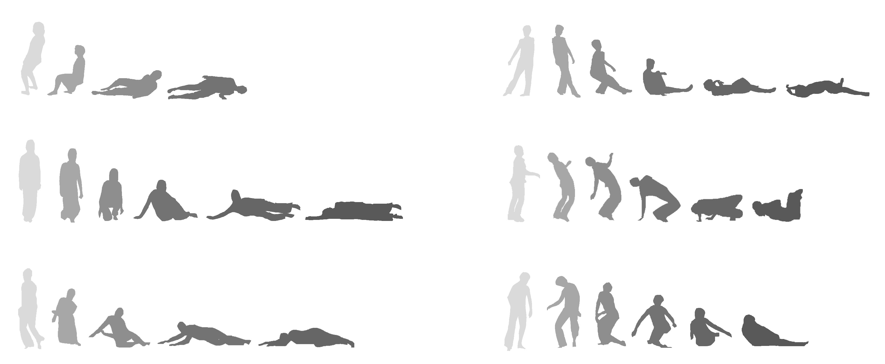
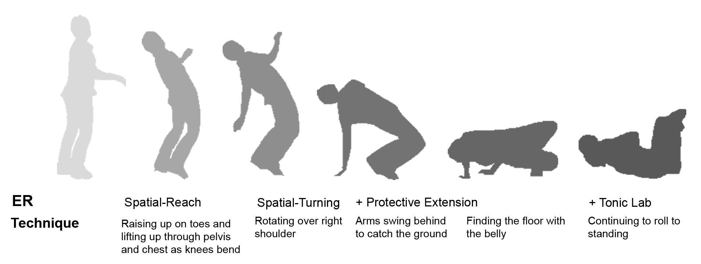
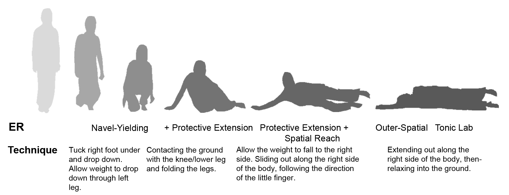
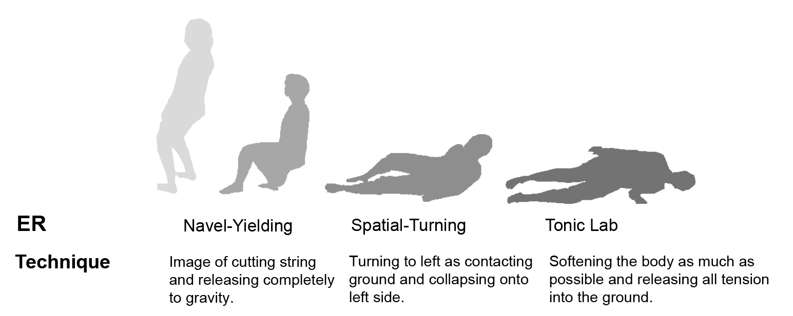
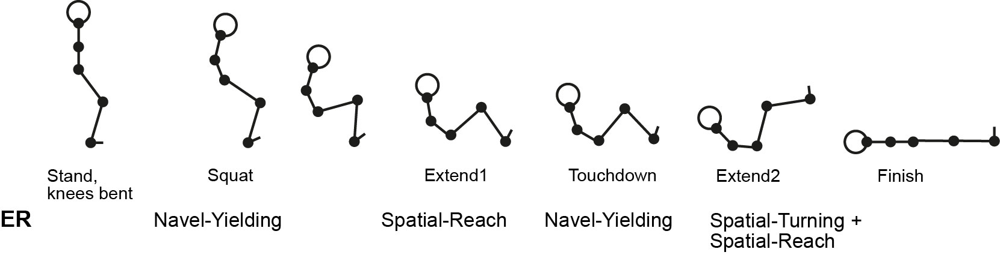
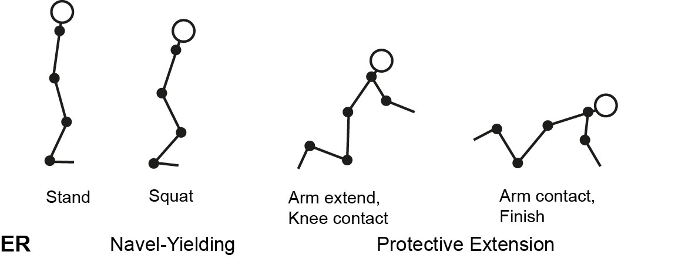
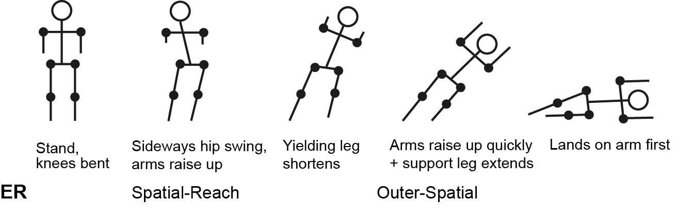

---

Falling is not usually viewed as a desirable act for humanoid robots, as it can lead to damage and injury of people, things and the robot itself. This article explores how falling can be viewed as an aesthetic, creative, and indeed desirable act, through positioning it within the disciplines of dance and choreography. Strategies for falling safely in dance are compared with engineering approaches to controlling falling for bipedal robots. By this comparison, the article identifies two main areas in which an aesthetic approach to movement might be used to extend falling strategies for humanoid robots. Studying and categorising reflexes used by dancers and humanoid robots in falling, the article proposes that particular reflexes be used as common ground in developing a more communicative language for moving, falling and performing robots. Then, by playing with parameters of movement as dancers and choreographers do, falling robots can go beyond safety-oriented motivations of avoidance and damage mitigation towards expressive behaviours that can be read on multiple levels of meaning for performance, entertainment and non-verbal communication between humans and machines. {#para1}

Instability is at the core of human balance and movement. Movement scientists have observed the phenomenon of postural sway – the continuous, small amplitude, high frequency movement of a dynamic system. This was once discounted as noise, but in cybernetic theory these small movements are considered exploratory and provide informative feedback on the state of balance of the system (Goldfarb, 1993). This instability – a small continuous wobble – is a crucial mechanism for proprioception in the detection of where we are in space and the maintenance of balance. Lepecki (2000) takes this function of the vibrating body further by reframing it as a source of creative action for choreographic material. He works with the example of Steve Paxton’s “small dance” in standing, in which the dancer observes the micro movements of the body’s reflexes and righting reactions as it performs the act of standing without their conscious control (Lepecki, 2000). Attendance to the tremor, vibration or wobble inherent in the body can provide dancers with inspiration and material for movement, which they can choose to amplify and extend into pathways of movement. {#para2}

Dance and choreography exploit the expressive potential in the tension between stability and instability, verticality and the surrender to gravity (Lepecki, 2006). A series of open moments exists in the execution of the fall, where the choreographed body can transition from one strategy to another or play with the aesthetic expression through varying the timing, duration, rhythm, speed, scale, tension and counter-tension of movement. At the moment of going off-centre and yielding to gravity, there is more than one possible pathway to the ground. When a specific pathway or strategy has been committed to in the descent, then other potential pathways open up in the first contact with the ground and the recovery of the fall. This same principle can be applied to robotic falling decisions. As will be shown, the initiation and recovery phases are the points at which there is currently the most divergence between the dancer’s and the humanoid robot’s repertoires of movement in falling; this is interpreted to indicate a promising area in which to extend the aesthetic communication and somatic scope of the robot. In opening up the initiation and recovery phases to experimental movement and improvisation, humanoid robots can fall more creatively, refining their reflexes and playing with the wobble. {#para3}

### Controlling Stability and Fall Prevention in Humanoid Robots

In emulating humans, robotics engineers who design humanoids are confronted with the complexity and mystery of the human body. Seemingly simple, everyday acts of standing and walking appear as complex, hard to solve problems of non-linear dynamical systems with unpredictable behaviours. The bipedal posture of both the human and the humanoid robot frees the upper limbs for tasks other than locomotion, yet simultaneously creates a crisis of balance: the ability to walk is intertwined with the possibility of falling. {#para4}

In robotics research, much of the understanding and inspiration for how to create safe falling sequences for humanoid robots have come from the disciplines of biomechanics, human dynamics simulation, medical studies and martial arts (Fujiwara et al., 2002, 2003; Ruiz del Solar et al., 2009; Moya et al., 2015). Interestingly, dance is notably absent from this list even though in contemporary dance controlled falling is a common and essential movement pathway in transitioning into the ground. This can be traced back to the pioneering modern dance of Martha Graham in the early twentieth century and the relationship to space and gravity so central to her approach. [1] {#para5}

Much like in humans, static stability in humanoid robots is more difficult to achieve in the sagittal than the lateral plane. True static stability requires at least three legs, or very large feet for two-legged robots (Bekey, 2005). Walking is statically unstable and dynamic stability is achieved through balancing inertial, frictional and gravitational forces (Bekey, 2005). Various methods for controlling stability have been developed, including active control of joints through sensors and actuators (Bekey, 2005), stepping in the direction of the fall (Pratt et al., 2006) and reflexes (Moya et al., 2015). {#para6}

Fall prevention is not always successful, and when stability is compromised, strategies for controlling the fall safely are needed. If the robot falls as a dead weight, either accidentally or intentionally, much damage can be done to the electronic and mechanical parts. [2] As Ruiz del Solar et al. (2009) point out, robots differ from humans in the way that they absorb shock through their structure. In humans, impact forces are absorbed by the joints, skin and flesh, before reaching the more fragile bony skeleton. In contrast, robots generally absorb shock through sturdy frames and padding. It is their joints that are the most prone to damage, as the joints house the servomotors that actuate the joint movements. {#para7}

A reflex, in robotic terminology, corresponds to a pre-calculated sequence of motions that requires the aborting of the current activity, for example, stopping walking or lowering the centre of mass by squatting (Moya et al., 2015). In a parallel way to the Paxton technique presented above (Lepecki, 2000), robots are continuously monitoring their internal state and attending to the moment-to-moment fluctuations. When a robot detects an unstable state, an aesthetic choice could be made in conjunction with the functional safety decision. Aesthetic pathways are available and can be integrated into the existing planning algorithms that seek to optimise the fall strategy for minimising damage. As part of this work, robotic researchers will also need to identify the envelope and lower threshold of acceptable falling manoeuvres, in order to expand the available set for aesthetic consideration. {#para8}

In summary, going off-centre is the initiation of an aesthetic act in dance, but is an indicator of undesirable instability in humanoid robots. In what follows, the falling strategies for robots are recast in the aesthetic frames of dance performance and choreography, to open up perspectives on possibilities for creative innovation and expression. {#para9}

### Beyond Safety to Choreography

As stated, this article identifies the initiation and recovery phases of falling as the most fruitful areas in which to encourage robotic experimentation (all three phases – initiation, control and recovery – will be explained in detail below). Here, it presents some examples of ways of falling that might stimulate these experimentations. Depending on the specific robot embodiment (the shape, size, degrees of freedom, configuration of parts), more or less options for creative movement on the ground and in the vertical will be available. {#para10}

Following Lepecki’s (2006) thinking of dance as a challenge to verticality, conception of the ground can be freed from its being just a surface to stand and travel on; it becomes a territory to inhabit, with extra choreographic potential. The relational placement of the body in space and on the ground plane is a diagramming of action, offering multiple levels of meaning. In choreographer Trisha Brown’s solo *It’s a Draw/Line Feed* (2003), her first move from standing is a fall to the ground. The unexpected landing of the fall outside of the square surface designated for performance is significant to the political meaning of the work (Lepecki, 2006). A corresponding choreographic, or even political, decision regarding where to land and contact the ground could elevate the falling action of a robot from a pure function of safety to one engaging registers of expressive and symbolic meaning. Acts of falling can be expanded from being purely motivated by avoidance and damage mitigation to being laden with aesthetic and expressive power. {#para11}

The recovery phase of the fall for humanoid robots is usually concerned with a fast recovery of the standing position (Moya et al., 2014), especially in robot soccer. In viewing the 2014 RoboCup SPL Grand Final, there is a great deal of accidental falling happening, apart from the intentional falling of the goalie. [3] It is a slow game! The knee-high robots slowly shuffle around the field, often gently colliding with each other with the net result of at least one of them falling over in what, it must be said, is a clumsy action. What is more impressive is the quick recovery action of getting up after falling down – a rapid series of articulated joint manoeuvres in the legs and torso. The ability to dynamically change body morphology is being explored in the area of self-reconfigurable robots (Stoy et al., 2010), but is yet to be successfully demonstrated as a mechanism for redirecting forces in falling strategies of humanoid robotics. {#para12}

In contexts not dictated by gameplay, safety or social requirements, what takes place in the recovery phase after ground contact can be expanded well beyond simply transitioning to standing. The return to verticality can be resisted. In *It’s a Draw/Line Feed* Trisha Brown resists the call to verticality by rolling, slithering and crawling on the ground. The horizontal and vertical planes become a playground for experimentation in moving and falling, built on the reflex, righting reaction and equilibrium response patterns (see below). {#para13}

In the example of the Honda Asimo humanoid, a 2007 televised demonstration of the robot intends to show it walking up a small set of stairs. Unfortunately, it stumbles on the third step and falls backwards. This moment of public failure is heightened as a modesty screen is quickly placed in front of the fallen, motionless Asimo. However, considered under the rubric of experimental, theatrical choreography, the motionless figure of the robot after it falls backwards off the stairs could be recast in a performance frame as a “still-act”. The employment of stillness as a legitimate element in choreography opens up a moment of presencing, an intensification of perception and affect between performer and audience (Lepecki, 2000). It can also be used to heighten or underscore what came before or what will follow. In De Quincey Co.’s 2005 performance *Dictionary of Atmospheres* in the dusty Mparntwe/Todd riverbed in Alice Springs, Central Australia, the use of fall-downs created an intense intimacy between performers and audience through the images of suspension and surrender embodied in their falling. The points of prostrate stillness correspond to the suspension of movement when standing and preparing to fall, and reverberate the impact of collapsing to the ground and remaining motionless before rising up again. {#para14}

The shock and danger of a potential fall can be used for theatrical impact, keeping the audience on edge due to the risk-taking inherent in going off-balance. Falling can also be used to great comedic effect, as exemplified by 1920s physical comedian Buster Keaton with his particular style of slapstick involving physical stunts. One of the participants in the below-described study of dancers shared how he might experiment with interacting with a chair as part of stunt falling (Loke and Robertson, 2007, 2010). He discussed choices available for dramatising the action, through collapsing into the ground as the chair tips over versus walking over the top of the chair as it tilts to the ground. With the impending rise of robots for entertainment, the idea of clowning, dancing and stunt-performing robots that use falling as part of dramatic and comedic routines could be an interesting future direction in creative robotics. {#para15}

### Learning to Fall: Reflexes, Righting Reactions and Equilibrium Responses

The somatic body-mind centering (BMC) work of Bonnie Bainbridge Cohen on human developmental movement patterns provides a language of automatic movement patterns in relation to gravity that gives rise to intentional, expressive movements (Cohen, 1993). These patterns provide a language for linking the analyses of the falling strategies of dancers and humanoid robots. Falling strategies for robots are beginning to appear that deal with the direction and dissipation of forces through a limited application of human-like equilibrium responses. These strategies can be expanded by considering reflexes as producing expressive performance, using Cohen’s schema and insights as a springboard. {#para16}

Primitive reflexes, righting reactions and equilibrium responses are a continuum of automatic patterns of movement that underlie our volitional movement. These mechanisms begin to develop from birth and are mostly formed within the first year of life. This section outlines definitions from Cohen (1993) of the automatic patterns most pertinent to this article, prior to them being applied to select examples of dancers and robots falling. {#para17}

- **Primitive Reflexes** (PR) are controlled by the spine and brain stem. For every reflex, there is an opposite reflex, which modulates it. One of the first reflexes to develop is the Tonic Labyrinthine Reflex. It is about bonding to the earth – it draws us towards the earth by increasing the postural tone of the muscles on the underside of the body. On the basis of this grounding, we can then leave the earth through righting reactions.

- **Righting Reactions** (RR) are controlled primarily by the mid-brain and are most dominant at 10–12 months of age. They are necessary for us to lift our heads, roll over, sit, crawl, creep, stand and walk. In pushing away from the earth towards the vertical, the three righting reactions (Head, Optical and Body Righting Acting on the Head) combine to draw us upwards.[4]

- **Equilibrium Responses** (ER) are automatic patterns of response for maintaining balance as a result of the shifting of one’s centre of gravity and/or base of support through space, from lying to standing to flying. When we go off-balance or fall, there is a range of possible responses. (The first response is that of head righting (above), to protect the head from impacting the ground.) There are five types of ER; these will be used both in the analysis of the three stages of falling and in the discussion of published strategies for falling in humanoid robots.

- 1. Navel-Yielding

- 2. Protective Extension

- 3. Spatial-Reaching

- 4. Spatial-Turning

- 5. Outer-Spatial

The *Navel-Yielding ER* is activated in the release of the body into the ground. It is gravity-oriented and yielding in nature, as the limbs are curled around the navel and the bodyweight is released sequentially. The *Protective Extension ER* occurs when we extend a limb and reach out in the direction of the fall, to extend the base of support. It includes *Protective Stepping* that underlies walking, and *Protective Hopping*. {#para18}

In the *Spatial-Reaching ER*, instead of reaching for the ground with the limbs, the spine curves in the direction of the fall, whilst the limbs (arms/legs) reach away in the opposite direction to control the descent. In the *Spatial-Turning ER*, the head, spine and limbs shape into a rounded form around a central body axis, so that the body turns in space in order to either: a) reorient the body’s position in space, as a last resort when a Spatial-Reaching ER has been unsuccessful; b) transition from an unsuccessful Spatial-Reaching ER to a gravity-oriented response; or c) transfer the falling forces or momentum into circular forces, for example in rolling. {#para19}

The *Outer-Spatial ER* occurs when the focus is far beyond the personal kinesphere. The body is fully extended as it reaches for an object well beyond itself. An example is a soccer goalkeeper leaping or diving to catch a ball. {#para20}

### Dancers’ Falling Strategies

The following section deploys my previous study of falling techniques by contemporary dancers from a range of backgrounds (Loke and Robertson, 2007, 2010) to analyse falling strategies using Cohen’s set of reflex, righting reaction and equilibrium response patterns underpinning volitional movement. My previous performance research studied the act of falling as a means of making strange or defamiliarising everyday movement (Loke and Robertson, 2007, 2010). A study of dancers who are skilled movers adept at falling was conducted to understand how they performed and experienced the act of choreographed falling. A selection of falls from the study illustrates the variety of falling strategies employed by the dancers (Figure 1). {#para21}

There are three distinct stages in the process of falling: (1) initiating the fall, (2) controlling the descent, and (3) resolving the fall, contacting the ground and recovering. This structure is useful for identifying opportunities for generating creative, expressive movement in the choice of available pathways for robotic falling strategies. Three examples of instances of dancers falling are presented and explained in terms of the involvement of the reflex and equilibrium response patterns. The study revealed the way dancers use their spatial imagination, both in mechanical and imagistic terms, to shape, support and direct the moving body and energy flow in the fall and recovery. In *mechanically-based* techniques, the focus and emphasis is on the order, organisation and sequencing of body parts in relation to each other and the environment as the movement unfolds, and the direction and dissipation of energy through the body. In *image-based* techniques, the focus and emphasis is on working strongly with the image to direct and inform the movement process and quality of movement. If one surrenders fully to the image, the body follows. There is less conscious attention given to specific body parts moving in a certain order, although the arrangement of limbs for minimising injury is worked out through training and experimentation. {#para22}

##### Initiating the fall: finding triggers

Dancers demonstrated a range of strategies for initiating the fall, such as going off-centre, spiralling around the central axis or collapsing by degrees. Some dancers used specific qualities or images to help generate how the body experiences transitioning from being stable to off-balance and releasing to gravity, such as dissolving from a point of suspension or imagining being shot by a gun. Many of them spoke about the desire to surprise themselves with how the act of falling was initiated and how to find novel pathways down to the ground rather than repeating habitual patterns of movement. {#para23}

##### Controlling the descent: the paradox of light/heavy

There is an inherent paradox in the controlled action of falling by dancers. Simultaneously the experience is one of buoyancy and lightness, combined with giving weight, a yielding to gravity. The Spatial-Reach or Navel-Yielding ER is predominant in this phase of the movement. The Tonic Lab Reflex is also present in the drawing down of the underside of the body towards earth. Playing with the opposing forces of these patterns, we can become accustomed to releasing our weight into the ground from all kinds of positions, including sitting, and on all fours. Dancers employ weight shifts, muscular tension and counter-tension to control the direction and momentum of releasing to gravity. They play with this dynamic to create different effects. {#para24}

##### Resolving the fall: contacting the ground and recovering

The resolution of the fall, from the descent to contacting the ground, usually involves some form of Protective Extension ER such as stretching out an arm or leg to make ground contact. This then turns into a Navel-Yielding or Tonic Lab Reflex. An essential strategy for not causing injury is to soften and release any tension in the body. Another important strategy is to redistribute the impact forces through rolling, by curling the body into configurations that will protect the bony parts and enable the dancer to control the impact and recovery – this is the Spatial-Turning ER in action. {#para25}

In Figure 2 participant 4 performs a hinge fall. This falling strategy begins with a variation of Spatial-Reach ER with the bent knees moving in the direction of the fall and the rest of the body moving in the opposite direction to control the momentum of the fall. The fall is resolved with the twist of the torso enabling the belly to seek the ground (the Spatial-Turning ER) and the hands to touch the ground and control the landing (Protective Extension ER). Upon the belly contacting the ground, there is an element of Tonic Lab Reflex, before the twisting motion is continued into a side roll (the Spatial-Turning ER continues). The recovery of the fall is a spiralling to stand. The dancer described her experience of the falling process predominantly as a feeling of lift and suspension, in working against gravity. {#para26}

In Figure 3 participant 1 demonstrates a sideways fall, commonly used in contemporary dance. Distal initiation through the fingers takes the body out into the desired direction. The falling strategy begins with a form of Navel-Yielding ER as the dancer uses the momentum of vertically dropping down and then folds the limbs inward. The contact with the ground is made with the legs and little finger, as a Protective Extension ER. The Spatial-Reach/Outer-Spatial ER is activated as the dancer slides out to the side with the little finger leading and extends the body along the ground, followed by a softening into the ground (Tonic Lab Reflex). The dominant feeling in this fall was described as a sensation of shooting out. {#para27}

Compared to the above examples, which are mostly about the physics and mechanics of managing forces through the falling body, Figure 4 illustrates the use of imagery for doing fall-downs in the Bodyweather dance practice. In Tess de Quincey’s words, ‘the whole imperative of the fall-down exercise is the experience of emptiness, which is driven fundamentally by a philosophical relationship to and questioning of what it means to be human, what it means to stand upright’. [5] The image is in two parts: (1) the body is suspended by a string attached to the crown of the head into the sky, and (2) the string is cut, and the body is like a bag of bones, collapsing to the ground. Prior to the initiation of the fall, the body is heavy ‘like a sack of potatoes’ (dancer’s description). Upon the image of the string being cut, the dancer releases all her weight into the ground. Here, this is a backwards fall that flows from a Navel-Yielding ER into a squat. As the dancer turns to one side in making contact with the ground, the Spatial-Turning ER is activated. This technique requires a large release of tension and softening into the ground, drawing on the Tonic Lab Reflex. {#para28}

<table class="tableblock frame-all grid-all" style="width: 100%;"> <caption class="title">Table 1. Summary of dancers&#8217; falling strategies categorised into phases and reflex/equilibrium responses (modified from Loke and Robertson 2010)</caption> <colgroup> <col style="width: 25%;" /> <col style="width: 25%;" /> <col style="width: 25%;" /> <col style="width: 25%;" /> </colgroup> <thead> <tr> <th class="tableblock halign-left valign-top"></th> <th class="tableblock halign-left valign-top">Initiating the Fall</th> <th class="tableblock halign-left valign-top">Controlling the Descent</th> <th class="tableblock halign-left valign-top">Resolving the Fall</th> </tr> </thead> <tbody> <tr> <td class="tableblock halign-left valign-top"> 
Mechanically-based
 </td> <td class="tableblock halign-left valign-top"> 
Going off-centre  Release from the centre
 
Spiralling around central axis
 
Momentum of dropping down
 
Finding interesting configurations, that surprise me
 </td> <td class="tableblock halign-left valign-top"> 
<em>Body Righting Reaction:</em> Internal muscular lift to slow down
 
<em>Protective Extension ER:</em> Distal initiation with hand
 
<em>Spatial Reach ER:</em> Working in opposite direction to the fall Control by taking my weight to the opposite side
 
<em>Navel Yielding ER:</em> Folding bones into alignment
 </td> <td class="tableblock halign-left valign-top"> 
<em>Protective Extension ER</em>: Distal initiation with hand Finding a way to support myself down, with your hand Let the legs and arms catch some aspect.
 
<em>Navel Yielding ER</em>: An unfolding …​ Letting my body roll into the ground Rolling down the body Making the contact with the ground take the greatest amount of time and cover the greatest surface area.
 
<em>Tonic Lab Reflex</em>: Release into the ground Relax and soften Absorbing it in the joints.
 
<em>Spatial-Reach/Outer-Spatial ER: </em>Little finger extends body out along the ground, legs moving in opposite direction.
 
 <em>Spatial Turning ER</em>: Twisting/turning to redirect momentum and control which part of the body contacts the ground Fast falls need some kind of roll
 </td> </tr> <tr> <td class="tableblock halign-left valign-top"> 
Image-based
 </td> <td class="tableblock halign-left valign-top"> 
Collapsing
 
Dissolving
 
Toppling like a rock
 
Image of extension and then release (like a string being cut)
 
Imagine being pushed, an outside force Bang!
 
Get shot and hit the ground
 </td> <td class="tableblock halign-left valign-top"> 
<em>Body Righting Reaction</em>: A sense of suspension
 
<em>Navel Yielding ER</em>: Collapsing by degrees Crumpling Body is like a bag of bones
 </td> <td class="tableblock halign-left valign-top"> 
<em>Navel Yielding ER</em>: Work with multiple, simultaneous images, e.g. bag of bones and foetal
 </td> </tr> </tbody> </table>

### Extending Humanoid Robots’ Falling Strategies

Turning to an examination of currently published strategies for falling in humanoid robots, the following will analyse examples of falling strategies for humanoid robots, using Cohen’s set of reflex and equilibrium response patterns. The section first juxtaposes falling strategies of dancers and robots, and next presents a discussion of potential aesthetic strategies for falling humanoid robots. {#para29}

A range of falling strategies for humanoid robots has been developed by several groups of robotics researchers. In abstract terms, these strategies involve actions like squatting to lower the centre of mass, extending the legs to redistribute the impact force, extending the arms in the direction of the fall, and turning the torso to redistribute the points of impact. These bear some similarity to the automatic reflexes, righting reactions and equilibrium responses underlying human movement and our relationship to gravity. When humanoid robots become unstable due to an external push or uneven terrain, the first reactive response often applied is a stepping strategy (Pratt et al., 2006). A step in the direction of the fall can often save the robot from falling and enable it to regain balance. This is equivalent to Cohen’s Protective Stepping equilibrium response (Protective Extension ER). When stability is compromised and a fall is inevitable, fall controllers are activated to control the fall and minimise damage to the robot and its surrounding environment. {#para30}

The design of safe falling motions for forward and backward falling has been explored by Fujiwara and colleagues (2002, 2003, 2007). They identified squatting as one strategy for reducing the potential energy and impact force (see Figure 4 for comparison). For falling over backwards, they were inspired by a martial art in the Judo Ukemi break fall technique (Fujiwara et al., 2002), however it is not clear how they understood the Ukemi technique and applied it to their model. {#para31}

Landing speed is closely related to damage at impact. In Fujiwara et al. (2003), the aim was to minimise the landing speed through the leg extension force. (A Spatial Reach ER, with one leg moving in the opposite direction to the fall.) As illustrated in Figure 5, the backward falling strategy consists of five stages of *Squat—LegExtend1—Touchdown—LegExtend2—Finish*. This sequence can be reinterpreted as a chain of Cohen’s ER responses: *Navel-Yielding (Squat)—Spatial-Reach (LegExtend1)—Navel-Yielding (Touchdown)—Spatial-Turning/Spatial-Reach (LegExtend2)—unclassified (Finish).* In other words, when a fall is detected the robot bends its knees to assume a squatting position and curls its neck, waist and arms into the landing posture. The hip becomes the first point of contact on landing. The extension of the legs before and after touchdown is calculated so that the optimum landing position for minimal impact is reached. During touchdown, the servomotors are temporarily turned off to minimise damage to the mechanical parts. The servomotors are turned on after touchdown to prevent the robot from rolling too far backwards and damaging the head. {#para32}

Depending on the robot morphology and ability to rotate the head, it may be possible to extend this sequence by employing the shoulder roll performed by dancers. The shoulder roll is a technique for dealing with backward falls and is particularly useful when running backwards at high speeds, as the high momentum will need to be absorbed and redirected by a rolling action. {#para33}

In Fujiwara’s study (2007), the research team simplified the problem by designing a humanoid robot with a simpler shape and less degrees of freedom: it has only one wide leg, and its upper arms are driven by one servomotor as one link. The reduction to one leg means no stepping strategies can be applied and the robot will fall forward or backward when pushed. The researchers focus on the forward falling, modelling it as a quadruple inverted pendulum model. As illustrated in Figure 6, the forward falling strategy is *Squat—ArmExtend—Finish*; in Cohen’s terms it is *Navel-Yielding (Squat)—Protective Extension (ArmExtend).* Apparently the padding (soft cushions at each joint) and protection (electronics and motors are inside the frame) are adequate in this set-up to minimise damage. Ha and Liu (2015) take this idea of distribution of forces over multiple contact points further with their planning algorithm that computes the optimal sequence of points to minimise the ground impact forces. Possible contact points in their system include feet, heel/toe, knees, hips, back, hands and head; the exact selection is dependent on the individual robot morphology. {#para34}

Human-size robots are heavy and can cause damage to people and objects upon impact. Some researchers (e.g. Yun et al., 2009) have tackled this problem by devising fall controllers that optimise the fall direction for minimal damage. The inertia-shaping technique recruits all the joints to control the composite rigid body (CRB) inertia (Lee and Goswami, 2007). It controls joint angles to produce a desired angular momentum, either towards a desired direction or away from a direction to be avoided. However, it is not clear how this changes the body configuration and influences the fall direction and landing posture. For Nagaran and Goswami (2010) the problem is expanded from a single object as obstacle to multiple objects in the environment. They propose a similar yet more generalised approach, changing the robot’s support base geometry through stepping, and whole body inertia shaping techniques. They expand the set of strategies to include Lift a Leg and Partial Body Inertia Shaping. Simulations and experiments involving an Asimo-like humanoid robot (Aldebaran NAO H25, 57cm tall) have shown promising results for computing the optimal stepping location for the safest fall (Goswami et al., 2014). These techniques show potential for being rethought and applied for aesthetic, expressive and choreographic contexts. Instead of computing optimal paths for safe falling, the computational goal could be expanded to also include stepping and body inertia shaping choices that may result in interesting, aesthetic shapes, pathways and target locations. {#para35}

Robot soccer is one of the few areas where falling is viewed in a positive light. In a human game of soccer, falling is a common occurrence triggered by sliding tackles, collisions, and extreme movements to kick and obstruct the ball. The goalkeeper is the one player who can touch the ball with her/his hands and thus is frequently involved in acts of diving and falling to catch or block the ball. In the work of Missura, Wilken and Behnke (2010), robot goalies perform a limited set of actions: stand, bent-knee halt posture, squat, jump, dive and walk. The dive is considered a high-risk option, due to the risk of mechanical damage and the time it takes for the goalie to recover and reposition itself in front of the goal. It is one of only a handful of examples in humanoid robots of a self-initiated intentional fall. {#para36}

With reference to Figure 7, the dive motion is initiated by a sideways hip swing, using the hip and ankle joints to accelerate the torso towards the yielding leg – an action that leads to the Spatial-Reach ER. Then the yielding leg shortens and before the support leg loses ground contact, it is extended and moved inwards closer to the yielding leg – this has the effect of increasing the blocking distance. While the support leg is extending, the arms are also lifted high up above the head – this appears similar to the Outer-Spatial ER. This motion is being used in the RoboCup SPL games. The design work of Ruiz del Solar and colleagues (2009) and Moya and colleagues (2015) adds an important element of dissipating forces through the arms on landing, much like martial artists and dancers do. This is achieved by extending the arms in the direction of the fall (a Protective Extension ER) and by reducing the torques in the arms’ motors to just above zero to minimise damage to the joint servo motors. Missura and colleagues (2010) also explored a FrontTurn frontal fall sequence where the robot turns its body before touching the ground – this action is like a Spatial-Turning ER, distributing the transfer of kinetic energy over several contact points and for a longer lapse of time (with the caveat of success limited to simulation due to the complexity of synchronisation). {#para37}

<table class="tableblock frame-all grid-all" style="width: 100%;"> <caption class="title">Table 2. Summary of humanoid falling strategies, categorised with Cohen’s reflex, righting reaction and equilibrium response patterns</caption> <colgroup> <col style="width: 33.3333%;" /> <col style="width: 33.3333%;" /> <col style="width: 33.3334%;" /> </colgroup> <thead> <tr> <th class="tableblock halign-left valign-top">Initiating the Fall</th> <th class="tableblock halign-left valign-top">Controlling the Descent</th> <th class="tableblock halign-left valign-top">Resolving the Fall</th> </tr> </thead> <tbody> <tr> <td class="tableblock halign-left valign-top"> 
External force, e.g., push, collision, resulting in front, back or side fall Instability due to uneven terrain
 
Internally generated, e.g., hip swing in desired sideways direction, leading to Outer-Spatial ER towards the ball
 </td> <td class="tableblock halign-left valign-top"> 
<em>Protective Stepping ER</em>: Stepping
 
<em>Navel-Yielding ER</em>: Squatting Curling body and limbs
 
<em>Protective Extension ER</em>: Extending arms or legs in direction of fall
 
<em>Spatial-Reach ER</em>: Extending arms or legs in opposite direction to the fall
 
<em>Combination</em>: Direction of fall controlled by stepping, foot placement and body inertia shaping
 </td> <td class="tableblock halign-left valign-top"> 
<em>Protective Extension ER</em>:
 
Extending arms in direction of fall
 
<em>Spatial-Reach ER</em>:
 
Extend leg away from fall to minimise landing speed
 
Turn joint motors on again after landing to control and stop the rolling action through extension of the joints to avoid damaging the head (<em>Head Righting Reaction</em>)
 
<em>Spatial-Turning ER</em>:
 
FrontTurn frontal fall – twisting torso to land on side
 
<em>Unclassified:</em>
 
Reduce or zero torque in joint motors to minimise damage
 
Padding on likely contact points to absorb shock Springs joining body segments
 </td> </tr> </tbody> </table>

### Aesthetic Strategies for Falling Humanoid Robots

##### Comparisons

On comparing Table 1 and Table 2, the middle stage of controlling the descent is already quite similar for dancers and humanoid robots, probably due to this phase of the fall being the one least open to variation. Both dancers and robots demonstrated the common use of three equilibrium responses: Navel-Yielding, Protective Extension and Spatial-Reach. {#para38}

However, in the other two stages (initiation and recovery) the richness and diversity of strategies for falling are evident for dancers, and the gaps revealed in robotic strategies for initiating and resolving the fall may indicate potential opportunities for extending their communicative and their falling repertoires through aesthetic, expressive approaches. In initiating the fall, the dancers have a more developed set of intentional triggers and strategies, expressed in interview as drawn from a desire to break habitual patterns of movement and find new and surprising ways of going off-centre and moving into the ground. The robots in comparison have a very limited set, comprising external pushes, collisions, instability caused by uneven terrain or internally generated hip swings to initiate a dive for soccer goalies. The use of images is an aesthetic approach to generating movement, for which there is no direct equivalent in robots. In contacting the ground, dancers used more variations of the Spatial-Turning ER with softening, rolling and redirecting of forces. Robots were limited to controlling impact forces through turning servo motors on/off, shock-absorbent padding, protective extension of the arms, spatial reach by extending one leg and some limited spatial turning actions. {#para39}

Thus, the stages of falling most open to creative improvisation are initiating the fall and the recovery. By playing with parameters of movement such as scale, speed and direction in initiating the fall, roboticists can generate interesting qualities of movement using repetition and surprise as the evaluative criteria. In resolving the fall and recovering, the ground plane and transitioning to the vertical can become a playground for experimental movement, delaying or eschewing the transition to standing. The impetus for falling can come from an external force or an intentional, internal act. In general, external stimuli lead to reactive responses, whereas internally generated triggers are of a deliberate intent. Even with intentional falls, where the performer or robot is deliberately seeking off-balance moments, the registering of the actual effect of the trigger can result in surprise. This notion of surprise, or at least of unexpectedness, can be used to evaluate the aesthetic merit of the chain of movement sequences making up the fall trajectory. It can also be used to continuously improvise small shifts in instability, before committing to a descent. Instead of applying a Protective-Stepping action to avoid a fall and restabilise, the robot could play with the size, speed and direction of the step, or could choose to go with the impetus of the fall. This is a situation wherein, for example, the body inertia shaping technique could be applied to create interesting and unexpected falling trajectories. {#para40}

##### Inspiration from the Falling Reflex in Non-Humanoid Robots

A reflex-based model for expressive acts of falling based on behaviour-based robotics could be another potential avenue for extending the falling strategies for humanoid robots. Behaviour-based approaches in robotics model a close link between a robot and its environment in terms of tight coupling between action and perception (Arkin, 1998). In Rodney Brooks’ pioneering subsumption architecture, complex behaviours are built on top of low-level primitives (Brooks, 1986). {#para41}

Watching insects walk over rough terrain, Brooks (2002) had the revolutionary insight that falling could be embraced in the act of walking. This was in opposition to the prevailing approach of attempting to maintain balance whilst walking. Brooks’ fall prevention approach to walking could be summarised as ‘catching oneself falling’ and was first realised in robotics in the six-legged robot Genghis. Genghis develops its high-level behavioural performance of walking over rough terrain based on the lower-level behavioural layers of Standup, Simple walk, Force balancing, Leg lifting, Whiskers and Pitch stabilisation. The Pitch stabilisation layer could be interpreted as an equilibrium response (ER), as it is similar to the work of the spinal reflexes involved in maintaining human upright posture in the sagittal plane. {#para42}

Boston Dynamics more recently demonstrated this approach with Big Dog. Big Dog is a four-legged robot, [6] intended for rough terrain locomotion (Raibert et al., 2008) and famous for demonstrations of recovering from near falls and regaining balance, for example walking and slipping on an icy surface. [7] A robotic creature with an inflexible spine and no head, it has been designed to absorb shocks and ground reaction forces in its four highly articulated, springy legs. Much like cats do when landing after a fall, Big Dog steps in the direction of the fall with some of the legs while simultaneously flexing its leg joints in order to absorb some of the shock as well as to generate an opposite force for recovery through extension of the legs. Big Dog’s performance on ice is reminiscent of an antithetical, expressive performance *Exergie* (2000) by performance artist Melati Suryodarmo, [8] wherein she stood in high heels on a surface of butter and repeatedly gyrated, slipped and fell. The reflexes and equilibrium responses underlying Suryodarmo’s falling include Head Righting and Protective Extension. Here the expressive power lies in the violence of the fall compared to the tension felt when observing Big Dog’s ability to not fall completely to the ground despite the slippery conditions underfoot. {#para43}

### Conclusion: Reflexes and Expressive Potential

This article explored the idea of reflexes producing meaningful performance, and proposed that aesthetic and expressive approaches be used to extend falling strategies for humanoid robots. Dancers strive for the mechanics of falling to become automatic and thus available for creative use in performance. The trained body then knows by reflex the pathways and patterns for falling safely, allowing the motivation for movement to come from the choreographic intent provided by drama, action, interaction, feeling state or imagination. In Cohen’s understanding of human developmental movement patterns, ‘[o]nce you have a reflex, you can use it as a “form” of expression’ (Cohen, 1993: 131). In improvisation, dancers are able to play with movement parameters to discover layers of expression and meaning, whilst relying on the automatic movement patterns underlying volitional movement. {#para44}

The majority of research into two-legged humanoid robots has focussed on the hard problem of locomotion, with the attendant issues of balance and instability, and the development of strategies for preventing falling. Loss of balance – falling – is an undesirable consequence in most circumstances, with the exception of robot soccer. A comparative analysis was conducted of the falling strategies of dancers and some humanoid robots, using the language of automatic movement patterns to identify areas in which we might extend current robotic falling strategies, allowing humanoid robots to be more expressive social communicators. Drawing on Cohen’s insight that a reflex can be used as a form of expression in volitional movement, some initial propositions were presented for directions in which current robotic falling strategies can be extended and developed into a more expressive language for moving and falling, using choreographic approaches to generate expressive behaviours. {#para45}

Roboticists have yet to turn to dance as a fertile source of inspiration for understanding falling as a creative act. By examining how dancers use falling as an intentional act for practical and aesthetic purposes, and also how they intercept sets of reflexes when falling whether or not the fall is intentional, we can begin to apply a choreographic language that enriches the mechanics of movement. Falling is no longer seen as something to avoid, but as an exploitation of instability as a creative resource in the generation of aesthetic, expressive performance. Falling can be used as a dramatic device, creating moments of heightened attention between robots and audience. The image of a falling robot presented through the lens of dance performance and choreography rethinks what it means to be a sociable robot and opens up new practices of creative expression for humans and machines. {#para46}

### Biographical Note

**Lian Loke** is a Senior Lecturer in the Design Lab, Faculty of Architecture, Design and Planning, University of Sydney and Director of the Master of Interaction Design and Electronic Arts. Her research interests include the transfer of knowledge and methods between the disciplines of dance, somatics, design and human–computer interaction, and the development of a choreographic approach to designing the movement-based interactions and behaviours of heterogeneous systems.

### Notes

 [1] For Graham, falling was both a physical and a psychological act, to be used for dramatic and emotional effect. She developed a technique of contraction and release, mirroring the rhythm of breathing and built around the relationship of the torso and spine (Benbow-Pfalzgraf, 1998). Her approach continues to be taught today in various forms, for example, in the Safety Release Technique, developed by B.J. Sullivan (USA). The Safety Release Technique can be found at [https://performingarts.uncg.edu/bios/bj-sullivan](https://performingarts.uncg.edu/bios/bj-sullivan)

 [2] The damage can also be of an emotional kind, such as embarrassment for the makers of the robot. See, for example, Honda’s Asimo falling (2007): [https://www.youtube.com/watch?v=ASoCJTYgYB0](https://www.youtube.com/watch) Four years later a new demonstration reveals a more physically competent version of Asimo, able to walk up stairs and hop on one foot. Asimo jumping (2011): [https://www.youtube.com/watch?v=Bmglbk_Op64](https://www.youtube.com/watch)

 [3] 2014 RoboCup SPL Grand Final, [https://youtu.be/dhooVgC_0eY](https://youtu.be/dhooVgC_0eY)

 [4] The modulator of the Tonic Lab is the Landau RR, a total body extension pattern where the head, tail, arms and legs extend away from the earth like an aeroplane.

 [5] Personal communication, Tess de Quincey (De Quincey Co.), Sydney, 4 February 2016.

 [6] In their work on multi-locomotion robots, Fukada and colleagues (2014) also use a quadrupedal robot to explore strategies for fall prevention inspired by human and animal locomotion modes. Quadrupedal locomotion is inherently more stable than bipedal walking, since the base of support is distributed over four legs compared to two. The risk of falling is related to the relative stability of the robot in relation to the terrain. Fukada and colleagues combine models of stabilisation based on the robot’s internal conditions with stabilisation based on external information from the environment. When the robot encounters rough terrain and the risk of falling is greater than 0.7, the strategy is to transition from a bipedal walking gait to a squat to a quadrupedal walking gait. The squat position lowers the centre of gravity and is an important intermediary action.

 [7] Big Dog on slippery ice: [https://youtu.be/cNZPRsrwumQ](https://youtu.be/cNZPRsrwumQ)

 [8] Documentation of *Exergie*: [https://www.melatisuryodarmo.com/works_Exergie_Butter_Dance.html**](https://www.melatisuryodarmo.com/works_Exergie_Butter_Dance.html**)

### References

- Arkin, Ronald C. *Behavior-Based Robotics* (Cambridge, Mass.; London, England: MIT Press, 1998).

- Bekey, George A. *Autonomous Robots: From Biological Inspiration to Implementation and Control* (Cambridge, Mass.; London, England: MIT Press, 2005).

- Benbow-Pfalzgraf, Taryn (ed.). *International Dictionary of Modern Dance* (Detroit: St. James Press, 1998).

- Brooks, Rodney. ‘A Robust Layered Control System for a Mobile Robot’, *IEEE Journal of Robotics and Automation* 2.1 (March 1986): 14-23.

- Brooks, Rodney. *Flesh and Machines: How Robots Will Change Us* (New York: Pantheon Books, 2002).

- Cohen, Bonnie B. *Sensing, Feeling and Action: The Experiential Anatomy of Body-Mind Centering* (Northampton, Mass.: Contact Editions, 1993).

- Fujiwara, Kiyoshi, Kanehiro, Fumio, Kajita, Shuji, Kaneko, Kenji, Yokoi, Kazuhito and Hirukawa, Hirohisa. ‘UKEMI: Falling Motion Control to Minimize Damage to Biped Humanoid Robot’, in *IEEE/RSJ International Conference on Intelligent Robots and Systems (IROS)* (2002), 2521-2526.

- Fujiwara, Kiyoshi, Kanehiro, Fumio, Kajita, Shuji, Yokoi, Kazuhito, Saito, Hajime, Harada, Kensuke, Kaneko, Kenji and Hirukawa, Hirohisa. ‘The First Human-size Humanoid that can Fall Over Safely and Stand-up Again’, in *Proceedings 2003 IEEE/RSJ International Conference on Intelligent Robots and Systems* (2003), 1920-1926.

- Fujiwara, Kiyoshi , Kajita, Shuji, Harada, Kensuke, Kaneko, Kenji, Morisawa, M., Kanehiro, Fumio, Nakaoka, Shin’ichiro and Hirukawa, Hirohisa. ‘An Optimal Planning of Falling Motions of a Humanoid Robot’, in *Proceedings 2007 IEEE/RSJ International Conference on Intelligent Robots and Systems* (2007), 456-462.

- Fukada, Toshi, Sekiyama, Kosuke, Aoyama, Tadayoshi, Hasegawa, Yasuhisa and Huang, Qiang. ‘Locomotion Mode Transition Control of a Multi-Locomotion Robot’, in Krzysztof Tchon and Wojciech W. Gasparski (eds) *A Treatise On Good Robots* (New Brunswick: Transaction Publishers, 2013), 83-101.

- Goldfarb, Larry W. ‘Why Robots Fall Down’, keynote address *Cybernetics in the Art of Learning,* American Society for Cybernetics conference, Philadelphia, 1993.

- Goswami, Ambarish, Yun, Seung-Kook, Nagarajan, Umashankar, Lee, Sung-Hee, Yin, KangKang and Kalyanakrishnan, Shivaram. ‘Direction-changing Fall Control of Humanoid Robots: Theory and Experiments’, *Autonomous Robots* 36.3 (March 2014): 199-223.

- Ha, Sehoon and Liu, C. Karen. ‘Multiple Contact Planning for Minimising Damage of Humanoid Falls’, in *IEEE/RSJ International Conference on Intelligent Robots and Systems (IROS)* (2015), 2761-2767.

- Lee, Sung-Hee and Goswami, Ambarish. ‘Reaction Mass Pendulum (RMP): An Explicit Model for Centroidal Angular Momentum of Humanoid Robots’, in *IEEE International Conference on Robotics and Automation (ICRA)* (April 2007), 4667-4672.

- Lepecki, André. ‘Still: On the Vibratory Microscopy of Dance’, in Gabriele Brandstetter and Hortensia Völckers (eds) *ReMembering the Body* (Ostfildern-Ruit: Hatje Cantz Publishers, 2000), 332-366.

- Lepecki, André. *Exhausting Dance: Performance and the Politics of Movement* (New York: Routledge, 2006).

- Loke, Lian and Robertson, Toni. ‘Making Strange with the Falling Body in Interactive Technology Design’, in L. Feijs, S. Kyffin and B. Young (eds) *Proceedings of Design and Semantics of Form and Movement (DeSForM 2007)* (Newcastle, UK, 2007), 164-175.

- Loke, Lian and Robertson, Toni. ‘Studies of Dancers: Moving from Experience to Interaction Design’, *International Journal of Design* 4.2 (2010): 39-54.

- Missura, Marcell, Wilken, Tobias and Behnke, Sven. ‘Designing Effective Humanoid Soccer Goalies’, *RoboCup 2010: Robot Soccer World Cup XIV: Lecture Notes in Computer Science* 6566 (2011), 374-385.

- Moya, Javier, Ruiz-del-Solar, Javier, Orchard, Marcos and Parra-Tsunekawa, Isao. ‘Fall Detection and Damage Reduction in Biped Humanoid Robots’, *International Journal of Humanoid Robotics* 12.1 (2015): 155001/1-155001/31.

- Nagaran, Umashankar and Goswami, Ambarish. ‘Generalized Direction Changing Fall Control of Humanoid Robots Among Multiple Objects’, in *Proceedings of the 2010 IEEE International Conference on Robotics and Automation (ICRA)* (2010), 3316-3322.

- Pratt, Jerry, Carff, John, Drakunov, Sergey and Goswami, Ambarish. ‘Capture Point: A Step Toward Humanoid Push Recovery’, in *Proceedings of the 6th IEEE-RAS International Conference on Humanoid Robots* (2006), 200-207.

- Raibert, Marc, Blankespoor, Kevin, Nelson, Gabriel, Playter, Rob and the BigDog Team. ‘BigDog, the Rough-Terrain Quadruped Robot’, in *Proceedings of the 17th IFAC World Congress* (2008), 10822-10825.

- Ruiz-del-Solar, J., Palma-Amestoy, R., Marchant, R., Parra-Tsunekawa, I. and Zegers, P. ‘Learning to Fall: Designing Low Damage Fall Sequences for Humanoid Soccer Robots’, *Robotics and Autonomous Systems* 57.8 (July 2009): 796-807.

- Stoy, Kasper, Brandt, David and Christensen, David J. *Self-Reconfigurable Robots: An Introduction.* (Cambridge, Mass.; London, England: MIT Press, 2010).

- Suchman, Lucy. *Human-machine Reconfigurations: Plans and Situated Actions* (Cambridge: Cambridge University Press, 2007).

- Tchon, Krzysztof and Gasparski, Wojciech W. *A Treatise on Good Robots* (New Brunswick: Transaction Publishers, 2013).

- Yun, Seung-Kook, Goswami, Ambarish and Sakagami, Yoshiaki. ‘Safe Fall: Humanoid Robot Fall Direction Change Through Intelligent Stepping and Inertia Shaping’, in *IEEE International Conference on Robotics and Automation* (2009), 781-787.
