Many of us would instinctively conceive of robotics as an industrially driven endeavour, shaped by the pursuit of relentless efficiencies. Instead, I indicate through my practice that the field of creative robotics is emerging with radically different frames of intention. In other words, creative practitioners might still be able to shape mainstream experiences of robotic media that retain a healthy criticality towards such productivist lineages. Will this nascent form bring forward fresh new techniques and assemblages that better spark conversations around ecosophy and, if so, which of its many approaches present the greatest opportunities? 

In this article I present a context for, and some examples of, prior work to give an overview of (my) ecosophical practice. I then detail the recent integration of creative robotics into the practice, and analyse achievements in relation to the work’s broader aspirations in my installations `<em>`Night Rage`</em>` (2013), `<em>`Night Fall`</em>` (2013-14) and `<em>`Light of Extinction`</em>`(2014).

---

### Ecosophy

Norwegian philosopher Arne Næss (1995) defined ecosophy as a form of personal, relational and intersubjective philosophy, or a guiding series of principles, which he contrasted with the discipline(s) of ecophilosophy. Ecosophy was subsequently developed by a number of commentators, notably Félix Guattari (1995) who categorised it as a relational process that draws upon interconnected networks of mind, society and environment. My own synthesis, or ecosophical undertaking, is contexualised within the aegis of experimental arts practices, comingled over the past 22 years with diverse historical tendencies in new media arts and net art. In response to societal and environmental imperatives, I have evolved an approach to thinking and working that I call ecosophical, and that involves scoping out a relational, interactive, embodied and interdisciplinary series of interventions that interrogate cultural conditions. {#para1}

This process has involved a broad swathe of media and approaches, and in recent years has increasingly, creatively, become entangled with robotics. This new engagement has allowed me to introduce a range of electromechanically controlled, physical forms into my mixed media works. Robotic forms present as complex socio-material assemblages and intersect with theoretical discourses such as anthropology and sociology. Petra Gemeinboeck and Rob Saunders (2013: 37) speak of their ‘affective potential to materially intervene into our familiar, human-created environment, bringing about a strange force’ and therefore performing material mesh-works of relationships that traverse the aesthetic, social and political. Understood this way, creative robotics presents significant potential for the ecosophical practitioner. {#para2}

We live in a time of unprecedented environmental challenge that demands the urgent attention of all disciplines. Significant confusion exists around how to tackle the wicked problems of sustaining a future for those species that will follow us. We find ourselves routinely locked in unwinnable duels between the discourses of freedom and limitation that dog the Climate Change debate. We struggle to think, design, create and act in ways that acknowledge timescales longer than weeks, years or decades, repeatedly falling back upon patterns of short-term thinking even though we observe the closing down of possibilities for other species as well as our own. Despite living within the sixth great extinction event (Oreskes and Conway, 2014), we deny that we have precipitated an unstoppable catastrophe in the biosphere, cryosphere and atmosphere that will ripple forward for hundreds if not thousands of years, significantly pre-determining and limiting future options. {#para3}

Our apparent inability (or unwillingness) to grasp the scope and reach of the problems of ecology that we collectively face is evidenced by today’s ever-worsening series of environmental indicators (Emmott, 2013). Not only do we cause the ecological problems that threaten us today, but we also have created cultures that innately limit our capacity to act sustainably. What we design for our world continues to design us (Fry, 2012). A world and a society founded on “de-futuring” principles cannot assure anyone or anything in it a future (Fry, 2011). If these problems we face stem from a failure of our cultures to evolve in ways that can fundamentally sustain us, then cultural practitioners must become front-line operatives in driving the requisite change. {#para4}

Paradoxically, as understandings of the scale of our problem accrue, appropriate, broad-scale public and political responses appear to weaken (Foster, Clark and York, 2010). Both democratic and non-democratic political systems appear frozen in holding patterns that further undermine the collective futures of all species including our own (Oreskes and Conway, 2014). Sustaining what is left of the future remains a uniquely non-partisan necessity, even if short-term politics and vested interests have temporarily obfuscated this fact. It requires much more than a dab or two of ‘Green Capitalism’ (Foster, Clark and York, 2010) or a vague instilling of eco-sensitivities into the populace. In reality we need wholesale and profound reorganisation of contemporary society – physically, culturally and politically – in order to encompass root-and-branch sustainability. Commentators such as Tony Fry (2012) have named this project ‘The Sustainment’, which Fry asserts requires crafting new economic paradigms and modes of cultural production that align with new forms of political philosophy. Such a project effectively parallels the scope and ambition of the Enlightenment, which successfully precipitated modern society but failed to understand the need for significant limitations and boundaries. And so, a project of The Sustainment’s scope must move us far away from normative understandings of *progr*ess and *development*, re-crafting us into new *types* of thinking and acting beings. Clearly this will require truly powerful forces in seeking solutions, and it is therefore within this space that practitioners committed to cultural change should focus their energies. {#para5}

We have long known that sufficient information and the necessary technical capabilities are not, in themselves, sufficient forces to change our behaviour, especially given we humans do not have a history of deferring to simple logic (Brooks and Heyd, 2010). Indeed, anyone proposing broad cuts or limits in this brief phase of plenty (plenty at least for the rich portion of the world’s population) is unlikely to be lauded. Slavoj Žižek (2007) (following Louis Althusser) describes how our ideologies (such as the capitalist assumption of endless growth in a finite world) have succeeded to date because they “interpellate” us into their value structures and correspondingly we want such systems of belief to succeed. Given its innate link with contemporary capitalism, unsustainability may appear to suit many of us now – but clearly it will serve us profoundly poorly into the future. {#para6}

Even slowing such terrible momentum now requires our immense creativity and application. It asks us to re-understand and re-imagine our relationships to social, biophysical, cultural, synthetic and psychological ecologies (within which we are all profoundly enmeshed). It asks us to precipitate new kinds of conversations that we are yet to conceive. It requires us to promote and model the cultural conditions within which enhanced comprehension can emerge, encouraging us towards new forms of navigation, mitigation, long-range thinking and conception. We must learn to craft cultural strategies that can assist us to break into, and ultimately out of, the wrench of ecological destruction, re-imagining ourselves as new kinds of profoundly embedded, differential, socio-environmental subjects (i.e. new kinds of citizens). {#para7}

### Ecosophical Praxis

Two decades ago I named my contribution to the above project “ecosophical praxis” – a synthesis of media-based, experimental arts that draws upon approaches such as embodiment, relationality, interactivity and distribution of movement (all of which innately relate to the robotic domain). A foundational component of the word *ecosophy* is the Greek *sophia* which equates to *wisdom* – a somewhat intangible idea that suggests care, learned knowledge, and measured and equitable response. Its praxis in the arts requires an evolving methodology that seeks to engage all conceptions of ecologies, but primarily philosophical ecologies. Ecosophical praxis resonates with the idea that: {#para8}

> … there is no such thing as individual life because organisms cannot by themselves sustain life. …​ Without … support by a community of the living and non-living, the individual organism simply has no existence. (Ophuls, 2011: 34) {#para9}

Being non-didactic, and thus more akin to pure research, the core objective is to ask foundational questions about the very meanings of ecology, highlighting how we overlook, misunderstand or obfuscate this problematic. The outcomes of its projects are process-based, and seek to create *conversational experiences* that speak to and/or shed light on such definitive schema. {#para10}

Cultural theorists such as Timothy Morton have advanced a ‘critical ecology’ by ascribing to it characteristics such as omniscience, entanglement, ‘mesh’, and freedom from any ‘central position that might privilege any one form of being over others’ (Morton, 2010: 38). Morton’s idea of ecologies defies conventional notions of boundaries (such as flesh, air or fences) and routinely accepted ideas of *insides* and *outsides*. He stresses that our long-held conception of nature as separate and different from us, and as being there to sustain us, is an inherently false and dangerous conception at the very core of the ecological problem. He calls for an ‘ecology without nature’ (2007: 1) fused with humanity in a way that ‘permits no distance’ (2010: 39). This central tenet of inseparability leads Morton to the idea of ‘dark ecologies’, which, he suggests, leaves ‘no neutral theoretical ground on which to articulate ecological claims’ (2010: 16). When ecologies are understood as innate inseparabilities, then we, in relationship to the worlds we are creating, embody the crisis. {#para11}

### Ecosophical Foci in My Work

Building upon these understandings, ecosophical praxis drives a particular range of tendencies in my work that aligns with both Morton’s and Guattari’s assertions that aesthetic activities can and must be deployed as part of our ethico-aesthetic response to the problem of ecology. Indeed, Guattari (2000) speaks eloquently to the value of participating within aesthetic experiences that, when carefully construed, may have transformative power – provoking us to understand the need to raise our sheer ambition in the face of today’s challenges and thus move cultural disciplines beyond the limits of how they are conventionally understood and practiced. This suggests that transformative conversational experiences might be effectively fostered via artistic works. {#para12}

To illustrate this thinking I will first touch briefly upon a major, historic project that pre-dates my recent investigations into creative robotics: the dual-site work *Intimate Transactions* (Armstrong, O’Neill and Webster, 2005-08), now in the permanent collection of ZKM Media Art History Museum in Karlsruhe, Germany. This work shares commonalities with my more recent investigations into robotics. Whilst it was not conceived specifically as a robotic form, its dissemination exhibited some of the characteristics that I am attracted to within that form – particularly the cultivation of embodied relationship between participants and the work; believable suggestions of living forms; and the capacity to playfully sense an order of things whilst also exploring the continuum between flourishing and collapse**.** {#para13}

*Intimate Transactions* was a telepresence-based installation that allowed two people in geographically separate spaces to interact in real time via avatar, using only their bodies to operate the interface. (For substantive details see Lone Bertelsen (2012) and Keith Armstrong (2005).) Participants interacted using a physical interface called a “bodyshelf” and wore a sound vibration transmission device around their necks called a “haptic pendant”. By gently moving their bodies on this “smart furniture”, they were able to instigate “intimate transactions”, which influenced an evolving “world” created from digital imagery, multichannel sound and tactile feedback. The interactivity was designed as transactional and conversational, in its formal properties, in the participant-initiation processes, and in the organised parallel events, each of which broadly contextualised possible actions and framed reflection around ecosophical principles. {#para14}

The interactive structures were ambiguous in their narrative framing, engendering open-ended conversations between pairs of participants. This was enhanced by placing each player’s avatar within a world of apparently life-like, animated creatures that were themselves programmatically dependent upon a generative *atmosphere* that could be either degraded or maintained depending on the chosen actions of both participants. The ecospohical focus was cemented through foregrounding simple, playful ecological rule-sets and simple game-like procedures. This engaged participants in a tangible experimental scenario, comprising the gathering and exchanging of responses across the network via haptic feedback, and the distinct physical materiality of the work’s bodyshelf interface, which required feet, back and shoulders to operate. The work used sensuous interest as a foil for speaking to deep entanglement between forms and re-directing attention towards the ecologically unnoticed and disregarded. {#para15}

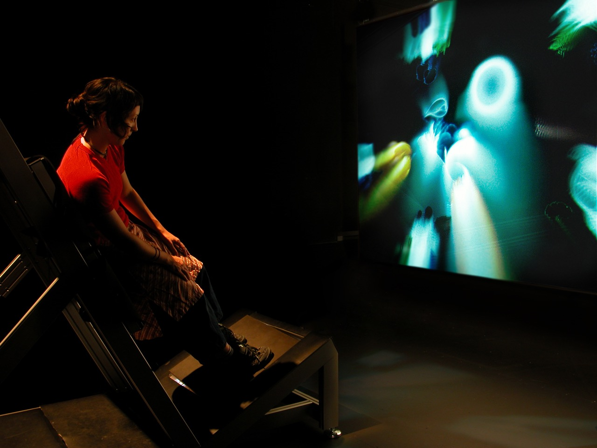

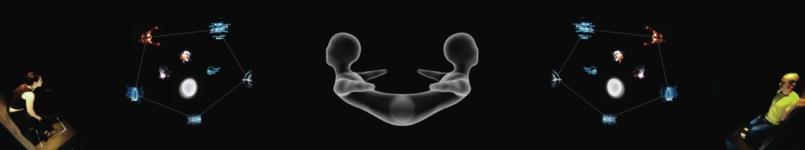

In all of these ways *Intimate Transactions* sought to establish clearing/focusing spaces capable of fostering conversations that dealt macroscopically with the requisite cultural conditions for improved ecological futures, and more immediately with the powerful experiences of a kinesthetic, transactional exchange across remote sites. Ecosophical praxis requires practitioners and participants to take temporal, creative journeys that maintain consistency with Næss’ rejection of the person *in* an environment in favour of ‘a relational total field image’ (cited in Hay, 2002: 43). Such an embodied approach became in *Intimate Transactions* a potent tactic for confronting our increasing inability to perceive the *time of everything* and thus *give time back* to others and to the future. {#para16}

### Integration of Creative Robotics: What Might Be Life?

The subsequent integration of robotics into my work developed more by stealth than by planning. It arose from particular artistic collaborations and the evolution of my studio practices. I was now moving away from the directly embodied human-to-human engagement of *Intimate Transactions* and the innate complexities of its realisation, and looking for logistically manageable formats for exhibition spaces. I began shifting the works’ emphases to exploring the kinetic potential of robotic forms. The consequent robotically infused projects include *Night Rage* (Armstrong, English and Lickfold, 2013; ISEA 2013, Powerhouse Museum Sydney) and *Night Fall* (Armstrong, English and Lickfold, 2014; Queensland Museum). {#para17}

For *Night Rage* I developed a large-scale visualisation device based on the Pepper’s Ghost technique. This approach allowed me to visually “float” and control a lit form (in combination with other simple, fibre optically lit cloth forms) in inky darkness, achieving a somewhat ethereal sensibility of flotation, 3D volume and, most importantly, life. Animation was achieved firstly through the simple ingress of air into flexible cloth objects, and subsequently via a full four-axis robotic motion control assembly, through which I was able to achieve a creatural/life-like form with relative simplicity once the technical hurdles had been overcome. This led me to ask what *conversations* would become conceivable and possible, when robotic actors became mixed and coupled with diverse media actors, materials and ecological thematics. {#para18}

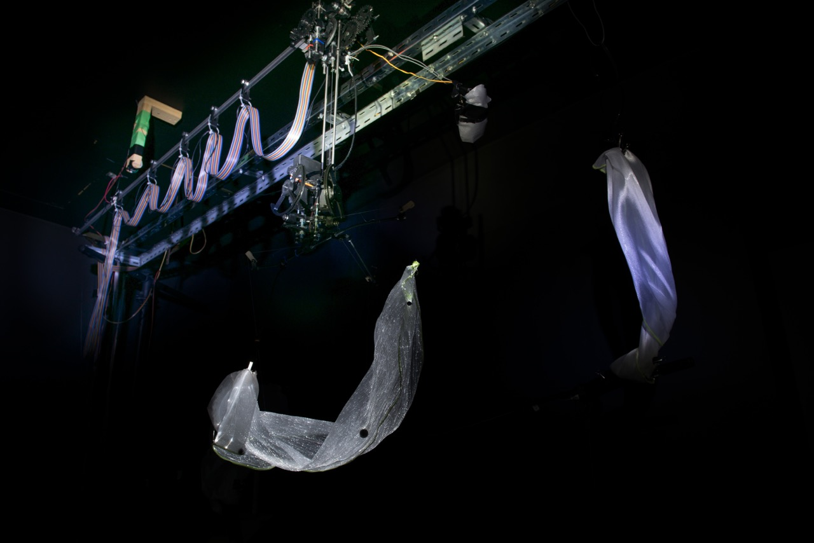

The perception of a life-like modality emanating from the electromechanic puppetry of *Night Rage’s* lit cloth forms evoked a more naïve engagement with the robotic form, and particularly, I suspect, with the fantasies portrayed in popular movies and comics. Many of us have longstanding, curious habits of imagining life-like features of the *other* in a robot. Simon Penny developed his early robotic work *Petit Mal* (which he called a ’embodied cultural agent’) to explore ‘how much can be left out in the construction of such an “agent”, and yet still give the impression of sentience’ (Penny, 1997). To this end *Petit Mal* pointed up an ‘interaction which takes place in the space of the body, in which kinesthetic intelligences, rather than “literary-imagistic” intelligences play a major part’ (1997). Creative works playing on our tendencies to believe in the unpredictable, life-like power of robotic forms range from wind-responsive works such as Theo Jansen’s *Strandbeest* series, to humanoid forms such as Mari Velonaki’s *Diamandini*, to the architecturally responsive installations by Gemeinboeck and Saunders. This ability to connote senses of *life* within a machinic work is not in itself remarkable, considering that a definitive set of physical properties common to living things (that excludes everything we might routinely think of as inanimate) has to date eluded us (Penny, 1997). Indeed, even the most simple of apparently randomised behaviors may, in certain contexts, be enough to flick the switch of “life” believability. {#para19}

Whilst robotic artworks exhibit different levels of technical complexity, they often possess a powerful ability to sway the public. Gemeinboeck and Saunders’ *Zwischenräume* created devious, machine-vision capable robots programmed to break through a gallery wall, rendering machines and audiences strange embodied objects of each others’ curiosity. Edward Ihnatowicz’s *Senster* (cited in Zivanovic, nd) was said to have behaved like a ‘wild animal’ (Rieser, 2002: 88), whilst Ken Rinaldo’s robotic assemblage *Autopoesis* successfully developed collective animalesque behaviours through sensing the bodies of the audiences and of their fellow robot forms. Several examples of robotic/dance collaborations (e.g. Chunky Move’s *Mortal Engine* and ADT’s *Devolution*) manifest the uncertain, the multiple and the entangled realities of human and robotic entities entwining within the mesh, rendering them necessarily or temporally strange. Such distinctly embodied renderings recall the user experiences of *Intimate Transactions*, wherein a parallel kinesthetic sense of agency became the currency for negotiating spaces of ecologically inscribed transaction and exchange. {#para20}

Penny (1997) suggests that creative robotic forms’ significant potential is in challenging audiences to consider their personal limits of perception and comprehension (as occurred in *Intimate Transactions*), particularly in relation to the strangeness of an impending ecology without nature. Similarly, Ingeborg Reichle (2009: 11) observes that artistic experimentation with robotic forms is often motivated by the desire to develop interactions between machinic actors and humans premised upon ‘open, non-determined modes’. I began to wonder whether the potential of robotic forms to creatively evoke living sensibilities might also correspondingly have capacities to evoke *interactive kinesthetic intelligences* within audiences, and thus subtly enhance audience members’ interactions with the works within the domains of their own bodies. I set out to re-invent a process that I had discovered to be so powerful in *Intimate Transactions*. I saw this as a particularly valuable link for maintaining senses of presence and subtle activation within my new works, given my focus at that time upon on non-live installation practices. Seen this way, creative robotics appeared to introduce an embodied, sensate driver into these new works, and therefore to help tilt audiences into conversational experiences with the work’s underpinning ecosopohical narratives. {#para21}

  {#para22}

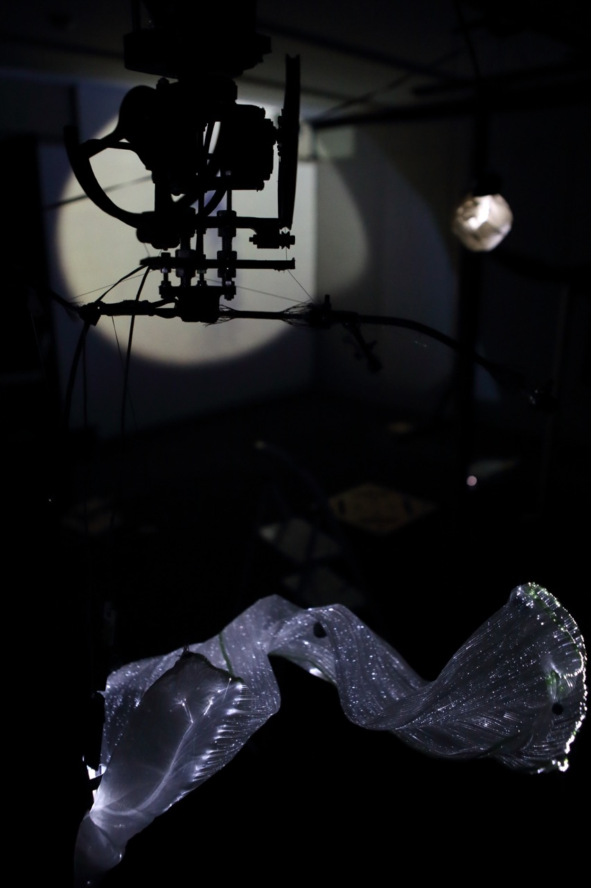

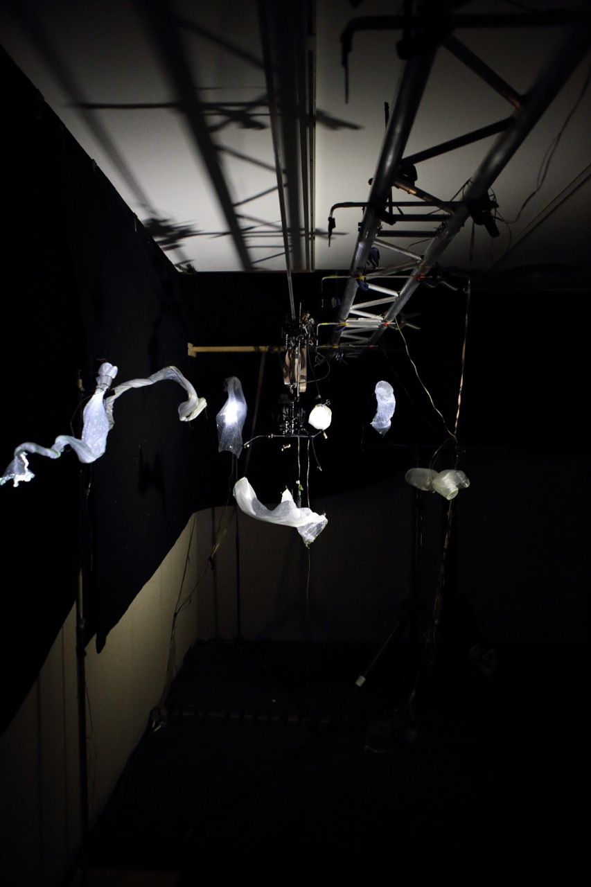

Buoyed by this possibility, I began to experiment with incorporating robotic forms into my installation works 2013-15, which include *Dark Cartographies* (Armstrong, English and Lickfold, 2013-14; Centre for Contemporary Art, Cairns), *Black Nectar* (Armstrong, English and Lickfold, 2014; Bundanon’s *Siteworks* Festival), *Light of Extinction* (Armstrong, English and Lickfold, 2014; *Media Art China*, National Gallery of China) and *Temporal* (Armstrong, English and Lickfold, 2015; Bundaberg Gallery). Each of these works involved an art–science collaboration with behavioural ecologist Dr Peggy Eby, assisted by GIS ecologist Heidi Millington, and was created in collaboration with sound artists Lawrence English and Luke Lickfold. They all drew upon overt or subtle techniques set within creative robotics and combined with ultra low-level, controllable illuminations of materials, which were physically manipulated in real time through multiple dimensions. Technically this was achieved through the application of controlling computers, embedded microcontrollers and series of controllable mechanical arms, pulleys, wheels and strings, as well as crane and gantry mechanisms. This resulted in robotically controlled, faintly glowing objects designed to engender certain and differing senses of aliveness when viewed from particular audience viewpoints. {#para23}

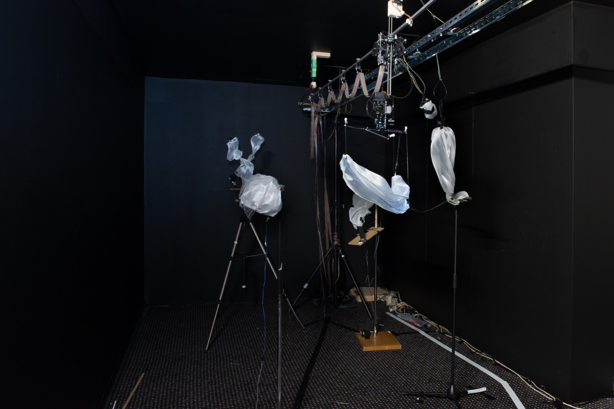

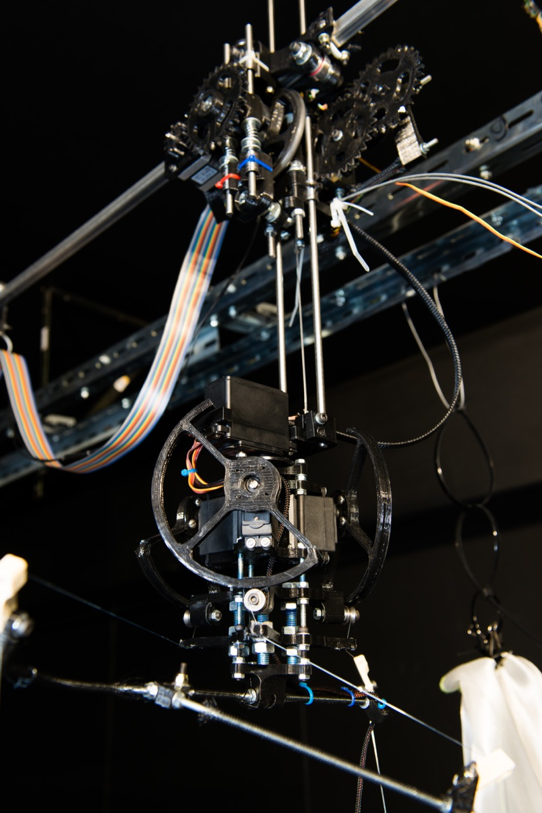

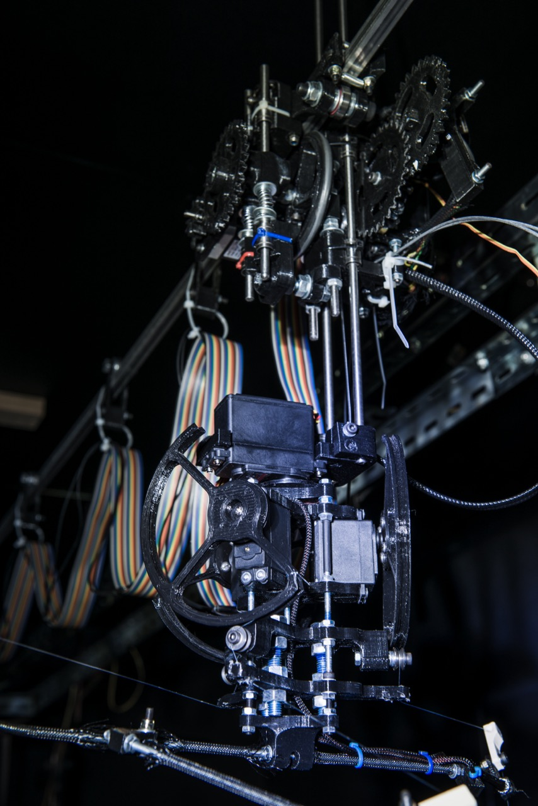

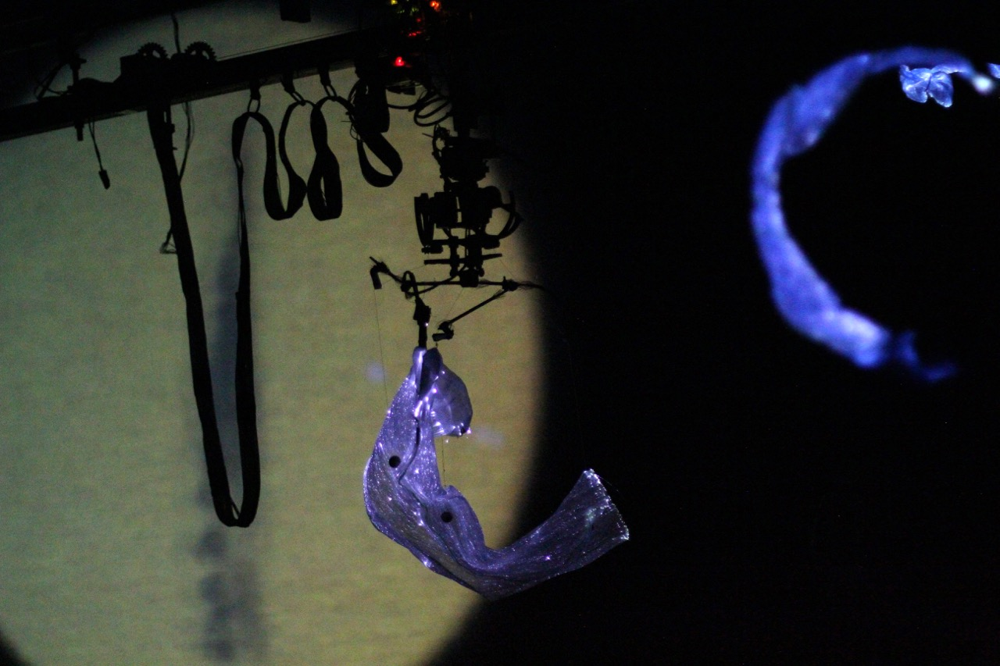

The exemplar work of this kind, *Light of Extinction*, evolved from presentations of *Night Rage* and *Night Fall* and involved sophisticated implementation of a gantry-driven robotic system that ultimately allowed fibre optically lit cloths to be manipulated and contorted along all dimensions and moved back and forth and up and down. The system used a series of motors, servos and mechanical linkages to move lit objects within a plane of view. These works were thematically linked by ideas of the *seasonal* in order to cast a different perspective upon my consistent questioning of ecological relationalities. Through the work, I argued that processes of seasonal change affect human existence within the mesh-work, and that correspondingly our embodied presence affects seasonal progression in increasingly significant precipitations of climate chaos (Oreskes and Conway, 2014). The work also foregrounded how our lived experiences of being embodied and embedded in place and time are increasingly being lost – the so-called ‘extinction of human experience’ (Miller, 2005) that concurs in broad outline with John Thackara’s assertion that: {#para24}

> We miss phenomena that are invisible, such as energy; We are unaware of things that are somewhere else, such as resource flows; We miss all sorts of natural phenomena because we use so few of our senses; And, because of our education, we fail to experience the planet as a living system of which we are a part. (2013: np) {#para25}

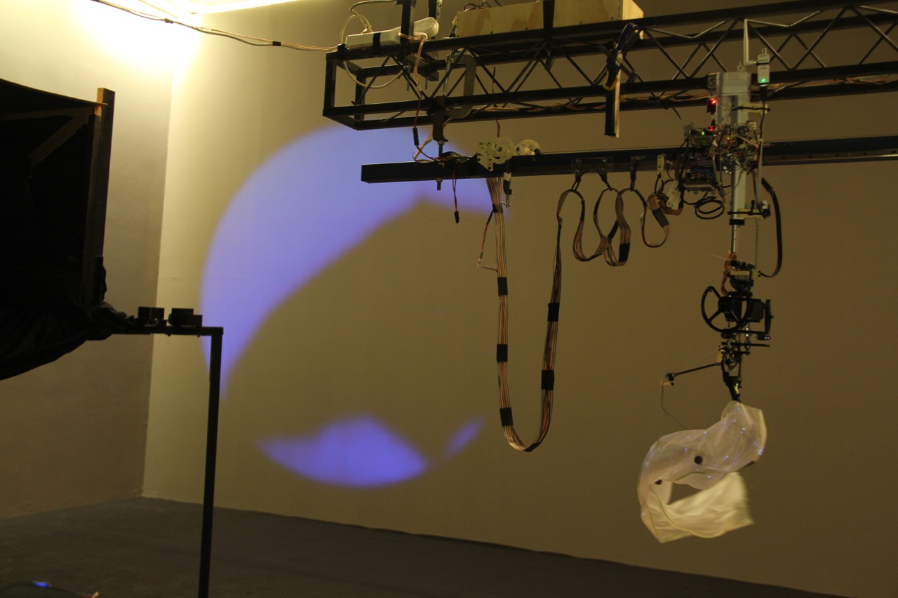

I created for *Light of Extinction* two distinctly differing viewpoints into the work. I constructed a series of physical corridors that used darkness and scale to encourage slowness of approach. Audiences initially entered into the *back end* of the work to be confronted by the first viewpoint, which exposed much of the robotic mechanism and the physical nature of the manipulable cloth forms. I refer to these forms as a “semi-autonomous gaggle of robotic actants”. Audiences then moved through into the work’s second viewing space, or *front end*, where they were now obliged to view the same robotically manipulated objects through a restricted aperture (again using the Pepper’s Ghost technique). Here, what they witnessed appeared to coordinate into a deep-field choreography, floating lusciously within inky landscapes of media, noise and embodied sound suggesting a privileged view into the “life” of non-human entities whose experience remains outside of our knowing. {#para26}

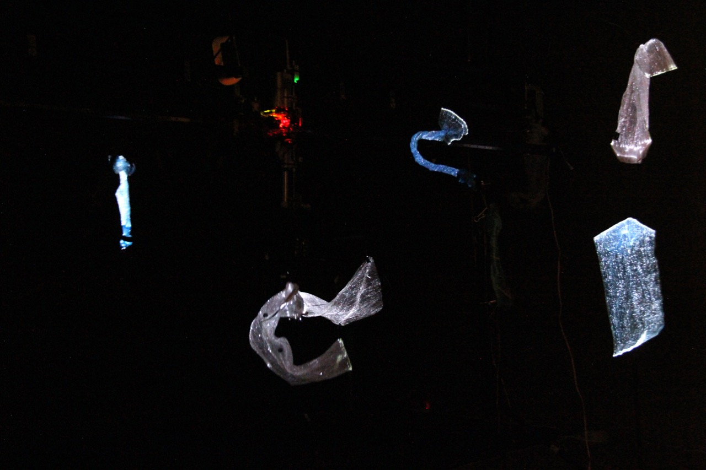

Together these two perspectives remained sensitive to notions of ecologies alluded to by Morton in his ‘mesh’ (2010) and expanded ‘hyperobject’ (2013) theses. Building on the idea that something as small, simple and trite as a manipulable series of hanging cloths could ultimately allow one to sense the vibrancy of something living, maybe even as embodied sensation, *Light of Extinction* provided a momentary disbelief giving way to ‘a relieving celebration of the imagined birth of “things” – without need for staples such as conventional light or the harmonious lullabies of long-extinguished sounds’ (Armstrong, 2014: np). This suggestion of a coming into life was premised upon the potential of embodied connection being germane to this application of creative robotics. The inclusion of robotics in *Light of Extinction* appears to amplify its catalytic ecosophical potential through the direct intimation of embodied experience. It draws attention to our increasingly diminished sense of emplacement, of *belonging* or of being *at home* – given that the unfamiliarity of ecologies still confounds us. {#para27}

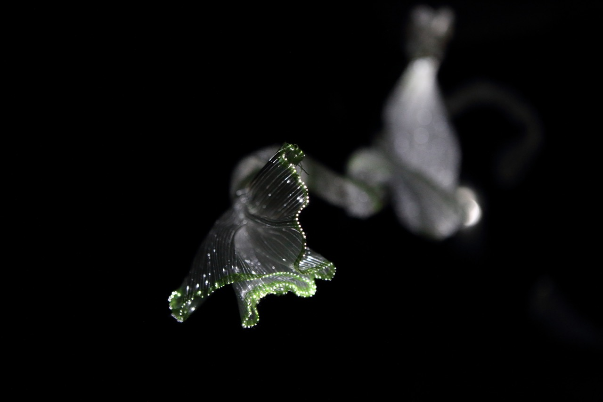

*Light of Extinction* built upon ideas from *Night Rage* and *Night Fall* of systemic breakdown, failure and the increasingly tenuous grapple with ecologies that eschew almost all contemporary understandings. In a kind of anthropomorphic lament, these works strip back the complexity of *Intimate Transactions* and other prior works to focus on a loss of our experience as once biodiverse worlds crash or fade into darkness. Indeed, as Thackara (2013: np) suggests, we would gain much should we choose to ‘focus attention on the positive qualities of the often small, humble … things that surround us’. Correspondingly we might move towards a more rounded inclusion, within any ecological picture, of human-created forms. The ironic playfulness of *Light of Extinction’s* “both-ways” approach proposes a conceptual re-positioning even in the face of unbearable loss. If creative robotic practices can invoke an interaction which takes place in and expands our sense of the space of the body, then the form will resonate powerfully with a mature ecosophical praxis – serving to propel degrees of sensuous engagement that might better redirect attention toward urgent questions of the Anthropocene. {#para28}

### Biographical Note

Keith Armstrong has specialised for 22 years in collaborative, hybrid, new media works with an emphasis on innovative performance forms, site-specific electronic arts, networked interactive installations, alternative interfaces, public arts practices and art-science collaborations. His ongoing research focuses on how scientific and philosophical ecologies can both influence and direct the design and conception of networked, interactive media artworks. Keith’s artworks have been shown and profiled extensively both in Australia and overseas and he has been the recipient of numerous grants from the public and private sectors. He was formerly an Australia Council New Media Arts Fellow, a Doctoral and Postdoctoral New Media Fellow at QUT’s Creative Industries Faculty and a lead researcher at the ACID Australasian Cooperative Research Centre for Interaction Design. He is currently part-time Senior Research Fellow at QUT, author of numerous chapters and papers, and an actively practicing freelance new media artist. ([https://www.embodiedmedia.com](https://www.embodiedmedia.com))

### References

- Armstrong, Keith. ‘Statement from Exhibition *Light of Extinction*‘, *Media Art China* (2014), https://mediaartchina.org/exhibitions/ensemble–parliament-of-things/light-of-extinction-au/

- Armstrong, Keith. ‘Intimate Transactions: The Evolution of an Ecosophical Networked Practice’, *Fibreculture* 7 (2005), [https://seven.fibreculturejournal.org/fcj-047-intimate-transactions-the-evolution-of-an-ecosophical-networked-practice/](../papers/fcj-047-intimate-transactions-the-evolution-of-an-ecosophical-networked-practice.md)

- Armstrong, Keith, English, Lawrence and Lickfold, Luke. *Temporal* (Bundaberg: Bundaberg Gallery, 2015).

- Armstrong, Keith, English, Lawrence and Lickfold, Luke. *Light of Extinction*, *Media Art China* (Beijing: National Gallery of China, 2014).

- Armstrong, Keith, English, Lawrence and Lickfold, Luke. *Black Nectar* (Bundanon: *Siteworks*, 2014).

- Armstrong, Keith, English, Lawrence and Lickfold, Luke. *Dark Cartographies* (Cairns: Centre For Contemporary Art, 2013-14). Armstrong, Keith, English, Lawrence and Lickfold, Luke. *Night Fall* (Brisbane: Queensland Museum, 2013-14).

- Armstrong, Keith, English, Lawrence and Lickfold, Luke. *Night Rage* (Sydney: Powerhouse Museum/ISEA, 2013).

- Armstrong, Keith, O’Neill, Lisa and Webster, Guy. *Intimate Transactions* (London, Linz, Beijing, Glasgow, Melbourne, Sydney, Brisbane: Multiple producers, 2005-08).

- Bertelsen, Lone. ‘Affect and Care in Intimate Transactions’, *Fibreculture* 21 (2012), [https://twentyone.fibreculturejournal.org/fcj-149-affect-and-care-in-intimate-transactions/](../papers/fcj-149-affect-and-care-in-intimate-transactions.md)

- Brooks, Nick and Heyd, Thomas. ‘Exploring Cultural Dimensions to Climate Change’, in Adger, Neil, Lorenzoni, Irene and Karen O’Brien (eds) *Adapting to Climate Change: Thresholds, Values, Governance* (Cambridge: Cambridge University Press, 2010), 269-282.

- Emmott, Stephen. *Ten Billion* (London: Penguin, 2013).

- Foster, John, Clark, Brett and York, Richard. *The Ecological Rift: Capitalism’s War On the Earth* (New York: Monthly Review, 2010).

- Fry, Tony. *Design as Politics* (New York: Berg, 2011).

- Fry, Tony. *Becoming Human by Design* (New York: Berg, 2012).

- Gemeinboeck, Petra and Saunders, Rob. ‘Inventing Cultural Machines’, in Andy Dong, John Conomos and Brad Buckley (eds) *Ecologies of Invention* (Sydney: University of Sydney Press, 2013): 37-46.

- Guattari, Félix. *Chaosmosis: An Ethic-Aesthetic Paradigm* (Sydney: Power Publications, 1995).

- Guattari, Félix. *The Three Ecologies* (London: Athlone Press, 2000).

- Hay, Peter. *Main Currents in Western Environmental Thought* (Sydney: UNSW Press, 2002).

- Miller, James. ‘Biodiversity Conservation and the Extinction of Experience’, *Trends in Ecology and Evolution* 20.8 (2005): 430-435.

- Morton, Timothy. *Ecology Without Nature: Rethinking Environmental Aesthetics* (Cambridge: Harvard University Press, 2007).

- Morton, Timothy. *The Ecological Thought* (Cambridge: Harvard University Press, 2010).

- Morton, Timothy. *Hyperobjects: Philosophy and Ecology after the End of the World* (Minneapolis: University of Minnesota Press, 2013).

- Næss, Arne, ‘The Deep Ecology ‘Eight Points’ Revisited’, in George Sessions (ed.) *Deep Ecology for the 21st Century* (Boston: Shambhala, 1995), 463-467.

- Ophuls, William. *Plato’s Revenge: Politics in the Age of Ecology* (Boston: MIT Press, 2011).

- Oreskes, Naomi and Conway, Erik. *The Collapse of Western Civilization: A View From The Future* (New York: Columbia University Press, 2014).

- Penny, Simon. ‘Embodied Cultural Agents: at the Intersection of Art, Robotics and Cognitive Science’, paper presented at the *AAAI Socially Intelligent Agents Symposium*, Massachusetts Institute of Technology, 8-10 November (1997), [https://simonpenny.net/texts/embodied.html](https://simonpenny.net/texts/embodied.html)

- Reichle, Ingeborg. *Art in the Age of Technoscience: Genetic Engineering, Robotics, and Artificial Life in Contemporary Art* (Vienna: Springer, 2009).

- Rieser, Martin. ‘The Art of Interactivity: From Gallery to Street’, in A. Mealing (ed.) *Computers and Art* (Bristol: Intellect, 2002), 81-96.

- Thackara, John. ‘Desert of the Real’, *Doors of Perception*, 23 November (2013), [https://www.doorsofperception.com/art-perception/desert-of-the-real/](https://www.doorsofperception.com/art-perception/desert-of-the-real/)

- Zivanovic, Alex. *The Senster* (Middlesex: Lansdowne Centre for Electronic Arts, nd), [https://www.senster.com/ihnatowicz/senster/index.htm](https://www.senster.com/ihnatowicz/senster/index.htm)

- Žižek, Slavoj.’Ideology I: No Man is an Island’ (2007), [https://www.lacan.com/zizwhiteriot.html](https://www.lacan.com/zizwhiteriot.html)
