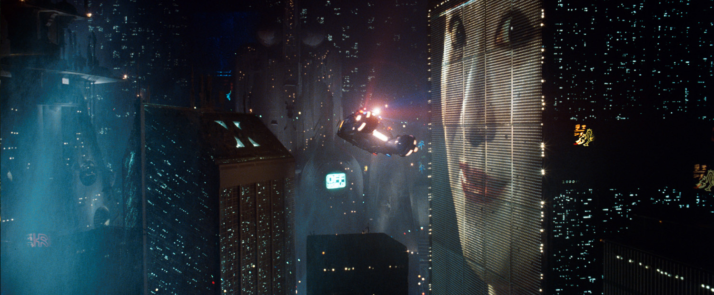
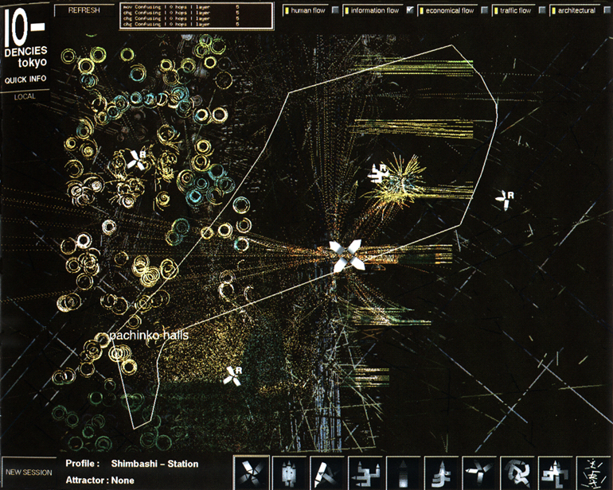
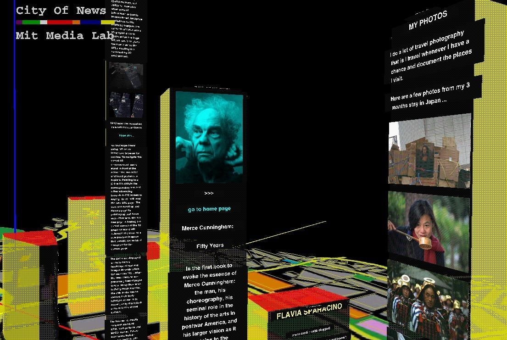
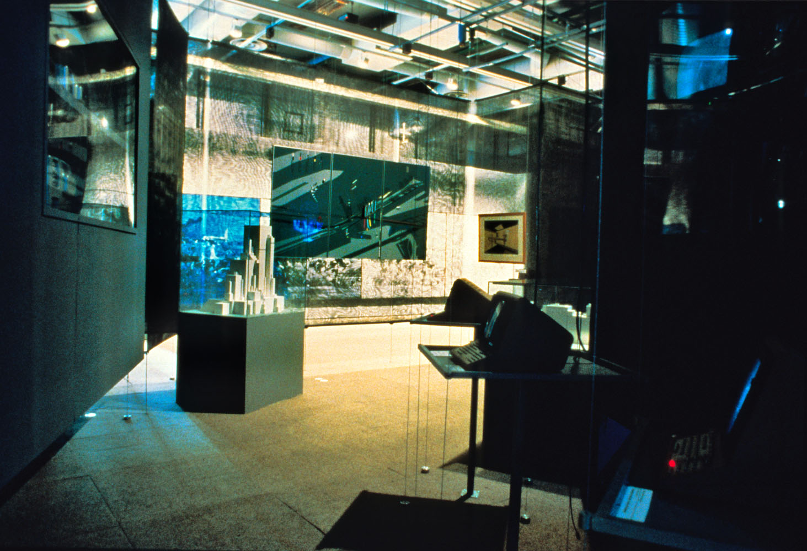
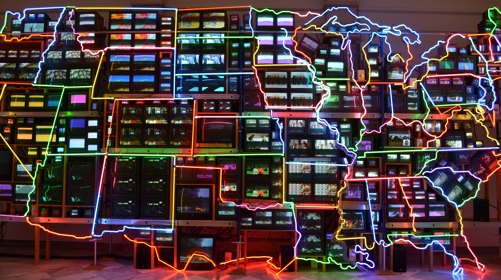
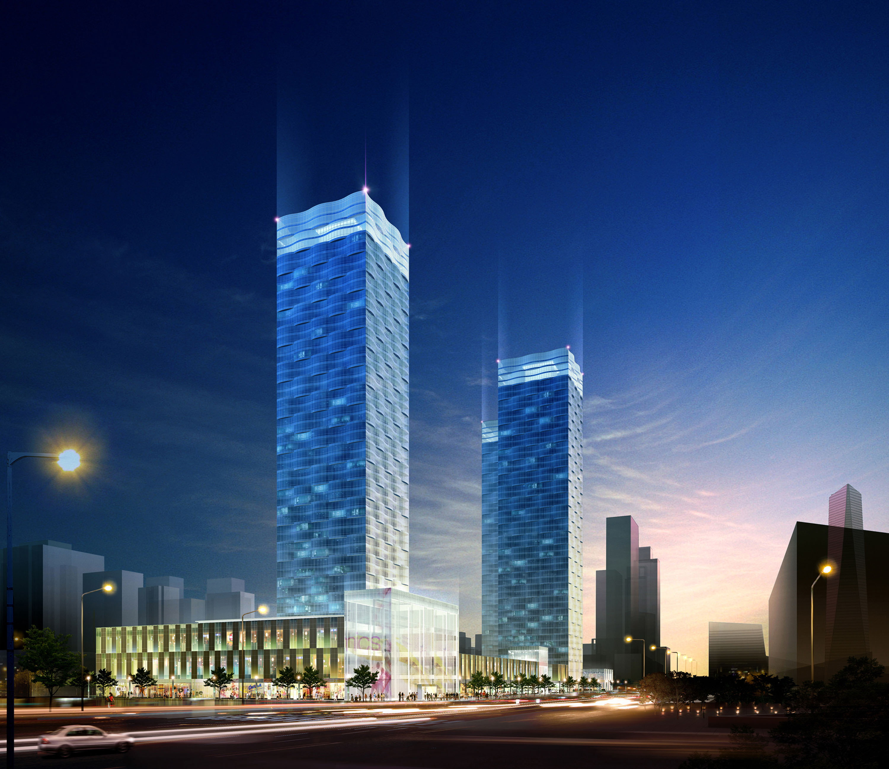
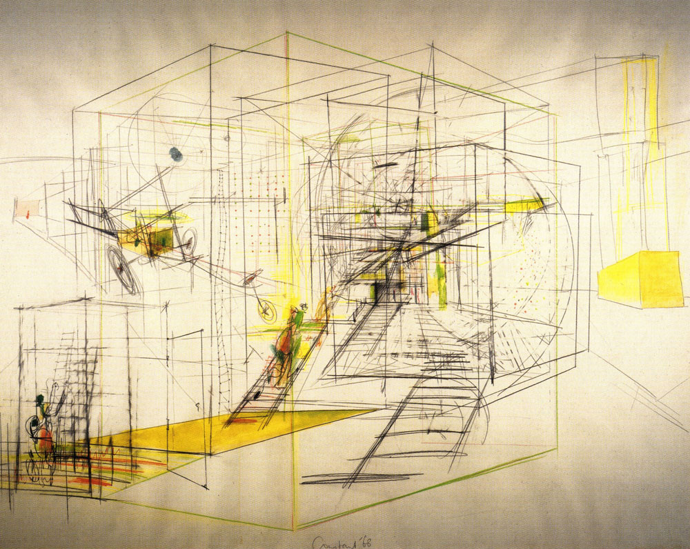

---

> Welcome to post-liberal Los Angeles, where the defense of luxury lifestyles is translated into proliferation of new repressions in space and movement, undergirded by the ubiquitous “armed response”. This obsession with physical security systems, and, collaterally, with the architectural policing of social boundaries, has become a zeitgeist of urban restructuring, a master narrative in the emerging built environment of the 1990s. […] Images of carceral inner cities (*Escape from New York, Running Man*), high-tech police death squads (*Blade Runner*), sentient buildings (*Die Hard*), urban bantustans (*They live!*), Vietnam-like street wars (*Colors*), and so on, only extrapolate from actually existing trends. (Davis, 1990: 223) {#para1}

In his bestselling book *City of Quartz*, Mike Davis, urban sociologist and rigorous chronicler of his Southern California home, described the imminent end of the ‘California Dream’ in the early 1990s (cf. Davis, 1990). By ‘excavating the future in Los Angeles’ (the subtitle of his book), he portrays the decay of California’s largest city and thereby scratches the glittering surface of ‘Tinseltown’. According to Davis, the commercial, business and cultural center of the US-American West runs the risk of becoming the victim of its own million-fold reproduced image. Hollywood’s dream factory is not only creating the image of the ideal suburban life, but also evokes the deadly perils of inner cities. Consequently, the fictional scenarios, fostering a culture of fear, are deeply penetrating into the built architecture of the city itself, as can be seen with the example of the Bunker Hill Redevelopment Project. Since the 1960s, when social unrest erupted in downtown L.A., public funding has been used to demolish old apartment buildings, and to replace them with a hermetically sealed-off financial district. At the same time, laws have been tightened and security forces expanded, culminating in the militarisation and rigorous zonation of city life during the Reagan era. And since the Rodney King Riots of 1992, the Los Angeles Police Department (LAPD) has become one of the most influential voices in urban development issues, without whose consent no major project can be carried out today. In a follow up to his book, Davis referred to the 1982 film *Blade Runner* as ‘L.A.’s own dystopic alter ego’ (Davis, 1992: 1). The future of L.A. is reflected in the dark rendition of Ridley Scott, a virtual shadow that is overlaying the *City of Angels*. {#para2}

Despite this powerful and unique image, *Blade Runner* remains yet another figure of modernist thought in which the possible future city can only be envisioned as a grotesque distortion of the present. This line of thought ranges from H.G. Wells’ *The Future of America* (1906) to Fritz Lang’s *Metropolis* (1931) to Christopher Nolen’s *The Dark Knight* (2008), and follows the teleological idea of an idealised – alternately utopian or dystopian – future. But ‘instead of seeing the future merely as a grotesque, Wellsian magnification of technology and architecture’, Davis wants to ‘carefully extrapolate existing spatial tendencies in order to glimpse their emergent pattern’ (Davis, 1992: 2). And for him such a pattern shows up in the ‘prefigurative social theory’ of William Gibson, who was the first to describe the political, social, as well as cognitive function of a new computer-generated space in his novel *Neuromancer* (1984). This space is called ‘cyberspace’ and Gibson compares it to the receding lights of a city, a ‘consensual hallucination’ (Gibson, 51) which is experienced by billions of users on a day-to-day basis. Mainly because of this plain and simple description, the term turned out to be extremely popular, used by different sides to describe the emerging reality of digital technologies: {#para3}

> From the moment William Gibson announced in his dystopian science-fiction account *Neuromancer* (1984) that the new informational network or computer matrix called cyberspace looks like Los Angeles seen from five thousand feet up in the air, there has been a predilection for drawing a parallel between the virtual space of computer networks and post-urban places of disorder and decay. (Boyer, 1996: 13) {#para4}

Particularly in the 1990s, cyberspace was used as a synonym for virtual reality, which, paradoxically, turned out to look like the crisis-ridden city. {#para5}

### The Crisis of the City

The image of Los Angeles as a city of decay did not simply refer to the dystopian vision of some disenchanted cyberpunks. Rather, the envisioned crisis of the city marked a general crisis of governance at the end of the 20th century: the modern city, which was characterised by its centrality, was replaced by the postmodern city, whose built architecture got more and more overlaid by global data flows, thereby fragmenting the traditional structure of the city and reassembling it according to the needs of multinational capitalism (cf. Castells, 1991; Sassen, 1991). For cultural theorist Fredric Jameson this marks the {#para6}

> moment of the multinational network […] in which not merely the older city but even the nation-state itself has ceased to play a central functional and formal role in a process that has in a new quantum leap of capital prodigiously expanded beyond them, leaving them behind as ruined and archaic remains of earlier stages in the development of this mode of production. (Jameson, 1991: 412) {#para7}

Late capitalism, therefore, has to be analysed by its cultural logic, which finds its expression in a new space of computer networks and implies a dramatic change in our cognitive capacities to grasp this space: ‘We are submerged in its henceforth filled and suffused volumes to the point where our now postmodern bodies are bereft of spatial coordinates and practically (let alone theoretically) incapable of distantiation’ (Jameson, 1991: 48f.). In the 1990s the sprawl became the symbol of an urban space that was not defined any more by clear-cut boundaries, but resembled the spatially distributed structure of new information and communication networks. Hence, the discourse about the dangers, but also possibilities of data networks, was influenced by a concern about the spatial transformation they cause: ‘The dramatic changes in information technology deeply affect the core of our system, and in so doing lie at the very roots of its spatial pattern of change’ (Castells, 1991: 126). And, as Manuel Castells describes in his three-volume work on the information age, this process is driven by the increasing dominance of the ‘space of flows’ over the ‘space of places’ (cf. Castells, 1996). {#para8}

The discussion about a crisis of the city is probably as old as the city itself. However, what is striking about the early 1990s is that the debate about the alleged decline of cities began to overlap with the emerging discourse about digital technologies (cf. Fuchs and Moltmann, 1995; Mitchell, 1996; Iglhaut, Medosch and Rötzer, 1996; Maar and Rötzer, 1997; Rötzer, 1997; Lévy, 1997). The discussion took place mainly between two camps: on the one side, Internet enthusiasts promoted the conquest of the new territory in the hope of leaving the old world with its galling problems behind; on the other side, techno-sceptics cherished the same old world for its clarity and comprehensibility. For the latter, the urban space had been infiltrated by digital technologies, and, in this process of virtualisation, traditional functions of the city, such as providing meeting points for its inhabitants, were considered to migrate into cyberspace. In this view, a computer-generated dis-urbanisation was taking place, creating a post-architectural city where ‘physical architecture and urbanism as a derivative of the ancient cities of the past will be something to be avoided. Something to be associated with danger, penalties, congestion and delay. Something best forgotten’ (Pawley, 1997: 548). {#para9}

The ‘death of architecture’ (Manovich, 1996: 39) ultimately implied the downfall of the city as the former centre of cultural and economic development. Beyond a centralised space, new media apologists began to dream of a tele-existence, which was no longer dependent on spatial proximity. In fact, a new ‘virtual class’ (Kroker and Weinstein, 1994) was supposed to leave the narrow space of the city, in order to settle in rural, yet well-connected areas. Linked to this vision was a – mainly white male – idea of individual freedom and unrestricted mobility, encapsulated by the image of an ‘information superhighway’ and propagated by the so called *Californian Ideology* (Barbrook and Cameron, 1996). The notion of an electronic frontier, beyond which a new and promising land was imagined, played a crucial role in the popularisation of cyberspace. In accordance with the old myth of the Wild Wild West, the actual WWW provided the tool to discover and colonise the electronically produced space.  [1] Hence, with the Internet the computer was not simply seen as a numerical calculating machine anymore – the mechanical calculator had been around since the 17th century – but rather as new symbolic system: {#para10}

> The crucial technological breakthrough lies with this idea of the computer as a symbolic system […]. Those pulses of electricity are symbols that stand in for zeros and ones, which in turn represent simple mathematical instruction sets, which in turn represent words or images, spreadsheets or e-mail messages. (Johnson, 1997: 14) {#para11}

While machines were understood as a prosthetic supplement to the human body during the 19th and well into the 20th century, the power of the digital computer arose from its capacity for self-representation: ‘For the first time, a machine was imagined not as an attachment to our bodies, but as an environment, a space to be explored’ (Johnson, 1997: 24). And, given the fact that the digital space is simply a sequence of zeros and ones, there were numerous ways in which it could be made visible; thereby leading to the question of why the city became such a prominent metaphor to describe data space in the 1990s. {#para12}

As Walter Benjamin already noted in the 1930s, new technological developments stir our cultural imagination. However, the unconscious production of these images is not detached from our past: we collectively dream of a future, where the old is suspended in the new (Benjamin, 1983: 46f.). In this sense, the new virtual space of the 1990s appeared as a phantasmagoria, a collective belief that ‘being released from reality and all of its messy and uncontrollable chaos enables the virtual to recover reality, even while, paradoxically, it implicates a withdrawal from it’ (Boyer, 1996: 6). So all hopes to overcome the crisis of the city were pinned to those technologies that were held accountable for the emergence of this crisis. While initially the discussion had revolved around the question of a dissolving urban space, allegedly caused by the mass distribution of network technologies, cyberspace henceforth hold the promise of an ideal space that could revitalise the main functions of the city and foster new forms of community building (Rheingold, 1994). As a consequence, virtual space, which ‘called for a series of new metaphors, new rules and patterns of behaviour’ (Bollmann, 1995: 164; my own translation), was represented as urban space. While engaging with the digital sphere, the image of the city with its organising principles proved to be tremendously useful to grasp the unintelligible environment of computer-generated space and, therefore, to cope with the postmodern ‘loss of orientation’ (Virilio, 2001).[2] {#para13}

This seems to be reasonable, given the fact that the city metaphor has a long history in describing technological media (Kittler, 1995). By the same token, one may argue that the city itself has always been characterised by information, communication and transport technologies (Böhme, 2004). As German cultural scientist Hartmut Böhme points out, the systematic networking of urban space began as early as the industrial revolution; however, with the mass distribution of computer-based networks since the 1990s, the ‘city as network’ has undergone an unprecedented intensification, implicating a qualitative change. Hence, the material architecture of the city has been permeated by local, national and global networks, to the effect that the management of urban infrastructure – from transport to communication to energy supply – is no longer imaginable without the presence of digital information networks. Since the 1990s the city has been overcoded by software-ensembles, which are necessary to control the new flood of information. In this sense, the physically built environment of the city does not simply disappear, but its readability and controllability are more and more dependent on computer networks – in particular the Internet. Whether electronic timetables, GPS-based maps or online-systems in municipal administration, the digital representation of urban processes has become – at least in this perspective – a second reality, yielding a new landscape built out of data (Gelernter, 1992). [3] {#para14}

### Info-Cities, or: How Did the City Come into the Net?

In the 1990s the new data space was waiting to be filled with meaning. A whole new academic genre emerged, situated between architecture, communication and urbanism. One of the best known proponents of this genre was William Mitchell, whose *City of Bits* (1996) became one of the main sources for the conception and the understanding of virtual spaces. In contrast to the popular image of the ‘global village’ (McLuhan, 1964), which still represented a rather definite and easily comprehensible entity, Mitchell’s soft cities had already lost their structuring differentiation vis-à-vis the surrounding data sphere. With the massive proliferation of personal computers and their increasing interconnection, the information landscape had changed: ‘Early computers had been like isolated mountain valleys ruled by programmer-kings […​]. But networking fundamentally changed things […​] by linking the increasingly numerous individual fragments of cyberturf into one huge, expanding system’ (Mitchell, 1996: 109f.). In order to keep track of this rapidly expanding computer network, interfaces had to be developed which made the navigation through cyberspace feasible. So-called ‘mirror worlds’ were supposed to enable a new kind of ‘whole-sightedness’ (Gelernter, 1992: 31), as computer scientist David Gelernter put it. For him, a mirror world ‘is some huge institution’s moving, true-to-life mirror image trapped inside a computer – where you can see and grasp it whole’ (Gelernter, 1992: 3). Like a microscope, or more precisely, a telescope, these software-ensembles are tasked to render data space into something observable and therefore comprehensible. Given the importance of metaphorical language to depict the binary coding system, a critical analysis of the metaphors in use is as relevant as the understanding of computer code itself. {#para15}

Since human-computer interfaces do not originate in a neutral space, the question remains: why did the city become such a popular trope and organising principle in the visual world of cyberspace? This may primarily be related to the fact that metaphors are often used to conceal, or at least obscure cultural transformations. In this sense, emerging technologies are often understood in terms of earlier innovations, as Mitchell explains in an interview: {#para16}

> the automobile was first called the “horseless carriage”, so it is like a carriage without a horse, and the radio was first called the “wireless telegraph”, it is like a telegraph without wires. […] I think the same thing has been happening with the internet – we began to understand it in terms of these metaphors from architecture. (Mitchell, 2005: 2) [4] {#para17}

At the turn of the millennium, the city metaphor established a new symbolic order and constituted – at least for a short period – the core idiom of cyberspace. Hence, not only had the city become a data space with the mass distribution of network technologies, but the data space, generated by these technologies, was represented as a city. {#para18}

In the early 1990s a postgraduate student at Vienna University of Technology (TU Vienna), Andreas Dieberger, coined the term *Information City* (1994) to describe a spatial user interface. In order to resolve the problem of ‘getting lost in hyperspace’ (Dieberger, 1993), Dieberger’s city metaphor attempted to make the structure of information systems easier to understand by drawing a cognitive map of the information space. He proposed to use architectural knowledge from city planning in order to build an information environment that would help users to navigate hypertext. His information city defined an ‘ontology of spaces and connections that is useful […] to create structure in an unstructured information domain’ (Dieberger, 1998). By implementing the hierarchical concept of the city, Dieberger was able to develop a rich set of navigational tools. For him cyberspace, like the city, was constructable and therefore controllable: ‘An important advantage of … city metaphors is that they define several levels of enclosed spaces’ (Dieberger, 1998). The elements of a city (i.e. the district, the neighbourhood, the block, the building, etc.) were seen as ‘ideal sources for metaphors that describe strong encapsulation and access control’ (Dieberger, 1998). Using the existing knowledge about its structured environment, the city provides an organisational regime. [5] {#para19}

Although Dieberger’s *Information City* was never realised, there were a whole series of projects in the 1990s that came close to his idea of a structured information space, in particular MIT’s *City of News* (first completed in 1996). Quite similar to Dieberger’s concept, an information environment was built, within which the user could draw on his or her experiences in actual cities: websites were visualised as buildings which themselves were organised in urban districts according to their specific content: the finance district, the shopping district, the district of science. In order to retrieve the content, a browser was designed ‘that organizes information as it fetches it, in real-time, in a virtual three-dimensional space which anchors our perceptual flow of data to a cognitive map of a (virtual) place’ (Sparacino et al., 1997). In this sense, the *City of News* can be understood as a precursor of today’s data management systems, which require an exact search term and an understanding of the basic structure of the database. Not only was the city a dynamic space, where every new website was represented by a new building, which, in turn, grew with every click, but because of its immersive logic, the cognitive map literally invited its users to search by strolling. Herein lies the promise of an ideally structured knowledge space: ‘City of News certainly participates in the utopian dimension of this historical line of thought as it carries within itself a hope for an ideal space of information sharing and consumption’ (Sparacino et al., 1997). This utopia involved the notion of a functionally zoned city, and drew on a variety of concepts in modernist architecture and town planning (for example Le Corbusier, Ebenezer Howard, Archigram, EPCOT), where the city is characterised by an organisational regime of inclusion and exclusion. Hence, the concept of the city was applied to cyberspace in the 1990s in order to draw a line between the visible and the invisible, the expressible and inexpressible, order and chaos – a virtual Jerusalem set against the Babylonian confusion of data streams. {#para20}

This model of the ordered city implies a significant foreclosure of the possibilities of cyberspace as a potentially open and non-hierarchical space: Info-Cities correspond to a parallel space, a virtual reality constituted by its boundaries. In this sense, Dieberger’s *Information City* as well as MIT’s *City of News* were still in line with the notion of the information superhighway, which ‘privileges the individual user exploring a relatively homogeneous information space’ (Bolter, 1996). In this vision, the user ranges all-alone through the virtual streets of the Info-City in search for human traces, which he or she only catches sight of in the form of abstract data sets. In contrast to this solipsistic concept of virtual space, at the same time the city metaphor evoked an image that was collective, heterogeneous and social, as can be seen by the example of so-called digital cities (for example, in Europe, Amsterdam, Berlin or Vienna). [6] Instead of merely applying the hierarchical structure of the city in a digital environment, in order to define an enclosed and idealised space of knowledge, the Internet had also been considered to be an open environment, a city as such, with all its functions, potentialities and shortcomings. Digital technologies, in this perspective, were not only seen as technical media, but also as social environments, yielding new forms of cultural production and interaction. It was this tension between an individualistic and a collectivistic understanding of media spaces that shaped the debate about digital networks during the 1990s (see also Apprich, 2015). [7] {#para21}

### Imagining Networks

The historical example of Info-Cities illustrates that urban computing is not only about the physical application of computer technologies in domestic and urban spaces, but also about the cultural imagination triggered by this implementation. By making use of the city as organisational regime, the attempt was made to manage the supposed chaos in digital space. In this sense, the idea of gathering and structuring knowledge within the city referred to the old wish of informational control. However, this idea of an ideal knowledge space was never really disconnected from the real world. Cyberspace in the 1990s did not merely represent a ‘new pure continent’ (see also Barbrook and Cameron’s Californian Ideology), but was rather the subject of a constant struggle over the establishment of a new symbolic order, as can be seen from the competing imaginings of what this space should look like. In this sense, every human computer interface contains some sort of metaphor (for example laptop, desktop, folders, trash can, windows, etc.). The interface determines how the user conceives the computer itself and the world accessed via this computer. As media theorist Lev Manovich observes, this means that ‘Far from being a transparent window into the data inside a computer, the interface brings with it strong messages of its own’ (2001: 65). By organising the digital space in specific ways, the interface provides distinct models of the world. Every time we use the Internet, everything we access (such as texts, images, photographs, videos, music or whole virtual environments) has already been filtered by these cultural interfaces. As a consequence, symbolic representation has played a crucial role in the formation of digital media cultures. {#para22}

This sort of media-becoming, described by Alexander Galloway in his book *The Interface Effect* refers to a process, rather than a thing: ‘the computer is not an object, or a creator of objects, it is a process or active threshold mediating between two states’ (2012: 23). [8] Instead of simply providing a gate to an enclosed space, as was the case with Dieberger’s *Information City* or MIT’s *City of News*, the digital interface understood as a threshold represents practices of mediation between the inside and the outside, between the data space and the social space. While text-based terminals – for a long time the only possible form of human-computer interaction – require a technical understanding of the underlying structure, graphical user interfaces facilitate the interaction with computers by employing our everyday knowledge. In this process, the interface becomes virtually invisible: {#para23}

> Windows, doors, airport gates, and other thresholds are those transparent devices that achieve more the less they do: for every moment of virtuosic immersion and connectivity, for every moment of volumetric delivery, of inopacity, the threshold becomes one notch more invisible, one notch more inoperable. (Galloway, 2008: 931) {#para24}

The more effective, that is, the more intuitive the interface is, the more it seems to disappear from the actual screen in front of the user. Hence, it was not by accident that the city was one of the most meaningful metaphors in the early days of the Internet. The city with its long history of urban morphology provided a familiar image for its users, while at the same time being defined by its built environment, which allows it to conceal the underlying networks. {#para25}

It becomes clear that the metaphor of the city was employed in the 1990s to tackle what Fredric Jameson identified as postmodern confusion. This confusion, as was mentioned before, was caused by ‘the incapacity of our minds, at least at present, to map the great global multinational and decentred communicational network in which we find ourselves caught as individual subjects’ (Jameson, 1991: 44). Because of the overlap of a local physical and a global data space a new complexity emerged, which can be read as the most recent push for modernisation. In this postmodern situation, defined by a process of digitisation and, consequently, new assemblages of people and technologies, the network became the determining morphology of society. But instead of rooting this transformation in technological development itself, Jameson stated that ‘our faulty representations of some immense communicational and computer network are themselves but a distorted figuration of something even deeper, namely, the whole world system of a present-day multinational capitalism’ (1991: 37f.). The challenge to grasp, understand and criticise this decentralised global network of power and control led to the idea of cognitive mapping, in order to tackle the problem of representation and representability. {#para26}

In this sense, the network can be understood as a ‘control allegory’ (Galloway, 2008: 99), an allegorical device that helps us to grasp the cultural transformation in the age of late capitalism. However, in the transition from one cultural form of organisation to another, metaphors – as described above – do not only serve the better understanding of this transformation but also its obfuscation. Hence, the network itself has to be analysed as an expression of the current socio-economic situation. As digital networks became more and more interconnected with physical space, the idea of a homogeneous information space was no longer sufficient to describe the increasingly complex network sphere: {#para27}

> As our machines are increasingly jacked into global networks of information, it becomes more and more difficult to “imagine” the dataspace at our fingertips, to picture all that complexity in our mind’s eye. (Johnson, 1997: 18) {#para28}

As a consequence, the city metaphor, defined by its hierarchically structured ontology, lost its attraction to describe data space; it made way for the rather abstract image of the “network”. Not only, as Wendy Chun recently suggested, was the idea of the network considered to bring some clarity into the postmodern world, but it also resonated with the socio-economic shift of that time: ‘networks have been central to the emergence, management and imaginary of neoliberalism, in particular to its narrative of individuals collectively dissolving society’. (Chun, 2015: 289) In this sense, the proclaimed crisis of the city in the 1990s is closely linked to neoliberal attempts to deterritorialise urban and social structures, in order to adapt them to the new conditions of global capital. The dissolution of the social involves the imagination of neoliberal networks, which, from now on, are supposed to connect human and non-human individuals. {#para29}

### Platform-Capitalism

New information and communication technologies have for a long time nurtured the hope of a “Third Wave” (see especially Toffler, 1984). According to this framework, a third socio-economic revolution is taking place: after the agricultural and the industrial era, in the aftermath of the Second World War most countries – at least in the West – have been transformed into post-industrial, knowledge-based societies. With the collapse of the Soviet Union and the end of the rivalry between the competing East and West systems, the idea of a third wave got picked up by neoliberal opinion leaders like Alvin Toffler, for whom the information age enables the replacement of industrial-style, centralized, top-down bureaucratic planning by ‘a more open, democratic, decentralized style’ (Toffler, 1987: 50). For the virtual class the technological discourse was vital, because it represented a new techno-religion that promised nothing short of the emergence of a whole new civilization, built on the free enterprise spirit of Silicon Valley. But despite the anti-state rhetoric of techno-libertarians, the transformation was not left to the market alone; rather, it was driven by large-scale public investment programs, as can be seen from Bill Clinton’s *National Information Infrastructure* (NII) initiative of 1993. After the Berlin Wall came down the idea of a market-driven revolution, supported by state subsidies, was in full swing in the US and Europe. In 1994 European Commissioner Martin Bangemann presented his report *Europe and the Global Information Society* (1994), which was an attempt to keep pace with the NII-initiative. The claim was made to free the entrepreneurial spirit from the constraints of state monopolies and, therefore, to unleash a new information economy, which ‘should be entrusted to the private sector and to market forces’ (Bangemann, 1994: 34). [9] {#para30}

In order to bring about a market-led change, the US and Europe were supposed to accelerate the liberalisation of the telecom sector, to foster competition within this market, to ensure legal protection of intellectual property rights and to concentrate public investments on the development of information technologies. This neoliberal approach reflected the technicist default setting of the 1990s, according to which the information society was a necessary imperative to lead the old industrial states to a brighter future. However, the desired leap ahead, both in terms of technical invention, and in terms of social innovation, simply repeated the liberal idea that capitalist market economy is the only guarantor for a democratic society – except that this time the liberalisation would not simply reform but dissolve society. In other words, individuals would no longer be governed by means of social institutions such as parties, unions or state organisations, but rather through self-managed communities (Rose, 1996: 332f.). Hence, in the wake of the so called ‘digital revolution’ the hitherto last push of neoliberal transformation had taken place, during which the market became the only structuring principle in Western societies (Mirowski, 2009). {#para31}

After the burst of the dot-com bubble, the commercialisation of the Internet slowed down. But soon the catch phrases of participation, democratisation and decentralisation began to generate a new business field: ‘Web 2.0 is the business revolution in the computer industry caused by the move to the Internet as a platform, and an attempt to understand the rules for success on that new platform’ (O’Reilly, 2005). With ‘Web 2.0’ a label was found with which to proceed with the capitalisation of network technologies. By commodifying user-generated content, new online-platforms turned the idea of user participation into a profitable business model, thereby giving capitalism an answer to the challenges of the evolving digital environment, and in particular non-commercial sharing cultures. The relational character of social media allowed for a new culture of connectivity in the form of an ‘advanced strategy of algorithmically connecting users to content, users to users, platforms to users, users to advertisers, and platforms to platforms’ (van Dijck and Poell, 2013: 9). In this sense, the initial dream of egalitarian communication systems was incorporated by a new platform-capitalism, to the effect that users became the source of permanent data production, while at the same time being targeted by ubiquitous advertising. {#para32}

Similar to electronic mass media (for example radio and TV), the power of social media lies in a capacity to impose their logic on other areas of society: ‘Far from being neutral platforms for everyone, social media have changed the conditions and rules of social interaction’ (van Dijck and Poell, 2013: 2). In this sense, networking sites favour the atomisation of users, because only isolated users can be (re-)connected according to pre-programmed patterns of interaction (as friends, followers, members etc.). The user, in this model, is an already fixed point, an identifiable, thus exploitable node within the network. As was the case with the virtual space of Info-Cities, commercial online-platforms impede any form of real sociability, understood as a free and spontaneous association of individuals. They are the direct expression of neoliberal governmentality (see Foucault, 2009). Thus, the ontology of today’s predominant network model, in particular its socio-metrical portrayal of social networks as nodes and links, reinforces the political thinking that society is simply a conjunction of individuals seen as social atoms (Hui and Halpin, 2013: 106). {#para33}

### Smart Cities, or: How Does the Net Come into the City?

Since the 1990s, the neoliberal discourse has transformed the existing solidarity principle into a connectivity paradigm, leaving a disparate field of communities run on networks. As a result, technological change interlinks with a social transition by dissolving the previous structure of society and therefore stretching digital networks over the yawning gap. In this situation, the networked platform becomes a new model of algorithmic governance, as can be seen from current projects in urban development. In this context the ‘phrase *smart city* can feasibly be applied to a large number of diverse international projects that range from the updating of telecommunication infrastructures to the construction of entirely new, planned cities’ (Halpern et al., 2013: 276). As such, these digitally enhanced urban environments correspond with commercial online-platforms; like Facebook and Google, smart cities represent enclosed spaces, whose purpose it is to collect as much data as possible from different sources, such as humans, vehicles and buildings. Examples like the ‘New Songdo City’ in South Korea, ‘Masdar City’ in Abu Dhabi and ‘PlanIT Valley’ in Portugal, show how the envisioned city is built upon a physical computing infrastructure, composed of ubiquitous sensing technologies, advanced data management and novel visualisation methods. {#para34}

In particular ‘New Songdo City’ is an example of what Adam Greenfield calls ‘canonical smart cities’ (Greenfield, 2013: 11), that is cities built in generic space. ‘New Songdo City’ has been built from scratch on 1500 acres of reclaimed land in the Yellow Sea, 40 miles South of Seoul. With an estimated investment volume of $40 billion it is the hitherto largest private real estate development in history and truly a city of superlatives: besides being home to South Korea’s highest building, it is built around a central park that holds 10% of the total area, surrounded by 20 miles of bicycle lanes and three international campuses, hosting the University of Utah, George Mason University, and the State University of New York at Stony Brook. The city’s fate is deeply aligned to US-American investors. Since the South Korean government approached the New York-based real estate company Gale International about developing a city in close vicinity to Incheon International Airport in 2001, Songdo has been set up as a gigantic for-profit project, in order to attract multinational corporations and turn the region into the world’s gateway for north-east Asia. [10] {#para35}

In cooperation with South Korea’s steel-making giant POSCO and Western tech-companies like Cisco the smart city was built as an integrated high-tech environment (see Clarke, 2013: 14f.). An intelligent urban infrastructure has been designed from the ground up to monitor and regulate almost every inch of urban life – from energy consumption to traffic to home entertainment. Smart cities, in this sense, are supposed to improve resource efficiency, distribution of services, and, urban participation: ‘Although cities infused by digital technologies and imaginaries are not a new development, their implementation to achieve sustainability directives under the guise of smart cities is a more recent tactic for promoting digital technologies’ (Gabrys, 2014: 31f.). According to urban sociologist Jennifer Gabrys the old promise of sustainable urbanisation is now being associated with ‘sensor-based ubiquitous computing across urban infrastructure’ (2014: 30), leading to a new regime of environmental governance (see Foucault 2008: 260ff.). {#para36}

Songdo is supposed to provide templates for technological efficiency and urban sustainability, thereby creating an experimental field for new investment opportunities that have yet to prove themselves in conventional cities. The idea of a low carbon city reflects South Korea’s aim to build a green infrastructure: In 2010 former president Lee Myung-bak launched the *Framework Act for Low Carbon Green Growth* with an investment volume of $83.6 billion. Similar to Clinton’s NII, the bill shows the huge effort made by the state to support market-driven innovations in new network technologies. The region of Songdo is a Free Economic Zone with special tax incentives and location subsidies; not to mention public spending for transport, such as the high-speed rail system to Seoul. On top of that, the smart city attracts international capital with less restrictive labour laws than the rest of the country. ‘New Songdo City’ therefore, can be seen as a ‘test bed for a form of urban life that is itself the product’ (Halpern et al., 2013: 290). The city is designed to function as a demo for future life, in order to see who is willing to live and work in such a neoliberal environment. [11] {#para37}

Similar to the Info-Cities of the 1990s, smart cities serve as new imaginary for actual cities, like Hong Kong, Toronto or Vienna – all of which are being enhanced by new network technologies to optimise daily life. Hence smart cities not only refer to the aforementioned test-tube cities, but also to ‘the broader and far more consequential drive to retrofit networked information technologies into existing urban places’ (Greenfield, 2013: 12). An illustrative example of this trend is IBM’s smart city in Rio de Janeiro. In preparation for the FIFA World Cup in 2014 and the Sumer Olympic Games in 2016, information-processing capabilities were installed throughout the city and connected by a computer network, which is controlled from a central Intelligent Operations Center (see Singer, 2012). Initially designed to forecast floods and related emergencies, the system has been expanded to coordinate a wide range of urban policy issues – such as ‘pacifying’ Rio’s favelas with the support of real-time surveillance data. As is the case in Songdo, urban citizens herby become ‘sensing nodes’ (Gabrys, 2014: 32), in order to live, work and participate in a more peaceful, productive and efficient way. Smart cities work like centralised Internet-platforms: being a fixed node within the information network, the citizen – or should we say user – is the source of data and the subject of data-driven governance; whereas the control over and management of this data remains in the hands of privately owned IT-businesses (Greenfield, 2013: 83ff.). {#para38}

### Conclusion

In accordance with the urban vision of the 1990s, the smart city aims to banish the problems of the modern world by building an experimental playground for neoliberal governance. While in the early days of the Internet the city came into the net, in order to structure the newly formed data space, today the net comes into the city, in order to provide the necessary data to govern it. This sort of optimisation, based on networked information technologies, follows the old dream of the functional city, which is divided into neatly arranged and easily manageable zones of activity: work, leisure, transport, home, etc. Both the info-city of the 1990s and the smart city of today are considered to be ideal spaces of information, designed to integrate computational systems with architectural knowledge, in order to overcome the deficiencies of confusing urban settings. However, this escape from reality merely repeats the quietist attitude of early cyberculture: ‘Rather than engaging in decisive political action, we defer and extend action: we are arguably forever searching, but never finding’ (Chun, 2015: 290). In order to overcome this situation, we need to envision new modes of organisation beyond the predominant network model. So by drawing a line from the early days of network building to today’s networked reality, it becomes clear that the digital space is itself the subject of constant struggle and renegotiation. Consequently, the historical debate about the informational city provides us with an alternative line of thought: What if we think about the networked sphere as an open space rather than an enclosed one? Instead of a perfectly organised urban environment, where everything and everyone is already in place, the digital landscape might actually resemble a web of spatial ramifications and social relations, inviting the user to explore and spatially experience his or her social environment: {#para39}

> In New Babylon, social space is social spatiality. Space as a psychic dimension (abstract space) cannot be separated from the space of action (concrete space). Their divorce is only justified in a utilitarian society with arrested social relations, where concrete space necessarily has an anti-social character. (Nieuwenhuys, 1974) {#para40}

As Dutch painter and situationist Nieuwenhuys tried to make clear more than thirty years ago, it is the unknown, rather than the always already known, that dreams are made of. [12] {#para41}

Constant’s dream of a modular city is the anarchic counter-concept to the modernist ideal of a structured and predetermined urban space, best exemplified by Ebenezer Howard’s *Garden Cities of Tomorrow* (Howard, 1902). Instead of building a city from scratch, Constant simply wants to add a new layer on top of the existing one: ‘Rather than demolish the old world to build a *radiant city*; rather than build a *garden city* on greenfield sites, Constant cantilevers new spaces up above, leaving both city and countryside untouched’ (Wark, 2011: 138). These spaces are constantly remodelled living areas, provided with social facilities for everyday use such as libraries, schools and shops. Together the spaces form a huge network of linked sectors, which can develop and expand in every direction. Hence, vertical layering is accompanied by a horizontal networking. But unlike today’s neoliberal network model, there ‘are no *a priori* links between anyone’ (Nieuwenhuys, 1974). For Constant, city planners should not accept existing social relations as given, thereby dividing urban space according to these relations; instead, they should embrace ‘disorientation that furthers adventure, play and creative change’ (Nieuwenhuys, 1974). *New Babylon* is heterogeneous and complex, a transversal superstructure, made possible by a new technological infrastructure. As such, it yields ‘an architecture of duration, of thresholds, of collaborative place-making’ (Wark, 2011: 140). Constant seeks to preserve, enhance and intensify the existing space, rather than leaving the dysfunctional city with its population behind. In order to do so he argues in favour of computer and network technologies. However, and in contrast to Smart Cities today, New Babylonians have full control over these technologies: far from remaining passive within a postmodern world, they use technologies to create space, whose structure changes frequently and makes possible a new ‘experimental collectivism’ (Nieuwenhuys, 1974). {#para42}

### Biographical Note

Clemens Apprich (PhD) is a Research Associate at the Centre for Digital Cultures at Leuphana University, Lüneburg. His research ranges from the history to the theory to the techno-political economy of digital cultures. His book *Technotopia. A* *Media Genealogy of Net Cultures* will soon be published by Rowman & Littlefield International.

### Notes

[1] Of course computer networks are much older than the WorldWideWeb, going back to the ARPAnet of the 1960s. Nonetheless, it was not until the introduction of the WWW in the early 1990s with its graphical user interface that users began to flock to the Internet.

[2] The organisational principle of the city, whose walls were supposed to protect the citizens against floodwaters, are part of our cultural memory since the Neolithic (Macho, 2009). In this sense, it is hardly surprising that in the face of the ‘digital flood’ the image of the city was conjured in the 1990s.

[3] Hartmut Böhme even speaks of a ‘third ontological layer’ (*‘dritte Seinsschicht’*), which emerges in addition to the first (nature) and second (civilisation) layer (Böhme, 1999: 315).

[4] Mitchell’s idea to represent the *City of Bits* by the visual structure of urban spaces goes back to Kevin Lynch (Lynch, 1960).

[5] Certainly Dieberger was not the first one who made use of this approach. From 1988 to 1991 media artist Jeffrey Shaw created an interactive video installation, employing urban knowledge: In *The Legible City* users were able to navigate through a virtual city by means of a stationary mounted bicycle. Instead of house fronts, the cyclist went by letters, words and whole sentences, so that each time an individual narrative and interpretation of the legible city originated (Grau, 2004).

[6] The North American Freenets (in Cleveland amongst others) of the 1980s were conceptualised as open information and communication networks, in order to support local communities: ‘These community networks […] are intended to advance social goals, such as building community awareness, encouraging involvement in local decision-making, or developing economic opportunities in disadvantaged communities’ (Schuler, 1994).

[7] In opposition to the concept of cyberspace as a virtual parallel space, the artistic, cultural and hacktivist practices in the context of digital cities sought to implement digital technologies within existing urban spaces. The proliferation of so-called ‘social media’ has precisely proven this approach to be right: it is not the parallel universe of a virtual reality but rather the net as a web of social relations that has gained significance today.

[8] The term ‘interface’ originated in natural sciences and depicts the surface forming a common boundary among two different phases of matter. The preposition ‘inter’ stands for ‘in-between’ and the Latin word ‘facies’ for ‘appearance.’

[9] The report was finally approved by the European Council at its conference in Corfu on the 24th and 25th of June 1994 and lead to an action plan in order to realise the recommendations made by the report.

[10] Pre-planned cities built from scratch, such as Brasilia, Canberra or Islamabad, have been around since the 1960s. Nonetheless, Songdo represents a new urban concept called *Aerotropolis* (Lindsay, 2011), which is – simply put – a city built around an airport, rather than sticking an airport on an existing city. Songdo is linked by a 7,4-mile bridge to *Incheon International Airport*, competing with other gateways in the region, in particular Shanghai and Dubai.

[11] In this sense, new urban zones, such as New Songdo City, but also Shenzhen or Astana, serve as the neoliberal ‘double’ for actual cities like Seoul, Hong Kong or Almaty (cf. Easterling, 2014: 48ff.).

[12] Constant himself indicates that ‘New Babylon is not a town planning project, but rather a way of thinking, of imagining, of looking at things and at life’ (Nieuwenhuys; quoted in Wigley, 1998: 62).

### References

- Apprich, Clemens. *Vernetzt – Zur Entstehung der Netzwerkgesellschaft* (Bielefeld: transcript, 2015).

- Bangemann, Martin. ‘Report on Europe and the Global Information Society. Recommendations of the High-Level Group on the Information society to the Corfu European Council (Bangemann Group)’, *Office for Official Publications of the European Communities* (1994), [*https://aei.pitt.edu/1199/1/info_society_bangeman_report.pdf*](https://aei.pitt.edu/1199/1/info_society_bangeman_report.pdf)

- Barbrook, Richard and Cameron, Andy. ‘The Californian Ideology’, *Science as Culture* 6.1 (1996): 44-72.

- Benjamin, Walter. *Das Passagen-Werk* (Frankfurt a. M.: Suhrkamp, 1983).

- Böhme, Hartmut. ‘Einführung. Netzwerke: Zur Theorie und Geschichte einer Konstruktion’, in Jürgen Barkhoff, Hartmut Böhme and Jeanne Riou (eds.): *Netzwerke. Eine Kulturtechnik der Moderne* (Köln/Weimar/Wien: Böhlau, 2004), 17-36.

- Bollmann, Stefan. ‘Einführung in den Cyberspace’, in Stefan Bollmann (ed.) *Kursbuch Neue Medien. Trends in Wirtschaft und Politik, Wissenschaft und Kultur* (Köln: Bollmann, 1996), 163-165.

- Bolter, Jay David. ‘Electronic Technology and the Metaphor of the City’, *Telepolis* (1996), [*https://www.heise.de/tp/artikel/6/6029/1.html*](https://www.heise.de/tp/artikel/6/6029/1.html)

- Boyer, Christine M. *CyberCities. Visual Perception in the Age of Electronic Communication* (New York: Princeton Architectural Press, 1996).

- Castells, Manuel. *The Informational City* (Oxford/Malden: Blackwell Publishing, 1991).

- Castells, Manuel. *The Rise of the Network Society. The Information Age: Economy, Society and Culture, Vol. I* (Oxford/Malden: Blackwell Publishing, 1996).

- Chun, Wendy. ‘Networks NOW: Belated too Early’, in David M. Berry and Michael Dieter (eds.) *Postdigital Aesthetics. Art, Computation and Design* (London: Palgrave Macmillan, 2015), 289-315.

- Clarke, Ruthbea Yesner. ‘Smart Cities and the Internet of Everything: The Foundation for Delivering Next-Generation Citizen Services’, *IDC Government Insights* (2013), [https://www.cisco.com/c/dam/en_us/solutions/industries/docs/scc/ioe_citizen_svcs_white_paper_idc_2013.pdf](https://www.cisco.com/c/dam/en_us/solutions/industries/docs/scc/ioe_citizen_svcs_white_paper_idc_2013.pdf)

- Davis, Mike. *City of Quartz. Excavating the Future in Los Angeles* (London: Verso, 1990).

- Davis, Mike. ‘Beyond Blade Runner: Urban Control, the Ecology of Fear’, *Open Magazine Pamphlet Series* 23 (1992): 1-20.

- Dieberger, Andreas. ‘The Information City – A Metaphor for Navigating Hypertexts’, *research paper presented at the BCS-HCI* (1993).

- Dieberger, Andreas. ‘Navigation in Textual Virtual Environments using a City Metaphor’, PhD Thesis, University of Technology Vienna (1994).

- Dieberger, Andreas. ‘A City Metaphor for Supporting Navigation in Complex Information Spaces’, *Journal of Visual Languages and Computing* 9 (1998): 597-622.

- Dijck, José van and Thomas Poell. ‘Understanding Social Media Logic’, *Media and Communication* 1.1 (2013): 2-14.

- Easterling, Keller. *Extrastatecraft. The Power of Infrastructure Space* (London/New York: Verso, 2014).

- Foucault, Michel. *The Birth of Biopolitics* (New York: Palgrave Macmillan, 2008).

- Foucault, Michel. *Security, Territory, Population* (New York: Palgrave Macmillan, 2009).

- Fuchs, Gotthard, Moltmann, Berhard and Prigge, Walter (eds.). *Mythos Metropole* (Frankfurt a. M.: Suhrkamp, 1995).

- Gabrys, Jennifer. ‘Programming Environments: Environmentality and Citizen Sensing in the Smart City’, *Environment and Planning D: Society and Space* 32.1: 30-48.

- Galloway, Alexander R. ‘The Unworkable Interface’, *New Literary History* 39.4 (2008): 931-955.

- Galloway, Alexander R. *The Interface Effect* (Cambridge/Malden: Polity Press, 2012).

- Gelernter, David. *Mirror World: or the Day Software Puts the Universe in a Shoebox… How It Will Happen and What It Will Mean* (Oxford: Oxford University Press, USA, 1992).

- Gibson, William. *Neuromancer* (New York: Ace Books, 1984).

- Grau, Oliver. ‘Immersion und Interaktion: Vom Rundfresko zum interaktiven Bildraum’, *MedienKunstNetz* (2004), [*https://www.medienkunstnetz.de/themen/medienkunst_im_ueberblick/immersion*](https://www.medienkunstnetz.de/themen/medienkunst_im_ueberblick/immersion)

- Greenfield, Adam. *Against the Smart City* (New York: Do projects, 2013).

- Halpern, Orit, LeCavalier, Jesse, Calvillo, Nerea and Pietsch, Wolfgang. ‘Test-Bed Urbanism’, *Public Culture* 25.2 (2013): 273-306.

- Howard, Ebenezer. *Garden Cities of To-Morrow* (London: Swan Sonnenschein & Co, 1902), [https://archive.org/details/gardencitiestom00howagoog](https://archive.org/details/gardencitiestom00howagoog)

- Hui, Yuk and Halpin, Harry. ‘Collective Individuation: The Future of the Social Web’, in Geert Lovink and Miriam Rasch (eds.) *Unlike Us Reader. Social Media Monopolies and their Alternatives* (Amsterdam: Institute of Network Cultures, 2013), 103-116.

- Iglhaut, Stefan, Medosch, Armin and Rötzer, Florian (eds.). *Stadt am Netz. Ansichten von Telepolis* (Mannheim: Bollmann, 1996).

- Jameson, Fredric. *Postmodernism, or, The Cultural Logic of Late Capitalism* (Durham: Duke University Press*,* 1991).

- Johnson, Steven. *Interface Culture* (New York: Basic Books, 1997).

- Kittler, Friedrich. ‘Die Stadt ist ein Medium’, in Gotthard Fuchs, Bernhard Moltmann and Walter Prigge (eds.) *Mythos Metropole* (Frankfurt a. M.: Suhrkamp, 1995), 228-244.

- Kroker, Arthur and Weinstein, Michael A.. *Data Trash: The Theory of the Virtual Class* (Montreal: New World Perspectives, 1994).

- Lévy, Pierre. *Cyberculture* (Paris: Éditions Odile Jacob, 1997).

- Lindsay, Greg. *Aerotropolis. The Way We’ll Live Next* (New York: Farrar, Straus and Giroux, 2011).

- Lynch, Kevin. *The Image of the City* (Cambridge/London: MIT Press, 1960).

- Maar, Christa and Rötzer, Florian (eds.). *Virtual Cities. Die Neuerfindung der Stadt im Zeitalter globaler Vernetzung* (Basel: Birkhäuser, 1997).

- Macho, Thomas. ‘Steinerne Abwehr: Zur Kultur- und Ideengeschichte der Mauern’, *Lecture at Humboldt University of Berlin* (2009).

- Manovich, Lev. ‘Avantgarde, Cyberspace und die Architektur der Zukunft’, in Stefan Iglhaut, Armin Medosch and Florian Rötzer (eds.) *Stadt am Netz. Ansichten von Telepolis* (Mannheim: Bollmann, 1996), 39-40.

- Manovich, Lev. *The Language of New Media* (Cambridge: MIT Press, 2001).

- McLuhan, Marshall. *Understanding Media*. (Berkeley, CA: Gingko Press, 1964).

- Mirowski, Philip. ‘Postface: Defining Neoliberalism’, in Philip Mirowski and Dieter Plehwe (eds.) *The Road from Mont Pelerin. The Making of the Neoliberal Thought Collective* (Cambridge: Harvard University Press, 2009), 417-455.

- Mitchell, William J. *City of Bits. Space, Place, and the Infobahn* (Cambridge: MIT Press, 1996).

- Mitchell, William J. ‘Interview with Pau Alsina’, *Artnodes*, January (2005), [*https://www.uoc.edu/artnodes/espai/eng/art/pdf/mitchell1204.pdf*](https://www.uoc.edu/artnodes/espai/eng/art/pdf/mitchell1204.pdf)

- Nieuwenhuys, Constant. ‘New Babylon’, *exhibition catalogue* (The Hague: Haags Gemeetenmuseum, 1974), [*https://www.notbored.org/new-babylon.html*](https://www.notbored.org/new-babylon.html)

- O’Reilly, Tim. ‘What is Web 2.0? Design, Patterns and Business Models for the Next Generation of Software’, *O’Reilly Network* (2005), [*https://www.oreilly.com/pub/a/web2/archive/what-is-web-20.html*](https://www.oreilly.com/pub/a/web2/archive/what-is-web-20.html)

- Pawley, Martin. ‘Architecture Versus the New Media’, in Peter Droege (ed.) *Intelligent Environments. Spatial Aspects of the Information Revolution* (Amsterdam: Elsevier Science B.V., 1997), 539-549.

- Rheingold, Howard. *The Virtual Community. Homesteading on the Electronic Frontier* (New York: HarperPerennial, 1994).

- Rose, Nicolas. ‘The Death of the Social? Re-figuring the Territory of Government’, *Economy and Society* 25.3 (1996): 327-356.

- Rötzer, Florian. *Die Telepolis. Urbanität im digitalen Zeitalter* (Mannheim: Bollmann, 1997).

- Sassen, Saskia. *The Global City. New York, London, Tokyo* (Princeton: Princeton University Press, 1991).

- Schuler, Douglas. ‘Community Networks. Building a New Participatory Medium’, *Civic Practices Network* (1994), [www.cpn.org/topics/communication/communitynets.html](https://www.cpn.org/topics/communication/communitynets.html)

- Singer, Natasha. ‘Mission Control, Built for Cities. I.B.M. takes “Smarter Cities” Concept to Rio de Janeiro’, *The New York Times*, 4 March (2012), [https://www.nytimes.com/2012/03/04/business/ibm-takes-smarter-cities-concept-to-rio-de-janeiro.html?_r=0](https://www.nytimes.com/2012/03/04/business/ibm-takes-smarter-cities-concept-to-rio-de-janeiro.html)

- Sparacino, Flavia, Pentland, Alex, Davenport, Glorianna, et al. ‘City of News’, *MIT Media Lab* (1997), [*https://ic.media.mit.edu/Publications/Conferences/CityOfNewsArs/HTML*](https://ic.media.mit.edu/Publications/Conferences/CityOfNewsArs/HTML)

- Toffler, Alvin. *The Third Wave: The Classic Study of Tomorrow* (New York: Bantam Books, 1984).

- Toffler, Alvin. *Previews & Premises: An Interview with the Author of Future Shock and The Third Wave* (Montréal: Black Rose books, 1987).

- Virilio, Paul. ‘Speed and Information: Cyberspace Alarm!’, in David Trend (ed.) *Reading Digital Culture*, (Malden/Oxford: Blackwell 2001), 23-27.

- Wark, McKenzie. *The Beach Beneath the Street. The Everyday Life and Glorious Times of the Situationist International* (London/New York: Verso, 2011).

- Wigley, Mark. *Constant’s New Babylon. The Hyper-Architecture of Desire* (Rotterdam: 010 Publishers, 1998).
