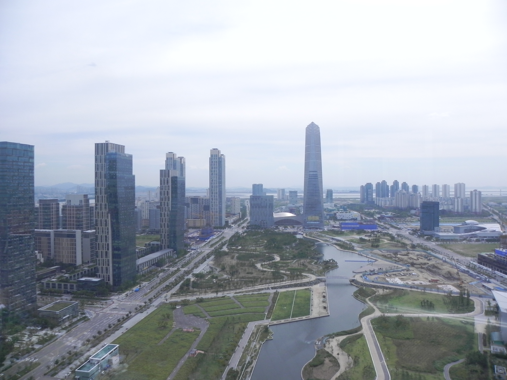
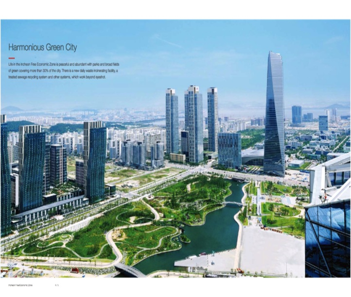
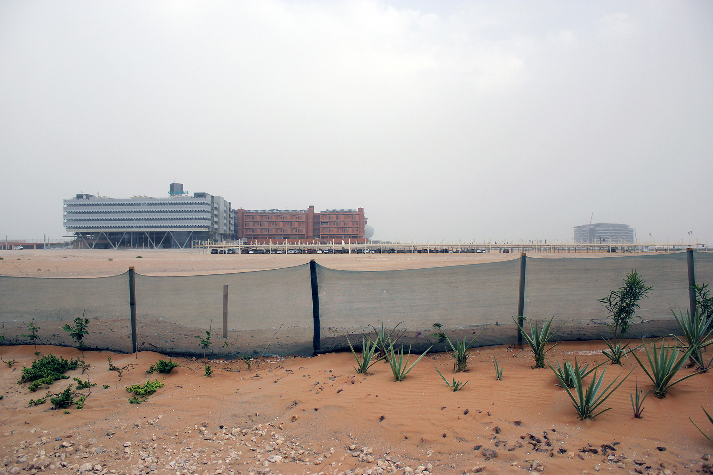
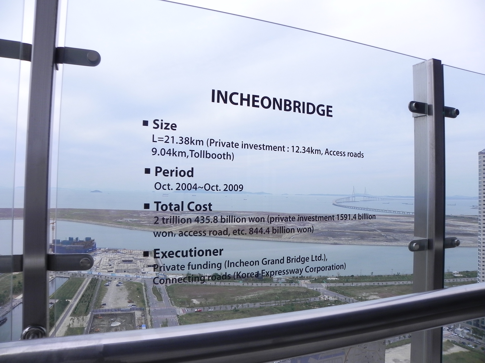
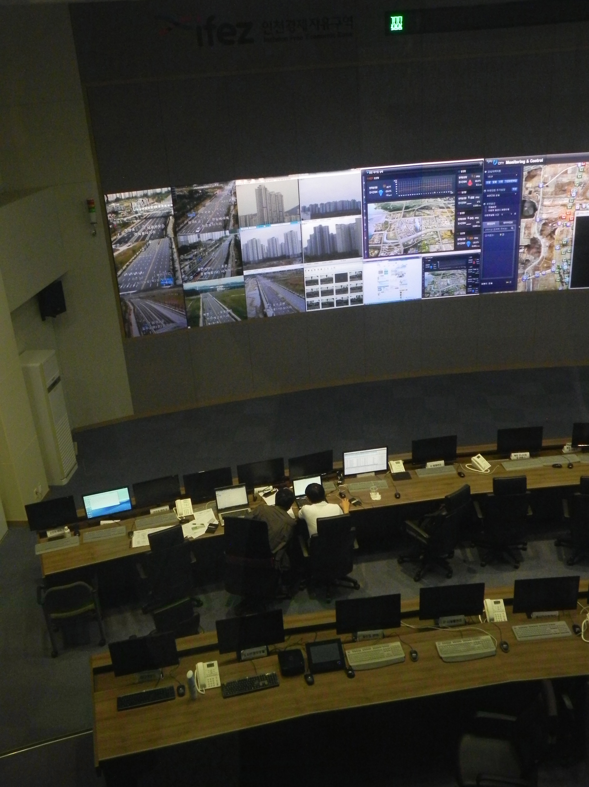
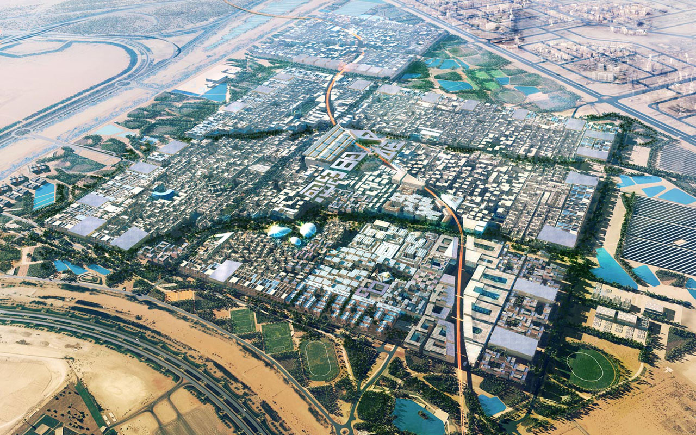
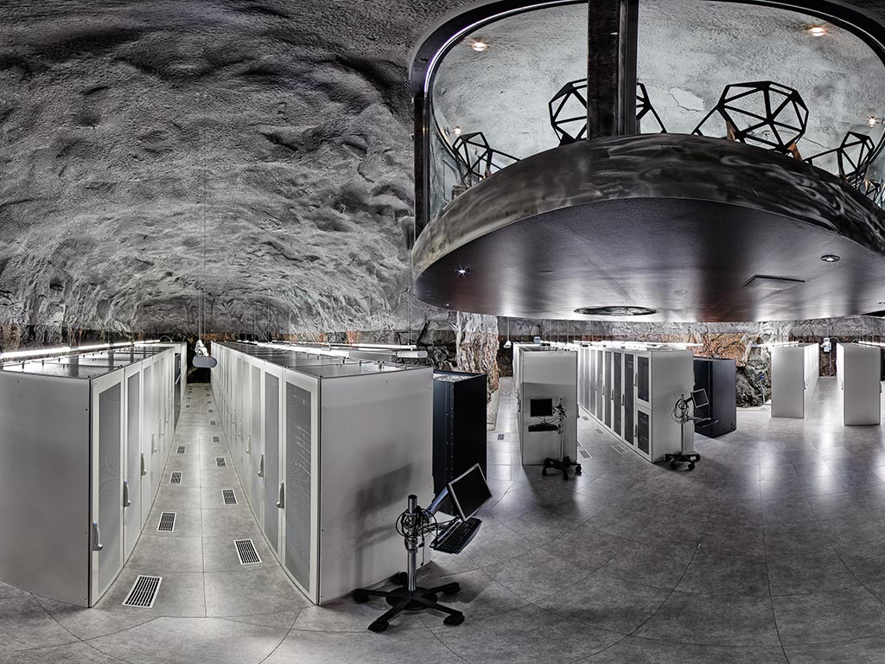
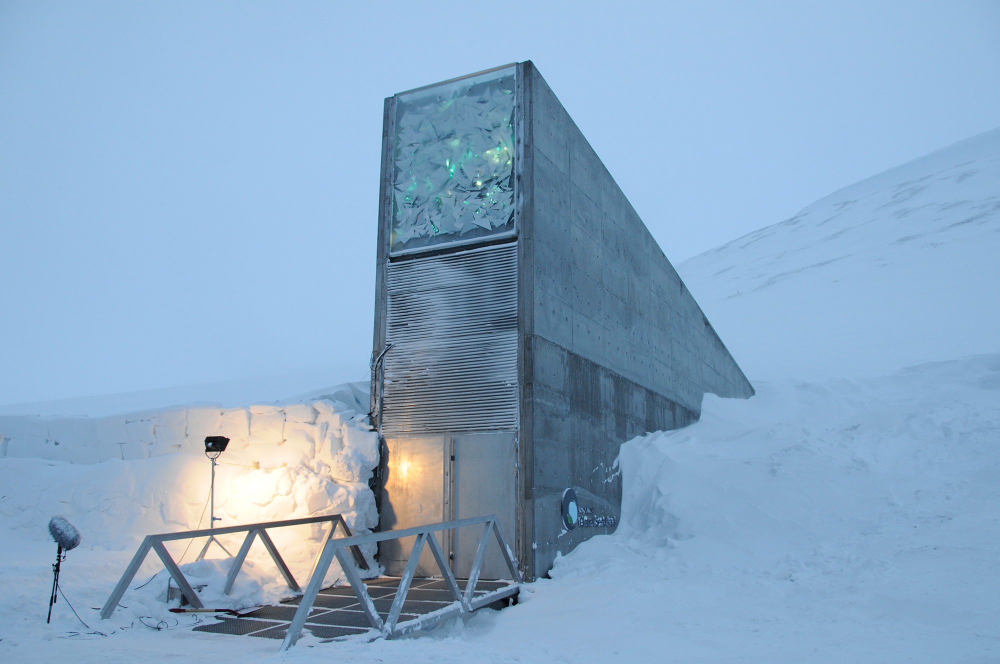
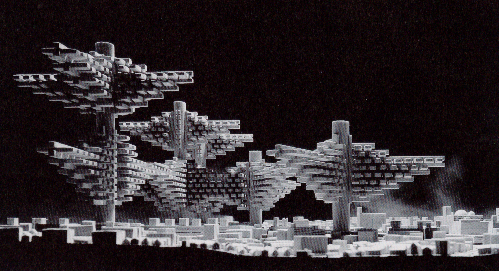

---

> Computing is not about computers any more. It is about living.
>
> (Nicholas Negroponte, 1995: 6) {#para1}

Today, growing concerns with climate change, energy scarcity, security, and economic collapse have turned the focus of urban planners, investors, and governments towards infrastructure as a site of value production and potential salvation from a world consistently defined by catastrophes and crisis. From discussions about ‘disaster capitalism’ to the embrace of a world after humans, the idea that some environmental, economic, or security catastrophe has arrived, or will arrive, is almost unquestioned. In response, there has emerged a new paradigm of high technology infrastructure development obsessed with ‘smart’, ‘ubiquitous’, or ‘resilient’ infrastructures. Such smartness and resilience must be understood as quite specific as it directly refers to computationally and digitally-managed systems – from electrical grids to building management systems – that can learn, and in theory adapt, through analysing data about themselves. Whether threatened by terrorism, sub-prime mortgages, energy shortages, or hurricanes, the response is surprisingly similar. {#para2}

The concept of such responsive or smart environments is often dated to the 1970s, and attributed to Nicholas Negroponte’s efforts with the Architecture Machine Group (later to become the Media Lab at MIT), where he supposedly coined the term (Negroponte, 1970; 1975). Negroponte proposed that designers would be able to make architecture better serve populations and address the context of urban degradation and racial segregation in the United States and in the Global South by integrating computation into built environments. Relying on technology, the Architecture Machine Group envisioned buildings and urban designs that could monitor fluctuations in their environment, alter their forms in response to possible changes, and redesign themselves if need be. {#para3}

Emerging at the same time as a global energy crisis, rising environmental consciousness, and an increase in both urban violence and terrorism, the idea and design of the responsive environment, therefore, has long been married to geo-political crisis (Halpern, 2014b). Sponsored by defense research funding and corporate investment, the Architecture Machine Group was directly invested in producing technologies and urban design solutions in answer to everything from post-colonial conflict, to American race warfare, to transforming corporate research and development. It is perhaps fitting then, that it is Negroponte’s famous adage summating the high-technology start-up mentality of the 1980s and 1990s – ‘demo or die’ – that also most adequately describes this mode of futurity and optimism being espoused in the name of impending disaster in our present. {#para4}

Our argument is that what differentiates these contemporary smart infrastructures from earlier approaches is not the question of technology, but rather the particular form of spatial and temporal containment and speculation engendered by the logic of prototyping, versioning, and demoing. The development of smart cities follows a logic of demoing, constant prototyping, testing and updating; instead of a finished product, infinitely replicable but always preliminary versions are installed in cities around the globe. At the same time, the idea of the smart city is inextricably linked to notions of catastrophe, where the logic of the demo or test-bed becomes a means for responding to impending environmental, security, and financial destruction by constantly deferring this future from ever arriving. The demo is a form of temporal management that through its very practices and discourses evacuates any historical and contextual specificity of the catastrophe. It is precisely the fact that threat is never fully represented or specified, and that all threats are dealt with in the *same* manner, that is the defining element of the demo as a form of logic and practice. While every event is different, for example the 2008 sub-prime mortgage collapse in the United States and the Tohuku earthquake of 2011 have distinctions, within the demo-logic that substantiates the production of smart and resilient cities, there is rarely any delineation within discourses of smart systems. {#para5}

This joint logic of both repetitive incompletion and even failure joined with the preemptive anticipation of negative events is central to legitimating the on-going penetration of computation into the environment. It is precisely this evacuation of differences, temporalities, and societal structures, that most concerns us in confronting the incredible rise of ubiquitous computing and hi-technology infrastructures as solutions to the political, social, environmental and historical problems confronting urban design and planning. {#para6}

In this essay we will explore this phenomenon – what we will label ‘preemptive hope’ – that ties together the logic of the demo or test-bed, speculation on disaster, sentiments of hope and optimism, and the production of high technology infrastructures. Preemptive hope necessitates the production of new metrics that measure the environmental performances of these complexes, giving their residents an opportunity for self-reflection and contemplation, and communicating an optimistic sense of potential at a time of future environmental destruction. To map and analyse how preemptive hope works, we will do a quick fly through of two major developments – Songdo in South Korea and Masdar City in Abu Dhabi – which are among the most visible and massive of the smart and eco- city projects started over the last decade, and continue to comprise noteworthy points in debates on urban design. {#para7}

### Inhabiting the Future

To move from the abstract to the substantive: one hour’s drive southwest from Seoul, the new city of Songdo [1] is being built from scratch on land reclaimed from the ocean (see Figure 1 and 2). It is a masterpiece of engineering, literally emerging from a previously non-existent territory. Beneath this newly grafted land, lies a massive infrastructure of conduits containing fiber optic cables. They are largely empty spaces waiting, in theory, to provide some of the highest bandwidth on earth. To the eye of a New Yorker this is a strange landscape of inhuman proportions. Nowhere in the United States are there construction sites even approximating this size. Songdo is thus both awe inspiring and beautiful (Figure 1), and horridly banal. The sheer size, and scale, all grafted from the Yellow Sea, is literally an engineering project of geological scope. The project thus conveys ideas of infinitude in both monetary and technical terms. Its purpose is to sell size, growth, and undefined expansion in the supposed name of some ill-defined notion of ‘greenness’ and economic development (Figure 2). {#para8}

Part of the Incheon Free Economic Zone (IFEZ), Songdo is one of three planned developments to be rolled out as the latest testing grounds for the future of human habitation (Zones, 2012). The master plan of the zone envisioned the unification of three functions: the first, high technology research and development and a city expected to house approximately 300,000 people, to which Songdo is dedicated; the second, a central hub for logistics which includes the massive Incheon Airport and port facility; and the third, a planned development, Cheongna (whose current fate post-2008 is unclear) that was to service finance and leisure services. Together – intelligence, logistics, and finance – they comprise a package that is, in the fantasies of its developers, replicable globally. The zone is being developed through a variety of public private partnerships. While the big players constantly change, currently they comprise of Cisco, a California based network infrastructure provider now interested in entering tele-presence and management consulting, and Posco a South Korean chaebol. In the course of the project Gale International (a Boston based Global real-estate development corporation), and Kohn Pederson Fox Associates (a New York based global architecture and engineering group), have also been involved in building and designing the urban space, and continue to be major stake holders. Although it should be noted that Incheon City and IFEZ took much of the responsibility through a debt restructuring deal in 2013, and are also now the prime owners and beneficiaries of any profits to be made from Songdo. {#para9}

Much of the financing to date, approximately $40 billion in Songdo alone (Lobo, 2014), was conducted through Morgan Stanley Real Estate and is heavily leveraged (Wikipedia, 2015; Landon Thomasm, 2013). All these groups are global players in both development and technology, and Cisco has teamed up with Posco and the IFEZ authorities to create management consulting and planning services in the interest of assisting other governments and locales with building similar developments – mainly in Ecuador and Malaysia. China, of course, is another major target of Korean management consulting interest. Cisco is also a major global player in the frantic race to dominate the smart infrastructure and city market currently presumed to reach the size of $1,134.84 billion by 2019 (current estimates put the number at $ 411.31 billion), through its ‘smart+connected’ communities program (Markets and Markets, 2015). {#para10}

What makes this city so smart is that it is (or planned to be) embedded with sensors that transfer data about atmosphere, trash, electricity, and traffic flow into networked computer systems that can algorithmically (in theory) figure out the most efficient way to respond to changes in behaviors of either the population or the environment. This agent-oriented smartness, not one of consciousness but little actions collectively networked, is viewed as capable of handling and managing a series of future events from the very mundane – direct marketing to smart phones – to the catastrophic – damaged energy grids, crowd sourcing for disaster relief in the case of massive meteorological, geological, or terrorist events (particularly as related to North Korea), and large transportation accidents (Schelemetic, 2011). {#para11}

Songdo, like any major technical product today, is not an object, it is a process. It is a beta version for urban life. The city is envisioned as a platform deploying this smartness in the interests of perfectly merging corporate demands and consumer lifestyles in a ‘safe’ and ‘optimized’ environment. [2] On first inspection, the city does appear to deliver these services. Songdo serves as a high-end suburb to Seoul, mostly for white-collar workers, although there are increasing numbers working within the city. The development is concentrated around a very long and large multi-block open-air shopping mall / street, which serves both entertainment and shopping demands. It has extensive industrial research and office parks including the headquarters of Posco and the UN Economic and Social Commission for East Asia and Pacific, the Global Climate Fund, the central research facilities for firms such as Samsung for biological research, and IBM and KYOBO house electronic book storage and cloud facilities on the site. Finally, it hosts a large university complex, the Songdo Global University Complex, that is home to both local and international schools such as SUNY, University of Utah, University of Ghent, and University of St. Petersburg. The city thus integrates in its plan hi-technology facilities for corporate administration, research and drug production, higher education and access to potential labour, and consumption. Foreign corporations receive tax breaks, but all corporations receive substantial benefits from the enormous investments that have been made (over $30 billion to date) by IFEZ and Incheon City to construct high bandwidth fiber optic infrastructure, smart electrical grids, public transport (including direct subway links to Seoul), and an advanced underground trash processing facility that generates energy as well. The city then, is a demo for urbanism of the future; a prototype for the world. As its initial developer, Stanley Gale, is quoted as saying, ‘We want to crack the code of urbanism, then replicate it. We want to build at least twenty Songdos ourselves: the G20 – Gale 20.’ (Arlidge, 2010). {#para12}

Incheon, in fact, is a leader in creating this new form of codeable territory and life. It was one of the first post-World War II free trade zones started by the Americans to encourage capitalist development in South Korea after the Korean War. Incheon emerged in its contemporary reincarnation as part of former President Lee Myung-bak’s efforts to promote green and low-carbon growth, and sponsorship of high technology infrastructure and research as a solution to South Korea’s economic woes and security situation in the aftermath of the 1996 currency crisis. In 2003, Incheon was officially legally reassigned as a ‘free trade zone’ with the accompanying deregulation, tax exemptions for foreign capital and companies, and tax and infrastructure subsidies from the local and federal governments. Where once invasion occurred in the name of containment now airports, automated port facilities, high-tech office parks, and university satellites rise in the name of global integration — or more appropriately global replication (Schelemetic, 2011). {#para13}

Songdo cannot therefore be treated in isolation. These spatial products are part of what Keller Easterling has labeled ‘extra-statecraft’: new zones that govern human activity. Such zonal logics do not denote the demise of the state, but rather the production of new forms of territory whose very ideal is an exception to national and often international laws. Free trade zones are thus a growing phenomenon, stretching from Pudong District in Shanghai to the Cayman Islands, and even as far as the business districts and port facilities of New York State that serve as conduits for the smooth transfer of capital, labor, and technology globally. A new networked infrastructure that is linked through the algorithms of GIS and GPS systems and computerised supply chain management systems, and the standardisation of container and shipping architecture, and regulatory legal exceptions, are but a few of the many protocols that produce these spaces (Easterling, 2012). {#para14}

What makes the smart zones unique, however, in a world of zonal territories, is that they predicate themselves on a dual imaginary of dis-utopia managed through self-organising and constantly self-modulating and updating systems. South Korean developers that Halpern spoke with on site repeated a discourse about the nation as resource poor (particularly in energy), population heavy (although population growth is among the lowest in the world), and surrounded by hostile countries including North Korea, China, and Japan. To these many threats, engineers, but also artists and architects, uniformly responded that it was only Korea’s remarkable engineering capacities that had saved it from demise. In fact, South Koreans regularly identified with Halpern’s Israeli origins, viewing both nations as closely related in struggling with security concerns, and also in their engineering and entrepreneurial spirit. [3] Such reasoning is not solely the province of South Koreans. It is one of the implicit and automatic assumptions legitimating ubiquitous or smart systems: that increasing computation and data flow in the environment (irrespective of how much energy servers use) will somehow overcome the problems and limits of human decision making and control. The new metrics developed on smart cities become the forms of deferring these threats, enable what we call ‘preemptive hope’, and trigger a future of economic growth and technological complexity (Figure 2). {#para15}

While the imaginaries of the future are steeped in threats, what is surprising is that these disasters are presumed to never arrive. When Halpern interviewed engineers at Cisco and government officials from IFEZ, in July 2012 and September 2013, repeatedly the language of Songdo as an ‘experiment’, a ‘test’ – in short, a demo – continually reasserted itself (Halpern, LeCavalier and Calvillo, 2013). In fact, few places on earth share so close an intimacy and so great a love for the demoing ethos and techno-fetishisation of MIT as South Korea; particularly as related to ubiquitous computing projects. The main leaders of the government commissions to build smart cities were all trained at MIT, as were many in the Cisco team. MIT was originally supposed to be a partner in Songdo, and then withdrew for arguably unspecified ideological or conceptual reasons, but most likely, according to other sources, fiscal reasons. MIT’s Senseable City Lab was, however, a partner and collaborator on other major projects, primarily the Digital Media City development near Seoul, a somewhat smaller and more targeted development specifically constructed to encourage entrepreneurship in the media production industries. [4] {#para16}

South Korea has even made it a business and matter of national identity to be the land of the consumer product test-bed. Korea markets itself globally as a test zone, opinion leader and early adopter population; highly urbanised and concentrated, ready to more rapidly consume new technology, offer discriminating feedback, and act generically. By extension, the nation, and particularly the youth zones of Seoul, are regularly billed as the most desirable location to test new products before entering more mature North American, European, and other Asian markets (Kwon, 2010; Lee, 2010). {#para17}

Songdo, therefore, must be understood not as a city but, as Halpern and her colleagues have written, as a test-bed. It is a platform for testing these parametrically designed and generated cities; and it is part of a global demo ethos that brings us endless versions, updates, and trials – comprised of constant feedback loops between market research, personalisation, and product development. Songdo might fail, but this is only a temporary problem, that will encourage the next version, a better smart city in Rio or New York or Shenzhen, another prototype (Halpern, LeCavalier and Calvillo, 2013). Just as car accidents are regularly re-performed on auto-manufacturer test-beds, so in the case of these massive infrastructures any failure can be contained and managed. Such failures are even the platforms that allow developers to prepare the next version; that enable engineers and planners to unearth that ‘code’, recalling Stanley Gale, of urbanism facilitating the rapid construction of new cities globally. {#para18}

In fact, Songdo’s occupancy rates are low and its financial future unclear. The entire complex, despite being widely touted in financial news as super-planned and green, is actually beneath sea level and vulnerable to global warming. Thus one must read all this optimism, not to mention the continuous South Korean government’s support, the spinning off of management consulting groups to conduct similar such ‘tests’ globally, and the ongoing preparedness of major investment banks to leverage such developments (Cisco and IFEZ are currently consulting on developments in Ecuador) as articulating a perspective where the world, and life, is just always a test without an end. The function of these territories is to serve as bounded studios within which to integrate finance, computation and digital media with discourses of sustainability, resilience, and survival. Like a modernist piece of montage, these seemingly dialectical oppositions become a single media product, combined into a package that is currently colonising our ability to imagine the future of human life. {#para19}

### ‘Energetic’ Demos

As part of this emerging practice of survival through technology, design, and smartness, the United Arab Emirates also started the construction of a zero-carbon city, titled Masdar City (Figure 3). {#para20}

The project began in 2006, when the Abu Dhabi government publicised its intentions to invest in renewable energy and clean technology infrastructures in the form of a multi-faceted state-owned company called Masdar. By investing in renewable energy and clean technology, the Abu Dhabi government hoped to remain a significant player in the energy industry well after its oil reserves run dry (Günel, forthcoming). In the following years, Masdar (meaning ‘source’ in Arabic) became widely known for Masdar City, a futuristic smart eco-city that was designed by the London-based architecture office Foster + Partners to rely entirely on renewable energies. Masdar City would house 50,000 residents and 40,000 commuters on a 600-hectare area, and cost $22 billion. ‘To look at computer-generated images of it, you might think it was a fantasy from a sci-fi comic. The sort I read as a boy’, Norman Foster of Foster+ Partners said in 2011, ‘But Masdar City, a university city and environmental technology park outside Abu Dhabi, is already being built’ (Foster, 2011). {#para21}

While the eco-city was central to Masdar’s vision, Masdar also invested in renewable energy via its other operations – Masdar Power, Masdar Carbon and Masdar Capital. Masdar Institute, the energy-focused research center that was set up and supervised by the Technology and Development Program (TDP) at MIT was founded in a campus amidst the fledgling eco-city. {#para22}

In a global context afflicted with climate change and energy deficiency, the proposed Masdar City serves to produce a new mode of preemptive hope that would be universally applicable to any location. Like all test-beds in engineering, the function of the prototype is to test extreme conditions; the absolute limits of imaginable situations that a technology must undergo and still remain operable. The producers of Masdar, therefore, imagined the future in the dialectical extremes of both heaven and hell. Conceptions of the approaching end of the world were complemented with imaginaries of a utopian future, driven by a coming together of critical regionalist architecture and high technology. The designers suggested that they borrowed from old Arab cities in thinking about Masdar City, and pointed to Shibam of Yemen as a prominent example. At the same time, the city was going to be smart, or in the words of the architecture critic Rowan Moore (2010), it would have ‘a hidden brain’, which ‘knows when you enter your building, so that your flat can be cooled before you arrive, while in public places flat screens broadcast uplifting news on the environmental performance of the complex’. Framed as a utopia or science fiction project, which might be achieved, Masdar City needed the backdrop of a world struck by climate change and energy deficiency. The marketing and communications campaigns put together by Masdar aimed at proving that the opposite was also true – that the world needed Masdar City. {#para23}

‘We are creating a city where residents and commuters will live the highest quality of life with the lowest environmental footprint’, announced Sultan Al Jaber, then the CEO of the renewable energy and clean technology company Masdar, during the groundbreaking ceremony in 2006. ‘Masdar City’, he continued, ‘will become the world’s hub for future energy. By taking sustainable development and living to a new level, it will lead the world in understanding how all future cities should be built’ (Masdar Institute, 2008). Masdar City was conceptualised as a role model for the world, whose proponents argued: one day all cities will be built like this. Masdar City would demonstrate how a combination of high technology and better architecture could provide luxuries with a zero carbon footprint. {#para24}

Some people associated with Masdar called the city a ‘spaceship in the desert’ stressing the self-contained nature of the project (see Günel, 2016). In this understanding, Masdar City was an innovative technological model, proposing a means of survival based on rational scientific calculation and management. The experimental hub would technologically maintain the livelihoods of its residents, even if the earth could not provide the right living conditions for the frontier people on the ship. As Peder Anker shows in his history of ecological architecture, this is by no means a new trend in design. Since the 1960s, cybernetically informed imagined or real environments from space have inspired the making of ecologically sensitive architecture, underscoring that adopting space technologies constitutes the singular means for being in harmony with the ecosystem. According to this perspective, space provided an alternative environment of peace and rationality, standing in opposition to the destructive and irrational crises of the earth (Anker, 2010). The spaceship therefore served as a finite, computationally and technically sophisticated and insular habitat for a group of beings facing an outside world of crises. In the words of Peter Sloterdijk, the spaceship would offer an ‘exclusivity dressed up in claims to universalism’ (Sloterdijk, 2014: 263). Likewise, Masdar City set a contrast to the current fossil fuel driven economies of the world and to the future world of climate catastrophe. The imagined eco-city not only relied on a future oriented temporality, but also reproduced a particular spatiality with firm boundaries. {#para25}

These are spaceships with peculiar properties. While it is assumed that failure of any system in space leads to death, here death is forestalled by rebranding or reframing. Currently, for example, one hundred or so Masdar Institute students reside at Masdar City, occupying the dorm rooms of the Masdar Institute campus. Around three hundred professionals who work with Masdar (and recently with Siemens) commute there from Abu Dhabi or Dubai. In addition, there are many male low-wage immigrant workers on site, who are bussed back to various labour camps at the end of every workday. And yet construction efforts have stalled since the 2008 economic crisis. The Foster + Partners master plan has been cancelled. These days, Masdar City is underlining its identity as a special and smart economic zone, promoting its capacities as ‘the city of possibilities’ [5] with perpetual potential, and inviting technology companies to come and build inside the 600 hectare area, which neighbours the Abu Dhabi airport and the Formula 1 tracks. {#para26}

Like Songdo, Masdar operates on a model of temporal and spatial bounding into the logic of demonstration, where failures are turned into experiments and justifications (in a seeming irony) for ever more integration of technology, particularly computer and digital technologies, into the environment; and ever more speculation, algorithmically managed, to derive value from the possible, never realised futures that these spaces might produce. In these cities, the site of performance and demonstration associated with democracy and the demos, terms first emerging with the idea of the polis or city, have now become a literal demo as in prototype. The inhabitants of Masdar City are test subjects, responding to this prototype in real time (Günel, 2014). The performance of the infrastructure has become a logic in itself that bounds time and space, in order to manage futurity without needing to know the endpoint, and always legitimising another version, another brand, another derivative, another technical system. In fact, it is the seeming separation between the computational and prototype infrastructure, and the lived world that is precisely the justification for ever more testing, demoing, and development of technology. {#para27}

### Technological Futures

A fantasy of the future managed, or destroyed, by technology is nothing new, of course. Since the nineteenth century, machines have been envisioned as leading to both the emancipation and destruction of humanity. In the past six decades, technologically realisable species suicide has been a historically unique and specific site of fascination, made possible by way of nuclear weaponry. What is interesting, however, is the way that today’s demos and test-beds differ in their logic from the game theories and simulations of nuclear war. {#para28}

One of the most powerful ways to think this difference is through distinguishing between risk and uncertainty. If the Cold War was about nuclear testing and simulation as a means to avoid the unthinkable but nonetheless predictable – nuclear war – the formula has now changed. [6] This distinction is best summated in the separation between risk and uncertainty first laid out in the 1920s by the economist Frank Knight. According to Knight, uncertainty, unlike risk, has no clearly defined endpoints or values (Knight, 1921). It offers no clear-cut terminal events. In this case, the test no longer serves as a simulation of life. Rather, the test-bed makes human life itself an experiment for technological futures. This uncertainty embeds itself in our technologies – both of architecture and finance. Thus in financial markets we continually swap, derive, and leverage never fully accounted for risks in the hope that circulation will defer any need to actually represent risk, and in infrastructure, engineering, and computing, we do the same. {#para29}

As future risk transforms into uncertainty, smartness becomes the language by which to imagine our future. Instead of looking for utopian answers to our questions regarding the future, we focus on quantitative and algorithmic methods. Smartness, the dominant method for engaging with possible urban collapse, then becomes our new catch phrase for an emerging form of technical rationality whose major goal is management of an uncertain future through a constant deferral of future results or evaluation through a continuous mode of self-referential data collection without endpoint; what Shannon Mattern has labelled a methodolatry, a constant obsession with methods and measurement to constantly assess prototypes that are never completed; an assessment of results without endpoint (Mattern, 2013). {#para30}

There is a profound difference between knowing the future, as under the conditions of nuclear war, and acting under conditions of climatic, energetic and economic uncertainty to which smart urban planning responds. At Songdo, which serves as a potent example of the management of uncertainty, Cisco executives and government employees repeat this discourse ad infinitum – bandwidth is valuable even if its function, and monetisation, has not yet been determined. So huge conduits (they are some three feet wide in Songdo compared to the less then a foot wide in NYC for example) for fiber optic cables are built, the environment is embedded with sensors and responsive systems – from garbage to electrical grids – all the while the space stands largely, still, empty. More interestingly, despite Songdo’s lack of accomplishment or profitability, the idea of this smart city linking finance, high tech research, green infrastructure, and the perfectly customised consumer lifestyle has already propagated through the financial news and the services of firms such as SAP, Siemens, Cisco, IBM, Morgan Stanley, and Arup and to many different locations from Rio’s Operation’s Centers to the Gherkin in London. The outcome, or even the efficiency, environmentally or energetically, of these developments and buildings is impossible to assess with accuracy, and no one even tries. This is a future no longer described, but simply acted upon with zeal and speculative optimism. {#para31}

### Disaster Aesthetics

The most striking feature, therefore, about all this speculation and demoing on and of the end, is its absolute positivity and hopefulness. Hope is an affective state, an emotion that induces new types of methods and techniques such as big data analytics or parametric design, and allows designers and policy makers to act upon the uncertain future with ease. As such, hope is also an aesthetic category; a particular organisation of sense that mobilises, in the Rancierian understanding, affect toward action. It therefore behooves us to understand not only the technical and rhetorical infrastructure of this demoing until death, but its aesthetic sensibilities and tactics. The demo or test-bed is a practice of the senses, a mode of aesthetic strategies and performances born of modern architecture and computer-aided design. Masdar City and Songdo are the exemplars of this new type of emotionally demarcated territory, both literally architected into space and figuratively existing in our imaginations and desires. {#para32}

Designed by Norman Foster’s office in London, Masdar City (Figure 6), for example, is beautifully rendered in advanced building materials. While some of the buildings mirror the desert surroundings in their color and draw on critical regionalist architecture, others replicate the gleaming light grey of a spaceship and highlight the technologically complex nature of this new center of renewable energy. The residential units boast terracotta walls of reinforced concrete and rely on contemporary interpretations of mashrabiyas to block sunlight and foster privacy. The laboratory buildings are insulated from the heat by façades filled with inflatable cushions, which remain cool to the touch. In their marketing and communications, these buildings promise to offer a temperate climate, while contributing to an economy of knowledge production; all theoretically with zero carbon footprint. The arid desert that in fact gives life to Abu Dhabi through its multiple resources, most importantly oil, becomes marginalised as an other space that cannot be dwelled except in this manner. Its managing executives, experts who hail from around the world, conceptualise this new territory as an opportunity for capital investment and technological experimentation in the backdrop of a world struck by climate change and energy deficiency. Masdar City is promoted as a utopian living arrangement that acknowledges and resolves the current energy crises of the world, while mitigating climate change. It is a Live-Work-Play space, which will grow one neighborhood at a time. It refuses a vision of a world in decay but rather envisions a world that indulges in its dissolution. {#para33}

Inside, Masdar City employs alternative modes of transport. The personal rapid transit (PRT) pods, the planned mode of transportation within Masdar City, were first exhibited on the opening day of the World Future Energy Summit in Abu Dhabi in January 2009, giving visitors a sense of the eco-city’s futuristic ambitions. Designed by Zagato, an Italian engineering company famous for racing cars, and manufactured in the Netherlands by 2getthere, the pods were perceived to be the most innovative element of Masdar City. One blogger who reviewed the exhibit suggested: {#para34}

> The comfort and safety of the pods shows us a rather favorable vision of the future. Ride on cushioned seats, holding hands or facing each other. Have a conversation, catch up on the morning news. The car will stop to let you off at your chosen destination. Chauffeurs for everyone, and Green at that? That’s our future? Not bad. Not bad at all! (alternate-power.org, 2009) {#para35}

The pod cars confirmed that our future would be one of technological complexity, just like what we imagine when we watch science fiction movies. They evidence that our imaginaries of the future would remain untouched by problems of energy scarcity, and offer a comforting and enjoyable narrative in the face of environmental conditions that are deeply unsettling. {#para36}

Masdar City’s neighbors also promote hope and fun. The Formula 1 tracks have been hosting the Grand Prix since 2009 in Yas Island. The Al Ghazal Golf Course is older, serving golfers since 1997. All of these zones assist the drive for economic diversification in Abu Dhabi while at the same time putting the Emirate’s name on the map, promoting its brand image for diverse target markets. In their segregation from Masdar City, these carbon intensive sites stage different pathways towards which Abu Dhabi’s economy can be steered. They demonstrate that Masdar City is not necessarily symptomatic of a greening effort across the Emirate – it is only one of the experiments towards the production of a future that depends less on oil revenues. Although they can easily be perceived as dissipated or unrelated spaces with no common social basis, the Formula 1 track, the golf course and the eco-city all comprise segments of the challenge to generate non-oil based revenues for the Emirate, united under the drive for possible future profits. The segregated units with seemingly contradictory agendas and drastically different relationships to climate change and energy scarcity stand together, because they are all experiments for economic diversification, designed to anticipate a future with less oil revenues. {#para37}

Songdo promotes other pleasures – those of undefined futurity and eternal growth (Figure 4). Songdo is thoroughly uninspired architecturally, but incredible in its display of size and infrastructure (Figure 5). The marketers for the Incheon Free Economic Zone have strategically placed an observation deck on their skyscraper headquarters. From this observation deck, residents and visitors will marvel at the raw size of the construction site, and gaze at the seventh longest cable-stayed bridge in the world leading directly to Incheon Airport. This spectacle of high-end development titillatingly reveals that behind the smooth towers and luxury condos there is another infrastructure – that of Incheon Airport and Port – two of the most high-tech and largest transport and logistics facilities in East Asia. This suggestion of infinite circulation – of capital and people – all mediated through computing, offers a sentimental and aesthetic answer to uncertain disasters of environment and economy. Songdo, and the Incheon Free Economic Zone, thus serve as a vacillating network awaiting purposes not yet assigned, and preparing for environmental and economic disasters that have not yet been assessed or definitively calculated and whose temporal horizons are eternally deferred. {#para38}

Within Songdo, planners are careful to regularly point out that the environment is hyper-responsive. The centerpiece of this responsiveness is the quite showy, and seemingly unnecessary, ‘smart’ pole. This very key element of Songdo, as well as other Korean smart city developments, is a device lauded and circulated as *the* design element for inducing happy (literally labelled that in the marketing) environments. They are very visible in the landscape (Figure 7). In theory, smart poles monitor crime and traffic and issue traffic violations through their sensors and surveillance cameras. They also offer location based and personalised marketing by providing public Internet service and by linking to cell phones passing in the area, and they might, some planners suggest, even play personalised ambient music and sounds to make the environment soothing. They also give light, and in some designs, different colours (again to match with mood). To safeguard the ‘happy’ population these poles are also linked to disaster services and monitor for accidents and outdoor medical emergencies, along with environmental particles and, in certain designs also sense for radiation and chemical weapons (ostensibly from terrorist events, New York City already has installed such poles as part of its post- 9-11 preparedness program). In South Korea what makes these little happy-inducing disaster monitoring poles seem strange is their deliberate visibility, alongside their almost complete unnecessity — considering the already extant GIS/GPS systems and direct to consumer marketing in every smartphone, existing wi-fi and surveillance camera infrastructure within transport and public spaces, and the prevalence of fitbits and trackers and other sensor systems on and in the bodies and environments of contemporary cities and their denizens. The marketed and widely broadcast and designed visibility of these poles must, therefore, only be understood as another disaster and security aesthetic performing and demoing the ideal of a smart environment that provides security and comfort within its confines (Figure 10). {#para39}

All this happiness is refracted in the gleaming marketing materials issued for Songdo, Masdar, and a myriad of other similar complexes in locations ranging from Azerbaijan to China. As other architectural critics have also noted, almost every such real-estate development on earth has a similar video usually involving a scalar swoop into the city from space, and a fly through the main architectural spaces, all landing on images of consumer-citizens easily downloading data and services from their smart phones and / or perched in their shiny offices (Allais, 2014; Easterling 2012). The buildings are almost always rendered as though aerodynamic and ergonomic, maximising the flow of people, energy, and information. This effect is created through long tracking shots merged with renderings that lack strong light and shadow thus intimating pure flow without resistance through the city, and between interior and exterior spaces. This seamlessness is amplified, at least in the animated adverts for Songdo and Masdar City, through many scales, from the individual smart high-tech employee in their office on their smart devices, up to satellites that suggest links to global supply chains directly referred to by showing the airport and adjacent shipping facilities as well as recording the time it takes to reach major global centers. Songdo’s promotional material is created with the latest standardised computer aided rendering, while at the same time making obvious use of standard objects and forms from already available templates. The whole experience feels low quality. The feeling of obsolence is enhanced by the fact that many features of the city in the Songdo promo and the Masdar City videos have yet to be built. {#para40}

In line with the culture of demo, and according to sales reps, this failure only proves how great the next version of the city is. In Songdo, economic disaster has been met with resilience; instead of trademark buildings by big name architects, cheaper condos were built, and universities were found to rent space. Instead of being zero carbon and absolutely green (a goal IFEZ gave up in the name of deregulation and encouraging development) now the United Nation’s offices that regulate the environment reside in the more cheaply built office buildings! In Masdar City, the master plan has been cancelled, allowing third parties to come and build inside the declared green special economic zone. Masdar City will no longer be zero carbon, but it will experiment with climate change knowledge, technology and governance, and impose sustainability protocols. To this end, it houses the International Renewable Energy Agency (IRENA) global headquarters, a tenant that moved in to the city in June 2015, as well as Siemens Headquarters, and hopes to attract others, such as Doubletree Hilton. The part of the city which was built according to the Foster + Partners master plan – that is the Masdar Institute campus – remains perched atop a 20 feet basement level. {#para41}

The demo in these cities is, therefore, not like that of seedbanks or server farms that are imagined as bunkers against change. Instead, the urban test-bed is a site where futurity collapses into contemporaneity. It is envisioned to be *in* time; syncopated to the moment that there can be no history, only an eternal and repetitive obsolescence.[7] ‘Demo or die’ is not a threat, it is an invitation to participate in a new practice; perhaps one that will replace the older demos of democracy and realms of appearance, into a neo-liberal call for endless digital entrepreneurship and creativity. These cities appropriate the public realm of appearance, that was once *the demos* and transformed it into the demo, also a realm of appearance, but one with severely limited temporal horizons, group imaginaries, or citizenship benefits. The demo allows us to die, repeatedly, under the safe, secure, and in theory, profitable watch of our networked machines. {#para42}

### Alternative Hope(s)

Death is not the only option. It behooves us to examine other moments where devastating disasters were responded to, to ask about different possibilities, to develop new vocabularies. To this end, we wish to demonstrate a possible alternative vision of the future of a high technology Asian city. The work of Japanese architect Arata Isozaki is shown above (Figure 10). Isozaki, like so many engineers and designers in today’s smart developments, attended MIT for training in the 1950s, leaving the war-destroyed Japan to learn about American architecture. He is famous as an affiliate of the Metabolist movement of architecture. {#para43}

Metabolism is a different idea for thinking the future. Metabolic processes have complex relationships to death. They are both mechanisms for assimilating the outside into our bodies, and mechanisms for producing growth and change. Metabolism is about decomposition and growth at the same time; it is at the center of life. The Metabolist movement also reflected this idea. Emerging out of a devastated post-World War II Japan, these architects and designers attempted to envision a future for their cities. {#para44}

As Japan was recovering from American air raids and atomic weapons, it became significant to contemplate possible relationships with this history of destruction. In the Arato Isozaki project, the future was constituted through hanging buildings with computerised control that would hover over the past, the remains of Tokyo, rather then destroying all memory of the past and its traumas. The mega structure offered a solution that bridged the dreams of developers at that time: to build homogenous constructions; anticipating the Songdos and Masdar Cities of the world, and the nostalgia to return to a pre-war way of life, to Empire, and to the village like structures and small paper homes of Tokyo. Neither smart nor dumb, not making the decision between the end or the past, these structures emphasise and attempt to work through notions of time and change; metabolism as architecture. The mega-structure would insert technology in a floating territory above the old Tokyo, leaving both temporalities to work at their own pace, allowing Tokyo to remain partially un-rebuilt, still scared and mostly destroyed, a constant rent in the fabric of time. These multiple temporalities operate simultaneously, neither returning to the past, nor falling into an eternal present. Neither seeking to forget Japan’s own militarism and obsession with technical death, nor attempting to cease the use of technology. {#para45}

We must attempt to find ways to use our graceful machines and networks in different ways. There is, therefore, still critical work to do — in art and in scholarship — to envision, and to sense, alternative images of the future; to produce images of life that are not the same as those we make in the present. What is now required is to realise that uncertainty is possibility. The pleasures of insecurity need not be solely diverted into spectacles of consumption. We have to open the discussion about what constitutes management and control, and how to add temporal multiplicity, whether it is allowing weeds to grow as a strategy to ‘green’ cities, or thinking about multiple aesthetics not just spaceships or sleek glass towers. The future of politics therefore demands that we imagine alternative futures and split with the techno-futurist, and modernist, aesthetics borrowed from science fiction or from urban planning, design, and technology. We must move past questions of survival to pose another question; not how *must* we survive the present, but how would we *like* to live in the future? {#para46}

### Acknowledgement

The authors would like to thank the following foundations and individuals that made this article possible: The Graham Foundation, the Wenner Gren Foundation and the ACLS Foundation for research and writing support, Joseph Dumit, Natasha Myers, Jamie Allen, and Christopher Salter for invaluable ideas and insight, the organisers and the audience members at the LafargeHolcim Foundation 5th International Forum for rigorous comments, and the two anonymous reviewers for wonderful feedback.

### Biographical Notes

Gökçe Günel is an Assistant Professor at the School of Middle Eastern and North African Studies at the University of Arizona. She received her PhD in Anthropology from Cornell University in 2012, and held postdoctoral positions at Rice University and Columbia University. Her book *Spaceship in the Desert: Energy, Climate Change and Urban Design in Abu Dhabi*, which focuses on the construction of renewable energy and clean technology infrastructures in the UAE, will be published in 2018 by Duke University Press.

Orit Halpern is a Strategic Hire in Interactive Design and Theory and an Associate Professor in the Department of Sociology and Anthropology at Concordia University, Montréal. Her work bridges the histories of science, computing, and cybernetics with design and art practice. Her most recent book *Beautiful Data: A History of Vision and Reason since 1945* (Duke Press, 2015) is a genealogy of interactivity and our contemporary obsessions with ‘big’ data and data visualisation. She is now working on a large multi-site research project examining futurity, computation, and large-scale infrastructures. You can find out more at [www.orithalpern.net](https://www.orithalpern.net).

### Notes

[1] The research conducted in Songdo, South Korea, was done in collaboration with two architects / designers – Nerea Cavillo and Jesse LeCavalier, and with the excellent assistance and translation help of Electronic Arts Curator – Dooeun Choi. Orit Halpern is indebted to all of them for the inspiration and education they provided.

[2] Safety is one of the most prevalent discussions repeated by sales reps and government administrators. In Halpern’s two visits to Songdo, the first in 2012, and the second in September of 2013, a marked shift had moved to accepting the possible threat of North Korean sabotage or attack of computer and other networks, as well as the possibility of other types of biological or nuclear weapon use. Government officials also emphasised the profitability of the complex, its rising rates of occupancy, and the technical and business aspects of the complex. Interviews conducted September 2, 2013.

[3] Taken from promotional materials and interviews with IFEZ officials, Kyung-Sik Chung (Director of Cultural Affairs) and Jongwon Kim (Director of Marketing and Development for IFEZ Authority), on July 4, 2012. See also: [https://en.wikipedia.org/wiki/Incheon_Free_Economic_Zone#Yeongjong_Island](https://en.wikipedia.org/wiki/Incheon_Free_Economic_Zone);

[https://www.fez.go.kr/en/incheon-fez.jsp](https://www.fez.go.kr/en/incheon-fez.jsp). Taken also from interviews with many curatorial staff at The Seoul Art Museum, and particularly with Dooeun Choi, September 9-13, 2013, and with the architect Taeseok Ha, of SCALe, on September 12, 2013.

[4] From interviews with Professor Dr. Donyun Kim, Professor of Urban Design at Sung Kyun Kwan University at Samoo Architects and Engineers on July 3, 2012 and September 11, 2013. Dr. Kim was also one of the lead members of the Presidential Committee on Ubiquitous Computing and Infrastructure in 2013-14.

[5] See the Masdar City website for this slogan: [https://www.masdar.ae/en/masdar-city/detail/we-are-masdar-city-the-city-of-possibilities](https://www.masdar.ae/en/masdar-city/detail/we-are-masdar-city-the-city-of-possibilities)

[6] It is important to recognise that there are also alternative histories of temporality and control within computing coming from cybernetics. In the work on organisations and economics from figures such as Herbert Simon, and in the work on neural nets coming from the heritage of Warren McCulloch and Walter Pitts, ideas of fuzzy problems and logic were prevalent, and preemption, not prediction, was a dominant theme. These influences went on to be very important and influential in engineering and financial culture, particularly through the figure of Nicholas Negroponte and through architectural collectives such as Archigram and the Metabolists. For more information, see Halpern (2014a) and Erickson et al. (2013).

[7] The architectural historian Daniel Abramson has suggested that obsolescence as a defining term in urbanism, and as a concept governing urban planning and design began to emerge in the immediate post-World War II. See [https://www.grahamfoundation.org/grantees/5127-obsolescence-an-architectural-history](https://www.grahamfoundation.org/grantees/5127-obsolescence-an-architectural-history)

### References

- Allais, Lucia. ‘Rendering’, talk at *The Instruments Project: Princetion Conversations*, Princeton School of Architecture (2014).

- Alternate-Power.org. ‘Zagato’s PRT Pod A Huge Hit at WFES’, *alternate-power.org* (2009), [https://alternate-power.org/zagatos-prt-pod-a-huge-hit-at-wfes/](https://alternate-power.org/zagatos-prt-pod-a-huge-hit-at-wfes/)

- Anker, Peder. *From Bauhaus to Eco-house: A History of Ecological Design* (Baton Rouge: Louisiana State University Press, 2010).

- Arlidge, John. ‘Metropolis Now’, *Wallpaper* (Oct 2010): 263.

- Easterling, Keller. ‘Zone: The Spatial Softwares of Extrastatecraft’, *Places* (June, 2012).

- Erickson, Paul, Judy L. Klein, Lorraine Daston, Rebecca Lemov, Thomas Sturm, and Michael D. Gordin. *How Reason Almost Lost Its Mind: The Strange Career of Cold War Rationality* (Chicago: University of Chicago Press, 2013).

- Foster, Norman. ‘The City of the Future: It’s a Story of Camels, Penguins and Cars you Don’t Drive’, *Daily Mail*, 26 January (2011), [https://www.dailymail.co.uk/home/moslive/article-1348558/Norman-Foster-City-future-camels-penguins-cars-dont-drive.html](https://www.dailymail.co.uk/home/moslive/article-1348558/Norman-Foster-City-future-camels-penguins-cars-dont-drive.html)

- Günel, Gökçe. ‘Masdar City’s Hidden Brain: When Monitoring and Modification Collide’, *The ARPA Journal, Applied Research Practices in Architecture* 01 (2014), [https://www.arpajournal.net/masdar-citys-hidden-brain/](https://www.arpajournal.net/masdar-citys-hidden-brain/)

- Günel, Gökçe. ‘Inhabiting the Spaceship: The Connected Isolation of Masdar City’ in James Graham, Caitlin Blanchfield, Alissa Anderson, Jordan Carver and Jacob Moore (eds.) *Climates: Architecture and the Planetary Imaginary* (Zurich: Lars Müller Publishers, 2016), 361-372

- Günel, Gökçe. *Spaceship in the Desert: Energy, Climate Change and Green Business in Abu Dhabi* (Durham, NC.: Duke University Press, forthcoming).

- Halpern, Orit, Jesse LeCavalier and Nerea Calvillo. ‘Test-Bed Urbanism’, *Public Culture* 26 (March 2013): 272-306.

- Halpern, Orit. ‘Cybernetic Rationality’, *Distinktion: Scandinavian Journal of Social Theory* 15 (2) (2014a): 1-16.

- Halpern, Orit. ‘Inhuman Vision’, *Media-N: Special Issue: Art and Infrastructures: Information* 10.3 (2014b), [https://median.newmediacaucus.org/art-infrastructures-information/inhuman-vision/](https://median.newmediacaucus.org/art-infrastructures-information/inhuman-vision/)

- Knight, Frank. *Risk, Uncertainty, Profit* (Boston: Schaffner and Marx; Houghton Mifflin, 1921), [https://www.econlib.org/library/Knight/knRUP.html](https://www.econlib.org/library/Knight/knRUP.html)

- Kwon, Son Jae. ‘Korea’s Early Adopters Set the Tone for Electronics Giants’, *Korea.net* (10 Aug 2010), Business Section, [https://www.korea.net/NewsFocus/Business/view?articleId=82272](https://www.korea.net/NewsFocus/Business/view)

- Landon Thomas, JR. ‘How Turkey’s Troubles Could Spread in Emerging Markets’, *The New York Times* (20 December 2013), Economix, [https://economix.blogs.nytimes.com/2013/12/20/how-turkeys-troubles-could-spread-in-emerging-markets/](https://economix.blogs.nytimes.com/2013/12/20/how-turkeys-troubles-could-spread-in-emerging-markets/)

- Lee, Su Hyun. ‘Companies Turn to South Korea for Product Testing’, *The New York Times* (11 Nov 2010), Global Business, [https://www.nytimes.com/2010/11/11/business/global/11iht-sk-consume.html?_r=0](https://www.nytimes.com/2010/11/11/business/global/11iht-sk-consume.html)

- Lobo, Rita. ‘Could Songdo Be the World’s Smartest City?’, *World Finance: The Voice of The Market* (2014), [https://www.worldfinance.com/inward-investment/could-songdo-be-the-worlds-smartest-city](https://www.worldfinance.com/inward-investment/could-songdo-be-the-worlds-smartest-city)

- Markets, Market and. ‘Press Release: Smart Cities Market worth $1,134.84 Billion by 2019’, *Market and Markets* (2015), [https://www.marketsandmarkets.com/PressReleases/smart-cities.asp](https://www.marketsandmarkets.com/PressReleases/smart-cities.asp).

- Masdar Institute. ‘Ground breaking marks start of Masdar City’, (2008) [https://www.masdar.ac.ae/component/k2/item/5623-ground-breaking-marks-start-of-masdar-city—​10-02-2008](https://www.masdar.ac.ae/component/k2/item/5623-ground-breaking-marks-start-of-masdar-city—​10-02-2008)

- Mattern, Shannon. ‘Methodolatry and the Art of Measure: The new wave of urban data science.’ *Places: Forum of Design for the Public Realm* (November 2013), [https://placesjournal.org/article/methodolatry-and-the-art-of-measure/](https://placesjournal.org/article/methodolatry-and-the-art-of-measure/)

- Moore, Rowan. ‘Masdar City, Abu Dhabi: the gulf between wisdom and folly.’ *The Guardian* (19 December 2010), [https://www.theguardian.com/artanddesign/2010/dec/19/norman-foster-masdar-city-review](https://www.theguardian.com/artanddesign/2010/dec/19/norman-foster-masdar-city-review)

- Negroponte, Nicholas. *The Architecture Machine* (Cambridge, MA: The MIT Press, 1970).

- Negroponte, Nicholas. *Soft Architecture Machines* (Cambridge, MA: The MIT Press, 1975).

- Negroponte, Nicholas. *Being Digital* (London: Hodder and Stoughton, 1995)

- Schelemetic, Tracey. ‘The Rise of the First Smart Cities’, *Thomasnet.com* (20 Sep 2011), Green and Clean, [https://news.thomasnet.com/green_clean/2011/09/20/the-rise-of-the-first-smart-cities/](https://news.thomasnet.com/green_clean/2011/09/20/the-rise-of-the-first-smart-cities/)

- Sloterdijk, Peter. *Globes (Spheres II)* (South Pasadena: Semiotext(e), 2014).

- Wikipedia. ‘Songdo International Business District’, *Wikipedia* (2015), [https://en.wikipedia.org/wiki/Songdo_International_Business_District](https://en.wikipedia.org/wiki/Songdo_International_Business_District) – Ownership_and_Design

- Zones, Korean Free Economic. ‘IFEZ’ (2012), [https://www.fez.go.kr/en/incheon-fez.jsp](https://www.fez.go.kr/en/incheon-fez.jsp).
