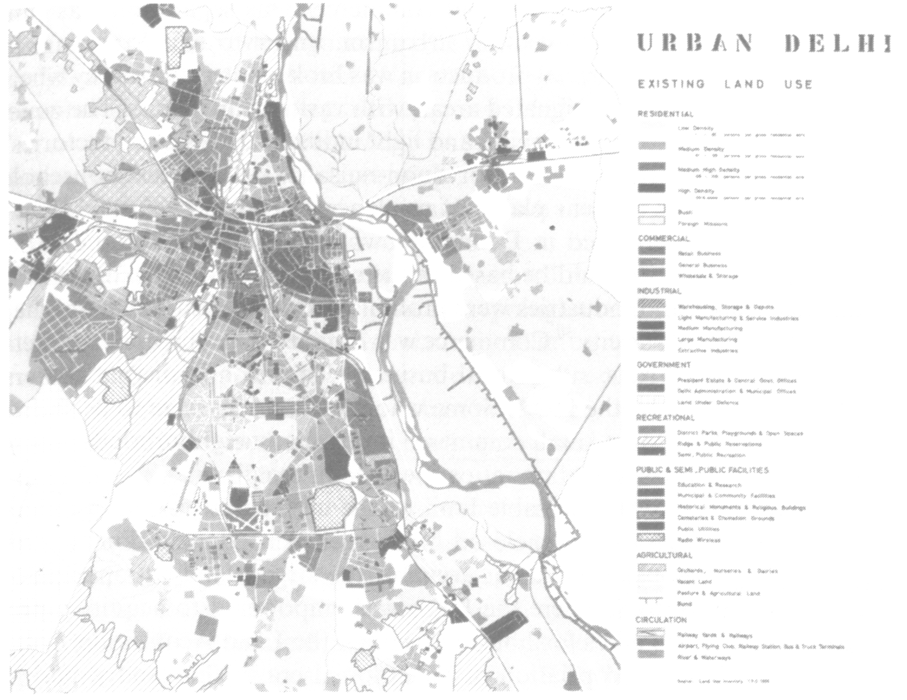
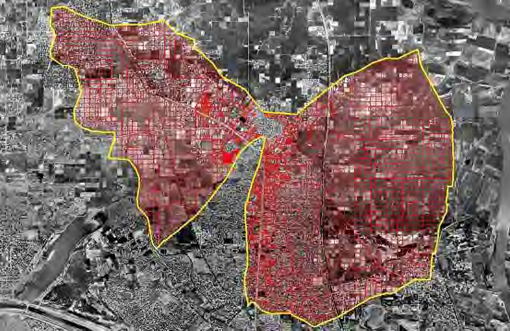

---

> Several decades from now cities will have countless autonomous, intelligently functioning IT systems that will have perfect knowledge of users’ habits and energy consumption, and provide optimum service … The goal of such a city is to optimally regulate and control resources by means of autonomous IT systems. {#para1}
>
> (Siemens Corporation cited in Greenfield, 2013: 12) {#para2}

> Do you, as a city, objectify the most sophisticated knowledge in a physical landscape of extraordinary complexity, power and splendour at the same time as you bring together social forces capable of the most amazing socio-technical and political innovation? {#para3}
>
> (Matthew Fuller, 2012) {#para4}

‘Smarter Solutions for a Better Tomorrow’ was the tagline for the 1st Smart City India Expo organised in Delhi, 20-22 May 2015. Ravish Kumar, a veteran Hindi journalist, covered the expo in his popular television news show. During a ‘City Surveillance Project’ demo, as a techno-manager tried to explain various aspects like CCTV monitoring, vehicle tracking, command and control, data management, etc., Ravish interrupted to ask: ‘What is this data management?’ [a rough translation from Hindi]. ‘Suppose you’re driving a car,’ replied the techno-manager, ‘and you’re stuck in traffic, only you know about that traffic and there is no centralised information about it. With a new sensors-based centralised command system integrated with the entire city’s dynamic map’, he continued, ‘we can collect all the data, process it in real time and send you a message on how to avoid the traffic.’ At this point Ravish, who was intrigued by the idea of a smart city throughout the show, asked ‘how… as the number of cars on the road won’t suddenly decrease.’ (Kumar, 2015) {#para5}

Beyond the questions of efficacy, this project demo along with several other demos at the expo, demonstrated new levels of enthusiasm and optimism in generating, mobilising and assembling certain forms of technologically empowered – especially ‘data-driven’ – urban futures. At a time when the Indian government has started to invest heavily in creating one hundred smart cities to solve pertinent problems of infrastructure, migration, employment, quality of life, delivery of services and governance (Ministry of Urban Development, n.d.) [1], the term and the networks of concepts which interweave its imagination call for scholarly attention and intervention. Much of the debate on smart cities in India has been focused on questions of policy and civic participation. The lack of clarity in the government’s vision and conceptualisation has been severely criticised (Lakshmi, 2015). However, there has not been much attempt to situate the idea of a smart city in India’s techno-urban context, and reflect on its interconnections with the past, existing and imagined forms of data-driven solutions. {#para6}

While smart cities are just the latest entrants into the vibrant, ever-evolving theatre of techno-urban problem solving, the wide-ranging potentialities which this term evokes – despite its conceptual fuzziness – have added new vigour to the discourse on urban infrastructures and techno-cultures both in India and abroad (Khanna, 2012; Townsend, 2014). How do we then begin to unpack the umbrella term ‘smart cities’? There cannot be one correct approach to this question, as it involves a panarchic (opposite of hierarchic) analysis of diverse sectors, institutions and actors. Given the current value-loaded and normatively techno-optimistic discourse, perhaps it would be worthwhile to start reflecting upon broadly what constitutes a smart city. {#para7}

One fundamental aspect of smart cities is their ‘data-driven’ character and the relationship of this with the larger big data discourse. [2] As we embrace the ‘data revolution’ – which promises to transform knowledge production, business and governance through use of digital tools, techniques and infrastructures for analysing the ever-expanding data from our devices, the Internet, governments, etc. – data or rather data-drivenness is being increasingly viewed as technologically and politically vital for making cities smarter. This data-driven-ness, however, is not just a digital upgrade, enhancement or optimisation of our present infrastructures, practices and planning processes. Rather, like previous technological interventions in general, it reconfigures our epistemic and ontic formulations of a city (Offenhuber and Ratti, 2014; Thrift, 2014). In other words, *data-drivenness* is reformulating the ways of *knowing, experiencing and governing a city*. This paper is essentially an exploratory, ethnographic engagement with these potential reformulations. {#para8}

I will begin by introducing the research agenda. In the next section I will discuss the techno-urban context in India. Subsequently I will present some vignettes from my on-going ethnography of data actors or ‘data-drivers’ in Delhi to highlight possibilities of grounded inquiries into data-driven systems. I will conclude by arguing for meta-analytics of data. {#para9}

### Introduction: Data-driven imaginaries

The burgeoning socio-technical research on big data has shown that questions and concerns about data quality, objectivity, epistemology and ethics are also themselves quite big (Boyd and Crawford, 2012; Kitchin, 2014a). The colossal hype around big data and the data revolution, at one level, is part of our recent ‘hype-cycles’ of technology – in which every new set of technological innovations is greeted by unchecked optimism, and a more balanced view emerges only after cycles of failures in bringing about the expected ‘revolutions’ (Gartner Inc., n.d.). At a deeper level, the big data debates invite us to reflect upon the history and anthropology of probability and statistics, computing and media, and quantitative social sciences (Desrosières, 2002; Halpern, 2014; Gitelman, 2013; Manovich, 2013; Mattern, 2015). Cities provide a rich socio-technical context for the latter set of inquiries. {#para10}

A well-networked city is the most fertile space for imagining big data or data-driven applications in general, since they require connectedness between various databases, institutions and socio-technical systems of transport, health, weather, water, sanitation, security, education, and governance. It is not a coincidence that the smart cities discourse has emerged in a certain conjunction with the data revolution, that is, the digital affordances of big data analytics, spatial data analytics, machine learning, data visualisation, etc. While there are longer histories of techno-urbanism, and specifically histories of the way that information and commutation technologies (ICTs) have been used to make cities ‘wired’, ‘digital’, ‘cybernetic’, ‘networked’, and ‘intelligent’, the data revolution marks an important shift from the earlier approaches and paradigms (Graham and Marvin, 2001; Kitchin, 2014b). In the smart cities cosmology, ICTs – from desktops to remote sensors, and mobile phones to CCTVs – are imagined to be *ubiquitous, platform technologies* that collect and collate massive amounts of data, which could be analysed to make the city more ‘knowable’ and ‘controllable’ (Offenhuber and Ratti, 2014). And even though data analytics per se has been part of the pre-big data analytics paradigms, its primary sources were limited to social and economic datasets. The smart cities movement, on the other hand, is anchored in the proliferation of digital spatial data which is being collected through GIS systems, sensors and user generated, geo-tagged social media content (Shelton et al., 2014). {#para11}

A critical engagement with this emerging shift in the epistemic and material basis of urbanism, I would argue, is only possible through an eclectic mix of conceptual tools and frameworks of science and technology studies (STS), urban studies, new media and anthropology. Cities, as Graham and Marvin and several others have illustrated, are complex ‘sociotechnical hybrids’ – wherein the technological and the social seamlessly co-evolve and co-construct each other (Graham and Marvin, 2001; Coutard and Guy, 2007; Aibar and Bijker, 1997; Farías and Bender, 2009). Using this as a point of departure, I will reflect upon the emerging urban data assemblages in the Indian context. {#para12}

Given the lack of precedence and overwhelming scope for such an inquiry, I will attempt to ethnographically engage with some common threads which run through the data revolution discourse – socio-technical imaginaries of data-driven systems. Drawing from interviews and participant observations from my fieldwork in Delhi, and extant literature, I will try to touch upon some of the historical and emergent techno-urban conditions and map the key sites for ethnographic inquiry. The choice of ethnography as a method to gauge socio-technical imaginaries of a data-driven city, goes beyond the need for reclaiming the ‘urban’ from technological determinism. More importantly, it allows for a contextual engagement with generative potentials and affordances of digital technologies and infrastructures (Boellstorff, 2012; Coleman, 2010; Larkin, 2013), which otherwise get encapsulated in social imaginaries. {#para13}

Political and social theory have elaborate conceptions of the intersubjective imaginaries which construct social order and practices. Arjun Appadurai, for instance, wrote in his seminal essay “Disjuncture and Difference in the Global Cultural Economy” (2002) that ‘the world we live in today is characterized by a new role for the imagination in social life’. He argued that to understand this new role we need to revisit the old ideas of images: {#para14}

> especially mechanically produced images (in the Frankfurt School sense); the idea of the imagined community (in Anderson’s sense); and the French idea of the imaginary (*imaginaire*) as a constructed landscape of collective aspirations, which is no more and no less real than the collective representations of, Emile Durkheim, now mediated through the complex prism of modern media … the imagination has become an organized field of social practices, a form of work (in the sense of both labor and culturally organized practice), and a form of negotiation between sites of agency (individuals) and globally defined fields of possibility. (Appadurai, 2002: 49) {#para15}

Appadurai’s argument is critical for understanding the heterogeneity of modernity and the dynamics of globalisation. However, as Sheila Jasanoff points out, he does not ‘engage with the seminal role of knowledge and its materialisations in generating and anchoring imaginaries of social order’ (2015: 12). Science, technology and media – the material basis of knowledge production and circulation, she argues, are ‘inexplicably’ missing from the overall social scientific imagination of imaginaries. To bridge this gap, Jasanoff puts forth a concept of socio-technical imaginaries, defined as ‘collectively held, institutionally stabilized, and publicly performed visions of desirable futures, animated by shared understandings of forms of social life and social order attainable through, and supportive of, advances in science and technology’ (2015: 6). Socio-technical imaginaries, she writes, ‘pull together the normativity of the imagination with the materiality of networks’ (2015: 28). {#para16}

Conceptually, socio-technical imaginaries are germane for studying data-driven systems. Although data is today popularly conceived of as new oil or new soil, it is not simply available as a natural resource. As Lev Manovich wrote nearly a decade before the invention of the concept of the data revolution, data ‘has to be generated. Data creators have to collect data and organize it, or create it from scratch. Texts need to written, photographs need to be taken, video and audio need to be recorded. Or they need to be digitized from already existing media’ (1999: 4). Data collection and generation techniques have undoubtedly become more sophisticated in the last fifteen years, but the basic principle still applies. As Lisa Gitelman wrote in the introduction of *Raw Data Is An Oxymoron* (a phrase coined by Geoffrey Bowker), ‘Data need to be imagined *as* data to exist and function as such, and the imagination of data entails an interpretive base’ (2013: 3). Different disciplines, as many STS scholars including Gitelman have demonstrated, contextualise or cook and savour data as per their historically and culturally contingent epistemologies (Gitelman, 2013; Bowker and Star, 2000; Edwards, 2010). With data-driveness expanding its publics into wider socio-technical realms like cities – in hybrids of human perception and cognition, computational logics of algorithms, databases and burgeoning digital infrastructures – the interpretive base(s) are encoding new socio-technical imaginaries and vice versa. The paper is intended to open up questions on these new forms of co-encoding or co-construction. {#para17}

### Indian Techno-Urban Context

Postcolonial cities have had numerous interesting encounters with socio-technical imaginaries of ‘modernist urbanism’, ‘modern infrastructural ideal’, ‘post-industrial city’ and so on (Chatterjee, 2004; Graham and Marvin, 2001). Each of these imaginaries has been marked by various technological, infrastructural, spatial and political reconfigurations. For instance, Partha Chatterjee (2004) observed that in the post-liberalisation economy flooded with images of global cities circulating through ‘cinema, television, and the Internet as well as through the Indian middle classes’ far greater access to international travel’ (143-144), government policies were increasingly designed to attract foreign investment. This created a situation whereby the urban middle-class citizens escalated their demands for ‘unhindered access to public spaces and thoroughfares and to a clean and healthy urban environment’ (Chatterjee, 2004: 143-144). Simultaneously, the government policy quickly moved away from welfare for the urban poor, towards more investments in infrastructure to promote ‘imports of high technology and the new service industries’. This had many visible effects including manufacturing industries being moved outside the city limits, eviction of encroachments, revisions in laws favouring the creation of high-value commercial and residential districts. {#para18}

Chatterjee remarks that ‘if this is the new global bourgeois vision of twenty-first century urbanity then this time we may have successfully grasped it’ (2004: 144). These reconfigurations however, were accompanied by a spate of unexpected implications as well. As Ravi Sundaram in his distinctive account of Delhi’s media urbanism notes: {#para19}

> The technological sublime of the planner imaginary, so central to post-independence India, began giving way to a splintered urbanist sprawl in the main metropolitan cities. Planning bodies pushed for the privatized decoupling of infrastructures; transportation design privileged the automobile flyovers and private toll highways to facilitate rapid travel to the suburbs, and private builders took over from older, albeit limited concerns with social housing. (Sundaram, 2009: 5). {#para20}

Later he continues: {#para21}

> … the end of the state’s technological monopoly opened up a dynamic space where the existing networks of ‘political society’ and expanding informal media production quickly moved from a model of parasitic attachment to a vitalistic transformation of the urban fabric. (Sundaram, 2009: 174) {#para22}

These political-infrastructural transformations are parts of the genealogy of the contemporary push for ICTs for urban development and data-driven urbanism in India. Drawing longer and thicker connections between the postcolonial city and the smart city will remain a work in progress; however, it is worth noting that the dynamic interactivity between social imaginaries and their materialisations is a part of urban (and not just digital) ontology. {#para23}

It is also important to note that ‘splintering’ in the Indian context happened without our cities ever achieving the ‘modern infrastructure ideal’ of universal, uniform grids and networks that covered services like water, electricity, roads, etc. Informal circuits, contested spaces and complex interactivity in co-existing systems of governance and infrastructure have long rendered the built environment in Indian cities some peculiarities which are hard to grasp and account for in urban masterplans and policies (Benjamin, 2008; Sundaram, 2009). The ‘archipelago’ (Bakker, 2003) condition of infrastructure systems calls for a view beyond the ‘modern infrastructure ideal’ (Furlong, 2014). {#para24}

For instance, in his ethnography of the water supply system in a suburban settlement in Mumbai, anthropologist Nikhil Anand analysed how the settlers manage to get access to water by mobilising ‘pressures of politics, pumps and pipes’ (2011: 560). Anand shows that constant negotiations and ‘pressure’ politics between the settlers, their elected representatives, local dadas (powerful patrons) and social workers, and the engineers and hydraulic infrastructure, constitute what he calls ‘hydraulic citizenship’: ‘a form of belonging to the city enabled by social and material claims made to the city’s water infrastructure’ (Anand, 2011: 560). Anand sees this as being produced in a sociotechnical field through ‘diverse articulations of *technologies of politics* (enabled by laws, politicians, and patrons) and the *politics of technology* (enabled by plumbing, pipes, and pumps)’ (2011: 560, my emphasis). {#para25}

Anand’s formulation helps in opening the largely black-boxed Indian cities as sociotechnical fields of interaction where infrastructures and politics materialise each other indeterminately. There are no similar ethnographic accounts of digital infrastructures, which arguably have much more convoluted and exotic issues of scale, multiple layers of abstractions, affordances and representation. {#para26}

Nonetheless, we do know that the much-desired data-driven systems of the smart cities will have to co-exist and interact with the present infrastructure systems. [3] While data-driven imaginaries boast of integrated modes of knowledge production, the infrastructural conditions will possibly only allow new and old systems to co-produce hybrids which are driven by more things than data alone (Bhatia, 2015; Lakshmi, 2015). For example, the Delhi metro – a rare, smoothly functioning infrastructure system in India – smart card data can be analysed to understand the commute patterns in the metro but the rest of the transport data in Delhi is extremely difficult to imagine, collect and collate with the metro data. These ambiguities, as we can gather from postcolonial urbanism and politics of infrastructure, are features (and not bugs) of the Indian techno-urban context, and can perhaps only be grasped through grounded inquiries. {#para27}

### Towards an Ethnography of Some Urban Data-Drivers

An ethnographic study of an Indian smart city will have to wait until the government, big consultancies and real estate moguls succeed in building one. Nonetheless, data-driven urbanism is thriving at the level of ‘the imagination’ in multiple forms. If we take smart cities to be a ‘great tradition’ to be performed by the government and partner agencies, there are several smaller entities performing diverse ‘little traditions’ of data-drivenness (Singer, 1972). I will provide ethnographic vignettes of five little traditions or emergences that I have come across in the past six months of my fieldwork in Delhi. These are: a new ‘image of the city’, the changing nature of expertise, civic data activism, data-driven consumer applications and political communication and analytics. Whether data-driven systems can produce holistic, nuanced knowledge of the social is contestable; nonetheless, they increasingly are producing some form of knowledge of the ‘social’, and by implication reconfiguring the social. This, I will conclude, begs for ethnographic attention. {#para28}

##### Emergence i. A new image of the city

Delhi is one of the very few cities in India with completely digitized maps and a Geographic Information System (GIS) in place – a pre-requisite in the selection of smart cities. During a recent visit to the government agency’s office which manages Delhi’s spatial data, one of the analysts gave me a demo on how their data can transform policy-making. {#para29}

Their spatial data has 386 layers of map data, including locations of post boxes, public conveniences, dustbin and garbage dumps, schools, hospitals, transport, markets, water tanks and so on. [4] On his computer, the analyst mashed up different map layers to demonstrate how he can with a mere click of a mouse generate insights about the city’s water bodies, roads, gas pipelines, forest and residential land zones, schools in a particular radius from any point on the map, and the list goes on. He regularly zoomed in and out of the map to explain the granularity and scale of their data. This non-real time data is currently only accessible for select government departments for planning and policy-making. {#para30}

An internal case study of the project gives an account of the data collection process: {#para31}

> The Department of IT gathered inputs from each participating line department and built every component of the project from scratch. The base map was created through the photogrammetric procedures on a large scale (1:2000), using aerial photography substantiated by various kinds of field surveys, namely topographic survey, property survey of dwelling units, underground utility surveys (including water, sewer and energy utility) and field photography in order to generate textures for the 3D models of the buildings. At the peak of the project execution, close to 1000 field surveyors were deployed. (PricewaterhouseCoopers, 2014: 6) {#para32}

The project was commissioned in 2008, and in 2011 the Delhi government created an act to set up the agency which currently manages the data. In contrast to the rigor with which the spatial data was collected, until now only a handful of applications have been created for intra-government usage. The smart city project however, has created a new wave of enthusiasm in an office which is accustomed to only mundane processes of digitising updates to maps and seldom shares information with other government departments. {#para33}

The analyst’s elaborate presentation and use of different functionalities of his ArcGIS software (like zoom, projection, overlaps and distance calculations), made me stumble upon how spatial data has, and continues to, rework our perceptual field of the city, or to use Kevin Lynch’s phrase, creates new ‘imageability’. In his pioneering book *Image of the City,* Lynch writes, {#para34}

> environmental images are the result of a two-way process between the observer and his environment. The environment suggests distinctions and relations, and the observer – with great adaptability and in the light of his own purposes – selects, organizes, and endows with meaning what he sees. The image so developed now limits and emphasizes what is seen, while the image itself is being tested against the filtered perceptual input in a constant interacting process. (Lynch, 1960: 7) {#para35}

Figure 1: Map of Delhi, 1962. Source: Masterplan for Delhi, as cited in (Sundaram, 2009: 50).

Figure 2: ‘Vector Overlay on Ortho Image’ (sic). Source: Geo Spatial Delhi Limited.

Software now, is an active techno-media layer of what Lynch referred to as ‘environment’. The Google maps in our smartphones and the government’s GIS, at different levels, provide the fundamental affordances for a new image of the city. This new heavily mediated image marks a new relationality between the observer and the city and participates in co-construction of a new techno-urban sensorium. For example, consider the two images above. The first one is the aerial map of Delhi in 1962, and the second one is a digital image on which a vector layer is overlaid on top of an ‘ortho’ base layer to highlight a particular area in the map using software. The latter image, the government analyst suggested, is an example of how spatial data can make the city ‘transparent’ and ‘computable’ for him. A critical geography of the augmentation being *performed* by the analyst might provide a different perspective (Graham, Zook and Boulton, 2013). Nonetheless, this new image and its meta-images are reconfiguring how the analyst or any spatial data user – at different levels of technological affordances – can now visualise, know and experience the city. This reconfiguration is one of the foundational elements of the socio-technical imaginaries of a data-driven city. {#para36}

##### Emergence ii. Expertise and data – who is driving whom and where?

‘Planning now is not related to space. ICTs and sensors do not need space. We just need more tech’, said a consultant working with the government on the smart cities project, as a response to my question on how they will manage to re-develop existing cities to smart cities. Beyond the obvious platitude, his response holds deep anthropological significance. {#para37}

Several STS scholars, including Timothy Mitchell, have demonstrated how ‘expert knowledge works to format social relations, never simply to report or picture them’ (2002: 118). In case of data-driven systems, it is difficult to trace the imaginaries and practices of its key drivers – techno-managerial experts, due to limited ethnographic access in corporate spaces like the consultancy firms at the fore front of smart cities projects. Nonetheless, through my interactions with some techno-managers at these consultancies and with several data scientists (mostly engineers) at data science meetups, I have come across certain aspects of the expertise driving the smart cities and the big data movement in India. {#para38}

Urban planning and policy have always depended on data. However, with the advent of big data, there is now a tremendous urge to collect more and more data. In my conversations with some leading urban researchers based in Delhi and Bangalore, I learned that instead of using the existing data, the current working of government agencies suggests an indiscriminate data collection approach without any sector-specificity or target. Also, I was told that there is a dearth of experts who could actually mine and analyse all the data we currently have. {#para39}

This is also relatable from the fact that there are almost no university courses in India in the fields of engineering and management which teach data sciences per se. For example, an engineer might know how to program in R language or with NoSQL databases but they would most likely lack problem framing, modelling and statistical skills. There is a lot of data floating around on how smart cities and big data technologies in general can transform the economy or at least deliver a boom in jobs related to data science (see Tejaswi, 2012). The latter ‘boom’, I would argue, is a generative site for re-imagining expertise. {#para40}

‘You are a researcher, so you must know some use cases right?’ This question is frequently posed to me in data science meetups. [5] By now I have rehearsed a few answers to keep the conversations alive. However, the problem here is not just a lack of use cases for techies to apply their data science skills. The data science communities in Indian cities like Delhi (including Gurgaon), Bangalore and Hyderabad which have major IT industries, are growing steadily. Yet there is little knowledge being produced on how to frame data problems in sectors other than the traditionally data savvy ones like business analytics, online marketing or supply chain management. The India chapter lead of a global data science community, which strives to solve data problems in the social sector on a pro bono basis, recently told me that there is very little interdisciplinary understanding of what data analytics can do in the social sector both among engineers as well as the people running NGOs. {#para41}

This leads us to the question: who essentially is an expert on smart cities? Or rather, who is imagined to be an expert? This will (and should) remain an open question. Nonetheless, the techno-managerial domination of expertise on smart cities is quite apparent. [6] The consultant I interviewed argued – in defence of his perspective on the insignificance of space for ICTs and sensors – that ‘water, electricity, health and education are all governance issues which we cannot solve. It’s the government’s job. We are here to provide expert solutions for collecting and analysing data’. While technological determinism and profit-driven approaches are historically characteristic features of such consultancy brand of expertise, this *peculiar division and thus reconfiguration of knowledge domains – of data analytics and governance – is a new, contextual occurrence*. Finding ethnographic nuances of these imaginaries remains a work in progress, though Delhi’s own history of urban planning provides a crucial stepping stone. As Sundaram observes: {#para42}

> The Masterplan’s landuse and zoning maps did not simply organize space into rational, manageable units for the new rulers. That had been done since the colonial era. As a specialist instrument of knowledge, the planning map of the 1950s fabricated urban expertise in Delhi. Planners and consultants now claimed privileged access to technical knowledge of the city, and consequently to political power. (Sundaram, 2009: 65) {#para43}

Later in the book he continues: {#para44}

> In the planning era, information helped to produce the city as a visible, rational entity within a hierarchy of parts. This was done for the public, but particularly for the postcolonial elites who were able to access the city using the authorized language of planning. All this changed with the simultaneous decline of planning and the emergence of globalization and technological networks in the city. (Sundaram, 2009: 175) {#para45}

Perhaps what we are witnessing now are remediated attempts to make the city ‘visible’ or knowable through data analytics. However, this is happening in a new zone of expertise and knowledge production. This emerging zone, wherein data analytics is imagined to be *the* site and *the* method of knowledge production, marks an important departure from the episteme of decentralisation that has dominated the discourse on network societies and urbanism in the last two decades (Graham and Marvin, 2001). This departure is further complicated by erratic boundaries of relevance of data analytics in urban governance. Thus, the emerging nature of expertise and knowledge production are key for understanding the socio-technical imaginaries of data-driven urbanism. {#para46}

##### Emergence iii. ‘What do we want?’ ‘open data!’ ‘when do we want it?’ ‘now!’ – ‘wait, who is “we”?’

A recent meetup of an Open Data advocacy group was organised to discuss the issue of opening water data in Delhi.[7] This meeting was attended by over forty people from diverse backgrounds including software engineers, urban researchers, non-profit workers, activists and politicians including the minister in charge of water in Delhi. The meeting, which lasted for more than four hours, saw lively discussions on several micro and macro issues of water infrastructure in Delhi such as the governance structure of water management bodies, existing data on water and its authenticity, disparate supply in adjacent areas, illegal supplies and so on. Towards the end of the meeting the core members requested everyone address the main objective of the meeting which was: to frame data problems associated with water in Delhi and devise strategies for opening up water data. {#para47}

The conversations between different stakeholders and the confluence of different standpoints and perceptions of both water and Delhi at this meeting made it a rare event. Debates on several ideas, like making the best use of the current data, which does not include much of end user data, as opposed to geo-tagging water data (by collating spatial data sets with existing water data) and installing new sensors and smart meters, kept resurfacing. The narrative went back and forth on issues of access to water for the end users and systemic accountability – and the role of data animated all the proposed solutions. Interestingly, people who were not acquainted with Open Data and analytics also chipped in. For example, an agent who acts as an intermediary between people of his residential area and the governing body for water in Delhi, suggested that we should focus first on data from resettlement and unauthorised colonies as the governing body always gives them the least priority. {#para48}

I observed similar but slightly more formal discussions at a couple of events organised by the central government’s Open Government Data (OGD) initiative, which is one of the leading OGD initiatives in the world, in Delhi. [8] A selectively condensed narrative on Open Data was also evident in a few hackathons – which were meant to crack governance and civic problems by creating web and mobile applications utilising open government datasets. {#para49}

Lilly Irani in her ethnographic study of hackathons in Delhi remarks that, ‘hackathons *sometimes* produce technologies, and they always, however, produce subjects’ (2015: 2). Hackathons have a pre-decided agenda and only attract a select set of people, mostly from privileged backgrounds, for whom the event is a rehearsal of what Irani refers to as ‘entrepreneurial citizenship’. While hackathons and Open Data meetups have a fairly different structure, the two categories of events, as I have come to observe, have a lot in common. {#para50}

Open Data meetups do not involve programming and product development, and thus the discussions and debates there are much wider. However, the idea of data-driven problem solving for social good animates the agenda of both the events. Also, from what I have observed, the set of people who attend civic hackathons are actually an approximate subset of people who are involved with Open Data meetups and advocacy. This I think sets the stage for a broader reconfiguration of citizenship, which is not limited to entrepreneurial character. {#para51}

At one level, the Open Data, and especially OGD movement can be seen as an evolution of public participation in a democracy. However, this form of participation reconstitutes the public and tacitly opens a register for classifying their civic affinities based on their engagement in the movement. When a group of data savvy citizens transparently partner with the government to open water data to solve water problems for the entire city, or when a group of engineers build an Android application for water grievance redress, they are not just participating in a democratic process in a fixed sense of the term (Kelty, 2017). Rather, they are creating new, technologically mediated and/or affected meanings of democratic citizenship. {#para52}

This may seem to be an obvious point in the Indian context where the Right to Information Act (RTI) and anti-corruption movements are still fresh in memory. However, the Open Data movement’s genealogy lies much more in the open source software and open access movements than the RTI (Kitchin, 2014a). And unlike RTI, Open Data comes with specific technological formats (with machine readability) and licenses. OGD offers distinctly new affordances to citizens to engage with the government and unsettles old ideas of civic liberalism. The imaginaries of Open Data though are not related to smart cities per se. Through the emergence of *government data as a civic commodity* and *select citizens as civic data scientists*, Open Data imaginaries have contingently become a part of the emerging urban data ecosystem, which otherwise is dominated by market driven imaginaries. {#para53}

##### Emergence iv. Apps – microcosmic smart cities

‘We are looking at a very specific problem for providing smarter insights to our customers. We are not in a position to take a systems level problem solving approach.’ This was a perfectly rational response by the lead data scientist of a popular housing application to my question on how they frame their data problems given the complexities like informal modes of governance, unauthorised colonies and slums. Application of this algorithmic episteme of dividing the problem into smaller chunks to cities – though driven by business models – creates an interesting problematic for systems thinking. One wonders how the access to city’s real estate will change for this application’s users vis-à-vis its non-users. Will emergences of this application in the broader city system be amoebic or rhizomatic? I do not know the answer, but I have a few reflections to share on the world of urban utility apps which exemplify this problematic. {#para54}

With the decline in prices of smartphones there has been a phenomenal rise of apps that offer solutions and services to suit the needs of everyday urban life. The ecosystem in which most of these app-developing companies and start-ups operate is rich with data collected from all user online activities and especially social media. This has also added to the premium placed on data-driven solutions in the start-up ecosystem. To stay within the scope of this paper, I will only discuss some urban utility apps that are at the cutting edge of remediating users’ interaction with urban infrastructures and services. {#para55}

In a recent blog post, Housing.com, one of the unicorn startups in India, explained their data model as follows: {#para56}

> Imagine this – Mr. X wants to move. He visits Housing.com and selects the city and neighbourhood where he’d like to live. Like an efficient personal assistant, we understand his requirements, social network, and community. We use this personalised understanding to recommend houses. He explores his top choices virtually, selecting furnishings that suit his tastes. Maybe someday he can go outside and look around, all in virtual reality. Once he has decided, we instantly connect him to the bank. The bank checks his credit history and approves the loan. The sale is done. He schedules a move-in date and we send movers to shift his belongings from his old house to his new home. This is the experience we want to build in the future. *Each of these steps is connected to the next with a huge amount of data about the customer, real estate, credit histories, loan criteria, and much more*. *Data science will be the key differentiator for all platforms providing real estate services, or really, for any services-based industry*. (Housing.com, 2015; my emphasis) If you own a real estate property like a parcel of land that you want to sell, you should get in touch with the right experts. [We buy New York land for cash](https://www.landboss.net/sell-land-for-cash/new-york), providing an efficient and reliable solution to help you achieve your financial goals quickly. {#para57}

The network of service providers and data sources this app is mobilising to better understand its users, and help them make informed choices, is creating an immense number of unparalleled and largely opaque feedback loops between the users, platforms and databases. {#para58}

There are many similar examples. Zomato, for instance, claims to have created a database of every dish served in restaurants in over 10,000 cities, through which it provides recommendations and user-generated reviews and ratings. Another app, Ridlr, which was launched earlier this year, utilises public transport and spatial data to provide timetables and user location sensitive transport information, recommendations and updates in all metro cities of India. Both these apps, along with several others, claim that their aim is to enable users to make ‘informed choices’ for better services. Clearly they are quite modest about their effects and affects. {#para59}

The feedback loops on which they operate remediate if not entirely redefine the choices users can make – in varying degrees across different sectors. In fact, unlike urban planning which has a long history with data-driven practices, these apps are emerging in a context in which areas like housing, food or transport have never explicitly been looked at from a computational and/or analytics perspective. The *personalised* insights mined from deeply mashed-up datasets, which these apps promise, puts them on the same plane of imagination as smart cities. Except of course the difference of scales, which brings us to the key question: from a systems theory perspective, what does the sum of these apps mean for the city? In other words, what will be the nature of interaction between these microcosmic smart city-like parts and the city as a whole? Will these interactions allow us to finally abandon what David Wellbery refers to as the ‘intellectual comedy of cultural analyses that find a bit of social determinism here and a bit of individual agency there or link the two in some sort of circular causality’ (in Mitchell and Hansen, 2010: 305). Perhaps the non-systemic or systems agnostic imaginaries which these apps embody – too complex to be grasped by political or value judgements – as an emergence would allow us to make an ‘informed choice’ of thought while studying sociotechnical systems like data-driven cities. {#para60}

##### Emergence v. Political analytics

The 2014 general election in India will be known for its many firsts. Among other things, it was the first time data analytics became a substantive part of an election campaign in India. Drawing a leaf from Barack Obama’s campaign – which is considered one of the best examples on big data’s capabilities, Prime Minister Narendra Modi had a data analytics team monitor his party’s social media campaigns and voter engagements. While there is little evidence to believe that data analytics had an impact in terms of votes, it did transform the online political discourse. A news article quotes a source who describes how Bharatiya Janata Party’s (BJP) targeted voters online: {#para61}

> If you move out of the BJP website and visit a website for bikes followed by a search on jobs, the algorithm will make the inference that you are a young male from a particular constituency, say Delhi, who is currently on a job hunt. What happens next is when you visit a job searching portal like Naukri.com, this system pops up a contextual ad for you like ‘jobs in Delhi’. The BJP banner which is just below the results will tell you ‘There are no Jobs in Delhi. India deserves better’. (in Shah, 2015) {#para62}

Interestingly, this is the exact same process – called programmatic marketing – used for automated digital marketing of brands. By tracking users’ online movement through cookies, digital marketers are able to algorithmically re-target users with ads of products they may have viewed or are likely to buy. In case of elections, given the size of the Indian electorate, it is much easier to profile voters as compared to consumers for marketing campaigns of specific brands. {#para63}

Apart from this, data analytics is used in election campaigns and otherwise by political parties to monitor and optimise their party’s and its leader’s social media presence. Here, too, the tools are the same as digital marketing of brands. {#para64}

Similar strategies were adopted by the Aam Admi Party (AAP) for the Delhi assembly elections. Their model was guerrilla-like in comparison to BJP’s organised data analytics teams. Still, AAP managed to take data analytics in election campaigns a step closer to digital marketing of brands. They ran sentiment analysis of Twitter to gauge the public opinion on social media which fed back into their manifesto and campaign (Dadawalal, 2015). [9] {#para65}

In an interview, a core member of the AAP’s social media team told me that during the campaigns they constantly monitored all media sources to stay in touch with the latest news and events. They created the party’s responses to news which concerned them and broadcast it using multiple WhatsApp groups, Twitter and Facebook. Additionally, they created weekly reports of social media analytics by studying their Facebook and Twitter analytics (using a third party software, since Twitter had not launched its own analytics dashboard until then). The reports included suggestions on timings, language and composition of social media posts, topic-wise traction details and even sartorial suggestions for images, video and television appearances. Another AAP member who headed the sentiment analysis team told me that since there are not many good, free sentiment analysis tools available so, they coded one for themselves. They used textual sentiment analysis of tweets related to the Delhi elections to get a sense of public opinion on important issues and relayed it to the party. {#para66}

All three of these data analytics methods – programmatic marketing, social media web analytics and sentiment analysis – which have been imported from digital marketing into political communication, mark an unprecedented convergence in marketing and politics. This *blurring of boundaries between citizen, user, consumer and voter is constitutive of the* *new political*. While it is common knowledge that network topologies of social media have engendered new forms of the political, the materiality and poetics of this cultural-infrastructural transformation are yet to be seriously examined (Gillespie, 2012). The data-driven imaginaries of the new political (and vice versa), which seem to materialise through the perpetually multiplying feedback loops between the users’ data shadows, platforms and data analysts/scientists, are underpinned by the largely opaque architectures of social media platforms. Given the great Indian rural-urban divide in Internet access, this new political imaginary of data (and data imaginary of politics) is invariably an urban phenomenon. The computational work that creates the infrastructural conditions for blurring the aforementioned boundaries, belongs to the same category as the work which is being undertaken – or is being imagined to be undertaken – for making our cities data-driven or smarter. {#para67}

### Conclusion – a prelude to meta-analytics of data

In this paper, I have attempted to reflect upon the sociotechnical imaginaries that are constitutive of smart cities in the Indian context. Expanding upon the data-driven character of smart cities I have tried to highlight their conceptual and material connections with the debates on big data and the data revolution. Given the longer histories of postcolonial urbanism and the non-digital, infrastructural conditions of Indian cities, I have tried to contextualise the contemporary moment so as to have something to hold onto in what seems like a socio-technical vortex called smart cities. Drawing upon my ethnographic experiences in the last six months in Delhi, I have briefly discussed five interconnected, non-exhaustive emergences of data-driven urbanism to highlight the possibilities of grounded inquiries. Given the lack of any precedence for such an inquiry and the formative nature of these emergences, I have avoided any premature criticism or appraisal of data-driven systems. Rather, my attempt has been to open up questions, concerns and ambiguities about the new zone of techno-urban flux we find ourselves in. {#para68}

My central argument (if any) is that emerging modes of data-driven knowledge production are reconfiguring ways of knowing, experiencing and governing a city. The diverse field sites and actors introduced through the ethnographic material, portray some of the on-going reconfigurations which are getting materialised differently in different sites. Given the infancy of these emergences, there has been no explicit attempt to draw connections between the five ethnographic vignettes – namely, the new image of the city, the changing nature of expertise, civic data activism, apps as microcosmic smart cities, and political communication and analytics. However, if one has to look for a pattern, it perhaps lies in the implications and questions that these emergences provoke. {#para69}

When the lines between mostly settled categories like citizen, user, consumer, voter or perhaps data-miner/analyst, and government, consultant, infrastructure regulator, platform or app designer or database administrator, begin to get blurred in multiple registers of socio-technical imaginaries and their materialisations, the pattern of concerns perhaps then should be aligned for a rethinking of the conceptual basis of these categories. To that end, we need a much deeper understanding of the vignettes discussed in this paper through longer ethnographies that can produce thicker descriptions of data-driven urbanism in the Indian context. {#para70}

While being an exploratory ethnography of sorts, this paper can also be read as an experiment on the suitability of the ethnographic method in studying contemporary emergences like big data and smart cities. Though ethnography has been widely appropriated in STS and media studies, it requires another level of reflexive recalibration to allow richer engagements with the generative potentials and materiality of digital technologies and infrastructures. Especially in a postcolonial and global south context like India where technologies and infrastructures materialise very different kinds of sociality and vice versa – than the ones which dominate the technology studies discourse – a conversation on socio-technical imaginaries is highly improbable without substantial emic insights. The methodological recalibration required for engaging with nuances of data-driven systems can perhaps be initiated with a change in epistemological stance. As Nick Seaver perceptively notes: {#para71}

> Rather than expending our efforts defending thickness, attacking formalism, or regulating the connections between the two, we might investigate these systems of relating themselves. To put an anthropological spin on it, we could study the kinship of method: How are methodological relationships deemed legitimate or illegitimate? What has the rise of ‘big data’ as a discursive and technical phenomenon meant for the ways methods relate? How do various groups of people – data scientists, ethnographers, managers, advertisers, ‘users’ – themselves partially constituted through these relations, imagine them to work? To talk about the kinship of knowledge, we’ll want to draw on our knowledge of kinship. (2015: 6) {#para72}

It is this two-way traffic between knowledge and kinship systems, and data and its socio-technical relationalities, I will conclude, that calls for us to seek a meta-analytics of data; to help frame the conceptual and material ontologies of data analytics without reducing its known and unknown life-worlds – which now includes cities – to either that of pure objects or culturally constructed networks. To that end, perhaps we should let the data speak for themselves, albeit holistically, and develop techniques to listen and comprehend its material and cultural conditions. {#para73}

### Acknowledgements

I am grateful to Prof. Ravi Sundaram, Aakash Solanki and Riley Gold as well as the editors and two anonymous reviewers, for their generous comments and feedback. An earlier version of this paper was presented at the ‘Life in the Indian City: Aspirations, Expressions and Planning’ Conference at the Indian Institute of Technology, Delhi, 18 April 2015. I would like to thank the conference participants for their questions and comments.

### Biographical Note

Sandeep Mertia is a Research Associate at The Sarai Programme, Centre for the Study of Developing Societies, Delhi. He is an ICT engineer by training with research interests in Science & Technology Studies, Software Studies and Anthropology. He is currently conducting an ethnographic study of emerging modes data-driven knowledge production in India. He can be reached via Email: [sandeepmertia@gmail.com](mailto:sandeepmertia@gmail.com) and Twitter: @SandeepMertia.

### Notes

[1] To know more about the government’s Smart Cities policy, see Rakesh (2015).

[2] Big data is generally referred to as massive, dynamic, machine readable datasets which cannot be stored or analysed using the relational database technologies (RDBMS). Big data departs from standard ways of data analytics not only by an increase in the size of data, but big data is also characterised by the speed and diverse nature of data. This requires a new set of approaches – architectures, algorithms and tools.

[3] Almost all the cities selected under the Smart Cities program are ‘brownfield’ cities, that is, existing cities, which will be elevated to smart cities through redevelopment and retrofitting.

[4] ‘Layers are the mechanism used to display geographic datasets in ArcMap, ArcGlobe, and ArcScene. Each layer references a dataset and specifies how that dataset is portrayed using symbols and text labels. When you add a layer to a map, you specify its dataset and set its map symbols and labeling properties.’ See ArcGIS Resources: [https://resources.arcgis.com/en/help/main/10.1/index.html#//00s500000006000000](https://resources.arcgis.com/en/help/main/10.1/index.html)

[5] ‘In software and systems engineering, a use case is a list of action or event steps, typically defining the interactions between a role (known in the Unified Modeling Language as an ‘actor’) and a system, to achieve a goal.’ See [https://en.wikipedia.org/wiki/Use_case](https://en.wikipedia.org/wiki/Use_case)

[6] Recently the government had to withdraw a tender after it was found that one of the bidding companies’ employee was the author of the tender document (Aurora, 2015).

[7] Broadly the Open Data movement is aimed at making datasets, which are generated using public funds and are not entangled with matters of privacy and security, freely available for everyone to access and use without restrictions of copyright, patents, etc.

[8] India was one of the first few countries to create an Open Government Data Platform, [https://data.gov.in/](https://data.gov.in/). To know more about the Open Data ecosystem in India please see Sumandro Chattapadhyay’s (2015) research project report on Opening Government Data in India.

[9] As the name suggests, sentiment analysis involves application of computational methods (like machine learning, natural language processing, computational linguistics, etc.) for mining subjective information from texts, images or videos.

### References

- Aibar, Eduardo., and Bijker, Wiebe E. ‘Constructing a City: The Cerdà plan for the extension of Barcelona’, *Science, Technology and Human Values* 22.1 (1997): 3-30.
- Anand, Nikhil. “PRESSURE: The PoliTechnics of Water Supply in Mumbai.” *Cultural Anthropology* 26, no. 4 (November 2011): 542–64. doi:10.1111/j.1548-1360.2011.01111.x.
- Appadurai, Arjun. ‘Disjuncture and Difference in the Global Cultural Economy’ in J. X. Inda and R. Rosaldo (eds.) *The Anthropology of Globalization: A Reader* (Oxford: Blackwell, 2002), 46-64.
- Aurora, Bhavna Vij. ‘Tender Cancellation Issue Hits PM Modi’s Smart City Project’, *The Economic Times*, 18 March (2015), [https://articles.economictimes.indiatimes.com/2015-03-18/news/60249876_1_tender-private-consultants-ambitious-smart-city-project](https://articles.economictimes.indiatimes.com/2015-03-18/news/60249876_1_tender-private-consultants-ambitious-smart-city-project)
- Bakker, Karen. ‘Archipelagos and Networks: Urbanization and Water Privatization in the South’, *The Geographical Journal* 169.4 (2003): 328-341.
- Benjamin, Solomon. ‘Occupancy Urbanism: Radicalizing Politics and Economy beyond Policy and Programs: Debates and Developments’, *International Journal of Urban and Regional Research*, 32.3 (2008): 719-729, [https://doi.org/10.1111/j.1468-2427.2008.00809.x](https://doi.org/10.1111/j.1468-2427.2008.00809.x)
- Bhatia, Gautam. ‘For a Smart City with a Heart’, *The Hindu*, 13 June (2015), [https://www.thehindu.com/opinion/lead/for-a-smart-city-with-a-heart/article7310196.ece](https://www.thehindu.com/opinion/lead/for-a-smart-city-with-a-heart/article7310196.ece)
- Boellstorff, Tom. ‘Rethinking Digital Anthropology’, *Digital Anthropology* (Berg: London, 2012): 39-60.
- Bowker, Geoff. C. and Star, Susan L. *Sorting Things Out – Classification and its Consequences* (Cambridge, Mass.: MIT Press, 2000).
- Boyd, Danah, and Crawford, Kate. ‘Critical Questions for Big Data: Provocations for a Cultural, Technological, and Scholarly Phenomenon’, *Information, Communication and Society*, 15.5 (2012): 662-679.
- Chattapadhyay, Sumandro. *Opening Government Data through Mediation: Exploring the Roles, Practices and Strategies of Data Intermediary Organisations in India* (2015), [https://ajantriks.github.io/oddc/](https://ajantriks.github.io/oddc/)
- Chatterjee, Partha. *The Politics of the Governed: Reflections on Popular Politics in most of the World* (New York: Columbia University Press, 2004).
- Coleman, E. Gabriella. ‘Ethnographic Approaches to Digital Media’, *Annual Review of Anthropology*, 39.1 (2010): 487-505, [https://doi.org/10.1146/annurev.anthro.012809.104945](https://doi.org/10.1146/annurev.anthro.012809.104945)
- Coutard, Olivier, and Guy, Simon. ‘STS and the City: Politics and Practices of Hope’, *Science, Technology and Human Values* (2007), [https://sth.sagepub.com/content/early/2007/09/12/0162243907303600.short](https://sth.sagepub.com/content/early/2007/09/12/0162243907303600.short)
- Dadawalal, Vikrant. ‘Delhi elections 2015: How a small IIT-B team shaped AAP’s Delhi poll campaign’, *The Times of India*, 9 February (2015), [https://timesofindia.indiatimes.com/delhi-assembly-elections/top-stories/Delhi-elections-2015-How-a-small-IIT-B-team-shaped-AAPs-Delhi-poll-campaign/articleshow/46173477.cms](https://timesofindia.indiatimes.com/delhi-assembly-elections/top-stories/Delhi-elections-2015-How-a-small-IIT-B-team-shaped-AAPs-Delhi-poll-campaign/articleshow/46173477.cms)
- Desrosières, Alain. *The Politics of Large Numbers: A History of Statistical Reasoning*, trans. C. Naish, (Cambridge, Mass.: Harvard University Press, 2002).
- Edwards, Paul N. *A Vast Machine: Computer Models, Climate Data, and the Politics of Global Warming* (Cambridge, Mass.: MIT Press, 2010).
- Farías, Ignacio, and Bender, Thomas H. (eds.). *Urban Assemblages: How Actor-Network Theory Changes Urban Studies* (London; New York: Routledge, 2009).
- Fuller, Matthew. ‘Questions To Ask A City’ in N. Hirsch and S. Sarda (Eds.) *Cybermohalla Hub* (The Sarai Programme, CSDS. Sternberg Press, 2012), 181-183.
- Furlong, Kathryn. ‘STS Beyond the “Modern Infrastructure Ideal”: Extending Theory by Engaging with Infrastructure Challenges in the South’, *Technology in Society* 38 (2014): 139-147, [https://doi.org/10.1016/j.techsoc.2014.04.001](https://doi.org/10.1016/j.techsoc.2014.04.001)
- Gillespie, Tarleton. ‘Can an Algorithm be Wrong? *Limn* 2 (2012), [https://limn.it/can-an-algorithm-be-wrong/](https://limn.it/can-an-algorithm-be-wrong/)
- Gitelman, Lisa. (ed.). *‘Raw Data’ Is an Oxymoron* (Cambridge, Mass.; London, England: MIT Press, 2013).
- Graham, Mark, Zook, Matthew, and Boulton, Andrew. ‘Augmented Reality in Urban Places: Contested Content and the Duplicity of Code’, *Augmented Reality in Urban Places*. *Transactions of the Institute of British Geographers* 38.3 (2013): 464-479, [https://doi.org/10.1111/j.1475-5661.2012.00539.x](https://doi.org/10.1111/j.1475-5661.2012.00539.x)
- Graham, Stephen, and Marvin, Simon. *Splintering Urbanism: Networked Infrastructures, Technological Mobilities and the Urban Condition* (London; New York: Routledge, 2001).
- Greenfield, Adam. *Against the Smart City* (1.3 edition). Do projects (2013).
- Halpern, Orit. *Beautiful Data: A history of Vision and Reason Since 1945* (Durham: Duke University Press, 2014).
- Housing.com. ‘Interview With Our Data Science Team – Part 2’, *Housing Blog*, 2 July (2015), [https://housing.com/oldblog/2015/07/02/interview-with-our-data-science-team-part-2/](https://housing.com/oldblog/2015/07/02/interview-with-our-data-science-team-part-2/)
- Gartner, Inc. ‘Research Methodologies: Gartner Hype Cycle’, (n.d.) [https://www.gartner.com/technology/research/methodologies/hype-cycle.jsp](https://www.gartner.com/technology/research/methodologies/hype-cycle.jsp)
- Irani, Lilly. ‘Hackathons and the Making of Entrepreneurial Citizenship’, *Science, Technology and Human Values* (2015), [https://doi.org/10.1177/0162243915578486](https://doi.org/10.1177/0162243915578486)
- Jasanoff, Sheila. ‘Future Imperfect: Science, Technology, and the Imaginations of Modernity’, in Jasanoff, Sheila. and Kim, Sang-Hyun (eds.) *Dreamscapes of Modernity: Sociotechnical Imaginaries and the Fabrication of Power* (University of Chicago Press, 2015): 1-47.
- Kelty, Chris. ‘Too Much Democracy in All the Wrong Places: Toward a Grammar of Participation’, *Current Anthropology* 58, no. S15 (February 2017): S77-S90, [https://doi.org/10.1086/688705](https://doi.org/%7B%7Barticle.doi%7D%7D)
- Khanna, Ayesha. ‘Is your City Smart Enough?’, *Indian Express*, 3 June (2012), [https://archive.indianexpress.com/news/is-your-city-smart-enough-/894919/0](https://archive.indianexpress.com/news/is-your-city-smart-enough-/894919/0)
- Kitchin, Rob. *The Data Revolution: Big Data, Open Data, Data Infrastructures and Their Consequences (*Thousand Oaks, CA: SAGE Publications Ltd., 2014a).
- Kitchin, Rob. ‘The Real-Time City? Big Data and Smart Urbanism’, *GeoJournal* 79.1 (2014b): 1-14.
- Kumar, Ravish. ‘Prime Time: What is the Need for Building Smart Cities?’, Hindi News Video, NDTV News, 22 May (2015), [https://khabar.ndtv.com/video/show/prime-time/prime-time-need-of-smart-city-368423?yt](https://khabar.ndtv.com/video/show/prime-time/prime-time-need-of-smart-city-368423)
- Lakshmi, Rama. ‘Indian Officials Want 100 “Smart Cities”. Residents just want water and power’, *The Washington Post*, 25 June (2015), [https://www.washingtonpost.com/world/asia_pacific/india-wants-to-build-100-smart-cities-residents-just-want-water-and-power/2015/06/25/9951df1a-0ec6-11e5-a0fe-dccfea4653ee_story.html](https://www.washingtonpost.com/world/asia_pacific/india-wants-to-build-100-smart-cities-residents-just-want-water-and-power/2015/06/25/9951df1a-0ec6-11e5-a0fe-dccfea4653ee_story.html)
- Larkin, Brian. ‘The Politics and Poetics of Infrastructure’, *Annual Review of Anthropology* 42.1 (2013): 327-343, [https://doi.org/10.1146/annurev-anthro-092412-155522](https://doi.org/10.1146/annurev-anthro-092412-155522)
- Lynch, Kevin. *The Image of the City*, vol. 11. (Cambridge, Mass.: MIT Press, 1960).
- Manovich, Lev. ‘Database as Symbolic Form’, *Convergence: The International Journal of Research into New Media Technologies* 5.2 (1999): 80-99.
- Manovich, Lev. *Software Takes Command: Extending the Language of New Media* (New York; London: Bloomsbury, 2013).
- Mattern, Shannon. ‘History of the Urban Dashboard’, *Places Journal* (2015), [https://placesjournal.org/article/mission-control-a-history-of-the-urban-dashboard/](https://placesjournal.org/article/mission-control-a-history-of-the-urban-dashboard/)
- Ministry of Urban Development. ‘Smart Cities Mission’, (n.d.), [https://smartcities.gov.in/](https://smartcities.gov.in/)
- Mitchell, Timothy. *Rule of Experts: Egypt, Techno-Politics, Modernity* (Berkeley: University of California Press, 2002).
- Mitchell, William T., and Hansen, Mark B. *Critical Terms for Media Studies* (Chicago: University of Chicago Press, 2010).
- Offenhuber, Dietmar, and Ratti, Carlo. *Decoding the City: Urbanism in the Age of Big Data* (Basel: Birkhauser Verlag AG, 2014).
- PricewaterhouseCoopers. ‘Case Study: Delhi State Spatial Data Infrastructure (DSSDI)’, March (2014). Department of Information Technology, Government of NCT, Delhi.
- Rakesh, Vanya. ‘Smart Cities in India: An Overview. Centre for Internet and Society’, 21 December (2015), [https://cis-india.org/internet-governance/blog/smart-cities-in-india-an-overview](https://cis-india.org/internet-governance/blog/smart-cities-in-india-an-overview)
- Shah, Furhaad. ‘The First Prime Minister to Use Big Data’, 23 May (2014), [https://dataconomy.com/narendra-modi-first-prime-minister-use-big-data-analytics/](https://dataconomy.com/narendra-modi-first-prime-minister-use-big-data-analytics/)
- Seaver, Nick. ‘Bastard Algebra’, in Bill Maurer and Tom Boellstorff (Eds.) *Data, Now Bigger & Better!* (Prickly Paradigm Press, 2015). Pre-print version available at: [https://socialmediacollective.files.wordpress.com/2015/11/4114c-seaver-bastardalgebra.pdf](https://socialmediacollective.files.wordpress.com/2015/11/4114c-seaver-bastardalgebra.pdf)
- Shelton, Taylor, Poorthuis, Ate, Graham, Mark, and Zook, Matthew. ‘Mapping the Data Shadows of Hurricane Sandy: Uncovering the Sociospatial Dimensions of “Big Data”’, *Geoforum* 52 (2014): 167-179.
- Singer, Milton B. *When a Great Tradition Modernizes: An Anthropological Approach to Indian Civilization* (Praeger Publishers, 1972).
- Sundaram, Ravi. *Pirate Modernity: Delhi’s Media Urbanism* (London; New York: Routledge, 2009).
- Tejaswi, Mini Joseph. ‘Big Data to Create a New Boom in Job Market’, *Times of India*, 5 June (2012), [https://timesofindia.indiatimes.com/business/india-business/Big-Data-to-create-a-new-boom-in-job-market/articleshow/13830805.cms](https://timesofindia.indiatimes.com/business/india-business/Big-Data-to-create-a-new-boom-in-job-market/articleshow/13830805.cms)
- Thrift, Nigel. ‘The “Sentient” City and What It May Portend’, *Big Data and Society*, 1.1 (2014), [https://doi.org/10.1177/2053951714532241](https://doi.org/10.1177/2053951714532241)
- Townsend, Anthony M. *Smart Cities: Big Data, Civic Hackers, and the Quest for a New Utopia* (W. W. Norton & Company, 2014).
- Wellbery, David. ‘Systems’, in *Critical Terms for Media Studies*, eds. W.J.T. Mitchell and Mark Hansen (Chicago: University of Chicago Press, 2010), 297-309.
