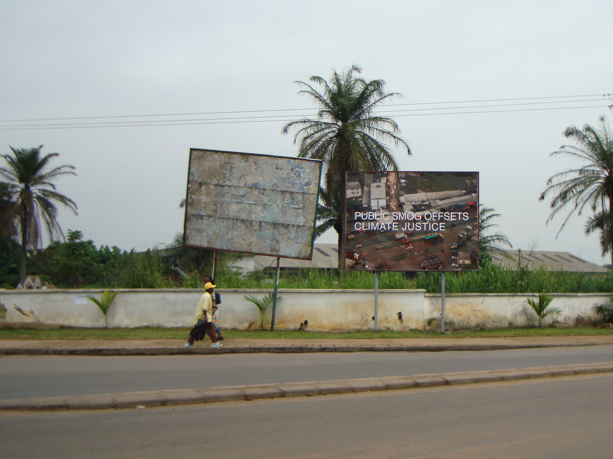

---

### Air Conditions

There is not much that could not be represented in and as data. Things and processes, locations and addresses, the earth and its elements, and indeed, as emphasised in this article, air too can become quantified and then patterned as data that feeds as part of operations of governance. This begs the question: how do you govern by way of air? This article focuses on the smart city from the perspective of air – and especially air pollution – arguing that besides one particular example of the justification of smart cities, air is also a theme that ties the smart city into an earlier industrial legacy which still persists and offers a complementary way to consider the technological city. {#para1}

It is already on the level of particles such as dust (Parikka, 2015: 83-107) that we encounter political dilemmas of inclusion and exclusion, exposure and security. Dust and air pollution in general are silent, violent aggressors that demonstrate the political urgency of the atmospheric condition: the age of modernity is one of bubbles and spheres, as Peter Sloterdijk (2011) argues referring to the constitution of subjectivity as an air conditioning operation. Modernity opens up as air conditioning and as airborne terror: of denying possibilities of breathing the air of the streets and the public spaces. Terror begins in and with the air (Sloterdijk, 2009). This claim connects political contexts of cleaning and dusting to the issues of chemical warfare. Such warfare is not merely an issue of the usual armed conflicts, but an increasingly naturalised part of security regimes that govern the urban sphere: an air of gas and clouds, of molecular combinations designed to turn the social breathing space into a space of suffocation (on tear gas, see Feigenbaum, 2017). This became evident in the past years of security politics of excessive tear gas use as a quasi-military form of urban sanification against social movements. Examples are plenty, including the infamous case of Turkey during and after the Gezi demonstrations in 2013, but also more recently, the use of tear gas against environmental protestors during #COP21 in Paris. The list could go on and includes a longer history of the normalisation of such techniques of the denial of air. The commons of the air is quickly turned into a commons of the unbreathable, although with the striking difference of gas masked police enjoying the personal sphere of breathing. The gas mask becomes a key symbol and operational item of the modern era of subjectivity (see also Soncul, 2015). [1] {#para2}

There is also a low level of slow violence (see Nixon, 2011) that is the background screen of industrial modernity. In other words, from the specific events of denied breath, we can move on to observe the wider sense in which bad quality of air is an issue that is itself a normalised and yet violent part of the conditions of living. We can name this a slower and more inconspicuous form of warfare that is expressed often in other sorts of vocabularies such as environmental problems, the Anthropocene, sustainability and/or pollution. The Anthropocene is a term that emerges in the scientific discussions of geological periodisation but has become a sort of a placeholder for the wider impact and effects of human-made climate change that moves across lands and seas, atmospheres and even space (space junk). Furthermore, the assumption of a generalised ‘human’ as the agent in this period has been challenged with calls for more geographically aware, gender-specific and politically aware analysis of the role of capitalist modes of production and consumption (see for example Haraway, 2015). The Anthropocene becomes a coordinate, and one recurring term in narrativising this condition and hopefully also facilitating an understanding of the links between the biological, the economic and the political spheres of interactions. It has also been proposed that there is a specific value to approaching it through the lenses of art and the wider context of aesthesis that accounts for the reality of the Anthropocene as ‘a sensorial phenomena: the experience of living in an increasingly diminished and toxic world’ (Davis and Turpin, 2015: 3). This experiential layer also expands to the wider sense in which it is being produced as a technological reality – a layer of planetary computation (Bratton, 2016) that works by way of sensors, data visualisation, satellites and more (Davis and Turpin, 2015: 3-4). {#para3}

Besides a chemical issue, air pollution is in many ways visual media you breathe. Photochemical smog that covers many global metropolitan areas consists of Nitrogen Oxide (NO), Nitrogen Dioxide (NO2), Ozone (O3) and Volatile organic compounds (RH). This is the elemental media condition across the aesthetic landscapes of contemporary industrial and post-industrial life. An urban screen, hovering above the cinematic megacities of Los Angeles, Istanbul, Beijing, Sao Paulo and many other places, is a residue of the transport cultures of automobiles as well as other sources of fossil fuel culture. It is also like a media archaeological chemical residue of the old in the contemporary. In cases like earlier 20th century Istanbul, it was coal that released a black cloth over the city that Orhan Pamuk described as a screen of *hüzün*, the feeling of melancholia: ‘On cold winter mornings, when the sun suddenly falls on the Bosphorus and the faint vapour begins to rise from the surface, the hüzün is so dense you can almost touch it, almost see it spread like a film over its people and its landscapes’ (Pamuk, 2011: 122). It was less poetically serialised in the various images of masks of London inhabitants that one finds in archives. They picture the modern London before the 1956 Clean Air Act gradually started to address the issue that was most violently summarised in the infamous ‘Big Smog’ of December 1952. {#para4}

Smog has of course not disappeared. Nowadays, smog is more likely to follow from the extensive private car traffic that characterises this city and so many like it at least in terms of their chemistry. It presents itself in slightly alternative visual ways and in different forms, but it is something that also can be addressed through questions such as: what are the conditions of visibility of air pollution? What are the conditions of chemical composition and the political-economic distribution of smog? Smog is then, besides a reference to a specific form of air pollution, also a conceptual bridge between the industrial and the post-industrial computerised city, a bridge between the production of the molecular pollution and its registration as part of the digital city, the smart city sensors and data. [2] {#para5}

Questions concerning air quality converge into one crucial question in the debate concerning the modern and smart city. The question of air and pollution cuts and divides insides and outsides, breathable and polluted spaces in subtle, informationally observed ways. Technical definitions and questions of air also have a relation to smart cities as cities of measurability (sensors) and processing of data. The computational data points that allow ‘management of uncertainty’ through the constant monitoring, optimisation and ‘penetration of computational interventions’ (Halpern, 2014: 27) are part of emerging city plans. This ranges from idealised custom-built tech cities such as South Korea’s Songdo to Spanish Santander, which is the European Union’s well-funded test case for the massively sensored city (Newcombe, 2014). Besides the computational, there is also a seemingly more archaic form of media that comes through the toxic materials in the air. This latter point refers to a sort of a veil, a screen that hovers across the everyday in the megacities of the current climate. {#para6}

This article focuses on the urban environment as defined both by the emergence of the new forms of measurement of the city – and its airborne pollution – through smog sensors. I will also envelop this more straightforward assumption as part of a conceptual argument: what does it mean to look at smog as a medium itself, and to approach it as an index of the technological city that is haunted by the industrial veil. What conditions this ‘looking’ and even ‘seeing the city’ through eyes that are often data, and often statistical, such as art projects like *Seeing the Air* (Gates and Sampath, 2015)? I am interested in photochemical smog as a screen media of the city and pollution’s relation to smog sensors, and the creation of breathable zones. Many of the problems we identify as ‘environmental’, like air pollution, are already discussed and operated as data (both analytic data and as financial data, traded in the offset markets). Hence I choose to discuss the two in parallel: the environmental as part of a media ecology of observing, measuring and processing of data. To follow John Durham Peters (2015), to consider the environment and its elements as media must also lead into questions as to how the media technological framing of elements leads recursively into an alternative view to nature through those technological frameworks. Air is one crucial media environment in which sensation happens, but air is not the same in technological culture, let alone in the remote-sensed data city-cum-lab, as it is in a purely scientific, chemical definition. Air has its own life, and its own history, and in some parts this history becomes part of media and art history, as articulated below. {#para7}

The text addresses the question in the three following sections. Following this introduction, I want to discuss the smart, modern city defined by its unwanted elements, in this case pollution and waste. Issues of sensing and perceiving pollution become key parts of political subjectivity in the urban environment. Two kinds of sensing perception are then discussed. In the second section, this starts with a more conceptual, and even aesthetic, discussion in relation to smog as visual media or environmental art. In the last section, issues of smog sensing, design and political citizenship are addressed. I draw widely on recent key theorisations and projects while myself offering a cross disciplinary discussion that can provide a conceptual lead which complements the earlier work as well as some current art projects (for example Susie Pratt’s art practice and Amy Balkin’s *Public Smog (2004-)*, which are both briefly discussed but also informative of the conceptual developments in this text). My addition to those analytic and artistic works is a theoretical consideration as to how to conceptualise the existence of the various overlapping milieus: the persisting pollution as legacy from CO2 heavy energy forms, transport and such; the data milieu in which air is being registered; and the forms of subjectivity which also register and sense the urban pollution. {#para8}

### The City and Its Residues

The media city refers to the infrastructural redesigning of urban environments both in terms of certain areas of clustering media industries into innovation hubs and parks and as the infrastructural implementation of systems that offer new data-enhanced services, information and interfaces to urban life. This latter is part of the idea of smart cities that promise optimised ways of addressing intensive urbanisation. It is interesting, however, to observe the disconnect between the custom-built shop window smartness of places like Songdo in South Korea and Masdar in Abu Dhabi (UAE) as the example cities of a green sustainability supported by corporate funds (including Consensus Business Group, [Credit Suisse](httpss://en.wikipedia.org/wiki/Credit_Suisse) and [Siemens Venture Capital](httpss://en.wikipedia.org/wiki/Siemens)) and the real existing cities where solutions of ‘smartness’ relate to the layered histories of the place. As smart city writers such as Anthony Townsend underline, ‘the vast amount of people living in cities don’t live in cities like that right now’ (in Mathis, 2014). Urban issues are actually of a different scale and don’t seem at first to touch the narrow smart city focus at all: ‘It took 10 years [to build Songdo and Masdar](https://www.citylab.com/technology/2013/09/how-are-those-cities-future-coming-along/6855/), which each house maybe 100,000 people, and in the same period, we’ve added hundreds of millions of people to the next big cities of the global south’ (Townsend in Mathis, 2014). In other words, we are rarely ‘starting from scratch’ (*The Economist*, 2013). {#para9}

Actual population growth, environmental questions and climate change, difficult ecosystems of cities and their surroundings, and for example supply of food and fresh water, are the issues for future of cities (see Sterling, 2013) as much as current planning. Hence, as Halpern and Günel (2017) demonstrate, the current smart city plans including Songdo but especially Masdar City in Abu Dhabi are implicitly enveloped in a narrative of emerging environmental catastrophe. What the authors describe as the tie in between ‘speculation on disaster’ and the ‘sentiments of hope and optimism’ becomes a way to frame the symbolic function of smart cities and also their design plans. The science-fictional style of the plans works to enhance the realization that ‘Masdar City is promoted as a utopian living arrangement that acknowledges and resolves the current energy crises of the world, while mitigating climate change’ (Halpern and Günel, 2017). In other words, the emerging global climate crisis is what prescribes a sort of a flipside of what is meant as utopian narrative of future cities: instead, it produces suspicions of dystopian gated enclaves that become resilient against the environmental and social issues that define current metropolitan landscapes. In the case of Masdar, the plans have a specific relation to imagining a post-oil Middle East luxury lifestyle, but more widely they point to issues of thinking climate change as incorporated in technological infrastructures. What’s noteworthy is that some of these, like Masdar, are already discussed as ‘failed experiments’ (Herzog, 2016) in their own right. {#para10}

Such analyses of smart cities acknowledge how current urban development works in the context of global problems as well as historical contexts. These critical insights also take into account the specific dynamic temporalities that define cities here and now. They recall the fact that media (as technologies and techniques that enable perception, sensation, habit) are built on top of existing infrastructures from the organic to technical media (see Mattern, 2015; Mattern 2016; see also Bratton, 2016). Cities present themselves through archaeological layers that can be excavated through various signs, systems, infrastructures and traces left behind. Many global cities also include an interface with an industrial legacy as well; this presents issues that include for example the residual of the overgrowth of cities, pollution and waste management. Different bin solutions present an amusing showcase of what smart cities could be as waste management. {#para11}

But such solutions always include much more in them than just the primary function of waste collection: the start-up behind the London smart bins suffered a blow after it was revealed that the pods actually track the MAC addresses of smart phones in the vicinity (Vincent, 2013). Indeed, waste is never just waste but an access point to a wider circulation of information and value creation, management of the wanteds and unwanteds of the city. Dominique Laporte (2000) in the *History of Shit* argues that the emergence of the modern infrastructural city is also a site for the production of modern subjectivity. The production of cleanliness became part of city planning as a way to install order; the emergence of bourgeois subjectivity of segregated spaces is partly visible in the measures taken to install sewage and other systems of waste. Furthermore, this was not merely an issue of closing off the unwanteds, but of designing certain ways in which this circulation can be managed productively. The city is where waste turns to gold by way of purification and privatisation of even the seemingly most unnecessary: {#para12}

> under the seal of divine power, the city – site of exchange from the earliest moments of generalized circulation – was similarly subject to purification. Whether belly or granary, the city is that place where merchandise accumulates and is consumed before being turned into gold. To purify the city, one must enrich it in a manner that makes way for the means of production. But shit cannot be converted into cash through mere elimination. Before its restitution in sublimated form, it must nourish the very cesspools of its production (Laporte, 2000: 26). {#para13}

Waste and also contemporary pollution present a convergence of environmental and political issues as part of the media ecology of the city. Ecology is here a broader term than the environment and refers to the various cultural, political, historical and media contexts in which issues of the environment are conditioned, measured, represented, discussed, and materially transformed into other spheres of interaction (see for example Andermatt Conley, 1997; Fuller, 2005). Besides the literal and proverbial excrement analysed by Laporte, I want to contextualise this discussion in air pollution, followed by the various contexts in which the ubiquitous city is localised and datafied with sensors. {#para14}

I want to propose a couple of detours and twists in the way in which we understand the city, its political citizenship and smog – the haze that is a companion of industrialisation and persists as the haze of the supposedly post-industrial: tiny particles that create an odd sort of a media city that is technological in more ways than the smart city discourse assumes. One is tempted to claim that this is how the city looks in the Anthropocene: defined both by its waste and pollution as remainders of the industrial legacy, fossil fuel age and insufficient waste solutions and by the data-intensive measures that aim to offer an understanding of this chemical reality of the Anthropocene and turn it into an excessive calculation, storing and financialisation of that data. It is registered in the various sensors, tracking, calculating, visualisations and statistics that are the quantified and then datafied basis of the city. The chemical reality and the data about it are interlocked. In other words, accounting for the layered infrastructures as well as historical legacies of the city reminds us of the old problems new technologies are supposed to solve: smog from industry, transport that is the existing legacy of the 20th century, and the old energy forms still firing up technological society, based on coal etc. This is the particle world of technological cities we inhale: the dirty dust and smaller molecular elements that ensure that air is never *just* air (Protevi, 2013: 46). The air also includes harmful chemicals that then mix with our insides, violating the basic line between the self and the non-self in a continuous mock example of the ‘democratic’ city: we all share the pollution. Of course, this is not entirely true, despite such writers as Ulrich Beck, who much earlier in the 1990s argued that ‘poverty is hierarchical, while *smog is democratic*‘ (Beck, 1995: 60), illuminating also how the distribution of bads is ‘democratic’. {#para15}

In Beck’s risk society vision, it is this inequality in the production of bads that is distributed across the urban social layers. Additionally, environmental hazards become a shared common just like air and land is meant to be (Cottle, 1998). And yet, through urban planning and the systematic production of the city that reproduces and reinforces ethnic, economic, and other divisions, issues of air pollution are not equally shared by all. This is a theme recognised in critical urbanism, for example in the discussion about politics of infrastructure cities have for a longer time been part of a production of inequality through infrastructural choices, such as water and sewage (Tonkiss, 2013: 148-149), and we can discuss similar issues in relation to the seemingly more ephemeral dystopia of the air, too. Any discussion of the environment(al) needs to be a discussion of the ecology of multiple ‘social, political, ethical and aesthetic dimensions’ (Braidotti, 2006: 123). Hence, more than environmental consciousness, the ecological analysis presented here accounts for the geographical and political distribution of waste, the situated nature of pollution, and the political economy of solutions offered as part of the management of the issue both in cities and globally. {#para16}

In places like Zhengzhou and many other Chinese cities, smog persistently consists of residues of fossil fuel burning and particulate matters such as PM2.5. Such a situation is not because of the lack of regulations, but the problems in enforcing them effectively. This issue is made evident in such material as the online documentary *Under the Dome* (2015) by Chai Jing, featuring the subject of Chinese air pollution and the disconnect between regulations, economic mandates and local levels of enforcement of standards. Furthermore, news pieces, images and stories about Chinese smog problems threaten to ignore the issues that are prevalent in a lot of European cities. London for example is among the cities that have failed to follow up on required limits for nitrogen dioxide (McGrath, 2014), underpinning the other side of the story: invisible air pollution does not as easily transform into a stream of media representations about smog cities. Not all air pollution is visible, a twist that should not be ignored in the discussion of this visual media that is another entry point to the sensor and data-registered ways in which we understand the chemical atmosphere of the technological city. Further emphasising the point about uneven distribution of visibilities as a matter of political geography of slow violence, Nixon (2011: 64-65) reminds us that the narrativisation of global environmental catastrophes also follows the logic where ‘some afflicted communities are afforded more visibility – and more access to remediation – than others through the mechanisms of globalization, environmental racism, and class discrimination’. {#para17}

From coal smog, diesel fuel burning and other sources, the archaic elements of the planet are enfolded even in the 21st century version of post-Fordist capitalism that is fuelled by the earth’s fossil political economy (see for example Szeman, 2007; Salminen and Vadén, 2015). The relevance of considering energy solutions as part of the wider technological infrastructures of smart cities reveals at this point more than just questions of smart monitoring: it is, instead, a bigger infrastructural issue of political economy that depends on certain environmentally disastrous energy forms. Indeed, as scholars are nowadays again noting, questions of technology are not restricted to the urban but are distributed across vast rural areas too (Starosielski, 2015). The question of perception and sensing the urban and its problems is one of the key issues that sustains the smart city as a technological assemblage: a smart city is a sensorial city, where perception is partly displaced onto the specific sensors and their analytical backend. But before going into issues of smog sensing, I want to propose an alternative, conceptual and artistic way of thinking about smog itself already related closely to media in and of the atmospheric. {#para18}

### Aesthetics of Smog

One step in conceptualising what pollution and smog are as a sensed reality that are experienced and yet not entirely reducible to human sensation is to offer the following suggestion: think of smog as a chemical screen, even, chemical screen media. The sun enlivens it with light, which is the most fundamental thing in visual culture. The screen is not a background but an environment that wraps you inside its toxic cloud. We register this sort of visual screen with our bodies with every breath but also with different sorts of sensors that have developed as an essential part of the observation of industrial culture. For us humans, ironically this sort of visual screen arts *irritates* the eye – molecular elements such a Peroxyacetyl nitrate and ozone don’t obey the visual distance that is necessary to form an image, but act directly as part of the visual system. It is within this experienced chemistry of the city and its toxins where the experience of its pollution starts. {#para19}

Imagine writing the history of media cities from this perspective that seems to borrow ideas from experimental aesthetics and art methods: The Anthropocene has become the commonplace name for radical environmental changes but it is in certain ways also a new art historical period that is measured in lung diseases and cancer rates. The environmental catastrophes produced as part of industrialisation – or what is nowadays often called the Anthropocene or Capitalocene (see Haraway, 2015) – are measures of this other register of visual and tactile history. For instance, the ozone depletion period since the 1970s visualises a concrete change in the conditions of light of the planet. {#para20}

For a sketch of an alternative ecological art history (on art and the Anthropocene, see Davis and Turpin, 2015), one could claim that ozone depletion relates to radical molecular art since the 1970s. The 1970s mark a visual art historical period caused by photodissociation of key chemical agents such as CFCs, freons, halons as well as solvents, propellants, etc. It is a weird period when one starts to consider it from this perspective: problems of refrigeration and the invention of products such as freon have their residual aftereffects in the upper atmosphere which, as historian John McNeill notes, have not really until now featured as an important role in human history. Usually things that concern us have happened in the lower spheres of the planet (McNeill, 2000: 52). History has been atmospherically biased towards things much closer to human headspace. But the modern historical period rather concretely consists of carbon dioxide, ozone and sulphur dioxide (McNeill, 2000: 52), too, and this is not a feature restricted to that one particular narrative-atmospheric space. The massive increase in CFC (chlorofluorocarbon) amounts has resulted in what could be called the ‘ultraviolet century’ (McNeill, 2000: 114). The effect of the ozone depletion as we have grown to know it, is the increase in penetration of UV-light/radiation through the stratosphere, resulting in a different light balance from the 1970s to approximately to the year 2070 (as the restoration of the ozone protection layer is a slow process). This form of art historical period is registered on the skin and the organisms of humans as increased cancer rates; in animals such as whales as similar epidermal reactions (Thomas, 2010); in plants and crops, etc. Smog itself is also visible in the increase in cardiovascular diseases, asthma and lung inflammations, asthma for example. {#para21}

Environmental histories of smog can also contribute to this alternative art history (see also Mirzoeff, 2014). This sort of art history is oddly connected to photochemical trails and their industrial transport roots: cars and their routes, part of the infrastructures of modernity. Besides industrial pollution, smog is a question of what is experienced and registered on the organic body but it is also in peculiar ways a technological question. It relates to both the technological production of the chemical world that defines contemporary culture and the specific political-aesthetic allocation of this as a material, sensed reality. This is a dividing and partitioning of spaces, breathability, and visuals of the city (see also Rancière, 2004). Who has to see and suffer from pollution is a question that should be put on the agenda of aesthetic theory, too. [3] This is a situation where visual politics, politics of breathing as well as politics of sensoring are negotiated. It is also the target of other sorts of campaigns that are perhaps in spirit close to Sloterdijk (2009, 2011) (defining questions of modern subjectivity are ones of breathing and air control/atmosphere), but executed by various alternative means. The very real problem of breathability becomes the site where the various forces of technological, economic, planning and design form the urban subject. {#para22}

Addressing similar themes by way of art methods, artist-scholar Susie Pratt (2014) mobilised a way of relating to smog as part of a case study of Hong Kong. Pratt engages with the human sensorial through the ‘taste of smog’: cultural practices of domesticating the urban problems of smog are made into a synaesthetic experience with a palette to match the air-born pollutants (Pratt, 2014). Smog imposes itself as a bodily experienced phenomenon, where its molecular status becomes also registered in and on the body. The lungs are open to the outside every minute of the day as an involuntary organ archive of the pollutant levels, registering the chemical century like lichen does in nature. The work of remote sensing, and smog-sensors is pre-empted by the fact that humans and non-human animals are constantly enfolded in such environments that open up as the new media of visual sense: embodied relations to air pollutants are perhaps not expressed so much in quantitative terms but in qualitative, affective and also in aesthetic expressions. This leads to an evaluation of the city in visual, tactile, and even gustatory senses, as Pratt demonstrates in the speculative but highly effective way of framing citizen sensing through art methods. {#para23}

The environmental is sedimented and folded on various levels in the city and in the atmosphere. The molecular chemistry that surrounds the cityscape is one that is not merely an object that stands apart from its background but a molecular reality that entangles with multiple scales. In some ways, we need to be aware of the already existing residual technology of air pollution and other industrial layers that define the backdrop for current monitoring and sensoring of the city. This is not merely an issue that relates to technologies of sensing, but to the wider sensorial, including that of the aesthetic distribution of how we perceive the atmosphere, for example, smog. Besides that, remote sensing technologies are a non-human registering of the molecular levels of what we perceive as mediated and audiovisual; the realisation of the air as an active ingredient in an everyday living space is a continuation of the climate conditioned condition of modernity. Fresh air can even be staged as a commodity, as the artist Lian Kegang did in his performance involving packed fresh mountain air selling for 5,250 yuan (Stampler, 2014). {#para24}

In a similar vein, a much earlier project by Amy Balkin staged the conceptual and atmospheric site of *Public Smog* (2004-). An art project that addressed emissions trade, the legal constitution of breathability, and engagement with the wider public in relation to various governmental and intergovernmental organisations, it functioned also to demonstrate the sites and non-sites where pollution *takes place* geographically and atmospherically. In Balkin’s words and the project description: ‘*Public Smog* is a park in the atmosphere that fluctuates in location and scale. The park is constructed through financial, legal, or political activities that open it for public use’. [4] The project attempted to buy emission offsets in order to be able to withdraw these from the financial trading market. As a way of buying back air, it created sites in the atmosphere that were public parks. Furthermore, the project attempted to reach out to UNESCO to register ‘Earth’s atmosphere, from sea level to the Kármán Line (100 kilometres above sea)’ (Balkin, 2015: 344) on the World Heritage List. *Public Smog* is about situations but ones that are in movement: the dynamic transactions on the market that deal with financial data concerning emissions and offsets, the atmospheric conditions, including wind, gas and aerosols, the legal bodies of global reach concerning heritage and preservation and more. [5] {#para25}

In peculiar ways, Balkin’s project was at the same time extremely grounded in issues of livability and yet reaching out to the various abstractions in which the sensorial dimensions of pollution are mediated. The project also extended to locations such as Douala, Cameroon, and was visible as large billboard installations that were spread across the city, described by Balkin: {#para26}

> A mix of rhetoric, boosterism, greenwashing, and political agitation, the slogans interweave dystopian narrative and political critique, setting the technocratic language of the Clean Development Mechanism (CDM) i.e. “Public Smog is CDM Gold Standard”, against “Public Smog Offsets Tomorrow Today” or “Public Smog is No Substitute for Direct Action”. (2016) {#para27}

Highlighted by such artistic methods, a focus on air pollution and smog, income, race and class differences can be further reproduced and enforced by way of breathability and air quality. Bodies are already sensorial registers, much before and in parallel to remote sensing in the ubiquitous city. Or, in short: some bodies are more exposed than others. Next, I will continue investigating the issue of the sensor in the computational, smart city and combining the two different, yet complementary approaches to what and where the sensorial happens. {#para28}

### The Sensored City

Technological residual is part of the political ecology in which sensoring, monitoring and the proclaimed smartness of the city has to be acknowledged. Part of the issue is that in many instances, contemporary air pollution is not visible to human eyes. Even if, as outlined above, the pollution registers itself on the body, not all current problems come down to the visible smog layers above cities such as Santiago, Istanbul, Sao Paulo or for example the infamous situations in many of the megacities of China, where smog descends on the streets in a much more imposing manner than in other metropolises. {#para29}

Air pollution has of course also spurred a wave of activism. This has led to a lot of citizen-led work with sensors as a way to capture back the right to monitor and report the invisible constitution of the environment. In many ways, this suggests an alternative way of approaching the smart city than that of the high-tech shop windows. Instead, the idea of the city as a demo (see Halpern and Günel, 2017, in this issue) is brought back onto a grassroots activity in such forms as Citizen Science at the Innovations Lab in Kosovo. [6] The polluted city is made accessible by way of a Lab that offers aesthetic, technological, and epistemological tools to interface with the issues that concern, for example, air quality. {#para30}

Such activism is taking place in varied situations and different political climates. Quite often the issue mentioned is about access to data as well as aesthetics (understood as the fundamental *aisthesis* of and in the world): both equate to visibility in the context of allocation of air quality. As articulated by one activist in Portland, Oregon (US): {#para31}

> ‘The problem with air pollution today in America is that most of it is no longer visible,’ said Peveto. ‘In the 1970s we were dealing with smog and envisioning L.A. and these basins of yellow smog. Today the insidious air pollution problem is largely invisible to the naked eye, so having the technology that can make the invisible visible through data and numbers is important to realizing change because we need awareness before we have change’ (Intelfreepress, 2013). {#para32}

A lot of sustainability and activist movements turn to data and the remote sensorial as ways to interface with the issues of pollution. What is interesting is the backstory about the corporate infrastructure supporting this grassroots investigation and analysis by way of providing low-cost sensors, tapping into the possibilities of data capture by way of activist work. Intel provided the hardware that is driving the distributed network of citizen remote sensoring that is described as light, cheap and open source. {#para33}

> The sensors weigh less than a pound and are built using an open-source Arduino microcontroller that is available on Amazon and at many electronics stores. The sensors measure carbon and nitrogen dioxide emissions, temperature and humidity, and can be upgraded to measure particulate matter, ozone conditions and volatile organic compounds. {#para34}
>
> In addition to the 17 in Northwest Portland, there are more than 200 other ‘egg’ sensors around the world now feeding real-time air quality data for anyone to see. Once a sensor is installed and registered [at the Air Quality Egg website](https://www.airqualityegg.com/), its live data can be seen online at [Xively](httpss://xively.com/), a public cloud service for the Internet of things (Intelfreepress, 2013). {#para35}

Issues of seeing are increasingly dealt with in terms of visibility of data even if the infrastructure of how data is being collected and with what effects is more interesting than merely visual perception. [7] For example, the visualisation project *Seeing the Air* engages with air quality data from selected cities including Boston, Bangalore, Rio de Janeiro and Shanghai and provides a variety of graphs that enable comparison over time, between cities and categories of the AQI (Air Quality Index). *Seeing the Air* makes pollution understandable through expected representations of sensor data. The API-driven way of presenting the invisible life of cities as data visualisation is however in danger of missing the question of what data is been seen, and where it connects, if anywhere at all. Is there any political efficacy that deals with the data produced? {#para36}

The sensored and monitored city is an interesting combination of two lineages. It might hark back to the cybernetic ideals of control through feedback that emerged gradually since the 1950s and had an effect also in the way that cities are thought about (Halpern, 2014). But the actual story of cities of the post World War II period has been rather different than the cleaned cybernetic face that now finds a new articulation in the smart city. From the cybernetic fantasies of the 1960s to the smartness of the urban architectures of the 1980s and the 1990s, there is similarity in terms of the persistant pollution levels in numerous urban locations, despite some shifts in energy sources towards ones that cause less smog and heavy particles. The city planning that increasingly takes into account the possibility of green planning through ‘smartness’ can however be contextualised as part of broader questions of ecology and visual politics (Gabrys, 2014). This has been recognized and even used as justification for smart plans, to quote Jennifer Gabrys, a key scholar of the cultural contexts of sensors and who is leading the significant European Research Council funded project ‘Citizen Sensing and Environmental Practice’: {#para37}

> While cities are centers of economic growth and innovation, they are also, as smart-city advocates argue, sites of considerable resource use and greenhouse gas emissions and are therefore seen to be important zones for implementing sustainability initiatives (Gabrys, 2014: 31). {#para38}

The sustainability initiatives themselves are at the core of the current corporate rhetorical justification of smartness. From current marketing campaigns by Microsoft and others, it is the goal of environmental sustainability that sustains the cloud as the solution for a wide range of systems and contexts, from cities to businesses – and cities as businesses. Of course, there is a direct angle to environmental pollution, too, but it is important to note how the issue of sensors articulates this in concrete locations, in global contexts and within urban areas. {#para39}

In several ways it is the existence of environmental problems that spurs the mobilisation of technological solutions such as massive level smog sensoring coupled with big data analysis. Here, the connections between remote sensing, smog sensing and environmental sensing are forming a crucial node in terms of producing the feedback-looped citizen/ smart environment. The smog disaster cities of, for example, China, produce massive amounts of data from sensors and other sorts of input for scientific research based on quantitative analysis of pollution levels together with the circuiting of smog sensors, social media data and big data analysis as to the geographic/location based distribution of the issues, which are taken as the synthetic chemical screen of the city itself. Big data and big sensors become ways to collect and process environmental data in ‘monitoring, which can better guide people’s behaviour and government strategy design for smog disaster mitigation’ (Chen et al., 2014: 510). People become functions of the data flows as both its sensors (through social media messages for example) and as its quantified subjects, while the issue of the political itself is rather left grey: monitoring does not necessarily mean any sort of a political follow-up. Interestingly, social activism is here supported by corporate hardware and issues of policy become more central than questioning politics of infrastructure. {#para40}

Many projects concerning coordinated data sets from sensors to social media messages become a way to mobilise computational solutions and infrastructures, too. These include Apache Hive-system based information warehouse solutions and real-time computation systems such as Storm (also Apache based and open system, offered by Hadoop), which demonstrates how chemical residues spur data. Management of the environment means also management of the data about the environment. Any environment includes also the data about itself, the wider media ecology. This refers to the informational ecology able to store, handle, query and process the data that also changes our understanding and relationship with the environment. It is on this level of the computational infrastructure where the old technological urban pollution such as smog from transport meets the new infrastructures that are built in relation to it: monitors, computational processes, data storage and more. {#para41}

Gabrys (2014) investigates some key smart city projects in terms of how they have mobilised notions of environmentality and the subject as part of the agenda of sustainability. In a way, one could see these projects as a direct address to the technological city as the polluted city, but with an added sense of the redistribution of power. It is a visual production of the city as per its statistical distribution of pollution levels in terms of graphs – and also in terms of apps that allow mapping of the city according to its pollution levels, adding another layer to the more chemical sense of smog as media. Monitoring is not necessarily only remote either – but literally mobilised by mobile researchers who track the existing infrastructural routes of the city. By moving along the existing channels of transport and communication such as ferries, subways, and pedestrian roots in cities like Hong Kong and Shenzen, this kind of research becomes a way to see how air quality varies: {#para42}

> Another innovative experiment in capturing highly localized air quality data was recently conducted in the cities of Hong Kong and Shenzhen. Instead of locating fixed monitoring stations around these cities, researchers at the MIT Senseable City Lab attached small sensors to their wrists and belts and then traveled along standard commute routes on ferries, subways, and on foot. The sensors gathered data for carbon monoxide, nitrogen dioxide, temperature, humidity, and noise and monitored PM 10, a measure of coarse inhalable particles. On their calves, the researchers strapped a GPS and camera to track spatial information. (Cooley, 2014) {#para43}

In other words, the air-borne pollution that defines the modern subject in relation to its breathing conditions, that is, air conditioning (Sloterdijk, 2011), triggers also questions of governance and subjectivity, of urban sites and movement in and across such locations. These are issues that also Gabrys focuses on. However, she is interested in how this can be read through Foucault’s vocabulary where ‘environmental technologies as spatial modes of governance might alter material-political distributions of power and possible modes of subjectification’ (2014: 32). Indeed, offering a contribution from the perspective of Science and Technology Studies (STS), this angle is less a question of individual subjects than the enfolding of the urban citizens as ‘sensing nodes – citizen sensors’ where issues of environmentality, sensors, mediated logistics and political subjectivity become knotted. {#para44}

As Gabrys (2014) outlines, the participatory citizen is nicely fitted in as part of the environmental management in a way that corresponds well with Michel Foucault’s (2007) analysis of territories and security: instead of controlling individuals, environmental management creates environmental conditions in which certain sorts of behaviour and end results are produced. Foucault’s outline of the genealogy of ‘case, risk, danger and crisis’ (Gabrys, 2014: 61) as particular terms that function in the context of security is in many ways pertinent to our interest. Foucault tracks the importance of these mechanisms through contagious diseases, and his analysis pays attention to the centrality of the (market) town as a territory of contagion. Furthermore, the focus on territorial and statistically-managed security is something, he observes, that is not being nullified or denied but addressed by way of containment; these are mechanisms of control and security. This approach could be a relevant way of understanding also air pollution linked to security issues that ‘involve the delimitation of phenomena within acceptable limits, rather than the imposition of a law that says no to them.’ (Gabrys, 2014: 66). In other words, the issue is less a straightforward process of getting rid of pollutants than finding frameworks in which they can be observed, contained, and at least acknowledged to be set within certain limits defined by the massive amount of data and consideration by different institutions, health bodies, etc. In this way, data plays a part in this security operation. {#para45}

This data-security arrangement leads to the production of a sustainability of the city that circuits the city dweller as part of a bigger, often corporate network of computational events that still does not automatically enable a wider sort of participation in the bigger logic of fundamental political questions. The infrastructures of sustainability are at the moment being touted and built by the major corporations involved in cloud and smart city projects. The computational platforms are at the same time the connection to the corporate platforms of the likes of Google, already piloting and prepared for reception of data through interoperability with Hadoop systems. The Google cloud platform has the processing capacity suited for smog and air pollution data. The environmental and chemical issues become big data: ‘Networked sensor technology is in the early stages of revolutionizing business logistics, city planning, and consumer products’ (Google Cloud Platform Blog, 2013) – this is the testimonial one-liner that narrativises something which otherwise stays as data: Google becoming the software backend for the big data gathered from client devices observing the city. {#para46}

In terms of the political questions of this smart city, some of the issues relate to the designs and debates concerning citizen sensing. Here, the sensor is taken as the bottleneck where the major dilemma surrounding the control of data can be addressed on a collective activist level. From the perspective of big data this is more of a modest approach, but useful in activating the question of design, infrastructure, data, and the polluted urban environment. With a focus on the sensors, the issue becomes a stronger articulation of citizen-mapped location instead of mere talk of ubiquity. Much of this design discourse revolves around the value of empowerment and suggests shifting the focus of design from the product to the collective production of sensor placement that becomes a mode for tagging the city according to possibilities of gathering data. It is referred to in terms of ‘making things public’, in Latour and Weibel’s (2005) sense of the term stemming from their jointly curated exhibition. And it partly extends to participatory design where the city becomes reinvestigated through citizen activities. {#para47}

Gabrys opts for the term ‘ambividuals’ to situate subjectivity in the smart-sensored feedback city: citizen-subjects function as ‘ambient and malleable urban operators that are expressions of computer environments’ (2014: 42-43). This is a mode of subjectivity relevant to discussions of cognitive capitalism as a framing of communicative opportunities. But, argues Gabrys, it does not assume the ambividual to be an ‘expression of a cognitive subject’; instead it ‘does articulate the distribution of nodes of action within the smart city’ (Gabrys, 2014: 42-43). The cognitive becomes a distributed, infrastructural operation within the circuit. It feeds both towards the understanding of the subject and also towards the issues of how the city itself is framed as a milieu, an environment of multiple layers. What Gabrys’ (2016) work points out then is the circulation of sensor data as something that reframes not only the question of the city as programmable but also the relation of such programs to issues of citizenship. {#para48}

In a way, some projects in HCI design demonstrate that the fallacy of the ubiquitous relates to a fantasy of removed, corporate and indeed, homogeneously ubiquitous sensing and processing environment, whereas many of the more interesting projects remind us that this ubiquity is not evenly distributed but becomes an issue that needs further focus: some places are more intensively mapped as part of the ubiquitous than others, some places are more sensed than others (see for example Kuznetsov et al., 2011; DiSalvo et al. 2014). Design projects that, for example, mobilise sensor placement and citizen drones scale down the massive level of computational ubiquity to the question of where the data for the ubiquitous city come from – a point raised in a way by Bratton and Jeremijenko (2008) in another context debating information visualisation, the interface, and different sensor projects. {#para49}

The data transactions are part of a complex environmental, ecological and territorial operation of defining the secure limits and optimised feedback loops. It is in this milieu that the existing levels of, for example, air pollution are measured. But the data milieu is also conditioned by the historical levels of the layers of the city: its transportation system, infrastructures, the seemingly residual industrial that features as smog. The archaic persists. And it taps into the politically important activities of citizens, who often have to negotiate their work in relation to corporate hardware too, such as Intel-provided cheap sensors. In more philosophical terms, Gabrys (2012) notes that sensorial environments are less about remote sensing of things *out there*, but about capturing them as part of a shared circuit in which they become part of the experience and consideration of ‘us’; it is a sort of co-emergent tuning, to continue paraphrasing Gabrys’ words, that is not only about a constant processing of sensor data, but also a way of creating matters of concern. {#para50}

Turning the idea of remote sensing on its head, Gabrys is able to pinpoint a moment where instead of transporting data about the environment to us, such mechanisms function as ways of constituting subjectivity and circuiting us as part of the concerns raised by them. This is where the added layers of sensors, data and their computation are not merely an isolated event of registering. Instead the urban subjects also become functions of that further level of smart computational city infrastructure. This is not a revelation per se, but something that some test cases (such as Santander) and researchers recognise: a lot of the work of sensor data is focused on how ‘to improve the performance of key infrastructure, such as roads, rail, water systems and electrical grids’ (Newcombe, 2014). Or as Townsend puts it, explicating the situation where infrastructural optimisation becomes itself dependent on the sensitive-added layer of computationality: ‘You’re creating a structure that is inherently unstable and can only be controlled by a computer and software that can sense what’s going on’ (in Newcombe, 2014). {#para51}

But the political stakes are not necessarily merely about circulation of information. Instead, it involves a relation to designing infrastructures in which sensing and sensation become possible. Hence questions about sensing emerge as a way to negotiate the techno-bodies of sensation (Gabrys, 2012, referring to Rosi Braidotti) as multiple scales of mediated registering: the human-sensorially and remote-sensorially experienced pollution levels are one such sort of entangled mixed ecology of sensing and sensation. This point actually comes back to the conceptual development I offered in the previous section through art projects and the relations of the experiential body to the realities of pollution that are not always easily available to the human senses. Hence, Gabrys and Braidotti provide exciting ways to consider this extended understanding of sensors (the technological, the embodied) and the media realities of air pollution as data, as visual screens, as even as taste in Pratt’s work. {#para52}

Of course, this mix can be addressed through informational contexts too but sensors and remote sensing should be understood also in terms of their concrete locations as part of the habitual life patterns of urban dwellers. Sensor placement becomes a tool to hotspot places, to enact a sense of location and movement that engages with the trail of data production. It is at certain spots and in certain activities where ubiquitous cities are being produced. In a way, sensors prescribe certain spots as places of special interest and the placing of sensors then becomes a crucial question as to *where* the city is sensed, *where* it is mapped, and what is being seen as valuable of a tactical or strategic *location*. Barreneche (2012) demonstrates how geo-services produce a specific geographical ontology that is prescribed by way of the software and the corporate platforms through tagging, and the circuiting of user data and so forth. In similar ways we need to see how air and geography are linked through the sensorial, and what prescribes the chemical trails to be turned into visible data as part of the smart city. {#para53}

Many of these questions raise the issue of what sort of sustainability is being sought, and in what sort of political economic infrastructures. Could we address this by way of different conceptual and even imaginary, design fiction coordinates? Bruce Sterling’s (2013) short design fiction about the smart urban megalopolis circa 2050 draws a brief image of the multiple contexts in which the city already lives: the relation to political economic distribution of income and the architectural projects of the financial elite, population growth and the ageing population, a continuing depletion of resources, the changing climate that might have gotten rid of urban smog, but not the ‘reek’ that is the after-effect of the polluted zones of urban settlements. [8] {#para54}

Whether imaginaries or real infrastructures, in the context of sustainability we are indeed forced to ask some interesting questions. What are the methods, sites and also conceptual questions – whether design, art or politics – that are able to frame air pollution in the developing context of technological solutions to the city? What are the sites and situations where smog meets bodies meets sensors meets the revelation as to the modes of production of data about the environment? The smog that one can poetically say to be the true visual media arts of modernity – from coal smog (see Mirzoeff, 2014) to the light media of photochemical smog – is seen, tasted, and received in multiple ways that are supposedly ‘democratic’ but in actuality uneven. Amy Balkin’s *Public Smog* project is a demonstration of the complex ties between emission markets, the atmosphere as commons, the legalities of what and where the public is, and the questions of breathability as one about data, but it is also about *financial* data/transactions. Air has a location, and *polluted* air has a location whether or not that lends itself to immediate perception; it is part of urban life of global metropolises and yet also in different altitudes of the atmosphere; not always within the reach of human senses, even if locatable. Also air, the visualisation of air, and sensor operations as well as narratives about air (pollution) are part of the larger question about ‘discriminatory distribution of environmental visibility’, to use Rob Nixon’s (2011: 65) words. {#para55}

The issue of location is one central part of the debate and becomes emphasised when focusing on issues of sensation; what are the locations of air and pollution, and how do they become part of the way in which the city lends itself to human *and* technological senses? Moving down to earth from locations above human heads in the atmosphere, air pollution levels also fluctuate radically *within* cities (see Xie, 2014). These differences in locations and their air quality are part of the historical and political ways in which aesthetics is being allocated: the visuals, smells, chemicals and toxins of the city that do not fall evenly. This is the aspect of the *nomos* (Schmitt, 2006) that is not merely a cut in the division of the terrestrial or the aquatic, but also the air. [9] It is not only an ordering of ownerships but also the consequences of urban planning, industrial residue, and infrastructures from transport to the emerging smart cities that themselves are built on top of cities real and imagined, technological and polluted. {#para56}

### Biographical Note

Professor Jussi Parikka is a Finnish media theorist who works at the Winchester School of Art, University of Southampton. Parikka’s work has focused on media archaeology, network culture and contemporary media arts. His recent books include *A Geology of Media* (2015) and *Writing and Unwriting (Media) Art History: Erkki Kurenniemi in 2048* (2015, with Joasia Krysa).

### Notes

[1] Thank you to Yigit Soncul for his notes on this issue, based on his ongoing (PhD) research project on the mask and modern media ecology.

[2] An important context for this proposition is inspired by Jennifer Gabrys’ work, while also relating to my project *A Geology of Media* (Parikka, 2015), which outlines ways in which media theory participates in discussions of ecology and the environmental humanities. Thinking chemical and elemental issues in the context of media culture and media theory is also a way of continuing what John Durham Peters sets out to do in his *The Marvelous Clouds* (2015) by way of investigating how environmental elements can be considered media and how media technologies participate in how we have expanded our understanding of what the environment might encompass. ‘Media are civilizational ordering devices’ (Peters, 2015: 5), and in this sense, the ordering of our urban environment is an issue of both aesthetic and media consideration – how the environment of air organises our sense of the city, and how technological remote sensing participates in this ordering of the city for us, and sometimes in activist practices.

[3] This aesthetics of and in the city addresses not merely any local condition but issues of global politics. In Nicholas Mirzoeff’s (2014) recent take, it becomes entangled as part of the logic of global political movements such as Occupy, which demand a ‘right to look’ in an exchange without surplus value. For Mirzoeff (2014: 214), this right is ‘aesthetically a priori, philosophically foundational, and historically prior’ to a gathering of the common moment; but as I would want to argue, it also picks upon the environmentally produced democratic bads as its engine of political manifestation, for example environmental protests suppressed by denial of air (tear gas).

[4] Public Smog-project website, see [https://www.publicsmog.org/](https://www.publicsmog.org/)

[5] On the topic of the public in environmentalism debates and activism, see Luke (2005).

[6] See Citizen Science-project, [https://www.citizenscienceks.org](https://www.citizenscienceks.org)

[7] Benjamin Bratton (2016) in his key work on *The Stack* of contemporary geopolitics has already identified the city as one of six key layers in the on-going reorganising of the relations that include much more than just the earth. Discussing cities, Bratton reminds of political subjectivity becoming tied to infrastructural determinations that are much beyond the usual sphere of roads, buildings and plumbing. Indeed, Bratton notes that megaurbanism tells a story of the new interfaces that connect cities to other scales of the planetary systems; a connection through hardware and software stacks.

[8] Sterling (2013) writes: ‘There’s no urban smog, but the city reeks. This dense, greenhouse stink is composed of the rot from flood damage, the decay of dead lawn and parks, and bursting, sneezy clouds of weedy pollen from invasive species. At the seashores, the great, flood-stricken port cities of the past smell like dead fish and invasive brine. This fetid greenhouse fever doesn’t smell much worse than the urban smog that brought it into being. People are used to it.’

[9] Quoting Schmitt (2006: 49): ‘… because it is not inconsequential whether the industrialized and mechanized world that men have created with the help of technology has a terrestrial or maritime foundation. But today, it is conceivable that the air will envelop the sea and perhaps even the earth, and that men will transform their planet into a combination of produce warehouse and aircraft carrier. Then, new amity lines will be drawn, beyond which atomic and hydrogen bombs will fall.’

### References

- Andermatt Conley, Verena. *Ecopolitics. The Environment in Poststructuralist Thought* (London and New York: Routledge, 1997).

- Balkin, Amy. ‘Public Smog’ in Heather Davis and Etienne Turpin (eds.) *Art in the Anthropocene* (London: Open Humanities Press, 2015), 341-346.

- Balkin, Amy. Email to author, 21 January (2016).

- Barreneche, Carlos. ‘The Order of Places: Code, Ontology and Visibility in Locative Media’, *Computational Culture* 2, September (2012), [https://computationalculture.net/article/order_of_places](https://computationalculture.net/article/order_of_places)

- Beck, Ulrich. *Ecological Enlightenment* (New Jersey: Humanities Press, 1995).

- Braidotti, Rosi. *Transpositions. On Nomadic Ethics* (Cambridge: Polity, 2006).

- Bratton, Benjamin. *The Stack*. *On Software and Sovereignty* (Cambridge, MA: The MIT Press, 2016).

- Bratton, Benjamin and Jeremijenko, Natalie. ‘Suspicious Images, Latent Interfaces’, *Situated Technologies* *Pamphlets* 3 (New York: The Architectural League of New York, 2008).

- Chen, Jiaoyan et al. ‘Big Smog Meets Web Science: Smog Disaster Analysis Based on Social Media and Device Data on the Web’, *WWW Companion ’14* (2014), 505-510.

- Cooley, Doug. ‘Improved Sensor Technology Shares Real-Time Air Pollution Data’, *SmartCitiesCouncil*, 2 April (2014), [https://smartcitiescouncil.com/article/improved-sensor-technology-shares-real-time-air-pollution-data](https://smartcitiescouncil.com/article/improved-sensor-technology-shares-real-time-air-pollution-data)

- Cottle, Simon. ‘Ulrich Beck, Risk Society and the Media. A Catastrophic View?’ *European Journal of Communication* 13(1) (1998): 5-32.

- Davis, Heather and Turpin, Etienne (eds.) *Art in the Anthropocene. Encounters Among Aesthetics, Politics, Environments and Epistemologies* (London: Open Humanities Press, 2015).

- DiSalvo, Cark, Lodato, Thomas, Jenkins, Tom, Lukens, Jonathan and Kim, Tanyoung. ‘Making Public Things: How HCI Design Can Express Matters of Concern’, *CHI ’14 Proceedings of the SIGCHI Conference on Human Factors in Computing Systems* (2014): 2397-2406.

- Feigenbaum, Anna. *Tear Gas: 100 Years in the Making* (London and New York: Verso, 2017).

- Foucault, Michel. *Security, Territory, Population*. *[Lectures at the Collège de France](https://www.palgrave.com//series/michel-foucault:-lectures-at-the-coll%C3%A8ge-de-france/MF) 1977-1978*, edited by Arnold I. Davidson (Basingstoke and New York: Palgrave Macmillan, 2007).

- Fuller, Matthew. *Media Ecologies. Materialist Energies in Art and Technoculture* (Cambridge, MA: The MIT Press, 2005).

- Gabrys, Jennifer. ‘Sensing an Experimental Forest: Processing Environments and Distributing Relations’, *Computational Culture* 2, September (2012), [https://computationalculture.net/article/sensing-an-experimental-forest-processing-environments-and-distributing-relations](https://computationalculture.net/article/sensing-an-experimental-forest-processing-environments-and-distributing-relations).

- Gabrys, Jennifer. ‘Programming Environments: Environmentality and Citizen Sensing in the Smart City’, *Environment and Planning D: Society and Space* 32 (2014), 30-48.

- Gabrys, Jennifer. *Program Earth. Environmental Sensing Technology and the Making of a Computational Planet* (Minneapolis: University of Minnesota Press, 2016).

- Gates, Kevin and Sampath, Ramesh. ‘Seeing the Air’, *Visualisation Project Website* (2015), [https://www.seeingtheair.com](https://www.seeingtheair.com)

- Google Cloud Platform Blog, ‘https://googlecloudplatform.blogspot.de/2013/05/data-sensing-lab-at-google-io-2013.html[Data Sensing Lab at Google I/O 2013: Google Cloud Platform meets the Internet of Things’, *Google Cloud Platform Blog* (May 13, 2013), [https://googlecloudplatform.blogspot.de/2013/05/data-sensing-lab-at-google-io-2013.html](https://googlecloudplatform.blogspot.de/2013/05/data-sensing-lab-at-google-io-2013.html) ]

- Halpern, Orit. *Beautiful Data: A History of Vision and Reason since 1945* (Durham and London: Duke University Press, 2014).

- Halpern, Orit and Günel, Gökçe. ‘Demoing unto Death. Smart Cities, Environment, and “Preemptive Hope”’, *Fibreculture* 29 (2017), httpss://fibreculturejournal.org/.

- Haraway, Donna. ‘Anthropocene, Capitalocene, Chthulhocene. Donna Haraway in Conversation with Martha Kenney’ in Heather Davis and Etienne Turpin (eds.) *Art in the Anthropocene* (London: Open Humanities Press, 2015), 255-270.

- Herzog, Katie. ‘The World’s First Zero-Carbon City is a Big Failure’, *Grist*, 17 February (2016), [https://grist.org/climate-energy/the-worlds-first-zero-carbon-city-is-a-big-failure/](https://grist.org/climate-energy/the-worlds-first-zero-carbon-city-is-a-big-failure/).

- IntelFreePress. ‘Big Data Makes Invisible Air Pollution Visible’, *Intelfreepress*, 20 May (2013), [https://www.intelfreepress.com/news/big-data-makes-invisible-air-pollution-visible/5667/](https://www.intelfreepress.com/news/big-data-makes-invisible-air-pollution-visible/5667/)

- Kuznetsov, Stacey, Davis, George Noel, Cheung, Jian Chiu and Paulos, Eric. ‘Ceci N’est Pas Une Pipe Bombe: Authoring Urban Landscapes with Air Quality Sensors’, *CHI ’11 Proceedings of the SIGCHI Conference on Human Factors in Computing Systems* (2011), 2375-2384.

- Laporte, Dominique. *The History of Shit*, trans. Nadia Benabid and Rodolphe el-Khoury, with an introduction by Rodolphe el-Khoury (Cambridge, MA: The MIT Press, 2000).

- Latour, Bruno and Weibel, Peter (eds.). *Making Things Public* (Cambridge, MA: The MIT Press, 2005).

- Luke, Timothy W. ‘The Death of Environmentalism or the Advent of Public Ecology?’, *Organization & Environment* 18 (4) (December 2005), 489-494

- Mattern, Shannon. *Deep Mapping the Media City* *(Forerunners: Ideas First)* (Minneapolis: University of Minnesota Press, 2015).

- Mattern, Shannon. ‘Of Mud, Media, and the Metropolis: Aggregating Histories of Writing and Urbanization’, *Cultural Politics* Volume 12, Number 3 (2016): 310-331

- McGrath, Matt. ‘EU Commission Launches Legal Action over UK Air Quality’, *BBC News*, 20 February (2014), [https://www.bbc.com/news/science-environment-26257703](https://www.bbc.com/news/science-environment-26257703)

- Mathis, Sommer. ‘The Rise and Fall and the Eventual Rise Again of the “Smart City”. A conversation with *Smart Cities* author Anthony Townsend’, *CityLab*, 13 January (2014), [https://www.citylab.com/tech/2014/01/rise-and-fall-and-eventual-rise-again-smart-city/8081/](https://www.citylab.com/tech/2014/01/rise-and-fall-and-eventual-rise-again-smart-city/8081/)

- McNeill, John. Som*ething New Under the Sun. An Environmental History of the Twentieth Century* (London: Penguin, 2000).

- Mirzoeff, Nicholas. ‘Visualizing the Anthropocene’, *Public Culture* 26 (2) (2014), 213-232.

- Newcombe, Todd. ‘Santander: The Smartest Smart City’, *Governing*, May (2014), [https://www.governing.com/topics/urban/gov-santander-spain-smart-city.html](https://www.governing.com/topics/urban/gov-santander-spain-smart-city.html)

- Nixon. Rob. *Slow Violence and the Environmentalism of the Poor* (Cambridge, MA: Harvard University Press, 2011).

- Pamuk, Orhan. *Istanbul. Memories of a City* (London: Faber and Faber, 2011).

- Parikka, Jussi. *A Geology of Media* (Minneapolis: University of Minnesota Press, 2015).

- Peters, John Durham. *The Marvelous Clouds. Toward a Philosophy of Elemental Media* (Chicago: Chicago University Press, 2015).

- Pratt, Susie. ‘Tasting Smog: Articulations of Becoming Affected’, *A workshop presentation at the Deleuze and the New Humanities-conference*, 12 June (2014, Hong Kong).

- Protevi, John. *Life, War, Earth. Deleuze and the Sciences* (Minneapolis: University of Minnesota Press, 2013).

- Rancière, Jacques. *The Politics of Aesthetics*, trans. Gabriel Rockhill (London: Continuum, 2004).

- Salminen, Antti and Vadén, Tere. *Energy and Experience: An Essay in Naftology* (Chicago and Alberta: M-C-M, 2015).

- Schmitt, Carl. *The Nomos of the Earth* (New York: Telos Press 2006).

- Sloterdijk, Peter. *Terror from the Air*, trans. Amy Patton and Steve Corcoran (Los Angeles: Semiotext(e), 2009).

- Sloterdijk, Peter. *Bubbles. Spheres Volume I: Microspherology*, trans. Wieland Hoban (Los Angeles: Semiotext(e), 2011).

- Soncul, Yigit. ‘Containing the Mask, Governing the Emergency: The Case of Turkey’,

- *Theory, Culture & Society* 32.7-8 (2015), 285-291.

- Stampler, Laura. ‘Fresh Air Sells for $860 a Jar in China’, *Time*, 10 April (2014), [https://time.com/57372/fresh-air-sells-for-860-a-jar-in-china/](https://time.com/57372/fresh-air-sells-for-860-a-jar-in-china/)

- Starosielski, Nicole. *The Undersea Network* (Durham: Duke University Press, 2015).

- Sterling, Bruce. ‘Bruce Sterling’s Vision of the Future City’, *BBC*, 8 May (2013), [https://www.bbc.com/future/story/20130507-bruce-sterling-2050-city-vision](https://www.bbc.com/future/story/20130507-bruce-sterling-2050-city-vision)

- Szeman, Imre. ‘System Failure: Oil, Futurity, and the Anticipation of Disaster’, *South Atlantic Quarterly* 106.4 (2007), 805-823.

- *The Economist*. ‘Starting from Scratch’, *The Economist*, 7 September (2013), [https://www.economist.com/news/briefing/21585003-building-city-future-costly-and-hard-starting-scratch](https://www.economist.com/news/briefing/21585003-building-city-future-costly-and-hard-starting-scratch)

- Thomas, Abbie. ‘Whales Showing More Sun Damage’, *ABC Science*, 10 November (2010), [https://www.abc.net.au/science/articles/2010/11/10/3062051.htm](https://www.abc.net.au/science/articles/2010/11/10/3062051.htm)

- Tonkiss, Fran. *Cities by Design. The Social Life of Urban Form* (Cambridge: Polity, 2013).

- Vincent, James. ‘(Updated) London Bins are Tracking Your Smart Phone’, *The Independent*, 9 August (2013), [https://www.independent.co.uk/life-style/gadgets-and-tech/news/updated-londons-bins-are-tracking-your-smartphone-8754924.html](https://www.independent.co.uk/life-style/gadgets-and-tech/news/updated-londons-bins-are-tracking-your-smartphone-8754924.html)

- Xie, Jenny. ‘Tracking Exactly How Much Air Pollution You’re Exposed to’, *CityLab*, 5 March (2014), [https://www.citylab.com/tech/2014/03/tracking-how-much-air-pollution-youre-exposed-step-step/8525/](https://www.citylab.com/tech/2014/03/tracking-how-much-air-pollution-youre-exposed-step-step/8525/)
