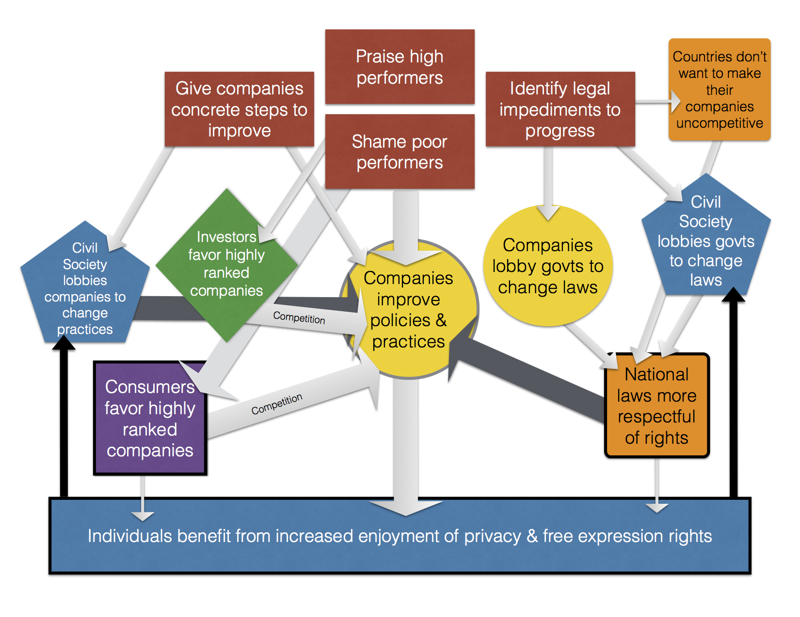

> The Ranking Digital Rights project is creating a system to evaluate the world’s Internet and mobile companies on policies and practices related to free expression and privacy in the context of international human rights law. In this article, project researcher, Nathalie Maréchal, talks about the ideas and events that have informed the project and the challenges and opportunities involved in taking it forward. {#para2}

The techno-utopianism of the early 2000s has given way to new discourses warning about the threats that the Internet poses to democracy and human rights ([Deibert, 2013](https://blackcodebook.com); [MacKinnon, 2012](https://consentofthenetworked.com); [Morozov, 2011)](https://books.google.com.au/books/about/The_Net_Delusion.html). These discourses are now being shaped by Edward Snowden’s revelations about the United States government’s mass surveillance programs which have brought privacy issues to the fore, and by the subsequent proliferation of news reports about Internet safety and security which have reinforced that this is a serious issue that is not going away. Notwithstanding the United States government’s protestations to the contrary, a [recent report](https://www.ohchr.org/EN/HRBodies/HRC/RegularSessions/Session27/Documents/A.HRC.27.37_en.pdf) led the United Nations High Commissioner, Navi Pillay (2014), to conclude that mass surveillance—as opposed to targeted surveillance—[‘amounts to a systematic interference with the right to respect for the privacy of communications.](https://www.ohchr.org/EN/NewsEvents/Pages/DisplayNews.aspx?NewsID=14875&LangID=E)’ {#para3}

The rights to information, privacy and to free expression are among the fundamental rights included in the Universal Declaration of Human Rights. As human activity is increasingly mediated by the Internet, these rights are becoming prerequisites for enjoying all the other rights. Without access to information, how can citizens find out about problems in their communities? Without freedom of expression, how can they express their desire for change or debate the issues of the day? And without privacy, how can they strategise and coordinate advocacy efforts without being stymied by government or corporate actors? {#para4}

In the United States where I live, work, and study, I have the ability to access information about violations of human rights, to express my views about them and to coordinate my research and advocacy efforts with colleagues around the globe. But this is far from a universal experience. In Thailand, [lèse-majesté laws are so strict](https://www.bbc.com/news/world-asia-29628191) that anyone who publicly criticises the king or royal family risks a prison sentence. In China, [the state’s control over information is such that Mainland Chinese media was initially devoid of any mention of the pro-democracy protests in Hong Kong](https://www.nytimes.com/2014/10/01/world/asia/chinese-web-censors-struggle-with-hong-kong-protest.html). ([They eventually covered the movement from a very negative slant](https://www.ibtimes.com/chinese-media-floods-mainland-news-anti-occupy-hong-kong-coverage-1704080)). The Hungarian government [proposed a per-gigabyte tax on Internet downloads in 2014](https://www.bbc.com/news/world-europe-29846285), which would have made many forms of online communication prohibitively expensive. There are also signs that many liberal democracies are trending toward increased communication control and repression, as the Snowden revelations illustrate. [Canada’s new Anti-Terrorism Act](https://openparliament.ca/bills/41-2/C-51/), Spain’s [Ley Mordaza](https://openparliament.ca/bills/41-2/C-51/) and [France’s efforts to regulate online speech after the Charlie Hebdo](https://www.newsweek.com/freedom-speech-facing-major-threat-france-305853) terrorist attacks provide three worrying examples of the decline of civil liberties in the West. {#para5}

The case of LGBT rights in Russia exemplifies the centrality of free expression and privacy for rights activism. Since 2013 it has been illegal to promote “non-traditional sexual relations” to minors, resulting in a *de facto* criminalisation of LGBT rights advocacy. This, combined with stringent Internet laws and Putin’s ‘[information security doctrine](https://archive.mid.ru//bdomp/ns-osndoc.nsf/1e5f0de28fe77fdcc32575d900298676/2deaa9ee15ddd24bc32575d9002c442b),’—which situates the control of information as a national security interest—has contributed to an increase in discrimination and assaults against LGBT Russians. [Impunity prevails](https://www.hrw.org/news/2014/12/15/russia-impunity-anti-lgbt-violence) since hate crimes do not get reported, much less explicitly tagged as such. The Mayor of Sochi’s infamous claim in the run-up to the 2014 Olympics, that ‘there are no gays in Sochi,’ was illustrative of the enforced obscurity endured by LGBT Russians. When [the gay community’s existence is denied](https://nationalave.com/hodgepodge/peterkrivicich/there-are-no-gays-in-russia-and-this-wont-affect-the-olympics-anyway/337/), the idea of gay rights becomes inconceivable. Even among the minority who support LGBT rights, the climate of intimidation and fear has produced a chilling effect where would-be activists refrain from actions that might lead to reprisals, even when their activities may not be deemed illegal. {#para6}

These, and other state-led assaults on privacy and freedom of expression, are documented in numerous rankings and reports published by the non-profit sector, including groups like Freedom House, [Reporters without Borders](https://en.rsf.org/world-press-freedom-index-2015-12-02-2015,47573.html), and others. But these reports usually neglect to examine the impact or role for Internet intermediaries like ISPs, mobile phone operators, social networking sites, and manufacturers of devices and networking equipment in carrying out—or preventing—oppressive policies. In the early 2000s, United States Internet giants Microsoft, Google and Yahoo! [were harshly criticised](https://www.eff.org/deeplinks/2008/10/global-network-initiative)—and rightly so—for cooperating with requests from the Chinese government to hand over user data, which resulted in at least two human rights defenders spending years in prison. In the wake of these events and ongoing criticism, the three companies formed the [Global Network Initiative (GNI)](https://www.globalnetworkinitiative.org) in 2008 as a multi-stakeholder forum for dialogue with technologists, activists and other experts on best practices for balancing their business interests with human rights concerns in widely disparate social and legal contexts. {#para7}

The GNI now includes six member companies, including Facebook, that hold one another accountable for respecting privacy rights and freedom of expression wherever they operate. While human rights have traditionally been considered the exclusive responsibility of the State, the human rights movement has gained traction by working with, rather than against, the private sector, and by making the business case that rights-respecting practices produce a better rate of return on investment. Various industries (such as diamond extraction and manufacturing) have joined with academics and nonprofit organisations to form multi-stakeholder agreements or structures (for example the [Kimberley Process](https://www.kimberleyprocess.com) to address diamond mining and conflict or the [Fair Labor Association](https://www.fairlabor.org) in the case of supporting worker rights) that promote adherence to international laws and norms. These groups do so through a variety of mechanisms, including certified audits and providing a confidential forum for companies to seek and receive advice on how to improve their operations’ respect for human rights. {#para8}

However, initiatives of this type (including the GNI) only have influence over their member companies, who are already committed in principle to respecting human rights. Rebecca MacKinnon, who helped start the GNI, started the [Ranking Digital Rights (RDR)](https://www.kimberleyprocess.com) project as a way to hold the world’s ICT companies accountable for respecting privacy and free expression, regardless of GNI membership. Though very different in methodology, the GNI and RDR are both based on the [UN Guiding Principles on Business and Human Rights](https://www.ohchr.org/Documents/Publications/GuidingPrinciplesBusinessHR_EN.pdf). These Guiding Principles, approved in 2011 after decades of fits and starts, represent a departure from 20th century international human rights law in that they assert that private sector companies, and not just governments, have a responsibility to respect human rights. {#para9}

The Ranking Digital Rights (RDR) project is developing a system to publicly assess how well the world’s information and communication technology (ICT) companies are living up to this responsibility vis-à-vis privacy and free expression rights. The [process of drafting the ranking methodology](https://rankingdigitalrights.org/wp-content/uploads/2015/02/RDR-RD-Overview-Feb2015.pdf) has been deliberate and consultative, starting with a series of stakeholder consultations, [geographically-focused case studies](https://rankingdigitalrights.org/project-documents/phase-1-case-study-research/), two open-comment periods on the [methodology](https://rankingdigitalrights.org/project-documents/phase-1-pilot-methodology/) itself and a [pilot study] focusing on 12 companies representing a range of markets, sub-sectors and legal environments. {#para10}

The RDR indicators used to assess companies consider company commitments, policies and practices regarding human rights, freedom of expression and privacy. Each company’s score is based on publicly available information, which we hope will incentivise firms to become more transparent. (The full methodology is available on the [project website](https://rankingdigitalrights.org).) Sample questions we are using to develop indicators include: {#para11}

- • Does the company regularly conduct human rights impact assessments (HRIA) addressing how the company’s products and services affect the freedom of expression and privacy of its users?

- • Does the company provide evidence that it supports implementation by staff at all levels and throughout the company of its freedom of expression commitments?

- • Does the company publish data at regular intervals about government requests it receives to remove, filter, or restrict access to content, plus data about the extent to which the company complies with such requests, if permissible under law?

- • Does the company regularly conduct credible and independent security audits on its technologies and practices affecting user data?

In October 2014, we started a pilot study that examined and ranked 12 publicly traded ICT firms around the world, in preparation for the launch of a full annual ranking of several dozen of the world’s largest publicly traded Information and Communication Technology (ICT) companies in late 2015. A [public report summarising the pilot study](https://rankingdigitalrights.org/phase-1-pilot/) was released in March 2015, although the scores for the pilot companies were not published since at this stage the methodology was still considered experimental and required further revisions before being applied publicly. Starting in 2016, the ranking will include hardware and networking equipment manufacturers alongside Internet Service Providers (ISPs), telecom operators, social networking sites, and other Internet companies. {#para12}

So what good will this company ranking accomplish? The Ranking Digital Rights [theory of change](https://rankingdigitalrights.org/project-documents/theory-and-strategy/) is complex (see Figure 1); however, the goal is to get companies to compete against each other on privacy and free expression metrics by giving consumers and investors accurate, comparable information by which to judge ICT firms. The information will also be crucial to local activist efforts to engage with companies and governments to ameliorate laws, policies and practices that contravene privacy and free expression. The end game is to create a virtuous cycle whereby baseline privacy and the capacity to freely express opinions makes the full spectrum of human rights more accessible. {#para13}




The friction here, however, is between the early idea of the Internet as an alternative space free from the constraints of the physical world and the role played by ICT companies—as gatekeepers to the global public sphere—in implementing government-driven information controls. Ranking Digital Rights and related activist projects aim to highlight this friction by shining a spotlight on companies’ performances and by empowering consumers as well as investors to decide which companies to favour. {#para14}

There are also significant frictions between the worldviews of the rights advocacy and ICT sectors. Those within private sector companies may lack awareness of the impact of their products and services on the human rights of their users. Indeed, several company representatives we spoke to during 2013 were initially confused by the connection between their business operations and the concept of human rights. Similarly, a chasm remains between the mainstream [Corporate Social Responsibility](https://www.forbes.com/forbes/welcome/) (CSR) world and those who advocate for digital free expression and privacy. Participants in a workshop we held in 2012 noted that mainstream CSR human rights related initiatives focus on concerns commonly associated with sectors like manufacturing and extractives which has little in common with their own work. Conversely, many Internet privacy advocacy groups and initiatives are disconnected from mainstream CSR approaches and in some cases feel more comfortable casting stones from an adversarial stance rather than engaging with companies. In our consultations with representatives from the ICT sector, we found that once the connection between CSR, human rights, and the ICT sector was spelled out—and the term “human rights” was rephrased as “user rights”—our interlocutors became more receptive to the project’s goals. Part of the friction, at least, lay in the different semiotic worlds inhabited by the various stakeholders. {#para15}

Perhaps the most important source of friction though, stems from the perception that human rights, accountability and transparency are Western concepts that can be dismissed in the name of national sovereignty or cultural diversity. Despite this, a growing number of NGOs outside of North America and Western Europe now exist with the primary purpose of promoting information rights. Many of these groups have expressed interest in using data from the RDR project as an advocacy tool at both national and regional levels. Also, a number of groups in a range of countries are currently devising schemes to rank the ICT firms in their own countries against each other, according to metrics grounded in domestic laws and concerns. This is a welcome development in many respects: firstly, more companies will be scrutinised than under the Ranking Digital Rights scheme; secondly, companies will be ranked against their direct competitors; thirdly, local activists are the real experts on the concrete needs and issues in their own countries and on the best combination of tactics to influence local actors; and finally, the existence of grassroots initiatives undermines claims that the digital rights movement is a Western aberration. {#para16}

### **Biographical Note**

Nathalie Maréchal is a doctoral student in Communication at the University of Southern California Annenberg School for Communication and Journalism. She was the 2014 COMPASS Fellow at the New America Foundation, where she contributed to the Ranking Digital Rights Project.

### References

- Deibert, Ronald J. *Black code: Inside the battle for cyberspace* (Toronto: Signal, 2013).

- MacKinnon, Rebecca. *Consent of the Networked: The World-wide Struggle for Internet Freedom* (New York: Basic, 2012).

- Morozov, Evgeny. *The Net Delusion : How Not to Liberate the World* (London: Allen Lane, 2011).

- Navi Pillay. ‘Dangerous practice of digital mass surveillance must be subject to independent checks and balances’, website of the Office of the High Commissioner for Human Rights, (2014) https://www.ohchr.org/EN/NewsEvents/Pages/DisplayNews.aspx?NewsID=14875&LangID=E**
