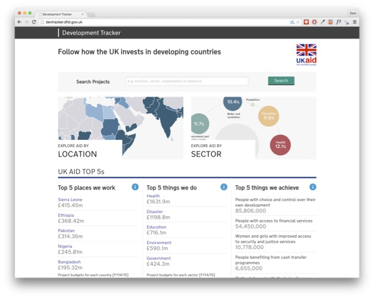

[10.15307/fcj.mesh.010.2015](https://dx.doi.org/10.15307/fcj.mesh.010.2015)




*In this article Zara Rahman, from the engine room, explores tensions between the activist motivations that are driving the use of technologies in Open Development and the rights and aspirations of vulnerable people and communities. She discusses how we might and why we must resist the push for new technologies to be adopted too quickly in pursuing an Open Development agenda.*
 {#para1}

This article will look at a few issues around the Open Development movement, which is a relatively new agenda within the field of international development. Open Development is centred on the idea that ‘openness’—in different forms—can improve the international development sector. {#para2}

Generally, there are a few broad themes that come up in most definitions of what Open Development includes: {#para3}

- • the availability and use of (open) data relating to development programs

- • participatory decision making and involvement from those affected by the program (a.k.a the “beneficiaries”)

- • innovative uses of technology to address development issues

As the Open Development movement is reasonably new, different actors are interpreting the term in different ways. Also, as noted by Smith and Elder (2010), it is important to remember, ‘openness is not one end of a binary dichotomy’ and to understand it as a spectrum or range. {#para4}

In this article I focus primarily on issues relating to open data, technology and accountability in the sector, because my experience lies in this realm; there are however, many other issues that could also be discussed to explore the complexities and frictions of open development as an ideology and a practice. {#para5}

To consider the frictions that are emerging, let’s start by thinking about the environment in which open development finds itself. By nature, international development projects involve some of the world’s most vulnerable people, some of whom are living in the most difficult situations imaginable. Many are living in poverty, lack access to vital services, or have their basic human rights violated on a regular basis. {#para6}

As such, the ethical and moral responsibilities for those working in the development sector are (or should be) even more demanding than in other sectors. The restricted agency of beneficiaries also means that the power balance within human rights, humanitarian and development projects are skewed towards the development practitioner. Reducing this power balance is difficult, if not impossible; being aware of it, however, is essential. {#para7}

In many ways, the open development movement is (or should be) as much about critiquing the effect of new technologies and methods upon the societies in which we work, as much as it is about designing and implementing them. However, in practice, the immediate benefits of these technologies—as well as wider environment we find ourselves in—where admitting failure is not looked kindly upon—is much more visible than the potential dangers or failures.
 {#para8}

### Open data: transparency and accountability for who?

**The advent of open data—data which falls under the Open Definition—has played a large part in establishing mechanisms intended to strengthen transparency and accountability. Increasingly, as part of their open development efforts, international development organisations, NGOs and funders are being encouraged to publish the data that they hold as open data, and many have signed up to do so through the [International Aid Transparency Initiative](https://www.aidtransparency.net). In theory institutions and governments making their data open can improve the sector, making it easier to reduce corruption, follow financial flows, organise resources better, and more generally level the ‘information playing field’. {#para9}

Although this data availability is a necessary step towards demanding accountability from powerful actors, it is not the only step. Especially within international development, many more steps are required to truly empower the actors involved to actually understand more about the world around them, and make use of the data that affects and relates to them. {#para10}

Different actors involved in international development projects have different information needs: from taxpayers in donor countries who want to know what their tax dollars are funding, to project managers who want to be able to track their project over a period of time, to the people who are actually affected by the project and want to know what is going on. {#para11}

One assumption that is often made is that simply publishing open data in international development is a tool of accountability for all; but this generalised framing of the target audience is counter-productive. Through my work on the Open Development Toolkit, I spent time looking at ways in which international development actors are making their data available and it become clear that those who try to please everyone, end up pleasing nobody. International development organisations that have developed online data portals aimed at ‘the general public’ have ended up with largely unusable tools. Not all of them are like this, though: the best example I have seen of a concretely useful tool is the UK’s DevTracker tool (see Figure 1), which tracks UK-funded international development projects abroad. In this case, the creators were very clear about their target audience: UK taxpayers. The tool helps this cohort to easily and clearly see where UK aid funds are going and on what, and are therefore able to better engage with where their tax money is going. {#para12}

 {#para13}

DevTracker’s efforts at identifying and meeting the needs of their target audience have been largely successful, but this is one example among many other less useful portals. These cases show that despite commendable efforts from open data advocates within international organisations, if the tool does not meet the needs of groups, the tool itself is, sadly, largely a waste of resources. {#para14}

It is also clear that online open data efforts are not sufficient if the information does not reach the people most affected by development projects. For example, the prerequisites to being able to access online open data include, but are not limited to: being able to read; Internet access; being technically literate enough to be able to find the data; being data literate enough to understand what the data might, or might not, be revealing; and, having the time and interest to actually go through the process of accessing and analysing the data. {#para15}

As you can imagine, very few of these conditions apply to many of the people who are affected by international development projects. This leads us to think about offline open data and the importance of information intermediaries, also known as ‘infomediaries’. [Offline open data can get data to people](https://lindaraftree.com/2012/07/16/taking-open-data-offline-and-back-again/) who don’t have access to the Internet, or any sort of device: examples include budget data being written up on chalkboards in town centres, or printing out maps and asking people with knowledge of the area in question to confirm the existence of landmarks released through open data initiatives, as [is happening in Chennai, India](https://www.transparentchennai.com/about/). Infomediaries, such as the ‘infoladies’—women who cycle around villages in Bangladesh with portable devices, offering access to the Internet—or data journalists who use [online data to tell compelling stories, which can reach ‘offline communities’ in Cambodia](https://onmedia.dw-akademie.com/english/), are both examples of how online open data can reach people who don’t meet the conditions outlined above. {#para16}

While online open data portals and tools are useful for those living in relative privilege to understand what their governments are doing, for open data to reach its full potential, projects such as these, which look first at how project beneficiaries already access information, and then use these established channels to communicate, are imperative. {#para17}

### Open sourcing the tools developed

**Technology has played a very significant role in the Open Development movement, and many organisations in the sector are embracing technological tools in their effort to enhance the sector. However, very few of these code-based tools are open source, despite many of them being publicly funded. My work in this field has led to a realisation that the reason behind this wasn’t—as we had first thought—purely due to a lack of awareness, but because of a lack of understanding regarding the value and culture of open source. {#para18}

One example can be seen in the tool mentioned above, DevTracker. While the code behind this tool is [open source](https://github.com/dfid), it has yet to actually be used by any other agency; from what I learned through speaking to various organisations, the idea of using that code is somehow understood as ‘copying’ someone else’s work. Organisations seem reluctant to use tools that have been developed by others, wanting instead to develop their own versions, resulting in tool duplication and wasted resources. {#para19}

Through this example we see that despite organisations in the sector having the good intentions of wanting to engage in Open Development, a lack of holistic understanding of the movement or a lack of coherency in terms of the values driving it means that the resulting impact is greatly reduced. Their ‘open’ intentions manifested themselves in wanting to share data online in a useable format, via a web based portal; however their traditional approaches to technology development led to a reluctance to contribute to open source projects started by others. Here, the desires of open data activists to have the data, seems somehow to have missed the more technical nuance of open sourcing the code.
 {#para20}

### Innovation versus ‘conservativeness’, and doing it responsibly

The new technologies we have in place—whether those used to publish open data or those used as part of open data programs themselves—are opening up new ethical issues for international development programmes. As part of the Responsible Data series, I joined a group of people in September 2015 to co-author a book on [“responsible data in international development”.](https://responsibledata.io/ways-to-practise-responsible-development-data/) {#para21}

While the forum the book emerged from examined many different issues, one broad trend emerged: the priority given to speed in engaging with new technology. Organisations who are jumping on the latest innovation are perceived to be displaying a progressive attitude, considered a desirable quality. Organisations who don’t do so, are considered to be old-fashioned and resistant to change. {#para22}

Within this perspective, the value proposition we are creating around the use of technology in development centres around the speed with which new technologies are being implemented; the faster, the better. But this ignores the need for some crucial first questions—is the technology ready for use in the real world? Is it appropriate in this context? Is this the best use of limited resources? {#para23}

A concrete example of this might be when decisions are made about development data that will be published as open data, and the data that will be kept internal within an organisation. This decision is largely put in the hands of the donor rather than with the local development organisations or actors who may be most affected by publishing the data. Taking the time to ask various stakeholders within the receiving NGO or institution whether publishing potentially sensitive data is suitable or not, takes time and resources—but it is wholly necessary to prevent any unintended harm being done. {#para24}

Taking time for self-examination, and investing more time and money into research, should not be considered a sign that an organisation is old-fashioned or unwilling to make the most of new technologies: it could in fact provide evidence that they are taking a more responsible and aware perspective towards new technologies and are willing to really invest in making sure that they are choosing the most appropriate systems. {#para25}

Unlike in many other communities so closely related to technology, such as the startup sector, where iteration and a fast turnaround are top priorities, in the realm of international development, implementing new approaches that have not been tested or deemed appropriate can have far-reaching and damaging effects on already vulnerable people and communities. This is true in relation to any development intervention, but given the remarkably new ground that the employment of technology in open development is treading, the field deserves particular attention and caution. {#para26}

### A case for thoughtful Open Development

There are a number of potential issues to be aware of within the Open Development movement. These include challenges regarding effective and useful publishing of open data—whether that be online, or offline, or the open source development of new tools—and the new responsibilities that aid organisations face with regards to innovation and new technologies in the sector. {#para27}

The Open Development movement is, as mentioned, relatively new, and it is highly likely that more ethical issues will come to the fore as the movement evolves in the future. However, if done correctly, it is clear that embracing a more open way of working within the sector has the potential to have a positive impact in many ways. Taking a critical view of open development, and open data, is by no means a rebuttal to the potentially life-changing and hugely positive effect that this could have on the lives of millions around the world; it is more an effort to make sure that these efforts and resources are carried out in the most effective and useful way possible, especially keeping the needs of those that we are trying to help at the forefront of our minds. {#para28}

### Biographical Note

Zara Rahman is Research Coordinator at the engine room, an NGO that work on supporting the use of technology in advocacy. Her research focuses on the intersection of international development, technology and accountability, and in September 2014, she co-authored a book on the responsible use of data in international development, which is available for [download here](https://responsibledata.io/ways-to-practise-responsible-development-data/). Zara is a Fellow at the Centre for Internet & Human Rights at European University Viadrina, and is based in Berlin, Germany.

### References

- Smith, Matthew and Laurent Elder. ‘Open ICT Ecosystems Transforming the Developing World’, *Information Technologies and International Development Journal* 6.1 (2010): 65–71.
